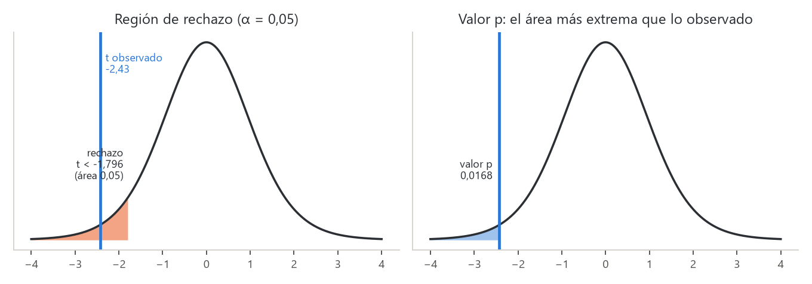
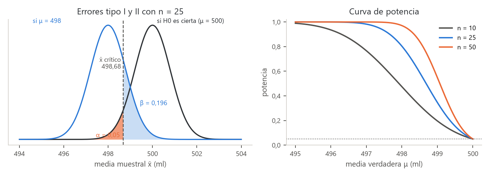
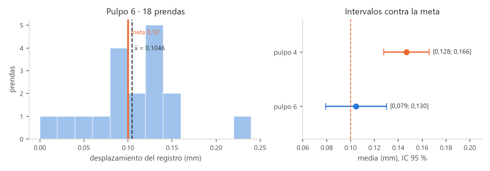

# Unidad 1 · Prueba de hipótesis: valor p, región de rechazo y errores

**Qué vas a poder hacer.** Traducir una pregunta del negocio a una hipótesis nula y una alternativa,
elegir la cola, calcular el estadístico y su valor p (o compararlo con la región de rechazo), decidir y
decirlo en el lenguaje del problema; estimar la probabilidad de equivocarte en cada dirección, calcular
la potencia y el tamaño de muestra de una prueba para una media, y leer la misma decisión en un
intervalo de confianza. Todo a mano y confirmado con `scipy`.

**Lo que necesitas antes.** De Probabilidades y Estadística: la distribución normal y la $t$ de
Student (leer sus tablas), el teorema central del límite y el intervalo de confianza para una media.
Es la primera unidad del ramo: no requiere otra.

**Tiempo.** Unas 6 horas: 2,5 de lectura con el ejemplo y el cuaderno, 3,5 de práctica.

---

## 1. La idea · suponer lo aburrido y ver si los datos lo desmienten

Una prueba de hipótesis es un argumento por contradicción con ruido. Se parte de una afirmación
aburrida (la máquina está bien, la campaña no cambió nada, los sacos pesan lo que dicen) y se
pregunta: **si eso fuera cierto, ¿qué tan raro sería ver datos como los que vi?** Si serían muy raros,
la afirmación aburrida pierde credibilidad y se descarta. Si no serían raros, se mantiene, no porque
esté probada sino porque los datos no alcanzan para descartarla.

Es el mismo razonamiento de un juicio: el acusado es inocente mientras la evidencia no supere una
duda razonable. «No culpable» no significa «inocente»: significa que no hubo prueba suficiente.

**Por qué importa.** En una planta todo varía. Si cada vez que una medición sale alta se ajusta la
máquina, se persigue ruido. La prueba de hipótesis da una regla, fijada antes de mirar los datos,
para separar una diferencia real de una que el azar produce solo.

---

## 2. Las piezas y los cinco pasos

| Pieza | Qué es | Ejemplo (sacos de 15 kg) |
|---|---|---|
| Parámetro | lo que se quiere saber de la población | $\mu$: peso medio de todos los sacos |
| $H_0$, hipótesis nula | el estado aburrido, con un signo igual | $\mu = 15$ kg |
| $H_1$, hipótesis alternativa | lo que se quiere mostrar con evidencia | $\mu < 15$ kg |
| Estadístico de prueba | número calculado con la muestra que mide la distancia a $H_0$ | $t = (\bar x - 15)/(s/\sqrt n)$ |
| Distribución bajo $H_0$ | cómo se reparte el estadístico **si $H_0$ es cierta** | $t$ con $n - 1$ grados de libertad |
| Nivel de significancia $\alpha$ | el riesgo de rechazar $H_0$ siendo cierta que se acepta correr | 0,05 |

En esta base cada prueba se escribe en **cinco pasos**, precedidos por los supuestos:

0. **Supuestos.** ¿Las observaciones son independientes? ¿La variable es normal, o la muestra es
   grande? ¿Hay datos extremos? Si un supuesto falla, el valor p no significa lo que dice.
1. **Pregunta en palabras.** «¿Los sacos vienen livianos?»
2. **Hipótesis.** $H_0$ y $H_1$ sobre el parámetro, con la cola elegida.
3. **Estadístico y su distribución bajo $H_0$.**
4. **Valor p o región de rechazo**, y la decisión con el $\alpha$ fijado antes.
5. **Conclusión en el lenguaje del problema.** No «se rechaza $H_0$» a secas, sino «hay evidencia de
   que los sacos pesan menos de 15 kg en promedio».

### Cómo elegir $H_1$ y la cola

- **Lo que se quiere demostrar va en $H_1$.** $H_0$ es lo que se mantiene si no hay evidencia. Quien
  carga con la prueba decide qué va en cada lado: si el cliente acusa al proveedor de entregar sacos
  livianos, la acusación ($\mu < 15$) es $H_1$.
- **Una cola** ($H_1: \mu < \mu_0$ o $H_1: \mu > \mu_0$) cuando solo una dirección importa o lleva a
  una acción. **Dos colas** ($H_1: \mu \ne \mu_0$) cuando cualquier desvío importa (un largo que no
  puede quedar ni corto ni largo).
- **La cola se elige antes de ver los datos.** Elegirla después, mirando hacia dónde salió la media,
  duplica en los hechos el riesgo de error tipo I.

Cuando $H_1$ es de una cola, $H_0$ puede escribirse como desigualdad ($\mu \ge 15$); la prueba se
hace en el borde ($\mu = 15$), que es el caso más difícil de rechazar.

---

## 3. Región de rechazo y valor p · dos caminos, la misma decisión

**Región de rechazo.** Se fija $\alpha$ y se buscan los valores del estadístico que, **si $H_0$ es
cierta**, aparecerían con probabilidad $\alpha$ o menos. Si el estadístico cae ahí, se rechaza
$H_0$.

| $H_1$ | Se rechaza $H_0$ si | Valor p |
|---|---|---|
| $\mu < \mu_0$ (cola izquierda) | $t \le -t_{1-\alpha,\,n-1}$ | $P(T \le t)$ |
| $\mu > \mu_0$ (cola derecha) | $t \ge t_{1-\alpha,\,n-1}$ | $P(T \ge t)$ |
| $\mu \ne \mu_0$ (dos colas) | $\lvert t\rvert \ge t_{1-\alpha/2,\,n-1}$ | $2\,P(T \ge \lvert t\rvert)$ |

(Con $\sigma$ conocida se cambia $t$ por $z$ y la $t$ de Student por la normal estándar.)

**Valor p.** Es la probabilidad, **calculada suponiendo $H_0$ cierta**, de obtener un estadístico
tan extremo o más que el observado, en la dirección de $H_1$. Mide qué tan sorprendentes son los
datos para $H_0$: un valor p chico dice «si $H_0$ fuera cierta, esto casi nunca pasaría».

**Por qué dan la misma decisión.** La región de rechazo tiene área $\alpha$. El valor p es el área
desde el estadístico hacia afuera. El estadístico cae dentro de la región exactamente cuando su área
hacia afuera es menor que la de la región: $p \le \alpha$ si y solo si el estadístico está en la región
de rechazo. El valor p trae más información: dice para qué $\alpha$ se rechazaría, y el lector puede
usar el suyo.



Lo que el valor p **no** es:

- No es la probabilidad de que $H_0$ sea cierta. Se calcula suponiéndola cierta.
- No es la probabilidad de que el resultado sea «por azar». Es la de ver algo así **si** solo hubiera
  azar.
- No mide el tamaño del efecto: con una muestra enorme, una diferencia irrelevante da $p$ minúsculo.

Una escala de lectura habitual: $p < 0{,}01$, evidencia fuerte contra $H_0$; entre 0,01 y 0,05,
evidencia moderada; entre 0,05 y 0,10, evidencia débil; sobre 0,10, los datos son compatibles con
$H_0$. Compatible no es probado: **sobre 0,10 no se «acepta» $H_0$; no se rechaza.**

---

## 4. Los dos errores, la potencia y el tamaño de muestra

| | $H_0$ es cierta | $H_0$ es falsa |
|---|---|---|
| **Se rechaza $H_0$** | error tipo I (probabilidad $\alpha$) | decisión correcta (potencia $1 - \beta$) |
| **No se rechaza $H_0$** | decisión correcta ($1 - \alpha$) | error tipo II (probabilidad $\beta$) |

- **Error tipo I:** una falsa alarma. Se detiene la línea, se reclama al proveedor o se lanza un
  producto «mejorado» que no lo era. Su probabilidad la fija quien diseña la prueba: es $\alpha$.
- **Error tipo II:** un problema que pasa sin verse. Su probabilidad $\beta$ no es una sola: depende
  de qué tan lejos de $H_0$ esté la verdad. Un desvío grande se detecta casi siempre; uno chico, casi
  nunca.
- **Potencia** $= 1 - \beta$: la probabilidad de detectar un desvío de un tamaño dado.

**Elegir $\alpha$ es elegir qué error temer más.** Bajar $\alpha$ (de 0,05 a 0,01) hace más difícil
rechazar: hay menos falsas alarmas y más problemas que pasan. Con $n$ fijo, $\alpha$ y $\beta$ se
mueven en sentido contrario. La única forma de bajar los dos es **más datos**. Si el error tipo II es
el caro (un medicamento mal dosificado que llega al paciente), conviene un $\alpha$ más alto o una
muestra más grande; si el caro es el tipo I (detener una planta sin motivo), un $\alpha$ más bajo.

### Potencia de la prueba $z$ de una cola

Para $H_1: \mu < \mu_0$ (o $\mu > \mu_0$), con $\sigma$ conocida, si la media verdadera está a una
distancia $\delta$ de $\mu_0$:

$$1 - \beta = \Phi\!\left(\frac{\lvert\delta\rvert}{\sigma/\sqrt n} - z_{1-\alpha}\right)$$

**La intuición.** La prueba rechaza cuando $\bar x$ queda a más de $z_{1-\alpha}$ errores estándar
de $\mu_0$. Si la verdad está a $\lvert\delta\rvert/(\sigma/\sqrt n)$ errores estándar, la pregunta
es qué parte de la campana centrada en la verdad pasa esa línea. Más $n$ angosta la campana; un
$\delta$ mayor la aleja; los dos suben la potencia.



### Tamaño de muestra

Despejando $n$ para una potencia $1 - \beta$ deseada:

$$n = \left(\frac{(z_{1-\alpha} + z_{1-\beta})\,\sigma}{\delta}\right)^2 \qquad \text{(una cola; con dos colas se usa } z_{1-\alpha/2}\text{)}$$

Se redondea **hacia arriba**. El $n$ crece con el cuadrado de $\sigma/\delta$: detectar un desvío la
mitad de grande cuesta cuatro veces más datos. Si $\sigma$ se estima con $s$, el cálculo con la $t$
(que hace `statsmodels`) pide unas pocas observaciones más.

---

## 5. Relación con el intervalo de confianza

Una prueba de dos colas con nivel $\alpha$ rechaza $H_0: \mu = \mu_0$ **exactamente cuando $\mu_0$
queda fuera del intervalo de confianza de nivel $1 - \alpha$**. Las dos herramientas usan la misma
cuenta: el intervalo junta todos los $\mu_0$ que la prueba no rechazaría.

$$\bar x \pm t_{1-\alpha/2,\,n-1}\,\frac{s}{\sqrt n}$$

Para una prueba de una cola el par es una **cota**: $H_1: \mu < \mu_0$ se rechaza cuando $\mu_0$ queda
sobre la cota superior $\bar x + t_{1-\alpha,\,n-1}\, s/\sqrt n$.

El intervalo dice más que la decisión: muestra **qué tan grande puede ser el efecto**. Dos estudios
pueden no rechazar $H_0$ y decir cosas muy distintas: uno con un intervalo angosto alrededor de
$\mu_0$ (no hay diferencia que importe) y otro con un intervalo ancho (no se sabe nada).

---

## 6. Las pruebas de esta unidad

| Caso | Estadístico | Distribución bajo $H_0$ | Cuándo |
|---|---|---|---|
| Media, $\sigma$ conocida | $z = \dfrac{\bar x - \mu_0}{\sigma/\sqrt n}$ | normal estándar | $\sigma$ viene de mucha historia estable; variable normal o $n$ grande |
| Media, $\sigma$ desconocida | $t = \dfrac{\bar x - \mu_0}{s/\sqrt n}$ | $t$ con $n - 1$ gl | lo habitual; variable aproximadamente normal |
| Proporción | $z = \dfrac{\hat p - p_0}{\sqrt{p_0(1-p_0)/n}}$ | normal estándar (aproximada) | $n p_0 \ge 10$ y $n(1 - p_0) \ge 10$ |

**Por qué la $t$ y no la $z$ con $s$.** Usar $s$ en vez de $\sigma$ agrega una segunda fuente de
azar: $s$ también varía de muestra en muestra. La $t$ de Student tiene colas más gruesas que la
normal para compensarlo; con $n$ grande las dos casi coinciden. Con $n$ chico, usar $z$ con $s$
produce falsas alarmas de más.

**Por qué $p_0$ y no $\hat p$ en la proporción.** El estadístico se calcula **suponiendo $H_0$
cierta**, y bajo $H_0$ la varianza de $\hat p$ es $p_0(1 - p_0)/n$. El intervalo de confianza, en
cambio, usa $\hat p$, porque no supone ningún $p_0$.

**Cuándo no aplican.**

- **Datos dependientes** (mediciones seguidas de una máquina que deriva, la misma persona contada
  dos veces): el error estándar sale demasiado chico y el valor p, falsamente pequeño.
- **$n$ chico y datos muy asimétricos o con un valor extremo:** la $t$ deja de ser válida. Se mira un
  histograma o un gráfico Q–Q y una prueba de normalidad como Shapiro–Wilk (unidad 5); si falla, se
  usa una prueba no paramétrica o más datos.
- **Proporción con $n p_0 < 10$:** la aproximación normal falla; se usa la binomial exacta
  (ejercicio 1.10).

---

## 7. Con Python

```python
from scipy import stats
from statsmodels.stats.proportion import proportions_ztest
from statsmodels.stats.power import TTestPower

stats.ttest_1samp(x, popmean=15, alternative="less")     # t de una media ("two-sided", "greater")
stats.shapiro(x)                                          # normalidad (H0: los datos son normales)
stats.t.interval(0.95, len(x) - 1, loc=x.mean(), scale=stats.sem(x))   # IC 95 %
proportions_ztest(34, 420, value=0.06, alternative="larger", prop_var=0.06)  # proporción con p0
stats.binomtest(7, 60, p=0.05, alternative="greater")     # proporción exacta
TTestPower().solve_power(effect_size=0.10 / s, alpha=0.05, power=0.90, alternative="larger")  # n con la t
```

`alternative` fija la cola; `"less"` y `"greater"` se refieren a $H_1$. `prop_var=p0` hace que el
error estándar use $p_0$, como la fórmula de la sección 6.

---

## 8. Ejemplo resuelto · ¿los sacos de pellets vienen livianos?

Una fábrica de pellets de madera de Los Ángeles vende sacos que dicen **15 kg**. Un distribuidor de
Temuco sospecha que vienen livianos y pesa 12 sacos tomados al azar de un despacho. Los datos quedan
en `datos/u01_pellets.csv` y el cuaderno `notebooks/u01_hipotesis.ipynb` reproduce todo.

| Saco | $x$ (kg) | $x - \bar x$ | $(x - \bar x)^2$ |
|---|---|---|---|
| 1 | 14,82 | -0,1117 | 0,012469 |
| 2 | 15,05 | 0,1183 | 0,014003 |
| 3 | 14,91 | -0,0217 | 0,000469 |
| 4 | 14,78 | -0,1517 | 0,023003 |
| 5 | 15,02 | 0,0883 | 0,007803 |
| 6 | 14,95 | 0,0183 | 0,000336 |
| 7 | 14,87 | -0,0617 | 0,003803 |
| 8 | 15,10 | 0,1683 | 0,028336 |
| 9 | 14,84 | -0,0917 | 0,008403 |
| 10 | 14,96 | 0,0283 | 0,000803 |
| 11 | 14,89 | -0,0417 | 0,001736 |
| 12 | 14,99 | 0,0583 | 0,003403 |

**Paso 0 · Supuestos.** Los sacos se tomaron al azar del despacho: se pueden tratar como
independientes. Con $n = 12$ la $t$ necesita una variable aproximadamente normal. Shapiro–Wilk da
$W = 0{,}983$ con $p = 0{,}993$: nada contra la normalidad, y la tabla no muestra valores extremos.

**Paso 1 · Pregunta.** ¿El peso medio de los sacos es menor que 15 kg?

**Paso 2 · Hipótesis.** El distribuidor acusa; la acusación va en $H_1$:

$$H_0: \mu = 15 \qquad H_1: \mu < 15 \qquad \alpha = 0{,}05$$

**Paso 3 · Estadístico.** $\sigma$ no se conoce: se usa $t$ con $n - 1 = 11$ gl.

$$\bar x = \frac{179{,}18}{12} = 14{,}9317 \qquad s = \sqrt{\frac{0{,}1046}{11}} = 0{,}0975 \qquad \frac{s}{\sqrt n} = \frac{0{,}0975}{\sqrt{12}} = 0{,}0281$$

$$t = \frac{14{,}9317 - 15}{0{,}0281} = -2{,}43$$

**Paso 4 · Región de rechazo y valor p.** Cola izquierda: se rechaza si $t \le -t_{0{,}95;\,11} = -1{,}796$.
El observado, $-2{,}43$, cae en la región. El valor p es $P(T_{11} \le -2{,}43) = 0{,}0168$, menor que
0,05: la misma decisión por los dos caminos. Con $\alpha = 0{,}01$ el valor crítico sería
$-2{,}718$ y **no** se rechazaría.

**Paso 5 · Conclusión.** Con un 5 % de significancia, hay evidencia de que los sacos de ese despacho
pesan en promedio menos de 15 kg.

**Intervalo.** El IC 95 % es $14{,}9317 \pm 2{,}201 \cdot 0{,}0281$, de **14,870 a 14,994 kg**. La cota
superior de una cola (95 %) es $14{,}9317 + 1{,}796 \cdot 0{,}0281 = 14{,}982$ kg, bajo 15: calza con
el rechazo. El faltante medio está entre unos 6 y 130 g por saco.

**Potencia y tamaño de muestra.** Al distribuidor le importa detectar sacos **100 g livianos**
($\delta = 0{,}10$). Tomando $\sigma \approx s = 0{,}0975$:

$$1 - \beta = \Phi\!\left(\frac{0{,}10}{0{,}0975/\sqrt{12}} - 1{,}645\right) = 0{,}972 \qquad n = \left(\frac{(1{,}645 + 1{,}282) \cdot 0{,}0975}{0{,}10}\right)^2 = 8{,}1$$

Doce sacos alcanzan de sobra: con 9 ya se llega a una potencia de 0,90 (con la $t$ exacta,
`statsmodels` pide 9,7, es decir 10). Pero si el distribuidor quisiera detectar un faltante de
**50 g**, con 12 sacos la potencia baja a 0,552 y necesitaría 32,6, es decir 33 sacos: la mitad del
desvío, cuatro veces la muestra.

```python
x = pd.read_csv("datos/u01_pellets.csv").peso_kg
stats.ttest_1samp(x, 15, alternative="less")   # t = -2,43, p = 0,0168
```

**Cómo se lee.**

- La diferencia es estadísticamente clara al 5 %, pero no al 1 %. Si el distribuidor va a reclamar
  formalmente (y un error tipo I le costaría la relación con el proveedor), conviene pesar más sacos
  antes que forzar la conclusión.
- El tamaño importa más que el valor p: el faltante estimado es de 68 g por saco ($d = -0{,}70$
  desviaciones). En un despacho de 2.000 sacos son unos 137 kg de pellets no entregados.
- La decisión práctica: pedir al proveedor que revise la calibración de la ensacadora y pesar 33 sacos
  en el próximo despacho, para poder ver también un faltante de 50 g.

---

## 9. Errores típicos

| Error | Cómo evitarlo |
|---|---|
| «No se rechaza $H_0$, entonces $H_0$ es cierta» (o «se acepta $H_0$») | No rechazar es falta de evidencia, no prueba. Mira el intervalo: si es ancho, no se sabe; solo un intervalo angosto alrededor de $\mu_0$ dice «no hay diferencia que importe» |
| Leer el valor p como la probabilidad de que $H_0$ sea cierta | Es la probabilidad de datos así **suponiendo** $H_0$ cierta |
| Significativo = importante | Informa siempre el tamaño del efecto (la diferencia y su intervalo, o $d$). Con $n$ enorme todo es significativo (ejercicio 1.8) |
| Elegir la cola o $\alpha$ después de ver los datos | Se fijan en el diseño. Cambiar a una cola porque «la media salió para ese lado» duplica el riesgo de error tipo I |
| Poner en $H_0$ lo que se quiere demostrar | Lo que se quiere mostrar va en $H_1$; $H_0$ lleva el signo igual |
| Usar $z$ con $s$ y $n$ chico | Con $\sigma$ desconocida, $t$ con $n - 1$ gl |
| En la proporción, usar $\hat p$ en el error estándar de la prueba, o la normal con $n p_0 < 10$ | La prueba usa $p_0$; con pocos esperados, binomial exacta |
| En dos colas, comparar $p$ de una cola con $\alpha$ (o usar $z_{1-\alpha}$) | Dos colas: $p = 2P(T \ge \lvert t\rvert)$ y crítico $t_{1-\alpha/2}$ |
| Mirar el valor p sin mirar los supuestos | Independencia, normalidad o $n$ grande, datos extremos: un valor p con supuestos rotos no vale |
| Creer que $\beta$ es un número fijo como $\alpha$ | $\beta$ depende del desvío verdadero; se calcula para un desvío que importe |

---

## 10. Práctica

Diez ejercicios: 1.1 a 1.4 básicos, 1.5 a 1.8 intermedios, 1.9 y 1.10 de desafío. Las pautas están en
la sección 11. Resuélvelos a mano con tablas y confirma con `scipy`.

**1.1 · Plantear antes de calcular (básico).** Para cada situación escribe $H_0$ y $H_1$, di si es de
una o dos colas y describe en palabras el error tipo I y el tipo II.

- (a) La Superintendencia fiscaliza que los cilindros de gas licuado de 11 kg no vengan con menos gas.
- (b) Un hospital cambia su protocolo de urgencias y quiere saber si cambió el tiempo medio de espera,
  que era de 42 minutos.
- (c) Un proveedor de cables asegura que a lo más el 2 % de los rollos viene con fallas; el comprador
  sospecha que son más.
- (d) Una minera quiere demostrar que un reactivo nuevo sube la recuperación media de cobre sobre el
  88 % actual.

**1.2 · Tableros con $\sigma$ conocida (básico).** Un aserradero de Mulchén corta tableros de un largo
nominal de 2.440 mm. Por años de registros estables, $\sigma = 1{,}8$ mm. Se miden 40 tableros y
$\bar x = 2.440{,}7$ mm. Con $\alpha = 0{,}05$, ¿el largo medio se corrió (en cualquier dirección)?
Da $z$, el valor p, la decisión y el IC 95 %. ¿Y con $\alpha = 0{,}01$?

**1.3 · Una cola o dos (básico).** Un programa entrega $t = -1{,}94$ con 15 gl. (a) Calcula el valor p
para $H_1: \mu < \mu_0$ y para $H_1: \mu \ne \mu_0$. (b) Decide en los cuatro casos ($\alpha = 0{,}05$ y
0,01, una y dos colas) por valor p y por valor crítico. (c) ¿Por qué el valor p de dos colas es el
doble?

**1.4 · Atrasos de reparto (básico).** Una empresa de reparto de Concepción promete que a lo más el 6 %
de los pedidos llega atrasado. En una muestra de 420 pedidos hubo 34 atrasados. Con $\alpha = 0{,}05$,
¿hay evidencia de que la tasa de atraso supera la promesa? Revisa primero la condición de la
aproximación normal.

**1.5 · Humedad de madera aserrada (intermedio).** Un comprador exige que la humedad media de la
madera seca no supere el 12 %. Mide 10 piezas de un lote (%):

| 1 | 2 | 3 | 4 | 5 | 6 | 7 | 8 | 9 | 10 |
|---|---|---|---|---|---|---|---|---|---|
| 12,4 | 11,8 | 12,9 | 12,6 | 12,1 | 13,0 | 11,9 | 12,7 | 12,3 | 12,5 |

(a) Revisa la normalidad. (b) Prueba si la humedad media supera el 12 % con $\alpha = 0{,}05$, por
valor crítico y por valor p. (c) Calcula el IC 95 % y la cota inferior de una cola, y muestra que dicen
lo mismo que la prueba. (d) Escribe la conclusión para el comprador.

**1.6 · Potencia en una embotelladora (intermedio).** Una embotelladora de agua mineral llena botellas
de 500 ml con $\sigma = 4$ ml. El control toma 25 botellas y prueba $H_0: \mu = 500$ contra
$H_1: \mu < 500$ con $\alpha = 0{,}05$. (a) ¿Bajo qué $\bar x$ se rechaza? (b) Si la media real es
498 ml, ¿cuál es $\beta$ y cuál la potencia? (c) ¿Qué pasa con $\beta$ si se usa $\alpha = 0{,}01$?
(d) ¿Cuántas botellas hacen falta para detectar 498 ml con potencia 0,90 y $\alpha = 0{,}05$?

**1.7 · Leer una prueba en un intervalo (intermedio).** Un informe municipal dice: «el tiempo medio de
atención en la oficina de patentes, con 36 trámites, tiene un IC 95 % de [18,4; 22,6] minutos»
(calculado con $z$). (a) Sin calcular nada, ¿se rechazaría $H_0: \mu = \mu_0$ (dos colas, 5 %) para
$\mu_0$ = 18, 20 y 23? (b) Recupera $\bar x$, el error estándar y $s$. (c) Calcula el estadístico y el
valor p de las tres pruebas y confirma (a). (d) ¿Se rechazaría $\mu_0 = 18$ al 1 %?

**1.8 · Significativo no es importante (intermedio).** (a) Una aplicación de reparto analiza 40.000
pedidos: el tiempo medio fue de 31,2 minutos con $s = 12$, contra los 31,0 del año anterior. Prueba
$H_0: \mu = 31$ (dos colas, 5 %) y calcula el efecto en segundos y en desviaciones ($d$). (b) Un piloto
de una ruta nueva en 6 trayectos ahorró en promedio 4,1 minutos, con $s = 5{,}3$. Prueba si el ahorro
medio es mayor que cero (5 %) y calcula $d$. (c) ¿Cuál de los dos resultados importa más para el
negocio y qué harías con cada uno?

**1.9 · Elegir $\alpha$ con costos (desafío).** Una planta de prefabricados recibe lotes de cemento. Un
lote conforme da una resistencia media de 250 (en las unidades del ensayo); uno malo, de 240. La
desviación de un ensayo es $\sigma = 12$ y se ensayan $n = 9$ probetas por lote. Se prueba
$H_0: \mu = 250$ contra $H_1: \mu < 250$. Rechazar un lote bueno cuesta $800.000 (flete y atraso);
aceptar uno malo cuesta $5.000.000 (refuerzo y reparación). Históricamente, el 25 % de los lotes es
malo. (a) Para $\alpha$ = 0,01, 0,05, 0,10 y 0,20, calcula el $\bar x$ crítico, $\beta$ y el costo
esperado por lote, $0{,}75\,\alpha \cdot 800.000 + 0{,}25\,\beta \cdot 5.000.000$. (b) ¿Qué $\alpha$
conviene? (c) Busca numéricamente el $\alpha$ que minimiza el costo. ¿Por qué no es 0,05?

**1.10 · Burbujas en botellas, con pocos datos (desafío).** Una vidriería promete a lo más un 5 % de
botellas con burbujas. Una inspección encontró 7 en 60. (a) ¿Se cumple la condición de la aproximación
normal? (b) Calcula el valor p con $z$ y el exacto con la binomial ($H_1: p > 0{,}05$). ¿Cambia la
decisión al 1 %? (c) Con 60 botellas y la prueba exacta al 5 %, ¿desde cuántas botellas con burbujas
se rechaza, cuál es el $\alpha$ real y qué potencia tiene si la tasa verdadera es 12 %? (d) ¿Cuántas
botellas hacen falta para detectar un 12 % con potencia 0,80 ($\alpha = 0{,}05$, una cola)? Usa

$$n = \left(\frac{z_{1-\alpha}\sqrt{p_0(1-p_0)} + z_{1-\beta}\sqrt{p_1(1-p_1)}}{p_1 - p_0}\right)^2$$

---

## 11. Pautas

**1.1.**

| | $H_0$ | $H_1$ | Colas | Error tipo I | Error tipo II |
|---|---|---|---|---|---|
| (a) | $\mu = 11$ kg | $\mu < 11$ kg | una (izquierda) | multar a una distribuidora que cumple | dejar pasar cilindros con menos gas |
| (b) | $\mu = 42$ min | $\mu \ne 42$ min | dos | creer que el protocolo cambió la espera sin que la cambiara | no ver un cambio real (para bien o para mal) |
| (c) | $p = 0{,}02$ | $p > 0{,}02$ | una (derecha) | reclamar a un proveedor que cumple | aceptar rollos fallados de más |
| (d) | $\mu = 88\ \%$ | $\mu > 88\ \%$ | una (derecha) | adoptar un reactivo que no mejora | descartar un reactivo que sí mejora |

En (a), (c) y (d) lo que se quiere mostrar (la falta, el exceso, la mejora) va en $H_1$. En (b) el
hospital no sabe hacia dónde se movió la espera: dos colas.

**1.2.** $\sigma/\sqrt n = 1{,}8/\sqrt{40} = 0{,}2846$ mm y $z = 0{,}7/0{,}2846 = 2{,}46$. Dos colas:
$p = 2P(Z \ge 2{,}46) = 0{,}0139$. Al 5 % se rechaza ($\lvert z\rvert > 1{,}96$): el largo medio se
corrió hacia arriba. El IC 95 % es de **2.440,14 a 2.441,26 mm**, que no contiene 2.440. Al 1 % no se
rechaza ($0{,}0139 > 0{,}01$; $2{,}46 < 2{,}576$). Lectura: el corrimiento es real con bastante
seguridad, pero chico (menos de un milímetro y medio en el peor caso); antes de parar la sierra
conviene saber si 0,7 mm le importan al cliente.

**1.3.** (a) $P(T_{15} \le -1{,}94) = 0{,}0357$ para la cola izquierda y $2 \cdot 0{,}0357 = 0{,}0714$
para dos colas. (b)

| | $\alpha = 0{,}05$ | $\alpha = 0{,}01$ |
|---|---|---|
| Una cola (crítico $-t_{1-\alpha}$) | $-1{,}753$: **se rechaza** ($p = 0{,}0357$) | $-2{,}602$: no se rechaza |
| Dos colas (crítico $\pm t_{1-\alpha/2}$) | $\pm 2{,}131$: no se rechaza ($p = 0{,}0714$) | $\pm 2{,}947$: no se rechaza |

(c) Con dos colas, un valor tan extremo como $-1{,}94$ cuenta también si sale hacia el otro lado
($+1{,}94$); la $t$ es simétrica, así que el área se duplica. Por eso el mismo dato rechaza con una
cola y no con dos: la cola única es más potente, pero solo si se eligió antes de ver los datos.

**1.4.** $n p_0 = 420 \cdot 0{,}06 = 25{,}2$ y $n(1 - p_0) = 394{,}8$: la aproximación vale.
$\hat p = 34/420 = 0{,}0810$; el error estándar bajo $H_0$ es $\sqrt{0{,}06 \cdot 0{,}94/420} = 0{,}01159$ y
$z = (0{,}0810 - 0{,}06)/0{,}01159 = 1{,}81$, sobre el crítico 1,645. $p = 0{,}0353 < 0{,}05$: hay
evidencia de que los atrasos superan el 6 % prometido. Al 1 % no alcanzaría. Lectura: la empresa
promete algo que, con estos datos, no cumple; o mejora el reparto o ajusta la promesa.

**1.5.** (a) Shapiro–Wilk da $p = 0{,}867$: nada contra la normalidad. (b) $H_0: \mu = 12$ contra
$H_1: \mu > 12$. $\bar x = 12{,}42$, $s = 0{,}4022$, $s/\sqrt{10} = 0{,}1272$ y
$t = 0{,}42/0{,}1272 = 3{,}30$ con 9 gl. El crítico es $t_{0{,}95;\,9} = 1{,}833$: se rechaza. Valor
$p = 0{,}0046$. (c) IC 95 %: $12{,}42 \pm 2{,}262 \cdot 0{,}1272$, de **12,13 a 12,71 %**. La cota inferior
de una cola es $12{,}42 - 1{,}833 \cdot 0{,}1272 = 12{,}19$ %: todo el rango plausible queda sobre 12 %,
igual que la prueba. (d) «La humedad media del lote supera el 12 % exigido; lo más probable es que
esté entre 12,2 y 12,7 %. El lote necesita más secado antes de aceptarse.»

**1.6.** El error estándar es $4/\sqrt{25} = 0{,}8$ ml. (a) Se rechaza si
$\bar x < 500 - 1{,}645 \cdot 0{,}8 = 498{,}68$ ml. (b) Si $\mu = 498$, $\beta = P(\bar x \ge 498{,}68) =
P(Z \ge 0{,}855) = 0{,}196$; la potencia es **0,804**. (c) Con $\alpha = 0{,}01$ el crítico baja a
498,14 y $\beta$ sube a **0,431**: se compra menos falsa alarma con más botellas cortas sin detectar.
(d) $n = ((1{,}645 + 1{,}282) \cdot 4/2)^2 = 34{,}26$, así que $n = 35$ botellas, con potencia 0,905.
Lectura: la muestra de 25 se pierde una de cada cinco veces un llenado 2 ml corto; 35 botellas lo
bajan a una de cada diez.

**1.7.** (a) Sin calcular: 18 y 23 quedan fuera del intervalo (se rechazan); 20 queda dentro (no se
rechaza). (b) $\bar x = (18{,}4 + 22{,}6)/2 = 20{,}50$; el semiancho 2,1 es $1{,}96$ errores estándar, así
que $s/\sqrt n = 2{,}1/1{,}96 = 1{,}0714$ y $s = 1{,}0714 \cdot 6 = 6{,}43$ min. (c)

| $\mu_0$ | $z$ | $p$ (dos colas) | Decisión al 5 % |
|---|---|---|---|
| 18 | 2,33 | 0,0196 | se rechaza |
| 20 | 0,47 | 0,6407 | no se rechaza |
| 23 | -2,33 | 0,0196 | se rechaza |

(d) El IC 99 % es $20{,}50 \pm 2{,}576 \cdot 1{,}0714$, de **17,74 a 23,26**: contiene 18, así que al
1 % no se rechaza ($p = 0{,}0196 > 0{,}01$). Lectura: un intervalo es una prueba hecha para todos los
$\mu_0$ a la vez.

**1.8.** (a) Error estándar $12/\sqrt{40.000} = 0{,}060$ y $z = 0{,}2/0{,}060 = 3{,}33$, $p < 0{,}001$:
muy significativo. Pero el efecto es de 12 segundos por pedido, $d = 0{,}2/12 = 0{,}017$ desviaciones:
irrelevante para un cliente. (b) $s/\sqrt 6 = 2{,}164$ y $t = 4{,}1/2{,}164 = 1{,}89$ con 5 gl,
$p = 0{,}0583$: no significativo al 5 %. Pero $d = 4{,}1/5{,}3 = 0{,}77$: un efecto grande. (c) El que
importa es el piloto: un ahorro de cuatro minutos por trayecto vale la pena, y no se rechaza solo
porque 6 trayectos son pocos. La decisión no es «no sirve», sino ampliar el piloto. El resultado (a)
no justifica ninguna acción, por bajo que sea su valor p.

**1.9.** Error estándar $12/\sqrt 9 = 4$. Para cada $\alpha$: $\bar x$ crítico $= 250 - z_{1-\alpha} \cdot 4$
y $\beta = 1 - \Phi(10/4 - z_{1-\alpha})$.

| $\alpha$ | $\bar x$ crítico | $\beta$ | Costo tipo I | Costo tipo II | Costo esperado |
|---|---|---|---|---|---|
| 0,01 | 240,69 | 0,4311 | $6.000 | $538.837 | $544.837 |
| 0,05 | 243,42 | 0,1962 | $30.000 | $245.294 | $275.294 |
| 0,10 | 244,87 | 0,1115 | $60.000 | $139.409 | $199.409 |
| 0,20 | 246,63 | 0,0486 | $120.000 | $60.776 | $180.776 |

(b) De los cuatro, conviene $\alpha = 0{,}20$. (c) El mínimo está en $\alpha = 0{,}169$, con
$\beta = 0{,}061$ y un costo de $178.339 por lote. No es 0,05 porque aceptar un lote malo cuesta más de
seis veces lo que cuesta rechazar uno bueno: la planta debe tolerar más falsas alarmas para que se le
escapen menos lotes malos. El 0,05 es una costumbre, no una ley; cuando los costos se conocen, mandan
ellos. (Y si los dos errores son caros, la salida es ensayar más probetas.)

**1.10.** (a) $n p_0 = 60 \cdot 0{,}05 = 3{,}0$, muy bajo 10: la normal no sirve. (b) $\hat p = 7/60 = 0{,}1167$,
$z = 2{,}37$ y $p = 0{,}0089$ con la normal; la binomial exacta da $P(X \ge 7) = 0{,}0297$. Con $z$ se
rechazaría al 1 %; con la exacta, no. La normal exagera la evidencia porque la binomial con $n p_0 = 3$
es muy asimétrica. (c) Se rechaza con **7 o más** botellas con burbujas ($P(X \ge 7) = 0{,}0297 \le 0{,}05$,
y con 6 ya pasaría de 0,05); el $\alpha$ real es 0,0297, no 0,05, porque la binomial va a saltos. Si la tasa
verdadera es 12 %, la potencia es solo **0,591**. (d)
$n = \big((1{,}645 \cdot 0{,}218 + 0{,}842 \cdot 0{,}325)/0{,}07\big)^2 = 81{,}5$: hacen falta **82 botellas**.
Lectura: con 60 botellas la vidriería tiene evidencia moderada de incumplir; para un reclamo firme,
82 botellas o más.

---

## 12. Caso integrador · Estampa Sur, ¿el pulpo 6 cumple la meta de registro?

> Estampa Sur es el taller de estampado que recorre la base. Sus datos son **simulados** con semilla
> fija por `verificacion/caso_estampa_sur_datos.py` y quedan en `datos/`; no describen ningún taller
> real. Esta es la primera pieza del caso en este ramo.

El **registro** es el calce entre los colores de un estampado: se mide el desplazamiento de un color
respecto de su posición correcta, en mm. El taller se fijó como meta que el desplazamiento medio de
cada máquina («pulpo») no supere **0,10 mm**. En `datos/registro.csv` hay 18 prendas medidas en el
pulpo 6 y 22 en el pulpo 4. Las del pulpo 6:

| 1 | 2 | 3 | 4 | 5 | 6 | 7 | 8 | 9 |
|---|---|---|---|---|---|---|---|---|
| 0,021 | 0,113 | 0,090 | 0,066 | 0,012 | 0,143 | 0,081 | 0,123 | 0,141 |

| 10 | 11 | 12 | 13 | 14 | 15 | 16 | 17 | 18 |
|---|---|---|---|---|---|---|---|---|
| 0,124 | 0,104 | 0,139 | 0,133 | 0,137 | 0,044 | 0,096 | 0,084 | 0,232 |

**Paso 0 · Supuestos.** Prendas de distintas tandas: independientes. Shapiro–Wilk da $W = 0{,}944$ y
$p = 0{,}344$; la prenda 18 (0,232) es la más alta, pero no rompe la normalidad.

**Paso 1 · Pregunta.** ¿El desplazamiento medio del pulpo 6 supera la meta?

**Paso 2 · Hipótesis.** El jefe de taller solo actúa si hay evidencia de incumplimiento:

$$H_0: \mu = 0{,}10 \qquad H_1: \mu > 0{,}10 \qquad \alpha = 0{,}05$$

**Paso 3 · Estadístico.** $\bar x = 1{,}883/18 = 0{,}1046$ mm, $s = 0{,}0514$ mm y
$s/\sqrt{18} = 0{,}0121$. Con 17 gl:

$$t = \frac{0{,}1046 - 0{,}10}{0{,}0121} = 0{,}38$$

**Paso 4 · Decisión.** El crítico es $t_{0{,}95;\,17} = 1{,}740$ (equivale a $\bar x > 0{,}1211$ mm). El
observado está lejos: $p = 0{,}354$. No se rechaza.

**Paso 5 · Conclusión.** Con estos datos **no hay evidencia de que el pulpo 6 supere la meta**. Eso no
es lo mismo que decir que la cumple: el IC 95 % de la media va de **0,079 a 0,130 mm**, y la meta queda
casi al centro. El pulpo 6 podría estar 0,02 mm bajo la meta o 0,03 mm sobre ella.



**¿Alcanzan 18 prendas?** Si el pulpo 6 estuviera en realidad en 0,13 mm (0,03 sobre la meta), con 18
prendas la prueba lo detectaría con potencia de 0,80 (tomando $\sigma \approx s$):
$n = ((1{,}645 + 0{,}842) \cdot 0{,}0514/0{,}03)^2 = 18{,}1$. Para ver un exceso de 0,02 mm harían falta
40,8, es decir 41 prendas. El estudio era capaz de ver un incumplimiento grande, no uno chico.

**El pulpo 4.** La misma prueba con sus 22 prendas: $\bar x = 0{,}1470$ mm, $s = 0{,}0429$,
$t = 5{,}13$ con 21 gl y $p < 0{,}001$; su IC 95 % va de 0,128 a 0,166 mm, entero sobre la meta. El
pulpo 4 **sí** incumple.

```python
reg = pd.read_csv("datos/registro.csv")
a = reg[reg.maquina == "pulpo 6"].desplazamiento_mm
stats.ttest_1samp(a, 0.10, alternative="greater")   # t = 0,38, p = 0,354
```

**Lectura.** El pulpo 4 hay que revisarlo ya (tensión de malla, topes de la paleta). El pulpo 6 queda
en observación: medir 41 prendas antes de darlo por bueno. Y aparece la pregunta de la próxima unidad:
el pulpo 4 desplaza más que la meta, pero ¿desplaza más **que el pulpo 6**? Comparar cada máquina con
0,10 no responde eso; hace falta comparar las dos medias entre sí (unidad 2) y, después, sus
variabilidades (unidad 3).

---

## 13. Para seguir

**En los libros del ramo.** Para esta unidad el programa remite a Walpole, Myers, Myers y Ye,
*Probabilidad y estadística para ingeniería y ciencias* (edición en español de 2012), capítulo 9, y a
Casella y Berger, *Statistical Inference*, capítulo 8 (pruebas de hipótesis y su construcción por
razón de verosimilitudes, para quien quiera ver de dónde salen estas pruebas).

**Abiertos y gratis.**

- Diez, Çetinkaya-Rundel y Barr, *OpenIntro Statistics* (en inglés), capítulo 5 «Foundations for
  Inference» y capítulo 6 para una proporción. PDF gratis en https://www.openintro.org/book/os/
- NIST/SEMATECH, *e-Handbook of Statistical Methods*, sección 7.2 «Comparisons based on data from one
  process» (en inglés), con tamaños de muestra para una media y una proporción:
  https://www.itl.nist.gov/div898/handbook/prc/section2/prc2.htm

**Con el tutor.** La carpeta `tutor/` trae el contexto de este ramo. Pégalo al inicio de la
conversación con cualquier IA y pídele, por ejemplo: «Dame una situación de planta, sin decirme la
cola, y corrígeme las hipótesis, el valor p y la conclusión en los cinco pasos».
