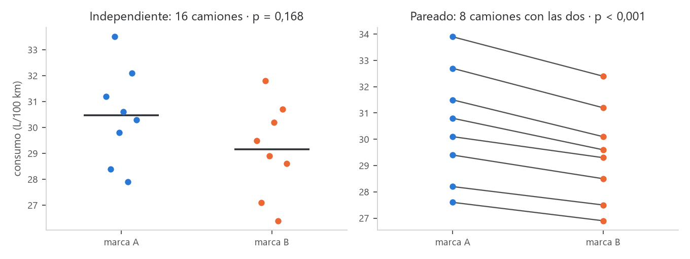
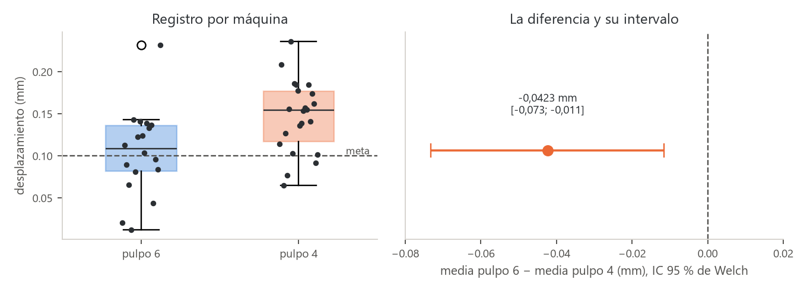

# Unidad 2 · Comparar dos medias

**Qué vas a poder hacer.** Reconocer si dos muestras son independientes o pareadas por cómo se
tomaron; comparar sus medias con la $t$ combinada, con la de Welch (y sus grados de libertad de
Satterthwaite) o con la $t$ pareada; revisar los supuestos y cambiar a una prueba de rangos cuando
fallan; y medir cuánto importa la diferencia con su intervalo y la $d$ de Cohen, a mano y con `scipy`.

**Lo que necesitas antes.** La unidad 1: los cinco pasos de una prueba, el valor p, la región de
rechazo, los errores tipo I y II y la relación con el intervalo de confianza. La prueba $t$ de una
media es la pieza que aquí se usa dos veces.

**Tiempo.** Unas 6 horas: 2,5 de lectura con el ejemplo y el cuaderno, 3,5 de práctica.

---

## 1. La idea · el diseño decide la prueba

Casi toda decisión de ingeniería compara dos cosas: dos máquinas, dos proveedores, antes y después de
un cambio. La pregunta es siempre la misma (¿la diferencia entre las medias es real o es ruido?),
pero la cuenta depende de **cómo se tomaron los datos**:

| Diseño | Cómo se reconoce | Ejemplo | Prueba |
|---|---|---|---|
| **Independiente** | cada unidad aparece en un solo grupo; los grupos pueden tener distinto tamaño | 8 camiones con la marca A y otros 8 con la B | $t$ combinada o de Welch |
| **Pareado** | cada unidad aparece en los dos grupos, o hay parejas naturales; los grupos tienen el mismo tamaño y un orden que no se puede barajar | los mismos 8 camiones, un mes con cada marca | $t$ pareada sobre las diferencias |

La señal práctica: si se puede reordenar una columna sin perder información, son independientes. Si
la fila 3 de un grupo «va con» la fila 3 del otro, son pareadas.

**Por qué importa.** En el diseño pareado cada unidad se compara consigo misma, así que todo lo que
hace distinta a una unidad de otra (la ruta del camión, la habilidad del operario, la pieza medida)
se cancela. Lo que queda es el efecto del tratamiento. Por eso, cuando se puede, **parear es la
forma más barata de ganar precisión**.

---

## 2. Muestras independientes con varianzas iguales · $t$ combinada

Dos muestras independientes de tamaños $n_1$ y $n_2$, medias $\bar x_1$, $\bar x_2$ y varianzas
$s_1^2$, $s_2^2$. Se prueba $H_0: \mu_1 - \mu_2 = D_0$ (casi siempre $D_0 = 0$).

Si las dos poblaciones tienen la **misma varianza**, las dos muestras estiman un solo $\sigma^2$, y
se juntan en la **varianza combinada**, un promedio de las varianzas ponderado por sus grados de
libertad:

$$s_p^2 = \frac{(n_1 - 1)s_1^2 + (n_2 - 1)s_2^2}{n_1 + n_2 - 2}$$

$$t = \frac{\bar x_1 - \bar x_2 - D_0}{s_p\sqrt{\dfrac{1}{n_1} + \dfrac{1}{n_2}}} \quad\sim\quad t_{\,n_1 + n_2 - 2} \text{ bajo } H_0$$

**La intuición.** La diferencia de medias varía menos cuanto más datos hay en cada grupo: su varianza
es $\sigma^2/n_1 + \sigma^2/n_2$. El estadístico mide a cuántos errores estándar quedó la diferencia
observada de la que dice $H_0$. Se pierden dos grados de libertad porque se estimaron dos medias.

El intervalo de confianza para $\mu_1 - \mu_2$ usa la misma cuenta:
$(\bar x_1 - \bar x_2) \pm t_{1-\alpha/2,\, n_1+n_2-2}\; s_p\sqrt{1/n_1 + 1/n_2}$.

---

## 3. Varianzas distintas · Welch y los grados de libertad de Satterthwaite

Si las varianzas no son iguales, juntarlas no tiene sentido. Welch usa cada varianza por separado:

$$t = \frac{\bar x_1 - \bar x_2 - D_0}{\sqrt{\dfrac{s_1^2}{n_1} + \dfrac{s_2^2}{n_2}}} \qquad \nu = \frac{\left(\dfrac{s_1^2}{n_1} + \dfrac{s_2^2}{n_2}\right)^2}{\dfrac{(s_1^2/n_1)^2}{n_1 - 1} + \dfrac{(s_2^2/n_2)^2}{n_2 - 1}}$$

El estadístico ya no sigue exactamente una $t$, pero se aproxima muy bien con una $t$ de $\nu$
grados de libertad (la aproximación de **Satterthwaite**). $\nu$ casi nunca es entero; con tabla se
redondea **hacia abajo** (más conservador); `scipy` usa el valor decimal.

**La intuición de $\nu$.** Cuando un grupo es chico y muy variable, casi todo el error estándar viene
de él, y la prueba tiene tan pocos grados de libertad como ese grupo. Cuando los dos aportan parecido,
$\nu$ se acerca a $n_1 + n_2 - 2$.

**¿Cuál usar?** Hay tres hechos que ordenan la decisión:

- Con $n_1 = n_2$, las dos dan **el mismo $t$** (el error estándar coincide); solo cambian los grados
  de libertad, y poco.
- Con tamaños distintos y varianzas distintas, la combinada **se equivoca**: si el grupo chico es el
  más variable, rechaza mucho más que el $\alpha$ prometido (ejercicio 2.10).
- Welch casi no pierde potencia cuando las varianzas sí son iguales.

Por eso la recomendación moderna es **usar Welch por defecto** y reservar la combinada para cuando la
igualdad de varianzas es razonable por diseño (mismo proceso, mismo instrumento). Comparar las
varianzas con una prueba formal antes de elegir (la prueba $F$ o la de Levene de la unidad 3) se
enseña a menudo, pero encadenar dos pruebas altera los niveles de error; una regla práctica es mirar
la razón de desviaciones: si la mayor supera el doble de la menor, Welch sin discusión.

---

## 4. Muestras pareadas · $t$ sobre las diferencias

Con $n$ pares $(x_i, y_i)$ se calculan las diferencias $d_i = x_i - y_i$ y se hace la prueba $t$ de
**una** media sobre ellas, con $H_0: \mu_D = D_0$:

$$t = \frac{\bar d - D_0}{s_d/\sqrt n} \quad\sim\quad t_{\,n-1}$$

**Por qué gana tanto.** La varianza de una diferencia es

$$\operatorname{Var}(X - Y) = \sigma_X^2 + \sigma_Y^2 - 2\rho\,\sigma_X\sigma_Y$$

Si las dos mediciones de una misma unidad están correlacionadas ($\rho$ alto, porque un camión que
gasta mucho gasta mucho con cualquier neumático), el término $-2\rho\sigma_X\sigma_Y$ se come casi toda
la varianza. Tratar datos pareados como independientes **ignora ese término** y usa un error estándar
muchas veces mayor que el real: la diferencia desaparece en el ruido.

El supuesto se revisa en las **diferencias**: tienen que ser aproximadamente normales e independientes
entre pares. No hace falta que $x$ e $y$ sean normales por separado.

---

## 5. Supuestos y qué hacer si fallan

| Supuesto | Cómo se revisa | Si falla |
|---|---|---|
| Independencia (entre unidades, y entre grupos en el diseño independiente) | por el diseño: cómo se eligieron y midieron las unidades | ninguna prueba lo arregla; hay que cambiar el análisis (pareado, por bloques) o el muestreo |
| Normalidad de cada grupo (o de las diferencias) | histograma o gráfico Q–Q; Shapiro–Wilk con $n$ chico | con $n \ge 30$ por grupo la $t$ resiste bien (teorema central del límite); con $n$ chico y asimetría o datos extremos, prueba de rangos |
| Varianzas iguales (solo la $t$ combinada) | razón de desviaciones; prueba $F$ o de Levene (unidad 3) | Welch |
| Sin datos extremos que dominen | diagrama de caja | entender el dato (¿error de registro?, ¿otro proceso?); informar con y sin él; prueba de rangos |

**Las pruebas de rangos.** Cuando la normalidad falla con muestras chicas:

- **Mann–Whitney** (también llamada de Wilcoxon de suma de rangos), para muestras independientes. Junta
  los datos, los ordena y pregunta si los rangos de un grupo tienden a ser más altos. Un dato extremo
  cuenta solo como «el más grande», sin importar cuánto.
- **Wilcoxon de rangos con signo**, para muestras pareadas, sobre las diferencias.

No comparan medias sino la tendencia de un grupo a dar valores mayores (con distribuciones de igual
forma, las medianas). Pierden algo de potencia cuando los datos sí son normales, y ganan mucha cuando
no lo son. Esta unidad solo las menciona; se usan en los ejercicios 2.9 y en el caso.

---

## 6. Tamaño del efecto · la $d$ de Cohen

El valor p dice si la diferencia es distinguible del ruido; no dice si importa. Para eso, la diferencia
en sus unidades (con su intervalo) y, para comparar entre estudios, la **$d$ de Cohen**: la diferencia
medida en desviaciones estándar.

$$d = \frac{\bar x_1 - \bar x_2}{s_p} \qquad \text{(pareado: } d_z = \bar d / s_d\text{)}$$

Una guía de lectura habitual: 0,2 es chico, 0,5 mediano y 0,8 grande. Es solo una guía: en una
máquina de precisión un efecto «chico» puede ser carísimo, y en una encuesta uno «grande» puede no
cambiar ninguna decisión. Lo que manda es la diferencia en unidades del problema.

$d$ y $t$ están ligados: $t = d \,/\sqrt{1/n_1 + 1/n_2}$. A igual efecto, más datos dan un $t$ mayor. Por
eso con muestras enormes todo es significativo y con muestras chicas efectos grandes no lo son.

---

## 7. Muchas pruebas $t$ no reemplazan un ANOVA

Con más de dos grupos, la tentación es comparar todos los pares con pruebas $t$. Con $k$ grupos hay
$k(k-1)/2$ pares, y cada prueba tiene su 5 % de falsa alarma. Si fueran independientes, la
probabilidad de al menos una falsa alarma sería $1 - 0{,}95^{m}$ con $m$ pruebas: con 15 pruebas, más
de la mitad. La salida correcta es el ANOVA (unidad 7) seguido de comparaciones múltiples con el error
controlado (unidad 8).

---

## 8. Con Python

```python
from scipy import stats

stats.ttest_ind(a, b, equal_var=False)      # Welch (equal_var=True: t combinada)
stats.ttest_ind(a, b, equal_var=False).confidence_interval(0.95)   # IC de la diferencia
stats.ttest_rel(x, y)                       # pareada (x e y en el mismo orden de unidades)
stats.mannwhitneyu(a, b)                    # rangos, independientes
stats.wilcoxon(x, y)                        # rangos con signo, pareadas
stats.shapiro(a), stats.shapiro(x - y)      # normalidad de cada grupo o de las diferencias
```

`alternative="less"` o `"greater"` da la prueba de una cola, en la dirección de $a - b$.

---

## 9. Ejemplo resuelto · ¿qué neumático gasta menos combustible?

Una empresa de reparto de Puerto Montt evalúa dos marcas de neumático por su efecto en el consumo
(L/100 km). Los datos quedan en `datos/u02_neumaticos.csv` y el cuaderno
`notebooks/u02_dos_medias.ipynb` reproduce todo.

### Primer intento · diseño independiente

Se montó la marca A en 8 camiones y la B en otros 8, y se midió el consumo de un mes.

| Camión | Marca A | Marca B |
|---|---|---|
| 1 | 31,2 | 29,5 |
| 2 | 28,4 | 27,1 |
| 3 | 33,5 | 31,8 |
| 4 | 29,8 | 28,9 |
| 5 | 30,6 | 30,2 |
| 6 | 27,9 | 26,4 |
| 7 | 32,1 | 30,7 |
| 8 | 30,3 | 28,6 |

(Las filas no se corresponden: el camión 1 de la marca A no es el camión 1 de la B. La tabla está
lado a lado solo por espacio.)

**Paso 0 · Supuestos.** Camiones distintos en cada grupo: independientes. Shapiro–Wilk da
$p = 0{,}954$ (A) y $p = 0{,}952$ (B). Las desviaciones son casi iguales.

**Paso 1 · Pregunta.** ¿Las dos marcas dan distinto consumo medio?

**Paso 2 · Hipótesis.** $H_0: \mu_A = \mu_B$ contra $H_1: \mu_A \ne \mu_B$, con $\alpha = 0{,}05$.

**Paso 3 · Estadístico.** $\bar x_A = 30{,}475$, $s_A^2 = 3{,}3936$; $\bar x_B = 29{,}150$, $s_B^2 = 3{,}2543$.

$$s_p^2 = \frac{7 \cdot 3{,}3936 + 7 \cdot 3{,}2543}{14} = 3{,}3239 \qquad s_p = 1{,}8232 \qquad \text{EE} = 1{,}8232\sqrt{\tfrac18 + \tfrac18} = 0{,}9116$$

$$t = \frac{30{,}475 - 29{,}150}{0{,}9116} = 1{,}45 \qquad \text{con } 14 \text{ gl}$$

Con Welch: $s_A^2/8 = 0{,}4242$ y $s_B^2/8 = 0{,}4068$; el error estándar es el mismo, 0,9116, porque
los grupos tienen igual tamaño, y $\nu = 14{,}0$.

**Paso 4 · Decisión.** El crítico es $t_{0{,}975;\,14} = 2{,}145$. El observado no llega: $p = 0{,}1681$
por las dos pruebas.

**Paso 5 · Conclusión.** Con 16 camiones no hay evidencia de que las marcas den distinto consumo. El
IC 95 % de la diferencia va de $-0{,}63$ a $3{,}28$ L/100 km: podría no haber diferencia, o la marca A
podría gastar 3 litros más cada 100 km. El estudio no decide. Y el efecto estimado no es chico:
$d = 0{,}73$.

### Segundo intento · diseño pareado

El jefe de flota nota que los camiones son muy distintos entre sí (unos hacen ruta de cerro, otros de
ciudad), y que eso tapa el efecto del neumático. Repite el ensayo con **8 camiones que usan una marca
un mes y la otra el mes siguiente** (sorteando cuál va primero).

| Camión | Marca A | Marca B | $d = A - B$ |
|---|---|---|---|
| 1 | 30,8 | 29,6 | 1,2 |
| 2 | 27,6 | 26,9 | 0,7 |
| 3 | 33,9 | 32,4 | 1,5 |
| 4 | 29,4 | 28,5 | 0,9 |
| 5 | 31,5 | 30,1 | 1,4 |
| 6 | 28,2 | 27,5 | 0,7 |
| 7 | 32,7 | 31,2 | 1,5 |
| 8 | 30,1 | 29,3 | 0,8 |

**Supuestos.** Shapiro–Wilk sobre las diferencias: $p = 0{,}094$, sin evidencia fuerte contra la
normalidad (con 8 datos, conviene mirar también el gráfico).

**Hipótesis.** $H_0: \mu_D = 0$ contra $H_1: \mu_D \ne 0$.

$$\bar d = 1{,}0875 \qquad s_d = 0{,}3523 \qquad \frac{s_d}{\sqrt 8} = 0{,}1246 \qquad t = \frac{1{,}0875}{0{,}1246} = 8{,}73 \text{ con 7 gl}$$

$p < 0{,}001$. El IC 95 % de la diferencia media va de **0,79 a 1,38 L/100 km**, y $d_z = 3{,}09$.

**Conclusión.** La marca B gasta en promedio entre 0,8 y 1,4 L menos cada 100 km que la A.



**El error de analizarlo mal.** Si estos mismos datos pareados se analizaran como dos muestras
independientes, Welch daría $t = 1{,}09$ y $p = 0{,}2956$: ninguna diferencia. La correlación entre
las dos mediciones de un mismo camión es 0,998; la prueba independiente la ignora y usa como ruido
las diferencias entre camiones, que son de varios litros.

```python
df = pd.read_csv("datos/u02_neumaticos.csv")
par = df[df.diseno == "pareado"].pivot(index="camion", columns="marca", values="consumo_l100km")
stats.ttest_rel(par.A, par.B)                       # t = 8,73, p < 0,001
stats.ttest_ind(par.A, par.B, equal_var=False)      # mal: t = 1,09, p = 0,2956
```

**Cómo se lee.**

- El primer estudio no estaba equivocado: era **poco potente** para una diferencia de un litro cuando
  los camiones difieren entre sí en cinco.
- Con 30.000 km al año por camión, un litro menos cada 100 km son unos 300 litros por camión al año.
  Esa es la cifra que va a la decisión de compra, no el valor p.
- La lección de diseño: antes de juntar datos, preguntarse si se puede parear.

---

## 10. Errores típicos

| Error | Cómo evitarlo |
|---|---|
| Tratar datos pareados como independientes | Si cada fila de un grupo «va con» una del otro, prueba pareada sobre las diferencias |
| Parear datos independientes (ordenar las dos columnas y restar) | Solo se parea lo que el diseño pareó; inventar parejas da un error estándar falso |
| $t$ combinada con varianzas muy distintas y tamaños distintos | Welch por defecto; la combinada solo si la igualdad es razonable |
| «No se rechaza, entonces las medias son iguales» (por ejemplo, para homologar dos materiales) | No rechazar no prueba igualdad. Para mostrar equivalencia se fija un margen aceptable y se exige que **todo** el intervalo caiga dentro (prueba de equivalencia) |
| Significativo = importante | Informa la diferencia con su intervalo y la $d$; decide con el efecto en unidades del problema |
| Muchas pruebas $t$ en vez de un ANOVA | Con más de dos grupos, ANOVA y comparaciones múltiples (unidades 7 y 8) |
| Calcular $s_p$ promediando desviaciones, o sin ponderar por $n - 1$ | $s_p^2$ pondera las **varianzas** por sus grados de libertad |
| Redondear los gl de Welch hacia arriba al usar la tabla | Hacia abajo: es el lado conservador |
| Mirar el valor p y no los supuestos | Diagrama de caja de cada grupo antes de la prueba; un dato extremo puede dar vuelta la conclusión (ejercicio 2.9) |

---

## 11. Práctica

Diez ejercicios: 2.1 a 2.4 básicos, 2.5 a 2.8 intermedios, 2.9 y 2.10 de desafío. Las pautas están en
la sección 12. Usa $\alpha = 0{,}05$ salvo que se indique otro.

**2.1 · ¿Independientes o pareadas? (básico).** Para cada estudio di el diseño, las hipótesis y la
prueba.

- (a) Se mide el tiempo de armado de 10 operarios antes y después de una capacitación.
- (b) Se ensaya la resistencia de probetas de cemento de dos proveedores.
- (c) Se mide la dureza de las mismas 12 piezas con dos durómetros, para ver si uno marca más alto.
- (d) Se comparan las ventas de 15 sucursales con una campaña y de 15 sucursales sin ella.

**2.2 · Dos moldes de inyección (básico).** El tiempo de ciclo de un molde nuevo se compara con el del
actual en la misma inyectora. Molde actual: $n_1 = 14$, $\bar x_1 = 38{,}6$ s, $s_1 = 2{,}1$ s. Molde
nuevo: $n_2 = 12$, $\bar x_2 = 36{,}9$ s, $s_2 = 1{,}8$ s. Suponiendo varianzas iguales, ¿los tiempos
medios difieren? Da $s_p$, $t$, el valor crítico, el valor p, el IC 95 % y $d$.

**2.3 · Dos contratistas (básico).** Horas de reparación de equipos: contratista 1, $n_1 = 10$,
$\bar x_1 = 6{,}8$ h, $s_1 = 3{,}4$ h; contratista 2, $n_2 = 16$, $\bar x_2 = 4{,}9$ h, $s_2 = 1{,}2$ h.
(a) ¿Por qué no conviene la $t$ combinada? (b) Haz la prueba de Welch de dos colas, con los grados de
libertad de Satterthwaite. (c) Compara con lo que habría dado la combinada.

**2.4 · Reorganizar una estación (básico).** Piezas por hora de 8 operarios antes y después de
reorganizar su estación de trabajo. ¿La reorganización sube la productividad media?

| Operario | 1 | 2 | 3 | 4 | 5 | 6 | 7 | 8 |
|---|---|---|---|---|---|---|---|---|
| Antes | 42 | 38 | 45 | 40 | 36 | 44 | 39 | 41 |
| Después | 45 | 40 | 47 | 41 | 40 | 46 | 39 | 44 |

**2.5 · Aditivos para mortero (intermedio).** Tiempo de fraguado (min) de probetas de mortero con dos
aditivos:

| Aditivo | 1 | 2 | 3 | 4 | 5 | 6 | 7 | 8 | 9 |
|---|---|---|---|---|---|---|---|---|---|
| A | 42 | 47 | 39 | 45 | 50 | 44 | 41 | 48 | 46 |

| Aditivo | 1 | 2 | 3 | 4 | 5 | 6 | 7 | 8 | 9 | 10 | 11 |
|---|---|---|---|---|---|---|---|---|---|---|---|
| B | 38 | 41 | 36 | 44 | 39 | 35 | 42 | 40 | 37 | 43 | 39 |

(a) Revisa normalidad y compara las desviaciones. (b) Haz Welch y la combinada. (c) Calcula $d$ y el
IC 95 % de la diferencia (Welch). (d) Concluye para la obra.

**2.6 · ¿Ahorra más de 5 minutos? (intermedio).** Un proveedor de software asegura que su sistema
reduce el tiempo de despacho de un pedido **en más de 5 minutos**. Con el sistema antiguo:
$n_1 = 25$, $\bar x_1 = 48{,}2$ min, $s_1 = 6{,}5$; con el nuevo (en otros pedidos): $n_2 = 22$,
$\bar x_2 = 41{,}0$ min, $s_2 = 5{,}9$. (a) Plantea las hipótesis con $D_0 = 5$ y pruébalas con Welch.
(b) Calcula la cota inferior de una cola (95 %) para la reducción. (c) ¿Qué habría dicho la prueba con
$D_0 = 0$? ¿Qué le contestas al proveedor?

**2.7 · Dos instrumentos, las mismas piezas (intermedio).** Se mide el espesor de recubrimiento (µm)
de 7 piezas con dos instrumentos:

| Pieza | Instrumento 1 | Instrumento 2 | Diferencia |
|---|---|---|---|
| 1 | 52,1 | 53,0 | -0,9 |
| 2 | 48,7 | 49,9 | -1,2 |
| 3 | 55,3 | 56,1 | -0,8 |
| 4 | 50,2 | 51,4 | -1,2 |
| 5 | 46,9 | 47,5 | -0,6 |
| 6 | 53,8 | 55,0 | -1,2 |
| 7 | 49,5 | 50,3 | -0,8 |

(a) Analiza los datos como si fueran independientes (Welch). (b) Analízalos como pareados. (c) Explica
la diferencia con la fórmula de $\operatorname{Var}(X - Y)$. ¿Qué le dices al laboratorio?

**2.8 · ¿Cuántas unidades por grupo? (intermedio).** Para comparar dos procesos se quiere detectar una
diferencia de medias de $\delta = 1{,}5$ unidades, con $\sigma = 3$ en cada proceso, $\alpha = 0{,}05$ de
dos colas y potencia 0,80. (a) Calcula $n$ por grupo con
$n = 2\big((z_{1-\alpha/2} + z_{1-\beta})\,\sigma/\delta\big)^2$. (b) Si solo hay presupuesto para 30 por
grupo, ¿qué potencia tiene el estudio? Usa
$1 - \beta \approx \Phi\big(\delta/(\sigma\sqrt{2/n}) - z_{1-\alpha/2}\big)$.

**2.9 · Un dato extremo (desafío).** Días de entrega de 8 pedidos de cada proveedor:

| Proveedor | 1 | 2 | 3 | 4 | 5 | 6 | 7 | 8 |
|---|---|---|---|---|---|---|---|---|
| A | 4 | 5 | 3 | 6 | 4 | 5 | 4 | 21 |
| B | 7 | 8 | 6 | 9 | 7 | 8 | 7 | 6 |

El pedido de 21 días de A se extravió en una bodega del transportista. (a) Revisa los supuestos.
(b) Compara con Welch y con Mann–Whitney. (c) Repite Welch sin el 21. (d) ¿Qué proveedor es más
rápido y cómo lo informas?

**2.10 · Cuando la $t$ combinada miente, y cuando sobran pruebas (desafío).** (a) Simula con Python
20.000 pares de muestras con **medias iguales** ($H_0$ cierta): la primera de $n_1 = 8$ con $\sigma_1 = 4$,
la segunda de $n_2 = 32$ con $\sigma_2 = 1$ (usa `np.random.default_rng(1101)`). ¿Qué fracción rechaza al
5 % la $t$ combinada y qué fracción Welch? Explica por qué. (b) Un laboratorio quiere comparar 6 tintas
de a pares con pruebas $t$ al 5 %. ¿Cuántas pruebas son? Si fueran independientes, ¿qué probabilidad
hay de al menos una falsa alarma? ¿Qué nivel tendría que usar cada prueba con la corrección de
Bonferroni?

---

## 12. Pautas

**2.1.** (a) **Pareado**: el mismo operario antes y después; $H_0: \mu_D = 0$ contra
$H_1: \mu_{antes} - \mu_{después} > 0$ (si se espera que baje el tiempo); $t$ pareada. (b) **Independientes**:
probetas distintas de cada proveedor; $H_0: \mu_1 = \mu_2$ contra $H_1: \mu_1 \ne \mu_2$; Welch. (c)
**Pareado**: las mismas piezas en los dos durómetros; $H_1: \mu_D \ne 0$; $t$ pareada (la diferencia entre
piezas se cancela). (d) **Independientes**: sucursales distintas; $H_1: \mu_{campaña} > \mu_{sin}$; Welch. Si las
sucursales se hubieran emparejado por tamaño antes de sortear la campaña, sería pareado.

**2.2.** $s_p^2 = (13 \cdot 2{,}1^2 + 11 \cdot 1{,}8^2)/24 = 3{,}8737$, así que $s_p = 1{,}9682$ s. EE $= 1{,}9682\sqrt{1/14 + 1/12} = 0{,}7743$
y $t = 1{,}7/0{,}7743 = 2{,}20$ con 24 gl. El crítico es 2,064: se rechaza; $p = 0{,}0380$. IC 95 %: de
**0,10 a 3,30 s**; $d = 0{,}86$. Lectura: el molde nuevo es más rápido, pero el intervalo va de casi nada
a más de 3 segundos por ciclo. Antes de cambiar todos los moldes conviene más ciclos para afinar
cuánto se gana.

**2.3.** (a) La razón de desviaciones es $3{,}4/1{,}2 = 2{,}83$, sobre 2, y el grupo más variable es el
más chico: la combinada sería demasiado optimista. (b) $s_1^2/n_1 = 1{,}156$ y $s_2^2/n_2 = 0{,}090$; EE
$= \sqrt{1{,}246} = 1{,}1162$ y $t = 1{,}9/1{,}1162 = 1{,}70$. Grados de libertad:
$\nu = 1{,}246^2/(1{,}156^2/9 + 0{,}090^2/15) = 10{,}42$, que con tabla se usan como 10: crítico
2,228. No se rechaza; $p = 0{,}1183$. (c) La combinada habría dado $t = 2{,}06$ con 24 gl y $p = 0{,}0504$,
casi en el borde. Usa un error estándar que no corresponde: trata la gran variabilidad del contratista
1 como si la compartiera el 2, y cuenta 24 grados de libertad cuando casi toda la incertidumbre viene de
10 reparaciones. Lectura: no hay evidencia firme de que el contratista 1 sea más lento; sí la hay de
que es mucho más **irregular**, y eso también es un costo (unidad 3).

**2.4.** Diferencias (después menos antes):

| Operario | 1 | 2 | 3 | 4 | 5 | 6 | 7 | 8 |
|---|---|---|---|---|---|---|---|---|
| Diferencia | 3 | 2 | 2 | 1 | 4 | 2 | 0 | 3 |

$H_0: \mu_D = 0$ contra $H_1: \mu_D > 0$. $\bar d = 2{,}125$, $s_d = 1{,}2464$, EE $= 0{,}4407$ y
$t = 4{,}82$ con 7 gl, sobre el crítico 1,895; $p = 0{,}0010$. $d_z = 1{,}70$. Lectura: la reorganización
sube la productividad en unas 2 piezas por hora por operario, y no es un efecto de unos pocos: 7 de
8 mejoraron.

**2.5.** (a) Shapiro–Wilk: $p = 0{,}986$ (A) y $p = 0{,}947$ (B). Varianzas de 12,50 y 8,27: razón de
desviaciones de 1,23, parecidas. (b) Medias de 44,67 y 39,45 min. Welch: EE $= 1{,}4632$, $t = 3{,}56$,
$\nu = 15{,}4$, $p = 0{,}0027$. Combinada: $s_p^2 = 10{,}15$, EE $= 1{,}4321$, $t = 3{,}64$ con 18 gl,
$p = 0{,}0019$. Las dos rechazan. (c) $d = 1{,}64$ (grande). IC 95 % de Welch: de **2,10 a 8,32 min**.
(d) El aditivo A retarda el fraguado entre 2 y 8 minutos. Si en la obra se necesita más tiempo de
colocación (hormigonado en verano), A es mejor; si se necesita desmoldar antes, B.

**2.6.** (a) $H_0: \mu_{ant} - \mu_{nue} = 5$ (o $\le 5$) contra $H_1: \mu_{ant} - \mu_{nue} > 5$, porque la
promesa es lo que hay que demostrar. EE $= \sqrt{6{,}5^2/25 + 5{,}9^2/22} = 1{,}8089$,
$t = (7{,}2 - 5)/1{,}8089 = 1{,}22$ con $\nu = 44{,}9$; $p = 0{,}1151$. No se rechaza. (b) Cota inferior:
$7{,}2 - t_{0{,}95} \cdot 1{,}8089 = 4{,}16$ min, bajo 5. (c) Con $D_0 = 0$: $t = 3{,}98$, $p < 0{,}001$. Lectura:
el sistema **sí** reduce el tiempo (eso está claro), pero los datos no respaldan que la reducción
supere 5 minutos. La promesa del proveedor no está demostrada; puede ser cierta, pero con estos
pedidos la reducción plausible parte en unos 4 minutos.

**2.7.** (a) Como independientes: Welch da $t = -0{,}60$ y $p = 0{,}5601$; no se ve nada. (b) Pareadas:
$\bar d = -0{,}957$ µm, $s_d = 0{,}2440$, $t = -10{,}38$ con 6 gl y $p < 0{,}001$. El instrumento 2 marca
casi un micrómetro más que el 1 en todas las piezas. (c) La correlación entre las dos mediciones de una
misma pieza es 0,997: las piezas difieren entre sí en varios micrómetros, y eso domina $\sigma_X^2$ y
$\sigma_Y^2$. En la pareada, el término $-2\rho\sigma_X\sigma_Y$ cancela esa variación y queda solo la
diferencia entre instrumentos. Lectura: hay un sesgo sistemático de cerca de 1 µm; el laboratorio
debe calibrar uno de los dos antes de seguir usándolos indistintamente.

**2.8.** (a) $n = 2\big((1{,}960 + 0{,}842) \cdot 3/1{,}5\big)^2 = 62{,}8$, es decir **63 por grupo** (con la
$t$, `statsmodels` pide 63,8, es decir 64). (b) Con 30 por grupo: $\delta/(\sigma\sqrt{2/30}) = 1{,}936$ y la
potencia es $\Phi(1{,}936 - 1{,}960) = 0{,}491$. Lectura: con 30 por grupo, el estudio se pierde la
diferencia buscada la mitad de las veces. Un resultado «no significativo» con esa muestra no
diría casi nada.

**2.9.** (a) A tiene un dato extremo: su desviación es 5,93 días contra 1,04 de B, y Shapiro–Wilk
rechaza la normalidad de A ($p < 0{,}001$). Con 8 datos, la $t$ no es confiable. (b) Welch: medias de
6,50 y 7,25 días, $t = -0{,}35$, $p = 0{,}7343$: no ve diferencia. Mann–Whitney: $U = 9{,}0$,
$p = 0{,}0170$: A entrega antes. La mediana de A es 4,5 días y la de B, 7,0. (c) Sin el 21: media de A
4,43 días, $t = -5{,}43$, $p < 0{,}001$. (d) A es el proveedor más rápido en lo habitual; un solo pedido
extraviado basta para tapar eso en la media. Se informa la prueba de rangos y el análisis con y sin el
dato, y el 21 no se borra: se informa aparte, porque un pedido extraviado también es parte del servicio
de A.

**2.10.** (a) Con la semilla 1101 y 20.000 simulaciones, la $t$ combinada rechaza en el **30,3 %** de los
casos y Welch en el **5,0 %**. La combinada promedia las varianzas ponderando por $n$: el grupo grande y
poco variable domina $s_p$, así que el error estándar subestima la variación real de $\bar x_1$, que
viene del grupo chico y muy variable. El $t$ resulta inflado y la prueba ve diferencias que no existen.
Welch usa la varianza de cada grupo con su propio $n$ y mantiene el 5 % prometido. (b) Son
$6 \cdot 5/2 = 15$ pruebas. La probabilidad de al menos una falsa alarma sería $1 - 0{,}95^{15} = 0{,}537$.
Bonferroni pide usar $0{,}05/15 = 0{,}0033$ en cada prueba, a costa de potencia; la vía ordenada es un
ANOVA y comparaciones múltiples (unidades 7 y 8).

```python
rng = np.random.default_rng(1101)
x = rng.normal(0, 4, (20_000, 8)); y = rng.normal(0, 1, (20_000, 32))
(stats.ttest_ind(x, y, axis=1, equal_var=True).pvalue < 0.05).mean()    # combinada
(stats.ttest_ind(x, y, axis=1, equal_var=False).pvalue < 0.05).mean()   # Welch
```

---

## 13. Caso integrador · Estampa Sur, ¿el pulpo 4 desplaza más el registro que el pulpo 6?

> Viene de la unidad 1: comparadas por separado contra la meta de 0,10 mm, el pulpo 4 la supera con
> claridad y el pulpo 6 no muestra evidencia de superarla. Falta la pregunta directa: ¿las dos máquinas
> son distintas? Los datos son los mismos (`datos/registro.csv`, simulados por
> `verificacion/caso_estampa_sur_datos.py`).

**Paso 0 · Supuestos.** Prendas distintas en cada máquina: independientes. Shapiro–Wilk:
$p = 0{,}344$ (pulpo 6) y $p = 0{,}959$ (pulpo 4). Desviaciones de 0,0514 y 0,0429 mm: razón de 1,2.
Tamaños de 18 y 22.

**Paso 1 · Pregunta.** ¿El desplazamiento medio del registro es distinto en las dos máquinas?

**Paso 2 · Hipótesis.** $H_0: \mu_6 = \mu_4$ contra $H_1: \mu_6 \ne \mu_4$, con $\alpha = 0{,}05$. Dos colas:
antes de mirar los datos, el taller no sabía cuál de las dos era peor.

**Paso 3 · Estadístico.**

| Máquina | $n$ | Media (mm) | Desviación (mm) |
|---|---|---|---|
| pulpo 6 | 18 | 0,1046 | 0,0514 |
| pulpo 4 | 22 | 0,1470 | 0,0429 |

Welch: EE $= \sqrt{0{,}0514^2/18 + 0{,}0429^2/22} = 0{,}0152$ y

$$t = \frac{0{,}1046 - 0{,}1470}{0{,}0152} = -2{,}79 \qquad \nu = 33{,}2$$

Combinada: $s_p = 0{,}0469$, EE $= 0{,}0469\sqrt{1/18 + 1/22} = 0{,}0149$ y $t = -2{,}84$ con 38 gl.

**Paso 4 · Decisión.** Welch: $p = 0{,}0087$. Combinada: $p = 0{,}0072$. Las dos rechazan al 5 % y al
1 %. Mann–Whitney, que no supone normalidad, da $U = 96$ y $p = 0{,}0058$: la misma conclusión.

**Paso 5 · Conclusión.** El pulpo 4 desplaza el registro más que el pulpo 6. La diferencia estimada es
de $-0{,}0423$ mm (6 menos 4), con IC 95 % de Welch de **-0,073 a -0,011 mm**, y el efecto es grande:
$d = -0{,}90$.



```python
reg = pd.read_csv("datos/registro.csv")
a = reg[reg.maquina == "pulpo 6"].desplazamiento_mm
b = reg[reg.maquina == "pulpo 4"].desplazamiento_mm
stats.ttest_ind(a, b, equal_var=False)   # t = -2,79, p = 0,0087
stats.ttest_ind(a, b, equal_var=True)    # t = -2,84, p = 0,0072
```

**Lectura.**

- Que las dos pruebas coincidan no es casualidad: las varianzas son parecidas y los tamaños, cercanos.
  Se informa Welch, que no depende de suponer varianzas iguales.
- Si el taller hubiera planteado de antemano «el pulpo 4 es peor» (una cola), el valor p de Welch sería
  0,0043. Como no lo planteó, se queda con dos colas.
- En unidades del problema: el pulpo 4 desplaza unos 0,04 mm más, casi la mitad de la meta completa.
  Es la máquina que hay que intervenir primero.
- Una advertencia para la próxima unidad: el pulpo 6 tiene la media más baja pero la desviación **más
  alta**. Cumplir la meta en promedio no basta si cada prenda varía mucho. ¿Varían distinto las dos
  máquinas? Eso se prueba comparando varianzas (unidad 3).

---

## 14. Para seguir

**En los libros del ramo.** El programa trata la diferencia de medias en la primera semana y remite a
Walpole, Myers, Myers y Ye, *Probabilidad y estadística para ingeniería y ciencias* (edición en español
de 2012), capítulo 9, y a Casella y Berger, *Statistical Inference*, capítulo 8.

**Abiertos y gratis.**

- Diez, Çetinkaya-Rundel y Barr, *OpenIntro Statistics* (en inglés), capítulo 7 «Inference for
  Numerical Data», secciones 7.2 «Paired data» y 7.3 «Difference of two means». PDF gratis en
  https://www.openintro.org/book/os/
- NIST/SEMATECH, *e-Handbook of Statistical Methods*, sección 7.3 «Comparisons based on data from two
  processes» (en inglés), con las pruebas para desviaciones iguales, distintas y datos pareados:
  https://www.itl.nist.gov/div898/handbook/prc/section3/prc3.htm

**Con el tutor.** La carpeta `tutor/` trae el contexto de este ramo. Pégalo al inicio de la
conversación con cualquier IA y pídele, por ejemplo: «Descríbeme un estudio sin decirme si es pareado,
dame los datos y corrígeme la elección de la prueba, el cálculo y la conclusión».
