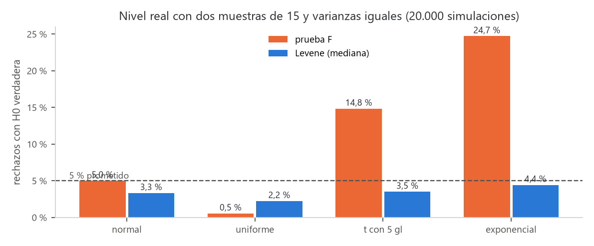
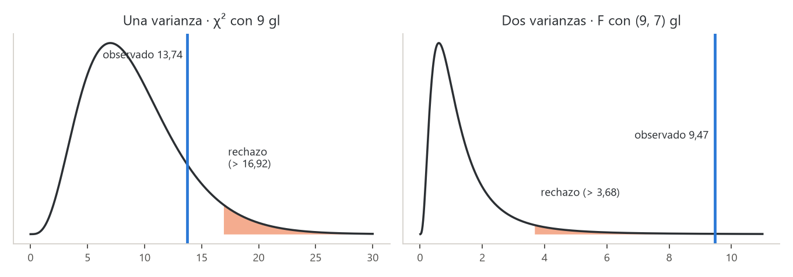
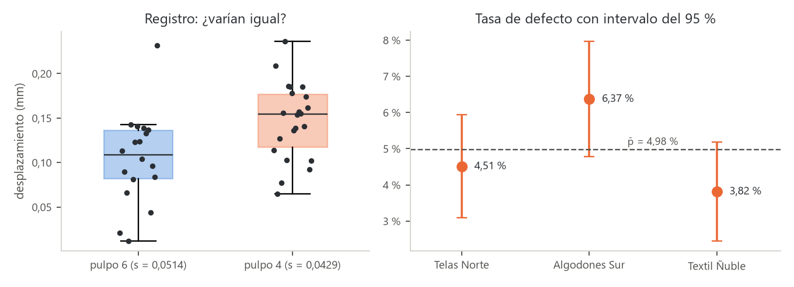

# Unidad 3 · Comparar varianzas y proporciones

**Qué vas a poder hacer.** Probar si una varianza cumple un tope con la chi-cuadrado; comparar dos
varianzas con la prueba F y, cuando los datos no son normales, con la prueba de Levene; comparar dos
proporciones con $z$ y varias con la chi-cuadrado de homogeneidad; decir dónde está la diferencia sin
inflar el error, y calcular cuántos datos hacen falta para que una prueba tenga potencia.

**Lo que necesitas antes.** De la unidad 1, el esquema de una prueba (hipótesis, estadístico, valor
p, decisión) y los errores tipo I y II. De la unidad 2, la prueba $t$ de dos muestras: allá se
preguntó por el **centro**; acá se pregunta por la **dispersión** y por **tasas**. Además, saber que
una suma de normales estándar al cuadrado sigue una chi-cuadrado.

**Tiempo.** Unas 6 horas: 2,5 de lectura con el ejemplo y el cuaderno, 3,5 de práctica.

---

## 1. La idea · por qué comparar dispersión y tasas

Dos procesos con la misma media pueden ser muy distintos: uno entrega todos los frascos entre 249 y
251 g y el otro entre 245 y 255 g. Al cliente le llega la **dispersión**, no la media. Por eso una
planta pregunta por la varianza tanto como por el promedio: ¿cumple la máquina el tope de variación
que fija la norma?, ¿es más pareja la máquina nueva que la antigua?

Cuando el dato es un sí o un no (defectuoso o bueno, compra o no compra), lo que se compara es una
**proporción**: ¿un turno sella peor que el otro?, ¿un proveedor entrega más prendas defectuosas?

| Pregunta | Parámetro | Prueba | Distribución bajo $H_0$ |
|---|---|---|---|
| ¿La varianza cumple un valor de referencia? | $\sigma^2$ | chi-cuadrado de una varianza | $\chi^2_{n-1}$ |
| ¿Dos varianzas son iguales? | $\sigma_1^2/\sigma_2^2$ | F (datos normales) o Levene (cualquier forma) | $F_{n_1-1,\,n_2-1}$ |
| ¿Dos proporciones son iguales? | $p_1 - p_2$ | $z$ de dos proporciones | $N(0,1)$ aproximada |
| ¿Varias proporciones son iguales? | $p_1 = \dots = p_k$ | chi-cuadrado de homogeneidad | $\chi^2_{k-1}$ aproximada |

Todas siguen los **cinco pasos** del ramo: la pregunta en palabras, $H_0$ y $H_1$, el estadístico y
su distribución bajo $H_0$, el valor p (o la región de rechazo) y la conclusión en el lenguaje del
problema. Antes de los cinco pasos se revisan los supuestos.

---

## 2. Una varianza · la prueba chi-cuadrado

**Supuestos.** Muestra aleatoria e independiente de una población **normal**. Este supuesto pesa
mucho más que en la prueba $t$ (sección 4).

Si $X_1, \dots, X_n$ son normales con varianza $\sigma^2$, entonces

$$\chi^2 = \frac{(n-1)\,S^2}{\sigma_0^2} \sim \chi^2_{n-1} \quad \text{si } H_0:\ \sigma^2 = \sigma_0^2 \text{ es verdadera.}$$

**Por qué funciona.** $(n-1)S^2 = \sum (X_i - \bar X)^2$. Dividida por $\sigma^2$ es una suma de
cuadrados de normales estándar; se pierde un grado de libertad porque las desviaciones se miden desde
$\bar X$ y suman cero. Si la varianza real es mayor que $\sigma_0^2$, el cociente crece; si es menor,
se achica.

| $H_1$ | Rechazo con nivel $\alpha$ | Valor p |
|---|---|---|
| $\sigma^2 > \sigma_0^2$ (el caso típico: un tope) | $\chi^2 > \chi^2_{1-\alpha,\,n-1}$ | $P(\chi^2_{n-1} \ge \chi^2_{obs})$ |
| $\sigma^2 < \sigma_0^2$ | $\chi^2 < \chi^2_{\alpha,\,n-1}$ | $P(\chi^2_{n-1} \le \chi^2_{obs})$ |
| $\sigma^2 \ne \sigma_0^2$ | fuera de $[\chi^2_{\alpha/2},\ \chi^2_{1-\alpha/2}]$ | el doble de la cola más chica |

La chi-cuadrado **no es simétrica**: en la prueba bilateral los dos valores críticos se buscan por
separado (no son $\pm$ el mismo número).

**Intervalo de confianza.** Invirtiendo la prueba,

$$\frac{(n-1)S^2}{\chi^2_{1-\alpha/2,\,n-1}} \le \sigma^2 \le \frac{(n-1)S^2}{\chi^2_{\alpha/2,\,n-1}}$$

y para $\sigma$ se saca raíz a los dos extremos. El intervalo no queda centrado en $S$.

**Unidades.** La varianza se mide en unidades **al cuadrado** (g², mm², min²). Un tope de «4 minutos»
es una desviación estándar; uno de «4 minutos²» es una varianza. Confundirlas cambia el resultado.

---

## 3. Dos varianzas · la prueba F

**Supuestos.** Dos muestras independientes, cada una de una población **normal**.

$$F = \frac{S_1^2}{S_2^2} \sim F_{n_1-1,\; n_2-1} \quad \text{si } H_0:\ \sigma_1^2 = \sigma_2^2.$$

**Por qué funciona.** Cada $(n_i - 1)S_i^2/\sigma_i^2$ es una chi-cuadrado; una $F$ es el cociente de
dos chi-cuadrado independientes, cada una dividida por sus grados de libertad. Si las varianzas son
iguales, las $\sigma^2$ se cancelan y queda $S_1^2/S_2^2$. Bajo $H_0$ el cociente ronda 1; muy lejos de
1 (hacia arriba o hacia abajo) es evidencia contra $H_0$.

**Cómo se arma en la práctica.**

- **Bilateral** ($\sigma_1^2 \ne \sigma_2^2$): se pone la varianza muestral **mayor** en el numerador y
  se compara con $F_{1-\alpha/2}$ (con los grados de libertad del numerador primero). Así basta la
  cola derecha de la tabla, pero el nivel es $\alpha/2$ en esa cola; el valor p es el doble de la cola.
- **Unilateral** ($\sigma_1^2 > \sigma_2^2$): en el numerador va la varianza que $H_1$ dice que es
  mayor, sea o no la mayor en la muestra, y se compara con $F_{1-\alpha}$.
- **Cola izquierda con una tabla que solo trae la derecha:**
  $F_{\alpha;\,v_1,\,v_2} = 1 / F_{1-\alpha;\,v_2,\,v_1}$ (se invierten los grados de libertad).

**Para qué sirve además.** La unidad 2 eligió entre la $t$ con varianza combinada y la de Welch. La F
(o mejor, Levene) es la pregunta previa: ¿se puede suponer $\sigma_1^2 = \sigma_2^2$? En el ANOVA de
las unidades 7 y 9, la igualdad de varianzas es un supuesto que se revisa con Levene.

---

## 4. Cuándo NO usar la F · la prueba de Levene

La prueba $t$ de medias aguanta bien datos no normales (el teorema central del límite la protege). La
F **no**: la distribución de $S^2$ depende de la curtosis de la población, y si las colas son más
pesadas que las de la normal, $S^2$ varía mucho más de lo que la F supone. Resultado: la F rechaza
$H_0$ con varianzas iguales mucho más que el $\alpha$ prometido.

Para verlo se simularon 20.000 pares de muestras de 15 datos con **varianzas iguales** de cuatro
formas distintas (semilla 3003 del verificador) y se contó cuántas veces cada prueba rechazó al 5 %:

| Población | Prueba F | Levene (mediana) |
|---|---|---|
| normal | 5,0 % | 3,3 % |
| uniforme | 0,5 % | 2,2 % |
| t con 5 gl | 14,8 % | 3,5 % |
| exponencial | 24,7 % | 4,4 % |



Con datos exponenciales la F se equivoca una de cada cuatro veces: un valor p chico de una F con datos
asimétricos no prueba nada. Levene se mantiene cerca (algo bajo) del 5 % en las cuatro.

**La prueba de Levene** (en la versión de Brown y Forsythe, con la mediana) convierte la pregunta por
la dispersión en una pregunta por una **media**:

1. En cada grupo $i$ se calcula la distancia de cada dato a la mediana del grupo:
   $z_{ij} = |x_{ij} - \tilde x_i|$.
2. Si un grupo varía más, sus $z$ son más grandes en promedio. Se comparan las medias de los $z$ con
   un ANOVA de un factor (unidad 7):

$$W = \frac{N-k}{k-1}\cdot\frac{\sum_i n_i(\bar z_i - \bar z)^2}{\sum_i\sum_j (z_{ij} - \bar z_i)^2} \sim F_{k-1,\;N-k}\ \text{(aproximada)}$$

con $k$ grupos y $N$ datos en total. Con dos grupos, $W$ es el cuadrado de la $t$ de dos muestras
aplicada a los $z$. Usar la mediana (y no la media) hace que un dato extremo pese poco.

| | Prueba F | Levene (mediana) |
|---|---|---|
| Supone normalidad | sí, y es sensible a ella | no |
| Grupos | dos | dos o más |
| Hipótesis unilateral | sí | no (mide si difieren) |
| Potencia con datos normales | la mayor | algo menor |
| En Python | se arma con `stats.f` | `stats.levene(a, b)` (la mediana es la opción por defecto) |

Regla práctica: si los datos son normales (revisar con un gráfico y, en la unidad 5, con Shapiro-Wilk)
usa F o Levene; si no lo son o hay atípicos, usa Levene.

---

## 5. Dos proporciones · la prueba $z$

**Supuestos.** Dos muestras independientes; cada unidad es éxito o fracaso; las unidades son
independientes entre sí; muestras grandes: al menos 5 éxitos y 5 fracasos esperados en cada grupo
(algunos textos piden 10).

Con $x_i$ éxitos en $n_i$ intentos, $\hat p_i = x_i/n_i$. Bajo $H_0:\ p_1 = p_2$ las dos muestras
estiman la misma proporción, así que se **combinan**:

$$\bar p = \frac{x_1 + x_2}{n_1 + n_2} \qquad z = \frac{\hat p_1 - \hat p_2}{\sqrt{\bar p(1-\bar p)\left(\dfrac{1}{n_1} + \dfrac{1}{n_2}\right)}} \sim N(0,1) \text{ aproximada.}$$

**Por qué se combina.** La prueba calcula qué tan raro sería lo observado **si $H_0$ fuera cierta**,
y bajo $H_0$ hay una sola proporción. El intervalo de confianza, en cambio, no supone $H_0$ y usa cada
proporción por separado:

$$(\hat p_1 - \hat p_2) \pm z_{1-\alpha/2}\sqrt{\frac{\hat p_1(1-\hat p_1)}{n_1} + \frac{\hat p_2(1-\hat p_2)}{n_2}}$$

Por esa diferencia, prueba e intervalo pueden discrepar levemente cuando el valor p está justo en el
borde. Para **una** proporción contra un valor $p_0$ la idea es la misma:
$z = (\hat p - p_0)/\sqrt{p_0(1-p_0)/n}$.

**Equivalencia con la chi-cuadrado.** Si se ordenan los datos en una tabla de 2 × 2 (grupo × éxito),
la chi-cuadrado de la sección 6 (sin corrección de Yates) da exactamente $z^2$. Es la misma prueba
bilateral escrita de dos maneras; la $z$ tiene la ventaja de permitir una hipótesis unilateral.

**Tamaño de muestra.** Para detectar $p_1$ frente a $p_2$ con nivel $\alpha$ (bilateral) y potencia
$1-\beta$, en cada grupo hacen falta

$$n = \frac{\left(z_{1-\alpha/2}\sqrt{2\bar p(1-\bar p)} + z_{1-\beta}\sqrt{p_1(1-p_1) + p_2(1-p_2)}\right)^2}{(p_1 - p_2)^2}, \qquad \bar p = \frac{p_1 + p_2}{2}.$$

La diferencia está al cuadrado en el denominador: detectar la mitad de la diferencia cuesta cuatro
veces más datos. Diferencias chicas entre tasas chicas exigen miles de unidades.

---

## 6. Varias proporciones · chi-cuadrado de homogeneidad

Con $k$ grupos y la pregunta $H_0:\ p_1 = p_2 = \dots = p_k$, los datos forman una tabla de $k \times 2$
(éxitos y fracasos de cada grupo). Bajo $H_0$ todos comparten $\bar p = \sum x_i / \sum n_i$, así que
el **esperado** del grupo $i$ es $n_i\bar p$ éxitos y $n_i(1-\bar p)$ fracasos.

$$\chi^2 = \sum_{\text{celdas}} \frac{(O - E)^2}{E} \sim \chi^2_{k-1} \text{ aproximada.}$$

**Por qué $k-1$ grados de libertad.** Hay $k$ tasas libres, pero $H_0$ obliga a estimar una común:
quedan $k-1$ formas de apartarse de ella. El supuesto es el de toda chi-cuadrado: esperados de al
menos 5 en cada celda (unidad 4).

La prueba es **global**: si rechaza, dice que *alguna* tasa difiere, no cuál. Para saber dónde:

- **Mirar los aportes** $(O-E)^2/E$ de cada celda: la celda que más aporta señala al grupo que más se
  aleja de $\bar p$.
- **Comparar de a pares con $z$ y corregir por multiplicidad.** Con $k$ grupos hay $k(k-1)/2$ pares; si
  cada uno se prueba al 5 %, la probabilidad de algún falso positivo crece. La corrección de Bonferroni
  multiplica cada valor p por el número de pares (unidad 8 trae métodos más finos).

Puede pasar que la prueba global rechace y ningún par sobreviva a Bonferroni: la global junta la
evidencia de todas las celdas, y cada par usa solo una parte. No es contradicción; es que la evidencia
alcanza para decir «no son todas iguales» y no para señalar a un culpable con el mismo nivel.

La misma cuenta, con más de dos columnas, es la prueba de independencia de la unidad 4.

---

## 7. Ejemplo resuelto · las dos dosificadoras de una fábrica de mermeladas

Una fábrica de mermeladas de San Carlos llena frascos de 250 g con dos dosificadoras. La **A** es
nueva y el proveedor promete que es «mucho más pareja». La norma interna pide que la desviación
estándar del peso no pase de **1,5 g**. Se pesaron 8 frascos de A y 10 de B (gramos):

| Dosificadora | 1 | 2 | 3 | 4 | 5 | 6 | 7 | 8 | 9 | 10 |
|---|---|---|---|---|---|---|---|---|---|---|
| A (nueva) | 251,2 | 249,8 | 250,6 | 250,1 | 249,5 | 250,9 | 250,3 | 249,7 |  |  |
| B (antigua) | 252,4 | 248,1 | 250,9 | 247,6 | 251,8 | 249,2 | 253,0 | 248,8 | 250,5 | 251,3 |

Además, en un mes la A cerró 600 frascos con **9** sellos fallados y la B, 640 con **21**.

**Supuestos.** Los frascos se tomaron al azar en distintos momentos (independencia). Con 8 y 10 datos
la normalidad no se puede probar con fuerza; los pesos no muestran asimetría ni atípicos. Como la F
depende de la normalidad, se confirma con Levene.

**Resumen.** $\bar x_A = 250{,}26$ g y $\bar x_B = 250{,}36$ g: las medias casi no difieren. Las sumas de
cuadrados son 2,5387 y 30,9040, así que

$$s_A^2 = \frac{2{,}5387}{7} = 0{,}3627 \text{ g}^2 \ (s_A = 0{,}602 \text{ g}) \qquad s_B^2 = \frac{30{,}9040}{9} = 3{,}4338 \text{ g}^2 \ (s_B = 1{,}853 \text{ g})$$

**Pregunta 1 · ¿La B cumple el tope de 1,5 g?**

1. *Pregunta.* ¿Hay evidencia de que la desviación de B supera 1,5 g?
2. *Hipótesis.* $H_0:\ \sigma_B^2 = 2{,}25$ g² frente a $H_1:\ \sigma_B^2 > 2{,}25$ g² (la norma se
   escribe con $\sigma$; la prueba, con $\sigma^2 = 1{,}5^2$).
3. *Estadístico.* $\chi^2 = \dfrac{9 \cdot 3{,}4338}{2{,}25} = 13{,}74$, con 9 gl bajo $H_0$.
4. *Valor p.* $P(\chi^2_9 \ge 13{,}74) = 0{,}132$. Región de rechazo al 5 %: $\chi^2 > 16{,}92$.
5. *Conclusión.* No hay evidencia suficiente de que B supere el tope. Ojo: eso **no** prueba que lo
   cumpla. Su $s_B = 1{,}853$ g está sobre 1,5; con solo 10 frascos la prueba no logra distinguirlo.

**Pregunta 2 · ¿La A es más pareja que la B?**

1. *Pregunta.* ¿Es menor la varianza de la nueva?
2. *Hipótesis.* $H_0:\ \sigma_B^2 = \sigma_A^2$ frente a $H_1:\ \sigma_B^2 > \sigma_A^2$ (unilateral: lo
   que promete el proveedor). Por eso B va en el numerador.
3. *Estadístico.* $F = \dfrac{3{,}4338}{0{,}3627} = 9{,}47$, con (9, 7) gl bajo $H_0$.
4. *Valor p.* $P(F_{9,7} \ge 9{,}47) = 0{,}0036$. Región de rechazo al 5 %: $F > 3{,}68$.
5. *Conclusión.* Hay evidencia fuerte de que la dosificadora nueva es más pareja: su varianza es
   cerca de la novena parte de la antigua.

**Confirmación con Levene** (no depende de la normalidad): $W = 7{,}88$ con (1, 16) gl,
$p = 0{,}013$. Las dos pruebas dicen lo mismo.



**Pregunta 3 · ¿Sellan igual?**

1. *Pregunta.* ¿Difiere la proporción de sellos fallados entre las dosificadoras?
2. *Hipótesis.* $H_0:\ p_A = p_B$ frente a $H_1:\ p_A \ne p_B$.
3. *Estadístico.* $\hat p_A = 9/600 = 1{,}50\ \%$, $\hat p_B = 21/640 = 3{,}28\ \%$ y
   $\bar p = 30/1.240 = 2{,}42\ \%$. El error estándar bajo $H_0$ es
   $\sqrt{0{,}0242 \cdot 0{,}9758\,(1/600 + 1/640)} = 0{,}00873$, y
   $z = (0{,}0150 - 0{,}0328)/0{,}00873 = -2{,}04$. Se esperan unos 15 sellos fallados por grupo:
   la aproximación normal sirve.
4. *Valor p.* $2\,P(Z \ge 2{,}04) = 0{,}041$.
5. *Conclusión.* Al 5 %, la A falla menos sellos. El intervalo del 95 % para $p_A - p_B$ va de
   -3,47 % a -0,09 %: la mejora puede ser de casi 3,5 puntos o de apenas una décima.

**Con Python** (el cuaderno `notebooks/u03_varianzas_proporciones.ipynb` lee `datos/u03_ejemplo.csv`):

```python
from scipy import stats
from statsmodels.stats.proportion import proportions_ztest

chi2 = 9 * b.var(ddof=1) / 1.5**2;  stats.chi2.sf(chi2, 9)        # 13,74 · p 0,132
F = b.var(ddof=1) / a.var(ddof=1);  stats.f.sf(F, 9, 7)           # 9,47 · p 0,0036
stats.levene(a, b)                                                 # W 7,88 · p 0,013
proportions_ztest([9, 21], [600, 640])                             # z -2,04 · p 0,041
```

**Cómo se lee.** La nueva dosificadora **sí** es más pareja (F y Levene coinciden) y falla menos
sellos, aunque la mejora en sellos podría ser chica. Sobre la antigua, la prueba no alcanza a
condenarla, pero su desviación estimada pasa el tope: lo sensato es medir más frascos antes de seguir
usándola, no darla por buena. Decisión: pasar la producción a la A y tomar una muestra de 30 frascos de
la B antes de decidir si se repara.

---

## 8. Errores típicos

| Error | Cómo evitarlo |
|---|---|
| Concluir «se acepta $H_0$, las varianzas son iguales» | Se dice «no hay evidencia de que difieran». Con muestras chicas la F tiene poca potencia (ejercicio 3.9) |
| Usar la F con datos asimétricos o con atípicos | La F depende de la normalidad; revisa los datos y usa Levene (sección 4) |
| Poner la varianza mayor arriba y comparar con $F_{1-\alpha}$ en una prueba bilateral | Con la mayor arriba el nivel en esa cola es $\alpha/2$: compara con $F_{1-\alpha/2}$ o duplica la cola |
| Invertir los grados de libertad de la F | El primer número es el del numerador: $(n_{num}-1,\ n_{den}-1)$ |
| Comparar $S$ con un tope expresado como varianza (o al revés) | Pasa todo a $\sigma^2$ antes de calcular; revisa si las unidades son g o g² |
| Usar la proporción combinada en el intervalo de confianza | La combinada es solo para la prueba (bajo $H_0$); el intervalo usa cada $\hat p_i$ |
| Hacer todas las $z$ de a pares al 5 % después de una homogeneidad | Corrige por multiplicidad (Bonferroni) o mira los aportes a la chi-cuadrado |
| Leer un valor p chico como una diferencia importante | Informa la diferencia de tasas y su intervalo; con miles de datos, diferencias mínimas son significativas |
| Mirar solo el valor p y no los supuestos | Antes de los cinco pasos: independencia, normalidad (para F y $\chi^2$ de una varianza) y esperados $\ge 5$ (para proporciones) |

---

## 9. Práctica

Diez ejercicios: 3.1 a 3.4 básicos, 3.5 a 3.8 intermedios, 3.9 y 3.10 de desafío. Usa $\alpha = 0{,}05$
salvo que se diga otra cosa. Las pautas están en la sección 10. Todos los datos son ficticios.

**3.1 · Marraquetas (básico).** Una panadería de Coronel quiere que el peso de sus marraquetas tenga
una desviación estándar de **a lo más 4 g**. En 20 marraquetas pesadas al azar, $s = 5{,}1$ g. ¿Hay
evidencia de que se pasa del tope? Supón pesos normales.

**3.2 · Pernos de dos proveedores (básico).** Una maestranza mide el largo de pernos de dos
proveedores: 13 del primero con $s_1 = 0{,}84$ mm y 16 del segundo con $s_2 = 0{,}52$ mm. ¿Difieren
sus varianzas? Usa la región de rechazo y el valor p.

**3.3 · Latas mal selladas por turno (básico).** En una conservera de Talcahuano, el turno de noche
selló mal 34 de 980 latas y el de día, 19 de 1.050. ¿Difieren las proporciones de latas mal selladas
entre turnos? Revisa la condición de muestras grandes.

**3.4 · Valores críticos (básico).** Dos muestras independientes de 8 y 11 datos vienen de poblaciones
normales con la misma varianza. (a) ¿Qué distribución tiene $S_1^2/S_2^2$? (b) Encuentra $c$ tal que
$P(S_1^2/S_2^2 > c) = 0{,}05$. (c) Encuentra $d$ tal que $P(S_1^2/S_2^2 < d) = 0{,}05$ usando solo
valores de la cola derecha. (d) Si $U \sim \chi^2_3$ y $V \sim \chi^2_6$ son independientes, ¿qué
distribución tiene $(U/3)/(V/6)$?

**3.5 · Dos balanzas y un dato raro (intermedio).** Un centro de acopio pesó la misma pesa patrón de
10 kg ocho veces en cada balanza:

| Balanza | 1 | 2 | 3 | 4 | 5 | 6 | 7 | 8 |
|---|---|---|---|---|---|---|---|---|
| X | 10,02 | 9,98 | 10,01 | 10,00 | 9,99 | 10,03 | 9,97 | 10,36 |
| Y | 10,04 | 9,95 | 10,01 | 9,97 | 10,06 | 9,94 | 10,03 | 9,99 |

(a) Prueba con F (bilateral) si las varianzas difieren. (b) Prueba lo mismo con Levene (mediana), a
mano. (c) ¿Por qué discrepan y a cuál le crees? ¿Qué harías con la octava pesada de X?

**3.6 · Despachos atrasados (intermedio).** Una tienda en línea de Temuco trabaja con cuatro empresas
de reparto. En un mes registró:

| Empresa | Atrasados | Despachos |
|---|---|---|
| A | 18 | 240 |
| B | 34 | 260 |
| C | 12 | 230 |
| D | 25 | 250 |

¿Atrasan en la misma proporción? Arma los esperados, calcula la chi-cuadrado de homogeneidad e indica
qué empresa explica más el resultado.

**3.7 · Tablas cortadas a largo (intermedio).** Un aserradero corta tablas de 1.200 mm y su cliente
exige una desviación de **a lo más 0,5 mm**. Diez tablas midieron (mm):

| Tabla | 1 | 2 | 3 | 4 | 5 |
|---|---|---|---|---|---|
| Largo | 1.200,3 | 1.199,6 | 1.200,9 | 1.199,2 | 1.200,5 |

| Tabla | 6 | 7 | 8 | 9 | 10 |
|---|---|---|---|---|---|
| Largo | 1.201,4 | 1.199,8 | 1.200,4 | 1.199,1 | 1.200,7 |

(a) ¿Hay evidencia de que la desviación supera 0,5 mm? (b) Construye un intervalo del 95 % para
$\sigma$. (c) ¿Qué agrega el intervalo a la prueba?

**3.8 · Formulario web (intermedio).** Una aseguradora prueba un formulario nuevo (versión 2) contra
el actual (versión 1). La 1 se completó en 62 de 1.240 visitas; la 2, en 88 de 1.310. El equipo solo
cambiará el formulario si la versión 2 es **mejor**. (a) Plantea y resuelve la prueba unilateral.
(b) ¿Qué habría concluido una prueba bilateral? (c) Calcula el intervalo del 95 % para $p_1 - p_2$ y
comprueba que la chi-cuadrado de la tabla de 2 × 2 (sin Yates) es $z^2$.

**3.9 · ¿Cuánta potencia tenía la F? (desafío).** Una prueba F bilateral al 5 % compara dos máquinas
con 18 y 22 mediciones (los tamaños del caso de esta unidad). (a) Halla los dos valores críticos.
(b) Calcula la potencia si la razón verdadera de varianzas $\sigma_1^2/\sigma_2^2$ es 1,5, 2 y 3.
Pista: si la razón verdadera es $\rho$, entonces $F_{obs}/\rho \sim F_{17,21}$. (c) ¿Cuántas
mediciones por máquina (iguales en ambas) harían falta para detectar una razón de 2 con potencia del
80 %? (d) ¿Qué significa esto para quien concluye «las varianzas son iguales» con un valor p alto?

**3.10 · ¿Cuántas prendas revisar? (desafío).** Un taller quiere comparar dos proveedores cuyas tasas
de defecto podrían ser 4,5 % y 6,5 %. (a) ¿Cuántas prendas por proveedor hacen falta para detectar
esa diferencia con $\alpha = 0{,}05$ bilateral y potencia del 80 %? (b) Si revisa 830 prendas de cada
uno, ¿qué potencia tiene? (c) ¿Cuántas haría falta revisar si la diferencia fuera la mitad (4,5 % y
5,5 %), según la estructura de la fórmula y sin calcular?

---

## 10. Pautas

**3.1.** $H_0:\ \sigma^2 = 16$ g² frente a $H_1:\ \sigma^2 > 16$ g². $\chi^2 = 19 \cdot 5{,}1^2/16 = 30{,}89$
con 19 gl; el crítico al 5 % es 30,14 y $p = 0{,}042$. Se rechaza: hay evidencia de que la desviación
del peso supera los 4 g. La panadería debe revisar el pesado de la masa, no solo el horno.

**3.2.** $H_0:\ \sigma_1^2 = \sigma_2^2$ frente a $H_1:\ \sigma_1^2 \ne \sigma_2^2$. La varianza mayor
va arriba: $F = 0{,}84^2/0{,}52^2 = 2{,}61$ con (12, 15) gl. Bilateral al 5 %: se compara con
$F_{0,975;\,12,15} = 2{,}96$. Como $2{,}61 < 2{,}96$, no se rechaza; $p = 0{,}082$ (el doble de la cola).
No hay evidencia suficiente de que un proveedor sea más disperso, aunque el primero lo parece: con 13
y 16 pernos la prueba ve poco.

**3.3.** $\hat p_{noche} = 3{,}47\ \%$, $\hat p_{día} = 1{,}81\ \%$, $\bar p = 53/2.030 = 2{,}61\ \%$. Los
éxitos esperados son unos 26 y 27: la condición se cumple. $z = 2{,}34$ y $p = 0{,}019$. Al 5 %, el
turno de noche sella peor. La diferencia (1,7 puntos) casi duplica la tasa: vale la pena revisar la
calibración de la selladora en el cambio de turno.

**3.4.** (a) $F_{7,10}$. (b) $c = F_{0,95;\,7,10} = 3{,}14$. (c) $d = 1/F_{0,95;\,10,7} = 1/3{,}64 = 0{,}275$.
(d) $F_{3,6}$: es la definición de la F. Por eso $S_1^2/S_2^2$ es F cuando las varianzas son iguales:
cada $S_i^2$ es una chi-cuadrado dividida por sus grados de libertad, multiplicada por la misma
$\sigma^2$, que se cancela.

**3.5.** (a) $s_X^2 = 0{,}01660$ y $s_Y^2 = 0{,}00190$: $F = 8{,}75$ con (7, 7) gl, mayor que
$F_{0,975;\,7,7} = 4{,}99$; $p = 0{,}010$. La F dice que X es más dispersa.

(b) Medianas: 10,005 en X y 10,000 en Y. Distancias $z = |x - \tilde x|$:

| | 1 | 2 | 3 | 4 | 5 | 6 | 7 | 8 |
|---|---|---|---|---|---|---|---|---|
| $z$ en X | 0,015 | 0,025 | 0,005 | 0,005 | 0,015 | 0,025 | 0,035 | 0,355 |
| $z$ en Y | 0,040 | 0,050 | 0,010 | 0,030 | 0,060 | 0,060 | 0,030 | 0,010 |

$\bar z_X = 0{,}06000$, $\bar z_Y = 0{,}03625$ y $\bar z = 0{,}04812$. Suma de cuadrados entre grupos
0,002256; dentro, 0,102988. $W = \frac{14}{1}\cdot\frac{0{,}002256}{0{,}102988} = 0{,}31$ con (1, 14) gl:
$p = 0{,}59$. Levene no ve diferencia.

(c) Toda la «dispersión» de X está en la octava pesada (10,36). La F la eleva al cuadrado y la deja
dominar; Levene usa distancias a la mediana y la pesa poco. Las otras siete pesadas de X son tan
parejas como las de Y o más: sin el dato raro, la razón $s_X^2/s_Y^2$ baja a 0,25. Los datos de X no son
normales (Shapiro-Wilk da $p = 0{,}0001$), así que se le cree a Levene sobre la dispersión habitual.
La octava pesada no se borra: se investiga (¿se apoyó algo en la balanza?, ¿se anotó mal?). Un error
grueso ocasional es un problema distinto de la dispersión, y también hay que resolverlo.

**3.6.** $\bar p = 89/980 = 9{,}08\ \%$. Esperados de atrasados: $n_i \cdot 0{,}0908$.

| Empresa | Atrasados | Despachos | Tasa | Esperados atrasados | Aporte atrasados | Aporte a tiempo |
|---|---|---|---|---|---|---|
| A | 18 | 240 | 7,50 % | 21,80 | 0,66 | 0,07 |
| B | 34 | 260 | 13,08 % | 23,61 | 4,57 | 0,46 |
| C | 12 | 230 | 5,22 % | 20,89 | 3,78 | 0,38 |
| D | 25 | 250 | 10,00 % | 22,70 | 0,23 | 0,02 |

$\chi^2 = 10{,}17$ con 3 gl y $p = 0{,}017$: las empresas no atrasan en la misma proporción. B (que
atrasa más de lo esperado) y C (que atrasa menos) explican casi todo. La conversación con B es la
primera; C es el modelo.

**3.7.** (a) Media 1.200,19 mm, $s^2 = 0{,}5610$ mm² ($s = 0{,}749$ mm). $H_1:\ \sigma^2 > 0{,}25$.
$\chi^2 = 9 \cdot 0{,}5610/0{,}25 = 20{,}20$ con 9 gl, sobre el crítico 16,92; $p = 0{,}017$. Hay
evidencia de que la desviación supera 0,5 mm.

(b) Con $\chi^2_{0,025;\,9} = 2{,}70$ y $\chi^2_{0,975;\,9} = 19{,}02$:
$\sigma \in [\sqrt{9 \cdot 0{,}5610/19{,}02},\ \sqrt{9 \cdot 0{,}5610/2{,}70}] = [0{,}515;\ 1{,}367]$ mm.

(c) La prueba dice que se pasa; el intervalo dice **cuánto**: la desviación real podría ser casi el
triple del tope. Con 10 tablas la incertidumbre sobre $\sigma$ es grande y el intervalo es asimétrico.

**3.8.** (a) $\hat p_1 = 5{,}00\ \%$, $\hat p_2 = 6{,}72\ \%$, $\bar p = 150/2.550 = 5{,}88\ \%$.
$H_0:\ p_2 = p_1$ frente a $H_1:\ p_2 > p_1$. $z = (\hat p_1 - \hat p_2)/ee = -1{,}84$; el valor p de la
cola que pide $H_1$ es $P(Z \le -1{,}84) = 0{,}033$. Al 5 %, la versión 2 es mejor.

(b) Bilateral: $p = 0{,}065$, no se rechaza. La hipótesis unilateral se justifica porque se fijó
**antes** de ver los datos (al equipo solo le interesa si la 2 mejora); elegirla después para cruzar
el 5 % es hacer trampa.

(c) Intervalo del 95 % para $p_1 - p_2$: de -3,54 % a 0,10 %, que incluye el cero, igual que la prueba
bilateral. El intervalo del 90 % para $p_2 - p_1$ (de 0,19 % a 3,24 %) es el que corresponde a la prueba
unilateral al 5 %. La tabla de 2 × 2 da $\chi^2 = 3{,}39 = (-1{,}84)^2$.

**3.9.** (a) Con (17, 21) gl: rechazo si $F < 0{,}385$ o $F > 2{,}483$. (b) Potencia
$= P(F_{17,21} > 2{,}483/\rho) + P(F_{17,21} < 0{,}385/\rho)$: 0,14 con $\rho = 1{,}5$; 0,32 con
$\rho = 2$; 0,65 con $\rho = 3$. (c) Hacen falta 68 mediciones por máquina. (d) Con 18 y 22 datos, una
máquina con el doble de varianza que la otra pasa inadvertida dos de cada tres veces. Un valor p alto
en la F dice «no lo vi», no «son iguales». Si la igualdad importa (por ejemplo, para la $t$ con varianza
combinada), es más seguro usar Welch, que no la necesita.

**3.10.** (a) Con $\bar p = 5{,}5\ \%$, la fórmula da 2.038,5: hacen falta **2.039 prendas por
proveedor**. (b) Con 830 por proveedor la potencia es 0,43: más de la mitad de las veces esa
diferencia pasaría inadvertida. (c) La diferencia está al cuadrado en el denominador: con la mitad de
diferencia hacen falta cerca de cuatro veces más prendas (algo menos, porque las tasas son más bajas y
su varianza también). Revisar por muestreo detecta proveedores muy malos; para diferencias de un par de
puntos hay que acumular meses de registros.

---

## 11. Caso integrador · Estampa Sur: ¿varían igual?, ¿un proveedor falla más?

> Estampa Sur es el taller ficticio que recorre el ramo. Sus datos son **simulados** con semilla fija
> por `verificacion/caso_estampa_sur_datos.py` (archivos `datos/registro.csv` y `datos/defectos.csv`):
> no describen ningún taller real.

**Lo que recibe de la unidad 2.** El desplazamiento del registro medio del pulpo 4 es mayor que el del
pulpo 6: la $t$ de Welch dio $t = -2{,}79$ ($p = 0{,}0087$) y la de varianza combinada,
$t = -2{,}84$ ($p = 0{,}0072$). Quedó pendiente si se podía suponer la misma varianza.

**Pieza 1 · ¿Las dos máquinas varían igual?** Con 18 prendas del pulpo 6 y 22 del pulpo 4:
$s_6 = 0{,}0514$ mm ($s_6^2 = 0{,}002638$) y $s_4 = 0{,}0429$ mm ($s_4^2 = 0{,}001843$).

1. *Pregunta.* ¿Una máquina dispersa más el registro que la otra?
2. *Hipótesis.* $H_0:\ \sigma_6^2 = \sigma_4^2$ frente a $H_1:\ \sigma_6^2 \ne \sigma_4^2$.
3. *Estadístico.* $F = 0{,}002638/0{,}001843 = 1{,}43$ con (17, 21) gl.
4. *Valor p.* $p = 0{,}43$ (bilateral). Región de rechazo al 5 %: $F < 0{,}38$ o $F > 2{,}48$.
5. *Conclusión.* No hay evidencia de que las máquinas dispersen distinto.

Supuestos: Shapiro-Wilk no muestra alejamiento de la normalidad ($p = 0{,}34$ en el pulpo 6 y $0{,}96$
en el pulpo 4), y Levene con la mediana confirma: $W = 0{,}26$, $p = 0{,}62$ (con la media, $p = 0{,}65$).
Pero la potencia de esta F para una razón como la observada es apenas 0,12 (ejercicio 3.9): «no se vio
diferencia» no es «son iguales». Por eso la unidad 2 hizo bien en preferir Welch; aquí ambas $t$
coinciden y la conclusión sobre las medias no cambia.

**Pieza 2 · ¿Un proveedor entrega más prendas defectuosas?** Se revisaron las prendas lisas de tres
proveedores:

| Proveedor | Defectuosas | Revisadas | Tasa | Esperadas defectuosas | Aporte defectuosas | Aporte buenas |
|---|---|---|---|---|---|---|
| Telas Norte | 37 | 820 | 4,51 % | 40,84 | 0,36 | 0,02 |
| Algodones Sur | 58 | 910 | 6,37 % | 45,32 | 3,55 | 0,19 |
| Textil Ñuble | 29 | 760 | 3,82 % | 37,85 | 2,07 | 0,11 |

1. *Pregunta.* ¿Los tres proveedores entregan la misma proporción de prendas defectuosas?
2. *Hipótesis.* $H_0:\ p_{TN} = p_{AS} = p_{TÑ}$ frente a $H_1$: alguna difiere.
3. *Estadístico.* Con $\bar p = 124/2.490 = 4{,}98\ \%$ y los esperados de la tabla (todos sobre 5),
   $\chi^2 = 6{,}29$ con 2 gl.
4. *Valor p.* $p = 0{,}043$.
5. *Conclusión.* Al 5 %, las tasas de defecto no son iguales entre proveedores. Casi todo el
   estadístico viene de Algodones Sur (más defectuosas de lo esperado) y de Textil Ñuble (menos).

¿Dónde está la diferencia? Las tres comparaciones de a pares con $z$ y Bonferroni:

| Par | $z$ | Valor p | Bonferroni (× 3) |
|---|---|---|---|
| Telas Norte y Algodones Sur | -1,70 | 0,090 | 0,269 |
| Telas Norte y Textil Ñuble | 0,69 | 0,489 | 1,000 |
| Algodones Sur y Textil Ñuble | 2,34 | 0,019 | 0,057 |

Ningún par queda bajo 0,05 después de corregir, aunque la prueba global sí rechazó (sección 6). La
lectura honesta: hay evidencia de que los proveedores no son iguales y Algodones Sur es el sospechoso,
pero con 760 a 910 prendas por proveedor no alcanza para condenarlo solo. El ejercicio 3.10 muestra
por qué: para diferencias de dos puntos hacen falta unas 2.000 prendas por proveedor.



**Decisión para Estampa Sur.** (1) Las dos máquinas se pueden tratar como igual de dispersas, con la
cautela de que la prueba ve poco; el problema del pulpo 4 es su centro, no su dispersión. (2) Algodones
Sur pasa a revisión reforzada: se le pide su control de calidad y se sigue contando defectuosas hasta
juntar unas 2.000 prendas. Sin datos nuevos, la unidad 12 retoma la misma pregunta con otra mirada:
¿qué tan probable es que su tasa supere el 6 %?

**Lo que pasa a la unidad 4.** La chi-cuadrado de homogeneidad es una tabla de 3 × 2. La unidad 4 la
generaliza a cualquier tabla: ¿el tipo de reclamo depende del canal de venta?

---

## 12. Para seguir

**En los libros del ramo.**

- Walpole, Myers, Myers y Ye, *Probability & Statistics for Engineers & Scientists* (Pearson, 2017):
  el capítulo de pruebas de hipótesis de una y dos muestras trae las pruebas de una varianza, de dos
  varianzas y de proporciones. El programa del ramo lo fija como lectura para la comparación de
  varianzas.
- Montgomery, *Design and Analysis of Experiments* (Wiley, 2005): en lo que trata de los supuestos del
  ANOVA está la prueba de Levene modificada.

**Abiertos y gratis.**

- Diez, Çetinkaya-Rundel y Barr, *OpenIntro Statistics*, capítulo 6 «Inference for categorical data»
  (en inglés; una y dos proporciones, chi-cuadrado): https://www.openintro.org/book/os/
- NIST/SEMATECH, *e-Handbook of Statistical Methods* (en inglés): prueba F
  https://www.itl.nist.gov/div898/handbook/eda/section3/eda359.htm y prueba de Levene
  https://www.itl.nist.gov/div898/handbook/eda/section3/eda35a.htm

**Con el tutor.** Pega `tutor/contexto.md` al inicio de la conversación con cualquier IA y pídele, por
ejemplo: «Dame dos muestras de 12 datos, una con un atípico, y corrígeme paso a paso la F y la prueba de
Levene».
