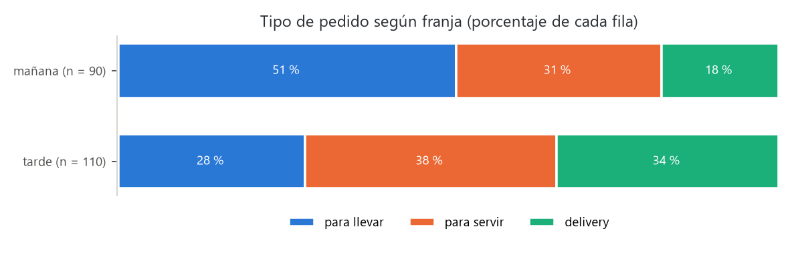
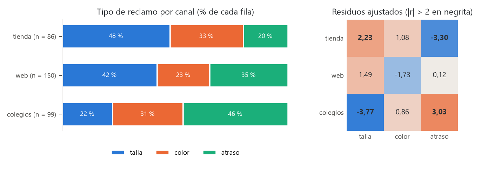

# Unidad 4 · Tablas de contingencia y chi-cuadrado

**Qué vas a poder hacer.** Ordenar dos variables categóricas en una tabla de contingencia, calcular
las frecuencias esperadas bajo independencia, probar la independencia con la chi-cuadrado y sus
grados de libertad, decidir qué hacer cuando hay esperados chicos (juntar categorías, Yates o la
prueba exacta de Fisher), medir la fuerza de la asociación con la V de Cramér y encontrar con los
residuos **dónde** está la asociación.

**Lo que necesitas antes.** El esquema de una prueba de hipótesis (unidad 1) y la chi-cuadrado de
homogeneidad de varias proporciones (unidad 3, sección 6): esta unidad la generaliza a cualquier tabla.
De probabilidades: si dos sucesos son independientes, $P(A \cap B) = P(A)\,P(B)$.

**Tiempo.** Unas 5 horas: 2 de lectura con el ejemplo y el cuaderno, 3 de práctica.

---

## 1. La idea · cuándo dos variables categóricas están asociadas

Una **tabla de contingencia** cuenta cuántas unidades caen en cada combinación de dos variables
categóricas: el canal de venta y el tipo de reclamo, la franja horaria y el tipo de pedido. Con $r$
filas y $c$ columnas es una tabla de $r \times c$.

Dos variables son **independientes** cuando conocer una no cambia lo que se espera de la otra: el
reparto de tipos de reclamo es el mismo en todos los canales. Por eso lo primero que se mira no son
los conteos (que dependen de cuántos reclamos tiene cada canal) sino los **porcentajes de cada fila**
(la distribución condicional). Si las filas tienen perfiles parecidos, no hay asociación; si difieren,
puede haberla, y la prueba dice si la diferencia es más grande que la que produciría el azar.

| Notación | Qué es |
|---|---|
| $o_{ij}$ | frecuencia observada en la fila $i$, columna $j$ |
| $f_{i\cdot}$, $f_{\cdot j}$ | totales de la fila $i$ y de la columna $j$ (los márgenes) |
| $n$ | total de la tabla |
| $e_{ij}$ | frecuencia esperada si las variables fueran independientes |

---

## 2. Las frecuencias esperadas

$$e_{ij} = \frac{f_{i\cdot}\, f_{\cdot j}}{n}$$

**Por qué.** Bajo independencia, la probabilidad de caer en la celda $(i, j)$ es el producto de las
probabilidades de la fila y de la columna, que se estiman con los márgenes:
$\hat P(i, j) = \frac{f_{i\cdot}}{n}\cdot\frac{f_{\cdot j}}{n}$. Multiplicando por $n$ sale la fórmula. Dicho
de otro modo: cada fila se reparte entre las columnas con el **porcentaje global** de cada columna.

Los esperados suman lo mismo que los observados en cada fila y en cada columna. Es la primera
verificación de una cuenta a mano.

---

## 3. El estadístico y sus grados de libertad

$$\chi^2 = \sum_{i=1}^{r}\sum_{j=1}^{c} \frac{(o_{ij} - e_{ij})^2}{e_{ij}} \sim \chi^2_{(r-1)(c-1)} \text{ aproximada, si } H_0 \text{ es cierta.}$$

- $H_0$: las dos variables son independientes. $H_1$: hay asociación (sin dirección: la prueba es
  siempre de cola derecha, porque cualquier alejamiento agranda $\chi^2$).
- Se rechaza si $\chi^2 > \chi^2_{1-\alpha,\,(r-1)(c-1)}$; el valor p es $P(\chi^2_{gl} \ge \chi^2_{obs})$.

**Por qué se divide por $e_{ij}$.** Un conteo se comporta como una Poisson, cuya varianza es su media:
una diferencia de 5 pesa mucho si se esperaban 4 y poco si se esperaban 400. Dividir por $e_{ij}$ pone
todas las celdas en la misma escala.

**Por qué $(r-1)(c-1)$ grados de libertad.** Con los márgenes fijos, basta llenar $(r-1)(c-1)$ celdas
para que las demás queden determinadas (la última fila y la última columna salen por diferencia). En
una tabla de 2 × 2, una sola celda decide todo: 1 grado de libertad.

---

## 4. Supuestos y qué hacer cuando fallan

| Supuesto | Qué pasa si falla | Qué hacer |
|---|---|---|
| Cada unidad cae en **una sola** celda y las unidades son independientes | Si un cliente reclama tres veces o una persona marca varias opciones, los conteos no son independientes y el valor p sale demasiado chico | Contar unidades, no respuestas; o analizar cada opción por separado |
| Se usan **conteos**, no porcentajes ni promedios | Con porcentajes el estadístico cambia con la escala y no significa nada | Volver a los conteos originales |
| Esperados suficientes: todos $e_{ij} \ge 5$ (regla de Cochran, más flexible: ninguno bajo 1 y no más del 20 % de las celdas bajo 5) | La aproximación a la chi-cuadrado falla y el valor p no es confiable | Juntar categorías con sentido (no para buscar significancia); en 2 × 2, usar Fisher |
| Variables categóricas | Una variable continua cortada en tramos pierde información y el resultado depende del corte | Si es continua, usar las pruebas de las unidades 2, 6 o 7 |

**Tablas de 2 × 2.**

- **Corrección de Yates.** Resta 0,5 a cada $|o_{ij} - e_{ij}|$ antes de elevar al cuadrado. Corrige
  que se aproxime una distribución discreta con una continua y hace la prueba más conservadora (valor p
  más alto). Algunos textos la piden solo con esperados entre 5 y 10 y $n < 100$; con muestras grandes
  casi no cambia nada. **Ojo:** `scipy.stats.chi2_contingency` la aplica **por defecto** en toda tabla
  de 2 × 2; para la versión sin corrección se pasa `correction=False`. Informa siempre cuál usaste.
- **Prueba exacta de Fisher.** Cuando hay esperados bajo 5, no se aproxima: con los márgenes fijos, el
  conteo $a$ de la primera celda sigue una hipergeométrica,
  $$P(a) = \frac{\binom{c_1}{a}\binom{n - c_1}{f_1 - a}}{\binom{n}{f_1}},$$
  con $f_1$ el total de la primera fila y $c_1$ el de la primera columna. El valor p bilateral suma las
  probabilidades de todas las tablas posibles que son **tan o menos probables** que la observada. En
  Python: `stats.fisher_exact(tabla)`. Para tablas mayores existen versiones exactas o por simulación;
  en este ramo basta juntar categorías.

---

## 5. Independencia u homogeneidad · la misma cuenta, dos diseños

| | Independencia | Homogeneidad |
|---|---|---|
| Cómo se juntan los datos | **una** muestra de $n$ unidades, cada una clasificada en las dos variables | **varias** muestras, una por fila, de tamaño fijado de antemano |
| Qué márgenes son aleatorios | los dos | solo las columnas |
| $H_0$ | las variables son independientes | la distribución de la columna es igual en todas las poblaciones |
| Cálculo | el mismo: $e_{ij} = f_{i\cdot}f_{\cdot j}/n$ y $(r-1)(c-1)$ gl | el mismo |

La diferencia está en lo que se puede concluir. En la homogeneidad no tiene sentido leer los
porcentajes de **columna** (los tamaños de las filas los fijó quien diseñó el estudio). La prueba de
varias proporciones de la unidad 3 es una homogeneidad con dos columnas, y con dos filas y dos columnas
es exactamente la $z$ de dos proporciones al cuadrado.

---

## 6. Cuánta asociación · la V de Cramér

$\chi^2$ crece con $n$: si se duplica la muestra con los mismos porcentajes, $\chi^2$ se duplica y el
valor p se achica, aunque la asociación sea la misma. Para medir **la fuerza** se divide por lo que
crece:

$$V = \sqrt{\frac{\chi^2}{n\,(k - 1)}}, \qquad k = \min(r, c)$$

$V$ va de 0 (independencia perfecta en la muestra) a 1 (cada fila determina la columna). En una tabla
de 2 × 2, $V$ es el coeficiente $\phi$. Una guía (de Cohen) que depende de $k - 1$:

| $k - 1$ | Pequeño | Mediano | Grande |
|---|---|---|---|
| 1 (tablas de 2 × $c$) | 0,10 | 0,30 | 0,50 |
| 2 (tablas de 3 × 3, 3 × 4…) | 0,07 | 0,21 | 0,35 |

La guía es una referencia, no una regla: lo que importa es si la diferencia de porcentajes cambia una
decisión. Un informe completo da las dos cosas: el valor p (¿es real?) y la V con los porcentajes de
fila (¿cuánto importa?).

---

## 7. Dónde está la asociación · los residuos

La chi-cuadrado es global: dice que hay asociación, no en qué celdas. Para eso se miran los residuos.

- **Residuo de Pearson:** $r_{ij} = \dfrac{o_{ij} - e_{ij}}{\sqrt{e_{ij}}}$. Su cuadrado es el aporte de
  la celda a $\chi^2$.
- **Residuo ajustado (estandarizado):**
  $$d_{ij} = \frac{o_{ij} - e_{ij}}{\sqrt{e_{ij}\left(1 - \dfrac{f_{i\cdot}}{n}\right)\left(1 - \dfrac{f_{\cdot j}}{n}\right)}}$$
  Bajo independencia se comporta como una normal estándar, así que $|d_{ij}| > 2$ (más exacto, 1,96)
  señala una celda con más (positivo) o menos (negativo) casos de los esperados. En Python:
  `Table(tabla).standardized_resids` de `statsmodels`.

**Por qué el ajustado.** El de Pearson tiene varianza menor que 1 (los márgenes están fijos), así que
subestima lo raro de una celda; el ajuste corrige esa varianza. Con muchas celdas, alguna pasará 2 por
azar: en una tabla grande conviene exigir más (por ejemplo, 3) o leer el patrón completo y no una celda
suelta. En una tabla de 2 × 2 los cuatro residuos ajustados valen lo mismo en valor absoluto, y ese
valor es $|z|$.

---

## 8. Ejemplo resuelto · una cafetería de Chillán

Una cafetería del centro de Chillán quiere decidir cuántas personas poner en caja, en mesas y en
despacho según la hora. Un día registró los 200 pedidos según la franja y el tipo:

| Franja | Para llevar | Para servir | Delivery | Total |
|---|---|---|---|---|
| mañana | 46 | 28 | 16 | 90 |
| tarde | 31 | 42 | 37 | 110 |
| Total | 77 | 70 | 53 | 200 |



En la mañana la mitad es para llevar; en la tarde, un tercio es delivery.

**Supuestos.** Cada pedido aparece una sola vez y en una sola celda. Se revisan los esperados en el
paso 3.

**Paso 1 · Pregunta.** ¿El tipo de pedido depende de la franja?

**Paso 2 · Hipótesis.** $H_0$: franja y tipo de pedido son independientes. $H_1$: están asociados.

**Paso 3 · Estadístico.** Esperados, por ejemplo $e_{11} = 90 \cdot 77/200 = 34{,}65$. Observado · esperado:

| Franja | Para llevar | Para servir | Delivery |
|---|---|---|---|
| mañana | 46 · 34,65 | 28 · 31,50 | 16 · 23,85 |
| tarde | 31 · 42,35 | 42 · 38,50 | 37 · 29,15 |

Todos los esperados superan 5. Aportes $(o - e)^2/e$:

| Franja | Para llevar | Para servir | Delivery |
|---|---|---|---|
| mañana | 3,72 | 0,39 | 2,58 |
| tarde | 3,04 | 0,32 | 2,11 |

$\chi^2 = 12{,}16$ con $(2-1)(3-1) = 2$ gl.

**Paso 4 · Valor p.** $P(\chi^2_2 \ge 12{,}16) = 0{,}0023$. Región de rechazo al 5 %: $\chi^2 > 5{,}99$.

**Paso 5 · Conclusión.** El tipo de pedido sí depende de la franja horaria.

**Cuánta y dónde.** $V = \sqrt{12{,}16/(200 \cdot 1)} = 0{,}247$: una asociación entre pequeña y mediana
(sección 6), pero que mueve la dotación. Residuos ajustados:

| Franja | Para llevar | Para servir | Delivery |
|---|---|---|---|
| mañana | 3,32 | -1,04 | -2,53 |
| tarde | -3,32 | 1,04 | 2,53 |

Para llevar en la mañana y delivery en la tarde son las celdas que se apartan ($|d| > 2$); «para
servir» no cambia tanto entre franjas.

**Con Python** (cuaderno `notebooks/u04_chi_cuadrado.ipynb`, datos en `datos/u04_ejemplo.csv`):

```python
from scipy import stats
from statsmodels.stats.contingency_tables import Table

chi = stats.chi2_contingency(tabla)        # sin Yates: la tabla no es de 2 x 2
chi.statistic, chi.dof, chi.pvalue         # 12,16 · 2 · 0,0023
chi.expected_freq                          # los esperados de arriba
np.sqrt(chi.statistic / (tabla.sum() * (min(tabla.shape) - 1)))   # V = 0,247
Table(tabla).standardized_resids           # residuos ajustados
```

**Cómo se lee.** La mañana es de caja (para llevar) y la tarde de despacho (delivery). La decisión: en
la mañana, la persona extra va a la caja; en la tarde, a armar pedidos de delivery. Las mesas no
justifican cambios entre franjas. Como es un solo día, conviene repetir el registro una semana antes
de cambiar turnos.

---

## 9. Errores típicos

| Error | Cómo evitarlo |
|---|---|
| Calcular la chi-cuadrado con porcentajes o con promedios | Solo conteos de unidades |
| Calcular mal los esperados (repartir «a ojo» para que cuadren los márgenes) | $e_{ij} = f_{i\cdot}f_{\cdot j}/n$ en cada celda; después comprueba que filas y columnas sumen lo mismo que los observados |
| Usar $rc - 1$ grados de libertad | Son $(r-1)(c-1)$; el $k - 1 - p$ es de la bondad de ajuste (unidad 5) |
| Seguir adelante con esperados bajo 5 | Junta categorías con sentido o, en 2 × 2, usa Fisher |
| No saber si `scipy` aplicó Yates | En 2 × 2 la aplica por defecto; escribe `correction=False` si quieres la otra e informa cuál usaste |
| Decir «se acepta la independencia» | «No hay evidencia de asociación»; con poca muestra la prueba ve poco |
| Leer un $\chi^2$ grande como asociación fuerte | $\chi^2$ crece con $n$: informa la V de Cramér y los porcentajes de fila |
| Decir dónde está la asociación mirando solo el valor p | Mira los residuos ajustados y el patrón de porcentajes |
| Leer causalidad en una asociación | La tabla muestra que van juntas; una tercera variable puede explicar todo (ejercicio 4.9) |

---

## 10. Práctica

Diez ejercicios: 4.1 a 4.4 básicos, 4.5 a 4.8 intermedios, 4.9 y 4.10 de desafío. Usa $\alpha = 0{,}05$
salvo que se diga otra cosa. Las pautas están en la sección 11. Todos los datos son ficticios.

**4.1 · Gimnasio (básico).** Un gimnasio de Los Ángeles clasificó a 220 socios según su plan y el
horario en que más entrenan:

| Plan | Mañana | Tarde | Noche |
|---|---|---|---|
| mensual | 34 | 51 | 45 |
| anual | 26 | 22 | 42 |

Calcula los esperados, la chi-cuadrado, los grados de libertad, el valor p y la V de Cramér. ¿El
horario depende del plan?

**4.2 · Capacitación y accidentes (básico).** Una constructora registró si cada trabajador tuvo un
accidente con tiempo perdido durante el año:

| Grupo | Con accidente | Sin accidente |
|---|---|---|
| con capacitación | 7 | 78 |
| sin capacitación | 19 | 76 |

(a) Prueba la independencia sin y con la corrección de Yates. (b) Calcula $\phi$. (c) Calcula la $z$
de dos proporciones (unidad 3) y comprueba que $z^2$ es la chi-cuadrado sin Yates. (d) ¿Se puede decir
que la capacitación **reduce** los accidentes?

**4.3 · Leer un resultado (básico).** Un informe dice: «tabla de 3 × 4, $n = 420$, $\chi^2 = 11{,}8$».
¿Cuántos grados de libertad tiene? ¿Cuál es el valor crítico al 5 %? ¿Qué valor p y qué V de Cramér
corresponden? ¿Qué concluyes?

**4.4 · Significativo no es importante (básico).** El estudio A (tabla de 2 × 2, $n = 200$) obtuvo
$\chi^2 = 9{,}6$; el estudio B (tabla de 3 × 3, $n = 5.000$), $\chi^2 = 48$. Calcula el valor p y la V
de cada uno. ¿Cuál muestra la asociación más fuerte?

**4.5 · Medio de pago y edad (intermedio).** Un supermercado de Linares registró 500 compras:

| Edad | Efectivo | Débito | Crédito |
|---|---|---|---|
| 18 a 34 | 18 | 96 | 46 |
| 35 a 54 | 25 | 88 | 67 |
| 55 o más | 52 | 61 | 47 |

Prueba la independencia, calcula la V y usa los residuos ajustados para decir dónde está la
asociación. ¿Qué haría el supermercado con este resultado?

**4.6 · Esperados chicos (intermedio).** Un taller mecánico clasificó 140 órdenes de trabajo:

| Cliente | Mantención | Frenos | Motor | Eléctrico |
|---|---|---|---|---|
| particular | 48 | 22 | 9 | 3 |
| empresa | 30 | 14 | 12 | 2 |

(a) Calcula los esperados. ¿Se cumple la regla? (b) Junta las dos categorías que tenga sentido juntar y
prueba la independencia. (c) Compara con lo que habría dado la tabla original.

**4.7 · Tiempo de espera en tres centros (intermedio).** Una empresa sanitaria encuestó **120, 150 y
130** clientes (cantidades fijadas de antemano) en tres centros de atención sobre cuánto esperaron:

| Centro | Menos de 5 min | 5 a 15 min | Más de 15 min |
|---|---|---|---|
| centro A | 54 | 44 | 22 |
| centro B | 51 | 63 | 36 |
| centro C | 34 | 52 | 44 |

(a) ¿Es una prueba de independencia o de homogeneidad? ¿Qué cambia? (b) Resuélvela con los porcentajes
de fila, la V y los residuos ajustados. (c) ¿Qué centro se revisa primero?

**4.8 · La misma tabla, diez veces más grande (intermedio).** Una encuesta piloto de 60 clientes
cruzó si usan la aplicación y si volvieron a comprar: 18 y 12 entre quienes usan la aplicación (volvió,
no volvió), 12 y 18 entre quienes no. (a) Prueba la independencia sin Yates y con Yates. (b) La encuesta
definitiva de 600 clientes da exactamente los mismos porcentajes. Calcula $\chi^2$, el valor p y la V.
(c) ¿Cambió la asociación?

**4.9 · Dos empresas de reparto y dos zonas (desafío).** Una distribuidora compara las entregas a
tiempo de dos empresas de reparto (A y B), separadas por zona:

| Zona | A (a tiempo/total) | B (a tiempo/total) |
|---|---|---|
| urbana | 180 de 200 | 46 de 50 |
| rural | 30 de 50 | 130 de 200 |

(a) Calcula el porcentaje a tiempo de cada empresa en cada zona y en total. (b) Prueba la asociación
entre empresa y puntualidad en el total y dentro de cada zona (revisa los esperados). (c) ¿Qué empresa
es más puntual? Explica la contradicción.

**4.10 · Fisher a mano (desafío).** Un taller probó un proveedor nuevo de tinta: de 10 lotes del
proveedor nuevo rechazó 1; de 8 del antiguo rechazó 5. (a) Revisa los esperados. (b) Calcula a mano la
prueba exacta de Fisher bilateral. (c) Compara con la chi-cuadrado sin y con Yates. ¿Qué conclusión
informarías?

---

## 11. Pautas

**4.1.** Esperados ($e = f_{i\cdot} f_{\cdot j}/220$):

| Plan | Mañana | Tarde | Noche |
|---|---|---|---|
| mensual | 35,45 | 43,14 | 51,41 |
| anual | 24,55 | 29,86 | 35,59 |

$\chi^2 = 5{,}60$ con 2 gl, bajo el crítico 5,99; $p = 0{,}061$; $V = 0{,}160$. Al 5 % no hay evidencia
de que el horario dependa del plan. La tarde tiene más socios mensuales de lo esperado (residuo ajustado
2,29), pero la prueba global no alcanza: es una pista para mirar con más datos, no una conclusión.

**4.2.** (a) Esperados: 12,28 y 72,72 en la primera fila; 13,72 y 81,28 en la segunda. Sin Yates,
$\chi^2 = 5{,}02$ ($p = 0{,}025$); con Yates, $\chi^2 = 4{,}12$ ($p = 0{,}042$). Las dos rechazan.
(b) $\phi = 0{,}167$, asociación pequeña. (c) Accidentes: 8,2 % con capacitación y 20,0 % sin ella;
$z = -2{,}24$ y $z^2 = 5{,}02$. (d) Hay asociación, pero el estudio es observacional: si se capacitó a
las cuadrillas más ordenadas o con tareas menos riesgosas, la diferencia podría venir de eso. Para
hablar de efecto hace falta asignar la capacitación al azar o comparar trabajadores con tareas
parecidas.

**4.3.** $(3-1)(4-1) = 6$ gl; crítico 12,59. Como $11{,}8 < 12{,}59$, no se rechaza: $p = 0{,}067$.
$V = \sqrt{11{,}8/(420 \cdot 2)} = 0{,}119$. No hay evidencia de asociación al 5 %, y si la hubiera sería
débil.

**4.4.** A: 1 gl, $p = 0{,}0019$, $V = 0{,}219$. B: 4 gl, $p < 0{,}001$, $V = 0{,}069$. B tiene el valor
p más chico y el $\chi^2$ más grande, pero A muestra la asociación **más fuerte** (más de tres veces la
V). La diferencia de B es casi segura y casi irrelevante; con 5.000 casos se detecta cualquier cosa.

**4.5.** Esperados:

| Edad | Efectivo | Débito | Crédito |
|---|---|---|---|
| 18 a 34 | 30,40 | 78,40 | 51,20 |
| 35 a 54 | 34,20 | 88,20 | 57,60 |
| 55 o más | 30,40 | 78,40 | 51,20 |

$\chi^2 = 33{,}10$ con 4 gl, $p < 0{,}001$; $V = 0{,}182$, entre pequeña y mediana para $k - 1 = 2$.
Residuos ajustados:

| Edad | Efectivo | Débito | Crédito |
|---|---|---|---|
| 18 a 34 | -3,03 | 3,38 | -1,07 |
| 35 a 54 | -2,18 | -0,04 | 1,88 |
| 55 o más | 5,28 | -3,34 | -0,86 |

La asociación está en el efectivo de los mayores de 55 (muchos más de los esperados) y en el débito de
los jóvenes. El crédito no se aparta en ningún tramo. Para el supermercado: no eliminar las cajas con
efectivo aunque el promedio general lo sugiera, porque concentran a un grupo de clientes.

**4.6.** (a) Esperados:

| Cliente | Mantención | Frenos | Motor | Eléctrico |
|---|---|---|---|---|
| particular | 45,69 | 21,09 | 12,30 | 2,93 |
| empresa | 32,31 | 14,91 | 8,70 | 2,07 |

Dos de ocho celdas (25 %) quedan bajo 5: no se cumple ni la regla estricta ni la de Cochran. (b) Juntar
**motor y eléctrico** (las dos reparaciones mayores) y no, por ejemplo, eléctrico con mantención. La
tabla de 2 × 3 queda con esperado mínimo 10,77; $\chi^2 = 2{,}03$ con 2 gl, $p = 0{,}362$. No hay
evidencia de que el tipo de servicio dependa del tipo de cliente. (c) La tabla original daba
$\chi^2 = 2{,}52$ y $p = 0{,}472$: la misma conclusión, pero con un valor p en el que no se podía confiar.
Juntar se decide por el sentido de las categorías, nunca mirando qué combinación da significativo.

**4.7.** (a) Homogeneidad: los tamaños de las filas (120, 150, 130) los fijó la empresa. La cuenta es
la misma; cambia la pregunta (¿el reparto de los tiempos de espera es igual en los tres centros?) y no
se leen porcentajes de columna. (b) Porcentajes de fila:

| Centro | Menos de 5 min | 5 a 15 min | Más de 15 min |
|---|---|---|---|
| centro A | 45,0 % | 36,7 % | 18,3 % |
| centro B | 34,0 % | 42,0 % | 24,0 % |
| centro C | 26,2 % | 40,0 % | 33,8 % |

$\chi^2 = 13{,}00$ con 4 gl, $p = 0{,}011$, $V = 0{,}127$ (pequeña). Residuos ajustados:

| Centro | Menos de 5 min | 5 a 15 min | Más de 15 min |
|---|---|---|---|
| centro A | 2,82 | -0,82 | -2,15 |
| centro B | -0,24 | 0,71 | -0,53 |
| centro C | -2,51 | 0,07 | 2,66 |

(c) El **centro C**: tiene más esperas de más de 15 minutos y menos esperas cortas de las que tendría
si atendiera como el promedio. El A es el modelo a copiar.

**4.8.** (a) Esperados de 15 en todas las celdas. Sin Yates, $\chi^2 = 2{,}40$, $p = 0{,}121$; con Yates,
$\chi^2 = 1{,}67$, $p = 0{,}197$. No hay evidencia de asociación. (b) Con 600 clientes y los mismos
porcentajes, $\chi^2 = 24{,}00$ (diez veces más) y $p < 0{,}001$. (c) La asociación **no cambió**:
$V = 0{,}200$ en las dos. Cambió la capacidad de verla. En el piloto, «no se rechaza» nunca quiso decir
«la aplicación no influye».

**4.9.** (a)

| Zona | A | B | A (%) | B (%) |
|---|---|---|---|---|
| urbana | 180/200 | 46/50 | 90,0 % | 92,0 % |
| rural | 30/50 | 130/200 | 60,0 % | 65,0 % |
| total | 210/250 | 176/250 | 84,0 % | 70,4 % |

(b) En el total, $\chi^2 = 13{,}14$ (1 gl, sin Yates), $p = 0{,}0003$: A parece mucho más puntual. En la
zona urbana hay un esperado de 4,80 (atrasos de B): se usa Fisher, $p = 0{,}794$. En la rural,
$\chi^2 = 0{,}43$, $p = 0{,}510$. Dentro de cada zona no hay diferencia, y si la hay favorece a **B**.
(c) Es la **paradoja de Simpson**. A reparte sobre todo en la zona urbana (200 de sus 250 entregas), que
es fácil; B, sobre todo en la rural (200 de 250), que es difícil. El total compara zonas, no empresas.
Antes de castigar a B hay que comparar dentro de cada zona: la zona es la tercera variable que explica
la asociación del total.

**4.10.** (a) Hay 6 lotes rechazados de 18. Esperados: 3,33 y 6,67 en el proveedor nuevo; 2,67 y 5,33 en
el antiguo. Dos celdas bajo 5 (mínimo 2,67): la chi-cuadrado no es confiable. (b) Con márgenes fijos
(10 lotes nuevos, 6 rechazados, 18 en total), los rechazados del proveedor nuevo pueden ser de 0 a 6, y
$\binom{18}{10} = 43.758$:

| Rechazados del nuevo | Probabilidad |
|---|---|
| 0 | 0,0015 |
| 1 | 0,0302 |
| 2 | 0,1697 |
| 3 | 0,3620 |
| 4 | 0,3167 |
| 5 | 0,1086 |
| 6 | 0,0113 |

La observada (1 rechazado) tiene probabilidad 0,0302. Las tablas tan o menos probables son las de 0, 1
y 6: $p = 0{,}0015 + 0{,}0302 + 0{,}0113 = 0{,}043$. (c) Sin Yates, $\chi^2 = 5{,}51$ y $p = 0{,}019$
(demasiado optimista); con Yates, $\chi^2 = 3{,}40$ y $p = 0{,}065$ (demasiado conservador). Se informa
Fisher: al 5 %, el proveedor nuevo tiene menos lotes rechazados. Con 18 lotes, la conclusión es
frágil: un lote más o menos la cambia. Conviene seguir registrando antes de cambiar de proveedor.

---

## 12. Caso integrador · Estampa Sur: ¿el tipo de reclamo depende del canal?

> Estampa Sur es el taller ficticio que recorre el ramo. Sus datos son **simulados** con semilla fija
> por `verificacion/caso_estampa_sur_datos.py` (archivo `datos/reclamos_canal.csv`): no describen ningún
> taller real.

**Lo que recibe de la unidad 3.** La chi-cuadrado de homogeneidad de las tasas de defecto de tres
proveedores (una tabla de 3 × 2) mostró que no son iguales ($p = 0{,}043$). Aquí la misma herramienta
se usa con una tabla de 3 × 3.

Estampa Sur vende por tres canales: su tienda, su página web y contratos con colegios (poleras de
generación y de educación física). Registró 335 reclamos según canal y tipo:

| Canal | Talla | Color | Atraso | Total |
|---|---|---|---|---|
| tienda | 41 | 28 | 17 | 86 |
| web | 63 | 35 | 52 | 150 |
| colegios | 22 | 31 | 46 | 99 |
| Total | 126 | 94 | 115 | 335 |

**Supuestos.** Cada reclamo es de un pedido distinto y se clasificó en un solo tipo (el principal).
Esperados:

| Canal | Talla | Color | Atraso |
|---|---|---|---|
| tienda | 32,35 | 24,13 | 29,52 |
| web | 56,42 | 42,09 | 51,49 |
| colegios | 37,24 | 27,78 | 33,99 |

El mínimo es 24,13: la aproximación es buena.

**Paso 1 · Pregunta.** ¿El tipo de reclamo depende del canal de venta?

**Paso 2 · Hipótesis.** $H_0$: canal y tipo de reclamo son independientes. $H_1$: están asociados.

**Paso 3 · Estadístico.** Aportes $(o - e)^2/e$:

| Canal | Talla | Color | Atraso |
|---|---|---|---|
| tienda | 2,32 | 0,62 | 5,31 |
| web | 0,77 | 1,19 | 0,01 |
| colegios | 6,23 | 0,37 | 4,25 |

$\chi^2 = 21{,}07$ con $(3-1)(3-1) = 4$ gl.

**Paso 4 · Valor p.** p < 0,001. Región de rechazo al 5 %: $\chi^2 > 9{,}49$.

**Paso 5 · Conclusión.** El tipo de reclamo depende del canal de venta.

**Cuánta.** $V = \sqrt{21{,}07/(335 \cdot 2)} = 0{,}177$: entre pequeña y mediana para $k - 1 = 2$ (más
cerca de mediana). Porcentajes de fila:

| Canal | Talla | Color | Atraso |
|---|---|---|---|
| tienda | 47,7 % | 32,6 % | 19,8 % |
| web | 42,0 % | 23,3 % | 34,7 % |
| colegios | 22,2 % | 31,3 % | 46,5 % |
| todos | 37,6 % | 28,1 % | 34,3 % |

**Dónde.** Residuos de Pearson (su cuadrado es el aporte):

| Canal | Talla | Color | Atraso |
|---|---|---|---|
| tienda | 1,52 | 0,79 | -2,30 |
| web | 0,88 | -1,09 | 0,07 |
| colegios | -2,50 | 0,61 | 2,06 |

y residuos ajustados, los que se comparan con 2:

| Canal | Talla | Color | Atraso |
|---|---|---|---|
| tienda | 2,23 | 1,08 | -3,30 |
| web | 1,49 | -1,73 | 0,12 |
| colegios | -3,77 | 0,86 | 3,03 |



Con nueve celdas, cuatro pasan de 2 en valor absoluto y tres pasan de 3: el patrón no es azar. Los
**colegios reclaman por atraso** mucho más de lo esperado y casi no por talla (las tallas vienen en una
planilla del colegio). La **tienda reclama por talla** y casi nunca por atraso (se lleva la prenda en
el momento). La web está cerca del promedio en todo.

**Decisión para Estampa Sur.** El problema de los colegios es de **plazos**, no de calidad: los pedidos
de colegio necesitan una fecha comprometida con holgura y aviso de avance. En la tienda, el problema es
de **tallas**: una tabla de medidas a la vista y un probador reducirían los cambios. Un mismo plan de
mejora para todos los canales gastaría esfuerzo donde no hay problema.

**Lo que pasa a la unidad 5.** La misma suma $\sum (o - e)^2/e$ sirve para preguntar si los datos
siguen una distribución: allí los esperados salen de un modelo (¿las llegadas de pedidos web son
exponenciales?) y los grados de libertad son $k - 1 - p$. En la unidad 11, una tabla de conteos como
esta se modela con una regresión de Poisson.

---

## 13. Para seguir

**En los libros del ramo.**

- Walpole, Myers, Myers y Ye, *Probability & Statistics for Engineers & Scientists* (Pearson, 2017):
  en el capítulo de pruebas de hipótesis, las secciones de bondad de ajuste, prueba de independencia
  para datos categóricos y prueba de homogeneidad.
- Kutner y otros, *Applied Linear Statistical Models* (McGraw-Hill, 2004), para cuando las tablas se
  convierten en modelos (unidad 11).

**Abierto y gratis.**

- Diez, Çetinkaya-Rundel y Barr, *OpenIntro Statistics*, sección 6.4 «Chi-square test for two-way
  tables» (en inglés): https://www.openintro.org/book/os/

**Con el tutor.** Pega `tutor/contexto.md` al inicio de la conversación con cualquier IA y pídele, por
ejemplo: «Dame una tabla de 3 × 4 con una celda que se aparte mucho y corrígeme los esperados, la V de
Cramér y los residuos ajustados».
