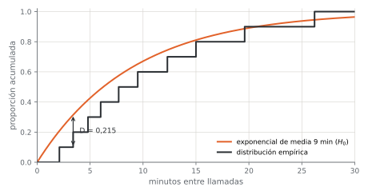
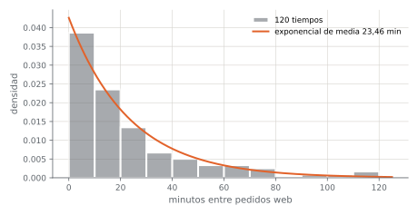
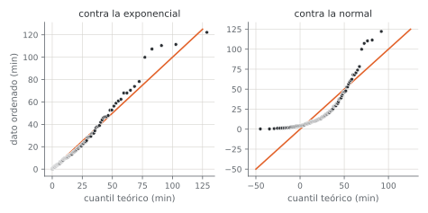

# Unidad 5 · Bondad de ajuste y normalidad

**Qué vas a poder hacer.** Proponer una distribución para unos datos y contrastarla: armar clases y
frecuencias esperadas para una prueba chi-cuadrado y descontar los parámetros estimados de los grados
de libertad; calcular a mano el estadístico de Kolmogorov-Smirnov y saber cuándo su tabla deja de
valer; usar Anderson-Darling y Shapiro-Wilk con Python, y leer un gráfico Q-Q antes de creerle a
cualquier valor p.

**Lo que necesitas antes.** De la unidad 1, los cinco pasos de una prueba y qué significa un valor
p. De la unidad 4, el estadístico chi-cuadrado $\sum (o-e)^2/e$ y la regla de las esperadas mayores
o iguales a 5. De Probabilidades: las distribuciones de Poisson, binomial, exponencial y normal, y
qué es una función de distribución acumulada $F(x) = P(X \le x)$.

**Tiempo.** Unas 6 horas: 2,5 de lectura con el ejemplo y el cuaderno, 3,5 de práctica.

---

## 1. La idea · ¿estos datos vienen de esa distribución?

Casi todo lo que viene en el ramo supone algo sobre la forma de los datos. Una prueba t supone
normalidad; un modelo de colas supone llegadas de Poisson y tiempos exponenciales; una simulación de
inventario necesita una distribución para la demanda. Si el supuesto es falso, el resultado puede ser
falso aunque la cuenta esté bien hecha.

Una **prueba de bondad de ajuste** contrasta:

$$H_0: \text{los datos vienen de la distribución } F_0 \qquad H_1: \text{no vienen de } F_0$$

Fíjate en la dirección. Acá $H_0$ es lo que **quieres** que sea cierto (que el modelo sirva), y la
prueba solo puede juntar evidencia en su contra. Por eso:

> **«No se rechaza» no es «se demuestra».** Un valor p grande dice que los datos no contradicen a
> $F_0$, no que $F_0$ sea la verdadera. Con pocos datos, casi ninguna distribución se rechaza. La
> frase correcta es «el modelo es compatible con los datos», nunca «los datos son normales».

Hay tres familias de herramientas, y se usan juntas:

| Herramienta | Qué compara | Sirve para |
|---|---|---|
| Chi-cuadrado | conteos por clase, observados contra esperados | datos discretos o agrupados en clases |
| Kolmogorov-Smirnov y Anderson-Darling | la distribución acumulada de los datos contra $F_0$ | datos continuos, sin agrupar |
| Shapiro-Wilk y gráfico Q-Q | los datos ordenados contra los cuantiles de la normal (o de otra $F_0$) | normalidad, y ver **cómo** falla el ajuste |

---

## 2. Chi-cuadrado de bondad de ajuste

### Cómo se arma

1. **Clases.** Se divide el recorrido en $k$ clases que no se traslapan y que cubren todo (la última
   suele ser «$c$ o más»). En datos discretos las clases son los valores; en continuos, intervalos.
2. **Probabilidad de cada clase bajo $H_0$:** $p_i = P(X \in \text{clase } i)$, con la $F_0$ propuesta.
3. **Frecuencia esperada:** $e_i = n\,p_i$.
4. **Agrupar** las clases con $e_i < 5$ con sus vecinas, hasta que todas cumplan. Se agrupa mirando
   las **esperadas**, no las observadas.
5. **Estadístico:**

$$\chi^2 = \sum_{i=1}^{k} \frac{(o_i - e_i)^2}{e_i} \;\sim\; \chi^2_{k-1-m} \text{ bajo } H_0$$

donde $k$ es el número de clases **después de agrupar** y $m$ el número de parámetros que se
estimaron con los mismos datos.

### Por qué los grados de libertad son $k - 1 - m$

Los $k$ conteos no son libres: suman $n$, así que basta conocer $k-1$. Eso explica el $-1$. Cada
parámetro estimado con los datos (una media para la Poisson, media y desviación para la normal)
obliga a la distribución ajustada a pasar más cerca de los datos, y gasta otro grado de libertad.

| Distribución propuesta | Parámetros que suelen estimarse | $m$ |
|---|---|---|
| uniforme discreta, dado, binomial con $p$ dado | ninguno | 0 |
| Poisson | $\lambda = \bar x$ | 1 |
| binomial con $n$ conocido | $p = \bar x / n$ | 1 |
| exponencial | la media | 1 |
| normal | $\mu$ y $\sigma$ | 2 |

Si un parámetro viene **de afuera** (una norma, un historial, el fabricante), no se descuenta.

**La intuición.** Cada término $(o_i-e_i)^2/e_i$ mide la sorpresa en una clase, escalada por lo que
se esperaba: 5 intervalos de más pesan mucho si se esperaban 4 y poco si se esperaban 400. Por eso,
además del total, conviene mirar **qué clase aporta más**: dice dónde falla el modelo.

**Cuándo no aplica.** Con esperadas chicas la aproximación chi-cuadrado falla (de ahí la regla del
5). En datos continuos funciona, pero agrupar bota información y el resultado depende de dónde se
pongan los cortes: si se puede, se usa KS o Anderson-Darling.

---

## 3. Kolmogorov-Smirnov

### La distribución empírica

Con $n$ datos ordenados $x_{(1)} \le \dots \le x_{(n)}$, la **función de distribución empírica** es
la fracción de datos que no supera $x$:

$$F_n(x) = \frac{\#\{x_i \le x\}}{n}$$

Es una escalera que sube $1/n$ en cada dato. Si $H_0$ es cierta, la escalera debería pegarse a la
curva $F_0$.

### El estadístico

$$D = \sup_x |F_n(x) - F_0(x)|$$

es la mayor distancia **vertical** entre la escalera y la curva. Como la escalera salta en cada dato,
la mayor distancia ocurre justo antes o justo después de un salto. Para cada dato ordenado se
calculan dos diferencias:

$$D_i^+ = \frac{i}{n} - F_0(x_{(i)}) \qquad D_i^- = F_0(x_{(i)}) - \frac{i-1}{n} \qquad D = \max_i \left(D_i^+,\ D_i^-\right)$$

$D^+$ mira la parte alta del escalón; $D^-$, la parte baja. Calcular solo $|i/n - F_0|$ es un error
frecuente: subestima $D$.

**Región de rechazo:** se rechaza si $D > D_{n,\alpha}$, el valor de la tabla de Kolmogorov-Smirnov.
Para $n > 40$, $D_{n;0,05} \approx 1{,}36/\sqrt n$. El valor p lo da `scipy.stats.kstest`.

**La intuición.** Bajo $H_0$, la distribución de $D$ **no depende de cuál sea $F_0$** (si es
continua y está completamente especificada): al transformar cada dato con $u = F_0(x)$, cualquier
continua se vuelve uniforme entre 0 y 1. Por eso una sola tabla sirve para la normal, la exponencial
o la que sea.

### Supuestos

- $F_0$ es **continua** (para conteos se usa chi-cuadrado).
- $F_0$ está **completamente especificada** antes de mirar los datos: sus parámetros vienen de
  afuera. Este supuesto es el que más se rompe, y merece su propia sección.

---

## 4. Estimar los parámetros cambia la distribución del estadístico

Supón que quieres probar normalidad y no conoces $\mu$ ni $\sigma$. Lo natural es usar $\bar x$ y
$s$ de la muestra y aplicar KS. El problema: la normal con $\bar x$ y $s$ **se ajustó a esos mismos
datos**, así que queda más cerca de la escalera de lo que quedaría la verdadera. $D$ sale más chico
de lo que la tabla espera, y la tabla de KS (hecha para $F_0$ fija) da valores críticos demasiado
grandes.

Resultado: la prueba casi nunca rechaza. El nivel nominal es 5 %, pero el real es mucho menor, y la
prueba pierde potencia. El ejercicio 5.10 lo mide por simulación.

**La corrección.** Lilliefors calculó por simulación los valores críticos cuando se estiman los
parámetros de una normal (y después de una exponencial). Para la normal y $n > 30$, al 5 %:

$$D_{\text{crítico}} \approx \frac{0{,}886}{\sqrt n} \quad \text{en vez de} \quad \frac{1{,}36}{\sqrt n}$$

En Python: `statsmodels.stats.diagnostic.lilliefors(x, dist="norm")` o `dist="exp"`. El
estadístico es el mismo $D$; cambia el valor p.

> La misma idea vale para la chi-cuadrado (el $-m$ de los grados de libertad) y para Anderson-Darling
> (sus valores críticos cambian según qué se estimó). **Siempre que un parámetro sale de los datos,
> la distribución del estadístico cambia.**

---

## 5. Anderson-Darling

KS mira **una** distancia, la mayor, y es poco sensible en las colas: allí $F_0$ está cerca de 0 o de
1 y las diferencias son chicas en valor absoluto aunque sean grandes en proporción. Anderson-Darling
suma todas las diferencias al cuadrado y les da más peso donde $F_0(1-F_0)$ es chico, o sea, en las
colas:

$$A^2 = n \int \frac{\left(F_n(x) - F_0(x)\right)^2}{F_0(x)\left(1 - F_0(x)\right)}\, dF_0(x)$$

Con los datos ordenados y $F_i = F_0(x_{(i)})$, la integral se calcula así:

$$A^2 = -n - \frac{1}{n} \sum_{i=1}^{n} (2i-1)\left[\ln F_i + \ln\left(1 - F_{n+1-i}\right)\right]$$

Se rechaza si $A^2$ supera el valor crítico. Con $F_0$ completamente especificada, al 5 % es
2,492 (sirve desde $n = 5$). Si se estiman parámetros, el valor crítico depende de la distribución y
de qué se estimó; `scipy.stats.anderson(x, dist="norm")` o `dist="expon"` los trae ya corregidos.

**Cuándo preferirla.** Cuando importan las colas: tiempos de espera largos, demandas extremas,
cargas máximas. Es más potente que KS en casi todas las alternativas.

---

## 6. Shapiro-Wilk · la prueba de normalidad

Shapiro-Wilk sirve solo para la normal y es, en general, la más potente para ese caso. Su
estadístico es

$$W = \frac{\left(\sum_{i=1}^{n} a_i\, x_{(i)}\right)^2}{\sum_{i=1}^{n} (x_i - \bar x)^2}$$

donde los $a_i$ salen de los valores esperados de los datos ordenados de una normal estándar. **La
intuición:** $W$ es, casi, el cuadrado de la correlación entre los datos ordenados y los cuantiles
normales; es decir, mide qué tan recto es el gráfico Q-Q. $W$ cerca de 1 es compatible con
normalidad; $W$ chico, no.

Los cinco pasos son los de siempre: $H_0$: normal, $H_1$: no normal, $W$ con su distribución
tabulada (la da `scipy.stats.shapiro`), valor p, conclusión. No hay que estimar nada aparte: la
prueba ya considera que $\mu$ y $\sigma$ son desconocidas.

**Dos advertencias de tamaño.**

- **Con pocos datos** (menos de 15 o 20) casi nada se rechaza: la prueba no tiene potencia. Un p
  grande con $n = 8$ no dice mucho.
- **Con muchos datos** (miles) se rechaza por desviaciones mínimas, sin importancia práctica. Una
  prueba t o un ANOVA toleran bien desvíos leves de normalidad con $n$ grande.

En los dos casos manda el gráfico Q-Q.

---

## 7. El gráfico Q-Q

Se ordenan los datos y se grafica cada $x_{(i)}$ contra el cuantil que $F_0$ predice para su
posición:

$$q_i = F_0^{-1}(p_i) \qquad p_i = \frac{i - 0{,}5}{n} \quad \text{o bien} \quad p_i = \frac{i - 0{,}375}{n + 0{,}25} \;(\text{Blom})$$

Las dos posiciones son convenciones; Blom es la que usa la normal en muchos programas. Si $F_0$
describe bien los datos, los puntos caen sobre una recta. Para la normal estándar se grafica
$x_{(i)}$ contra $z_i$ y la recta tiene pendiente $s$ y corte $\bar x$.

| Lo que se ve | Qué significa |
|---|---|
| puntos sobre la recta | el modelo es razonable |
| curva cóncava hacia arriba (los puntos de la derecha suben por encima) | asimetría a la derecha: tiempos, montos, ingresos |
| forma de S, con las dos puntas alejándose de la recta | colas más pesadas que la normal |
| S invertida, puntas hacia la recta | colas más livianas (datos acotados, casi uniformes) |
| un punto suelto en un extremo | un posible atípico: revisarlo antes de concluir |
| escalones horizontales | datos redondeados o discretos |

El Q-Q no da un valor p, pero dice **cómo** falla el ajuste, y eso decide qué hacer: transformar
(logaritmo para la asimetría), cambiar de modelo (exponencial, lognormal) o usar un método que no
suponga normalidad.

---

## 8. Qué prueba usar

| Situación | Prueba |
|---|---|
| Conteos (Poisson, binomial, geométrica) o datos ya agrupados | chi-cuadrado, con $k - 1 - m$ grados de libertad |
| Continua, $F_0$ completamente especificada | KS o Anderson-Darling |
| Continua, parámetros estimados de los datos | Lilliefors (KS corregido) o Anderson-Darling con sus valores críticos corregidos |
| Normalidad, con $\mu$ y $\sigma$ desconocidas | Shapiro-Wilk, siempre con el Q-Q al lado |
| Supuesto de normalidad de un ANOVA o una regresión | Shapiro-Wilk y Q-Q **de los residuos**, no de la variable cruda (unidades 7, 9 y 10) |

**Supuestos comunes a todas:** observaciones independientes (si los datos son una serie de tiempo
con inercia, ninguna de estas tablas vale) y una sola población (dos turnos con medias distintas
mezclados no siguen ninguna distribución simple).

---

## 9. Ejemplo resuelto · las llamadas de una pizzería

Una pizzería de Talca quiere decidir cuántas personas atienden el teléfono los viernes en la noche.
Para modelar la carga necesita saber cómo llegan las llamadas.

### Parte A · ¿El número de llamadas por intervalo sigue una Poisson?

Registró las llamadas en 120 intervalos de 15 minutos (los viernes de un mes):

| Llamadas en 15 min | 0 | 1 | 2 | 3 | 4 | 5 | 6 |
|---|---|---|---|---|---|---|---|
| Intervalos | 27 | 36 | 30 | 17 | 6 | 3 | 1 |

**Paso 1 · La pregunta.** ¿Las llamadas llegan al azar y de forma pareja en el tiempo, como predice
una Poisson?

**Supuestos.** Intervalos independientes entre sí; una sola tasa (todos los intervalos son de la
misma franja, viernes de 20 a 23 h).

**Paso 2 · Hipótesis.** $H_0$: el número de llamadas por intervalo sigue una Poisson. $H_1$: no la
sigue. La tasa no se conoce: se estima.

$$\hat\lambda = \bar x = \frac{0 \cdot 27 + 1 \cdot 36 + 2 \cdot 30 + 3 \cdot 17 + 4 \cdot 6 + 5 \cdot 3 + 6 \cdot 1}{120} = \frac{192}{120} = 1{,}60$$

**Paso 3 · Esperadas y estadístico.** Con $P(X = k) = e^{-1{,}6}\,1{,}6^k/k!$ y $e_k = 120\,P(X=k)$,
las esperadas de 4 y de «5 o más» son 6,62 y 2,84. La segunda es menor que 5: se agrupan las tres
últimas clases en «4 o más» ($o = 6 + 3 + 1 = 10$).

| Clase | $o_i$ | $e_i$ | $(o_i - e_i)^2 / e_i$ |
|---|---|---|---|
| 0 | 27 | 24,23 | 0,317 |
| 1 | 36 | 38,76 | 0,197 |
| 2 | 30 | 31,01 | 0,033 |
| 3 | 17 | 16,54 | 0,013 |
| 4 o más | 10 | 9,46 | 0,031 |
| **Total** | 120 | 120,00 | **0,591** |

Quedan $k = 5$ clases y se estimó un parámetro: $gl = 5 - 1 - 1 = 3$.

**Paso 4 · Valor p y región de rechazo.** $\chi^2_{0,95;\,3} = 7{,}815$. Como $0{,}591 < 7{,}815$, no
se rechaza; el valor p es p = 0,898.

**Paso 5 · Conclusión.** El conteo de llamadas es compatible con una Poisson de 1,6 llamadas cada 15
minutos. Si la llegada es Poisson, el tiempo entre llamadas es exponencial con media
$15/1{,}6 = 9{,}38$ minutos. Eso se contrasta en la parte B.

### Parte B · ¿Los tiempos entre llamadas son exponenciales de media 9 minutos?

La central telefónica informa que, en su historial anual, el promedio entre llamadas del viernes es
de **9 minutos**. La pizzería midió 10 tiempos seguidos (minutos), ya ordenados: 2,1; 3,4; 4,8; 6,0;
7,7; 9,5; 12,3; 15,0; 19,6; 26,2. Su media es 10,66.

**Pregunta.** ¿Los tiempos siguen la exponencial de media 9 que dice la central?

**Hipótesis.** $H_0$: $F_0(x) = 1 - e^{-x/9}$. $H_1$: los tiempos no siguen esa distribución. La media
viene del historial, **no de estos datos**: $F_0$ está completamente especificada y la tabla de KS
vale.

**Estadístico.**

| $i$ | $x_{(i)}$ | $i/n$ | $F_0(x_{(i)})$ | $D_i^+$ | $D_i^-$ |
|---|---|---|---|---|---|
| 1 | 2,1 | 0,1 | 0,2081 | -0,1081 | 0,2081 |
| 2 | 3,4 | 0,2 | 0,3146 | -0,1146 | 0,2146 |
| 3 | 4,8 | 0,3 | 0,4134 | -0,1134 | 0,2134 |
| 4 | 6,0 | 0,4 | 0,4866 | -0,0866 | 0,1866 |
| 5 | 7,7 | 0,5 | 0,5750 | -0,0750 | 0,1750 |
| 6 | 9,5 | 0,6 | 0,6520 | -0,0520 | 0,1520 |
| 7 | 12,3 | 0,7 | 0,7450 | -0,0450 | 0,1450 |
| 8 | 15,0 | 0,8 | 0,8111 | -0,0111 | 0,1111 |
| 9 | 19,6 | 0,9 | 0,8867 | 0,0133 | 0,0867 |
| 10 | 26,2 | 1,0 | 0,9456 | 0,0544 | 0,0456 |

($D_i^- = F_0(x_{(i)}) - (i-1)/n$.) El máximo está en $D_2^- = 0{,}2146$: a los 3,4 minutos la
exponencial predice que el 31 % de los tiempos ya terminó, y en la muestra solo había terminado el
10 % (uno de diez). Fíjate que con solo $D^+$ el máximo habría sido 0,0544.



**Valor p y región de rechazo.** Para $n = 10$ y $\alpha = 0{,}05$, $D_{10;\,0,05} = 0{,}409$. Como
$0{,}2146 < 0{,}409$, no se rechaza: p = 0,672.

**Conclusión.** Los 10 tiempos son compatibles con la exponencial de media 9 minutos de la central.
Con 10 datos esto es poco exigente: la prueba no detectaría diferencias moderadas.

### Parte C · Con Python, y una advertencia sobre la normal

```python
from scipy import stats
import numpy as np

conteo = [27, 36, 30, 17, 10]                  # 0, 1, 2, 3 y «4 o más»
lam = 1.6
p = [stats.poisson.pmf(k, lam) for k in range(4)] + [stats.poisson.sf(3, lam)]
stats.chisquare(conteo, 120 * np.array(p), ddof=1)   # ddof=1: un parámetro estimado → gl = 3

t = [2.1, 3.4, 4.8, 6.0, 7.7, 9.5, 12.3, 15.0, 19.6, 26.2]
stats.kstest(t, "expon", args=(0, 9))          # loc = 0, scale = media → D = 0,2146
stats.shapiro(t)                               # W = 0,920
```

`chisquare` y `kstest` devuelven exactamente lo calculado a mano. El cuaderno
`notebooks/u05_bondad_de_ajuste.ipynb` lo reproduce con `datos/u05_pizzeria_llamadas.csv` y
`datos/u05_pizzeria_tiempos.csv`.

Shapiro-Wilk sobre los mismos 10 tiempos da $W$ = 0,920 y p = 0,357: **tampoco rechaza la
normalidad**. Los datos no pueden ser normales y exponenciales a la vez; lo que pasa es que con 10
datos ninguna de las dos pruebas tiene fuerza para descartar nada. Un tiempo de espera no puede ser
negativo y su distribución es asimétrica: la exponencial tiene sentido físico; la normal, no. El
modelo se elige por el mecanismo y se contrasta con la prueba, no al revés.

**Cómo se lee.** El conteo por intervalo y los tiempos entre llamadas cuentan la misma historia:
llamadas al azar a razón de 1,6 cada 15 minutos (una cada 9 a 9,4 minutos). La pizzería puede usar
un modelo de colas con llegadas de Poisson para decidir cuántas personas contestan. Antes de fijarlo,
conviene juntar más tiempos: con 10 datos, el KS solo descarta modelos muy equivocados.

---

## 10. Errores típicos

| Error | Cómo evitarlo |
|---|---|
| Concluir «los datos son normales» (o «son Poisson») porque no se rechazó | La conclusión es «el modelo es compatible con los datos»; con pocos datos casi nada se rechaza |
| No descontar los parámetros estimados en la chi-cuadrado | $gl = k - 1 - m$, con $k$ contado **después** de agrupar |
| Agrupar mirando las observadas | Se agrupa hasta que cada **esperada** sea al menos 5 |
| Usar la tabla de KS con la media y la desviación sacadas de los mismos datos | Es Lilliefors: usa `lilliefors` de statsmodels o Anderson-Darling con sus valores corregidos |
| Calcular $D$ solo con $i/n - F_0(x_{(i)})$ | Se calculan $D^+$ y $D^-$; el máximo puede estar en la parte baja del escalón |
| Usar KS para conteos | KS supone $F_0$ continua; para conteos, chi-cuadrado |
| Mirar el valor p de Shapiro y no el Q-Q | El Q-Q dice cómo falla el ajuste (asimetría, colas, un atípico) y qué hacer |
| Rechazar normalidad con 5.000 datos y abandonar la prueba t | Con $n$ grande se detectan desvíos sin importancia; el Q-Q y el tamaño muestral deciden |
| Probar normalidad de la variable cruda en un ANOVA | El supuesto es sobre los **residuos** (unidades 7 y 9) |

---

## 11. Práctica

Diez ejercicios: 5.1 a 5.4 básicos, 5.5 a 5.8 intermedios, 5.9 y 5.10 de desafío. Usa $\alpha = 0{,}05$
salvo que se diga otra cosa. Las pautas están en la sección 12.

**5.1 · Grados de libertad (básico).** Para cada caso, di los grados de libertad y el valor crítico
$\chi^2_{0,95}$. (a) Un dado: 6 caras, $H_0$: equilibrado. (b) Llegadas por minuto con Poisson y
$\lambda$ estimado; 8 clases de las cuales las tres últimas se agrupan en una. (c) Una normal con
$\mu$ y $\sigma$ estimadas, 8 clases. (d) Una binomial con $n = 4$ y $p = 0{,}3$ que fija el
fabricante, 5 clases (0 a 4).

**5.2 · Boletas por día (básico).** Una ferretería de Los Ángeles quiere saber si el sábado necesita
más cajeros. En una semana típica emitió estas boletas. ¿Los días son igual de cargados?

| Día | lunes | martes | miércoles | jueves | viernes | sábado |
|---|---|---|---|---|---|---|
| Boletas | 58 | 44 | 41 | 47 | 52 | 68 |

**5.3 · Bolsas de harina (básico).** Un molino declara que el peso de sus bolsas de 1 kg es normal
con media 1.000 g y desviación 8 g. Una panadería pesa 6 bolsas: 991, 1.004, 996, 1.013, 1.000 y
1.009 g. Haz la prueba de Kolmogorov-Smirnov a mano contra la distribución declarada.

**5.4 · Un Q-Q a mano (básico).** Seis pernos miden 49,2; 49,8; 50,0; 50,1; 50,4 y 51,9 mm. (a)
Calcula las posiciones de Blom y los cuantiles normales $z_i$. (b) Calcula la correlación entre los
datos ordenados y los $z_i$ y repítela sin el perno de 51,9 mm. (c) Shapiro-Wilk da $W$ = 0,886.
¿Qué dicen el Q-Q y la prueba?

**5.5 · Fallas en rollos de tela (intermedio).** Una tejeduría revisa 100 rollos y cuenta las fallas
de cada uno. ¿Las fallas por rollo siguen una Poisson? Si no, ¿qué patrón muestran los datos?

| Fallas por rollo | 0 | 1 | 2 | 3 | 4 | 5 |
|---|---|---|---|---|---|---|
| Rollos | 40 | 26 | 15 | 10 | 5 | 4 |

**5.6 · Frascos defectuosos por caja (intermedio).** Una envasadora revisa 150 cajas de 4 frascos y
cuenta los defectuosos de cada caja. ¿Sigue una binomial con $n = 4$ y $p$ estimado? Si los frascos
salieran malos «por tandas» (una caja con uno malo tiende a tener más), ¿qué clase mostraría el
problema?

| Defectuosos por caja | 0 | 1 | 2 | 3 | 4 |
|---|---|---|---|---|---|
| Cajas | 96 | 42 | 10 | 2 | 0 |

**5.7 · Paquetes de café (intermedio).** Una tostaduría pesó 200 paquetes; la media fue 250,1 g y la
desviación 2,9 g. Contrasta normalidad con chi-cuadrado usando estas clases.

| Peso (g) | menos de 246 | 246 a 248 | 248 a 250 | 250 a 252 | 252 a 254 | 254 o más |
|---|---|---|---|---|---|---|
| Paquetes | 18 | 27 | 52 | 49 | 37 | 17 |

**5.8 · El mismo $D$, dos conclusiones (intermedio).** Un analista contrasta la normalidad de 50
tiempos de proceso. Estima $\mu$ y $\sigma$ con la muestra y obtiene $D = 0{,}152$. (a) ¿Qué concluye
con la tabla de KS? (b) ¿Y con el valor crítico de Lilliefors? (c) ¿Cuál vale y por qué?

**5.9 · Anderson-Darling a mano (desafío).** Un servicio técnico afirma que sus tiempos de reparación
son exponenciales con media 4 horas. Cinco reparaciones duraron 0,6; 1,9; 3,1; 5,2 y 11,8 h. (a)
Calcula $A^2$ y $D$ y decide con cada uno. (b) Cambia el último tiempo por 24,0 h y recalcula los
dos. ¿Cuál reacciona más a una cola larga y por qué?

**5.10 · Medir el error de usar KS con parámetros estimados (desafío).** Con Python y la semilla 505,
simula 5.000 muestras de 30 datos de una normal estándar. En cada una estima media y desviación y
calcula $D$ contra esa normal ajustada. (a) ¿Qué fracción supera el valor crítico de la tabla de KS
para $n = 30$? (b) ¿Cuál es el percentil 95 de los $D$ simulados y cómo se compara con el de
Lilliefors? (c) ¿Qué fracción supera el valor de Lilliefors?

```python
rng = np.random.default_rng(505)
D = []
for _ in range(5000):
    m = rng.normal(0, 1, 30)
    D.append(stats.kstest(m, stats.norm(m.mean(), m.std(ddof=1)).cdf).statistic)
```

---

## 12. Pautas

**5.1.** (a) Nada se estima: 5 gl, $\chi^2_{0,95}$ = 11,07. (b) Quedan 6 clases y se estimó
$\lambda$: 4 gl, 9,49. (c) Se estimaron dos parámetros: $8 - 1 - 2$ = 5 gl, 11,07. (d) $p$ viene del
fabricante: 4 gl, 9,49. Los mismos grados de libertad pueden salir de caminos distintos; lo que
importa es contar clases finales y parámetros sacados de los datos.

**5.2.** Hay 310 boletas: bajo $H_0$ cada día espera $310/6 = 51{,}67$. Los aportes son 0,776, 1,138,
2,202, 0,422, 0,002 y 5,163 (el sábado aporta más de la mitad). $\chi^2 = 9{,}70$ con 5 gl; el valor
crítico es 11,07 y p = 0,084. No se rechaza al 5 %: con una semana de datos no hay evidencia
suficiente de que los días difieran. **No** significa que sean iguales: el sábado está 32 % sobre el
promedio. Antes de decidir los cajeros conviene juntar cuatro o cinco semanas; si el patrón se
mantiene, la prueba lo va a detectar.

**5.3.** Ordenados: 991, 996, 1.000, 1.004, 1.009, 1.013. Con $F_0 = \Phi\left((x - 1.000)/8\right)$:
0,1303; 0,3085; 0,5000; 0,6915; 0,8697; 0,9479. Los $D^-$ son 0,1303; 0,1419; 0,1667; 0,1915;
0,2030 y 0,1146, y los $D^+$ no pasan de 0,0521. $D = 0{,}2030$, menor que $D_{6;\,0,05} = 0{,}519$:
no se rechaza (p = 0,925). Las bolsas son compatibles con lo que declara el molino. Con 6 bolsas el
valor crítico es enorme: la prueba solo detectaría un incumplimiento grosero.

**5.4.** (a) Posiciones $(i - 0{,}375)/6{,}25$: 0,100; 0,260; 0,420; 0,580; 0,740; 0,900. Cuantiles:
-1,28; -0,64; -0,20; 0,20; 0,64; 1,28. (b) La correlación del Q-Q es 0,929; sin el perno de 51,9 sube
a 0,966. (c) Shapiro da $W$ = 0,886 y p = 0,296: no rechaza. El Q-Q, en cambio, muestra cinco puntos
casi en recta y uno muy arriba: un perno 1,5 mm más largo que el siguiente. Con 6 datos la prueba no
tiene potencia para declararlo raro, pero el gráfico ya lo señala. Hay que revisar ese perno
(¿otro lote, un error de medición?) antes de suponer normalidad.

**5.5.** $\hat\lambda = 126/100 = 1{,}26$. Esperadas para 0 a 5 o más: 28,37; 35,74; 22,52; 9,46;
2,98 y 0,94. Se agrupa en «3 o más» (o = 19, e = 13,38).

| Clase | 0 | 1 | 2 | 3 o más |
|---|---|---|---|---|
| $o_i$ | 40 | 26 | 15 | 19 |
| $e_i$ | 28,37 | 35,74 | 22,52 | 13,38 |
| Aporte | 4,77 | 2,65 | 2,51 | 2,36 |

$\chi^2 = 12{,}30$ con $4 - 1 - 1 = 2$ gl (crítico 5,99): se rechaza, p = 0,0021. El patrón: sobran
rollos sin fallas **y** rollos con muchas, y faltan los del medio. La varianza de los conteos (1,99)
es casi el doble de la media (1,26), y en una Poisson son iguales. Eso es **sobredispersión**: típico
de dos poblaciones mezcladas (un telar bueno y uno con problemas). La acción es separar los rollos por
telar y repetir la prueba en cada uno.

**5.6.** $\hat p = 68/600 = 0{,}1133$. Esperadas con la binomial(4; 0,1133) para 0 a 4: 92,71; 47,40;
9,09; 0,77 y 0,02. Las tres últimas se agrupan en «2 o más» (o = 12, e = 9,89). Con 3 clases y un
parámetro queda 1 gl. $\chi^2 = 1{,}184$, menor que 3,84: no se rechaza (p = 0,277). Los
defectuosos por caja son compatibles con frascos que fallan de forma independiente. Si fallaran por
tandas, el exceso aparecería en la clase «2 o más» (y en la de 0), como en 5.5.

**5.7.** Con $\Phi$ y media 250,1 y desviación 2,9, las probabilidades de las clases son 0,0787;
0,1558; 0,2518; 0,2576; 0,1668 y 0,0893, y las esperadas, 15,74; 31,16; 50,35; 51,52; 33,37 y 17,87
(todas sobre 5). $\chi^2 = 1{,}49$ con $6 - 1 - 2 = 3$ gl (crítico 7,81): no se rechaza, p = 0,684. El
peso de los paquetes es compatible con una normal; la tostaduría puede usarla para estimar cuántos
paquetes quedan bajo el peso declarado.

**5.8.** (a) Tabla de KS: $1{,}36/\sqrt{50} = 0{,}192$. Como $0{,}152 < 0{,}192$, no rechaza
(p = 0,179). (b) Lilliefors: $0{,}886/\sqrt{50} = 0{,}125$. Como $0{,}152 > 0{,}125$, rechaza
(p = 0,006). (c) Vale Lilliefors: la media y la desviación salieron de los mismos 50 datos, así que
la normal ajustada ya está «acomodada» a la muestra y $D$ es naturalmente más chico. La tabla de KS
supone una $F_0$ fija y aquí da una conclusión equivocada.

**5.9.** (a) Con $F_0 = 1 - e^{-x/4}$: $F_i$ = 0,1393; 0,3781; 0,5393; 0,7275; 0,9477. Los términos
$(2i-1)\left[\ln F_i + \ln(1 - F_{6-i})\right]$ son -4,921; -6,818; -6,962; -5,552 y -1,834; suman
-26,087, así que $A^2 = -5 + 26{,}087/5 = 0{,}217$. Es menor que 2,492: no se rechaza. KS: $D$ =
0,1781, menor que $D_{5;\,0,05} = 0{,}563$ (p = 0,989). (b) Con 24,0 h, $F_5$ pasa a 0,9975: $A^2$
sube a 0,735 (más del triple) y $D$ solo a 0,1975. Ninguno rechaza todavía con 5 datos, pero
Anderson-Darling **reacciona mucho más**: su peso $1/[F_0(1-F_0)]$ es enorme cuando $F_0$ está cerca
de 1, justo donde cae una reparación muy larga. Si lo que preocupa son las reparaciones eternas,
Anderson-Darling es la prueba.

**5.10.** (a) De las 5.000 muestras, 0 de 5.000 superan el valor de la tabla de KS para $n = 30$
(0,242): 0,00 %, cuando debería ser 5 %. La prueba nunca habría rechazado una normal verdadera,
y por lo mismo casi nunca rechazaría una falsa. (b) El percentil 95 simulado es 0,157, al lado del
de Lilliefors ($0{,}886/\sqrt{30} = 0{,}162$) y lejos de 0,242. (c) Con el valor de Lilliefors se
rechaza el 4,2 % de las veces: muy cerca del 5 % nominal (la diferencia es el error de la
aproximación y de la simulación). La simulación es la prueba de la sección 4: estimar los
parámetros achica $D$, y la tabla tiene que corregirse.

---

## 13. Caso integrador · Estampa Sur, ¿cómo llegan los pedidos web?

> Estampa Sur es el taller ficticio que recorre el ramo. Sus datos son simulados con semilla fija por
> `verificacion/caso_estampa_sur_datos.py` (en `datos/`). **Lo que trae de la unidad 4:** el tipo de
> reclamo depende del canal de venta ($\chi^2$ = 21,07; p < 0,001), y el canal web reúne 150 de los 335 reclamos. Para planificar ese canal (cuántas personas lo atienden, cada cuánto se revisa) el taller
> necesita un modelo de cómo llegan sus pedidos.

**Los datos.** `datos/llegadas.csv`: 120 tiempos entre pedidos web consecutivos, en minutos. Media
23,46 min, desviación 25,94 min, mediana 13,2 min, de 0,3 a 122,2 min. Que la desviación sea casi
igual a la media (coeficiente de variación 1,11) y la mediana mucho menor que la media ya apunta a
una exponencial: en ella, la desviación es igual a la media y la mediana es el 69 % de la media.



**La pregunta.** ¿Los tiempos entre pedidos siguen una exponencial? (Si es así, los pedidos llegan
como un proceso de Poisson.)

**Supuestos.** Pedidos independientes; una sola tasa en el período (si de noche llegaran muchos menos,
habría que separar franjas).

**Prueba 1 · Kolmogorov-Smirnov.** $H_0$: exponencial; la media se estima con los datos (23,46). El
script del caso obtiene $D$ = 0,0746 y p = 0,49. Pero la media salió de los mismos datos: ese valor
p es optimista (sección 4). Lilliefors para la exponencial, con el mismo $D$, da p = 0,32. Las dos
versiones no rechazan; la corregida es la que vale.

**Prueba 2 · Chi-cuadrado por clases.** Con la exponencial de media 23,46,
$p_i = e^{-a/23{,}46} - e^{-b/23{,}46}$ para cada clase $[a, b)$:

| Minutos | 0 a 10 | 10 a 20 | 20 a 30 | 30 a 45 | 45 a 60 | 60 o más |
|---|---|---|---|---|---|---|
| Observados | 46 | 28 | 16 | 10 | 8 | 12 |
| Esperados | 41,64 | 27,19 | 17,76 | 15,78 | 8,33 | 9,30 |
| Aporte | 0,456 | 0,024 | 0,174 | 2,118 | 0,013 | 0,783 |

$\chi^2 = 3{,}57$ con $6 - 1 - 1 = 4$ gl (crítico 9,49): no se rechaza, p = 0,47. El mayor aporte
está entre 30 y 45 minutos (hubo 10 tiempos donde se esperaban 16), pero es una diferencia que el
azar explica.

**Prueba 3 · Anderson-Darling.** Contra la exponencial con la media estimada, $A^2$ = 0,722; el
valor crítico al 5 % para este caso (escala estimada) es 1,314. No se rechaza (p ≥ 0,15). Como mira
las colas, confirma que los tiempos largos (sobre 60 minutos) también calzan.

**Prueba 4 · ¿Y si se hubiera supuesto normalidad?** Shapiro-Wilk da $W$ = 0,774, p < 0,001: se
rechaza con fuerza. El Q-Q lo muestra: contra la exponencial los puntos siguen la recta (los cuatro tiempos más largos quedan algo por
encima, una cola un poco más pesada que Anderson-Darling no alcanza a rechazar); contra la
normal se curvan hacia arriba (asimetría a la derecha) y los primeros quedan por encima de la recta
porque un tiempo no puede ser negativo.



```python
x = pd.read_csv("datos/llegadas.csv").minutos
stats.kstest(x, "expon", args=(0, x.mean()))      # D = 0,0746; p optimista
lilliefors(x, dist="exp")                         # mismo D; p corregido
stats.anderson(x, dist="expon", method="interpolate")
stats.shapiro(x)
```

**Lectura.** Las tres pruebas de ajuste coinciden: los tiempos entre pedidos web son compatibles con
una exponencial de media 23,46 minutos, es decir, una llegada de Poisson con
$\lambda = 60/23{,}46 = 2{,}56$ pedidos por hora. Con ese modelo el taller puede calcular, por
ejemplo, la probabilidad de que pase más de una hora sin pedidos: $e^{-60/23{,}46}$ = 7,8 %. No
hay que leerlo como «los tiempos son exponenciales»: es el modelo más simple que los datos no
contradicen, y basta para dimensionar la atención del canal web.

**Lo que pasa a las unidades siguientes.** Dos cosas. Primero, la herramienta: Shapiro-Wilk y el Q-Q
vuelven en las unidades 7, 9 y 10, aplicados a los **residuos** del ANOVA y de la regresión. Segundo,
la advertencia: los tiempos de espera, los montos y los conteos rara vez son normales; antes de
aplicarles una prueba t hay que mirar su forma (o usar el modelo que les corresponde, como la Poisson
de la unidad 11). La unidad 6 cambia de pregunta: ya no la forma de una variable, sino cuánto se
mueven juntas dos (el precio y las unidades vendidas).

---

## 14. Para seguir

**En los libros del ramo.**

- Walpole, Myers, Myers y Ye, *Probability & Statistics for Engineers & Scientists* (Pearson, 2017),
  la sección de prueba de bondad de ajuste del capítulo de pruebas de una y dos muestras: la
  chi-cuadrado con parámetros estimados.
- Casella y Berger, *Statistical Inference* (Cengage, 2021): la distribución empírica y por qué la
  de $D$ no depende de $F_0$ (la transformación $F_0(X)$ uniforme).

**Abiertos y gratis.**

- NIST/SEMATECH, *e-Handbook of Statistical Methods*, en inglés: sección 1.3.5.16
  «Kolmogorov-Smirnov Goodness-of-Fit Test»
  (https://www.itl.nist.gov/div898/handbook/eda/section3/eda35g.htm) y sección 1.3.5.14
  «Anderson-Darling Test» (https://www.itl.nist.gov/div898/handbook/eda/section3/eda35e.htm).
- Diez, Çetinkaya-Rundel y Barr, *OpenIntro Statistics* (4.ª ed.), sección 6.3 «Testing for goodness
  of fit using chi-square», en inglés: https://www.openintro.org/book/os/

**Con el tutor.** Pega `tutor/contexto.md` al inicio de la conversación con cualquier IA y pídele,
por ejemplo: «Dame una tabla de conteos que parezca Poisson pero tenga sobredispersión, y corrígeme
la chi-cuadrado paso a paso, incluidos los grados de libertad».
