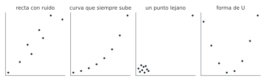
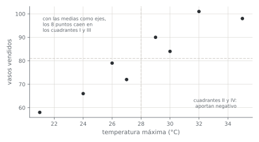
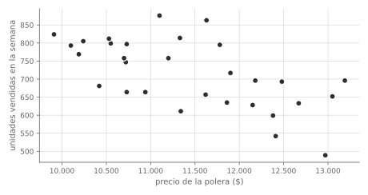

# Unidad 6 · Correlación

**Qué vas a poder hacer.** Dibujar y leer un diagrama de dispersión; calcular a mano la covarianza
y el coeficiente de Pearson; probar si una correlación es distinta de cero con una t de $n - 2$
grados de libertad y darle un intervalo de confianza; elegir Spearman o Kendall cuando la relación
es monótona pero no recta o hay atípicos, y explicar por qué una correlación, por fuerte que sea, no
basta para afirmar que una variable causa la otra.

**Lo que necesitas antes.** De la unidad 1, los cinco pasos de una prueba y la distribución t. De
la unidad 5, mirar la forma de los datos antes de confiar en una prueba (el Q-Q y Shapiro-Wilk). De
Probabilidades: media, varianza y desviación estándar.

**Tiempo.** Unas 5 horas: 2 de lectura con el ejemplo y el cuaderno, 3 de práctica.

---

## 1. La idea · cuánto se mueven juntas dos variables

Las unidades anteriores comparaban grupos o miraban una sola variable. Ahora hay **pares** de datos
$(x_i, y_i)$ medidos sobre la misma unidad (un día, una semana, una sucursal) y la pregunta es si,
cuando una sube, la otra tiende a subir (o a bajar).

**Lo primero es el gráfico.** Un diagrama de dispersión pone un punto por par. Antes de calcular
cualquier coeficiente hay que mirar tres cosas: la **dirección** (sube o baja), la **forma** (recta,
curva, otra cosa) y los **puntos raros** (uno lejos del resto puede decidir el resultado). Los
coeficientes de esta unidad resumen el gráfico en un número, y un número no muestra la forma.

---

## 2. Covarianza

$$s_{xy} = \frac{1}{n-1}\sum_{i=1}^{n} (x_i - \bar x)(y_i - \bar y) = \frac{S_{xy}}{n-1}$$

**La intuición.** Se trazan dos ejes por las medias $(\bar x, \bar y)$ y quedan cuatro cuadrantes.
Un punto arriba a la derecha o abajo a la izquierda (cuadrantes I y III) tiene las dos desviaciones
del mismo signo y aporta un producto positivo. Un punto en los cuadrantes II o IV aporta negativo.
Si la mayoría cae en I y III, la covarianza es positiva: las variables suben juntas.

**Su problema.** La covarianza tiene las unidades de $x$ por las de $y$ (grados por vasos, pesos por
unidades). Si se cambia de grados Celsius a Fahrenheit, cambia el número sin que cambie nada de la
relación. Sirve para el signo, no para decir si la relación es fuerte.

---

## 3. El coeficiente de correlación de Pearson

Se divide la covarianza por las dos desviaciones estándar:

$$r = \frac{s_{xy}}{s_x\, s_y} = \frac{S_{xy}}{\sqrt{S_{xx}\, S_{yy}}} \qquad S_{xx} = \sum (x_i - \bar x)^2 \quad S_{yy} = \sum (y_i - \bar y)^2$$

Es la covarianza de las variables **estandarizadas**, y por eso no tiene unidades y está siempre
entre $-1$ y $1$:

| Valor de $r$ | Qué dice |
|---|---|
| $1$ o $-1$ | todos los puntos están sobre una recta (creciente o decreciente) |
| cerca de 0 | no hay relación **lineal** (puede haber otra) |
| el signo | la dirección de la relación |
| $r^2$ | la fracción de la variación de $y$ que una recta en $x$ explica (unidad 10) |

Una guía gruesa para el tamaño, que depende del área: $|r|$ menor que 0,3 es débil; entre 0,3 y 0,7,
moderada; sobre 0,7, fuerte. Lo que importa más es $r^2$: un $r$ de 0,5 deja sin explicar el 75 % de
la variación.

**Cuándo no aplica.** Pearson mide **solo relaciones lineales**. Una relación curva fuerte puede dar
$r$ chico (sección 6), y un solo punto lejano puede fabricar un $r$ alto donde no hay relación.

---

## 4. La prueba de la correlación

$r$ es una estimación del coeficiente poblacional $\rho$. Aunque dos variables no tengan relación,
con pocos datos $r$ sale distinto de cero por azar. La prueba pregunta si el $r$ observado es más
grande de lo que el azar explica.

**Hipótesis.** $H_0: \rho = 0$ (no hay relación lineal) contra $H_1: \rho \ne 0$ (o $\rho > 0$, o
$\rho < 0$, si la dirección se fijó antes de ver los datos).

**Estadístico.**

$$t = \frac{r\sqrt{n-2}}{\sqrt{1 - r^2}} \;\sim\; t_{n-2} \text{ bajo } H_0$$

**Por qué $n - 2$.** Para medir cuánto se alejan los puntos de una recta hay que estimar antes la
recta: su corte y su pendiente, dos parámetros. Es la misma t que la prueba de la pendiente de la
regresión simple (unidad 10).

**La intuición del estadístico.** $r/\sqrt{1-r^2}$ compara la parte de la variación que la recta
explica con la que no explica, y $\sqrt{n-2}$ dice que la misma correlación pesa más con más datos.
Con $n$ grande, cualquier correlación real distinta de cero, por chica que sea, termina
siendo significativa.

**Supuestos.**

- **Pares independientes.** Una fila no debe influir en la siguiente. Datos semanales o mensuales
  pueden arrastrar inercia; si las dos series tienen tendencia en el tiempo, la correlación sale
  inflada (sección 7).
- **Relación lineal.** Se revisa en el diagrama.
- **Normalidad aproximada** de las dos variables (en rigor, normal bivariada), o $n$ grande. Se
  revisa con Q-Q o Shapiro-Wilk (unidad 5). Si falla o hay atípicos, se usa Spearman o Kendall.

**Intervalo de confianza: la transformación de Fisher.** La distribución de $r$ es asimétrica cerca
de $\pm 1$. Fisher la estira con

$$z = \operatorname{arctanh}(r) = \tfrac12 \ln\frac{1+r}{1-r} \;\approx\; \text{Normal}\left(\operatorname{arctanh}\rho,\ \tfrac{1}{n-3}\right)$$

Se arma el intervalo en la escala $z$ ($z \pm 1{,}96/\sqrt{n-3}$) y se devuelve con $\tanh$. El
intervalo dice **qué tan fuerte** puede ser la relación, que es lo que la decisión necesita.

> **Significativo no es importante.** Con 1.000 datos, $r = 0{,}07$ es significativo y explica el
> 0,5 % de la variación. El valor p responde «¿hay alguna relación?»; $r$, $r^2$ y su intervalo
> responden «¿cuánta?».

---

## 5. Correlaciones de rangos · Spearman y Kendall

Cuando la relación es **monótona** (siempre sube o siempre baja) pero no recta, o cuando hay
atípicos, se trabaja con los **rangos**: se reemplaza cada valor por su posición (1 al menor).

**Spearman.** Es el $r$ de Pearson calculado sobre los rangos. Si no hay empates, con
$d_i = \operatorname{rango}(x_i) - \operatorname{rango}(y_i)$:

$$\rho_s = 1 - \frac{6\sum d_i^2}{n(n^2-1)}$$

Con empates se usa el rango promedio y se calcula Pearson sobre los rangos (`spearmanr` lo hace).

**Kendall.** Mira todos los pares de observaciones. Un par es **concordante** si el que tiene mayor
$x$ también tiene mayor $y$, y **discordante** si al revés. Con $C$ concordantes y $D$ discordantes
entre los $n(n-1)/2$ pares:

$$\tau = \frac{C - D}{n(n-1)/2}$$

$\tau$ se lee directo: es la probabilidad de que un par al azar esté en el mismo orden menos la de
que esté en orden opuesto. Suele salir más chico que $\rho_s$ para los mismos datos; no es que
detecte menos, está en otra escala.

**Pruebas.** $H_0$: no hay relación monótona. `stats.spearmanr` y `stats.kendalltau` dan el valor p
(Kendall, exacto para muestras chicas sin empates).

| | Pearson | Spearman | Kendall |
|---|---|---|---|
| Mide | relación lineal | relación monótona | relación monótona (pares en orden) |
| Atípicos | muy sensible | resistente | resistente |
| Datos | numéricos | numéricos u ordinales (rankings) | numéricos u ordinales; mejor con muchos empates o $n$ chico |
| Se calcula con | los valores | los rangos | los pares |

---

## 6. Mira el gráfico antes que el número

Los cuatro paneles muestran datos de esta unidad (el ejemplo y los ejercicios 6.5 a 6.7). Calcula
sus coeficientes en la práctica y compáralos con lo que ves.



- **Recta con ruido:** el caso para el que Pearson fue hecho.
- **Curva que siempre sube:** Spearman y Kendall valen 1 (el orden es perfecto); Pearson queda bajo 1
  porque los puntos no están en recta.
- **Un punto lejano:** nueve puntos sin relación y uno muy lejos. Pearson ve una recta que no
  existe; los rangos no se dejan engañar.
- **Forma de U:** una relación fuerte que ningún coeficiente de esta unidad ve, porque sube en una
  mitad y baja en la otra. **$r$ cerca de cero no significa independencia.**

---

## 7. Correlación no es causalidad

Que $x$ e $y$ se muevan juntas tiene varias explicaciones posibles, y solo una de ellas es que $x$
cause $y$:

| Explicación | Ejemplo |
|---|---|
| $x$ causa $y$ | más temperatura, más vasos de mote vendidos |
| $y$ causa $x$ (causalidad inversa) | un local vende más y por eso contrata más vendedores, no al revés |
| una **variable oculta** $z$ mueve a las dos | en invierno se venden más bufandas y hay más resfríos; ni las bufandas enferman ni los resfríos venden bufandas: el frío mueve a las dos |
| las dos tienen tendencia en el tiempo | dos series que crecen año a año (el precio del pan y los suscriptores de una plataforma) salen muy correlacionadas sin tener nada que ver |
| el azar en muchas pruebas | si se prueban 100 pares de variables sin relación, unas 5 salen «significativas» al 5 % |

A una correlación que aparece por una variable oculta, por la tendencia o por el azar se la llama
**espuria**.

**La correlación parcial.** Si se sospecha de una variable $z$, se mide la correlación entre $x$ e
$y$ después de sacarles lo que $z$ explica de cada una:

$$r_{xy \cdot z} = \frac{r_{xy} - r_{xz}\, r_{yz}}{\sqrt{\left(1 - r_{xz}^2\right)\left(1 - r_{yz}^2\right)}}$$

Es la correlación entre los residuos de regresar $x$ en $z$ y de regresar $y$ en $z$. Se prueba con
$t = r\sqrt{n-3}/\sqrt{1-r^2}$, con $n - 3$ grados de libertad (un parámetro más). La variable oculta
puede **fabricar** una correlación (la parcial cae a cero) o **esconderla** (la parcial sale más
fuerte que la simple): el caso de esta unidad es de los segundos.

**¿Cómo se llega a causalidad?** Con un **experimento** (se asigna $x$ al azar, así ninguna $z$ puede
estar detrás) o, cuando no se puede, controlando las variables que podrían confundir (la regresión
múltiple de la unidad 10) y con un mecanismo que lo explique. La correlación sola solo dice que vale
la pena investigar.

---

## 8. Qué coeficiente usar

| Situación | Coeficiente |
|---|---|
| Relación recta, sin atípicos, variables aproximadamente normales | Pearson, con su prueba t y el intervalo de Fisher |
| Relación monótona pero curva | Spearman o Kendall (o transformar, por ejemplo con logaritmo, y usar Pearson) |
| Atípicos que no se pueden descartar | Spearman o Kendall, y reportar Pearson con y sin el atípico |
| Rankings o escalas ordinales (1 a 5) | Spearman o Kendall |
| $n$ chico o muchos empates | Kendall |
| Relación que sube y baja | ninguno: describir el gráfico o modelar la curva |
| Se quiere saber **cuánto** cambia $y$ por unidad de $x$ | ninguno: es una pendiente, regresión (unidad 10) |

---

## 9. Ejemplo resuelto · el carrito de mote con huesillo

Un carrito de mote con huesillo en la plaza de Chillán anotó, durante 8 días de diciembre, la
temperatura máxima y los vasos vendidos. Quiere saber si vale la pena llevar más huesillos los días
que se anuncian calurosos.

| Temperatura (°C) | 21 | 24 | 26 | 27 | 29 | 30 | 32 | 35 |
|---|---|---|---|---|---|---|---|---|
| Vasos | 58 | 66 | 79 | 72 | 90 | 84 | 101 | 98 |

**Paso 0 · El gráfico.** Los puntos suben de izquierda a derecha, más o menos en recta, sin puntos
lejanos.



**Paso 1 · La pregunta.** ¿Los días más calurosos se venden más vasos?

**Supuestos.** Días distintos y sin arrastre de uno a otro (pares independientes); relación lineal
(el gráfico lo muestra); sin atípicos.

**Paso 2 · Hipótesis.** $H_0: \rho = 0$; $H_1: \rho \ne 0$.

**Paso 3 · Estadístico, a mano.** Medias: $\bar x = 224/8 = 28$ °C y $\bar y = 648/8 = 81$ vasos.

| $x$ | $y$ | $x - \bar x$ | $y - \bar y$ | producto | $(x - \bar x)^2$ | $(y - \bar y)^2$ |
|---|---|---|---|---|---|---|
| 21 | 58 | -7 | -23 | 161 | 49 | 529 |
| 24 | 66 | -4 | -15 | 60 | 16 | 225 |
| 26 | 79 | -2 | -2 | 4 | 4 | 4 |
| 27 | 72 | -1 | -9 | 9 | 1 | 81 |
| 29 | 90 | 1 | 9 | 9 | 1 | 81 |
| 30 | 84 | 2 | 3 | 6 | 4 | 9 |
| 32 | 101 | 4 | 20 | 80 | 16 | 400 |
| 35 | 98 | 7 | 17 | 119 | 49 | 289 |
| **Suma** | | | | **448** | **140** | **1.618** |

Todos los productos son positivos: los 8 puntos caen en los cuadrantes I y III.

$$s_{xy} = \frac{448}{7} = 64{,}00 \text{ °C·vasos} \qquad r = \frac{448}{\sqrt{140 \cdot 1.618}} = 0{,}9413 \qquad r^2 = 88{,}6\ \%$$

$$t = \frac{0{,}9413\sqrt{6}}{\sqrt{1 - 0{,}9413^2}} = 6{,}83 \quad \text{con } 6 \text{ gl}$$

**Paso 4 · Valor p y región de rechazo.** $t_{0,975;\,6} = 2{,}447$. Como $6{,}83 > 2{,}447$, se rechaza
$H_0$: p < 0,001.

**Intervalo de 95 % para $\rho$.** $z = \operatorname{arctanh}(0{,}9413) = 1{,}7493$ con error
estándar $1/\sqrt{5} = 0{,}4472$. En la escala $z$: $1{,}7493 \pm 1{,}96 \cdot 0{,}4472$; de vuelta con
$\tanh$, de 0,703 a 0,990. Con 8 días el intervalo es ancho, pero incluso su extremo inferior es una
relación fuerte.

**Spearman y Kendall, como control.** Rangos de los vasos: 1, 2, 4, 3, 6, 5, 8, 7 (los de la
temperatura son 1 a 8). Las diferencias son 0, 0, -1, 1, -1, 1, -1, 1: Σd² = 6 y
$\rho_s = 1 - 6 \cdot 6/(8 \cdot 63) = 0{,}929$. De los 28 pares de días hay 25 pares concordantes y
3 discordantes (días 3 y 4, 5 y 6, 7 y 8): $\tau = (25 - 3)/28 = 0{,}786$.

**Con Python.**

```python
from scipy import stats
t = [21, 24, 26, 27, 29, 30, 32, 35]
v = [58, 66, 79, 72, 90, 84, 101, 98]
r = stats.pearsonr(t, v)          # r = 0,9413
r.confidence_interval()           # (0,703; 0,990), con Fisher
stats.spearmanr(t, v)             # 0,929
stats.kendalltau(t, v)            # 0,786
```

El cuaderno `notebooks/u06_correlacion.ipynb` lo reproduce con `datos/u06_mote.csv`.

**Paso 5 · Conclusión.** Los días más calurosos se venden más vasos: la correlación es fuerte
(0,9413, entre 0,703 y 0,990 con 95 % de confianza) y la temperatura acompaña el 88,6 % de la
variación de las ventas en estos 8 días.

**Cómo se lee.** Para el carrito, el pronóstico de temperatura es una buena señal de cuántos
huesillos llevar. Acá la causalidad es creíble porque hay un mecanismo obvio (el calor da sed) y la
temperatura no la decide nadie. Pero la correlación no dice **cuántos** vasos más por grado: eso es
una pendiente, y se estima con regresión en la unidad 10.

---

## 10. Errores típicos

| Error | Cómo evitarlo |
|---|---|
| Calcular $r$ sin mirar el diagrama de dispersión | Primero el gráfico: forma, dirección y puntos raros |
| Leer $r = 0$ como «no hay relación» | Solo descarta una relación **lineal**; una U puede dar $r$ cero |
| Leer una correlación significativa como relación fuerte | Con $n$ grande todo es significativo; reporta $r$, $r^2$ y el intervalo |
| Concluir que $x$ causa $y$ | Busca la variable oculta, la causalidad inversa y la tendencia común; la causalidad pide experimento o control |
| Dejar que un atípico decida | Reporta Pearson con y sin el punto, y Spearman o Kendall |
| Usar $n - 1$ grados de libertad en la prueba de $r$ | Son $n - 2$ (y $n - 3$ en la correlación parcial) |
| Usar la fórmula de Spearman con $\sum d^2$ habiendo empates | Con empates, rangos promedio y Pearson sobre los rangos (`spearmanr`) |
| Correlacionar dos series de tiempo con tendencia | Correlaciona sus cambios (diferencias) o modela la tendencia |
| Probar decenas de pares y reportar los significativos | Corrige por comparaciones múltiples (Bonferroni, unidad 8) |

---

## 11. Práctica

Diez ejercicios: 6.1 a 6.4 básicos, 6.5 a 6.8 intermedios, 6.9 y 6.10 de desafío. Usa $\alpha = 0{,}05$
y pruebas bilaterales salvo que se diga otra cosa. Las pautas están en la sección 12.

**6.1 · Horas de estudio y puntaje (básico).** Seis estudiantes de un preuniversitario declararon sus
horas de estudio semanal y su puntaje en un ensayo. Calcula a mano la covarianza y $r$, y prueba si
la correlación es distinta de cero.

| Horas | 2 | 4 | 5 | 7 | 8 | 10 |
|---|---|---|---|---|---|---|
| Puntaje | 480 | 530 | 520 | 600 | 610 | 650 |

**6.2 · El mismo $r$, distinto $n$ (básico).** Un estudio encuentra $r = -0{,}38$ entre los años de
antigüedad de un equipo y su disponibilidad. (a) Con $n = 25$ equipos, ¿es significativa? (b) ¿Y
con $n = 100$? (c) ¿Qué fracción de la variación explica en cada caso? (d) Con $n = 25$, ¿desde qué
$|r|$ habría sido significativa?

**6.3 · Dos jueces de empanadas (básico).** En un concurso de empanadas de pino, dos jueces ordenan
las mismas 7 (1 = la mejor). El juez A las ordena 1, 2, 3, 4, 5, 6, 7; el juez B les da, en ese mismo
orden de empanadas, 2, 1, 4, 3, 7, 5, 6. Calcula a mano Spearman y Kendall. ¿Coinciden los jueces?

**6.4 · Cambiar de unidades (básico).** En 5 semanas, una casa registró la temperatura media y el
consumo de gas: 4 °C y 38 kWh; 7 °C y 31 kWh; 9 °C y 29 kWh; 12 °C y 22 kWh; 15 °C y 16 kWh. (a)
Calcula la covarianza y $r$. (b) Pasa la temperatura a grados Fahrenheit ($F = 32 + 1{,}8\,C$) y
recalcula. (c) Pasa además el consumo a megajoules (1 kWh = 3,6 MJ). ¿Qué cambia y qué no?

**6.5 · La sucursal grande (intermedio).** Una cadena de ferreterías compara la superficie de sus
sucursales (m²) con sus ventas del mes (millones de pesos). La décima es la tienda insignia del
centro. Calcula Pearson, Spearman y Kendall con las 10 y sin la insignia. ¿Qué le informarías al
gerente que pregunta si «más metros venden más»?

| Sucursal | 1 | 2 | 3 | 4 | 5 | 6 | 7 | 8 | 9 | 10 |
|---|---|---|---|---|---|---|---|---|---|---|
| m² | 84 | 93 | 101 | 107 | 116 | 122 | 129 | 137 | 146 | 420 |
| Ventas | 31 | 27 | 35 | 29 | 33 | 26 | 34 | 30 | 28 | 96 |

**6.6 · Seguidores de una cuenta nueva (intermedio).** Una pyme abrió una cuenta en redes sociales.
Seguidores al final de cada semana: 120, 150, 200, 270, 380, 540, 790 y 1.150 (semanas 1 a 8).
Calcula Pearson, Spearman y Kendall entre la semana y los seguidores, y Pearson entre la semana y el
logaritmo de los seguidores. ¿Cuál describe mejor la relación?

**6.7 · Temperatura y electricidad (intermedio).** Una oficina con calefacción y aire acondicionado
eléctricos registró la temperatura media y el consumo de 8 días: 2 °C y 182 kWh; 6 °C y 151; 10 °C
y 128; 14 °C y 116; 18 °C y 118; 22 °C y 131; 26 °C y 157; 30 °C y 190. Calcula Pearson y Spearman
y pruébalos. Después calcula Pearson solo con los 4 días más fríos y solo con los 4 más calurosos.
¿Hay relación entre temperatura y consumo?

**6.8 · Bufandas y resfríos (intermedio).** Una tienda de una ciudad del sur y el CESFAM del barrio
juntaron 12 meses de datos. Calcula la correlación entre bufandas vendidas y consultas por resfrío,
pruébala, y después calcula la correlación parcial controlando la temperatura. ¿Las bufandas tienen
algo que ver con los resfríos?

| Mes | Temperatura media (°C) | Bufandas | Consultas |
|---|---|---|---|
| enero | 18 | 232 | 118 |
| febrero | 17 | 238 | 105 |
| marzo | 14 | 248 | 149 |
| abril | 11 | 270 | 185 |
| mayo | 8 | 302 | 181 |
| junio | 6 | 333 | 252 |
| julio | 5 | 327 | 210 |
| agosto | 7 | 312 | 206 |
| septiembre | 9 | 319 | 177 |
| octubre | 12 | 284 | 158 |
| noviembre | 15 | 253 | 154 |
| diciembre | 17 | 232 | 100 |

**6.9 · Intervalo y comparación de correlaciones (desafío).** En 40 tiendas de una cadena, la
correlación entre la nota de satisfacción del cliente y la venta por metro cuadrado es $r = 0{,}62$.
(a) Construye el intervalo de 95 % para $\rho$ con la transformación de Fisher. (b) La gerencia
decía que la correlación era 0,40: prueba $H_0: \rho = 0{,}40$. (c) En las 55 tiendas de otra cadena
la misma correlación es 0,35. ¿Es distinta de la primera? (Usa
$z = (z_1 - z_2)/\sqrt{1/(n_1-3) + 1/(n_2-3)}$.)

**6.10 · Pescar correlaciones (desafío).** Con Python y la semilla 606, genera 15 variables
independientes, cada una con 40 datos normales, y prueba la correlación de todos los pares posibles.
(a) ¿Cuántos pares hay y cuántos esperas significativos al 5 % si ninguna variable tiene relación con
otra? (b) ¿Cuántos salen? ¿Cuál es el mayor $|r|$? (c) ¿Cuántos sobreviven a Bonferroni?

```python
rng = np.random.default_rng(606)
M = rng.normal(size=(40, 15))
p = [stats.pearsonr(M[:, i], M[:, j]).pvalue for i, j in itertools.combinations(range(15), 2)]
```

---

## 12. Pautas

**6.1.** Medias: 6 horas y 565 puntos. $S_{xy}$ = 920, $S_{xx}$ = 42 y $S_{yy}$ = 20.950. Covarianza
$920/5 = 184{,}0$ horas·puntos. $r = 920/\sqrt{42 \cdot 20.950} = 0{,}981$. $t = 10{,}05$ con 4 gl:
p < 0,001. Más horas de estudio van con más puntaje, y la relación es casi una recta. Ojo: son 6
estudiantes que **declararon** sus horas, y los que estudian más pueden ser también los que tenían
mejor base. La correlación no prueba que estudiar una hora más suba el puntaje en lo mismo.

**6.2.** (a) $t = -0{,}38\sqrt{23}/\sqrt{1 - 0{,}1444} = -1{,}97$; el crítico con 23 gl es 2,069: no se
rechaza (p = 0,061). (b) Con $n = 100$: $t = -4{,}07$ contra 1,984: se rechaza (p < 0,001). (c) En los
dos casos $r^2$ = 14,4 %: la antigüedad acompaña una parte chica de la variación de la
disponibilidad. (d) Despejando, $|r| = t_c/\sqrt{n - 2 + t_c^2}$ = 0,396. La misma relación es «no
significativa» con 25 equipos y «significativa» con 100; su tamaño no cambió. Lo que hay que
reportar es $r$ y su intervalo, no solo el veredicto.

**6.3.** Diferencias de rangos: -1, 1, -1, 1, -2, 1, 1. Σd² = 10 y
$\rho_s = 1 - 60/336 = 0{,}821$ (p = 0,023). De los 21 pares hay 17 concordantes y 4 discordantes:
$\tau = 13/21 = 0{,}619$ (p = 0,069). Los jueces coinciden bastante: los dos ponen las mismas
empanadas arriba y abajo y solo intercambian vecinas. Con 7 empanadas, Spearman alcanza a ser
significativo y Kendall no; los dos dicen lo mismo en escalas distintas.

**6.4.** (a) Covarianza -36,10 °C·kWh y $r$ = -0,9966. (b) En Fahrenheit la temperatura es 39,2;
44,6; 48,2; 53,6 y 59,0 °F: la covarianza pasa a -64,98 (multiplicada por 1,8) y $r$ sigue en
-0,9966. (c) Con megajoules la covarianza llega a -233,93 y $r$ no se mueve. La covarianza depende
de las unidades; $r$, no (sumar una constante no cambia nada y multiplicar por una positiva cambia
igual el numerador y el denominador). Por eso se compara con $r$.

**6.5.** Con las 10 sucursales: Pearson 0,967, Spearman 0,176 y Kendall 0,111. Sin la insignia:
Pearson -0,111, Spearman -0,133 y Kendall -0,111. Las nueve sucursales comunes no muestran ninguna
relación entre metros y ventas; Pearson alto lo produce solo la insignia, que es más grande **y**
está en el centro (otra variable). Al gerente: «entre las sucursales normales, más metros no venden
más; la insignia es un caso aparte». Un $r$ de 0,967 construido por un punto es el error más caro de
esta unidad.

**6.6.** Pearson 0,932, Spearman 1,000 y Kendall 1,000. Los seguidores siempre suben (orden perfecto),
pero cada vez más rápido: la curva no es una recta y Pearson queda bajo 1. Con el logaritmo de los
seguidores, Pearson sube a 0,9971: el crecimiento es casi exponencial (un porcentaje parecido cada
semana). Spearman describe bien que la relación es monótona; el logaritmo, además, dice su forma.

**6.7.** Pearson 0,100 (p = 0,81) y Spearman 0,190: ninguno es significativo. Pero la relación es
fortísima: con los 4 días fríos Pearson es -0,982 (más calor, menos calefacción) y con los 4
calurosos es 0,983 (más calor, más aire acondicionado). El consumo tiene forma de U con el mínimo
cerca de los 16 °C. Los dos coeficientes buscan una relación monótona y no la encuentran porque no
la hay; el gráfico la muestra de inmediato.

**6.8.** Bufandas y consultas: $r$ = 0,906, p < 0,001. Con la temperatura: bufandas -0,970 y
consultas -0,929. Correlación parcial:

$$r_{xy \cdot z} = \frac{0{,}906 - (-0{,}970)(-0{,}929)}{\sqrt{(1 - 0{,}970^2)(1 - 0{,}929^2)}} = 0{,}052$$

con $t$ = 0,16 y 9 gl (p = 0,88). Descontado el frío, bufandas y resfríos no tienen nada que ver: la
correlación de 0,906 es espuria, la fabricó la temperatura. Una campaña de bufandas no llenaría el
CESFAM, y regalarlas no lo vaciaría.

**6.9.** (a) $z_1 = \operatorname{arctanh}(0{,}62) = 0{,}7250$ y error estándar $1/\sqrt{37} = 0{,}1644$.
El intervalo $0{,}7250 \pm 1{,}96 \cdot 0{,}1644$, devuelto con $\tanh$, va de 0,382 a 0,781. (b)
$z = (0{,}7250 - \operatorname{arctanh} 0{,}40)/0{,}1644 = 1{,}83$, p = 0,067: no se rechaza que sea 0,40
(fíjate que 0,40 está dentro del intervalo). (c) $z_2 = \operatorname{arctanh}(0{,}35) = 0{,}3654$ y
$z = (0{,}7250 - 0{,}3654)/\sqrt{1/37 + 1/52} = 1{,}67$, p = 0,095: con estos tamaños no se puede
afirmar que las cadenas difieran. Con 40 y 55 tiendas, las correlaciones se estiman con mucha
incertidumbre: el intervalo de (a) mide 0,4 de ancho.

**6.10.** (a) Hay $15 \cdot 14/2$ = 105 pares; si nada se relaciona, al 5 % se esperan 5,25
«significativos» por puro azar. (b) Con la semilla 606 salen 4 de los 105, y el mayor $|r|$ es 0,388
(con 40 datos el crítico es 0,312). Cualquiera de esos 4 pares podría publicarse como «hallazgo» sin
serlo. (c) Bonferroni exige $p < 0{,}05/105 = 0{,}00048$: ninguno sobrevive. Buscar en una matriz
grande de correlaciones y quedarse con las significativas garantiza falsos hallazgos; el control de
comparaciones múltiples se ve en la unidad 8.

---

## 13. Caso integrador · Estampa Sur, ¿cuánto se mueven juntos el precio y las ventas?

> Estampa Sur es el taller ficticio que recorre el ramo; sus datos son simulados con semilla fija por
> `verificacion/caso_estampa_sur_datos.py`. **Lo que trae de la unidad 5:** el canal web recibe
> pedidos como un proceso de Poisson (un pedido cada 23,46 minutos en promedio), y quedó la costumbre
> de revisar la forma de los datos antes de aplicar una prueba.

**Los datos.** `datos/ventas.csv`: 30 semanas con el precio de la polera estampada, el gasto en
publicidad y las unidades vendidas. El precio fue de $9.910 a $13.190 (media 11.433,3 y desviación
953,3) y las unidades, entre 489 y 876 (media 715,57 y desviación 95,01).



**El gráfico.** La nube baja de izquierda a derecha, sin curvatura clara ni puntos aislados, con
bastante dispersión vertical.

**Paso 1 · La pregunta.** ¿Las semanas de precio más alto se venden menos poleras?

**Supuestos.** La relación parece lineal. Shapiro-Wilk no rechaza la normalidad del precio
(p = 0,26) ni de las unidades (p = 0,47). Las semanas son consecutivas: si hubiera estacionalidad,
habría que revisarla. Aquí el precio no muestra tendencia en el tiempo: su correlación con el número
de semana es 0,05 (p = 0,78).

**Paso 2 · Hipótesis.** $H_0: \rho = 0$; $H_1: \rho \ne 0$.

**Paso 3 · Estadístico.** La covarianza es -56.435 (pesos × unidades), negativa. $r$ = -0,623, de modo
que $r^2$ = 38,8 %.

$$t = \frac{-0{,}623\sqrt{28}}{\sqrt{1 - 0{,}623^2}} = -4{,}22 \quad \text{con } 28 \text{ gl}$$

**Paso 4 · Valor p.** $|t| > t_{0,975;\,28} = 2{,}048$: p < 0,001. El intervalo de 95 % para $\rho$
(Fisher) va de -0,803 a -0,339.

**Control con rangos.** Spearman da -0,609 y Kendall -0,446, los dos con p < 0,001. Coinciden con
Pearson: la relación no depende de algún punto extremo.

**Paso 5 · Conclusión.** Sí: en las semanas de precio más alto Estampa Sur vendió menos poleras. La
relación es moderada a fuerte (entre -0,339 y -0,803) y el precio acompaña el 38,8 % de la variación
semanal de las ventas.

**La variable que faltaba.** El 61 % restante no es solo ruido. La publicidad también mueve las
ventas: su correlación con las unidades es 0,484. Y en estas 30 semanas, el precio y la publicidad
se movieron algo juntos (0,257): varias semanas caras coincidieron con más publicidad, que empujaba
las ventas hacia arriba y **tapaba** parte del efecto del precio. Controlando la publicidad, la
correlación parcial entre precio y unidades es -0,883, mucho más fuerte que la simple. Es el caso
contrario al de las bufandas (6.8): la variable oculta no fabrica la relación, la esconde.

```python
v = pd.read_csv("datos/ventas.csv")
stats.pearsonr(v.precio, v.unidades)          # r = -0,623
stats.spearmanr(v.precio, v.unidades)         # -0,609
v[["precio", "unidades", "publicidad"]].corr()
```

**Lectura.** El taller tiene evidencia de que el precio importa, pero dos cosas quedan abiertas. La
primera: ¿**cuántas** poleras menos por cada $1.000 de alza? La correlación no lo dice; es una
pendiente. La segunda: ¿el precio **causa** la baja? Que la relación se fortalezca al controlar la
publicidad apoya esa lectura, pero solo cuenta lo que se midió (una temporada, la competencia o el
clima podrían estar detrás). **Lo que pasa a la unidad 10:** la regresión múltiple de las unidades
sobre el precio **y** la publicidad, con los mismos 30 datos, que separa los dos efectos y estima
cuánto vende el taller por cada peso de precio y de publicidad.

---

## 14. Para seguir

**En los libros del ramo.**

- Walpole, Myers, Myers y Ye, *Probability & Statistics for Engineers & Scientists* (Pearson, 2017),
  la sección de correlación del capítulo de regresión lineal simple: la prueba de $\rho = 0$ y la
  transformación de Fisher.
- Kutner y otros, *Applied Linear Statistical Models* (McGraw-Hill, 2004): la correlación en el
  modelo normal bivariado, Spearman y la relación entre $r$ y la pendiente.

**Abierto y gratis.** Diez, Çetinkaya-Rundel y Barr, *OpenIntro Statistics* (4.ª ed.), sección 8.1
sobre residuos y correlación, en inglés: https://www.openintro.org/book/os/

**Con el tutor.** Pega `tutor/contexto.md` al inicio de la conversación con cualquier IA y pídele,
por ejemplo: «Dame 10 pares de datos con una variable oculta detrás y guíame para calcular la
correlación simple, la parcial y explicar si hay causalidad».
