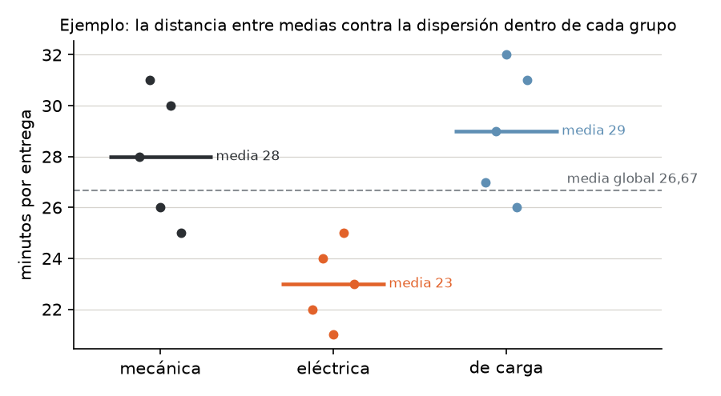
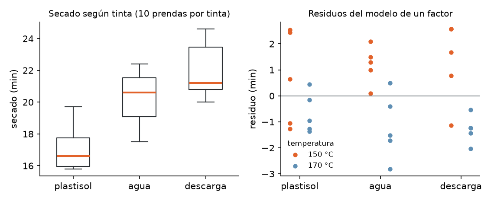

# Unidad 7 · Modelo lineal y ANOVA de un factor

**Qué vas a poder hacer.** Escribir una comparación de varios grupos como un modelo lineal
$y = X\beta + \varepsilon$; codificar un factor con variables ficticias y leer cada coeficiente;
descomponer la variabilidad en lo que explican los grupos y lo que queda dentro de ellos; armar y leer
la tabla ANOVA (gl, SC, CM, $F$, valor p); revisar los supuestos antes de creerle al resultado, y
explicar por qué no se reemplaza el ANOVA por muchas pruebas $t$.

**Lo que necesitas antes.** De la unidad 2, la prueba $t$ de dos medias con varianza combinada. De la
unidad 3, la distribución $F$ como cociente de dos varianzas y la idea de comparar varianzas. De la
unidad 5, la prueba de Shapiro-Wilk y el gráfico cuantil-cuantil para revisar normalidad.

**Tiempo.** Unas 6 horas: 2,5 de lectura con el ejemplo y 3,5 de práctica.

---

## 1. La idea · comparar varias medias de una vez

Una pregunta frecuente en ingeniería tiene esta forma: *¿el tipo de X cambia el resultado medio?* Tres
proveedores, cuatro máquinas, cinco recetas. Con dos grupos bastaba la prueba $t$ de la unidad 2. Con
$k$ grupos la tentación es hacer una prueba $t$ por cada par, y ahí está el problema.

Cada prueba al 5 % tiene un 5 % de probabilidad de declarar una diferencia que no existe. Con $m$
pruebas, la probabilidad de equivocarse **al menos una vez** (la tasa de error por familia) es, si las
pruebas fueran independientes:

$$\alpha_{familia} = 1 - (1 - \alpha)^m$$

Con 3 grupos hay 3 pares y la tasa ya sube a 14,3 %; con 8 grupos hay 28 pares y supera el 75 %. El
**análisis de varianza (ANOVA)** responde primero una sola pregunta, con un solo 5 % de riesgo:

> ¿Hay **alguna** diferencia entre las $k$ medias, o todas las diferencias que veo caben en el ruido?

Si la respuesta es sí, la unidad 8 dice **cuáles** pares difieren sin inflar el error.

**Vocabulario.** El **factor** es la variable que define los grupos (el tipo de bicicleta); sus
**niveles** son los valores que toma (mecánica, eléctrica, de carga); cada nivel aplicado a una unidad
es un **tratamiento**; la **respuesta** es lo que se mide (minutos por entrega). Si el investigador
asigna los tratamientos al azar es un **experimento**; si solo observa grupos que ya existen, es un
**estudio observacional** y la conclusión es más débil: un grupo puede diferir por otra causa.

---

## 2. El modelo lineal

Casi todo el resto del ramo (ANOVA, regresión, modelos lineales generalizados) es un caso del mismo
modelo:

$$y = X\beta + \varepsilon$$

| Símbolo | Tamaño | Qué es |
|---|---|---|
| $y$ | $N \times 1$ | las respuestas observadas |
| $X$ | $N \times p$ | la **matriz de diseño**: una fila por observación, una columna por cada cosa que explica |
| $\beta$ | $p \times 1$ | los parámetros desconocidos |
| $\varepsilon$ | $N \times 1$ | los errores: lo que el modelo no explica |

«Lineal» quiere decir **lineal en los parámetros**: $y$ es una suma de columnas de $X$ multiplicadas
por números. Las columnas pueden ser cualquier cosa, incluso un 0 o un 1 que dice a qué grupo pertenece
la observación.

**Estimación por mínimos cuadrados.** Se elige $\hat\beta$ para que la suma de los residuos al
cuadrado $\sum (y_i - \hat y_i)^2$ sea mínima. Derivando e igualando a cero se llega a las
**ecuaciones normales** $X^\top X \hat\beta = X^\top y$, de donde:

$$\hat\beta = (X^\top X)^{-1} X^\top y$$

**Supuestos.** Para que $\hat\beta$ sea el mejor estimador lineal insesgado (teorema de Gauss-Markov):
(1) el modelo es lineal en $\beta$; (2) $X$ tiene rango completo (ninguna columna es combinación de
otras); (3) $E[\varepsilon] = 0$; (4) varianza constante, $\mathrm{Var}(\varepsilon_i) = \sigma^2$;
(5) errores no correlacionados. Para las pruebas $F$ y $t$ se agrega (6): errores normales.

---

## 3. El ANOVA de un factor es un modelo lineal

Con $k$ grupos, $n_i$ datos en el grupo $i$ y $N = \sum n_i$ en total, $y_{ij}$ es el dato $j$ del
grupo $i$. Hay dos maneras equivalentes de escribir el modelo.

**Modelo de medias.** Cada grupo tiene su media y el error es normal con la misma varianza:

$$y_{ij} = \mu_i + \varepsilon_{ij} \qquad \varepsilon_{ij} \sim N(0, \sigma^2) \text{ independientes}$$

**Modelo de efectos.** La media de cada grupo es una media general más un **efecto** del nivel:

$$y_{ij} = \mu + \tau_i + \varepsilon_{ij} \qquad \text{con una restricción, por ejemplo } \textstyle\sum_i \tau_i = 0$$

La restricción hace falta porque $\mu + \tau_i$ tiene $k + 1$ incógnitas para solo $k$ medias: sin ella
habría infinitas soluciones. Las hipótesis son las mismas en las dos formas:

$$H_0: \mu_1 = \mu_2 = \dots = \mu_k \quad (\text{todos los } \tau_i = 0) \qquad H_1: \text{al menos una media difiere}$$

### Cómo entra un factor a la matriz $X$

Un factor no es un número: «eléctrica» no vale 2. Se codifica con **variables ficticias**
(*dummies*) que valen 1 si la observación es de ese nivel y 0 si no.

**Codificación de referencia** (la que usan `statsmodels` y R por omisión). Se elige un nivel de
referencia y se pone una ficticia por cada uno de los otros $k - 1$ niveles, más la columna de unos:

$$y_{ij} = \beta_0 + \beta_1 D_{1} + \dots + \beta_{k-1} D_{k-1} + \varepsilon_{ij}$$

| Coeficiente | Qué estima |
|---|---|
| $\beta_0$ | la media del nivel de referencia |
| $\beta_i$ | la **diferencia** entre la media del nivel $i$ y la de la referencia |

**Codificación de efectos** (suma cero). Estima $\mu$ como el promedio de las $k$ medias y cada
$\tau_i$ como la distancia de la media del nivel $i$ a ese promedio. Los coeficientes cambian según la
codificación; los valores ajustados, los residuos y la tabla ANOVA **no cambian**.

> **La trampa de las ficticias.** Si se pone una ficticia por **cada** nivel y además la columna de
> unos, las ficticias suman exactamente la columna de unos: $X$ pierde rango, $X^\top X$ no tiene
> inversa y no hay un $\hat\beta$ único. Por eso se ponen $k - 1$.

---

## 4. Descomponer la variabilidad

La desviación de cada dato respecto de la media global se parte en dos:

$$\underbrace{y_{ij} - \bar y_{\cdot\cdot}}_{\text{total}} = \underbrace{(\bar y_{i\cdot} - \bar y_{\cdot\cdot})}_{\text{entre grupos}} + \underbrace{(y_{ij} - \bar y_{i\cdot})}_{\text{dentro del grupo}}$$

Al elevar al cuadrado y sumar sobre todos los datos, el término cruzado se anula (las desviaciones
dentro de cada grupo suman cero) y queda:

$$\underbrace{\sum_{i}\sum_{j} (y_{ij} - \bar y_{\cdot\cdot})^2}_{SCT} = \underbrace{\sum_{i} n_i (\bar y_{i\cdot} - \bar y_{\cdot\cdot})^2}_{SC_{Trat}} + \underbrace{\sum_{i}\sum_{j} (y_{ij} - \bar y_{i\cdot})^2}_{SCE}$$

- $SC_{Trat}$ mide **cuán separadas están las medias** (cada media pesa por su $n_i$).
- $SCE$ mide **el ruido**: cuánto varían los datos alrededor de la media de su propio grupo.
- $R^2 = SC_{Trat}/SCT$ (en ANOVA también se llama $\eta^2$) es la fracción de la variabilidad que
  explican los grupos: el **tamaño del efecto**.

Una forma práctica de $SCE$: $\sum_i (n_i - 1)s_i^2$, la suma de las varianzas de cada grupo ponderadas
por sus grados de libertad. Así se arma un ANOVA desde un informe que solo trae $n$, media y desviación
de cada grupo.

---

## 5. La tabla ANOVA y la prueba $F$

| Fuente | gl | SC | CM | $F$ |
|---|---|---|---|---|
| Entre grupos (tratamientos) | $k - 1$ | $SC_{Trat}$ | $CM_{Trat} = SC_{Trat}/(k-1)$ | $CM_{Trat}/CME$ |
| Dentro (error) | $N - k$ | $SCE$ | $CME = SCE/(N-k)$ | |
| Total | $N - 1$ | $SCT$ | | |

**Grados de libertad.** $SCT$ usa $N$ desviaciones que suman cero: $N - 1$. $SC_{Trat}$ usa $k$
medias alrededor de la global: $k - 1$. $SCE$ estima $k$ medias con $N$ datos: $N - k$.

**Por qué $F$ funciona.** Los cuadrados medios estiman cosas distintas:

$$E[CME] = \sigma^2 \qquad E[CM_{Trat}] = \sigma^2 + \frac{\sum_i n_i \tau_i^2}{k - 1}$$

$CME$ estima la varianza del ruido pase lo que pase con las medias (es la varianza combinada de la
unidad 2, extendida a $k$ grupos). $CM_{Trat}$ estima lo mismo **más** un término que solo existe si
las medias difieren. Bajo $H_0$ los dos estiman $\sigma^2$ y su cociente anda cerca de 1; si hay
efectos, $F$ crece. Bajo $H_0$ y con los supuestos, $F \sim F_{k-1,\,N-k}$, y la prueba es **de una
cola**: solo un $F$ grande es evidencia contra $H_0$.

**La prueba en cinco pasos.**

1. **Pregunta:** ¿la media de la respuesta cambia según el nivel del factor?
2. **Hipótesis:** $H_0: \mu_1 = \dots = \mu_k$; $H_1$: al menos una difiere.
3. **Estadístico:** $F = CM_{Trat}/CME \sim F_{k-1,\,N-k}$ bajo $H_0$.
4. **Valor p:** $P(F_{k-1,N-k} \ge F_{obs})$. Región de rechazo al 5 %: $F_{obs} > F_{0,95;\,k-1,\,N-k}$.
5. **Conclusión** en el lenguaje del problema, con las medias ordenadas y el $R^2$.

**Dos grupos.** Con $k = 2$, $F = t^2$ (la $t$ con varianza combinada) y los valores p son idénticos.
El ANOVA es la generalización de la prueba $t$, no un método distinto.

---

## 6. Supuestos y qué hacer si fallan

Los supuestos son sobre los **errores**, y los errores se estiman con los **residuos**
$e_{ij} = y_{ij} - \bar y_{i\cdot}$. Se revisan antes de leer el valor p.

| Supuesto | Cómo se revisa | Si falla |
|---|---|---|
| **Independencia** | por el diseño: asignación al azar, unidades distintas, mirar los residuos en el orden en que se midieron | ninguna prueba lo arregla después; hay que cambiar el diseño o el modelo (bloques, medidas repetidas) |
| **Normalidad de los residuos** | gráfico cuantil-cuantil y Shapiro-Wilk de los residuos (unidad 5), no de los datos brutos mezclados | con grupos parejos y $n$ moderado el $F$ aguanta bien; si hay asimetría fuerte, transformar ($\log y$) o usar Kruskal-Wallis |
| **Varianzas iguales** | diagrama de caja por grupo; prueba de **Levene** o de **Bartlett** con $H_0$: varianzas iguales | ANOVA de **Welch** (no supone varianzas iguales) o transformar |

**Levene o Bartlett.** Bartlett es la más potente si los datos son normales, pero es muy sensible a la
falta de normalidad: puede rechazar por colas pesadas y no por varianzas distintas. **Levene** es más
robusta: hace un ANOVA de un factor sobre las desviaciones absolutas $|y_{ij} - \tilde y_i|$ (con
$\tilde y_i$ la mediana del grupo en la versión de Brown y Forsythe, la que usa `scipy` por omisión). Si
un grupo varía más, sus desviaciones absolutas son mayores y ese ANOVA lo detecta.

**Diseños balanceados.** Con el mismo $n$ en cada grupo, el $F$ es poco sensible a varianzas algo
distintas. El peligro grande es un grupo chico con varianza grande: ahí el $F$ clásico se equivoca y
conviene Welch.

> **«No se rechaza» no es «se cumple».** Un Levene con $p = 0{,}45$ no prueba que las varianzas sean
> iguales: dice que con estos datos no hay evidencia de que difieran. Con muestras chicas casi nada se
> rechaza, y por eso los gráficos importan tanto como las pruebas.

---

## 7. Efectos fijos y efectos aleatorios

Hasta acá los niveles son los que interesan: estas tres bicicletas, estos tres proveedores. Es el
**modelo de efectos fijos** y sus conclusiones valen **para esos niveles**.

A veces los niveles son una **muestra al azar** de muchos posibles: cinco lotes de pigmento elegidos
de la producción del año, cuatro operadores de un equipo de cuarenta. No interesa cuál lote es mejor
sino **cuánta variación hay entre lotes**. Es el **modelo de efectos aleatorios**:

$$y_{ij} = \mu + \alpha_i + \varepsilon_{ij} \qquad \alpha_i \sim N(0, \sigma_\alpha^2) \quad \varepsilon_{ij} \sim N(0, \sigma^2)$$

La tabla ANOVA se calcula igual, pero la hipótesis es $H_0: \sigma_\alpha^2 = 0$ y lo que se informa son
los **componentes de varianza**. Con $n$ datos por nivel, como $E[CM_{Trat}] = \sigma^2 + n\sigma_\alpha^2$:

$$\hat\sigma^2 = CME \qquad \hat\sigma_\alpha^2 = \frac{CM_{Trat} - CME}{n} \qquad CCI = \frac{\hat\sigma_\alpha^2}{\hat\sigma_\alpha^2 + \hat\sigma^2}$$

El coeficiente de correlación intraclase ($CCI$) dice qué fracción de la variación total viene de las
diferencias entre niveles. Si $CM_{Trat} < CME$, la estimación sale negativa y se informa como cero.

---

## 8. Con Python

```python
import pandas as pd
import statsmodels.api as sm
import statsmodels.formula.api as smf
from scipy import stats

df = pd.read_csv("datos/u07_ejemplo.csv")                      # columnas: bicicleta, minutos
modelo = smf.ols("minutos ~ C(bicicleta, Treatment(reference='mecánica'))", data=df).fit()
print(sm.stats.anova_lm(modelo, typ=1))                       # tabla ANOVA
print(modelo.params)                                          # β0 = media de la referencia; βi = diferencias
grupos = [g.minutos for _, g in df.groupby("bicicleta")]
print(stats.f_oneway(*grupos))                                # el mismo F, sin modelo
print(stats.shapiro(modelo.resid), stats.levene(*grupos), stats.bartlett(*grupos))
```

`C(...)` le dice a la fórmula que la columna es un factor. Sin `Treatment(reference=...)`, la
referencia es el primer nivel en orden alfabético. El cuaderno `notebooks/u07_anova_un_factor.ipynb`
reproduce el ejemplo y el caso, incluida la forma matricial.

---

## 9. Ejemplo resuelto · reparto en bicicleta en Valdivia

Una empresa de reparto de Valdivia evalúa tres tipos de bicicleta antes de renovar la flota. Durante una
semana asignó **al azar** 15 entregas comparables (misma zona, misma franja horaria) a los tres tipos y
midió los minutos por entrega:

| Bicicleta | 1 | 2 | 3 | 4 | 5 | Total | Media |
|---|---|---|---|---|---|---|---|
| mecánica | 28 | 31 | 26 | 30 | 25 | 140 | 28 |
| eléctrica | 22 | 24 | 21 | 25 | 23 | 115 | 23 |
| de carga | 27 | 29 | 32 | 26 | 31 | 145 | 29 |



**Paso 1 · Medias.** $\bar y_{\cdot\cdot} = 400/15 = 26{,}667$ min.

**Paso 2 · Sumas de cuadrados.**

$$SC_{Trat} = 5(28 - 26{,}667)^2 + 5(23 - 26{,}667)^2 + 5(29 - 26{,}667)^2 = 103{,}33$$

Dentro de cada grupo: mecánica $0 + 9 + 4 + 4 + 9 = 26$; eléctrica $1 + 1 + 4 + 4 + 0 = 10$; de carga
$4 + 0 + 9 + 9 + 4 = 26$. Entonces $SCE = 62$ y $SCT = 103{,}33 + 62 = 165{,}33$.

**Paso 3 · Tabla ANOVA.**

| Fuente | gl | SC | CM | $F$ |
|---|---|---|---|---|
| Bicicleta | 2 | 103,33 | 51,67 | 10,00 |
| Error | 12 | 62,00 | 5,167 | |
| Total | 14 | 165,33 | | |

**Paso 4 · Prueba en cinco pasos.** (1) ¿El tipo de bicicleta cambia el tiempo medio de entrega?
(2) $H_0: \mu_{mec} = \mu_{elé} = \mu_{carga}$; $H_1$: al menos uno difiere. (3) $F = 10{,}00$ con
$F_{2,12}$ bajo $H_0$. (4) $F_{0,95;\,2,\,12} = 3{,}89$: $10{,}00 > 3{,}89$, se rechaza; el valor p es
0,0028. (5) El tipo de bicicleta **sí** cambia el tiempo medio de entrega, y los grupos explican
$R^2 = 103{,}33/165{,}33 = 0{,}625$ de la variabilidad.

**Paso 5 · Forma matricial** (mecánica como referencia). Cada fila de $X$ es $(1, D_{elé}, D_{carga})$:
las cinco entregas mecánicas son $(1, 0, 0)$, las eléctricas $(1, 1, 0)$ y las de carga $(1, 0, 1)$.

$$X^\top X = \begin{pmatrix} 15 & 5 & 5 \\ 5 & 5 & 0 \\ 5 & 0 & 5 \end{pmatrix} \qquad X^\top y = \begin{pmatrix} 400 \\ 115 \\ 145 \end{pmatrix} \qquad \hat\beta = (X^\top X)^{-1}X^\top y = \begin{pmatrix} 28 \\ -5 \\ 1 \end{pmatrix}$$

$\hat\beta_0 = 28$ es la media de la mecánica; $\hat\beta_1 = -5$ dice que la eléctrica tarda 5 minutos
menos que la mecánica; $\hat\beta_2 = 1$, que la de carga tarda 1 minuto más. Con la codificación de
efectos, $\hat\mu = 26{,}667$ (el promedio de las tres medias, igual a la media global porque el diseño
es balanceado) y los efectos son $\hat\tau = 1{,}333$; $-3{,}667$; $2{,}333$, que suman cero.

**Paso 6 · Supuestos.** Las entregas se asignaron al azar y son distintas: independencia razonable.
Shapiro-Wilk de los residuos: $p = 0{,}175$. Levene: $p = 0{,}45$; Bartlett: $p = 0{,}62$. Las
varianzas de los grupos (6,5; 2,5; 6,5) difieren, pero con 5 datos por grupo eso cabe en el azar y el
diseño es balanceado. Nada impide leer el $F$.

**Cómo se lee.** Hay diferencias reales entre los tipos de bicicleta y son grandes: el tipo explica el
62,5 % de la variación de los tiempos. Lo que el ANOVA **no** dice todavía es si la eléctrica es mejor
que las otras dos o solo que alguna difiere de alguna. Comparar los tres pares con tres pruebas $t$
al 5 % llevaría el riesgo de una falsa alarma a 14,3 %; la unidad 8 hace esa comparación controlando
el error. Para la decisión de compra, el ANOVA autoriza a seguir: vale la pena mirar los pares.

---

## 10. Errores típicos

| Error | Cómo evitarlo |
|---|---|
| Hacer una prueba $t$ por cada par en vez de un ANOVA | Con $m$ pares la tasa de falsas alarmas sube a $1-(1-\alpha)^m$; primero el $F$, después comparaciones múltiples (unidad 8) |
| Concluir del $F$ significativo **cuál** grupo es distinto | El $F$ solo dice que alguna media difiere; cuáles, lo dice Tukey o Bonferroni |
| Leer «no se rechaza $H_0$» como «las medias son iguales» | Es falta de evidencia, no prueba de igualdad; informar el tamaño de muestra y el intervalo |
| Creer que un $F$ significativo es un efecto importante | Mirar el $R^2$ ($\eta^2$) y las diferencias en unidades del problema: con $n$ grande, diferencias mínimas son significativas |
| Revisar la normalidad de los datos brutos mezclados | Se revisan los **residuos**: los datos de grupos con medias distintas mezclados no son normales aunque cada grupo lo sea |
| Mirar el valor p sin mirar los supuestos | Diagrama de caja por grupo, residuos, Levene; si un grupo chico varía mucho, Welch |
| Poner una ficticia por cada nivel además del intercepto | $X^\top X$ queda singular; se ponen $k - 1$ ficticias |
| Leer $\hat\beta_1$ como la media del nivel 1 | Con codificación de referencia, $\hat\beta_1$ es la **diferencia** con la referencia |
| Usar efectos fijos cuando los niveles son una muestra | Si interesa la población de lotes u operadores, efectos aleatorios y componentes de varianza |

---

## 11. Práctica

Diez ejercicios: 7.1 a 7.4 básicos, 7.5 a 7.8 intermedios, 7.9 y 7.10 de desafío. Usa $\alpha = 0{,}05$.
Las pautas están en la sección 12. Todos se pueden resolver a mano y comprobar con el cuaderno.

**7.1 · Completar una tabla (básico).** Un ensayo en Chiloé compara el rendimiento de 4 variedades de
papa con 6 surcos por variedad (kg por surco). El informe solo trae $SC_{Trat} = 42{,}6$ y
$SCT = 118{,}2$. Completa la tabla ANOVA (gl, SC, CM, $F$), decide con el valor crítico y con el valor p,
y calcula $R^2$.

**7.2 · Humedad de la harina (básico).** Una panadería compra harina a tres molinos y mide la humedad
(%) de cuatro sacos de cada uno. Haz el ANOVA a mano en cinco pasos.

| Molino | 1 | 2 | 3 | 4 |
|---|---|---|---|---|
| Molino Norte | 13,2 | 13,8 | 13,5 | 13,1 |
| Molino Centro | 14,1 | 14,6 | 14,0 | 14,5 |
| Molino Sur | 13,4 | 13,9 | 13,6 | 13,7 |

**7.3 · Codificar un factor (básico).** Una cadena de farmacias mide la espera (min) en tres locales:
Centro (4 clientes, media 12), Mall (3 clientes, media 9) y Barrio (3 clientes, media 15). (a) Escribe
$X^\top X$ con Centro como referencia y obtén $\hat\beta$. (b) Repite con Mall como referencia. (c) ¿Qué
pasa si agregas una ficticia para Centro además de las otras dos y del intercepto? (d) Calcula los
efectos con la codificación de suma cero.

**7.4 · Muchas pruebas $t$ (básico).** Para $k = 3, 4, 5$ y $8$ grupos, ¿cuántas pruebas $t$ hacen
falta para comparar todos los pares y cuál sería la tasa de error por familia al 5 %, si fueran
independientes? ¿Qué le dirías a quien compara 8 proveedores de a pares «porque es más simple»?

**7.5 · Datos desbalanceados (intermedio).** Una empresa mide las horas hasta responder un reclamo según
el canal por el que llegó. Haz el ANOVA a mano, escribe $X^\top y$ y $\hat\beta$ con correo como
referencia, y concluye.

| Canal | 1 | 2 | 3 | 4 | 5 | 6 |
|---|---|---|---|---|---|---|
| correo | 26 | 31 | 28 | 35 |  |  |
| formulario web | 22 | 18 | 25 | 20 | 24 | 23 |
| teléfono | 15 | 19 | 14 | 17 | 20 |  |

**7.6 · Levene a mano (intermedio).** Tres envasadoras llenan bolsas de 1 kg; se pesan 5 bolsas de cada
una (g):

| Envasadora | 1 | 2 | 3 | 4 | 5 |
|---|---|---|---|---|---|
| E1 | 1002 | 998 | 1001 | 1000 | 999 |
| E2 | 1006 | 993 | 1003 | 995 | 1008 |
| E3 | 1001 | 1000 | 1003 | 999 | 1002 |

(a) Calcula la mediana de cada envasadora y las desviaciones absolutas $|y - \tilde y|$. (b) Haz el ANOVA
de un factor sobre esas desviaciones: ese $F$ es el estadístico de Levene. (c) Compara con Bartlett.
(d) ¿Qué dice el ANOVA clásico de las medias y qué dice el de Welch? ¿Cuál es el problema real de esta
planta?

**7.7 · Significativo no es importante (intermedio).** Tres servidores tienen tiempos de carga medios de
2,10, 2,16 y 2,22 s, con una desviación estándar común de 0,30 s en cada grupo. Calcula $F$, valor p y
$\eta^2$ si cada servidor se midió (a) 5 veces y (b) 400 veces. ¿Cambió el efecto? ¿Qué cambió?

**7.8 · ANOVA desde un resumen (intermedio).** Un informe de una conservera solo trae, por planta, el
número de turnos, la media de cajas por turno y la desviación estándar. Arma la tabla ANOVA.

| Planta | Turnos | Media | Desviación |
|---|---|---|---|
| Planta 1 | 8 | 412 | 14 |
| Planta 2 | 6 | 398 | 11 |
| Planta 3 | 7 | 425 | 16 |
| Planta 4 | 9 | 405 | 12 |

**7.9 · Efectos aleatorios (desafío).** Una fábrica de pinturas elige al azar 5 lotes de pigmento de la
producción del año y mide 4 veces la intensidad de color de cada uno (unidades del colorímetro).

| Lote | 1 | 2 | 3 | 4 |
|---|---|---|---|---|
| L1 | 52,1 | 51,4 | 52,8 | 51,9 |
| L2 | 49,8 | 50,6 | 50,1 | 49,5 |
| L3 | 53,4 | 54,1 | 52,9 | 53,6 |
| L4 | 50,9 | 51,3 | 50,2 | 51,0 |
| L5 | 52,6 | 51,8 | 52,3 | 53,1 |

(a) Haz la tabla ANOVA y la prueba de $H_0: \sigma_\alpha^2 = 0$. (b) Estima $\sigma^2$, $\sigma_\alpha^2$
y el $CCI$. (c) El cliente pide una desviación total de color menor que 1. ¿Conviene mejorar la
medición o el proceso de los lotes?

**7.10 · Dos grupos: $t$, $F$ y regresión (desafío).** Horas de duración de baterías de dos proveedores:

| Proveedor | 1 | 2 | 3 | 4 | 5 | 6 | 7 |
|---|---|---|---|---|---|---|---|
| P | 7,24 | 6,81 | 7,53 | 7,02 | 6,95 | 7,38 | |
| Q | 6,52 | 6,87 | 6,31 | 6,74 | 6,63 | 6,18 | 6,79 |

(a) Haz la prueba $t$ con varianza combinada. (b) Haz el ANOVA de un factor y comprueba que $F = t^2$.
(c) Ajusta $y = \beta_0 + \beta_1 D_P + \varepsilon$ (Q como referencia): ¿qué son $\hat\beta_1$ y su
error estándar? (d) ¿Qué da la $t$ de Welch y por qué casi no cambia?

---

## 12. Pautas

**7.1.** $N = 24$; $SCE = 118{,}2 - 42{,}6 = 75{,}6$.

| Fuente | gl | SC | CM | $F$ |
|---|---|---|---|---|
| Variedad | 3 | 42,6 | 14,20 | 3,76 |
| Error | 20 | 75,6 | 3,78 | |
| Total | 23 | 118,2 | | |

$F_{0,95;\,3,\,20} = 3{,}10$: como $3{,}76 > 3{,}10$, se rechaza; $p = 0{,}027$. $R^2 = 0{,}360$. Hay
diferencias de rendimiento entre variedades; la variedad explica un 36 % de la variación entre surcos y
el resto es suelo, riego y azar.

**7.2.** Medias: Norte 13,400, Centro 14,300, Sur 13,650; global 13,783. $SC_{Trat} = 1{,}727$,
$SCE = 0{,}300 + 0{,}260 + 0{,}130 = 0{,}690$, $SCT = 2{,}417$. Con gl 2 y 9: $CM_{Trat} = 0{,}863$,
$CME = 0{,}0767$, $F = 11{,}26$ contra $F_{0,95;\,2,\,9} = 4{,}26$; $p = 0{,}004$. $R^2 = 0{,}714$. La
humedad media **depende del molino**: Molino Centro entrega la harina más húmeda (unos 0,9 puntos sobre
Norte), lo que cambia cuánta agua se agrega a la masa. Cuál par difiere exactamente se ve con la unidad 8.

**7.3.** (a) Con $N = 10$:

$$X^\top X = \begin{pmatrix} 10 & 3 & 3 \\ 3 & 3 & 0 \\ 3 & 0 & 3 \end{pmatrix} \qquad \hat\beta = (12,\ -3,\ 3)$$

con columnas (unos, Mall, Barrio): la media de Centro y las diferencias de Mall y Barrio con Centro.
(b) Con Mall como referencia, $\hat\beta = (9,\ 3,\ 6)$: media de Mall, Centro − Mall y Barrio − Mall.
Los ajustados son los mismos (12, 9, 15). (c) Las tres ficticias suman la columna de unos: $X$ tiene 4
columnas y rango 3, $X^\top X$ no se invierte. (d) El promedio de las medias es 12; los efectos son
0, $-3$ y $+3$ (suman cero). Ojo: con datos desbalanceados la media global (12,0 también acá, por
casualidad) no siempre coincide con el promedio de las medias.

**7.4.**

| $k$ | Pares | Tasa por familia |
|---|---|---|
| 3 | 3 | 14,3 % |
| 4 | 6 | 26,5 % |
| 5 | 10 | 40,1 % |
| 8 | 28 | 76,2 % |

Con 8 proveedores, lo más probable es que al menos un par «difiera» solo por azar: tres de cada cuatro
estudios así encontrarían una diferencia inexistente. (Las pruebas reales no son independientes porque
comparten grupos, así que la cifra exacta es algo menor, pero el orden de magnitud es ese.) Primero un
ANOVA; después comparaciones múltiples.

**7.5.** Totales 120, 132 y 85; $N = 15$, $\bar y_{\cdot\cdot} = 337/15 = 22{,}467$. Medias 30, 22 y 17.
$SC_{Trat} = 4(30 - 22{,}467)^2 + 6(22 - 22{,}467)^2 + 5(17 - 22{,}467)^2 = 377{,}73$;
$SCE = 46 + 34 + 26 = 106{,}00$; $SCT = 483{,}73$. $F = (377{,}73/2)/(106/12) = 21{,}38$ con 2 y 12 gl,
$p < 0{,}001$; $R^2 = 0{,}781$. Con correo como referencia, $X^\top y = (337,\ 132,\ 85)$ (total
general, total del formulario y total del teléfono) y $\hat\beta = (30,\ -8,\ -13)$. El canal importa:
un reclamo por teléfono se responde en promedio 13 horas antes que uno por correo. En un diseño
desbalanceado cada media pesa por su $n_i$ en $SC_{Trat}$.

**7.6.** (a) Medianas 1000, 1003 y 1001. Desviaciones absolutas: E1 (2, 2, 1, 0, 1), E2 (3, 10, 0, 8, 5),
E3 (0, 1, 2, 2, 1), con medias 1,20, 5,20 y 1,20. (b) El ANOVA de esas desviaciones da $F = 4{,}68$
con 2 y 12 gl: es el Levene de `scipy`, $p = 0{,}031$. (c) Bartlett: $p = 0{,}007$. Las dos rechazan
varianzas iguales: las desviaciones estándar son 1,58, 6,67 y 1,58 g. (d) El ANOVA clásico de las
medias da $F = 0{,}10$, $p = 0{,}905$; Welch, $F = 0{,}47$ con 2 y 7,24 gl, $p = 0{,}643$. Las tres
envasadoras están **centradas** igual (alrededor de 1.001 g); el problema es que **E2 dispersa**
cuatro veces más que las otras. Lo que hay que mantener es E2, no recalibrar el promedio. Un ANOVA de
medias solo nunca habría visto esto.

**7.7.** Con $n = 5$: $SC_{Trat} = 0{,}036$, $F = 0{,}20$, $p = 0{,}821$, $\eta^2 = 0{,}032$. Con
$n = 400$: $F = 16{,}00$, $p < 0{,}001$, $\eta^2 = 0{,}026$. El efecto (diferencias de 0,06 s entre
servidores, un 3 % de la variabilidad) es el mismo; lo que cambió es la **precisión**. Con 400
mediciones por servidor, una diferencia de seis centésimas es real, pero el usuario no la nota. La
decisión depende de cuánto cuesta esa diferencia, no del valor p.

**7.8.** $N = 30$; media global ponderada 410,13. $SC_{Trat} = \sum n_i(\bar y_i - 410{,}13)^2 = 2.695{,}5$;
$SCE = \sum (n_i - 1)s_i^2 = 7 \cdot 196 + 5 \cdot 121 + 6 \cdot 256 + 8 \cdot 144 = 4.665$.

| Fuente | gl | SC | CM | $F$ |
|---|---|---|---|---|
| Planta | 3 | 2.695,5 | 898,5 | 5,01 |
| Error | 26 | 4.665,0 | 179,42 | |

$p = 0{,}007$, $R^2 = 0{,}366$. Las plantas no rinden lo mismo por turno; la Planta 3 está arriba y la 2
abajo. Para afirmar qué pares difieren hace falta la unidad 8, y para atribuir la diferencia a la planta
(y no a los turnos que le tocaron) hace falta saber cómo se asignaron.

**7.9.** (a) Medias por lote 52,05, 50,00, 53,50, 50,85 y 52,45. $CM_{Trat} = 7{,}513$ (4 gl),
$CME = 0{,}2633$ (15 gl), $F = 28{,}53$, $p < 0{,}001$: hay variación entre lotes. (b)
$\hat\sigma^2 = 0{,}2633$; $\hat\sigma_\alpha^2 = (7{,}513 - 0{,}2633)/4 = 1{,}812$;
$CCI = 1{,}812/(1{,}812 + 0{,}2633) = 0{,}873$. (c) En desviaciones: entre lotes 1,35, dentro del lote
(medición y no homogeneidad) 0,51, total 1,44. El 87 % de la variación es **entre lotes**. Aunque la
medición fuera perfecta, la desviación total no bajaría de 1,35: hay que estandarizar el proceso de
fabricación del pigmento. Como los lotes son una muestra, la conclusión vale para la producción del
año, no solo para estos cinco.

**7.10.** (a) Medias 7,155 y 6,577; $CME = 0{,}0700$ con 11 gl; $t = 3{,}925$, $p = 0{,}002$.
(b) $F = 15{,}40 = 3{,}925^2$, mismo valor p. (c) $\hat\beta_0 = 6{,}577$ (media de Q) y
$\hat\beta_1 = 0{,}578$, la diferencia P − Q, con error estándar 0,1472 $=\sqrt{CME(1/6 + 1/7)}$; su
$t$ es la misma 3,925. (d) Welch: $t = 3{,}901$, $p = 0{,}003$. Casi no cambia porque las varianzas
(0,076 y 0,065) y los tamaños son parecidos. Las baterías de P duran en promedio unos 35 minutos más;
la prueba $t$, el ANOVA y la regresión con una ficticia son la misma cuenta.

---

## 13. Caso integrador · Estampa Sur, secado según tinta

> El taller ficticio de todo el ramo. En las unidades 1 a 6 comparó máquinas, proveedores y canales;
> desde acá pregunta por el **secado**: las prendas estampadas pasan por un túnel y, si salen húmedas,
> se manchan al doblarlas. Los datos son simulados por `verificacion/caso_estampa_sur_datos.py`
> (`datos/secado.csv`).

El taller usa tres tintas: **plastisol**, **al agua** y **de descarga**. Se midió el tiempo de secado
(min) de 30 prendas, 10 por tinta (la mitad a 150 °C y la otra mitad a 170 °C, pero en esta unidad se
mira solo la tinta). La pregunta del jefe de producción: *¿la tinta cambia el tiempo de secado, y cuánto
pesa en lo que vemos?*

| Tinta | Media (min) | Varianza |
|---|---|---|
| plastisol | 17,16 | 2,234 |
| agua | 20,31 | 2,528 |
| descarga | 22,03 | 3,038 |



**Tabla ANOVA** (media global 19,83 min):

| Fuente | gl | SC | CM | $F$ |
|---|---|---|---|---|
| Tinta | 2 | 121,99 | 61,00 | 23,46 |
| Error | 27 | 70,19 | 2,600 | |
| Total | 29 | 192,19 | | |

**Cinco pasos.** (1) ¿El tiempo medio de secado depende de la tinta? (2) $H_0$: las tres medias son
iguales. (3) $F = 23{,}46$ con $F_{2,27}$. (4) $F_{0,95;\,2,\,27} = 3{,}35$; $p < 0{,}001$. (5) La tinta
**sí** cambia el tiempo de secado, y explica $R^2 = 0{,}635$ de la variación.

**El modelo.** Con `statsmodels` (agua es la referencia por orden alfabético): intercepto 20,31 (la
media del agua), descarga +1,72 y plastisol -3,15 minutos respecto del agua.

**Supuestos.** Levene: $p = 0{,}89$; Bartlett: $p = 0{,}90$; las varianzas son parecidas. Shapiro-Wilk
de los residuos: $p = 0{,}062$, en el límite. El gráfico de la derecha muestra por qué: los residuos de
las prendas secadas a 150 °C están corridos hacia arriba (en promedio 1,05 min) y los de 170 °C hacia
abajo (-1,05 min). **La temperatura está escondida en el error.** El modelo de un factor la trata como
ruido y por eso el $CME$ (2,600) es más grande de lo que sería si la incluyera.

**Lectura.** La tinta explica casi dos tercios de la variación del secado: es la primera palanca. Pero
con un 14,3 % de riesgo de falsa alarma si se comparan los tres pares con pruebas $t$ sueltas, todavía no
se puede afirmar cuál tinta es distinta de cuál.

**Lo que recibe y lo que pasa.** Recibe de la unidad 3 la idea de comparar varianzas (acá con Levene y
Bartlett) y de la unidad 5 la revisión de normalidad. Pasa a la **unidad 8** la tabla ANOVA y su
$CME = 2{,}600$ con 27 gl, con los que se comparan los pares de tintas; y a la **unidad 9**, los residuos
ordenados por temperatura, que piden un segundo factor.

---

## 14. Para seguir

**En los libros del ramo.**

- Montgomery, *Design and Analysis of Experiments* (Wiley), capítulo 3, experimentos con un solo
  factor: el análisis de varianza. Es el capítulo que fija el programa para esta parte de la Unidad II;
  trae el modelo de efectos, la tabla ANOVA, la revisión de supuestos con residuos y el modelo de efectos
  aleatorios.
- Kutner y otros, *Applied Linear Statistical Models* (McGraw-Hill, 2004): el ANOVA de un factor escrito
  como modelo de regresión con variables ficticias.
- Walpole, Myers, Myers y Ye, *Probability & Statistics for Engineers & Scientists* (Pearson, 2017), en
  sus capítulos de experimentos de un factor.

**Abiertos y gratis.**

- NIST/SEMATECH, *e-Handbook of Statistical Methods*, sección 7.4.3 «Are the means equal?» (en inglés),
  con el ANOVA de un factor paso a paso: https://www.itl.nist.gov/div898/handbook/prc/section4/prc43.htm
- Diez, Çetinkaya-Rundel y Barr, *OpenIntro Statistics* (PDF gratis, en inglés), sección 7.5 «Comparing
  many means with ANOVA»: https://www.openintro.org/book/os/

**Con el tutor.** La carpeta `tutor/` trae el contexto de este ramo. Pégalo al inicio de la conversación
con cualquier IA y pídele, por ejemplo: «Dame cuatro grupos de datos con un grupo de varianza mucho mayor,
pídeme el ANOVA y el Levene, y corrígeme la conclusión».
