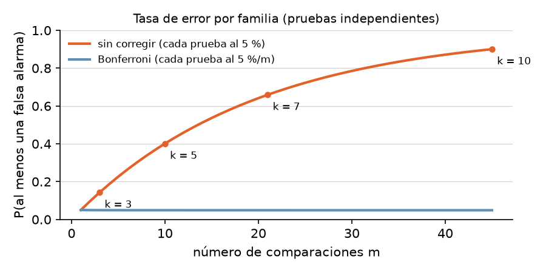
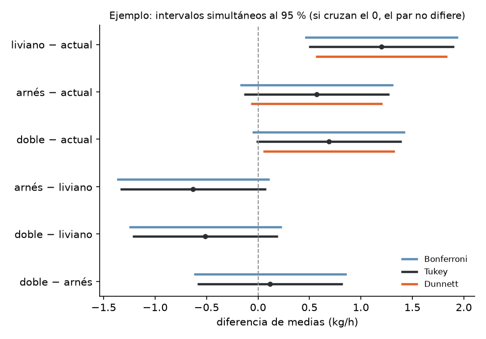
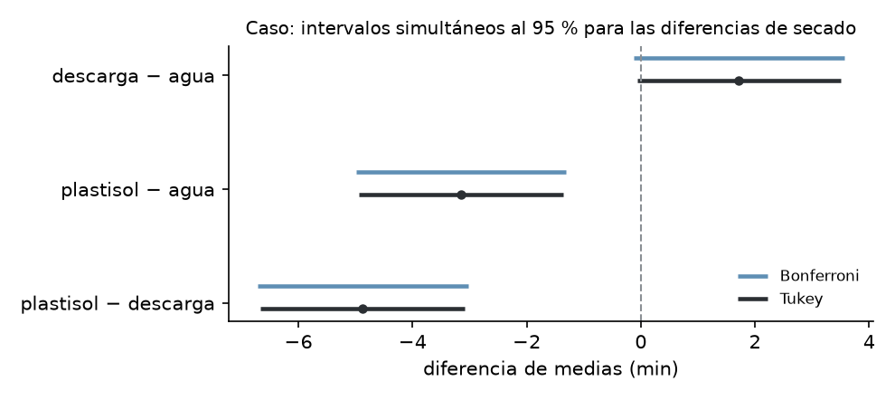

# Unidad 8 · Comparaciones múltiples

**Qué vas a poder hacer.** Después de un ANOVA que rechaza, decir **qué pares de grupos difieren**
sin inflar el riesgo de falsas alarmas: calcular la tasa de error por familia, ajustar con Bonferroni,
aplicar Tukey (HSD) a mano y con Python, comparar contra un control con Dunnett, reconocer cuándo usar
Scheffé, y leer la tabla de Tukey y sus intervalos simultáneos para tomar una decisión.

**Lo que necesitas antes.** De la unidad 2, la prueba $t$ y el intervalo para una diferencia de
medias. De la unidad 7, la tabla ANOVA de un factor: sobre todo el $CME$ y sus grados de libertad, que
acá se reutilizan en cada comparación.

**Tiempo.** Unas 5 horas: 2 de lectura con el ejemplo y 3 de práctica.

---

## 1. El problema · muchas preguntas, un solo riesgo

El ANOVA de la unidad 7 dice si **alguna** media difiere. La pregunta práctica casi siempre es otra:
**cuáles**. Con $k$ grupos hay $m = k(k-1)/2$ pares. Si cada par se prueba al 5 %, cada prueba tiene un
5 % de falsa alarma, pero la **familia** de pruebas tiene mucho más:

$$\text{tasa de error por familia} = P(\text{al menos una falsa alarma}) = 1 - (1-\alpha)^m \quad \text{(pruebas independientes)}$$



Las comparaciones de pares no son independientes (comparten grupos y el mismo $CME$), así que la cifra
exacta es algo menor, pero la conclusión no cambia: **sin corrección, buscar diferencias entre muchos
grupos garantiza encontrar alguna**. El ejercicio 8.9 lo mide con una simulación.

Hay dos maneras de pensar el error:

- **Tasa por comparación:** cada prueba al 5 %. Es lo que hace una prueba $t$ suelta.
- **Tasa por familia:** la probabilidad de que **alguna** de las $m$ conclusiones sea una falsa alarma
  quede en 5 %. Es lo que exige quien va a actuar sobre la lista completa de diferencias.

Todos los métodos de esta unidad controlan la tasa por familia. Difieren en **qué familia** cubren
(todos los pares, solo contra un control, cualquier contraste) y por eso en cuánto se ensanchan los
intervalos.

**Lo común a todos.** Comparan medias con el error estándar que sale del ANOVA:

$$ee(\bar y_i - \bar y_j) = \sqrt{CME\left(\frac{1}{n_i} + \frac{1}{n_j}\right)} \qquad \text{con } N - k \text{ gl}$$

Usar el $CME$ (que junta la información de todos los grupos) en vez de la varianza de solo los dos
grupos comparados da más grados de libertad y más precisión. Por eso los supuestos del ANOVA
(normalidad de residuos, varianzas iguales, independencia) siguen valiendo acá.

---

## 2. Bonferroni · repartir el 5 %

La idea más simple: si se hacen $m$ pruebas y se quiere que la familia tenga a lo más $\alpha$, cada
prueba se hace al nivel $\alpha/m$. Funciona por la desigualdad de Boole: la probabilidad de que ocurra
alguno de $m$ eventos es a lo más la suma de sus probabilidades, $m \cdot \alpha/m = \alpha$.

En la práctica hay tres formas equivalentes de aplicarlo:

| Forma | Cómo |
|---|---|
| Valor crítico | rechazar si $|t_{ij}| > t_{1-\alpha/(2m),\,N-k}$ |
| Diferencia mínima | rechazar si $|\bar y_i - \bar y_j| > t_{1-\alpha/(2m),\,N-k}\cdot ee$ |
| Valor p ajustado | $p_{Bonf} = \min(1,\ m \cdot p)$ y comparar con $\alpha$ |

**Cuándo conviene.** Cuando las comparaciones son **pocas y elegidas antes de ver los datos** (por
ejemplo, tres preguntas concretas). Sirve para cualquier tipo de prueba, no solo medias. Su defecto:
con muchas comparaciones es **conservador** (la familia queda bajo el 5 % y se pierden diferencias
reales).

**Holm, la versión escalonada.** Ordena los $m$ valores p de menor a mayor y compara el más chico con
$\alpha/m$, el segundo con $\alpha/(m-1)$, y así hasta el primero que no rechaza; ahí se detiene.
Controla la misma tasa por familia y nunca rechaza menos que Bonferroni. `multipletests(p, method="holm")`
lo hace.

---

## 3. Tukey (HSD) · todos los pares, con exactitud

Si la pregunta es **todos los pares**, la pregunta de fondo es: ¿la diferencia más grande entre medias
es más grande de lo que el azar produce? Con $n$ datos por grupo y bajo $H_0$, la distribución de

$$q = \frac{\bar y_{max} - \bar y_{min}}{\sqrt{CME/n}}$$

es conocida: la **distribución del rango studentizado** $q_{k,\,N-k}$, que depende del número de
grupos y de los gl del error. Si la diferencia más grande no supera el percentil 95 de $q$, ninguna
otra lo hace. Por eso Tukey controla la tasa por familia **exactamente** en 5 % para todos los pares en
un diseño balanceado.

**La diferencia honestamente significativa:**

$$HSD = q_{1-\alpha;\ k,\ N-k}\sqrt{\frac{CME}{n}} \qquad \text{el par } (i, j) \text{ difiere si } |\bar y_i - \bar y_j| > HSD$$

**Intervalos simultáneos:** $(\bar y_i - \bar y_j) \pm HSD$. Todos juntos cubren las diferencias reales
con 95 % de confianza. Si el intervalo de un par **no contiene el 0**, ese par difiere.

**Datos desbalanceados (Tukey-Kramer).** Se reemplaza $\sqrt{CME/n}$ por
$\sqrt{\frac{CME}{2}\left(\frac{1}{n_i}+\frac{1}{n_j}\right)}$: cada par tiene su propio $HSD$. Es lo que
hace `pairwise_tukeyhsd`. (Algunos apuntes dicen que Tukey exige grupos del mismo tamaño: con la
corrección de Kramer no hace falta, y la tasa por familia queda en 5 % o un poco menos.)

**La tabla de $q$.** Se entra con $k$ (número de grupos, no de pares) y con los gl del error. Con
Python: `stats.studentized_range.ppf(0.95, k, gl)`.

> **Relación con la $t$.** $q = \sqrt 2 \cdot |t|$ para un par. Tukey es una prueba $t$ cuyo valor
> crítico sale de pensar en el par más distante de todos, no en uno solo.

---

## 4. Scheffé · cualquier contraste (mención)

Un **contraste** es una combinación $L = \sum_i c_i \mu_i$ con $\sum_i c_i = 0$: un par
($c = 1, -1$), o «el promedio de dos métodos nuevos contra el promedio de dos viejos»
($c = \tfrac12, \tfrac12, -\tfrac12, -\tfrac12$). Su estimación y error estándar son

$$\hat L = \sum_i c_i \bar y_i \qquad ee(\hat L) = \sqrt{CME \sum_i \frac{c_i^2}{n_i}}$$

Scheffé protege **todos los contrastes posibles a la vez**, incluso los que se inventan después de mirar
los datos. Rechaza si $|\hat L/ee| > \sqrt{(k-1)\,F_{1-\alpha;\,k-1,\,N-k}}$.

Dos propiedades lo hacen útil: (1) es **coherente con el $F$**: si el ANOVA rechaza, existe al menos un
contraste que Scheffé declara significativo (aunque puede no ser un par); (2) por cubrir tanto, es el
más **conservador** para pares: para comparar pares, Tukey es mejor.

---

## 5. Dunnett · todos contra un control

Muchas veces hay un **control** (el proceso actual, el placebo, el proveedor de siempre) y la única
pregunta es si cada alternativa difiere de él. Son $k - 1$ comparaciones, no $k(k-1)/2$. Dunnett usa la
distribución conjunta de esas $k-1$ estadísticas $t$ (que están correlacionadas porque todas usan el
mismo control) y obtiene un valor crítico menor que el de Tukey y que el de Bonferroni con $k - 1$
pruebas:

$$|\bar y_i - \bar y_{control}| > d_{1-\alpha;\ k-1,\ N-k}\cdot\sqrt{CME\left(\frac{1}{n_i}+\frac{1}{n_c}\right)}$$

Con Python: `stats.dunnett(*tratamientos, control=control)` entrega los valores p ajustados y, con
`.confidence_interval()`, los intervalos simultáneos. El cálculo es numérico: se fija la semilla
(`rng=`) para que dé siempre lo mismo.

---

## 6. Cuál usar

| Pregunta | Método | Por qué |
|---|---|---|
| ¿Qué pares difieren, todos contra todos? | **Tukey** | exacto para todos los pares; intervalos más angostos que Bonferroni |
| ¿Alguna alternativa difiere del proceso actual? | **Dunnett** | solo $k - 1$ comparaciones; más potencia que Tukey para esa pregunta |
| Pocas comparaciones fijadas **antes** de ver los datos | **Bonferroni** (o Holm) | simple y sirve para cualquier prueba |
| Contrastes que se te ocurren **después** de mirar los datos | **Scheffé** | el único que protege lo que se elige mirando |
| Pruebas $t$ sueltas sin corregir (LSD de Fisher) | no se recomienda | solo protege si el ANOVA rechazó y hay 3 grupos; con más, la familia pierde el 5 % |

**El método se elige antes de mirar los resultados.** Probar los cuatro y quedarse con el que da más
diferencias es otra forma de hacer muchas pruebas.

---

## 7. Cómo leer la salida de Tukey

`pairwise_tukeyhsd` de `statsmodels` entrega una fila por par:

| Columna | Qué es |
|---|---|
| `group1`, `group2` | el par; los grupos van en orden alfabético |
| `meandiff` | la media de `group2` **menos** la de `group1` (ojo con el signo) |
| `p-adj` | el valor p **ya ajustado** por Tukey: se compara directo con 0,05 |
| `lower`, `upper` | el intervalo simultáneo al 95 % para `meandiff` |
| `reject` | `True` si el par difiere (equivale a `p-adj < 0,05` y a que el intervalo no contenga el 0) |

**Letras de agrupamiento.** Una forma compacta de informar: se ordenan las medias y se da la misma letra
a los grupos que **no** difieren. Dos grupos sin letra en común difieren; un grupo con «ab» no se
distingue ni de los «a» ni de los «b». Las letras no son transitivas: que A se parezca a B y B a C no
dice que A se parezca a C.

---

## 8. Con Python

```python
from scipy import stats
from statsmodels.stats.multicomp import pairwise_tukeyhsd
from statsmodels.stats.multitest import multipletests

tk = pairwise_tukeyhsd(df.kg_hora, df.capacho, alpha=0.05)    # Tukey(-Kramer)
print(tk)
tk.plot_simultaneous()                                       # intervalos simultáneos
p_bonf = multipletests(p_sin_corregir, method="bonferroni")[1]
p_holm = multipletests(p_sin_corregir, method="holm")[1]
d = stats.dunnett(liviano, arnes, doble, control=actual, rng=np.random.default_rng(1))
print(d.pvalue, d.confidence_interval(0.95))
q = stats.studentized_range.ppf(0.95, k, gl_error)           # el valor de la tabla de Tukey
```

El cuaderno `notebooks/u08_comparaciones_multiples.ipynb` reproduce el ejemplo y el caso, con las
pruebas $t$ de pares hechas con el $CME$.

---

## 9. Ejemplo resuelto · capachos para cosechar arándanos

Un huerto de arándanos de Ñuble prueba tres capachos nuevos (el balde que el cosechero lleva al cuerpo)
contra el **actual**: uno liviano, uno con arnés y uno doble. Asignó al azar 20 cosecheros con
experiencia parecida, 5 por capacho, y midió los kg cosechados por hora en una jornada.

| Capacho | 1 | 2 | 3 | 4 | 5 | Media |
|---|---|---|---|---|---|---|
| actual | 9,83 | 10,42 | 9,47 | 10,11 | 10,17 | 10,000 |
| liviano | 10,94 | 11,58 | 10,71 | 11,33 | 11,44 | 11,200 |
| arnés | 10,27 | 11,03 | 10,12 | 10,79 | 10,64 | 10,570 |
| doble | 10,53 | 11,12 | 9,97 | 10,92 | 10,90 | 10,688 |

**Paso 1 · ANOVA (unidad 7).** $F = 7{,}96$ con 3 y 16 gl, $p = 0{,}002$; $CME = 0{,}1523$. Algún
capacho difiere. Cada par tiene el mismo error estándar, $ee = \sqrt{0{,}1523 \cdot 2/5} = 0{,}2468$.

**Paso 2 · Las seis comparaciones con tres criterios.** $t = d/ee$ con 16 gl; Bonferroni multiplica el
$p$ por 6; Tukey usa $q = \sqrt2\,|t|$ contra el rango studentizado con $k = 4$.

| Par | $d$ (kg/h) | $t$ | $p$ sin corregir | $p$ Bonferroni | $q$ | $p$ Tukey |
|---|---|---|---|---|---|---|
| liviano − actual | 1,20 | 4,86 | < 0,001 | 0,001 | 6,88 | < 0,001 |
| arnés − actual | 0,57 | 2,31 | 0,035 | 0,208 | 3,27 | 0,137 |
| doble − actual | 0,69 | 2,79 | 0,013 | 0,079 | 3,94 | 0,058 |
| arnés − liviano | -0,63 | -2,55 | 0,021 | 0,128 | 3,61 | 0,089 |
| doble − liviano | -0,51 | -2,07 | 0,055 | 0,327 | 2,93 | 0,203 |
| doble − arnés | 0,12 | 0,48 | 0,639 | 1,000 | 0,68 | 0,963 |

Sin corregir, **cuatro** pares parecen distintos. Con Bonferroni y con Tukey queda **uno**.

**Paso 3 · Tukey a mano.** $q_{0,95;\,4,\,16} = 4{,}046$ (tabla de Tukey o `studentized_range`).

$$HSD = 4{,}046\sqrt{\frac{0{,}1523}{5}} = 0{,}706 \text{ kg/h}$$

Solo liviano − actual (1,20) supera 0,706. Doble − actual (0,69) queda justo debajo. Para comparar,
Bonferroni exige $t_{1 - 0{,}05/12;\ 16} = 3{,}008$, es decir una diferencia mínima de
$3{,}008 \cdot 0{,}2468 = 0{,}743$: más exigente que Tukey (las pruebas $t$ sueltas usan 2,120).

| Par | Tukey: desde | hasta | Bonferroni: desde | hasta |
|---|---|---|---|---|
| liviano − actual | 0,49 | 1,91 | 0,46 | 1,94 |
| arnés − actual | -0,14 | 1,28 | -0,17 | 1,31 |
| doble − actual | -0,02 | 1,39 | -0,05 | 1,43 |
| arnés − liviano | -1,34 | 0,08 | -1,37 | 0,11 |
| doble − liviano | -1,22 | 0,19 | -1,25 | 0,23 |
| doble − arnés | -0,59 | 0,82 | -0,62 | 0,86 |

**Paso 4 · La pregunta real era contra el actual: Dunnett.** El jefe de cosecha no necesita saber si
el arnés le gana al doble; necesita saber cuáles **superan al actual**. Son 3 comparaciones. El valor
crítico de Dunnett es 2,592 (contra 2,86 de Tukey en escala $t$, que es $4{,}046/\sqrt2$), así que la
diferencia mínima baja a $2{,}592 \cdot 0{,}2468 = 0{,}640$ kg/h.

| Capacho | $d$ contra actual | $t$ | $p$ Dunnett | IC 95 % desde | hasta |
|---|---|---|---|---|---|
| liviano | 1,20 | 4,86 | < 0,001 | 0,56 | 1,84 |
| arnés | 0,57 | 2,31 | 0,086 | -0,07 | 1,21 |
| doble | 0,69 | 2,79 | 0,034 | 0,05 | 1,33 |



**Paso 5 · Letras (Tukey).**

| Capacho | Media | Grupo |
|---|---|---|
| actual | 10,00 | a |
| arnés | 10,57 | ab |
| doble | 10,69 | ab |
| liviano | 11,20 | b |

**Cómo se lee.** Con la pregunta bien planteada (¿qué capacho supera al actual?, Dunnett, elegido antes
de mirar), hay evidencia para dos: el **liviano**, que agrega entre 0,56 y 1,84 kg por hora, y el
**doble**, entre 0,05 y 1,33. El liviano es la mejor apuesta: su ganancia es la mayor y la única que
sobrevive incluso a Tukey. Entre los tres nuevos no hay evidencia de diferencias (todos comparten letra
con alguno). Si se hubieran hecho pruebas $t$ sueltas, el informe habría dicho que el liviano también
le gana al arnés y que el arnés le gana al actual: dos afirmaciones que ningún método corregido
sostiene.

---

## 10. Errores típicos

| Error | Cómo evitarlo |
|---|---|
| Hacer pruebas $t$ de todos los pares y reportar las que dan $p < 0{,}05$ | Con $m$ pares la familia supera el 5 %; usar Tukey, Bonferroni o Dunnett según la pregunta |
| Comparar el `p-adj` de Tukey con $0{,}05/m$ | Ya viene ajustado: se compara con 0,05 directo |
| Leer el signo de `meandiff` al revés | Es `group2` − `group1`, y los grupos van en orden alfabético |
| Concluir «A y C son iguales» porque comparten letra | No rechazar no prueba igualdad; mirar el intervalo: puede ser ancho |
| Elegir el método que da más diferencias después de verlos todos | El método se fija antes, según la pregunta |
| Usar Tukey cuando solo interesa compararse con el control | Dunnett responde esa pregunta con más potencia |
| Usar la varianza de los dos grupos comparados en vez del $CME$ | El $CME$ y sus $N - k$ gl son los del modelo; si las varianzas difieren mucho, el problema es del ANOVA (unidad 7) |
| Creer que un $F$ significativo garantiza un par significativo | Puede que lo significativo sea un contraste entre grupos de grupos (ejercicio 8.8) |
| Informar solo «difiere / no difiere» | Dar la diferencia con su intervalo simultáneo: es lo que sirve para decidir |
| Creer que Tukey exige grupos de igual tamaño | Tukey-Kramer resuelve el caso desbalanceado |

---

## 11. Práctica

Diez ejercicios: 8.1 a 8.4 básicos, 8.5 a 8.8 intermedios, 8.9 y 8.10 de desafío. Usa $\alpha = 0{,}05$
por familia. Las pautas están en la sección 12.

**8.1 · El tamaño de la familia (básico).** Para $k = 3$, 5 y 7 grupos: ¿cuántos pares hay?, ¿a qué
nivel se hace cada prueba con Bonferroni?, ¿cuál sería la tasa por familia sin corregir y cuál con
Bonferroni, si las pruebas fueran independientes?

**8.2 · Tukey desde un resumen (básico).** Un vivero compara cuatro mezclas de sustrato para almácigos
(gramos de plántula por bandeja), 6 bandejas por mezcla. El ANOVA dio $CME = 2{,}4$ con 20 gl. Las medias
son A 15,2; B 17,9; C 16,1; D 19,0. Calcula el $HSD$, decide qué pares difieren y escribe las letras.

**8.3 · Leer una salida (básico).** Una tienda en línea mide el tiempo de pago (s) en tres versiones de
su página, 8 compras por versión:

| Versión | 1 | 2 | 3 | 4 | 5 | 6 | 7 | 8 |
|---|---|---|---|---|---|---|---|---|
| V1 | 186 | 169 | 203 | 181 | 163 | 197 | 192 | 175 |
| V2 | 157 | 175 | 145 | 168 | 151 | 163 | 179 | 156 |
| V3 | 181 | 197 | 174 | 205 | 188 | 169 | 211 | 193 |

`pairwise_tukeyhsd` entrega (con coma decimal):

| group1 | group2 | meandiff | p-adj | lower | upper | reject |
|---|---|---|---|---|---|---|
| V1 | V2 | -21,5000 | 0,0118 | -38,4988 | -4,5012 | True |
| V1 | V3 | 6,5000 | 0,6071 | -10,4988 | 23,4988 | False |
| V2 | V3 | 28,0000 | 0,0013 | 11,0012 | 44,9988 | True |

Interpreta cada fila en palabras (quién es más rápido y por cuánto), comprueba el ancho de los
intervalos con $q$ y el $CME$, y recomienda una versión.

**8.4 · Bonferroni y Holm (básico).** Un estudio con 6 comparaciones obtuvo estos valores p sin
corregir: 0,003; 0,006; 0,012; 0,030; 0,200 y 0,640. Ajústalos con Bonferroni y con Holm. ¿Cuántas
comparaciones son significativas con cada uno?

**8.5 · Tukey-Kramer (intermedio).** Con los datos del ejercicio 7.5 (horas hasta responder un reclamo:
correo 26, 31, 28, 35; formulario web 22, 18, 25, 20, 24, 23; teléfono 15, 19, 14, 17, 20), calcula el
$HSD$ de cada par con la corrección de Kramer y decide. Compara con Bonferroni.

**8.6 · Dunnett contra el adhesivo actual (intermedio).** Una fábrica de tableros prueba tres adhesivos
nuevos contra el actual; resistencia de la unión (MPa), 6 probetas cada uno:

| Adhesivo | 1 | 2 | 3 | 4 | 5 | 6 |
|---|---|---|---|---|---|---|
| actual | 8,42 | 9,07 | 8,71 | 8,93 | 8,18 | 8,84 |
| A1 | 9,03 | 9,58 | 9,31 | 8,82 | 9,47 | 9,41 |
| A2 | 8,62 | 9,19 | 8,48 | 9,04 | 8,87 | 8,73 |
| A3 | 9,38 | 9,93 | 9,61 | 9,24 | 10,08 | 9,66 |

(a) Haz Dunnett contra el actual. (b) Compara sus valores p con Bonferroni para 3 comparaciones y con
Tukey. (c) Ordena los cuatro métodos (Dunnett, Bonferroni con 3, Tukey, sin corregir) por la diferencia
mínima que exigen y explica el orden.

**8.7 · Un contraste con Scheffé (intermedio).** Con el resumen de 8.2: las mezclas B y D llevan compost
y A y C no. (a) Estima el contraste $L = \tfrac12(\mu_B + \mu_D) - \tfrac12(\mu_A + \mu_C)$ y su error
estándar. (b) ¿Es significativo si se planificó antes (prueba $t$) y si se eligió después de mirar
(Scheffé)? (c) Para un par cualquiera, ¿qué diferencia mínima exigen Scheffé, Tukey y Bonferroni?

**8.8 · $F$ significativo y ningún par (intermedio).** Minutos para armar un mueble con cuatro versiones
del instructivo, 5 personas por versión:

| Versión | 1 | 2 | 3 | 4 | 5 |
|---|---|---|---|---|---|
| V1 | 41 | 47 | 44 | 38 | 45 |
| V2 | 44 | 41 | 47 | 40 | 45 |
| V3 | 44 | 50 | 47 | 53 | 47 |
| V4 | 48 | 45 | 51 | 47 | 51 |

(a) Haz el ANOVA y Tukey. (b) ¿Cómo puede el $F$ rechazar si ningún par difiere? (c) Prueba con Scheffé
el contraste $\tfrac12(\mu_3 + \mu_4) - \tfrac12(\mu_1 + \mu_2)$.

**8.9 · Medir la tasa por familia (desafío).** Simula 20.000 experimentos con $k = 5$ grupos de $n = 8$
datos normales con **la misma media** (semilla 708 de `numpy.random.default_rng`). En cada uno haz las
10 pruebas $t$ de pares con el $CME$, Bonferroni, Tukey y el $F$ del ANOVA. ¿En qué fracción de los
experimentos cada método declara al menos una diferencia? ¿Por qué las pruebas sin corregir no llegan al
40,1 % de la fórmula?

**8.10 · Planificar el tamaño de muestra (desafío).** Un laboratorio va a comparar 4 recetas y quiere
que Tukey detecte cualquier diferencia de 1,0 unidades entre dos recetas. Espera una desviación
estándar de 1,2. ¿Cuántas réplicas por receta necesita para que el $HSD$ sea a lo más 1,0? (El valor de
$q$ cambia con $n$ porque cambian los gl del error.)

---

## 12. Pautas

**8.1.**

| $k$ | Pares | Nivel por prueba | Sin corregir | Con Bonferroni |
|---|---|---|---|---|
| 3 | 3 | 0,0167 | 14,3 % | 4,92 % |
| 5 | 10 | 0,0050 | 40,1 % | 4,89 % |
| 7 | 21 | 0,0024 | 65,9 % | 4,88 % |

Bonferroni deja la familia **bajo** el 5 %: protege, y por eso pierde algo de potencia. Sin corregir,
con 7 grupos dos de cada tres estudios «encuentran» algo inexistente.

**8.2.** $q_{0,95;\,4,\,20} = 3{,}958$; $\sqrt{2{,}4/6} = 0{,}6325$; $HSD = 2{,}50$ g. Diferencias: B − A
2,7 (difiere); C − A 0,9; D − A 3,8 (difiere); B − C 1,8; D − B 1,1; D − C 2,9 (difiere).

| Mezcla | Media | Grupo |
|---|---|---|
| A | 15,2 | a |
| C | 16,1 | ab |
| B | 17,9 | bc |
| D | 19,0 | c |

D es la mejor y se distingue de A y C, pero no de B. Si B es más barata, B es una opción que los datos
no permiten descartar.

**8.3.** Fila 1: V2 tarda 21,5 s menos que V1 (de 4,5 a 38,5 s menos, con 95 % simultáneo); difiere.
Fila 2: V3 tarda 6,5 s más que V1, pero el intervalo va de -10,5 a 23,5 y contiene el 0: no hay evidencia
de diferencia. Fila 3: V3 tarda 28,0 s más que V2; difiere. Ancho: $CME = 181{,}9286$ con 21 gl,
$q_{0,95;\,3,\,21} = 3{,}565$, $HSD = 3{,}565\sqrt{181{,}93/8} = 17{,}0$: cada intervalo es la diferencia
± 17,0 s. Recomendación: **V2**, la única más rápida que las otras dos. (Ojo con el signo: `meandiff` es
`group2` − `group1`, por eso la primera fila es negativa.)

**8.4.**

| $p$ sin corregir | Bonferroni | Holm |
|---|---|---|
| 0,003 | 0,018 | 0,018 |
| 0,006 | 0,036 | 0,030 |
| 0,012 | 0,072 | 0,048 |
| 0,030 | 0,180 | 0,090 |
| 0,200 | 1,000 | 0,400 |
| 0,640 | 1,000 | 0,640 |

Bonferroni: 2 significativas. Holm: 3 (el tercer p se multiplica por 4, no por 6: $0{,}012 \cdot 4 = 0{,}048$).
El cuarto ($0{,}030 \cdot 3 = 0{,}090$) ya no pasa y ahí Holm se detiene. Holm siempre rechaza al menos lo
mismo que Bonferroni con la misma protección.

**8.5.** $CME = 8{,}833$ con 12 gl; $q_{0,95;\,3,\,12} = 3{,}773$. Cada par tiene su $HSD$ con
$\sqrt{\tfrac{CME}{2}(1/n_i + 1/n_j)}$:

| Par | $d$ (h) | $HSD$ | $p$ Tukey | $p$ Bonferroni |
|---|---|---|---|---|
| formulario web − correo | -8 | 5,12 | 0,0034 | 0,0039 |
| teléfono − correo | -13 | 5,32 | < 0,001 | < 0,001 |
| teléfono − formulario web | -5 | 4,80 | 0,0411 | 0,0501 |

Los tres pares difieren con Tukey: teléfono es el canal más rápido, después el formulario y al final el
correo. Con Bonferroni el último par queda en 0,0501, apenas sobre 0,05: para todos los pares, Tukey es
más potente que Bonferroni.

**8.6.** $CME = 0{,}0916$ con 20 gl; cada comparación con el actual tiene $ee = 0{,}1748$.

| Adhesivo | $d$ (MPa) | $t$ | $p$ Dunnett | $p$ Bonferroni (3) | $p$ Tukey |
|---|---|---|---|---|---|
| A1 | 0,578 | 3,31 | 0,009 | 0,011 | 0,017 |
| A2 | 0,130 | 0,74 | 0,799 | 1,000 | 0,878 |
| A3 | 0,958 | 5,48 | < 0,001 | < 0,001 | < 0,001 |

(a) A1 y A3 son más resistentes que el actual; A2 no se distingue. (b) y (c) Diferencia mínima para
declarar distinto un adhesivo del actual:

| Método | Diferencia mínima (MPa) |
|---|---|
| Dunnett | 0,444 |
| Bonferroni (3) | 0,457 |
| Tukey | 0,489 |
| sin corregir | 0,365 |

Sin corregir es el más permisivo (y no protege la familia). Entre los que protegen, Dunnett exige menos
porque su familia es la más chica (3 comparaciones) y aprovecha que comparten el control; Bonferroni
con 3 no aprovecha esa correlación; Tukey cubre 6 pares que acá no interesan.

**8.7.** (a) $\hat L = \tfrac12(17{,}9 + 19{,}0) - \tfrac12(15{,}2 + 16{,}1) = 2{,}80$ g;
$ee = \sqrt{2{,}4 \cdot 4 \cdot 0{,}25/6} = 0{,}6325$; $t = 4{,}43$. (b) Planificado: $t_{0,975;\,20} = 2{,}086$,
significativo. Elegido después: el crítico de Scheffé es $\sqrt{3 F_{0,95;\,3,\,20}} = 3{,}049$; 4,43 lo
supera, también significativo. El compost aumenta el peso de las plántulas en unos 2,8 g por bandeja.
(c) Para un par, $ee = 0{,}8944$: Scheffé exige 2,73, Bonferroni (6 pares) 2,62 y Tukey 2,50. Para pares,
Scheffé es el más exigente: paga por proteger contrastes que nadie pidió.

**8.8.** (a) Medias 43,0; 43,4; 48,2; 48,4. $F = 4{,}43$ con 3 y 16 gl, $p = 0{,}019$; $CME = 9{,}825$.
Tukey ($HSD = 5{,}67$):

| Par | $d$ (min) | $p$ Tukey |
|---|---|---|
| V2 − V1 | 0,4 | 0,997 |
| V3 − V1 | 5,2 | 0,078 |
| V4 − V1 | 5,4 | 0,065 |
| V3 − V2 | 4,8 | 0,113 |
| V4 − V2 | 5,0 | 0,094 |
| V4 − V3 | 0,2 | 1,000 |

Ningún par difiere. (b) El $F$ junta la evidencia de todos los grupos: hay **dos bloques** (V1 y V2
rápidos, V3 y V4 lentos) y ninguna diferencia individual alcanza, pero el patrón completo sí. (c)
$\hat L = 5{,}1$ min, $ee = 1{,}402$, $t = 3{,}64$ contra el crítico de Scheffé 3,117: significativo,
$p = 0{,}019$. Las versiones 3 y 4 del instructivo hacen armar más lento que la 1 y la 2. Scheffé es
coherente con el $F$: cuando el $F$ rechaza, algún contraste lo explica.

**8.9.** Con la semilla 708, la fracción de experimentos con al menos una «diferencia»:

- pruebas $t$ sin corregir: 27,7 %;
- Bonferroni: 3,9 %;
- Tukey: 5,1 %;
- $F$ del ANOVA: 5,0 %.

```python
rng = np.random.default_rng(708)
Y = rng.normal(0, 1, size=(20_000, 5, 8))                 # 20.000 experimentos, 5 grupos, 8 datos
medias = Y.mean(axis=2)
cme = ((Y - medias[:, :, None]) ** 2).sum(axis=(1, 2)) / 35
rango = (medias.max(axis=1) - medias.min(axis=1)) / np.sqrt(cme / 8)
print((rango > stats.studentized_range.ppf(0.95, 5, 35)).mean())   # Tukey
```

Tukey y el $F$ quedan en el 5 % nominal (con el error de simulación); Bonferroni queda bajo el 5 %
(conservador). Las pruebas sueltas no llegan al 40,1 % de la fórmula porque las 10 comparaciones no
son independientes: comparten medias y el mismo $CME$. Igual son más de cinco veces el 5 % prometido.

**8.10.** $HSD = q_{0,95;\,4,\,4(n-1)} \cdot 1{,}2/\sqrt n$. Las últimas filas de la búsqueda:

| $n$ | gl del error | $q$ | $HSD$ |
|---|---|---|---|
| 18 | 68 | 3,725 | 1,053 |
| 19 | 72 | 3,719 | 1,024 |
| 20 | 76 | 3,715 | 0,997 |

Hacen falta **20 réplicas por receta** (80 en total). Casi todo el efecto viene de $\sqrt n$: $q$ apenas
baja de 3,725 a 3,715. Si 80 ensayos son caros, hay que aceptar detectar solo diferencias mayores o bajar
la variabilidad del ensayo.

---

## 13. Caso integrador · Estampa Sur, qué tintas difieren

> Sigue de la unidad 7: el ANOVA de un factor dijo que la tinta cambia el tiempo de secado
> ($F = 23{,}46$, $p < 0{,}001$). Ahora la pregunta es cuáles. Datos de `datos/secado.csv`, simulados por
> `verificacion/caso_estampa_sur_datos.py`.

El jefe de producción quiere saber si puede tratar igual a dos tintas en la programación del túnel, y
cuál seca más rápido. Son 3 tintas, 10 prendas por tinta, $CME = 2{,}600$ con 27 gl.

**Tukey a mano.** $q_{0,95;\,3,\,27} = 3{,}506$, así que

$$HSD = 3{,}506\sqrt{\frac{2{,}600}{10}} = 1{,}788 \text{ min}$$

**La salida de `pairwise_tukeyhsd`** (la misma que imprime el script del caso):

| group1 | group2 | meandiff | p-adj | lower | upper | reject |
|---|---|---|---|---|---|---|
| agua | descarga | 1,7200 | 0,0611 | -0,0679 | 3,5079 | False |
| agua | plastisol | -3,1500 | 0,0005 | -4,9379 | -1,3621 | True |
| descarga | plastisol | -4,8700 | 0,0000 | -6,6579 | -3,0821 | True |

(Un `p-adj` de 0,0000 es un valor p bajo 0,00005: se informa como $p < 0{,}001$.)

**Contra Bonferroni.** Con 3 pares, $t_{1 - 0{,}05/6;\ 27} = 2{,}552$ y $ee = 0{,}7211$: la diferencia
mínima es 1,841 min, algo mayor que el $HSD$.

| Par | $d$ (min) | $t$ | $p$ sin corregir | $p$ Bonferroni | $p$ Tukey |
|---|---|---|---|---|---|
| descarga − agua | 1,72 | 2,39 | 0,024 | 0,073 | 0,061 |
| plastisol − agua | -3,15 | -4,37 | < 0,001 | < 0,001 | < 0,001 |
| plastisol − descarga | -4,87 | -6,75 | < 0,001 | < 0,001 | < 0,001 |



**Letras.**

| Tinta | Media (min) | Grupo |
|---|---|---|
| plastisol | 17,16 | a |
| agua | 20,31 | b |
| descarga | 22,03 | b |

**Lectura.**

- **El plastisol seca más rápido que las otras dos:** 3,15 min menos que la tinta al agua (entre 1,36 y
  4,94) y 4,87 menos que la de descarga (entre 3,08 y 6,66). Las dos conclusiones sobreviven a Tukey y
  a Bonferroni. Si el plastisol se toma como la tinta de referencia del taller, Dunnett (valor crítico
  2,334) dice lo mismo: las otras dos difieren de él con $p < 0{,}001$.
- **Agua y descarga no se distinguen con estos datos:** 1,72 min de diferencia, pero Tukey da
  $p = 0{,}061$ y Bonferroni 0,073. Una prueba $t$ suelta ($p = 0{,}024$) habría dicho que difieren:
  es justo el error que esta unidad enseña a evitar. «No se distinguen» no es «son iguales»: el
  intervalo va de -0,07 a 3,51 min.
- **Decisión:** programar el túnel con dos tiempos, uno para plastisol y otro común para agua y
  descarga, sabiendo que la de descarga puede necesitar hasta unos 3,5 minutos más que la al agua.

**Lo que pasa a la unidad 9.** El $CME$ de 2,600 incluye el efecto de la temperatura, que la unidad 7
dejó escondido en el error. La unidad 9 agrega la temperatura como segundo factor: el error baja y la
comparación entre agua y descarga se vuelve a mirar con un error más chico.

---

## 14. Para seguir

**En los libros del ramo.**

- Montgomery, *Design and Analysis of Experiments* (Wiley), capítulo 3, el que fija el programa para el
  ANOVA de un factor; su parte sobre la interpretación de resultados trae comparaciones de pares,
  contrastes y comparaciones con un control.
- Kutner y otros, *Applied Linear Statistical Models* (McGraw-Hill, 2004), en sus capítulos de análisis
  de los efectos de los factores: Tukey, Scheffé y Bonferroni lado a lado.

**Abiertos y gratis.**

- NIST/SEMATECH, *e-Handbook of Statistical Methods*, sección 7.4.7 «How can we make multiple
  comparisons?» (en inglés), con Tukey, Scheffé y Bonferroni:
  https://www.itl.nist.gov/div898/handbook/prc/section4/prc47.htm
- Diez, Çetinkaya-Rundel y Barr, *OpenIntro Statistics* (PDF gratis, en inglés), sección 7.5 «Comparing
  many means with ANOVA», que cierra con comparaciones múltiples: https://www.openintro.org/book/os/

**Con el tutor.** La carpeta `tutor/` trae el contexto de este ramo. Pégalo al inicio de la conversación
con cualquier IA y pídele, por ejemplo: «Dame una salida de Tukey con cinco grupos y pídeme las letras de
agrupamiento y la recomendación; después corrígeme».
