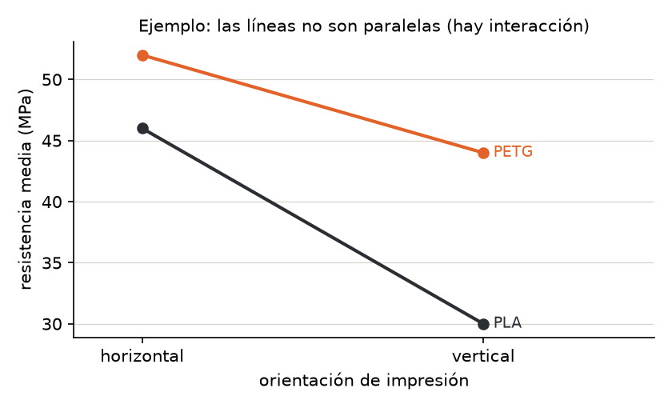
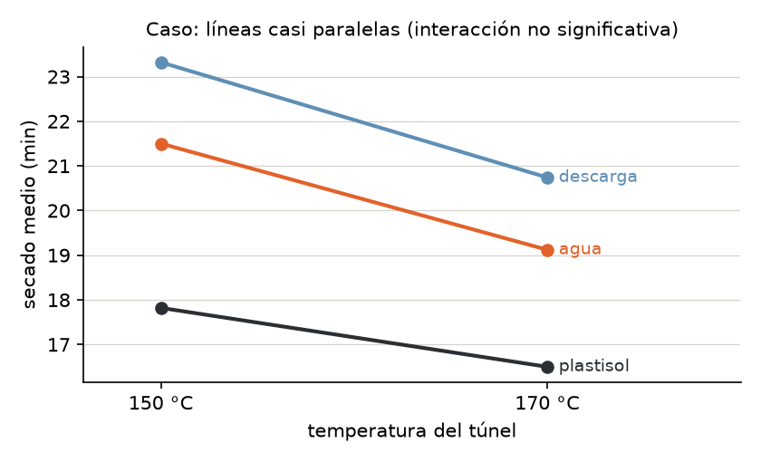
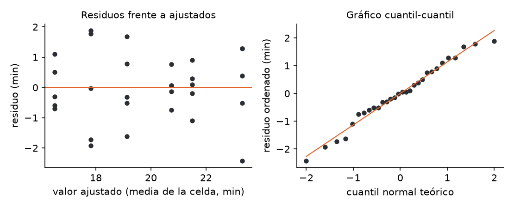

# Unidad 9 · ANOVA de varios factores, interacciones y supuestos

**Qué vas a poder hacer.** Plantear un diseño factorial de dos factores con réplicas, escribirlo como
modelo lineal en forma matricial, descomponer la variabilidad en efectos principales, interacción y
error, leer un gráfico de interacción, decidir qué tipo de suma de cuadrados informar cuando el diseño
no está balanceado, revisar los supuestos con los residuos y elegir qué hacer cuando fallan.

**Lo que necesitas antes.** De la unidad 7, el ANOVA de un factor: sumas de cuadrados entre y dentro,
cuadrados medios y la prueba $F$. De la unidad 8, las comparaciones múltiples (Tukey) para decir qué
niveles difieren después de una $F$ significativa. De álgebra lineal, multiplicar matrices.

**Tiempo.** Unas 6 horas: 2,5 de lectura con el ejemplo y 3,5 de práctica con el cuaderno.

---

## 1. La idea · dos factores en el mismo experimento

En la unidad 7 se comparaban los niveles de **un** factor. Casi nunca hay uno solo: el tiempo de
secado depende de la tinta y también de la temperatura; la resistencia de una pieza, del material y de
cómo se fabricó. Hay dos caminos:

- **Un experimento por factor.** Se fija la temperatura y se prueban tintas; después se fija la tinta y
  se prueban temperaturas. Gasta el doble de unidades y no dice nada de cómo se combinan.
- **Un diseño factorial.** Se prueban **todas** las combinaciones de niveles (cada combinación es un
  **tratamiento** o **celda**) y se repite cada una $n$ veces. Con los mismos datos se estiman los dos
  efectos y, además, si el efecto de uno depende del nivel del otro: la **interacción**.

Un diseño $a \times b$ con $n$ réplicas tiene $ab$ celdas y $N = abn$ observaciones. Es **balanceado**
si todas las celdas tienen el mismo $n$. Las réplicas tienen que ser **réplicas verdaderas**: unidades
distintas tratadas por separado, no la misma pieza medida tres veces.

> **Por qué conviene aunque no haya interacción.** Lo que explica el segundo factor sale del error. Con
> menos ruido en el denominador, la $F$ del primer factor crece. El caso de esta unidad lo muestra: la
> misma tinta pasa de $F = 23{,}46$ (un factor) a $F = 41{,}78$ (dos factores).

---

## 2. El modelo de dos factores

**Notación.** Factor A con niveles $i = 1, \dots, a$; factor B con niveles $j = 1, \dots, b$; réplica
$k = 1, \dots, n$. $Y_{ijk}$ es la $k$-ésima respuesta de la celda $(i, j)$.

**Modelo de medias de celda.** Cada celda tiene su media y las observaciones varían alrededor de ella:

$$Y_{ijk} = \mu_{ij} + \varepsilon_{ijk}, \qquad \varepsilon_{ijk} \sim N(0, \sigma^2) \text{ independientes}$$

**Modelo de efectos.** La misma media de celda, separada en piezas que se pueden interpretar:

$$Y_{ijk} = \mu + \alpha_i + \beta_j + (\alpha\beta)_{ij} + \varepsilon_{ijk}$$

con las restricciones $\sum_i \alpha_i = 0$, $\sum_j \beta_j = 0$, $\sum_i (\alpha\beta)_{ij} = \sum_j (\alpha\beta)_{ij} = 0$.

| Pieza | Qué es | Se estima con |
|---|---|---|
| $\mu$ | media global | $\bar y_{\cdot\cdot\cdot}$ |
| $\alpha_i$ | cuánto se aparta el nivel $i$ de A del promedio | $\bar y_{i\cdot\cdot} - \bar y_{\cdot\cdot\cdot}$ |
| $\beta_j$ | cuánto se aparta el nivel $j$ de B | $\bar y_{\cdot j\cdot} - \bar y_{\cdot\cdot\cdot}$ |
| $(\alpha\beta)_{ij}$ | lo que la celda tiene **de más** respecto de lo que predicen A y B por separado | $\bar y_{ij\cdot} - \bar y_{i\cdot\cdot} - \bar y_{\cdot j\cdot} + \bar y_{\cdot\cdot\cdot}$ |

Las restricciones no son un capricho: sin ellas hay más parámetros que medias de celda ($1 + a + b + ab$
contra $ab$) y el modelo no tiene una solución única.

**Las tres hipótesis.**

| Efecto | $H_0$ | $H_1$ |
|---|---|---|
| Interacción A×B | $(\alpha\beta)_{ij} = 0$ para todo $i, j$ | alguna $(\alpha\beta)_{ij} \ne 0$ |
| Principal de A | $\alpha_1 = \dots = \alpha_a = 0$ | algún $\alpha_i \ne 0$ |
| Principal de B | $\beta_1 = \dots = \beta_b = 0$ | algún $\beta_j \ne 0$ |

**Fijos o aleatorios.** Si los niveles se eligieron a propósito (estas tres tintas, estas dos
temperaturas), los efectos son **fijos** y la conclusión vale para esos niveles. Si los niveles son una
muestra de una población más grande (cuatro operarios sacados al azar de cuarenta), el efecto es
**aleatorio**: interesa su varianza, no la media de cada nivel. Esta unidad trabaja con efectos fijos.

---

## 3. La forma matricial $Y = X\beta + \varepsilon$

El ANOVA es un **modelo lineal**: el mismo $Y = X\beta + \varepsilon$ de la regresión (unidad 10), con
columnas de $X$ que son **variables indicadoras** (0 o 1) en vez de mediciones.

Con la **codificación de referencia** se elige un nivel base de cada factor. En un $2 \times 2$ con A en
niveles 1 y 2 y B en niveles 1 y 2, las columnas son: la constante, «es nivel 2 de A», «es nivel 2 de B»
y su producto. Cada celda tiene una fila distinta:

| Celda | constante | $x_A$ | $x_B$ | $x_A x_B$ | media que modela |
|---|---|---|---|---|---|
| (1, 1) | 1 | 0 | 0 | 0 | $\beta_0$ |
| (2, 1) | 1 | 1 | 0 | 0 | $\beta_0 + \beta_1$ |
| (1, 2) | 1 | 0 | 1 | 0 | $\beta_0 + \beta_2$ |
| (2, 2) | 1 | 1 | 1 | 1 | $\beta_0 + \beta_1 + \beta_2 + \beta_3$ |

La matriz $X$ completa repite cada fila $n$ veces. Los mínimos cuadrados dan

$$\hat\beta = (X^\top X)^{-1} X^\top Y$$

y la lectura es directa: $\hat\beta_0$ es la media de la celda base, $\hat\beta_1$ la diferencia entre los
niveles de A **dentro del nivel base de B**, $\hat\beta_2$ lo mismo para B, y $\hat\beta_3$ la
**diferencia de diferencias**: cuánto cambia el efecto de B al pasar al nivel 2 de A. Si $\beta_3 = 0$,
no hay interacción.

**Por qué importa.** La forma matricial es la que usa el software (`statsmodels` arma $X$ cuando
escribes `C(A) * C(B)`), y es la que permite tratar el desbalance, agregar una variable continua o
pasar a la regresión sin cambiar de herramienta. Una advertencia: `statsmodels` elige como base el
primer nivel en orden alfabético, así que sus coeficientes pueden diferir de los tuyos aunque el ajuste
sea idéntico.

---

## 4. La tabla ANOVA de dos factores (caso balanceado)

La desviación de cada dato respecto de la media global se parte en cuatro trozos, y sus cuadrados
suman (los productos cruzados se anulan cuando el diseño es balanceado):

$$SC_T = SC_A + SC_B + SC_{AB} + SC_E$$

$$SC_A = bn\sum_i (\bar y_{i\cdot\cdot} - \bar y_{\cdot\cdot\cdot})^2 \qquad SC_B = an\sum_j (\bar y_{\cdot j\cdot} - \bar y_{\cdot\cdot\cdot})^2$$

$$SC_{AB} = n\sum_{i,j} (\bar y_{ij\cdot} - \bar y_{i\cdot\cdot} - \bar y_{\cdot j\cdot} + \bar y_{\cdot\cdot\cdot})^2 \qquad SC_E = \sum_{i,j,k} (y_{ijk} - \bar y_{ij\cdot})^2$$

| Fuente | gl | SC | CM | $F$ |
|---|---|---|---|---|
| A | $a-1$ | $SC_A$ | $SC_A/(a-1)$ | $CM_A/CM_E$ |
| B | $b-1$ | $SC_B$ | $SC_B/(b-1)$ | $CM_B/CM_E$ |
| A×B | $(a-1)(b-1)$ | $SC_{AB}$ | $SC_{AB}/[(a-1)(b-1)]$ | $CM_{AB}/CM_E$ |
| Error | $ab(n-1)$ | $SC_E$ | $CM_E$ | |
| Total | $abn-1$ | $SC_T$ | | |

**La intuición.** $CM_E$ mide el ruido **dentro** de las celdas, donde todo está fijo salvo el azar.
Cada $CM$ de un efecto mide cuánto se separan las medias por ese efecto, más el mismo ruido. Si el
efecto no existe, los dos estiman $\sigma^2$ y la $F$ ronda 1; bajo $H_0$ sigue una $F$ con los gl de
la fila y los del error.

**Sin réplicas no hay prueba de interacción.** Con $n = 1$, $SC_E$ tiene $ab(1-1) = 0$ grados de
libertad: todo lo que no explican A y B es a la vez interacción y error, y no se pueden separar. Solo
queda suponer que no hay interacción y usar $SC_{AB}$ como error.

**Tamaño del efecto.** Una $F$ enorme dice que el efecto existe, no que importe. El $\eta^2$ parcial
dice qué fracción de la variabilidad que queda explica cada efecto:

$$\eta^2_p = \frac{SC_\text{efecto}}{SC_\text{efecto} + SC_E}$$

---

## 5. La interacción y el gráfico de interacción

Hay **interacción** cuando el efecto de un factor **depende** del nivel del otro. No significa que los
factores estén correlacionados ni que «se refuercen»: significa que no se puede hablar del efecto de A
sin decir en qué nivel de B.

**El gráfico de interacción** pone un factor en el eje horizontal, la media de cada celda en el vertical,
y une con una línea las celdas de cada nivel del otro factor.

| Lo que se ve | Lectura |
|---|---|
| Líneas paralelas | sin interacción: el efecto de B es el mismo en todos los niveles de A |
| Líneas que se abren o se cierran | interacción cuantitativa: B actúa en la misma dirección, con distinta fuerza |
| Líneas que se cruzan | interacción cualitativa: el mejor nivel de B cambia según A |

El gráfico se mira antes de la tabla, pero no reemplaza la prueba: con pocas réplicas, dos líneas pueden
verse algo inclinadas solo por azar. La $F$ de la interacción dice si la falta de paralelismo es más
grande que el ruido.

**El orden de lectura.**

1. **Primero la interacción.** Si no es significativa, se leen los efectos principales con las medias
   marginales, y las comparaciones múltiples de la unidad 8 se hacen sobre esas medias con el $CM_E$
   del modelo de dos factores.
2. **Si es significativa, los efectos principales pierden sentido por sí solos.** Un efecto principal
   «no significativo» puede esconder dos efectos opuestos que se cancelan. Se analizan los **efectos
   simples**: el efecto de B dentro de cada nivel de A, con

$$t = \frac{\bar y_{i1\cdot} - \bar y_{i2\cdot}}{\sqrt{CM_E \cdot 2/n}} \qquad \text{gl} = ab(n-1)$$

   y con una corrección por comparaciones múltiples (Bonferroni: $\alpha$ dividido por el número de
   comparaciones) si son varias.

---

## 6. Sumas de cuadrados tipo I, II y III

Si el diseño está **balanceado**, los factores son ortogonales: lo que explica A no se superpone con
lo que explica B, y cualquier forma de calcular las sumas de cuadrados da lo mismo. Si está
**desbalanceado** (una probeta se rompió, un estudio observacional), A y B quedan correlacionados y hay
que decidir a quién se le atribuye la parte compartida.

| Tipo | Qué mide cada fila | Cuándo se usa |
|---|---|---|
| **I (secuencial)** | lo que agrega cada término **en el orden en que se escribe**: $SC(A)$, luego $SC(B \mid A)$, luego $SC(AB \mid A, B)$ | cuando hay un orden natural (un factor que se controla primero); cambia si cambias el orden |
| **II** | cada efecto principal ajustado por el otro: $SC(A \mid B)$, $SC(B \mid A)$; la interacción ajustada por ambos | la opción por defecto cuando la interacción no es significativa |
| **III** | cada efecto ajustado por **todos** los demás, incluida la interacción | cuando hay interacción y se quiere probar efectos principales igual; exige codificación de suma cero |

Cada $SC(\cdot \mid \cdot)$ es una diferencia de sumas de cuadrados del error entre dos modelos
anidados: $SC(B \mid A) = SC_E(\text{solo } A) - SC_E(A + B)$. Lo que «explica» B es lo que baja el error
al agregarlo.

```python
mod = smf.ols("y ~ C(A) * C(B)", data=df).fit()
sm.stats.anova_lm(mod, typ=1)   # secuencial: depende del orden de la fórmula
sm.stats.anova_lm(mod, typ=2)   # ajustada; no depende del orden
```

---

## 7. Supuestos y qué hacer si fallan

Los supuestos son del **error**, y se revisan con los **residuos** $e_{ijk} = y_{ijk} - \bar y_{ij\cdot}$,
no con los datos crudos.

| Supuesto | Cómo se revisa | Si falla |
|---|---|---|
| **Independencia** | se asegura con el diseño: unidades distintas, orden de corrida al azar | no hay corrección estadística; hay que rehacer el diseño o modelar la dependencia |
| **Normalidad** | gráfico cuantil-cuantil de los residuos; Shapiro-Wilk (unidad 5) | la $F$ es robusta con celdas balanceadas y $n$ moderado; si el problema es un dato aberrante, primero revisarlo |
| **Varianzas iguales** | residuos frente a ajustados (que no hagan embudo); Levene **sobre las $ab$ celdas**; razón entre la varianza mayor y la menor | transformar la respuesta; Welch (un factor); errores robustos |

**Antes de transformar, mirar el dato.** Un residuo estandarizado ($e / \sqrt{CM_E}$) mayor que 3 en
valor absoluto suele ser un error de digitación o una unidad rara. Si se confirma el error, se corrige;
si no, se informa con y sin ese dato.

**Transformaciones.** Si la desviación estándar crece con la media (tiempos, montos, concentraciones),
el logaritmo estabiliza la varianza y convierte efectos multiplicativos en aditivos. Para conteos, la
raíz cuadrada. Box-Cox elige la potencia con los datos. Después de un logaritmo, una diferencia de
medias $d$ en la escala log se lee como una razón $e^{d}$ en la escala original. Ojo: una interacción
puede **desaparecer** con la transformación (era solo efecto de la escala) y eso es una buena noticia,
porque el modelo aditivo es más simple de explicar.

**Welch.** Para un factor con varianzas distintas, la $F$ de Welch pondera cada grupo por
$w_i = n_i / s_i^2$ (los grupos ruidosos pesan menos):

$$F_W = \frac{\sum w_i (\bar y_i - \bar y_w)^2 / (k-1)}{1 + \frac{2(k-2)}{k^2-1}\Lambda} \qquad \bar y_w = \frac{\sum w_i \bar y_i}{\sum w_i} \qquad \Lambda = \sum \frac{(1 - w_i/\sum w)^2}{n_i - 1}$$

con $k-1$ y $(k^2-1)/(3\Lambda)$ grados de libertad. En `statsmodels`:
`anova_oneway(grupos, use_var="unequal")`. Para dos factores, la versión equivalente es pedir errores
robustos a la heterocedasticidad: `sm.stats.anova_lm(mod, typ=2, robust="hc3")`.

**Kruskal-Wallis** (mención). Reemplaza los datos por sus rangos y compara un factor sin suponer
normalidad (`stats.kruskal`). No tiene una versión directa para la interacción, y responde algo
distinto: si alguna distribución tiende a dar valores más altos, no si las medias difieren.

---

## 8. Ejemplo resuelto · probetas impresas en 3D

Un taller de impresión 3D de Temuco fabrica soportes para repisas y quiere saber cuánto influyen el
**material** (PLA o PETG) y la **orientación** de impresión (capas horizontales o verticales respecto de
la carga) en la **resistencia a la tracción** (MPa). Imprime tres probetas por combinación, en orden al
azar, y las ensaya.

| Material | Orientación | $y_1$ | $y_2$ | $y_3$ | Media |
|---|---|---|---|---|---|
| PLA | horizontal | 44 | 48 | 46 | 46 |
| PLA | vertical | 31 | 28 | 31 | 30 |
| PETG | horizontal | 51 | 54 | 51 | 52 |
| PETG | vertical | 45 | 44 | 43 | 44 |

**Paso 1 · Medias.** Marginales: PLA 38, PETG 48; horizontal 49, vertical 37. Global: 43.

**Paso 2 · Sumas de cuadrados** ($a = b = 2$, $n = 3$).

$$SC_A = 2 \cdot 3\,[(38-43)^2 + (48-43)^2] = 300 \qquad SC_B = 2 \cdot 3\,[(49-43)^2 + (37-43)^2] = 432$$

Efecto de interacción de cada celda: PLA-horizontal $46 - 38 - 49 + 43 = 2$, y por las restricciones
las otras tres valen $-2$, $-2$ y $2$. Entonces $SC_{AB} = 3 \cdot 4 \cdot 2^2 = 48$. El error suma los
cuadrados de los desvíos dentro de cada celda: $(4+4+0) + (1+4+1) + (1+4+1) + (1+0+1) = 22$.
Total: $300 + 432 + 48 + 22 = 802$.

**Paso 3 · Tabla y pruebas** (cada gl del efecto es 1; el error tiene $4 \cdot 2 = 8$).

| Fuente | gl | SC | CM | $F$ | valor p | $\eta^2_p$ |
|---|---|---|---|---|---|---|
| Material | 1 | 300 | 300 | 109,09 | p < 0,001 | 0,93 |
| Orientación | 1 | 432 | 432 | 157,09 | p < 0,001 | 0,95 |
| Interacción | 1 | 48 | 48 | 17,45 | p = 0,003 | 0,69 |
| Error | 8 | 22 | 2,75 | | | |
| Total | 11 | 802 | | | | |

Las tres pruebas en cinco pasos se resumen así (con $F_{0,95;\,1,\,8} = 5{,}32$):

1. **Pregunta.** ¿El efecto de la orientación depende del material? ¿Influyen el material y la
   orientación?
2. **Hipótesis.** $H_0: (\alpha\beta)_{ij} = 0$; $H_0: \alpha_i = 0$; $H_0: \beta_j = 0$, contra que
   alguno no es cero.
3. **Estadístico.** $F = CM_\text{efecto}/CM_E$, que bajo $H_0$ sigue una $F(1, 8)$.
4. **Valor p.** Los tres están bajo 0,05 (las tres $F$ superan 5,32).
5. **Conclusión.** La orientación debilita la pieza, pero **cuánto** depende del material.

**Paso 4 · El gráfico de interacción.**



Las líneas no se cruzan pero no son paralelas: imprimir vertical cuesta 16 MPa en PLA y solo 8 en PETG.
Como la interacción es significativa, el siguiente paso son los **efectos simples** de la orientación
en cada material, con el $CM_E$ del modelo:

$$\sqrt{CM_E \cdot 2/n} = \sqrt{2{,}75 \cdot 2/3} = 1{,}354 \qquad t_\text{PLA} = \frac{46-30}{1{,}354} = 11{,}82 \qquad t_\text{PETG} = \frac{52-44}{1{,}354} = 5{,}91$$

Los dos superan $t_{0,975;\,8} = 2{,}306$: la orientación importa en ambos materiales.

**Paso 5 · La forma matricial.** Base: PLA y horizontal. Las cuatro filas distintas de $X$ son
$(1,0,0,0)$, $(1,0,1,0)$, $(1,1,0,0)$ y $(1,1,1,1)$, cada una tres veces.

$$X^\top X = \begin{pmatrix} 12 & 6 & 6 & 3 \\ 6 & 6 & 3 & 3 \\ 6 & 3 & 6 & 3 \\ 3 & 3 & 3 & 3 \end{pmatrix} \qquad X^\top Y = \begin{pmatrix} 516 \\ 288 \\ 222 \\ 132 \end{pmatrix} \qquad \hat\beta = (X^\top X)^{-1}X^\top Y = \begin{pmatrix} 46 \\ 6 \\ -16 \\ 8 \end{pmatrix}$$

$\hat\beta_0 = 46$ es la media de PLA horizontal; $\hat\beta_1 = 6$, lo que gana el PETG en horizontal;
$\hat\beta_2 = -16$, lo que pierde el PLA al imprimir vertical; $\hat\beta_3 = 8$, cuánto menos pierde el
PETG que el PLA al pasar a vertical ($-8$ contra $-16$). Es la interacción con nombre y apellido.

**Paso 6 · Supuestos.** Levene sobre las cuatro celdas da p = 0,95 y Shapiro-Wilk de los residuos,
p = 0,26: nada contradice varianzas iguales ni normalidad (con solo 12 datos, ninguna prueba tiene
mucha potencia; el gráfico de residuos del cuaderno no muestra embudo). Como el diseño es balanceado,
las sumas de cuadrados tipo I y tipo II coinciden.

```python
ej = pd.read_csv("../datos/u09_ejemplo.csv")
mod = smf.ols("resistencia ~ C(material) * C(orientacion)", data=ej).fit()
print(sm.stats.anova_lm(mod, typ=2))                       # la tabla del paso 3
print(stats.levene(*[g.resistencia for _, g in ej.groupby(["material", "orientacion"])]))
print(stats.shapiro(mod.resid))
```

**Cómo se lee.** El taller no puede decir «el PETG es 10 MPa mejor» a secas, porque la ventaja depende
de la orientación: en horizontal es de 6 MPa y en vertical, de 14. La decisión práctica: si una pieza
tiene que imprimirse vertical (por su forma), el PETG es casi obligatorio; si se puede imprimir
horizontal, el PLA rinde 46 MPa y puede bastar, porque es más barato. Lo que manda es la combinación,
no cada factor por separado.

---

## 9. Errores típicos

| Error | Cómo evitarlo |
|---|---|
| Hacer dos ANOVA de un factor en vez de uno de dos factores | Un solo modelo: separa los efectos, prueba la interacción y achica el error |
| Leer los efectos principales sin mirar antes la interacción | Primero la fila A×B; si es significativa, efectos simples dentro de cada nivel |
| Decir «no hay interacción» porque $p > 0{,}05$ | «No se rechaza» no es «se acepta»: con pocas réplicas la prueba tiene poca potencia; mira también el gráfico y el $\eta^2_p$ |
| Confundir significativo con importante | Informa la diferencia en unidades del problema (MPa, minutos) y el $\eta^2_p$, no solo el valor p |
| Probar la interacción con $n = 1$ | Sin réplicas el error tiene 0 gl; hay que suponer aditividad |
| Revisar la normalidad de los datos crudos | Se revisan los **residuos**: los datos crudos mezclan medias distintas |
| Hacer Levene sobre un factor cuando el modelo tiene dos | La varianza tiene que ser igual en las $ab$ celdas |
| Mirar el valor p y no los supuestos | Un dato mal digitado puede borrar un efecto real (ejercicio 9.6) |
| Informar sumas tipo I en un diseño desbalanceado sin decir el orden | En desbalance usa tipo II (o III si hay interacción) y dilo |
| Interpretar los coeficientes de `statsmodels` con otra base | Revisa qué nivel quedó de referencia (el primero en orden alfabético) |

---

## 10. Práctica

Diez ejercicios: 9.1 a 9.4 básicos, 9.5 a 9.8 intermedios, 9.9 y 9.10 de desafío. Usa $\alpha = 0{,}05$
salvo que se indique otra cosa. Las pautas están en la sección 11.

**9.1 · Completar la tabla (básico).** Una lavandería industrial de Chillán mide el consumo de agua por
carga con 3 programas de lavado y 2 tipos de carga (algodón, sintético), 4 cargas por combinación. Obtuvo
$SC_\text{programa} = 58{,}6$, $SC_\text{carga} = 21{,}3$, $SC_{AB} = 4{,}2$ y $SC_T = 131{,}5$. Completa la
tabla ANOVA (gl, CM, $F$, valor p), da los valores críticos y concluye en el lenguaje del problema.

**9.2 · Leer las medias de celda (básico).** Un call center mide el tiempo medio de atención (min) por
canal y turno:

| Canal | mañana | tarde | noche |
|---|---|---|---|
| teléfono | 6,2 | 6,8 | 7,9 |
| chat | 8,1 | 8,7 | 11,0 |

(a) Calcula las medias marginales, la global y los seis efectos de interacción
$(\alpha\beta)_{ij}$. (b) Describe el gráfico de interacción. (c) ¿Puedes decir con esta tabla si la
interacción es significativa?

**9.3 · La matriz de diseño (básico).** Un taller de bicicletas mide los minutos que tarda en cambiar
una cadena según el técnico y el tipo de bicicleta, dos veces por combinación:

| Técnico | Bicicleta | 1.º | 2.º |
|---|---|---|---|
| Ana | ruta | 12 | 14 |
| Ana | montaña | 17 | 19 |
| Benjamín | ruta | 15 | 15 |
| Benjamín | montaña | 24 | 22 |

Con Ana y ruta como base, escribe la matriz $X$ ($8 \times 4$), calcula $X^\top X$ y obtén $\hat\beta$ sin
invertir matrices, usando lo que significa cada coeficiente. Comprueba con Python. ¿Qué dice
$\hat\beta_3$? ¿Es significativa la interacción?

**9.4 · Grados de libertad (básico).** Una viña del Maule compara el rendimiento de 4 clones con 3 tipos
de poda, 3 hileras por combinación. (a) Da los gl de cada fila y los valores críticos $F_{0,95}$ de las
tres pruebas. (b) Si tuviera una sola hilera por combinación, ¿qué pasaría con la prueba de interacción?
¿Con qué error y qué valores críticos probaría los efectos principales?

**9.5 · Una tabla completa a mano (intermedio).** Una panadería mide los minutos de fermentación de la
masa con dos levaduras y tres temperaturas de sala:

| Levadura | Sala | $y_1$ | $y_2$ | $y_3$ |
|---|---|---|---|---|
| fresca | 22 °C | 92 | 88 | 95 |
| fresca | 26 °C | 74 | 78 | 73 |
| fresca | 30 °C | 61 | 66 | 62 |
| seca | 22 °C | 101 | 97 | 99 |
| seca | 26 °C | 84 | 80 | 85 |
| seca | 30 °C | 70 | 72 | 67 |

Arma la tabla ANOVA a mano, calcula el $\eta^2_p$ de cada efecto principal y, si corresponde, compara las
temperaturas con Tukey usando el $CM_E$ del modelo de dos factores.

**9.6 · Un dato que esconde el efecto (intermedio).** Una empacadora de arándanos llena cajas de 125 g
con dos máquinas en dos turnos y pesa 5 cajas por combinación (g):

| Máquina | Turno | $y_1$ | $y_2$ | $y_3$ | $y_4$ | $y_5$ |
|---|---|---|---|---|---|---|
| M1 | día | 125,8 | 126,1 | 125,5 | 126,4 | 125,9 |
| M1 | noche | 126,2 | 125,7 | 126,6 | 126,0 | 152,4 |
| M2 | día | 127,1 | 126,8 | 127,5 | 126,9 | 127,3 |
| M2 | noche | 127,0 | 127,6 | 126,7 | 127,4 | 127,2 |

(a) Haz el ANOVA y revisa los supuestos con los residuos. (b) El supervisor confirma que el 152,4 fue
mal digitado: era 125,4. Rehaz el análisis. ¿Qué cambió y qué enseña?

**9.7 · Una interacción que es solo escala (intermedio).** El tiempo de respuesta (ms) de una API se mide
con dos servidores y dos tamaños de consulta, 4 veces por combinación:

| Servidor | Consulta | $y_1$ | $y_2$ | $y_3$ | $y_4$ |
|---|---|---|---|---|---|
| estándar | chica | 38 | 44 | 41 | 36 |
| estándar | grande | 131 | 108 | 124 | 115 |
| optimizado | chica | 21 | 18 | 22 | 19 |
| optimizado | grande | 57 | 66 | 54 | 63 |

(a) Haz el ANOVA en la escala original y revisa las varianzas de las celdas. (b) Repite con
$\ln(\text{ms})$. (c) ¿Qué dice el modelo en la escala log sobre el servidor optimizado?

**9.8 · Efectos simples (intermedio).** Un ensayo de trigo cruza fertilizante (sin, con) y manejo
(secano, riego), 4 parcelas por combinación. Medias (qq/ha): secano sin 38,2, secano con 41,0, riego sin
52,4 y riego con 63,8. El modelo completo dio $CM_E = 6{,}8$ con 12 gl. (a) Prueba la interacción con el
contraste $c = (\bar y_{rc} - \bar y_{rs}) - (\bar y_{sc} - \bar y_{ss})$, cuya varianza es
$CM_E \cdot 4/n$. (b) Calcula el efecto del fertilizante en secano y en riego, con su $t$ y su intervalo
del 95 %. (c) ¿Cambia alguna conclusión con Bonferroni?

**9.9 · Desbalance y tipos de suma de cuadrados (desafío).** Una tienda en línea revisa el monto de sus
pedidos (miles de $) según tipo de envío y región. Es un estudio observacional y las celdas quedaron
desbalanceadas:

| Envío | Región | Montos |
|---|---|---|
| normal | Santiago | 12, 14, 13, 15, 11, 13 |
| normal | regiones | 9, 10 |
| express | Santiago | 16, 18 |
| express | regiones | 13, 12, 14, 15, 13, 12 |

(a) Compara la diferencia de medias express menos normal calculada con todos los pedidos y con el
promedio de las medias de celda. (b) Calcula las sumas de cuadrados tipo I con los dos órdenes posibles y
las tipo II. (c) ¿Cuál informarías y por qué?

**9.10 · Varianzas desiguales (desafío).** Tres transportistas entregan pedidos; los días de entrega
fueron:

| Transportista | Días |
|---|---|
| A | 2,14 · 2,38 · 2,21 · 2,02 · 2,33 · 2,19 |
| B | 3,46 · 1,83 · 4,87 · 2,25 · 5,61 · 1,42 · 3,94 · 2,68 |
| C | 2,81 · 2,93 · 3,07 · 2,74 · 3,02 |

(a) Revisa la igualdad de varianzas. (b) Compara las medias con el ANOVA clásico y con Welch.
(c) Aplica Kruskal-Wallis. (d) Explica por qué los tres resultados no coinciden y qué transportista
contratarías.

---

## 11. Pautas

**9.1.** Error: $SC_E = 131{,}5 - 58{,}6 - 21{,}3 - 4{,}2 = 47{,}4$ con $3 \cdot 2 \cdot 3 = 18$ gl.

| Fuente | gl | SC | CM | $F$ | valor p | $F_{0,95}$ |
|---|---|---|---|---|---|---|
| Programa | 2 | 58,6 | 29,30 | 11,13 | p < 0,001 | 3,55 |
| Carga | 1 | 21,3 | 21,30 | 8,09 | p = 0,011 | 4,41 |
| Interacción | 2 | 4,2 | 2,10 | 0,80 | p = 0,466 | 3,55 |
| Error | 18 | 47,4 | 2,633 | | | |
| Total | 23 | 131,5 | | | | |

La interacción no es significativa: no hay evidencia de que la diferencia entre algodón y sintético
cambie con el programa. Entonces se leen los efectos principales: el programa y el tipo de carga influyen
en el consumo de agua. El paso siguiente es Tukey sobre los tres programas para saber cuál gasta menos.

**9.2.** (a) Marginales: teléfono 6,97, chat 9,27; mañana 7,15, tarde 7,75, noche 9,45; global 8,12.
Efectos de interacción:

| Canal | mañana | tarde | noche |
|---|---|---|---|
| teléfono | 0,20 | 0,20 | -0,40 |
| chat | -0,20 | -0,20 | 0,40 |

(b) La diferencia chat menos teléfono es 1,9 min en la mañana y en la tarde, y 3,1 de noche: dos líneas
paralelas en los primeros turnos que se abren en la noche. Si hay interacción, está en el chat nocturno.
(c) No. Para probarla hacen falta las réplicas: sin $n$ ni $CM_E$ no hay con qué comparar el 0,40. Una
tabla de medias muestra la forma; la prueba dice si es más que ruido.

**9.3.** $X$ tiene las filas $(1,0,0,0)$ dos veces (Ana, ruta), $(1,0,1,0)$ dos veces (Ana, montaña),
$(1,1,0,0)$ dos veces (Benjamín, ruta) y $(1,1,1,1)$ dos veces (Benjamín, montaña).

$$X^\top X = \begin{pmatrix} 8 & 4 & 4 & 2 \\ 4 & 4 & 2 & 2 \\ 4 & 2 & 4 & 2 \\ 2 & 2 & 2 & 2 \end{pmatrix}$$

Medias de celda: 13, 18, 15 y 23. Entonces $\hat\beta_0 = 13$ (Ana en ruta), $\hat\beta_1 = 15 - 13 = 2$
(Benjamín en ruta), $\hat\beta_2 = 18 - 13 = 5$ (montaña, para Ana) y
$\hat\beta_3 = (23 - 15) - (18 - 13) = 3$: a Benjamín la montaña le cuesta 3 minutos más que a Ana. La
interacción da $F = 3{,}00$ con 1 y 4 gl, p = 0,158: con dos réplicas por celda no alcanza para
afirmarla. `np.linalg.solve(X.T @ X, X.T @ y)` devuelve los mismos cuatro números.

**9.4.** (a) A: 3 gl; B: 2; A×B: 6; error: $4 \cdot 3 \cdot 2 = 24$; total: 35. Críticos:
$F_{0,95;\,3,\,24} = 3{,}01$, $F_{0,95;\,2,\,24} = 3{,}40$ y $F_{0,95;\,6,\,24} = 2{,}51$. (b) Con una
hilera, el error del modelo con interacción tiene $4 \cdot 3 \cdot 0 = 0$ gl: la interacción no se puede
probar. Hay que suponer que no existe y usar su suma de cuadrados como error, con $3 \cdot 2 = 6$ gl.
Los críticos pasan a $F_{0,95;\,3,\,6} = 4{,}76$ y $F_{0,95;\,2,\,6} = 5{,}14$. Si la poda sí interactúa
con el clon, ese error queda inflado y las pruebas pierden potencia.

**9.5.** Medias de celda: fresca 91,67, 75,00 y 63,00; seca 99,00, 83,00 y 69,67. Marginales: fresca
76,56, seca 83,89; 22 °C 95,33, 26 °C 79,00, 30 °C 66,33.

| Fuente | gl | SC | CM | $F$ | valor p |
|---|---|---|---|---|---|
| Levadura | 1 | 242,00 | 242,00 | 33,25 | p < 0,001 |
| Temperatura | 2 | 2.536,44 | 1.268,22 | 174,26 | p < 0,001 |
| Interacción | 2 | 1,33 | 0,67 | 0,09 | p = 0,913 |
| Error | 12 | 87,33 | 7,28 | | |
| Total | 17 | 2.867,11 | | | |

Sin interacción (las líneas son casi paralelas), los efectos principales se leen solos. $\eta^2_p$:
levadura 0,73, temperatura 0,97. Tukey sobre las temperaturas, con 6 datos por nivel:
$HSD = q_{0,95;\,3,\,12}\sqrt{CM_E/6} = 3{,}773\sqrt{7{,}28/6} = 4{,}16$ min. Las diferencias (16,33 entre
22 y 26 °C; 12,67 entre 26 y 30 °C; 29,00 entre 22 y 30 °C) superan todas 4,16. Cada grado de sala
acorta la fermentación, y la levadura fresca ahorra unos 7 minutos en cualquier temperatura.

**9.6.** (a) Con el 152,4, la celda M1-noche tiene media 131,38 y el $CM_E$ sube a 34,62. Ningún efecto
es significativo (la $F$ del turno es 1,09). Pero los residuos delatan el problema: Shapiro-Wilk da
p < 0,001 y el residuo estandarizado de ese dato es 3,6. (b) Con 125,4: $CM_E = 0{,}132$, la máquina da
$F = 53{,}5$ (p < 0,001), el turno 0,09 y la interacción nada. Shapiro p = 0,94; Levene p = 0,81. M2
llena en promedio 127,15 g contra 125,96 de M1: regala más fruta por caja. La lección: un solo dato mal
digitado multiplicó el error por más de 260 y borró un efecto real. Mirar el valor p sin mirar los residuos habría
llevado a decir que las máquinas llenan igual.

**9.7.** (a) Medias: 39,75, 119,50, 20,00 y 60,00. Varianzas de celda: 12,2, 101,7, 3,3 y 30,0; la mayor
es 30,5 veces la menor (Levene p = 0,011). La interacción sale enorme: $F = 42{,}92$, p < 0,001.
(b) Con el logaritmo, la razón de varianzas baja a 1,2 (Levene p = 0,977) y la interacción desaparece:
$F = 0{,}00$, p = 0,980. (c) En la escala original, «el servidor optimizado ahorra 20 ms en consultas
chicas y 60 en grandes» parecía una interacción; en realidad ahorra **la misma proporción** en las dos:
la razón de medias geométricas es $e^{d} = 0{,}50$, es decir, responde en la mitad del tiempo. El modelo
aditivo en logaritmos es el correcto y se explica en una frase.

**9.8.** (a) $c = (63{,}8 - 52{,}4) - (41{,}0 - 38{,}2) = 8{,}6$ qq/ha, y
$F = c^2/(CM_E \cdot 4/4) = 10{,}88$ con 1 y 12 gl, p = 0,006: hay interacción. (b) Error estándar de
cada efecto simple: $\sqrt{6{,}8 \cdot 2/4} = 1{,}844$. En secano, $t = 2{,}8/1{,}844 = 1{,}52$
(p = 0,155), IC 95 % de -1,22 a 6,82 qq/ha (con $t_{0,975;\,12} = 2{,}179$). En riego,
$t = 11{,}4/1{,}844 = 6{,}18$ (p < 0,001), IC de 7,38 a 15,42. (c) Con Bonferroni para dos comparaciones
el crítico sube a 2,560; riego sigue significativo y secano sigue sin serlo. El fertilizante rinde bajo
riego; en secano, el agua limita y la evidencia no alcanza. Informar «el fertilizante sube 7 qq/ha en
promedio» sería engañoso.

**9.9.** (a) Con todos los pedidos: normal 12,12, express 14,12, una diferencia de 2,0. Con el
promedio de las medias de celda: normal 11,25, express 15,08, una diferencia de 3,83. La diferencia
bruta subestima el efecto porque los envíos express vienen sobre todo de regiones, donde los montos son
menores: región y envío están mezclados.

(b)

| Término | Tipo I (envío primero) | Tipo I (región primero) | Tipo II |
|---|---|---|---|
| Envío | 16,00 | 44,08 | 44,08 |
| Región | 40,33 | 12,25 | 40,33 |
| Interacción | 0,08 | 0,08 | 0,08 |
| Error | 19,33 | 19,33 | 19,33 |

La interacción es nula (p = 0,824) en todos los casos. (c) El tipo I cambia con el orden porque le regala
al primer término la parte que comparte con el segundo. El tipo II ajusta cada efecto por el otro y no
depende del orden; sin interacción, es el que corresponde. Los dos efectos son significativos ajustados
(p < 0,001).

**9.10.** (a) Medias 2,21, 3,26 y 2,91 días; desviaciones 0,13, 1,48 y 0,14. Levene: p < 0,001. La
varianza de B es más de cien veces la de A. (b) ANOVA clásico: $F = 1{,}95$, p = 0,175. Welch:
$F = 35{,}66$ con 2 y 10,20 gl, p < 0,001. (c) Kruskal-Wallis: $H = 5{,}11$, p = 0,078. (d) El ANOVA
clásico junta las tres varianzas en un $CM_E$ dominado por B: el ruido de B tapa la diferencia nítida
entre A y C. Welch pesa cada grupo por su precisión y ve que A y C, muy consistentes, difieren claramente.
Kruskal-Wallis responde otra pregunta (si algún transportista tiende a tardar más en rangos) y con estos
tamaños tiene poca potencia. La decisión no la toma solo la media: A entrega antes **y** sin sorpresas;
B promedia 3,26 días pero puede tardar 5,61. Se contrata A.

---

## 12. Caso integrador · Estampa Sur, secado según tinta y temperatura

> En la unidad 7 Estampa Sur comparó el tiempo de secado de tres tintas con un ANOVA de un factor
> ($F = 23{,}46$) y en la 8 vio con Tukey qué pares difieren. Pero las prendas se secaron a dos
> temperaturas del túnel, y eso quedó en el error. Esta pieza agrega la temperatura.

Los datos son simulados por `verificacion/caso_estampa_sur_datos.py` y están en `datos/secado.csv`:
3 tintas, 2 temperaturas y 5 prendas por combinación (minutos hasta el secado al tacto).

| Tinta | Temperatura | $y_1$ | $y_2$ | $y_3$ | $y_4$ | $y_5$ | Media |
|---|---|---|---|---|---|---|---|
| plastisol | 150 °C | 19,7 | 16,1 | 19,6 | 15,9 | 17,8 | 17,82 |
| plastisol | 170 °C | 15,9 | 16,2 | 15,8 | 17,6 | 17,0 | 16,50 |
| agua | 150 °C | 21,8 | 22,4 | 20,4 | 21,6 | 21,3 | 21,50 |
| agua | 170 °C | 20,8 | 18,8 | 19,9 | 18,6 | 17,5 | 19,12 |
| descarga | 150 °C | 24,6 | 24,6 | 23,7 | 20,9 | 22,8 | 23,32 |
| descarga | 170 °C | 21,5 | 20,8 | 20,8 | 20,6 | 20,0 | 20,74 |

Medias marginales: plastisol 17,16, agua 20,31, descarga 22,03; 150 °C 20,88, 170 °C 18,79.

**Primero el gráfico.**



Las tres líneas bajan casi en paralelo: a 170 °C todas las tintas secan antes, en una magnitud parecida.

**La tabla** (balanceada: tipo I y tipo II coinciden).

| Fuente | gl | SC | CM | $F$ | valor p | $\eta^2_p$ |
|---|---|---|---|---|---|---|
| Tinta | 2 | 121,99 | 61,00 | 41,78 | p < 0,001 | 0,78 |
| Temperatura | 1 | 32,87 | 32,87 | 22,51 | p < 0,001 | 0,48 |
| Interacción | 2 | 2,29 | 1,15 | 0,79 | p = 0,467 | 0,06 |
| Error | 24 | 35,04 | 1,460 | | | |
| Total | 29 | 192,19 | | | | |

1. **Pregunta.** ¿El efecto de la temperatura depende de la tinta? ¿Influyen la tinta y la temperatura?
2. **Hipótesis.** $H_0: (\alpha\beta)_{ij} = 0$, $H_0: \alpha_i = 0$, $H_0: \beta_j = 0$.
3. **Estadístico.** $F = CM/CM_E$; la interacción sigue una $F(2, 24)$ bajo $H_0$ (crítico 3,40).
4. **Valor p.** Interacción p = 0,467; tinta y temperatura, p < 0,001.
5. **Conclusión.** No hay evidencia de que la temperatura actúe distinto según la tinta (lo que no prueba
   que el efecto sea idéntico: con 5 prendas por celda, una interacción chica pasaría inadvertida). Tinta y
   temperatura influyen, y se pueden leer por separado.

**Supuestos.** Levene entre las tres tintas (como lo calcula el script del caso) da p = 0,89; sobre las
seis celdas, que es lo que supone el modelo, p = 0,17. Shapiro-Wilk de los residuos, p = 0,76. El gráfico
de residuos no muestra embudo ni curva:



**Lo que gana el modelo de dos factores.** Con un solo factor, el error era 2,600 y la tinta daba
$F = 23{,}46$. Al sacar la temperatura del error, $CM_E$ baja a 1,460 y la $F$ de la tinta sube a 41,78.
Las mismas 30 prendas, mejor usadas.

**Cuánto.** Sin interacción, el efecto de la temperatura es la diferencia de medias marginales:
$20{,}88 - 18{,}79 = 2{,}09$ min, con error estándar $\sqrt{1{,}460 \cdot 2/15} = 0{,}441$. Con
$t_{0,975;\,24} = 2{,}064$, el IC 95 % va de 1,18 a 3,00 minutos. Para las tintas, Tukey con el $CM_E$ de
dos factores: $HSD = q_{0,95;\,3,\,24}\sqrt{1{,}460/10} = 3{,}532 \cdot 0{,}382 = 1{,}35$ min. Las tres
diferencias (3,15 agua frente a plastisol; 1,72 descarga frente a agua; 4,87 descarga frente a
plastisol) la superan: las tres tintas difieren.

```python
s = pd.read_csv("../datos/secado.csv")
mod = smf.ols("secado_min ~ C(tinta) * C(temperatura)", data=s).fit()
print(sm.stats.anova_lm(mod, typ=2))
print(stats.levene(*[g.secado_min for _, g in s.groupby(["tinta", "temperatura"])]))
```

**Lectura para el taller.** Subir el túnel a 170 °C ahorra unos 2 minutos por prenda **con cualquier
tinta**, así que la decisión de temperatura no depende del pedido; se compara ese ahorro con el gasto de
energía y con el riesgo de quemar prendas sintéticas. La tinta de descarga es la más lenta: un pedido con
descarga necesita unos 5 minutos más por prenda que uno con plastisol, y eso entra en la programación.

**Lo que pasa a la unidad 10.** El modelo de esta pieza es $Y = X\beta + \varepsilon$ con columnas
indicadoras. En la unidad 10 las columnas de $X$ son variables continuas (el precio y la publicidad), y
la estimación, las pruebas y el diagnóstico de residuos son los mismos.

---

## 13. Para seguir

**En los libros del ramo.**

- Montgomery, *Design and Analysis of Experiments* (Wiley): el programa del ramo indica los capítulos 5
  y 6 para el diseño factorial y los gráficos de interacción.
- Walpole, Myers, Myers y Ye, *Probability & Statistics for Engineers & Scientists* (Pearson, 2017): los
  capítulos de análisis de varianza y experimentos factoriales, con muchos ejercicios de dos factores.
- Kutner, *Applied Linear Statistical Models* (McGraw-Hill, 2004): la parte de ANOVA de dos factores
  trata el desbalance y los tipos de suma de cuadrados con detalle.

**Abierto y gratis.**

- NIST/SEMATECH, *e-Handbook of Statistical Methods*, sección 7.4.3 «Are the means equal?» (en inglés),
  con el ANOVA de uno y dos factores:
  https://www.itl.nist.gov/div898/handbook/prc/section4/prc43.htm

**Con el cuaderno.** `notebooks/u09_anova_factorial.ipynb` reproduce el ejemplo y el caso.

**Con el tutor.** Pega `tutor/contexto.md` al inicio de la conversación y pídele, por ejemplo: «Dame un
diseño 2×3 con 3 réplicas donde la interacción sea cualitativa, déjame hacer la tabla a mano y corrígeme
los efectos simples».
