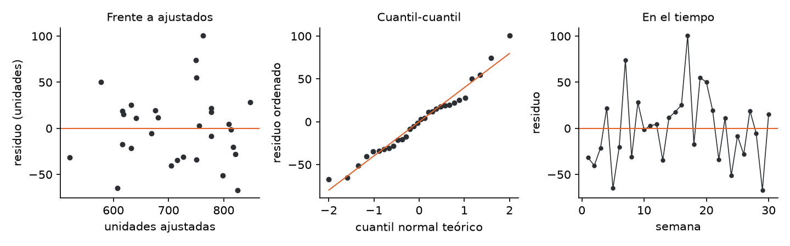

# Unidad 10 · Regresión lineal múltiple y diagnóstico

**Qué vas a poder hacer.** Estimar un modelo con varias variables explicativas por mínimos cuadrados en
forma matricial, interpretar cada coeficiente «con las demás constantes», probar cada coeficiente con
$t$ y el modelo completo con $F$, leer $R^2$ y $R^2$ ajustado, predecir con un intervalo para la media
y otro para una observación nueva, y diagnosticar el modelo: residuos, normalidad, homocedasticidad,
independencia, multicolinealidad y puntos influyentes.

**Lo que necesitas antes.** De la unidad 6, la correlación y la recta de regresión simple. De la
unidad 9, el modelo $Y = X\beta + \varepsilon$ con matriz de diseño y la tabla ANOVA. De álgebra
lineal, multiplicar matrices e invertir una de $3 \times 3$ (o saber pedírselo a Python).

**Tiempo.** Unas 7 horas: 3 de lectura con el ejemplo y 4 de práctica con el cuaderno.

---

## 1. La idea · explicar con varias variables a la vez

En la unidad 6 se midió cuánto se mueven juntas dos variables. Pero las ventas no dependen solo del
precio: dependen también de la publicidad, del clima, de la temporada. Si se mira una sola, su
coeficiente absorbe el efecto de las que faltan. La regresión múltiple estima el efecto de cada
variable **manteniendo constantes las demás que están en el modelo**.

$$y_i = \beta_0 + \beta_1 x_{i1} + \beta_2 x_{i2} + \dots + \beta_p x_{ip} + \varepsilon_i, \qquad \varepsilon_i \sim N(0, \sigma^2) \text{ independientes}$$

Hay $p$ variables explicativas y $p + 1$ coeficientes (con la constante). «Lineal» quiere decir lineal
**en los coeficientes**: $x^2$, $\ln x$ o un producto $x_1 x_2$ pueden ser columnas del modelo.

**Cuándo NO aplica tal cual.** Si la respuesta es un sí o no, o un conteo, el error no es normal ni su
varianza constante: eso es la unidad 11. Si los datos son una serie de tiempo con inercia, los errores
no son independientes y hay que modelar esa dependencia.

---

## 2. Mínimos cuadrados en forma matricial

Se apilan las $n$ observaciones:

$$Y = X\beta + \varepsilon, \qquad X = \begin{pmatrix} 1 & x_{11} & \cdots & x_{1p} \\ \vdots & \vdots & & \vdots \\ 1 & x_{n1} & \cdots & x_{np} \end{pmatrix}$$

Los mínimos cuadrados eligen $\hat\beta$ que minimiza la suma de los residuos al cuadrado
$\sum e_i^2 = (Y - X\beta)^\top (Y - X\beta)$. Derivando e igualando a cero salen las **ecuaciones
normales** $X^\top X \hat\beta = X^\top Y$, y si $X^\top X$ es invertible:

$$\hat\beta = (X^\top X)^{-1} X^\top Y$$

**La intuición.** El vector ajustado $\hat Y = X\hat\beta$ es la **proyección** de $Y$ sobre el espacio
que generan las columnas de $X$. Por eso el residuo $e = Y - \hat Y$ es perpendicular a cada columna:
$X^\top e = 0$. Eso implica que los residuos suman cero (por la columna de unos) y que no están
correlacionados con ninguna $x$ del modelo.

**Cuándo falla.** Si una columna es combinación lineal de otras (dos variables que miden lo mismo, o
una variable indicadora por cada nivel más la constante), $X^\top X$ no se puede invertir: el modelo
no distingue sus efectos. Si casi es combinación lineal, se invierte pero con coeficientes inestables
(sección 7, multicolinealidad).

**Varianza del error y de los coeficientes.**

$$\hat\sigma^2 = CM_E = \frac{SC_E}{n - p - 1} \qquad \operatorname{Var}(\hat\beta) = \sigma^2 (X^\top X)^{-1} \qquad ee(\hat\beta_j) = \sqrt{CM_E \cdot c_{jj}}$$

donde $c_{jj}$ es el elemento $j$ de la diagonal de $(X^\top X)^{-1}$. Se divide por $n - p - 1$
porque se gastaron $p + 1$ grados de libertad en estimar los coeficientes.

---

## 3. Interpretar los coeficientes

$\hat\beta_j$ es el cambio esperado en $y$ cuando $x_j$ sube en una unidad **y las demás variables del
modelo no cambian**. Tres advertencias:

- **Las unidades mandan.** Un coeficiente de 0,00166 unidades por peso de publicidad parece nada;
  multiplicado por $10.000 es 16,6 unidades. Expresa siempre el efecto en un cambio que tenga sentido.
- **«Constantes» se refiere solo a las variables que están.** Si falta una variable que se mueve con
  $x_j$ y afecta a $y$, $\hat\beta_j$ carga con su efecto: es el **sesgo por variable omitida**
  (ejercicio 10.5).
- **El intercepto** es la respuesta esperada con todas las $x$ en cero, que muchas veces está fuera de
  los datos (precio cero). Se deja en el modelo, pero no siempre se interpreta.

**Variables indicadoras.** Una variable cualitativa con $m$ niveles entra con $m - 1$ columnas de 0 y 1;
el nivel sin columna es la base. Su coeficiente es la diferencia con la base, con lo demás constante.
Es exactamente la codificación de referencia de la unidad 9.

**Correlación no es causalidad.** Con datos observacionales, $\hat\beta_j$ describe una asociación
ajustada por lo que se midió. Para leerlo como «si cambio $x_j$, $y$ cambia en $\hat\beta_j$» hace
falta que nada más se mueva con $x_j$: idealmente, un experimento.

---

## 4. Pruebas: $t$ para cada coeficiente y $F$ para el modelo

**Prueba $t$ de un coeficiente.** ¿Aporta $x_j$, dado que las demás ya están?

$$H_0: \beta_j = 0 \qquad t = \frac{\hat\beta_j}{ee(\hat\beta_j)} \sim t_{n-p-1} \text{ bajo } H_0 \qquad IC_{95\%}: \hat\beta_j \pm t_{0,975;\,n-p-1}\, ee(\hat\beta_j)$$

**Prueba $F$ global.** ¿Sirve el modelo para algo?

$$H_0: \beta_1 = \beta_2 = \dots = \beta_p = 0 \qquad F = \frac{SC_R/p}{SC_E/(n-p-1)} \sim F_{p,\,n-p-1} \text{ bajo } H_0$$

con $SC_R = \sum (\hat y_i - \bar y)^2$, $SC_E = \sum (y_i - \hat y_i)^2$ y $SC_T = SC_R + SC_E$. La
hipótesis nula **no incluye** a $\beta_0$: la $F$ compara el modelo contra uno que solo tiene la media.

| Fuente | gl | SC | CM | $F$ |
|---|---|---|---|---|
| Regresión | $p$ | $SC_R$ | $SC_R/p$ | $CM_R/CM_E$ |
| Error | $n-p-1$ | $SC_E$ | $SC_E/(n-p-1)$ | |
| Total | $n-1$ | $SC_T$ | | |

**$R^2$ y $R^2$ ajustado.**

$$R^2 = \frac{SC_R}{SC_T} = 1 - \frac{SC_E}{SC_T} \qquad R^2_a = 1 - \frac{SC_E/(n-p-1)}{SC_T/(n-1)}$$

$R^2$ es la fracción de la variabilidad de $y$ que explica el modelo. Nunca baja al agregar una
variable, aunque sea ruido; el $R^2$ ajustado cobra un grado de libertad por cada variable y sí puede
bajar. Para comparar modelos con distinto número de variables se usa el ajustado.

**Prueba $F$ parcial.** Para probar varias variables a la vez (las $m - 1$ indicadoras de un factor, o
una interacción), se comparan el modelo completo y el reducido:

$$F = \frac{(SC_{E,\text{red}} - SC_{E,\text{comp}})/q}{CM_{E,\text{comp}}} \sim F_{q,\,n-p-1}$$

donde $q$ es el número de coeficientes que se sacan. Las sumas de cuadrados tipo II de la unidad 9 son
exactamente esto.

---

## 5. Predicción: la media o una observación nueva

Para un punto $x_0 = (1, x_{01}, \dots, x_{0p})$, el valor ajustado es $\hat y_0 = x_0^\top \hat\beta$ y
la cantidad clave es $h_0 = x_0^\top (X^\top X)^{-1} x_0$, que mide qué tan lejos está $x_0$ del centro
de los datos.

$$\text{IC de la media: } \hat y_0 \pm t_{0,975;\,n-p-1}\sqrt{CM_E \, h_0} \qquad \text{IP de una observación: } \hat y_0 \pm t_{0,975;\,n-p-1}\sqrt{CM_E\,(1 + h_0)}$$

El intervalo de **confianza** dice dónde está la media de todos los casos con ese $x_0$; se achica con
más datos. El de **predicción** dice dónde caerá **un** caso nuevo: suma el ruido propio de ese caso
($\sigma^2$, el «1 +») y nunca baja de $\pm t\,\hat\sigma$. Para planificar una semana se usa el de
predicción.

**Extrapolar.** Si $x_0$ está fuera del rango de los datos (o en una combinación que nunca se observó,
como precio alto con publicidad alta si nunca se dieron juntos), $h_0$ crece y, peor, nada garantiza que
la relación siga siendo lineal ahí.

---

## 6. La regresión como modelo lineal general

El ANOVA de las unidades 7 y 9 y la regresión de esta unidad son el **mismo modelo**
$Y = X\beta + \varepsilon$; cambia solo qué hay en las columnas de $X$ (indicadoras o mediciones). La
$F$ del ANOVA es la $F$ global de una regresión con indicadoras, y la $F$ de la interacción es una $F$
parcial (ejercicio 10.10).

El paso siguiente es el **modelo lineal generalizado** (GLM) de la unidad 11, que tiene tres piezas:

| Pieza | En la regresión lineal | En la unidad 11 |
|---|---|---|
| Distribución de $y$ | normal | binomial (sí o no), Poisson (conteos) |
| Predictor lineal | $\eta = X\beta$ | $\eta = X\beta$ |
| Enlace entre $E(y)$ y $\eta$ | identidad: $E(y) = \eta$ | logit, logaritmo |

Por eso un GLM normal con enlace identidad da los mismos coeficientes que los mínimos cuadrados, y su
**devianza** es la $SC_E$:

```python
smf.glm("y ~ x1 + x2", data=df, family=sm.families.Gaussian()).fit().params   # = smf.ols(...).fit().params
```

---

## 7. Diagnóstico: los supuestos se revisan con los residuos

Las pruebas $t$ y $F$ y los intervalos valen si se cumplen los supuestos. Ninguno se revisa con el
valor p del modelo; se revisan con los residuos.

| Qué se revisa | Herramienta | Señal de problema | Qué hacer |
|---|---|---|---|
| **Linealidad** | residuos frente a ajustados y frente a cada $x$ | curva | agregar $x^2$, transformar $x$ o $y$ |
| **Varianza constante** | residuos frente a ajustados; Breusch-Pagan | embudo; p chico | transformar $y$ (log); errores robustos HC3; mínimos cuadrados ponderados |
| **Normalidad** | cuantil-cuantil; Shapiro-Wilk | colas que se alejan; p chico | con $n$ grande pesa poco; revisar atípicos; transformar |
| **Independencia** | residuos en el orden del tiempo; Durbin-Watson | rachas; DW lejos de 2 | modelar la dependencia (rezagos, series de tiempo) |
| **Multicolinealidad** | VIF | VIF > 10 (algunos usan 5) | quitar o combinar variables redundantes; no interpretar sus coeficientes por separado |
| **Puntos influyentes** | palanca $h_{ii}$; residuo estudentizado; distancia de Cook | $h_{ii} > 2(p+1)/n$; $\lvert r_i \rvert > 3$; Cook > 1 (o $> 4/n$ para mirar) | revisar el dato; ajustar con y sin él e informar ambos |

**Breusch-Pagan.** Regresa los residuos al cuadrado sobre las $x$: si las $x$ los explican, la
varianza no es constante. $H_0$: homocedasticidad.

**Durbin-Watson.** $DW = \sum_{t \ge 2}(e_t - e_{t-1})^2 / \sum e_t^2$. Vale cerca de 2 si los residuos
consecutivos no están correlacionados; bajo 1,5 sugiere correlación positiva (rachas), sobre 2,5,
negativa. Solo tiene sentido si los datos tienen un orden (semanas, turnos).

**VIF.** Para cada $x_j$, se regresa $x_j$ sobre las demás $x$ y

$$VIF_j = \frac{1}{1 - R_j^2}$$

Dice cuántas veces se infla la varianza de $\hat\beta_j$ por estar $x_j$ correlacionada con las demás.
Con dos variables, $R_j^2 = r^2$. La multicolinealidad **no** empeora las predicciones dentro del rango
de los datos; lo que estropea es la lectura de cada coeficiente por separado.

**Palanca, residuo estudentizado y Cook.** La palanca $h_{ii}$ (la diagonal de
$H = X(X^\top X)^{-1}X^\top$) mide qué tan raro es el punto en las $x$; su promedio es $(p+1)/n$. El
residuo estudentizado mide qué tan raro es en $y$, dado el modelo ajustado sin él. La **distancia de
Cook** combina las dos: cuánto se mueven todos los ajustados si se saca ese punto. Un punto con palanca
alta y residuo grande es el que manda en la recta.

---

## 8. Ejemplo resuelto · tiempo de despacho de una ferretería

Una ferretería de Los Ángeles despacha pedidos en camioneta y quiere saber cuánto agregan al tiempo
cada bulto y cada kilómetro, para dar plazos realistas. Registró 8 pedidos:

| Pedido | Bultos | Km | Minutos |
|---|---|---|---|
| 1 | 2 | 4 | 20 |
| 2 | 5 | 6 | 27 |
| 3 | 3 | 10 | 35 |
| 4 | 8 | 3 | 28 |
| 5 | 4 | 8 | 30 |
| 6 | 6 | 12 | 44 |
| 7 | 1 | 7 | 23 |
| 8 | 7 | 9 | 39 |

**Paso 1 · Las matrices.** Con $X = (1, \text{bultos}, \text{km})$:

$$X^\top X = \begin{pmatrix} 8 & 36 & 59 \\ 36 & 204 & 266 \\ 59 & 266 & 499 \end{pmatrix} \qquad X^\top Y = \begin{pmatrix} 246 \\ 1{.}184 \\ 1{.}956 \end{pmatrix}$$

$$(X^\top X)^{-1} = \begin{pmatrix} 1{,}44641 & -0{,}10578 & -0{,}11463 \\ -0{,}10578 & 0{,}02381 & -0{,}00019 \\ -0{,}11463 & -0{,}00019 & 0{,}01566 \end{pmatrix}$$

**Paso 2 · Los coeficientes.** $\hat\beta = (X^\top X)^{-1} X^\top Y$ da $\hat\beta_0 = 6{,}356$,
$\hat\beta_1 = 1{,}807$ y $\hat\beta_2 = 2{,}205$:

$$\widehat{\text{minutos}} = 6{,}356 + 1{,}807 \cdot \text{bultos} + 2{,}205 \cdot \text{km}$$

Cada bulto agrega 1,8 minutos (carga y descarga) a igual distancia; cada kilómetro, 2,2 minutos a igual
carga. Los 6,4 minutos fijos son el tiempo de salida y entrega que no depende de ninguna de las dos.

**Paso 3 · Residuos y error.**

| Pedido | $\hat y$ | $e$ |
|---|---|---|
| 1 | 18,79 | 1,21 |
| 2 | 28,62 | -1,62 |
| 3 | 33,83 | 1,17 |
| 4 | 27,43 | 0,57 |
| 5 | 31,22 | -1,22 |
| 6 | 43,66 | 0,34 |
| 7 | 23,60 | -0,60 |
| 8 | 38,85 | 0,15 |

$SC_E = 7{,}79$ con $8 - 2 - 1 = 5$ gl, así que $CM_E = 1{,}558$ y $\hat\sigma = 1{,}25$ minutos.

**Paso 4 · Pruebas.** $ee(\hat\beta_j) = \sqrt{CM_E\, c_{jj}}$: 1,501, 0,193 y 0,156.

| Coeficiente | Estimación | ee | $t$ | valor p | IC 95 % |
|---|---|---|---|---|---|
| constante | 6,356 | 1,501 | 4,23 | p = 0,008 | |
| bultos | 1,807 | 0,193 | 9,38 | p < 0,001 | 1,31 a 2,30 |
| km | 2,205 | 0,156 | 14,12 | p < 0,001 | 1,80 a 2,61 |

(con $t_{0,975;\,5} = 2{,}571$). En cinco pasos, para los bultos: (1) ¿agregan tiempo, a igual
distancia? (2) $H_0: \beta_1 = 0$ contra $H_1: \beta_1 \ne 0$. (3) $t = 9{,}38$ con 5 gl. (4)
p < 0,001. (5) Sí: cada bulto agrega entre 1,3 y 2,3 minutos.

La $F$ global: $SC_T = 459{,}5$, $SC_R = 451{,}71$, $F = (451{,}71/2)/1{,}558 = 144{,}94$ con 2 y 5 gl,
p < 0,001. $R^2 = 0{,}983$ y $R^2_a = 0{,}976$.

**Paso 5 · Predicción.** Un pedido de 5 bultos a 8 km: $\hat y_0 = 33{,}03$ minutos, con
$h_0 = 0{,}1370$.

- IC 95 % de la **media** de esos pedidos: de 31,84 a 34,22 minutos.
- IP 95 % de **este** pedido: de 29,61 a 36,45 minutos.

**Paso 6 · Diagnóstico.** La correlación entre bultos y km es 0,01, así que $VIF = 1{,}00$: cada
coeficiente se lee limpio. La palanca mayor es 0,72 (el pedido 4, con 8 bultos a solo 3 km), bajo el
corte $2(p+1)/n = 0{,}75$. Ningún residuo estandarizado pasa de 2. Con 8 datos los gráficos de residuos
dicen poco: la ferretería debería seguir juntando pedidos antes de confiar en el modelo para distancias
mayores que 12 km.

```python
ej = pd.read_csv("../datos/u10_ejemplo.csv")
X = np.column_stack([np.ones(len(ej)), ej.bultos, ej.km])
beta = np.linalg.solve(X.T @ X, X.T @ ej.minutos)          # 6,356 · 1,807 · 2,205
mod = smf.ols("minutos ~ bultos + km", data=ej).fit()        # mismo resultado, con ee, t y p
mod.get_prediction(pd.DataFrame({"bultos": [5], "km": [8]})).summary_frame(alpha=0.05)
```

**Cómo se lee.** Para prometer un plazo a un cliente se usa el intervalo de predicción: a un pedido de
5 bultos a 8 km se le puede decir «entre media hora y 37 minutos». El intervalo de confianza (31,84 a
34,22) sirve para planificar la jornada de la camioneta, que suma muchos pedidos y donde los desvíos se
compensan.

---

## 9. Errores típicos

| Error | Cómo evitarlo |
|---|---|
| Leer $\hat\beta_j$ como el efecto de $x_j$ «a secas» | Es el efecto **con las demás variables del modelo constantes**; cambia si agregas o quitas variables |
| Concluir causalidad desde datos observacionales | Un coeficiente es una asociación ajustada; la causalidad necesita diseño |
| Sacar una variable porque su $t$ no es significativa, sin mirar el VIF | Con multicolinealidad, dos variables pueden ser no significativas por separado y muy importantes juntas |
| Incluir $\beta_0$ en la hipótesis de la $F$ global | $H_0: \beta_1 = \dots = \beta_p = 0$; la constante queda siempre |
| Elegir el modelo por el $R^2$ | El $R^2$ siempre sube con más variables; usa el ajustado y la lógica del problema |
| Usar el intervalo de confianza para un caso individual | Para un caso nuevo, el de predicción (lleva el «1 +») |
| Predecir fuera del rango de los datos | Revisa $h_0$; si es mucho mayor que las palancas de los datos, estás extrapolando |
| Mirar el valor p y no los residuos | Un solo punto con palanca alta puede fabricar o borrar una pendiente (ejercicio 10.9) |
| Borrar un atípico porque «molesta» | Se borra solo si es un error comprobado; si no, se informa con y sin él |
| Redondear $(X^\top X)^{-1}$ a pocos decimales | Con $X^\top Y$ grande, el redondeo mueve los coeficientes (ejercicio 10.1); trabaja con la inversa completa |
| Decir «no se rechaza, entonces $\beta_j = 0$» | No rechazar no prueba que el efecto sea cero; mira el intervalo de confianza |

---

## 10. Práctica

Diez ejercicios: 10.1 a 10.4 básicos, 10.5 a 10.8 intermedios, 10.9 y 10.10 de desafío. Usa
$\alpha = 0{,}05$. Las pautas están en la sección 11.

**10.1 · Coeficientes desde las matrices (básico).** Una empresa de reparto de Temuco registró el costo
de 6 viajes (miles de $) según los km recorridos y el número de paradas:

| Km | Paradas | Costo |
|---|---|---|
| 12 | 3 | 14 |
| 25 | 5 | 26 |
| 8 | 2 | 10 |
| 30 | 4 | 27 |
| 18 | 6 | 24 |
| 22 | 3 | 21 |

(a) Calcula $X^\top X$ y $X^\top Y$. (b) Invierte $X^\top X$ (con Python) y obtén $\hat\beta$. (c) Repite
(b) con la inversa redondeada a 5 decimales. ¿Qué pasa? (d) Interpreta el coeficiente de las paradas.

**10.2 · La tabla ANOVA (básico).** Un modelo del consumo eléctrico de una planta con 3 variables y
25 días tiene $SC_T = 840$ y $SC_E = 210$. Arma la tabla ANOVA, prueba la significancia global y calcula
$R^2$ y $R^2$ ajustado.

**10.3 · Leer una tabla de coeficientes (básico).** Un modelo del precio de departamentos en Concepción
(millones de $) con 40 departamentos entregó:

| Variable | $\hat\beta$ | ee |
|---|---|---|
| constante | 35,6 | 12,4 |
| m² | 1,82 | 0,21 |
| distancia al centro (km) | -3,40 | 1,05 |
| antigüedad (años) | -0,26 | 0,19 |

Calcula $t$, valor p e IC 95 % de cada coeficiente y di cuáles son significativos. ¿Qué significa el
coeficiente de la distancia?

**10.4 · Variables indicadoras (básico).** Una tienda en línea estimó

$$\widehat{\text{días}} = 1{,}6 + 0{,}012 \cdot \text{km} + 1{,}3 \cdot \text{courier B} - 0{,}9 \cdot \text{express}$$

donde «courier B» vale 1 si el envío va por el courier B (0 si va por el A) y «express» vale 1 si el
cliente pagó envío rápido. (a) Interpreta cada coeficiente. (b) Predice los días de un envío express por
el courier B a 300 km. (c) ¿Qué significa el 1,6?

**10.5 · La variable que faltaba (intermedio).** Una heladería registró 8 días:

| Temperatura máx. (°C) | Precio por litro ($) | Litros vendidos |
|---|---|---|
| 18 | 1.800 | 40 |
| 22 | 1.900 | 55 |
| 25 | 2.000 | 71 |
| 28 | 2.100 | 82 |
| 30 | 2.200 | 92 |
| 33 | 2.300 | 101 |
| 20 | 2.000 | 42 |
| 27 | 1.900 | 86 |

(a) Regresa los litros solo sobre el precio. (b) Agrega la temperatura. (c) Explica por qué cambió el
signo del precio y cuál de los dos coeficientes usarías para decidir una rebaja.

**10.6 · Media o caso nuevo (intermedio).** Con el modelo del 10.1, la empresa quiere cotizar un viaje de
20 km con 4 paradas. Se sabe que $CM_E = 0{,}1842$ y que $x_0^\top (X^\top X)^{-1} x_0 = 0{,}1698$ para ese
viaje. Calcula el costo esperado, el IC 95 % de la media y el IP 95 % del viaje. ¿Cuál usarías para
cotizar?

**10.7 · Dos variables que dicen lo mismo (intermedio).** El consumo mensual de 10 locales de una cadena
de minimarkets:

| Superficie (m²) | Equipos de frío | kWh |
|---|---|---|
| 82 | 3 | 1.255 |
| 96 | 4 | 1.348 |
| 108 | 4 | 1.527 |
| 123 | 5 | 1.586 |
| 137 | 5 | 1.763 |
| 148 | 6 | 1.838 |
| 163 | 6 | 1.994 |
| 171 | 7 | 2.057 |
| 192 | 8 | 2.334 |
| 207 | 8 | 2.378 |

(a) Ajusta kWh sobre superficie y equipos. ¿Qué coeficientes son significativos? ¿Y el modelo? (b) Calcula
el VIF. (c) Ajusta kWh solo sobre los equipos. (d) ¿Los equipos de frío no gastan energía?

**10.8 · El embudo (intermedio).** El gasto anual en mantención de 12 camiones (miles de $) según su
kilometraje anual (miles de km):

| Km | Gasto |
|---|---|
| 20 | 455 |
| 35 | 590 |
| 50 | 680 |
| 60 | 820 |
| 75 | 860 |
| 90 | 1.110 |
| 100 | 1.010 |
| 120 | 1.390 |
| 140 | 1.290 |
| 160 | 1.790 |
| 180 | 1.500 |
| 200 | 2.190 |

(a) Ajusta la recta y aplica Breusch-Pagan. (b) Compara el error estándar de la pendiente clásico con el
robusto HC3. (c) Ajusta $\ln(\text{gasto})$ sobre km, repite Breusch-Pagan e interpreta la pendiente.

**10.9 · Un punto que manda (desafío).** Horas de capacitación y piezas por hora de 10 operarios:

| Operario | 1 | 2 | 3 | 4 | 5 | 6 | 7 | 8 | 9 | 10 |
|---|---|---|---|---|---|---|---|---|---|---|
| Horas | 2 | 3 | 4 | 5 | 6 | 7 | 8 | 9 | 10 | 30 |
| Piezas por hora | 41 | 43 | 44 | 47 | 48 | 50 | 51 | 53 | 55 | 52 |

(a) Ajusta la recta. (b) Calcula la palanca, el residuo estudentizado y la distancia de Cook del operario
10 y compáralos con los cortes. (c) Ajusta sin él. (d) ¿Qué informarías a la gerencia?

**10.10 · El ANOVA es una regresión (desafío).** Toma los datos del ejemplo de la unidad 9 (resistencia
de probetas: PLA horizontal 44, 48, 46; PLA vertical 31, 28, 31; PETG horizontal 51, 54, 51; PETG vertical
45, 44, 43). (a) Ajusta una regresión con las indicadoras «PETG», «vertical» y su producto. Compara los
coeficientes con las medias de celda. (b) Compara la $SC_R$ y la $F$ global con la tabla ANOVA de la
unidad 9. (c) Prueba la interacción con una $F$ parcial y compárala con la $F$ de la interacción del
ANOVA.

---

## 11. Pautas

**10.1.** (a)

$$X^\top X = \begin{pmatrix} 6 & 115 & 23 \\ 115 & 2{.}541 & 471 \\ 23 & 471 & 99 \end{pmatrix} \qquad X^\top Y = \begin{pmatrix} 122 \\ 2{.}602 \\ 507 \end{pmatrix}$$

(b) $\hat\beta = (1{,}24;\ 0{,}61;\ 1{,}93)$: costo $= 1{,}24 + 0{,}61 \cdot \text{km} + 1{,}93 \cdot \text{paradas}$,
con $R^2 = 0{,}998$. (c) La inversa redondeada es

$$\begin{pmatrix} 1{,}80832 & -0{,}03359 & -0{,}26031 \\ -0{,}03359 & 0{,}00396 & -0{,}01101 \\ -0{,}26031 & -0{,}01101 & 0{,}12298 \end{pmatrix}$$

y con ella el coeficiente de km sale 0,62 en vez de 0,61: el 2.602 de $X^\top Y$ amplifica el error del
quinto decimal. Con una inversa entregada con 3 decimales, el error es mayor. (d) Cada parada agrega
1,93 mil pesos al costo del viaje, a igual distancia: el tiempo detenido y el combustible de partir y
frenar.

**10.2.**

| Fuente | gl | SC | CM | $F$ |
|---|---|---|---|---|
| Regresión | 3 | 630 | 210 | 21 |
| Error | 21 | 210 | 10 | |
| Total | 24 | 840 | | |

$F = 21$ supera $F_{0,95;\,3,\,21} = 3{,}07$ (p < 0,001): al menos una variable explica el consumo.
$R^2 = 0{,}75$ y $R^2_a = 1 - 10/35 = 0{,}714$. El modelo explica tres cuartos de la variación diaria.

**10.3.** Con $40 - 3 - 1 = 36$ gl, $t_{0,975;\,36} = 2{,}028$.

| Variable | $t$ | valor p | IC 95 % |
|---|---|---|---|
| constante | 2,87 | p = 0,007 | 10,45 a 60,75 |
| m² | 8,67 | p < 0,001 | 1,39 a 2,25 |
| distancia | -3,24 | p = 0,003 | -5,53 a -1,27 |
| antigüedad | -1,37 | p = 0,180 | -0,65 a 0,13 |

Superficie y distancia son significativas; la antigüedad no (su intervalo incluye el cero, lo que no
prueba que no importe: los datos no alcanzan para afirmarlo). Cada km más lejos del centro baja el precio
en 3,4 millones, entre departamentos de igual superficie y antigüedad.

**10.4.** (a) 0,012: cada km agrega 0,012 días (1,2 días cada 100 km), con courier y tipo de envío fijos.
1,3: el courier B tarda 1,3 días más que el A en igualdad de distancia y tipo. -0,9: el express ahorra
0,9 días. (b) $1{,}6 + 0{,}012 \cdot 300 + 1{,}3 - 0{,}9 = 5{,}6$ días. (c) Es el tiempo esperado de un
envío normal por el courier A a 0 km: el tiempo de preparación y despacho antes de recorrer.

**10.5.** (a) Solo con el precio: pendiente 0,1055 litros por peso (p = 0,028). ¡Subir el precio
vendería más! (b) Con la temperatura: precio -0,0425 (p = 0,003) y temperatura 5,63 litros por grado.
(c) La heladería sube el precio en los días calurosos (correlación precio-temperatura de 0,86). En la
regresión simple, el precio carga con el efecto del calor. Ajustado por la temperatura, subir $100 el
litro baja unos 4 litros al día. Para decidir una rebaja se usa el coeficiente de la regresión múltiple:
el otro responde «qué pasa los días en que el precio está alto», no «qué pasa si yo subo el precio».

**10.6.** $\hat y_0 = 21{,}16$ mil pesos. Con 3 gl, $t_{0,975;\,3} = 3{,}182$.
IC de la media: $21{,}16 \pm 3{,}182\sqrt{0{,}1842 \cdot 0{,}1698}$, de 20,60 a 21,73. IP del viaje:
$21{,}16 \pm 3{,}182\sqrt{0{,}1842 \cdot 1{,}1698}$, de 19,69 a 22,64. Para cotizar un viaje se usa el
IP: es ese viaje el que puede salir caro. Con solo 6 datos (3 gl), la $t$ es grande y los intervalos se
ensanchan; juntar más viajes los achica.

**10.7.** (a) Superficie 9,41 kWh por m² (p = 0,001); equipos -1,54 kWh por equipo, con error estándar
42,31 (p = 0,972). El modelo es muy significativo (p < 0,001) con $R^2 = 0{,}993$. (b) La correlación
entre superficie y equipos es 0,985, así que $VIF = 33{,}1$ para las dos: la varianza de cada
coeficiente se infla 33 veces. (c) Solo con los equipos: 221,55 kWh por equipo, p < 0,001. (d) Sí gastan:
los locales grandes tienen más equipos y el modelo no puede separar «más metros» de «más equipos». Un
coeficiente negativo y no significativo no dice que los equipos no consuman, dice que con estos datos no
se distinguen de la superficie. Para separarlos haría falta un local grande con pocos equipos, o medir
el consumo de los equipos directamente.

**10.8.** (a) Pendiente 8,493 mil pesos por cada mil km. Breusch-Pagan: LM = 8,12, p = 0,004: la varianza
crece con el kilometraje (el embudo se ve en los residuos). (b) El error estándar clásico de la pendiente
es 0,777; el robusto HC3, 1,254. La pendiente sigue siendo significativa, pero el clásico sobrestimaba la
precisión. (c) En logaritmos, Breusch-Pagan da LM = 0,25, p = 0,618: varianza estable. Pendiente 0,00773:
cada mil km más sube el gasto en 0,77 %, y cada 10 mil km, en 8,0 %. Es un efecto proporcional, que
calza con camiones que gastan más en todo a medida que ruedan.

**10.9.** (a) Con los 10: $\widehat{\text{piezas}} = 45{,}65 + 0{,}327 \cdot \text{horas}$, $R^2 = 0{,}322$.
(b) Operario 10: palanca 0,907 (corte $2 \cdot 2/10 = 0{,}40$), residuo estudentizado -27,6, Cook 38,5
(corte 1; para mirar, $4/n = 0{,}40$). Domina la recta. (c) Sin él: $37{,}70 + 1{,}717 \cdot \text{horas}$,
$R^2 = 0{,}993$. La pendiente sube más de cinco veces. (d) Hay que preguntar quién es el operario 10:
30 horas puede ser un error de registro o alguien que hizo un curso distinto. Se informa: «entre 2 y 10
horas, cada hora de capacitación se asocia con 1,7 piezas más por hora; no hay datos para decir qué pasa
sobre 10 horas, y el único caso con 30 no sigue el patrón». No se borra el dato en silencio.

**10.10.** (a) Los coeficientes son 46, 6, -16 y 8: la media de PLA horizontal, la diferencia PETG
menos PLA en horizontal, la diferencia vertical menos horizontal en PLA y la diferencia de diferencias.
Los mismos de la unidad 9. (b) $SC_R = 780 = 300 + 432 + 48$, la suma de los tres efectos del ANOVA, y
$SC_E = 22$ es la misma. La $F$ global es 94,55 con 3 y 8 gl, $R^2 = 0{,}973$. (c) Sin el producto,
$SC_E = 70$. $F = (70 - 22)/1/2{,}75 = 17{,}45$, p = 0,003: la misma $F$ de la interacción de la unidad
9. ANOVA y regresión son el mismo modelo lineal.

---

## 12. Caso integrador · Estampa Sur, ventas según precio y publicidad

> En la unidad 6 Estampa Sur midió la correlación entre el precio y las unidades vendidas. En la 9 usó
> el modelo lineal con columnas indicadoras. Esta pieza pone dos variables continuas en $X$: el precio de
> la polera y el gasto semanal en publicidad.

Los datos son 30 semanas simuladas por `verificacion/caso_estampa_sur_datos.py`, en `datos/ventas.csv`
(semana, precio en pesos, publicidad en pesos y unidades vendidas).

**El modelo.**

| Coeficiente | Estimación | ee | $t$ | valor p | IC 95 % |
|---|---|---|---|---|---|
| constante | 1.466,67 | 90,35 | 16,23 | p < 0,001 | |
| precio | -0,0797 | 0,00814 | -9,80 | p < 0,001 | -0,0964 a -0,0630 |
| publicidad | 0,00166 | 0,000197 | 8,44 | p < 0,001 | 0,00126 a 0,00207 |

(con $t_{0,975;\,27} = 2{,}052$).

$$\widehat{\text{unidades}} = 1{.}466{,}67 - 0{,}0797 \cdot \text{precio} + 0{,}00166 \cdot \text{publicidad}$$

| Fuente | gl | SC | CM | $F$ |
|---|---|---|---|---|
| Regresión | 2 | 217.763 | 108.882 | 66,79 |
| Error | 27 | 44.016 | 1.630,2 | |
| Total | 29 | 261.779 | | |

$F = 66{,}79$, p < 0,001; $R^2 = 0{,}832$ y $R^2_a = 0{,}819$. El error típico del modelo es
$\hat\sigma = 40{,}4$ unidades por semana.

**Cómo se lee cada coeficiente.**

- **Precio.** Subir el precio en $1.000, con la misma publicidad, baja las ventas en
  $-0{,}0797 \cdot 1{.}000 = -79{,}7$ unidades por semana. La regresión simple de la unidad 6 daba
  -0,0621: subestimaba el efecto porque las semanas de precio más alto tuvieron algo más de publicidad
  (correlación 0,26), que tapaba parte de la caída.
- **Publicidad.** Cada $10.000 más de publicidad, con el mismo precio, se asocia con 16,64 unidades
  más. Esa publicidad se paga sola si el margen de contribución por polera supera \$601
  ($10.000 divididos por 16,64 poleras).

**Predicción para la próxima semana.** Con precio $11.500 y publicidad $100.000: $\hat y_0 = 716{,}2$
unidades ($h_0 = 0{,}0337$). IC 95 % de la media: 701,0 a 731,4. IP 95 % de esa semana: 632,0 a 800,4. El
taller debería tener tela e insumos para unas 800 poleras si no quiere quedarse corto una semana de cada
cuarenta.

**Diagnóstico.**



| Supuesto | Resultado | Lectura |
|---|---|---|
| Linealidad y varianza constante | sin curva ni embudo; Breusch-Pagan p = 0,71 | se cumple |
| Normalidad | Shapiro-Wilk p = 0,57 | se cumple |
| Independencia | Durbin-Watson 2,05 | sin rachas entre semanas |
| Multicolinealidad | correlación precio-publicidad 0,26; VIF 1,07 | cada coeficiente se lee por separado |
| Palanca | máxima 0,21 (semana 1), apenas sobre el corte 0,20 | precio alto con publicidad baja: es un borde de los datos, no un error |
| Residuo estudentizado | máximo 2,91 (semana 17) | bajo 3 |
| Cook | máxima 0,24 (semana 7), lejos de 1 y sobre $4/n = 0{,}13$ | se revisa: sin la semana 7, precio -0,0755 y publicidad 0,00174; la lectura no cambia |

El modelo es confiable para precios entre $9.910 y $13.190 y publicidad entre $42.000 y $160.000 por
semana, que es el rango observado. Fuera de ahí, sería extrapolar.

```python
v = pd.read_csv("../datos/ventas.csv")
mod = smf.ols("unidades ~ precio + publicidad", data=v).fit()
mod.get_prediction(pd.DataFrame({"precio": [11500], "publicidad": [100000]})).summary_frame(alpha=0.05)
het_breuschpagan(mod.resid, mod.model.exog); durbin_watson(mod.resid)
variance_inflation_factor(mod.model.exog, 1)
mod.get_influence().cooks_distance[0]
```

**Como modelo lineal general.** `smf.glm(..., family=sm.families.Gaussian())` da los mismos tres
coeficientes, y su devianza es la $SC_E$ (44.016). Es la puerta a la unidad 11.

**Lo que pasa a la unidad 11.** Hasta acá la respuesta era una cantidad que puede tomar cualquier valor y
con error normal. En la unidad 11 la respuesta es si una prenda sale defectuosa (sí o no) y cuántos
reclamos llegan en un día (conteo): el mismo predictor lineal $X\beta$, con otra distribución y otro
enlace.

---

## 13. Para seguir

**En los libros del ramo.**

- Kutner, *Applied Linear Statistical Models* (McGraw-Hill, 2004): la parte de regresión múltiple, con
  la forma matricial, la predicción y el diagnóstico (palanca, Cook, VIF) en detalle.
- Walpole, Myers, Myers y Ye, *Probability & Statistics for Engineers & Scientists* (Pearson, 2017): los
  capítulos de regresión lineal simple y múltiple.
- Casella y Berger, *Statistical Inference* (Cengage, 2021): el programa lo indica para el modelo lineal
  general.

**Abierto y gratis.**

- Çetinkaya-Rundel y Hardin, *Introduction to Modern Statistics*, 2.ª ed., OpenIntro (en inglés, licencia
  CC BY-SA): capítulo 8 «Linear regression with multiple predictors» y capítulo 25 «Inference for linear
  regression with multiple predictors»: https://openintro-ims.netlify.app/

**Con el cuaderno.** `notebooks/u10_regresion.ipynb` reproduce el ejemplo, el caso y su diagnóstico.

**Con el tutor.** Pega `tutor/contexto.md` al inicio de la conversación y pídele, por ejemplo: «Dame un
conjunto de 12 datos con un punto influyente escondido y una variable omitida, déjame ajustar el modelo
y corrígeme el diagnóstico».
