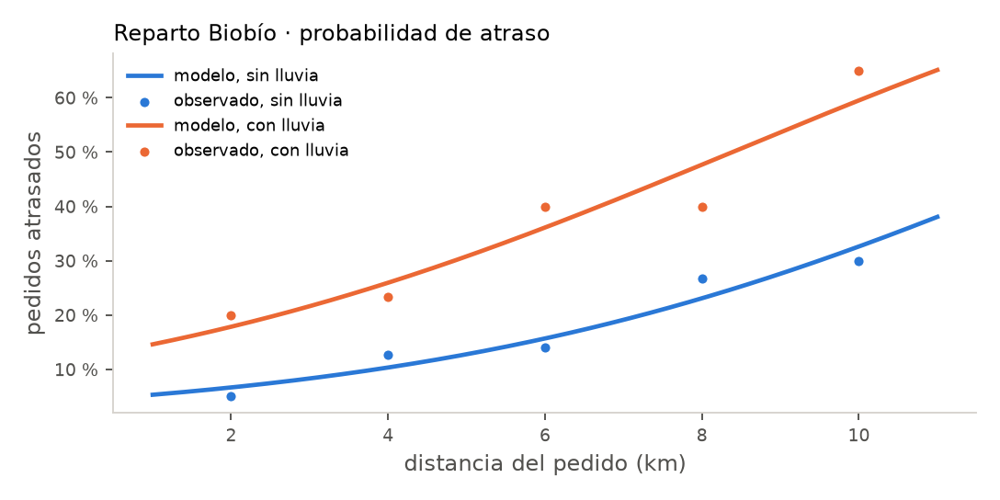
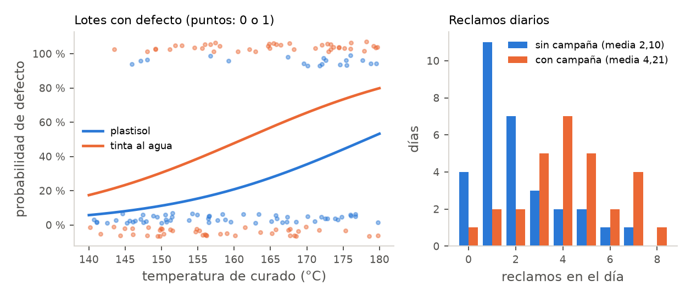

# Unidad 11 · Modelos lineales generalizados: logística y Poisson

**Qué vas a poder hacer.** Elegir la familia y el enlace de un modelo según el tipo de respuesta;
ajustar una regresión logística y una de Poisson con `statsmodels`; traducir cada coeficiente a un
odds ratio o a una razón de tasas; calcular una probabilidad o un conteo predicho; probar un
coeficiente con Wald y un grupo de coeficientes con la razón de verosimilitud; detectar la
sobredispersión y corregir los errores estándar cuando aparece.

**Lo que necesitas antes.** De la unidad 1, las cinco piezas de una prueba (hipótesis, estadístico,
distribución bajo $H_0$, valor p, conclusión). De la unidad 4, el estadístico $G$ de una tabla de
contingencia. De la unidad 10, leer una tabla de coeficientes de regresión múltiple y la idea de
«a igualdad de las demás variables».

**Tiempo.** Unas 6 horas: 2,5 de lectura con el ejemplo y el cuaderno, 3,5 de práctica.

---

## 1. La idea · cuando la respuesta no es una medida

La regresión de la unidad 10 supone que la respuesta es continua, que su varianza es la misma en
todas partes y que el error es normal. Dos respuestas muy comunes en una empresa rompen las tres
cosas:

- **Un sí o un no.** ¿El pedido llegó atrasado? ¿El lote salió con defecto? ¿El cliente renovó? La
  respuesta vale 0 o 1 y lo que interesa es la probabilidad $p$ de que valga 1.
- **Un conteo.** Reclamos en el día, atascos en un turno, accidentes en el año. La respuesta es
  0, 1, 2, … y lo que interesa es el promedio $\mu$.

Si a esas respuestas se les ajusta una recta por mínimos cuadrados pasan tres cosas malas: la recta
predice probabilidades bajo 0 o sobre 1 y conteos negativos; la varianza no es constante (en un 0 o
1 la varianza es $p(1-p)$, en un conteo de Poisson es igual a la media), y los valores p de la tabla
dejan de valer. El **modelo lineal generalizado** (GLM) arregla las tres cosas sin perder lo bueno de
la regresión: una ecuación lineal en los predictores, coeficientes que se interpretan uno por uno y
pruebas para cada uno.

---

## 2. Las tres piezas de un GLM

Todo GLM se arma con tres decisiones:

1. **Componente aleatoria.** Qué distribución tiene la respuesta dado el valor de los predictores:
   normal, binomial (sí o no, o $k$ éxitos en $n$), Poisson (conteos). Fija cómo se relacionan la
   media y la varianza.
2. **Predictor lineal.** La parte que ya conoces: $\eta = \beta_0 + \beta_1 x_1 + \dots + \beta_k x_k$.
3. **Función de enlace** $g$. Conecta la media de la respuesta con el predictor lineal:
   $g(\mu) = \eta$. Su trabajo es llevar la media, que vive en un rango restringido, a toda la recta
   real, donde puede vivir $\eta$.

| Respuesta | Componente aleatoria | Enlace canónico | El coeficiente se lee como |
|---|---|---|---|
| Medida continua (minutos, kilos) | normal | identidad: $\mu = \eta$ | cambio en la media |
| Sí o no; $k$ de $n$ | binomial | logit: $\ln\frac{p}{1-p} = \eta$ | $e^{\beta}$ es un odds ratio |
| Conteo sin tope | Poisson | log: $\ln \mu = \eta$ | $e^{\beta}$ es una razón de tasas |

La regresión lineal de la unidad 10 es el GLM normal con enlace identidad: no es otro método, es el
caso particular. Lo que cambia en los otros dos es cómo se estima. Ya no se minimizan los cuadrados
de los residuos; se buscan los $\beta$ que hacen **más probable** lo observado (máxima verosimilitud).
No hay fórmula cerrada en general: el computador itera (el algoritmo se llama IRLS) hasta converger.
Con **un solo predictor binario** sí hay fórmula cerrada, y por eso el ejemplo y el caso empiezan
ahí: se puede hacer a mano y comparar con Python.

**Cuándo NO aplica tal cual.** Si las observaciones no son independientes (mediciones repetidas del
mismo cliente o del mismo lote), si la respuesta tiene más de dos categorías (se usa la logística
multinomial u ordinal) o si los conteos tienen muchos más ceros de los que una Poisson permite.

---

## 3. Regresión logística

### Probabilidad, odds y log-odds

Para una probabilidad $p$, los **odds** son $p/(1-p)$: cuántos «sí» hay por cada «no». Una
probabilidad de 0,20 son odds de 0,25 (uno a cuatro); una de 0,50 son odds de 1. Los odds van de 0 a
infinito; su logaritmo, el **log-odds** o logit, va de menos a más infinito, y eso es lo que el
modelo iguala a una recta:

$$\ln\frac{p}{1-p} = \beta_0 + \beta_1 x_1 + \dots + \beta_k x_k = \eta
\qquad\Longleftrightarrow\qquad
p = \frac{1}{1 + e^{-\eta}}$$

La segunda forma (la función logística) es la que da la **probabilidad predicha**: se calcula $\eta$
con los coeficientes y se pasa por la curva en S.

### Cómo se lee un coeficiente

$\beta_j$ es el cambio en el **log-odds** cuando $x_j$ sube en 1, con el resto fijo. Como nadie
piensa en log-odds, se exponencia:

$$OR_j = e^{\beta_j}$$

es el **odds ratio**: el factor por el que se **multiplican los odds** cuando $x_j$ sube en 1. Un
$OR = 1{,}5$ es «los odds suben 50 %»; un $OR = 0{,}8$ es «bajan 20 %»; $OR = 1$ es «no cambian». Si
$x$ sube en $c$ unidades, los odds se multiplican por $e^{c\beta}$.

**Lo que $\beta$ no es:** no es el cambio en la probabilidad. El efecto de $x$ sobre $p$ depende de
dónde estás en la curva:

$$\frac{\partial p}{\partial x} = \beta\,p\,(1-p)$$

Es máximo cuando $p = 0{,}5$ (vale $\beta/4$) y se achica cerca de 0 y de 1. El mismo odds ratio
puede ser un salto de 3 puntos porcentuales para un pedido de bajo riesgo y de 11 para uno de riesgo
medio. Por eso se informa el odds ratio **y** algunas probabilidades predichas en casos típicos.

### Con un solo predictor binario, a mano

Si $x$ vale 0 o 1, el modelo tiene dos parámetros y dos grupos, y la máxima verosimilitud reproduce
las proporciones de cada grupo. Con la tabla 2 × 2 ($a_1$ «sí» y $b_1$ «no» cuando $x = 1$; $a_0$ y
$b_0$ cuando $x = 0$):

$$\hat\beta_0 = \ln\frac{a_0}{b_0} \qquad
\hat\beta_1 = \ln\left(\frac{a_1/b_1}{a_0/b_0}\right) \qquad
EE(\hat\beta_1) = \sqrt{\frac{1}{a_1}+\frac{1}{b_1}+\frac{1}{a_0}+\frac{1}{b_0}}$$

Es el odds ratio de la tabla de toda la vida. La intuición del error estándar: cada celda aporta
$1/\text{conteo}$, así que la celda más chica manda; con pocas fallas el coeficiente es impreciso,
aunque la muestra total sea grande.

---

## 4. Inferencia en un GLM · Wald, devianza y razón de verosimilitud

### Prueba de Wald para un coeficiente

$$z = \frac{\hat\beta_j}{EE(\hat\beta_j)} \;\sim\; N(0,1)\ \text{bajo}\ H_0: \beta_j = 0
\qquad IC_{95\%}(OR_j) = e^{\hat\beta_j \pm 1{,}96\,EE(\hat\beta_j)}$$

Es lo que `statsmodels` muestra en la columna `z` y `P>|z|`. El intervalo se calcula en la escala de
$\beta$ y después se exponencia; por eso no es simétrico en torno al odds ratio. Si el intervalo del
OR contiene el 1, el predictor no es significativo al 5 %.

### Devianza

La **log-verosimilitud** $\ln L$ mide qué tan probable hace el modelo lo que se observó (es negativa;
más cerca de 0 es mejor). La **devianza** es $D = -2\ln L$ (medida contra el modelo saturado, que
tiene un parámetro por observación): cumple el papel de la suma de cuadrados de los residuos.

- La **devianza nula** es la del modelo con solo intercepto.
- Con datos **agrupados** (muchos ensayos por fila, como pedidos por tramo de distancia), la devianza
  residual se compara con una $\chi^2$ con $n - p$ grados de libertad: si es mucho mayor que sus
  grados de libertad, el modelo no ajusta. Con datos individuales 0 o 1 esa comparación no sirve.

### Prueba de razón de verosimilitud

Para comparar un modelo reducido con uno completo que agrega $q$ coeficientes:

$$G = D_{\text{reducido}} - D_{\text{completo}} = 2(\ln L_{\text{completo}} - \ln L_{\text{reducido}})
\;\sim\; \chi^2_q \ \text{bajo}\ H_0$$

Contra el modelo nulo, $G$ prueba si el modelo entero sirve (es el `LLR` del resumen de
`statsmodels`). Contra el modelo sin una variable, prueba esa variable. Con muestras chicas o
coeficientes grandes la razón de verosimilitud es más confiable que Wald. Con un predictor binario, $G$
es exactamente el estadístico $G = 2\sum O\ln(O/E)$ de la tabla 2 × 2 de la unidad 4.

Para elegir entre modelos no anidados se usa el **AIC** $= -2\ln L + 2k$ ($k$ = número de
parámetros): menor es mejor; diferencias menores que 2 no distinguen.

### La prueba en cinco pasos

| Paso | En un GLM |
|---|---|
| Pregunta | ¿La variable $x_j$ cambia la probabilidad (o la tasa), a igualdad del resto? |
| Hipótesis | $H_0: \beta_j = 0$ ($OR = 1$) contra $H_1: \beta_j \neq 0$ |
| Estadístico | $z$ de Wald $\sim N(0,1)$, o $G \sim \chi^2_1$ |
| Valor p | $2P(Z > \lvert z\rvert)$, o $P(\chi^2_1 > G)$ |
| Conclusión | en el lenguaje del problema y con el tamaño: «la lluvia multiplica los odds de atraso por 3» |

### Clasificar · la matriz de confusión

Una logística da probabilidades. Para decidir (revisar el lote o no, llamar al cliente o no) se fija
un **umbral**: si $\hat p \ge$ umbral se predice «sí». Cruzando lo predicho con lo real queda la
matriz de confusión: verdaderos positivos (VP), falsos positivos (FP), falsos negativos (FN) y
verdaderos negativos (VN). La **exactitud** es $(VP+VN)/n$; la **sensibilidad**, $VP/(VP+FN)$, es la
fracción de los «sí» reales que se detectan; la **especificidad**, $VN/(VN+FP)$, la fracción de los
«no» que se dejan pasar bien. Bajar el umbral sube la sensibilidad a costa de la especificidad; el
umbral correcto lo fija el costo de cada error, no el 0,5.

---

## 5. Regresión de Poisson

### El modelo

Para un conteo $Y$ con media $\mu$:

$$Y \sim \text{Poisson}(\mu) \qquad \ln \mu = \beta_0 + \beta_1 x_1 + \dots + \beta_k x_k$$

El logaritmo garantiza $\mu > 0$ y vuelve multiplicativos los efectos: $e^{\beta_j}$ es la **razón de
tasas** (RR, *rate ratio*), el factor por el que se multiplica el conteo esperado cuando $x_j$ sube en
1. Un $RR = 1{,}36$ es «36 % más eventos».

Con un solo predictor binario también hay fórmula cerrada: si el grupo 0 suma $s_0$ eventos en $t_0$
unidades de tiempo y el grupo 1 suma $s_1$ en $t_1$,

$$\hat\lambda_0 = \frac{s_0}{t_0} \qquad \widehat{RR} = \frac{s_1/t_1}{s_0/t_0} \qquad
EE(\ln \widehat{RR}) = \sqrt{\frac{1}{s_0} + \frac{1}{s_1}}$$

Otra vez manda el grupo con menos eventos, no el con más días.

### Exposición (offset)

Si las unidades observan tiempos distintos (una planta trabaja 52.000 horas y otra 61.000), comparar
conteos crudos es injusto. Se modela la tasa: $\ln \mu_i = \ln t_i + \eta_i$, donde $\ln t_i$ entra con
coeficiente fijo en 1 (el *offset*). En `statsmodels`: `offset=np.log(horas)`.

### El supuesto que más se rompe · sobredispersión

La Poisson obliga a que la varianza sea igual a la media. En datos reales suele ser mayor
(**sobredispersión**): hay días buenos y días malos por causas que el modelo no ve. El estimador del
coeficiente sigue bien, pero los errores estándar salen **demasiado chicos** y los valores p
demasiado optimistas. Se mide con

$$\hat\phi = \frac{X^2}{n - p} = \frac{1}{n-p}\sum_i \frac{(y_i - \hat\mu_i)^2}{\hat\mu_i}$$

Si $\hat\phi \approx 1$, la Poisson va bien. Si es claramente mayor (2, 4), se usa la
**cuasi-Poisson** (mismo coeficiente, error estándar multiplicado por $\sqrt{\hat\phi}$; en
`statsmodels`, `.fit(scale="X2")`) o una **binomial negativa**, que agrega un parámetro de dispersión.
Si $\hat\phi < 1$, los errores estándar de la Poisson son conservadores y no hay que corregir nada.

---

## 6. Supuestos de los GLM y qué hacer si fallan

| Supuesto | Cómo se revisa | Si falla |
|---|---|---|
| Observaciones independientes | cómo se tomaron los datos | modelos mixtos o errores agrupados |
| La familia es la correcta | varianza contra media; $\hat\phi$ | cuasi-Poisson, binomial negativa |
| Linealidad en la escala del enlace | residuos de devianza contra cada $x$ | transformar $x$, agregar un cuadrado |
| Sin separación perfecta (logística) | un $x$ que predice el 0 o 1 sin error; coeficientes y EE enormes | juntar categorías, más datos, penalización |
| Suficientes eventos | regla práctica: unos 10 eventos (el resultado menos frecuente) por coeficiente | menos predictores |

---

## 7. Ejemplo resuelto · Reparto Biobío y la imprenta de etiquetas

### A · ¿La lluvia atrasa los pedidos?

Reparto Biobío, una empresa de despacho en bicicleta y moto de Concepción, registró durante un mes
cuántos pedidos salieron por tramo de distancia y cuántos llegaron fuera del plazo prometido, en
días con y sin lluvia. Los datos están en `datos/u11_ejemplo_reparto.csv`.

Días sin lluvia:

| km | Pedidos | Atrasados | Proporción |
|---|---|---|---|
| 2 | 60 | 3 | 5,0 % |
| 4 | 55 | 7 | 12,7 % |
| 6 | 50 | 7 | 14,0 % |
| 8 | 45 | 12 | 26,7 % |
| 10 | 40 | 12 | 30,0 % |

Días con lluvia:

| km | Pedidos | Atrasados | Proporción |
|---|---|---|---|
| 2 | 30 | 6 | 20,0 % |
| 4 | 30 | 7 | 23,3 % |
| 6 | 25 | 10 | 40,0 % |
| 8 | 25 | 10 | 40,0 % |
| 10 | 20 | 13 | 65,0 % |



**Supuestos.** Cada pedido es un ensayo binario; los atrasos de pedidos distintos se toman como
independientes (si un repartidor lleva varios pedidos juntos, no lo son del todo). Hay 87 atrasos
para 3 coeficientes: sobra para la regla de los 10 eventos.

**Paso 1 · a mano, solo la lluvia.** Se juntan los tramos en una tabla 2 × 2:

| | Atrasado | A tiempo | Total |
|---|---|---|---|
| Con lluvia | 46 | 84 | 130 |
| Sin lluvia | 41 | 209 | 250 |

Con lluvia se atrasaron 46/130 (35,4 %); sin lluvia, 41/250 (16,4 %). Los odds son
$46/84 = 0{,}5476$ y $41/209 = 0{,}1962$, y

$$OR = \frac{0{,}5476}{0{,}1962} = 2{,}792 \qquad
\hat\beta_0 = \ln 0{,}1962 = -1{,}6288 \qquad \hat\beta_1 = \ln 2{,}792 = 1{,}0266$$

$$EE(\hat\beta_1) = \sqrt{\tfrac{1}{46}+\tfrac{1}{84}+\tfrac{1}{41}+\tfrac{1}{209}} = 0{,}2506
\qquad z = \frac{1{,}0266}{0{,}2506} = 4{,}10$$

$$IC_{95\%}(OR) = e^{1{,}0266 \pm 1{,}96\cdot 0{,}2506} = (1{,}71;\ 4{,}56)$$

En cinco pasos: (1) ¿la lluvia cambia la probabilidad de atraso? (2) $H_0: \beta_1 = 0$ contra
$H_1: \beta_1 \ne 0$. (3) $z = 4{,}10$, normal estándar bajo $H_0$. (4) p < 0,001; la razón de
verosimilitud da $G = 16{,}81$ con 1 grado de libertad, también p < 0,001. (5) En días de lluvia los
odds de atraso son 2,8 veces los de un día seco, con un intervalo de 1,71 a 4,56: el efecto es real y
grande.

**Paso 2 · con Python, agregando la distancia.** Los datos están agrupados, así que la respuesta se
le da al GLM binomial como «atrasados + a tiempo»:

```python
import numpy as np, pandas as pd
import statsmodels.api as sm, statsmodels.formula.api as smf

rep = pd.read_csv("../datos/u11_ejemplo_reparto.csv")
rep["a_tiempo"] = rep.pedidos - rep.atrasados
g2 = smf.glm("atrasados + a_tiempo ~ km + lluvia", data=rep,
             family=sm.families.Binomial()).fit()
print(g2.summary())          # coeficientes, EE, z, devianza
print(np.exp(g2.params))     # odds ratios
```

El modelo con solo la lluvia (`~ lluvia`) devuelve exactamente $-1{,}6288$ y $1{,}0266$ con error
estándar 0,2506: la fórmula de la tabla 2 × 2 y la máxima verosimilitud coinciden. El modelo
completo:

| Coeficiente | $\hat\beta$ | EE | $z$ | $e^{\hat\beta}$ |
|---|---|---|---|---|
| Intercepto | $-3{,}1139$ | 0,3733 | $-8{,}34$ | |
| km | 0,2389 | 0,0484 | 4,94 | 1,270 |
| lluvia | 1,1104 | 0,2631 | 4,22 | 3,04 |

- Cada kilómetro adicional multiplica los odds de atraso por 1,270 (27 % más), con la lluvia fija.
- A igual distancia, la lluvia multiplica los odds por 3,04 (IC 95 % de 1,81 a 5,08). Sin ajustar
  por distancia era 2,79: ajustar cambia el número, por eso se informa el ajustado.
- Razón de verosimilitud para la lluvia (modelo con km contra modelo con km y lluvia):
  $G = 18{,}07$; para la distancia, $G = 26{,}56$. Las dos con p < 0,001.
- Bondad de ajuste: la devianza nula es 45,75 y la residual 2,38 con 7 grados de libertad
  ($p = 0{,}94$). El modelo explica casi toda la variación entre tramos; no hay señal de falta de
  ajuste.

Probabilidades predichas, $\hat p = 1/(1+e^{-\eta})$:

| km | Sin lluvia | Con lluvia |
|---|---|---|
| 2 | 6,7 % | 17,9 % |
| 6 | 15,7 % | 36,1 % |
| 10 | 32,6 % | 59,5 % |

Por ejemplo, a 10 km con lluvia, $\eta = -3{,}1139 + 0{,}2389\cdot 10 + 1{,}1104 = 0{,}385$ y
$\hat p = 1/(1+e^{-0{,}385})$, es decir, 59,5 %. Fíjate en que el mismo $OR = 3{,}04$ es un salto de
11 puntos a 2 km y de 27 puntos a 10 km.

### B · ¿El papel reciclado atasca más la impresora?

Una imprenta de etiquetas de Chillán anotó los atascos de su impresora en 10 turnos con papel virgen
y 10 con papel reciclado (`datos/u11_ejemplo_atascos.csv`):

- Papel virgen: 1, 0, 2, 1, 3, 1, 0, 2, 1, 2 (suma 13).
- Papel reciclado: 3, 2, 4, 1, 3, 5, 2, 3, 4, 2 (suma 29).

**A mano.** $\hat\lambda_0 = 13/10 = 1{,}3$ y $\hat\lambda_1 = 29/10 = 2{,}9$ atascos por turno.

$$\widehat{RR} = \frac{2{,}9}{1{,}3} = 2{,}231 \qquad \hat\beta_0 = \ln 1{,}3 = 0{,}2624 \qquad
\hat\beta_1 = \ln 2{,}231 = 0{,}8023$$

$$EE = \sqrt{\tfrac{1}{13}+\tfrac{1}{29}} = 0{,}3338 \qquad z = \frac{0{,}8023}{0{,}3338} = 2{,}40
\qquad IC_{95\%}(RR) = (1{,}16;\ 4{,}29)$$

El valor p de Wald es p = 0,016 y la razón de verosimilitud da $G = 6{,}25$, p = 0,012.

**Supuesto de la Poisson.** Las varianzas por grupo son 0,90 y 1,43, menores que las medias. El
estadístico de Pearson es $X^2 = 10{,}68$ con 18 grados de libertad: $\hat\phi = 0{,}59$. No hay
sobredispersión (la devianza residual, 12,70, también está bajo sus 18 grados de libertad), así que
los errores estándar de la Poisson se pueden usar tal cual.

```python
at = pd.read_csv("../datos/u11_ejemplo_atascos.csv")
gp = smf.glm("atascos ~ reciclado", data=at, family=sm.families.Poisson()).fit()
print(np.exp(gp.params["reciclado"]))       # razón de tasas
print(gp.pearson_chi2 / gp.df_resid)         # dispersión
```

**Cómo se lee.** Reparto Biobío ya sabe dónde está el riesgo: un pedido de 10 km en día de lluvia se
atrasa más de la mitad de las veces. Tiene dos salidas: prometer un plazo más largo cuando llueve y
la distancia supera los 6 km (donde el riesgo pasa del 36 %) o reforzar esos tramos con motos. La
imprenta, por su parte, sabe que el papel reciclado duplica los atascos (entre 1,16 y 4,29 veces):
1,6 atascos más por turno. Si cada atasco cuesta 10 minutos de máquina, el ahorro del papel tiene que
pagar esos minutos.

---

## 8. Errores típicos

| Error | Cómo evitarlo |
|---|---|
| Leer $\beta$ de la logística como cambio en la probabilidad («la lluvia sube el atraso en 1,11») | $\beta$ cambia el log-odds; $e^\beta$ multiplica los odds; el cambio en $p$ depende de dónde se parte: $\beta p(1-p)$ |
| Confundir odds con probabilidad («OR de 3, entonces el triple de atrasos») | Con $p$ chica se parecen; con $p$ grande no: 36 % y 59 % no son el triple |
| Ajustar una recta por mínimos cuadrados a un 0 o 1 o a un conteo | Predice fuera de rango y los valores p no valen: GLM binomial o Poisson |
| Usar la Poisson sin mirar la dispersión | Calcular $\hat\phi$; si pasa claramente de 1, cuasi-Poisson o binomial negativa |
| Comparar conteos de grupos con distinta exposición | Modelar la tasa con offset $\ln t$ |
| Decir «no se rechaza, entonces la variable no influye» | No rechazar es falta de evidencia; mira el intervalo del OR: si va de 0,8 a 4, no sabes |
| Informar solo el valor p | Informar el OR o el RR con su intervalo y un par de probabilidades predichas (el tamaño del efecto) |
| Clasificar siempre con umbral 0,5 | El umbral lo fija el costo de un falso negativo contra uno falso positivo |
| Creer que un buen valor p dice que el modelo ajusta | El valor p de un coeficiente no revisa los supuestos: devianza, dispersión y residuos |

---

## 9. Práctica

Diez ejercicios: 11.1 a 11.4 básicos, 11.5 a 11.8 intermedios, 11.9 y 11.10 de desafío. Las pautas
están en la sección 10. Usa $z_{0{,}975} = 1{,}96$.

**11.1 · Despacho gratis y recompra (básico).** Una tienda en línea ajusta una logística de la
recompra en 60 días. El coeficiente de «tuvo despacho gratis» es $\hat\beta = 0{,}42$. (a) Calcula y
lee el odds ratio. (b) Un cliente sin despacho gratis tiene probabilidad 0,30 de recomprar: calcula
sus odds y su log-odds. (c) ¿Qué probabilidad tendría el mismo cliente con despacho gratis? ¿Subió
42 puntos? ¿Subió 42 %?

**11.2 · Falla de una bomba (básico).** Un plan de mantención modela la probabilidad de que una bomba
falle en el mes: $\text{logit}(p) = -4{,}1 + 0{,}035\cdot\text{meses de uso} + 0{,}9\cdot\text{turno noche}$.
(a) Calcula la probabilidad de falla de una bomba de 24 meses en turno de día y de una de 60 meses en
turno de noche. (b) Lee el odds ratio del turno de noche y el de 12 meses más de uso.

**11.3 · Lluvia y llamadas a la mesa de ayuda (básico).** Una Poisson de las llamadas por hora a la
mesa de ayuda de una distribuidora eléctrica da $\ln\hat\mu = 0{,}85 + 0{,}31\cdot\text{lluvia}$.
Calcula las llamadas esperadas por hora sin lluvia y con lluvia, y la razón de tasas. ¿Cuánto por
ciento más llamadas trae la lluvia?

**11.4 · Elegir el modelo (básico).** Para cada respuesta, di la componente aleatoria, el enlace y
cómo se leería un coeficiente: (a) si un cliente renueva su contrato anual; (b) el número de llamadas
que entran en una hora; (c) el tiempo de secado en minutos; (d) cuántas de 50 prendas revisadas salen
defectuosas; (e) los accidentes del año en plantas de tamaños muy distintos.

**11.5 · Recordatorio por WhatsApp (intermedio).** Una cooperativa mandó un recordatorio por WhatsApp
a 180 socios antes del vencimiento, y 132 pagaron a tiempo; de 170 socios sin recordatorio, pagaron a
tiempo 98. Ajusta a mano la logística del pago a tiempo según el recordatorio: $\hat\beta_0$,
$\hat\beta_1$, el error estándar de $\hat\beta_1$, la prueba de Wald en cinco pasos y el intervalo
del 95 % del odds ratio. Escribe el código que lo confirma.

**11.6 · Tres modelos anidados (intermedio).** Con 480 clientes se ajustaron tres logísticas de la
fuga: el nulo (solo intercepto, $\ln L = -312{,}4$), el modelo A (2 predictores, $\ln L = -298{,}7$) y
el modelo B (A más 2 predictores, $\ln L = -295{,}9$). (a) Prueba si A sirve contra el nulo. (b) Prueba
si B mejora a A. (c) Calcula el AIC de los tres. ¿Cuál usarías?

**11.7 · Accidentes en dos plantas (intermedio).** La planta A tuvo 14 accidentes con tiempo perdido
en 52.000 horas-hombre; la planta B, 9 en 61.000. (a) Calcula la tasa de cada una por 100.000 horas.
(b) Estima la razón de tasas de A contra B, su error estándar y la prueba de Wald. (c) Da el intervalo
del 95 % y concluye. (d) Escribe el GLM con offset que lo confirma.

**11.8 · El umbral de la alerta de fuga (intermedio).** Una logística da la probabilidad de que doce
clientes se vayan; después se vio quién se fue (1) y quién no (0):

| Cliente | 1 | 2 | 3 | 4 | 5 | 6 | 7 | 8 | 9 | 10 | 11 | 12 |
|---|---|---|---|---|---|---|---|---|---|---|---|---|
| $\hat p$ | 0,83 | 0,74 | 0,62 | 0,53 | 0,46 | 0,41 | 0,36 | 0,29 | 0,23 | 0,18 | 0,12 | 0,07 |
| Se fue | 1 | 1 | 0 | 1 | 1 | 0 | 1 | 0 | 0 | 0 | 1 | 0 |

Arma la matriz de confusión con umbral 0,5 y con umbral 0,3, y calcula exactitud, sensibilidad y
especificidad. Si perder un cliente cuesta diez veces lo que cuesta llamarlo, ¿qué umbral usarías?

**11.9 · Llamadas abandonadas (desafío).** En un centro de llamadas, la probabilidad de que el cliente
cuelgue antes de ser atendido sigue $\text{logit}(p) = -3{,}4 + 0{,}45\cdot\text{minutos de espera}$.
(a) Lee el odds ratio de un minuto y el de cinco minutos más de espera. (b) Calcula la probabilidad de
abandono a los 2, 6 y 10 minutos, la pendiente $\beta p(1-p)$ en cada punto y cuánto sube $p$ (en
puntos porcentuales) con un minuto más. (c) ¿A qué espera la probabilidad llega a 50 %? ¿Cuál es el
mayor aumento posible por minuto? (d) Explica a un jefe por qué «cada minuto sube el abandono en 0,45»
está mal dicho.

**11.10 · Fallas de dos líneas de envasado (desafío).** Fallas diarias durante 12 días:

- Línea 1: 0, 1, 7, 0, 2, 9, 1, 0, 6, 1, 3, 0.
- Línea 2: 2, 8, 0, 11, 1, 4, 0, 9, 3, 12, 1, 5.

(a) Ajusta a mano la Poisson con la línea como predictor: razón de tasas, error estándar y prueba de
Wald. (b) Calcula la media y la varianza de cada línea, el $X^2$ de Pearson y $\hat\phi$. (c) Corrige
el error estándar con la cuasi-Poisson y repite la prueba. (d) ¿Cambia la conclusión? ¿Qué le dirías
al jefe de planta que ya iba a cambiar la línea 2?

---

## 10. Pautas

**11.1.** (a) $OR = e^{0{,}42} = 1{,}522$: con despacho gratis los odds de recompra son 1,52 veces los
de sin despacho gratis (52,2 % más odds). (b) Odds $= 0{,}30/0{,}70 = 0{,}4286$; log-odds
$= \ln 0{,}4286 = -0{,}8473$. (c) Odds nuevos $= 0{,}4286 \cdot 1{,}522 = 0{,}6523$, y
$p = 0{,}6523/1{,}6523$, es decir, 39,5 %. Subió unos 9,5 puntos, no 42 puntos ni 42 %. Lo que sube 52 % son
los odds, no la probabilidad.

**11.2.** (a) Día, 24 meses: $\eta = -4{,}1 + 0{,}035\cdot 24 = -3{,}26$ y la probabilidad es 3,7 %. Noche, 60
meses: $\eta = -4{,}1 + 2{,}1 + 0{,}9 = -1{,}10$ y la probabilidad es 25,0 %. (b) $e^{0{,}9} = 2{,}46$: a igual
antigüedad, el turno de noche multiplica los odds de falla por 2,46. $e^{12\cdot 0{,}035} = 1{,}52$:
un año más de uso multiplica los odds por 1,52. La bomba vieja de noche merece la mantención primero.

**11.3.** Sin lluvia, $\hat\mu = e^{0{,}85} = 2{,}34$ llamadas por hora; con lluvia,
$e^{0{,}85+0{,}31} = 3{,}19$. $RR = e^{0{,}31} = 1{,}363$: la lluvia trae 36,3 % más llamadas. Un turno
de 8 horas con lluvia recibe unas 7 llamadas más: vale la pena reforzar la mesa en días de temporal.

**11.4.** (a) Binomial (Bernoulli) con enlace logit; $e^\beta$ es un odds ratio de renovar. (b) Poisson
con enlace log; $e^\beta$ es una razón de tasas. (c) Normal con identidad (es la regresión de la
unidad 10); si los tiempos son muy asimétricos y positivos, una gamma con enlace log. (d) Binomial con
$n = 50$ y enlace logit; la respuesta se da como «defectuosas + buenas». (e) Poisson con enlace log y
offset $\ln(\text{horas trabajadas})$; $e^\beta$ es una razón de tasas por hora trabajada.

**11.5.** Odds con recordatorio $132/48 = 2{,}750$; sin recordatorio $98/72 = 1{,}361$.
$OR = 2{,}020$, $\hat\beta_0 = \ln 1{,}361 = 0{,}3083$, $\hat\beta_1 = \ln 2{,}020 = 0{,}7033$.
$EE = \sqrt{1/132 + 1/48 + 1/98 + 1/72} = 0{,}2291$. Cinco pasos: (1) ¿el recordatorio cambia el pago
a tiempo? (2) $H_0: \beta_1 = 0$, $H_1: \beta_1 \ne 0$. (3) $z = 0{,}7033/0{,}2291 = 3{,}07$, normal
estándar. (4) p = 0,002. (5) El recordatorio duplica los odds de pagar a tiempo:
$IC_{95\%}(OR) = e^{0{,}7033 \pm 1{,}96\cdot 0{,}2291} = (1{,}29;\ 3{,}17)$. En probabilidad, de 57,6 %
a 73,3 %.

```python
d = pd.DataFrame({"wsp": [1, 0], "pagan": [132, 98], "no_pagan": [48, 72]})
smf.glm("pagan + no_pagan ~ wsp", data=d, family=sm.families.Binomial()).fit().summary()
```

**11.6.** (a) $G = 2(-298{,}7 + 312{,}4) = 27{,}4$ con 2 grados de libertad; el crítico al 5 % es
5,99: p < 0,001, A sirve. (b) $G = 2(-295{,}9 + 298{,}7) = 5{,}6$ con 2 grados de libertad: p = 0,061.
No hay evidencia suficiente al 5 % de que los dos predictores nuevos mejoren el modelo. (c) AIC: nulo
626,8; A 603,4; B 601,8. B gana por 1,6, menos de 2: los dos son prácticamente equivalentes. Con la
prueba al límite y el AIC empatado, A es más simple y explica casi lo mismo; B se justifica solo si
esos predictores son baratos de medir.

**11.7.** (a) A: $14/52.000 \cdot 100.000 = 26{,}9$; B: 14,8 accidentes por 100.000 horas. (b)
$\widehat{RR} = 1{,}82$, $\ln \widehat{RR} = 0{,}6015$, $EE = \sqrt{1/14 + 1/9} = 0{,}4272$,
$z = 1{,}41$, p = 0,159. (c) $IC_{95\%}(RR) = (0{,}79;\ 4{,}22)$. La planta A tiene casi el doble de
tasa observada, pero con 23 accidentes en total la evidencia no alcanza: el intervalo va de una tasa
menor a una cuatro veces mayor. No es «A es igual de segura»: es «todavía no se puede distinguir».
(d) `smf.glm("acc ~ A", data=d, family=sm.families.Poisson(), offset=np.log(d.horas)).fit()`.

**11.8.**

| Umbral | VP | FP | FN | VN | Exactitud | Sensibilidad | Especificidad |
|---|---|---|---|---|---|---|---|
| **0,5** | 3 | 1 | 3 | 5 | 66,7 % | 50,0 % | 83,3 % |
| **0,3** | 5 | 2 | 1 | 4 | 75,0 % | 83,3 % | 66,7 % |

Con 0,3 se detectan 5 de las 6 fugas a cambio de llamar a 2 clientes que no se iban. Si una fuga cuesta
diez veces una llamada, perder un cliente (FN) es el error caro: el umbral 0,3 es mejor (y podría
bajar más).

**11.9.** (a) $e^{0{,}45} = 1{,}568$: cada minuto multiplica los odds de abandono por 1,57;
$e^{5\cdot 0{,}45} = 9{,}49$ para cinco minutos. (b)

| Minutos | $\hat p$ | Pendiente $\beta p(1-p)$ | Un minuto más (puntos) |
|---|---|---|---|
| 2 | 7,6 % | 0,0315 | 3,8 |
| 6 | 33,2 % | 0,0998 | 10,6 |
| 10 | 75,0 % | 0,0843 | 7,5 |

(c) $p = 0{,}5$ cuando $\eta = 0$: $3{,}4/0{,}45 = 7{,}56$ minutos. La mayor pendiente es
$\beta/4 = 0{,}1125$, unos 11 puntos por minuto, justo ahí. (d) 0,45 es el cambio del log-odds. En
probabilidad, un minuto más pesa poco al principio (4 puntos a los 2 minutos) y mucho entre los 5 y
los 9 minutos: ahí conviene poner el mensaje de «su llamada es importante» o la opción de que lo
llamen de vuelta.

**11.10.** (a) Medias 2,50 y 4,67; $\widehat{RR} = 4{,}67/2{,}50 = 1{,}867$,
$EE = \sqrt{1/30 + 1/56} = 0{,}2263$, $z = 2{,}76$, p = 0,006: con la Poisson, la línea 2 falla más.
(b) Varianzas 9,73 y 18,61, unas cuatro veces las medias. $X^2 = 86{,}66$ con 22 grados de libertad,
$\hat\phi = 3{,}94$: sobredispersión fuerte (hay días de 0 fallas y días de 9 a 12, en las dos
líneas). (c) $EE_{\text{cuasi}} = 0{,}2263\cdot\sqrt{3{,}94} = 0{,}4490$; $z = 1{,}39$, p = 0,165.
(d) Sí cambia: la diferencia deja de ser significativa. La Poisson suponía que cada día era igual y
subestimaba la incertidumbre a la mitad. Antes de cambiar la línea 2 conviene buscar qué hace que
algunos días se disparen las fallas en las dos líneas (un insumo, un operador, un cambio de formato):
esa causa común pesa más que la diferencia entre líneas.

---

## 11. Caso integrador · Estampa Sur, defectos y reclamos

> En la unidad 10 Estampa Sur explicó sus ventas semanales (una medida continua) con el precio y la
> publicidad. Ahora las respuestas son un sí o no (¿el lote salió con defecto?) y un conteo (¿cuántos
> reclamos llegaron hoy?). Los datos son simulados por `verificacion/caso_estampa_sur_datos.py` y
> están en `datos/lotes.csv` (160 lotes) y `datos/reclamos_dia.csv` (60 días).

**Pregunta 1.** ¿Qué sube la probabilidad de que un lote salga con defecto: la temperatura de curado,
la tinta al agua o las dos?

**A mano, solo la tinta.** De 84 lotes con tinta al agua salieron con defecto 42/84; de 76 con
plastisol, 19/76. Odds: $42/42 = 1{,}000$ y $19/57 = 0{,}333$, así que $OR = 3{,}00$,
$\hat\beta_1 = \ln 3 = 1{,}0986$ y $EE = \sqrt{1/42 + 1/42 + 1/19 + 1/57} = 0{,}3432$; $z = 3{,}20$,
p = 0,001.

**Con Python, tinta y temperatura.**

```python
lotes = pd.read_csv("../datos/lotes.csv")
m4 = smf.logit("defecto ~ temperatura + tinta_agua", data=lotes).fit()
print(m4.summary()); print(np.exp(m4.params))
```

| Coeficiente | $\hat\beta$ | EE | $z$ | $e^{\hat\beta}$ |
|---|---|---|---|---|
| Intercepto | $-13{,}0754$ | 2,8858 | $-4{,}53$ | |
| temperatura (°C) | 0,0734 | 0,0173 | 4,23 | 1,076 |
| tinta al agua | 1,2460 | 0,3744 | 3,33 | 3,48 |

Prueba de la tinta en cinco pasos: (1) ¿la tinta al agua cambia la probabilidad de defecto a igual
temperatura? (2) $H_0: \beta_{\text{tinta}} = 0$. (3) $z = 3{,}33$, normal estándar; razón de
verosimilitud contra el modelo sin tinta, $G = 11{,}92$ con 1 grado de libertad. (4) Las dos dan
p < 0,001. (5) A igual temperatura, la tinta al agua multiplica los odds de defecto por **3,48**
(IC 95 % de 1,67 a 7,24). Cada grado más multiplica los odds por 1,076; diez grados, por 2,08.

El modelo completo contra el nulo: devianza nula 212,70, residual 181,13, $G = 31{,}57$ con 2 grados de
libertad, p < 0,001.

**¿Por qué el OR pasó de 3,00 a 3,48?** No es que la temperatura confunda: la temperatura media de los
lotes es 160,7 °C con plastisol y 161,2 °C con tinta al agua, casi igual. Es una propiedad del odds
ratio (no es «colapsable»): al agregar un predictor que explica parte de la variación, el OR de los
demás se aleja de 1 aunque no haya confusión. Por eso se compara el OR ajustado con el ajustado, nunca
con el de la tabla cruda.

Probabilidades predichas:

| Temperatura | Plastisol | Tinta al agua |
|---|---|---|
| 150 °C | 11,2 % | 30,5 % |
| 160 °C | 20,8 % | 47,7 % |
| 170 °C | 35,4 % | 65,5 % |



Si el taller usara el modelo para decidir qué lotes revisar con umbral 0,5:

| Real | Predicho con defecto | Predicho sin defecto |
|---|---|---|
| **defecto** | 29 | 32 |
| **sin defecto** | 16 | 83 |

Exactitud 70,0 %, sensibilidad 47,5 %, especificidad 83,8 %: con 0,5 se escapa más de la mitad de los
lotes malos. Para un control de calidad conviene un umbral más bajo.

**Pregunta 2.** ¿La campaña web trae más reclamos?

**A mano.** Sin campaña llegaron 65 reclamos en 31 días ($\hat\lambda_0 = 2{,}097$ por día); con
campaña, 122 reclamos en 29 días ($\hat\lambda_1 = 4{,}207$).
$\widehat{RR} = 4{,}207/2{,}097 = 2{,}01$, $\hat\beta_0 = 0{,}7404$, $\hat\beta_1 = 0{,}6963$,
$EE = \sqrt{1/65 + 1/122} = 0{,}1536$, $z = 4{,}53$, p < 0,001, $IC_{95\%}(RR) = (1{,}48;\ 2{,}71)$.
Razón de verosimilitud: $G = 21{,}66$. `smf.glm("reclamos ~ campana_web", family=Poisson())` da los
mismos coeficientes.

**Supuesto.** Varianzas 3,22 y 3,96 para medias 2,10 y 4,21; $X^2 = 72{,}45$ con 58 grados de libertad,
$\hat\phi = 1{,}25$ (devianza 77,34). Sobredispersión leve: con la cuasi-Poisson el error estándar
sube en $\sqrt{1{,}25} = 1{,}12$, a 0,1716, y $z = 4{,}06$. La conclusión no cambia.

**Lectura para Estampa Sur.** (1) La tinta al agua triplica los odds de defecto y el calor los
empuja más: la temperatura alta que en la unidad 9 acortaba el secado cuesta defectos. A 170 °C con
tinta al agua, dos de cada tres lotes salen malos; conviene curar la tinta al agua cerca de 150 °C y
aceptar el secado más largo, o revisar todos esos lotes. (2) Los días de campaña llegan el doble de
reclamos. Pero ojo: el modelo cuenta reclamos por día, no por pedido. Si la campaña también duplica los
pedidos, la calidad no empeoró. El paso siguiente es registrar los pedidos diarios y usar
`offset=np.log(pedidos)`: así se mide la tasa de reclamos por pedido.

**Pasa a la unidad 12.** La tasa de defecto por proveedor se mira ahora con otra lente: en vez de
preguntar si el dato rechaza una hipótesis, se pregunta qué tan probable es que la tasa de Algodones
Sur supere el 6 %, combinando la historia del taller con los datos nuevos.

---

## 12. Para seguir

**En los libros del ramo.**

- Kutner, *Applied Linear Statistical Models* (McGraw-Hill, 2004), capítulo de regresión logística,
  regresión de Poisson y modelos lineales generalizados: el desarrollo completo de la máxima
  verosimilitud, la devianza y los diagnósticos.
- Casella y Berger, *Statistical Inference* (Cengage, 2021), lo que trata de modelos lineales
  generalizados y de pruebas de razón de verosimilitud: la teoría detrás de Wald y de $G$. El programa
  la fija para esta unidad.

**Abierto y gratis.** Roback y Legler, *Beyond Multiple Linear Regression: Applied Generalized Linear
Models and Multilevel Models in R* (licencia CC BY-NC-SA 4.0), capítulos 4 (regresión de Poisson),
5 (los GLM como teoría unificada) y 6 (regresión logística). Los ejemplos están en R, pero la lectura
de los modelos es la misma: https://bookdown.org/roback/bookdown-BeyondMLR/

**Con el tutor.** Pega `tutor/contexto.md` al inicio de la conversación y pídele, por ejemplo:
«Dame una tabla 2 × 2 nueva, déjame calcular el odds ratio y su intervalo a mano y después
corrígeme la lectura en probabilidad para dos casos típicos».
