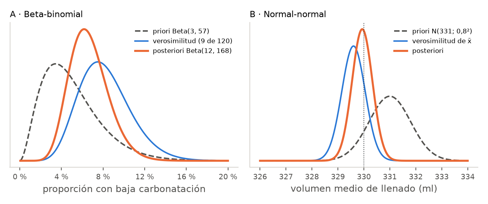
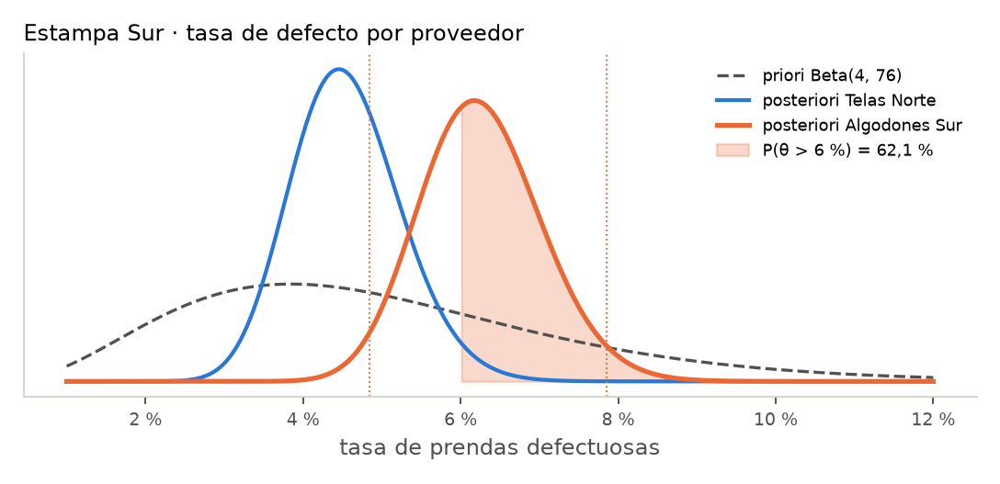

# Unidad 12 · Inferencia bayesiana

**Qué vas a poder hacer.** Traducir lo que ya se sabe de un parámetro a una distribución a priori;
combinarla con los datos para obtener la posteriori en los modelos conjugados beta-binomial,
normal-normal y gamma-Poisson; resumir la posteriori con su media, su moda y un intervalo de
credibilidad; calcular la probabilidad posterior de una hipótesis y usarla para decidir con costos;
y explicar en qué se diferencia un intervalo de credibilidad de uno de confianza.

**Lo que necesitas antes.** De la unidad 1, qué es un valor p y qué no es. De la unidad 3, el
intervalo de confianza de una proporción. De la unidad 11, la verosimilitud como «qué tan probable
hace cada valor del parámetro lo que se observó». Y las distribuciones binomial, normal y Poisson de
Probabilidades y Estadística.

**Tiempo.** Unas 6 horas: 2,5 de lectura con el ejemplo y el cuaderno, 3,5 de práctica.

---

## 1. La idea · dos maneras de mirar un parámetro

Todo lo que se hizo en las unidades 1 a 11 es **frecuentista**: el parámetro (la tasa de defecto de
un proveedor, el volumen medio de llenado) es un número fijo y desconocido; lo aleatorio son los
datos. Por eso un intervalo del 95 % no dice «hay 95 % de probabilidad de que la tasa esté aquí»:
dice que el **método** acierta 95 de cada 100 veces.

El enfoque **bayesiano** trata al parámetro como algo incierto y describe esa incertidumbre con una
distribución de probabilidad. Antes de ver los datos se tiene la **priori**; después de verlos, la
**posteriori**. Eso permite responder directo las preguntas que un jefe hace: «¿qué tan probable es
que la tasa de defecto supere el 6 %?».

| | Frecuentista | Bayesiano |
|---|---|---|
| El parámetro | fijo, desconocido | incierto, con distribución |
| Información que usa | solo la muestra | muestra y conocimiento previo |
| Resultado | estimador y su distribución muestral | distribución posteriori $\pi(\theta \mid x)$ |
| Intervalo del 95 % | el método cubre $\theta$ en 95 % de las muestras | $\theta$ está ahí con probabilidad 0,95 |
| Punto débil | ignora lo que ya se sabía | depende de la priori elegida |

Por qué importa en una empresa: casi nunca se parte de cero. El taller lleva años comprando al mismo
proveedor; el maestro cervecero sabe cuánto falla su embotelladora. Tirar esa historia es
desperdiciar información, y con muestras chicas la diferencia es grande.

---

## 2. El teorema de Bayes para un parámetro

Con $\pi(\theta)$ la priori y $f(x \mid \theta)$ la verosimilitud de los datos:

$$\pi(\theta \mid x) = \frac{f(x \mid \theta)\,\pi(\theta)}{g(x)}
\qquad g(x) = \sum_\theta f(x\mid\theta)\,\pi(\theta) \ \ \text{o} \ \int f(x\mid\theta)\,\pi(\theta)\,d\theta$$

$g(x)$, la **evidencia** o distribución marginal de los datos, solo normaliza: no depende de
$\theta$. Por eso casi siempre se escribe

$$\text{posteriori} \;\propto\; \text{verosimilitud} \times \text{priori}$$

La intuición: cada valor posible de $\theta$ parte con un peso (la priori) y ese peso se multiplica
por qué tan bien explica ese valor lo que se vio. Los valores que explican mal los datos pierden
peso; los que los explican bien lo ganan. Si la priori es discreta (tres valores posibles de la
tasa), esto se hace en una tabla: multiplicar, sumar y dividir por la suma (ejercicio 12.1).

---

## 3. Elegir la priori

**Informativa.** Resume lo que ya se sabe. Para una proporción, la familia Beta($\alpha$, $\beta$) se
lee como «$\alpha$ éxitos y $\beta$ fracasos ya vistos». Si la historia dice «la tasa anda por $m$, y
eso vale como $k$ observaciones», entonces

$$\alpha = m\,k \qquad \beta = (1-m)\,k \qquad E[\theta] = \frac{\alpha}{\alpha+\beta} = m$$

$k = \alpha + \beta$ es la **fuerza** de la priori: cuántos datos equivale. Una priori de fuerza 60
pesa como 60 botellas revisadas.

**No informativa (o poco informativa).** Cuando no se quiere que la historia pese: Beta(1, 1) es
uniforme en $(0, 1)$; para una media normal, una varianza a priori $\sigma_0^2$ muy grande. Con ella la
posteriori queda casi pegada a los datos.

**Sensibilidad.** Como la priori es una decisión, se informa y se prueba con otra: si la conclusión
cambia mucho con prioris razonables distintas, los datos todavía no bastan (ejercicio 12.6).

**Cuándo NO.** La priori se fija **antes** de mirar los datos; elegirla después para llegar a una
conclusión es hacer trampa. Y nunca se le pone probabilidad cero a un valor posible: si la priori
dice que la tasa no puede pasar de 5 %, ningún dato la convencerá de lo contrario.

---

## 4. Las conjugadas · posteriori con fórmula

Una priori es **conjugada** de una verosimilitud si la posteriori queda en la misma familia. Entonces
no hay integrales que hacer: se actualizan los parámetros.

| Datos | Priori | Posteriori | Media posterior |
|---|---|---|---|
| $x$ éxitos en $n$ (binomial) | Beta($\alpha$, $\beta$) | Beta($\alpha + x$, $\beta + n - x$) | $\dfrac{\alpha + x}{\alpha+\beta+n}$ |
| $n$ medidas normales, $\sigma$ conocida, media $\bar x$ | $N(\mu_0, \sigma_0^2)$ | $N(\mu_n, \sigma_n^2)$ | $\mu_n$ (abajo) |
| $S$ eventos Poisson en $t$ unidades de tiempo | Gamma($\alpha$, $\beta$), $\beta$ tasa | Gamma($\alpha + S$, $\beta + t$) | $\dfrac{\alpha + S}{\beta + t}$ |

**Beta-binomial: los pseudo-conteos.** La posteriori suma los éxitos reales a los previos y los
fracasos reales a los previos. La media posterior es un promedio ponderado:

$$\frac{\alpha + x}{\alpha+\beta+n} = \underbrace{\frac{\alpha+\beta}{\alpha+\beta+n}}_{\text{peso de la priori}}\cdot\frac{\alpha}{\alpha+\beta}
\;+\; \underbrace{\frac{n}{\alpha+\beta+n}}_{\text{peso de los datos}}\cdot\frac{x}{n}$$

Mientras más datos, más pesan los datos; mientras más fuerte la priori, más le cuesta moverse.

**Normal-normal: las precisiones.** La precisión es el inverso de la varianza: cuánta información
trae cada fuente. Con $\tau_0 = 1/\sigma_0^2$ (la priori) y $\tau_d = n/\sigma^2$ (los datos):

$$\tau_n = \tau_0 + \tau_d \qquad \sigma_n^2 = \frac{1}{\tau_n} \qquad
\mu_n = \frac{\tau_0\,\mu_0 + \tau_d\,\bar x}{\tau_n}$$

Las informaciones se suman y la media posterior es el promedio de las dos medias pesado por su
precisión. La posteriori siempre es más precisa que cada fuente por separado.

**Gamma-Poisson.** Para tasas de conteo (llegadas por hora, fallas por día): se suman los eventos a
$\alpha$ y el tiempo observado a $\beta$. Ojo con la parametrización: con $\beta$ como **tasa**, la media
es $\alpha/\beta$; scipy usa la **escala** $1/\beta$: `stats.gamma(a, scale=1/b)`.

---

## 5. Resumir la posteriori

La posteriori es la respuesta completa. Para comunicarla se resume:

- **Media posterior** $E[\theta\mid x]$. Es la estimación de Bayes bajo pérdida cuadrática (la que
  minimiza el error cuadrático esperado). En la Beta($A$, $B$): $A/(A+B)$.
- **Moda posterior** (el máximo, o MAP): en la Beta, $(A-1)/(A+B-2)$. Con priori plana coincide con
  el estimador clásico $x/n$.
- **Desviación posterior**: en la Beta, $\sqrt{AB/\left[(A+B)^2(A+B+1)\right]}$.
- **Intervalo de credibilidad** del 95 %: los cuantiles 2,5 % y 97,5 % de la posteriori (de colas
  iguales). A mano se aproxima con media $\pm\,1{,}96\,\cdot$ desviación; con `scipy` se calcula
  exacto con `post.interval(0.95)`. Para proporciones chicas la Beta es asimétrica y la aproximación
  se corre hacia abajo.
- **Probabilidad posterior de una hipótesis**: $P(\theta > c \mid x)$ = `post.sf(c)`. Es la cifra que
  más sirve para decidir.
- **Predicción**: la probabilidad de que la **próxima** unidad salga defectuosa, en el modelo
  beta-binomial, es la media posterior.

### Credibilidad contra confianza

| | Intervalo de confianza | Intervalo de credibilidad |
|---|---|---|
| Qué es aleatorio | el intervalo | el parámetro |
| Qué afirma | el procedimiento cubre $\theta$ en 95 % de las muestras | dados estos datos, $P(a<\theta<b)=0{,}95$ |
| Usa la priori | no | sí |
| Con priori plana y $n$ grande | casi igual al de credibilidad | casi igual al de confianza |

Con la priori plana y muchos datos los números casi coinciden; la diferencia es de interpretación.
Con pocos datos o una priori informativa, los números también cambian.

---

## 6. Comparar hipótesis y decidir

**Probabilidad de cada hipótesis.** Con $H_0: \theta \le c$ y $H_1: \theta > c$ se calculan
$P(H_0)$ y $P(H_1)$ con la priori y con la posteriori. El **factor de Bayes** dice cuánto movieron los
datos las apuestas:

$$\frac{P(H_0\mid x)}{P(H_1\mid x)} = BF_{01} \cdot \frac{P(H_0)}{P(H_1)}$$

$BF_{01} > 1$ favorece a $H_0$; entre 1 y 3 es evidencia débil; sobre 10, fuerte.

**Decidir con pérdidas.** Si aceptar un lote malo cuesta $C_1$ y rechazar uno bueno cuesta $C_0$, la
pérdida esperada de aceptar es $P(H_1\mid x)\,C_1$ y la de rechazar, $P(H_0\mid x)\,C_0$. Se elige la
menor. Equivale a rechazar cuando $P(H_1 \mid x) > C_0/(C_0 + C_1)$: con costos asimétricos, el corte no
es 0,5.

**Regresión bayesiana (mención).** La misma lógica se aplica a los coeficientes de una regresión
(unidad 10) o de una logística (unidad 11): se pone una priori a cada $\beta$ y se obtiene su
posteriori. Con prioris planas y errores normales la media posterior coincide con mínimos cuadrados;
con prioris normales centradas en 0 los coeficientes se «encogen» hacia 0, lo que ayuda con pocos
datos o muchos predictores. Fuera de los casos conjugados la posteriori se obtiene por simulación
(MCMC), con paquetes como PyMC o Bambi.

---

## 7. Ejemplo resuelto · la cervecería Cerro Caracol

### A · ¿Cuántas botellas salen con baja carbonatación?

La cervecería Cerro Caracol, de Concepción, sabe por la historia de su embotelladora que alrededor de
5 % de las botellas sale con baja carbonatación, y le da a esa historia el peso de 60 botellas: priori
Beta(3, 57). Después de cambiar una válvula revisó 120 botellas del lote nuevo
(`datos/u12_ejemplo_botellas.csv`); salieron bajas las botellas 7, 19, 33, 41, 58, 66, 87, 95, 112:
nueve de 120 (7,5 %). El cliente principal (una cadena de bares) exige que la tasa no pase de 8 %.

**Supuestos.** Cada botella es un ensayo independiente con la misma probabilidad $\theta$ (si la falla
viniera en rachas, la binomial subestimaría la incertidumbre). La priori se fijó antes de revisar.

**A mano.** La posteriori es Beta(3 + 9, 57 + 111) = Beta(12, 168).

$$E[\theta\mid x] = \frac{12}{180} = 0{,}0667 \qquad \text{moda} = \frac{11}{178} = 0{,}0618$$

$$\text{Var} = \frac{12\cdot 168}{180^2\cdot 181} = 3{,}438\cdot 10^{-4} \qquad \text{DE} = 0{,}0185$$

La media posterior, 6,67 %, queda entre la priori (5,0 %) y los datos (7,5 %), más cerca de los datos:
pesan $120/180$, el 67 %. El intervalo aproximado es $0{,}0667 \pm 1{,}96\cdot 0{,}0185$, de 3,03 % a
10,30 %. La moda es 6,18 %.

**Con Python, exacto.**

```python
from scipy import stats
post = stats.beta(3 + 9, 57 + 120 - 9)
post.mean(), post.interval(0.95)    # media e intervalo de credibilidad exacto
post.sf(0.08)                       # P(theta > 8 % | datos)
```

El intervalo de credibilidad exacto va de 3,51 % a 10,73 %: la Beta es asimétrica y la aproximación
normal lo corría hacia abajo. La probabilidad posterior de pasar el límite del cliente es
$P(\theta > 0{,}08 \mid x) = $ 22,3 % (antes de revisar, con la sola priori, era 13,9 %).

**Comparación con la priori plana y con el intervalo clásico.**

| | Posteriori | Media | Intervalo 95 % | $P(\theta > 8\%)$ |
|---|---|---|---|---|
| Priori de la historia Beta(3, 57) | Beta(12, 168) | 6,67 % | 3,51 % a 10,73 % | 22,3 % |
| Priori plana Beta(1, 1) | Beta(10, 112) | 8,20 % | 4,03 % a 13,65 % | 49,5 % |
| Clásico (Wald) | | 7,5 % | 2,79 % a 12,21 % | no existe |

Con la priori plana la probabilidad de pasar el 8 % es casi una moneda al aire; con la historia
baja a 22,3 %. Toda la diferencia viene de las 60 botellas «previas»: hay que poder defender ese
número. El intervalo clásico no responde la pregunta del cliente; solo dice que 8 % no se puede
descartar.

### B · ¿Las botellas traen los 330 ml?

La llenadora tiene una desviación conocida de $\sigma = 1{,}8$ ml (dato del fabricante). Los meses
anteriores el volumen medio anduvo en 331 ml, con una incertidumbre de 0,8 ml: priori
$\mu \sim N(331;\ 0{,}8^2)$. Se midieron 16 botellas (`datos/u12_ejemplo_llenado.csv`):

331,2; 327,9; 330,4; 328,6; 332,1; 329,0; 326,8; 330,9; 329,7; 328,3; 331,5; 330,2; 327,4; 329,9; 330,6; 329,1

Media $\bar x = 329{,}6$ ml (la desviación de la muestra, 1,53, es compatible con la del fabricante).

$$\tau_0 = \frac{1}{0{,}8^2} = 1{,}5625 \qquad \tau_d = \frac{16}{1{,}8^2} = 4{,}9383 \qquad
\tau_n = 6{,}5008$$

$$\mu_n = \frac{1{,}5625\cdot 331 + 4{,}9383\cdot 329{,}6}{6{,}5008} = 329{,}94 \qquad
\sigma_n^2 = \frac{1}{6{,}5008} = 0{,}1538 \qquad \sigma_n = 0{,}392$$

Los datos pesan 76,0 % y la priori 24,0 %. Intervalo de credibilidad: $329{,}94 \pm 1{,}96\cdot 0{,}392$,
de 329,17 a 330,71 ml. El intervalo de confianza clásico, que ignora la priori, es
$329{,}6 \pm 1{,}96\cdot 0{,}45$, de 328,72 a 330,48: más ancho y más abajo.

¿El volumen medio está bajo lo rotulado? $z = (330 - 329{,}94)/0{,}392 = 0{,}16$ y
$P(\mu < 330 \mid x) = $ 56,4 % (con la priori sola era 10,6 %).

```python
import numpy as np, pandas as pd
vol = pd.read_csv("../datos/u12_ejemplo_llenado.csv").volumen_ml
t0, td = 1 / 0.8**2, len(vol) / 1.8**2
mun = (t0 * 331 + td * vol.mean()) / (t0 + td); sn = (t0 + td) ** -0.5
stats.norm(mun, sn).cdf(330)        # P(mu < 330 | datos)
```



**Cómo se lee.** (A) La válvula nueva probablemente no empeoró las cosas por sobre el límite: hay
22,3 % de probabilidad de que la tasa pase el 8 %. Si el contrato castiga fuerte un lote malo, conviene
revisar 100 botellas más antes de despachar; si no, se despacha. (B) Hay algo más de la mitad de
probabilidad de que el llenado medio esté bajo los 330 ml: el cambio de válvula movió el volumen.
Subir el punto de ajuste de la llenadora medio mililitro cuesta poco y evita el reclamo por llenado
corto.

---

## 8. Errores típicos

| Error | Cómo evitarlo |
|---|---|
| Leer un intervalo de confianza como «95 % de probabilidad de que $\theta$ esté ahí» | Eso lo dice el intervalo de credibilidad; el de confianza habla del método |
| Elegir la priori después de ver los datos | Fijarla antes, escribir de dónde sale su media y su fuerza |
| Usar una priori fuerte sin justificarla | La fuerza $\alpha+\beta$ son observaciones «regaladas»: hay que poder defenderlas; probar la sensibilidad |
| Confundir la parametrización de la Gamma | Con tasa $\beta$, media $\alpha/\beta$; en scipy, `scale=1/beta` |
| Aproximar con la normal una Beta asimétrica (proporción chica, pocos datos) | Usar los cuantiles exactos de la Beta; la normal puede dar límites negativos |
| Decidir con la media posterior e ignorar la dispersión | Calcular $P(\theta > c \mid x)$ y la pérdida esperada de cada acción |
| Creer que $P(H_0\mid x)$ es un valor p | El valor p es $P(\text{datos tan extremos}\mid H_0)$; la posterior es $P(H_0 \mid \text{datos})$ |
| Usar el corte 0,5 cuando los errores cuestan distinto | El corte es $C_0/(C_0+C_1)$ |

---

## 9. Práctica

Diez ejercicios: 12.1 a 12.4 básicos, 12.5 a 12.8 intermedios, 12.9 y 12.10 de desafío. Las pautas
están en la sección 10. Usa $z_{0{,}975} = 1{,}96$; los cuantiles exactos se sacan con `scipy.stats`.

**12.1 · Lector de códigos (básico).** Un técnico cree que la tasa de error de un lector de códigos de
barra es 1 %, 4 % u 8 %, con probabilidades a priori 0,45, 0,35 y 0,20. En una prueba de 40 lecturas
hay 3 errores. Arma la tabla de Bayes (priori, verosimilitud binomial, producto, posteriori) y calcula
la estimación de Bayes de la tasa.

**12.2 · Priori por media y fuerza (básico).** Una tienda de muebles cree que 15 % de sus despachos
llega con algún daño, y le da a esa creencia el peso de 40 despachos. Escribe la priori Beta. En el
mes revisó 50 despachos y 11 llegaron con daño. Escribe la posteriori y compara su media con la
proporción de la muestra.

**12.3 · Media, moda y varianza (básico).** Con priori Beta(2, 2) y 7 éxitos en 20 ensayos, escribe la
posteriori y calcula su media, su moda, su varianza y su desviación. Compara con $x/n$.

**12.4 · Tiempo de atención en caja (básico).** Un supermercado cree que el tiempo medio de atención en
caja es 6,0 minutos, con desviación a priori 0,5. La desviación de un cliente individual es 2,0
minutos (conocida). En 25 clientes de un local nuevo el promedio fue 6,8 minutos. Calcula las
precisiones, la media y la desviación posterior, el peso de los datos y el intervalo de credibilidad
del 95 %.

**12.5 · Conversión de una tienda nueva (intermedio).** Una tienda en línea recién lanzada tuvo 3
compras en 40 visitas. Sin información previa, usa la priori Beta(1, 1). (a) Escribe la posteriori y
su media. (b) Calcula el intervalo de credibilidad del 95 % exacto y el aproximado por la normal.
(c) Calcula el intervalo de confianza de Wald. ¿Qué pasa con su límite inferior? (d) ¿Cuál es la
probabilidad de que la conversión supere el 5 %?

**12.6 · ¿Cuánto pesa la priori? (intermedio).** En 60 llamadas a una mesa de ayuda, 9 terminaron en
reclamo formal. Tres analistas usan prioris distintas: Beta(1, 1), Beta(4, 36) y Beta(40, 360). Para
cada una, calcula la posteriori, su media, el intervalo de credibilidad del 95 %, la probabilidad de que
la tasa de reclamo supere el 12 % y el peso de los datos. ¿Qué conclusión es robusta?

**12.7 · Sacos de harina (intermedio).** Un molino llena sacos de 25 kg. Por la historia, el peso medio
anda en 25,2 kg con desviación a priori 0,15 kg; la desviación de un saco individual es 0,4 kg. Una
muestra de 12 sacos promedia 25,05 kg. (a) Calcula la posteriori de $\mu$. (b) Compara el intervalo de
credibilidad con el de confianza. (c) ¿Qué probabilidad hay de que el peso medio esté bajo 25 kg?
¿Cambió mucho respecto de la priori?

**12.8 · Camiones en un andén (intermedio).** Un centro de distribución modela los camiones que llegan
por hora a un andén como Poisson($\lambda$). Su priori es Gamma(6, 2), con 2 como tasa (media 3 por
hora). En 8 horas llegaron 31 camiones. (a) Escribe la posteriori, su media y su desviación. (b) Da el
intervalo de credibilidad del 95 %. (c) Si con más de 4 camiones por hora hay que abrir un segundo
andén, ¿qué probabilidad hay de que haga falta? Compárala con la priori.

**12.9 · Dos lotes y cuántos más revisar (desafío).** Un laboratorio parte con priori Beta(2, 48) para
la tasa de muestras contaminadas. El lunes revisa 100 y hay 4 contaminadas; el jueves, 150 con 7.
(a) Actualiza en dos pasos (la posteriori del lunes es la priori del jueves) y en uno solo con todo
junto: ¿dan lo mismo? (b) Calcula el intervalo de credibilidad exacto del 95 % y su ancho. (c) Con la
aproximación normal, ¿cuántas muestras en total y cuántas más hacen falta para que el intervalo
mida a lo más 4 puntos porcentuales, si la tasa se mantiene?

**12.10 · Aceptar o rechazar un lote (desafío).** Un comprador acepta lotes con tasa de defecto de a lo
más 5 %. Su priori es Beta(3, 47). En 150 unidades del lote hay 6 defectuosas. Aceptar un lote malo
(tasa sobre 5 %) cuesta $1.200.000; rechazar uno bueno cuesta $300.000. (a) Calcula $P(H_0)$ y
$P(H_1)$ con $H_0: \theta \le 0{,}05$, antes y después de los datos. (b) Calcula las apuestas a priori y
a posteriori y el factor de Bayes $BF_{01}$. ¿Qué dicen los datos? (c) Calcula la pérdida esperada de
aceptar y de rechazar. ¿Qué haces? (d) ¿Por qué la decisión puede ir contra lo que «dicen los datos»?

---

## 10. Pautas

**12.1.**

| Tasa | Priori | Verosimilitud $b(3; 40, p)$ | Producto | Posteriori |
|---|---|---|---|---|
| 0,01 | 0,45 | 0,0068 | 0,0031 | 0,031 |
| 0,04 | 0,35 | 0,1396 | 0,0489 | 0,498 |
| 0,08 | 0,20 | 0,2313 | 0,0463 | 0,471 |

La suma de los productos es $g(x) = 0{,}0982$. La estimación de Bayes es
$0{,}01\cdot 0{,}031 + 0{,}04\cdot 0{,}498 + 0{,}08\cdot 0{,}471$, es decir, 5,79 %. Tres errores en 40
casi descartan el 1 % (que partía como lo más probable) y reparten la probabilidad entre 4 % y 8 %.

**12.2.** $\alpha = 0{,}15\cdot 40 = 6$ y $\beta = 34$: priori Beta(6, 34). Posteriori
Beta(6 + 11, 34 + 39) = Beta(17, 73), con media $17/90$, es decir, 18,9 %. La muestra dio 22,0 %; la
posteriori queda entre la creencia y los datos, más cerca de los datos (50 contra 40).

**12.3.** Posteriori Beta(9, 15). Media $9/24 = 0{,}375$; moda $8/22 = 0{,}364$; varianza
$9\cdot 15/(24^2\cdot 25) = 0{,}0094$; desviación 0,097. El estimador clásico es $7/20 = 0{,}35$: la
priori Beta(2, 2) empuja levemente hacia 0,5 (vale como 4 ensayos con 2 éxitos).

**12.4.** $\tau_0 = 1/0{,}5^2 = 4{,}00$; $\tau_d = 25/2{,}0^2 = 6{,}25$; $\tau_n = 10{,}25$.
$\mu_n = (4\cdot 6{,}0 + 6{,}25\cdot 6{,}8)/10{,}25 = 6{,}49$ minutos; $\sigma_n = 1/\sqrt{10{,}25} = 0{,}312$.
Los datos pesan 61,0 %. Intervalo de credibilidad: de 5,88 a 7,10 minutos. El local nuevo
probablemente atiende más lento que el promedio de la cadena, pero 6,0 todavía está dentro del intervalo.

**12.5.** (a) Beta(4, 38), media $4/42$, es decir, 9,52 %. (b) Exacto: de 2,72 % a 19,92 %;
aproximado: de 0,75 % a 18,30 %. (c) Wald: $0{,}075 \pm 1{,}96\sqrt{0{,}075\cdot 0{,}925/40}$, de
-0,66 % a 15,66 %: el límite inferior es negativo, una conversión imposible. Con 3 éxitos la
aproximación normal falla; la Beta exacta no. (d) $P(\theta > 0{,}05 \mid x) = $ 85,3 %.

```python
post = stats.beta(1 + 3, 1 + 37); post.interval(0.95), post.sf(0.05)
```

**12.6.**

| Priori | Media a priori | Posteriori | Media | Intervalo 95 % | $P(\theta > 12\%)$ | Peso de los datos |
|---|---|---|---|---|---|---|
| Beta(1, 1) | 50,0 % | Beta(10, 52) | 16,13 % | 8,2 % a 26,2 % | 80,9 % | 97 % |
| Beta(4, 36) | 10,0 % | Beta(13, 87) | 13,00 % | 7,2 % a 20,2 % | 59,1 % | 60 % |
| Beta(40, 360) | 10,0 % | Beta(49, 411) | 10,65 % | 8,0 % a 13,6 % | 17,3 % | 13 % |

La media posterior es robusta (entre 10,65 % y 16,13 %), pero la probabilidad de pasar el 12 % no lo
es: va de 17,3 % a 80,9 % según la priori. Con 60 llamadas los datos no alcanzan para esa pregunta; la
priori Beta(40, 360) «vale» 400 llamadas y hay que poder justificarlas.

**12.7.** (a) $\tau_0 = 44{,}4$, $\tau_d = 12/0{,}4^2 = 75{,}0$; $\mu_n = 25{,}106$ kg,
$\sigma_n = 0{,}091$; los datos pesan 62,8 %. (b) Credibilidad: de 24,93 a 25,29 kg; confianza: de
24,82 a 25,28. El de credibilidad es más angosto y está más arriba porque suma la historia. (c)
$P(\mu < 25 \mid x) = $ 12,4 %, contra 9,1 % con la sola priori. La muestra baja sugiere un leve
corrimiento, pero el peso medio sigue con alta probabilidad sobre lo rotulado.

**12.8.** (a) Posteriori Gamma(6 + 31, 2 + 8) = Gamma(37, 10). Media $37/10 = 3{,}70$ camiones por
hora (la priori decía 3,0 y los datos solos, $31/8 = 3{,}875$); desviación $\sqrt{37}/10 = 0{,}608$.
(b) De 2,61 a 4,98 camiones por hora. (c) $P(\lambda > 4 \mid x) = $ 29,6 % (con la priori era 19,1 %).
Tres de cada diez: conviene tener el segundo andén listo para habilitar, no abierto todo el día.

```python
post = stats.gamma(37, scale=1/10); post.interval(0.95), post.sf(4)
```

**12.9.** (a) Lunes: Beta(2 + 4, 48 + 96) = Beta(6, 144), media 4,00 %. Jueves: Beta(6 + 7, 144 + 143)
= Beta(13, 287), media 4,33 %. Todo junto (11 de 250): Beta(2 + 11, 48 + 239) = Beta(13, 287). Da lo
mismo: la posteriori de hoy es la priori de mañana, y el orden de los datos no importa. (b) De 2,34 % a
6,91 %: un ancho de 4,57 puntos (la aproximación normal da 4,60). (c) El ancho es
$2\cdot 1{,}96\sqrt{\theta(1-\theta)/(\alpha+\beta+N+1)}$. Con $\theta = 0{,}0433$ y ancho 0,04:
$\alpha + \beta + N + 1 \ge 0{,}0433\cdot 0{,}9567\cdot(3{,}92/0{,}04)^2$, de donde $N = 348$ muestras en
total: 98 más.

**12.10.** (a) Posteriori Beta(9, 191). Antes: $P(H_0) = 0{,}446$, $P(H_1) = 0{,}554$. Después:
$P(H_0\mid x) = 0{,}667$, $P(H_1\mid x) = 0{,}333$. (b) Apuestas a priori $0{,}446/0{,}554 = 0{,}806$; a
posteriori 2,005. $BF_{01} = 2{,}005/0{,}806 = 2{,}49$: los datos (4 % de defecto) favorecen que el lote
es bueno, con evidencia débil. (c) Aceptar: $0{,}333\cdot 1.200.000$, es decir, $399.324 de pérdida
esperada. Rechazar: $0{,}667\cdot 300.000$, es decir, $200.169. Se rechaza (o se pide más muestra). (d)
Porque el corte no es 0,5 sino $300.000/1.500.000 = 0{,}20$: aceptar un lote malo cuesta cuatro veces
más que rechazar uno bueno, así que basta un 20 % de probabilidad de que sea malo para rechazarlo. Los
datos movieron la balanza hacia «bueno», pero no lo suficiente para ese costo.

---

## 11. Caso integrador · Estampa Sur, la tasa de defecto de Algodones Sur

> En la unidad 3, la prueba de homogeneidad sobre las prendas defectuosas de los tres proveedores dio
> p = 0,043: hay diferencias, y Algodones Sur tenía la tasa más alta. En la unidad 11 se vio qué sube la
> probabilidad de defecto en el estampado. Ahora la pregunta es la que hace el jefe de compras:
> **¿qué tan probable es que la tasa de Algodones Sur pase del 6 %?** Los datos son simulados por
> `verificacion/caso_estampa_sur_datos.py` y están en `datos/defectos.csv`.

**La priori.** La historia del taller con sus proveedores de prendas lisas dice que la tasa anda por el
5 %, y se le da el peso de 80 prendas: Beta(4, 76), con media 5,0 %. Con esa sola priori,
$P(\theta > 6\%)$ era 29,5 %.

**Los datos.** Algodones Sur entregó 58/910 prendas defectuosas (6,37 %).

**A mano.** Posteriori Beta(4 + 58, 76 + 852) = Beta(62, 928). Media $62/990$, es decir, 6,26 %; moda
6,17 %; desviación 0,77 puntos porcentuales. Los datos pesan $910/990$, el 91,9 %: con 910 prendas, la
historia casi no mueve el resultado. Intervalo aproximado: de 4,75 % a 7,77 %.

**Con Python.**

```python
d = pd.read_csv("../datos/defectos.csv").set_index("proveedor")
k, n = d.loc["Algodones Sur", ["defectuosas", "revisadas"]]
post = stats.beta(4 + k, 76 + n - k)
post.mean(), post.interval(0.95), post.sf(0.06)
```

- Intervalo de credibilidad del 95 %: de **4,84 % a 7,85 %**.
- $P(\theta > 6\% \mid x) = $ **62,1 %**.
- Con priori plana, Beta(59, 853): media 6,47 % y $P(\theta > 6\%)$ de 70,9 %. La conclusión no
  depende de la priori: la tasa pasa del 6 % con probabilidad entre 62 % y 71 %.
- El intervalo de confianza clásico (Wald) va de 4,79 % a 7,96 %: casi el mismo rango, pero no permite
  decir «62,1 % de probabilidad».

**¿Es peor que Telas Norte?** Con la misma priori, Telas Norte (37/820) queda en Beta(41, 859), media
4,56 % y $P(\theta > 6\%)$ de 2,6 %. Simulando 400.000 pares desde las dos posterioris (semilla 1212 en
el verificador; la integral numérica da lo mismo):

```python
rng = np.random.default_rng(1212)
p = (rng.beta(62, 928, 400_000) > rng.beta(41, 859, 400_000)).mean()
```

$P(\theta_{AS} > \theta_{TN} \mid x) = $ 95,0 %, y la diferencia de tasas está entre -0,3 y 3,7 puntos
con 95 % de probabilidad.



**Lectura para Estampa Sur.** Hay 95,0 % de probabilidad de que Algodones Sur entregue más prendas
defectuosas que Telas Norte, y 62,1 % de que su tasa pase del 6 %. No es certeza, pero es la cifra que
sirve para negociar: el taller puede pedirle a Algodones Sur un descuento por la revisión extra o una
cláusula de devolución sobre el 6 %, y mover pedidos a Telas Norte si la tasa sigue igual en los
próximos dos lotes. Esa revisión no parte de cero: la posteriori de hoy, Beta(62, 928), es la priori
del próximo lote.

**Cierre del ramo.** El caso partió preguntando si una máquina desplazaba más el registro que otra
(unidades 1 y 2) y termina con una probabilidad que un jefe de compras puede usar sin saber
estadística. En el camino: comparar medias, varianzas y proporciones; tablas de contingencia y ajuste;
correlación, ANOVA y regresión; y modelos para respuestas que son un sí o no o un conteo. La lente
bayesiana no reemplaza a las otras: agrega la historia y responde con probabilidades sobre lo que
importa.

---

## 12. Para seguir

**En los libros del ramo.**

- Gelman, Carlin, Stern, Dunson, Vehtari y Rubin, *Bayesian Data Analysis* (Chapman & Hall/CRC,
  2013), capítulos 2 y 3 (modelos de un parámetro y conjugadas, introducción a modelos de varios
  parámetros), que el programa fija para esta unidad; el capítulo 4 lo fija para la comparación entre
  intervalos de credibilidad y de confianza.
- Walpole, Myers, Myers y Ye, *Probability & Statistics for Engineers & Scientists* (Pearson, 2017),
  capítulo de estadística bayesiana: prioris discretas y continuas, estimación de Bayes e intervalos
  bayesianos con muchos ejercicios cortos.
- Berger, *Statistical Decision Theory and Bayesian Analysis* (Springer, 1993), para decidir con
  funciones de pérdida.

**Abierto y gratis.** Johnson, Ott y Dogucu, *Bayes Rules! An Introduction to Applied Bayesian
Modeling*, en línea: capítulo 3 (modelo beta-binomial), capítulo 5 (familias conjugadas
gamma-Poisson y normal-normal), capítulo 8 (inferencia y predicción con la posteriori) y capítulo 9
(regresión normal bayesiana): https://www.bayesrulesbook.com/

**Con el tutor.** Pega `tutor/contexto.md` al inicio de la conversación y pídele, por ejemplo:
«Dame un proveedor con su historia y un lote nuevo; déjame elegir la priori, calcular la posteriori y
la probabilidad de pasar un límite, y después discute conmigo si mi priori era defendible».
