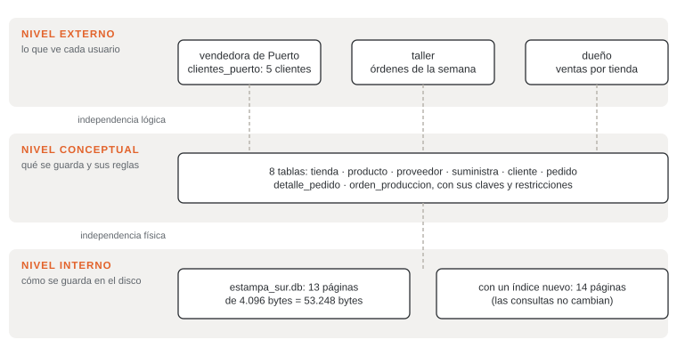

# Unidad 1 · Datos, información y sistemas de bases de datos

**Qué vas a poder hacer.** Distinguir un dato de la información que se arma con él, encontrar en una
planilla real los datos repetidos, las contradicciones y las reglas que nadie hace cumplir, explicar
qué hace un sistema de gestión de bases de datos para evitarlos, ubicar un cambio en el nivel que le
corresponde y ordenar el trabajo de diseño de una base en sus cuatro etapas.

**Lo que necesitas antes.** Nada del ramo. Haber usado una planilla (Excel o Google Sheets) y saber qué
es una fila y una columna. Para correr los ejemplos, Python (trae SQLite en el módulo `sqlite3`) o
cualquier cliente de SQLite o MySQL.

**Tiempo.** Unas 4 horas: 2 de lectura con los scripts abiertos y 2 de práctica.

---

## 1. Dato, información y conocimiento

Una base de datos guarda **datos**. Lo que las personas usan es **información**, y lo que deciden con
ella es **conocimiento**. Conviene separarlos porque cada uno vive en un lugar distinto.

| | Qué es | Ejemplo en un taller de estampado |
|---|---|---|
| Dato | un valor suelto, sin contexto | `38` · `Valle` · `2026-03-06` |
| Información | datos puestos en contexto, que responden una pregunta | «el pedido 1, del 06-03-2026, lleva 38 polerones y está en el taller» |
| Conocimiento | lo que se aprende al mirar mucha información y que guía una decisión | «los clubes piden en marzo y en tandas grandes: conviene tener el lote listo antes del 15» |

**Por qué importa.** La base guarda datos; la información la arma una consulta en el momento en que
alguien la pide; el conocimiento es de quien decide. Si el dato está mal escrito, la información sale
mal y la decisión también. Por eso casi todo este ramo trata de cómo guardar bien los datos.

**Campos, registros y archivos.** Una colección de datos se organiza en tres piezas, y cada una tiene
varios nombres según quién hable:

| Pieza | En una planilla | En una base relacional | En la teoría (unidad 4) |
|---|---|---|---|
| una característica (el teléfono) | columna | columna o **campo** | atributo |
| un caso completo (un socio) | fila | fila o **registro** | tupla |
| todos los casos del mismo tipo | hoja | tabla o **archivo** | relación |

Una **base de datos** es un conjunto de archivos relacionados entre sí y organizados para que un
programa encuentre rápido lo que necesita. La palabra clave es *relacionados*: los pagos se conectan
con los socios, los pedidos con los clientes.

---

## 2. Por qué la planilla suelta deja de servir

Una planilla funciona bien mientras la usa una persona, para un solo tema y con pocas filas. Deja de
funcionar cuando la llenan varias personas, cuando mezcla temas (socios *y* pagos, clientes *y*
pedidos) o cuando hay que guardar la historia. Los problemas que aparecen son siempre los mismos seis:

| Problema | Qué es | Ejemplo (el club de la sección 8) | Qué hace un SGBD |
|---|---|---|---|
| Redundancia | el mismo dato escrito en varios lugares | el teléfono de cada socio, en cada fila de pago | cada dato se guarda una vez, en la tabla de la cosa a la que pertenece |
| Inconsistencia | copias del mismo dato que no coinciden | dos teléfonos distintos para el mismo socio | si el dato está una sola vez, no se puede contradecir |
| Aislamiento | datos repartidos en archivos y formatos distintos, que solo se cruzan a mano | la asistencia en un cuaderno, los pagos en Excel | una sola base; las consultas cruzan tablas |
| Integridad | reglas del negocio que nadie hace cumplir | un pago negativo, una categoría que no existe | restricciones (`NOT NULL`, `CHECK`, claves) que se revisan en cada cambio |
| Concurrencia | dos personas cambian lo mismo a la vez y una pisa a la otra | el tesorero y la secretaria guardan la misma planilla | transacciones y bloqueos (unidad 12) |
| Seguridad | todo o nada: quien abre el archivo lo ve todo | el entrenador ve los teléfonos y los montos de todos | usuarios, permisos y vistas por usuario |

La redundancia es la madre de la inconsistencia: un dato que está en diez filas puede quedar distinto
en una. Hay dos problemas más que nacen de mezclar temas en una sola hoja, y que la unidad 6 trata a
fondo: no se puede anotar a un socio nuevo hasta que pague (**anomalía de inserción**) y, si se borra
el único pago de alguien, se borra también su teléfono (**anomalía de borrado**). Y uno de
infraestructura: si el archivo se corrompe o alguien lo borra, la planilla no tiene cómo volver al
último estado bueno; un SGBD sí (respaldos y bitácora).

---

## 3. Qué es un sistema de gestión de bases de datos

Un **sistema de gestión de bases de datos** (SGBD, o DBMS en inglés) es el programa que define,
construye, modifica y comparte una base de datos. El programa que usa la base (una página web, la caja
de una tienda) ya no sabe dónde ni cómo están guardados los datos: le pide al SGBD lo que necesita y el
SGBD se encarga del resto. El **sistema de base de datos** completo es la base, el SGBD, los programas
que lo usan y las personas.

Ejemplos de SGBD relacionales: **SQLite** (la base completa es un archivo; viene con Python y es la que
usa este ramo para correr todo), **MySQL**, PostgreSQL, SQL Server y Oracle. Ejemplo de SGBD de
documentos: MongoDB. A un SGBD relacional se le habla en **SQL**.

| Función | Qué hace | Con qué se pide | Unidad |
|---|---|---|---|
| Definir | crea tablas, tipos de dato y reglas | DDL: `CREATE`, `ALTER`, `DROP` | 8 |
| Manipular | inserta, cambia, borra y consulta | DML: `INSERT`, `UPDATE`, `DELETE`, `SELECT` | 8 a 11 |
| Hacer cumplir la integridad | rechaza todo cambio que viole una regla | `NOT NULL`, `CHECK`, `PRIMARY KEY`, `FOREIGN KEY` | 5 |
| Controlar la concurrencia | muchos usuarios a la vez sin pisarse | transacciones | 12 |
| Proteger | decide quién ve y quién cambia qué | usuarios, permisos, vistas | 11 |
| Respaldar y recuperar | vuelve a un estado bueno después de una falla | respaldos y bitácora de transacciones | 12 |
| Describirse a sí mismo | guarda la definición de la base junto con los datos | catálogo o diccionario de datos | 2 |

**La intuición.** En la planilla, la regla «el monto es positivo» vive en la cabeza del tesorero. En
la base vive en la definición de la tabla, y el SGBD la revisa cada vez que alguien escribe, venga de
donde venga. Lo mismo con «este pago es de un socio que existe»: deja de depender de la memoria.

**Cuándo no hace falta.** Una lista personal, un cálculo que se hace una vez o una planilla que usa una
sola persona para un solo tema no necesitan un SGBD. Lo necesitan los datos que comparten varias
personas, que cruzan varios temas y que tienen que durar.

---

## 4. Tres niveles de abstracción e independencia de datos

Un SGBD separa tres maneras de ver la misma base. Es la arquitectura de tres niveles (conocida como
ANSI/SPARC):

- **Nivel externo.** Lo que ve cada usuario: una **vista** con solo las columnas y filas que le
  sirven. La vendedora de una tienda ve sus clientes; el dueño ve las ventas por tienda.
- **Nivel conceptual.** La estructura completa de la base: qué tablas hay, qué columnas tienen, cómo se
  conectan y qué reglas cumplen. No dice nada de discos ni de archivos. Es lo que diseñan las unidades
  2 a 6.
- **Nivel interno.** Cómo se guarda de verdad: en qué archivo, en qué páginas, con qué índices.

**Independencia de datos** es poder cambiar un nivel sin rehacer el de arriba.

- **Independencia física:** se cambia el nivel interno (un índice nuevo, otro disco) y ni las tablas ni
  las consultas se enteran. La respuesta es la misma; solo llega más rápido.
- **Independencia lógica:** se cambia el nivel conceptual (una columna nueva, una tabla nueva) y las
  vistas y programas que no usan lo cambiado siguen funcionando.



La figura es la base del caso integrador, y la sección 12 hace cada uno de esos cambios con SQL.

**La intuición.** Es lo que pasa con un enchufe: el aparato no sabe de qué central viene la
electricidad. Mientras el enchufe (la vista, la tabla) no cambie, lo de atrás se puede rehacer.

**Cuándo no aplica.** La independencia lógica no es total: si se borra o se renombra una columna que
una vista usa, la vista se rompe. Agregar es seguro; quitar, no.

---

## 5. Modelos de datos

Un **modelo de datos** es el conjunto de conceptos con que se describe la estructura de una base: qué
tipos de cosas hay, cómo se conectan y qué reglas cumplen. Hay modelos para cada etapa del diseño
(sección 7): el **modelo entidad-relación** es conceptual (unidades 2 y 3); los que siguen son lógicos,
porque son los que entiende un SGBD.

- **Relacional** (Codd, 1970). Todo es una tabla con filas y columnas, y las tablas se conectan por
  valores que se repiten a propósito: el pago lleva el `id_socio` del socio. Es el modelo de este ramo
  y el de casi todos los sistemas de una empresa.
- **Documentos.** Cada registro es un documento (JSON) que puede anidar listas. Así se vería un socio
  del club con sus pagos adentro:

```json
{
  "id_socio": 2,
  "nombre": "Benjamín Soto",
  "telefono": "9 6655 2091",
  "categoria": {"nombre": "sub-15", "cuota": 16500},
  "pagos": [
    {"fecha": "2026-03-03", "monto": 16500},
    {"fecha": "2026-04-04", "monto": 16500}
  ]
}
```

  Leer al socio con su historia es una sola lectura. Pero la cuota de la categoría sub-15 queda copiada
  en el documento de cada socio sub-15: la redundancia vuelve.
- **Otros NoSQL** («no solo SQL»), como mención: **clave-valor** (Redis: el carro de compras de una
  tienda en línea, guardado por número de sesión), **columnas anchas** (Cassandra: millones de lecturas
  de sensores por segundo) y **grafos** (Neo4j: redes de contactos, rutas).

| Modelo | La unidad que guarda | Bueno para | Lo que pierde |
|---|---|---|---|
| Relacional | fila de una tabla | muchos temas que se cruzan y reglas que hay que hacer cumplir | leer un objeto anidado pide juntar tablas |
| Documentos | documento JSON | leer y escribir juntos los datos que siempre van juntos | lo que se repite entre documentos se puede contradecir |
| Clave-valor | un valor bajo una clave | buscar por la clave, nada más, muy rápido | no se puede preguntar por el contenido |
| Grafos | nodos y aristas | preguntas de caminos y vecinos | las sumas y los totales por grupo |

**Cuándo no aplica.** NoSQL no es «la versión moderna» del relacional: se elige por cómo se usan los
datos. Un taller con clientes, pedidos, productos y proveedores que se cruzan todo el tiempo es el caso
de libro del modelo relacional.

---

## 6. Quién hace qué

| Rol | Qué hace | Ejemplo en el club |
|---|---|---|
| Usuario final | usa la base a través de una pantalla, sin ver SQL; algunos (analistas) escriben sus propias consultas | la secretaria registra un pago; el presidente pide la recaudación del mes |
| Desarrollador | diseña la base a partir de los requisitos y programa las pantallas y las consultas que usan | quien arma el formulario de pago y las tablas detrás |
| Administrador (DBA) | instala y configura el SGBD, da permisos, programa respaldos, vigila el rendimiento y recupera la base tras una falla | quien decide que el entrenador vea la asistencia pero no los montos |

En una pyme la misma persona suele usar los tres sombreros. Igual conviene distinguirlos: el error de
dar permisos de más es de administrador, no de desarrollador.

---

## 7. El ciclo de diseño

Una base se diseña de lo general a lo concreto, en cuatro etapas:

| Etapa | Pregunta | Producto | Unidades |
|---|---|---|---|
| 1. Requisitos | ¿qué hay que guardar y qué preguntas hay que responder? | lista de datos y de consultas, sacada de entrevistas, formularios y planillas actuales | 1 |
| 2. Diseño conceptual | ¿qué cosas hay y cómo se relacionan? | diagrama entidad-relación, sin pensar en ningún SGBD | 2 y 3 |
| 3. Diseño lógico | ¿en qué tablas, con qué claves? | modelo relacional normalizado | 4 a 6 |
| 4. Diseño físico | ¿con qué tipos, índices y en qué SGBD? | los `CREATE TABLE` y los índices | 8 y 12 |

Después vienen la implementación (crear la base y cargar los datos) y la operación (usarla, respaldarla
y ajustarla). El ciclo no es una línea: una pregunta que aparece tarde («¿cuánto le vendimos a cada tipo
de cliente?») obliga a volver al diseño conceptual.

**La intuición.** Un error en los requisitos es el más caro, porque obliga a rehacer todo lo de abajo.
Por eso cada diseño de este ramo parte del problema en palabras y de las preguntas que la base tiene
que responder, nunca del `CREATE TABLE`.

---

## 8. Ejemplo resuelto · Las cuotas del Club Deportivo Río Laja

El club, de Los Ángeles, cobra una cuota mensual según la categoría del socio. El tesorero lleva esta
planilla con los pagos de marzo y abril de 2026:

| fecha | socio | teléfono | categoría | cuota | pagado |
|---|---|---|---|---|---|
| 2026-03-02 | Antonia Rivas | 9 7412 3380 | sub-13 | 14500 | 14500 |
| 2026-03-03 | Benjamín Soto | 9 6655 2091 | sub-15 | 16500 | 16500 |
| 2026-03-05 | Catalina Mora | 9 8120 4473 | adulto | 21000 | 21000 |
| 2026-03-09 | Diego Paredes | 9 5531 7804 | sub-15 | 16500 | 16500 |
| 2026-03-10 | Emilia Cáceres | 9 4478 1962 | sub-13 | 14500 | 14500 |
| 2026-04-01 | Antonia Rivas | 9 7412 3380 | sub-13 | 14500 | 14500 |
| 2026-04-04 | Benjamín Soto | 9 6655 2019 | sub-15 | 16500 | 16500 |
| 2026-04-06 | Catalina Mora | 9 8120 4473 | adulto | 21000 | 21000 |
| 2026-04-08 | Diego Paredes | 9 5531 7804 | sub-15 | 16000 | 16000 |
| 2026-04-12 | Emilia Caceres | 9 4478 1962 | sub-13 | 14500 | 14500 |

**Paso 1 · Contar lo repetido.** Son 10 filas por 6 columnas: 60 celdas. Para cada columna se pregunta
*de quién es el dato*. El nombre, el teléfono y la categoría son del socio; la cuota es de la
categoría. Una celda es una copia de más si repite un dato que ya estaba escrito en otra fila:

| Dato | Es de | Veces escrito | Debería estar | Copias de más |
|---|---|---|---|---|
| nombre | el socio | 10 | 5 | 5 |
| teléfono | el socio | 10 | 5 | 5 |
| categoría | el socio | 10 | 5 | 5 |
| cuota | la categoría | 10 | 3 | 7 |
| **Total** | | | | **22** |

La cuota tiene 7 copias de más porque las tres cuotas se escriben diez veces. En total, 22 de esas 60
celdas (36,7 %) repiten algo que ya estaba escrito. La fecha y lo pagado no se repiten: son de cada
pago.

**Paso 2 · Buscar las contradicciones.** Donde hay copias, hay contradicciones:

- Benjamín Soto tiene dos teléfonos (`9 6655 2091` y `9 6655 2019`). ¿Cuál es el bueno? La planilla no
  lo sabe.
- Emilia aparece como «Cáceres» y como «Caceres». Un filtro por nombre la cuenta como dos personas.
- La cuota sub-15 aparece como 16.500 y como 16.000. En abril se le cobraron \$500 de menos a Diego, y
  nadie lo notó porque la planilla no tiene un lugar donde esté «la cuota sub-15».

**Paso 3 · Lo que la planilla no puede guardar.** Un socio nuevo que todavía no paga no tiene fila
(anomalía de inserción). Si Benjamín cambia de teléfono, hay que corregir 2 celdas, y con un año de
pagos serían 12. Nada impide escribir un pago de −21.000 ni una categoría «sub-17» que el club no tiene.

**Paso 4 · Separar por tema.** Cada dato va a la tabla de la cosa a la que pertenece:

| Tabla | Columnas | Filas |
|---|---|---|
| `categoria` | nombre, cuota | 3 |
| `socio` | id_socio, nombre, telefono, categoria | 5 |
| `pago` | id_socio, fecha, monto | 10 |

El socio recibe un número (`id_socio`) porque el nombre no sirve para identificarlo: puede escribirse de
dos formas y dos personas pueden llamarse igual. El pago guarda solo el número del socio, y desde ahí se
llega a su nombre, a su categoría y a su cuota.

Con tan pocas filas el diseño casi no ahorra espacio: son 56 celdas contra 60. La diferencia crece con
el uso: con 120 socios y 12 meses, la planilla llega a 8.640 celdas y las tres tablas a 4.806. Pero lo
que importa no es el espacio, sino que cada dato está una sola vez.

**Paso 5 · Crear la base** (`sql/u01_sistemas_bd.sql`). No hace falta entender cada palabra todavía; la
unidad 8 explica el DDL en detalle. Fíjate en las reglas: `NOT NULL`, `CHECK` y `REFERENCES`.

```sql
CREATE TABLE categoria (
    nombre  VARCHAR(10) PRIMARY KEY,
    cuota   INTEGER NOT NULL CHECK (cuota > 0)
);

CREATE TABLE socio (
    id_socio   INTEGER PRIMARY KEY,
    nombre     VARCHAR(60) NOT NULL,
    telefono   VARCHAR(15),
    categoria  VARCHAR(10) NOT NULL REFERENCES categoria(nombre)
);

CREATE TABLE pago (
    id_socio  INTEGER NOT NULL REFERENCES socio(id_socio),
    fecha     DATE NOT NULL,
    monto     INTEGER NOT NULL CHECK (monto > 0),
    PRIMARY KEY (id_socio, fecha)
);

INSERT INTO categoria VALUES ('sub-13', 14500), ('sub-15', 16500), ('adulto', 21000);

INSERT INTO socio VALUES
    (1, 'Antonia Rivas',  '9 7412 3380', 'sub-13'),
    (2, 'Benjamín Soto',  '9 6655 2091', 'sub-15'),
    (3, 'Catalina Mora',  '9 8120 4473', 'adulto'),
    (4, 'Diego Paredes',  '9 5531 7804', 'sub-15'),
    (5, 'Emilia Cáceres', '9 4478 1962', 'sub-13');

INSERT INTO pago VALUES
    (1, '2026-03-02', 14500), (2, '2026-03-03', 16500), (3, '2026-03-05', 21000),
    (4, '2026-03-09', 16500), (5, '2026-03-10', 14500), (1, '2026-04-01', 14500),
    (2, '2026-04-04', 16500), (3, '2026-04-06', 21000), (4, '2026-04-08', 16000),
    (5, '2026-04-12', 14500);
```

Al cargar, el tesorero tuvo que decidir una vez cuál era el teléfono bueno de Benjamín (llamó y era el
`2091`) y cómo se escribe Emilia. Los pagos se cargaron tal como se cobraron.

**Paso 6 · Lo que la base responde.** Como la cuota está en un solo lugar, la base puede comparar cada
pago con la cuota que corresponde (la unidad 10 explica el `JOIN`):

```sql
SELECT s.nombre, p.fecha, p.monto, c.cuota
FROM pago p
JOIN socio s     ON s.id_socio = p.id_socio
JOIN categoria c ON c.nombre = s.categoria
WHERE p.monto < c.cuota;
```

| nombre | fecha | monto | cuota |
|---|---|---|---|
| Diego Paredes | 2026-04-08 | 16000 | 16500 |

El error que la planilla escondía sale solo: a Diego le faltan \$500. Y si Benjamín cambia de teléfono,
se corrige en una fila:

```sql
UPDATE socio SET telefono = '9 6655 8034' WHERE id_socio = 2;
SELECT id_socio, nombre, telefono FROM socio WHERE id_socio = 2;
```

El `UPDATE` cambia 1 fila, y la consulta devuelve:

| id_socio | nombre | telefono |
|---|---|---|
| 2 | Benjamín Soto | 9 6655 8034 |

**Paso 7 · Lo que la base rechaza.** Cuatro errores que la planilla habría aceptado sin reclamar. SQLite
responde con estos mensajes (corridos por el verificador):

| Sentencia | Qué intenta | Respuesta de SQLite |
|---|---|---|
| `INSERT INTO pago VALUES (9, '2026-04-15', 14500);` | un pago de un socio que no existe | `FOREIGN KEY constraint failed` |
| `INSERT INTO pago VALUES (3, '2026-04-20', -21000);` | un monto negativo | `CHECK constraint failed: monto > 0` |
| `INSERT INTO socio VALUES (6, 'Martina Lagos', '9 3307 6618', 'sub-17');` | una categoría que el club no tiene | `FOREIGN KEY constraint failed` |
| `INSERT INTO pago VALUES (1, '2026-04-01', 14500);` | el mismo pago dos veces | `UNIQUE constraint failed: pago.id_socio, pago.fecha` |

```sql
SELECT COUNT(*) AS pagos, SUM(monto) AS recaudado FROM pago;
```

| pagos | recaudado |
|---|---|
| 10 | 165500 |

Siguen los 10 pagos y los $165.500 de la planilla: nada de lo rechazado entró.

> **En MySQL.** El mismo script corre en MySQL 8.0.16 o más. Tres diferencias: SQLite revisa las claves
> foráneas solo después de `PRAGMA foreign_keys = ON;` (MySQL con InnoDB las revisa siempre); MySQL
> anterior a 8.0.16 acepta el `CHECK` pero no lo hace cumplir; y los mensajes de error son otros (por
> ejemplo, `Cannot add or update a child row: a foreign key constraint fails`).

**Cómo se lee.** La planilla no estaba «mal hecha»: estaba haciendo el trabajo de tres tablas a la vez.
Al separar por tema, cada dato queda en un lugar, las contradicciones no tienen dónde aparecer y las
reglas del club (cuotas positivas, categorías que existen, un pago por socio y fecha) pasan de la
memoria del tesorero a la base. **Decisión:** el club deja la planilla, cobra los \$500 a Diego y
registra los pagos en la base; la planilla, si alguien la quiere, se arma con una consulta.

---

## 9. Errores típicos

| Error | Cómo evitarlo |
|---|---|
| Creer que una base es «una planilla más grande» | la diferencia no es el tamaño, sino que cada dato está una vez y que hay reglas que se cumplen solas |
| Escribir en cada fila datos que son de otra cosa (el teléfono del socio en cada pago) | pregunta de quién es el dato; si es del socio, va en la tabla de socios |
| Poner varios valores en una celda («9 7412 3380 / 9 2210 5547») | eso es un atributo multivaluado; va en una tabla aparte (unidades 2 y 4) |
| Confiar en que la gente va a escribir bien (olvidar `NOT NULL`, `CHECK` o la clave foránea) | escribe cada regla del negocio en la definición de la tabla; el SGBD la revisa siempre |
| Declarar una clave foránea en SQLite y no activar `PRAGMA foreign_keys = ON` | SQLite acepta la declaración pero no la revisa; actívalo en cada conexión |
| Identificar a las personas por el nombre | usa un número o un código que no cambie; el nombre se repite y se escribe de varias formas |
| Guardar la edad en vez de la fecha de nacimiento | guarda el dato que no envejece y calcula el resto (atributo derivado, unidad 2) |
| Partir por el `CREATE TABLE` | parte por los requisitos: qué hay que guardar y qué preguntas hay que responder |
| Elegir NoSQL «porque es más moderno» | el modelo se elige por cómo se usan los datos, no por la moda |

---

## 10. Práctica

Diez ejercicios: 1.1 a 1.4 básicos, 1.5 a 1.8 intermedios, 1.9 y 1.10 de desafío. Las pautas están en
la sección 11; los scripts de 1.6, 1.7 y 1.9 están en `sql/u01_e*.sql`. Contesta antes de mirar.

**1.1 · Dato, información o conocimiento (básico).** En un CESFAM de Lirquén, clasifica cada frase:

(a) `118/76`.
(b) «La presión de Rosa Venegas el 14-09-2026 fue 118/76 mmHg».
(c) «En invierno suben las consultas respiratorias; conviene reforzar la sala IRA desde junio».
(d) «Lista de los 37 pacientes hipertensos del sector Verde con su control vencido».
(e) `Verde`.
(f) «Los pacientes que reciben un recordatorio por mensaje faltan menos a su control; se le mandará uno
a cada uno de los 37».

**1.2 · Campos y registros (básico).** El municipio de Chillán lleva este archivo de puestos de la feria
libre:

| n_puesto | feriante | rubro | metros | dia |
|---|---|---|---|---|
| 14 | Juana Toledo | verduras | 6 | miércoles |
| 15 | Luis Arriagada | frutas | 4 | miércoles |
| 22 | Juana Toledo | verduras | 6 | sábado |
| 31 | Pedro Sanhueza | huevos | 3 | sábado |

(a) ¿Cuántos campos, cuántos registros y cuántos datos tiene? (b) ¿Qué campo identifica a cada
registro? ¿Por qué no sirve `feriante`? (c) Da un dato del archivo y una información que se arme con
él. (d) Juana pasa a vender frutas: ¿cuántos registros hay que corregir y qué problema de la sección 2
asoma?

**1.3 · ¿Cuál de los seis problemas? (básico).** La liga de fútbol amateur de Coronel lleva todo en
planillas. Di qué problema de la sección 2 es cada situación:

(a) Un delegado inscribió a un jugador nacido el 31-02-2008.
(b) El teléfono del árbitro Ramírez está en la planilla del fixture, en la de pagos y en la de
sanciones.
(c) En la de pagos aparece como `9 8833 1207` y en la de sanciones como `9 8833 1270`.
(d) Para saber qué jugadores sancionados jugaron el domingo, alguien cruza a mano la planilla del
tribunal con las actas de los partidos, que están en PDF.
(e) El tesorero y la secretaria abren la misma planilla compartida, los dos guardan y se pierde lo que
anotó la secretaria.
(f) Para que los delegados vean el fixture se les comparte la planilla completa, que también trae las
multas de todos los clubes.

**1.4 · ¿Qué nivel cambió? (básico).** En la base de préstamos de la biblioteca municipal de Coyhaique,
di en qué nivel (externo, conceptual o interno) ocurre cada cambio y qué tipo de independencia evita
que haya que reprogramar todo:

(a) Se agrega la columna `correo` a la tabla de lectores.
(b) El archivo de la base pasa a un disco más rápido.
(c) Se crea un índice por título para que las búsquedas sean más rápidas.
(d) La pantalla del mesón muestra solo el nombre del lector y sus libros prestados, sin su dirección.
(e) La editorial deja de ser un texto escrito en cada libro y pasa a ser una tabla propia.
(f) El informe mensual para la municipalidad muestra cuántos préstamos hubo por mes.

**1.5 · Contar lo repetido en una veterinaria (intermedio).** Una veterinaria de Puerto Varas anota así
sus atenciones de agosto (la lista de precios no cambió en el mes):

| fecha | mascota | dueño | teléfono | servicio | precio |
|---|---|---|---|---|---|
| 2026-08-03 | Toby | Marcela Ojeda | 9 4410 2286 | vacuna antirrábica | 18900 |
| 2026-08-03 | Luna | Marcela Ojeda | 9 4410 2286 | desparasitación | 9400 |
| 2026-08-07 | Rocco | Andrés Vidal | 9 7302 5519 | consulta | 22500 |
| 2026-08-12 | Toby | Marcela Ojeda | 9 4410 2286 | consulta | 22500 |
| 2026-08-15 | Kira | Sofía Henríquez | 9 6158 3340 | vacuna antirrábica | 18900 |
| 2026-08-19 | Rocco | Andrés Vidal | 9 7302 5591 | desparasitación | 9400 |
| 2026-08-21 | Luna | Marcela Ojeda | 9 4410 2286 | vacuna antirrábica | 19800 |
| 2026-08-26 | Kira | Sofía Henríquez | 9 6158 3340 | consulta | 22500 |

(a) ¿Cuántas veces está escrito el teléfono de Marcela, y cuántas copias de más del teléfono hay en
total? (b) Encuentra las dos inconsistencias. (c) Marcela cambia de número: ¿cuántas celdas hay que
corregir en la planilla y cuántas en una base bien hecha? (d) Sumando las copias de más del teléfono y
del precio, ¿qué parte de la planilla repite algo que ya estaba escrito? (e) ¿Qué tablas propondrías y
cuántas filas tendría cada una?

**1.6 · Predecir qué hace el SGBD (intermedio).** Un almacén de Quilpué crea su tabla de productos y
carga cinco filas (`sql/u01_e06_almacen.sql`). Antes de correrlo, predice qué sentencias entran, cuáles
rechaza SQLite y por qué, y qué devuelve el `SELECT` final.

```sql
CREATE TABLE producto (
    codigo  VARCHAR(13) PRIMARY KEY,
    nombre  VARCHAR(40) NOT NULL,
    precio  INTEGER NOT NULL CHECK (precio > 0),
    stock   INTEGER NOT NULL CHECK (stock >= 0)
);

INSERT INTO producto VALUES ('7809900000017', 'Pan de molde', 2290, 14);
INSERT INTO producto VALUES ('7809900000024', 'Leche entera 1 L', 1150, -3);
INSERT INTO producto VALUES ('7809900000017', 'Pan integral', 2490, 8);
INSERT INTO producto VALUES ('7809900000031', NULL, 890, 20);
INSERT INTO producto VALUES ('7809900000048', 'Té 100 bolsitas', 3790, 6);

SELECT codigo, nombre, stock FROM producto;
```

**1.7 · Documento o tablas (intermedio).** Una pastelería de La Serena guarda cada pedido como un
documento:

```json
{
  "pedido": 5012,
  "fecha": "2026-09-18",
  "cliente": {"nombre": "Daniela Pizarro", "telefono": "9 5520 7714"},
  "items": [
    {"producto": "torta tres leches", "cantidad": 1, "precio": 18500},
    {"producto": "kuchen de nuez", "cantidad": 2, "precio": 9800},
    {"producto": "berlines", "cantidad": 12, "precio": 900}
  ]
}
```

(a) Pásalo a tablas relacionales: ¿qué tablas y cuántas filas en cada una? (b) ¿Cuánto suma el pedido?
Escríbelo como consulta sobre tus tablas. (c) ¿Qué pregunta se responde mejor con documentos: «muéstrame
el pedido 5012 completo» o «¿cuántos berlines se vendieron en septiembre?»? ¿Y la otra? (d) Daniela tiene
9 pedidos guardados y cambia de teléfono: ¿cuánto hay que corregir en cada modelo?

**1.8 · Etapas y roles (intermedio).** Una clínica dental de Rancagua encarga su base de datos. Para cada
tarea, di la etapa (requisitos, conceptual, lógico, físico o uso) y quién la hace (usuario final,
desarrollador o administrador):

(a) Entrevistar a las secretarias para saber qué les preguntan los pacientes por teléfono.
(b) Dibujar las entidades paciente, dentista y atención, y cómo se relacionan.
(c) Decidir que la atención será una tabla con claves foráneas al paciente y al dentista.
(d) Elegir MySQL, escribir los `CREATE TABLE` y crear un índice por RUT.
(e) Agendar una hora para un paciente.
(f) Configurar el respaldo nocturno y decidir quién puede ver las fichas clínicas.
(g) Programar la pantalla donde la secretaria agenda las horas.
(h) Averiguar por qué la búsqueda de pacientes se puso lenta y arreglarlo.

**1.9 · La venta que se perdió (desafío).** Un hostal de Pucón tiene 6 camas libres en el dormitorio
compartido para el 15-01-2027, anotadas en una celda de una planilla compartida. Al mismo tiempo, la
recepcionista A vende 2 camas a un grupo y la B vende 3 a otro. Cada una lee el número de la celda, le
resta lo que vendió y escribe el resultado.

(a) ¿Qué número debería quedar? (b) Ocurre esto: A lee, B lee, A escribe, B escribe. ¿Qué número queda?
(c) Esa tarde se venden 3 camas más confiando en la planilla: ¿cuántas camas quedan vendidas de más?
(d) ¿Qué queda si el orden es A lee, B lee, B escribe, A escribe? (e) ¿De cuántas maneras se pueden
intercalar los cuatro pasos (cada una lee antes de escribir), y cuántas dejan el número correcto?
(f) Escribe la venta como un `UPDATE` sobre una tabla `cupo` con una regla que impida vender más camas
de las que hay, y muestra qué pasa con la tercera venta.

**1.10 · De la planilla a las tablas (desafío).** Un taller de bicicletas de Valdivia anota así sus
órdenes de julio (cada orden puede tener varios servicios):

| orden | fecha | cliente | teléfono | bicicleta | servicio | valor |
|---|---|---|---|---|---|---|
| 101 | 2026-07-02 | Felipe Cárcamo | 9 3381 0457 | ruta roja | cambio de cadena | 12900 |
| 101 | 2026-07-02 | Felipe Cárcamo | 9 3381 0457 | ruta roja | ajuste de frenos | 7500 |
| 102 | 2026-07-03 | Ignacia Muñoz | 9 7724 9163 | urbana azul | mantención completa | 34900 |
| 103 | 2026-07-08 | Felipe Cárcamo | 9 3381 0457 | ruta roja | parche de cámara | 4500 |
| 103 | 2026-07-08 | Felipe Cárcamo | 9 3381 0457 | ruta roja | ajuste de frenos | 7500 |
| 104 | 2026-07-10 | Tomás Leiva | 9 5096 2238 | montaña negra | cambio de cadena | 12900 |
| 104 | 2026-07-10 | Tomás Leiva | 9 5096 2238 | montaña negra | ajuste de frenos | 7500 |
| 104 | 2026-07-10 | Tomás Leiva | 9 5096 2238 | montaña negra | parche de cámara | 4500 |
| 105 | 2026-07-15 | Ignacia Muñoz | 9 7724 9163 | urbana azul | ajuste de frenos | 7500 |

(a) ¿Qué «cosas» distintas describe la planilla? (b) Propón las tablas, con sus columnas, y di cuántas
filas tendría cada una. (c) ¿Cuánto suma la orden 104? (d) Felipe cambia de teléfono: ¿cuántas celdas se
corrigen hoy? ¿Cuántas copias de más tienen la fecha y el cliente de cada orden? (e) Nombra dos cosas que
el taller querría guardar y que esta planilla no puede. (f) ¿A qué tablas del caso integrador se parecen
la orden y su detalle?

---

## 11. Pautas

**1.1.** (a) dato; (b) información; (c) conocimiento; (d) información; (e) dato; (f) conocimiento. La
misma cifra (los 37 pacientes) es información cuando se lista y pasa a ser conocimiento cuando se le
suma lo aprendido (el recordatorio funciona) y lleva a una acción.

**1.2.** (a) 5 campos, 4 registros y 20 datos. (b) `n_puesto`: no se repite. `feriante` no sirve
porque Juana Toledo tiene dos puestos; tampoco `rubro`, `metros` ni `dia`. (c) Dato: `6`. Información:
«el puesto 22, de Juana Toledo, vende verduras, mide 6 metros y funciona el sábado». (d) Hay que corregir
2 registros: su rubro está escrito dos veces (redundancia), y si se corrige uno solo queda una
inconsistencia. El rubro es de la feriante, no del puesto.

**1.3.** (a) integridad (una regla que nadie revisó: la fecha no existe); (b) redundancia; (c)
inconsistencia, consecuencia directa de (b); (d) aislamiento; (e) concurrencia (la actualización
perdida del ejercicio 1.9); (f) seguridad. La lectura: los seis se resuelven en una base con un dato en
un lugar, reglas declaradas, una sola fuente, transacciones y vistas por usuario.

**1.4.**

| Cambio | Nivel | Independencia que protege |
|---|---|---|
| (a) columna `correo` | conceptual | lógica: las pantallas que no usan el correo siguen igual |
| (b) disco más rápido | interno | física |
| (c) índice por título | interno | física: las consultas no cambian, solo se aceleran |
| (d) pantalla del mesón | externo | es una vista: no cambia nada abajo |
| (e) editorial como tabla | conceptual | lógica, pero no total: lo que leía la editorial como texto del libro hay que ajustarlo |
| (f) informe mensual | externo | otra vista sobre los mismos datos |

**1.5.** (a) El teléfono de Marcela está escrito 4 veces. Hay 8 filas y 3 dueños: 5 copias de más del
teléfono. (b) Andrés Vidal tiene dos teléfonos (`9 7302 5519` y `9 7302 5591`), y la vacuna antirrábica
aparece a 18.900 y a 19.800 con la lista de precios sin cambios. (c) En la planilla, 4 celdas; en una
base, 1. (d) 5 copias de más del teléfono y 5 del precio (8 filas, 3 servicios): 10 de las 48 celdas
repiten algo que ya estaba escrito. (e) `dueno` (3 dueños, con su teléfono), `mascota` (4 mascotas, cada
una con el número de su dueño), `servicio` (3 servicios, con su precio de lista) y `atencion` (8
atenciones: fecha, mascota y servicio). Si los precios cambian en el tiempo, conviene que la atención
guarde además el precio cobrado: esa copia es historia, no redundancia (el caso integrador hace lo mismo
con `precio_unit`).

**1.6.** Entran la primera y la última fila; las otras tres las rechaza SQLite:

| Sentencia | Respuesta de SQLite | Por qué |
|---|---|---|
| `INSERT INTO producto VALUES ('7809900000017', 'Pan de molde', 2290, 14);` | entra | cumple todo |
| `INSERT INTO producto VALUES ('7809900000024', 'Leche entera 1 L', 1150, -3);` | `CHECK constraint failed: stock >= 0` | stock negativo |
| `INSERT INTO producto VALUES ('7809900000017', 'Pan integral', 2490, 8);` | `UNIQUE constraint failed: producto.codigo` | el código ya existe: es la clave primaria |
| `INSERT INTO producto VALUES ('7809900000031', NULL, 890, 20);` | `NOT NULL constraint failed: producto.nombre` | falta el nombre |
| `INSERT INTO producto VALUES ('7809900000048', 'Té 100 bolsitas', 3790, 6);` | entra | cumple todo |

```sql
SELECT codigo, nombre, stock FROM producto;
```

| codigo | nombre | stock |
|---|---|---|
| 7809900000017 | Pan de molde | 14 |
| 7809900000048 | Té 100 bolsitas | 6 |

Cada sentencia se revisa sola: que una falle no deshace las anteriores (agrupar varias en un todo o nada
es una transacción, unidad 12).

**1.7.** (a) `cliente` (1 fila), `pedido` (1 fila, con el número del cliente y la fecha), `producto` (3
filas) y `detalle` (3 filas: pedido, producto, cantidad y precio): 8 filas en total, en el script
`sql/u01_e07_pasteleria.sql`:

```sql
CREATE TABLE cliente (
    id_cliente INTEGER PRIMARY KEY,
    nombre     VARCHAR(60) NOT NULL,
    telefono   VARCHAR(15)
);

CREATE TABLE producto (
    id_producto INTEGER PRIMARY KEY,
    nombre      VARCHAR(40) NOT NULL UNIQUE
);

CREATE TABLE pedido (
    id_pedido  INTEGER PRIMARY KEY,
    id_cliente INTEGER NOT NULL REFERENCES cliente(id_cliente),
    fecha      DATE NOT NULL
);

CREATE TABLE detalle (
    id_pedido   INTEGER NOT NULL REFERENCES pedido(id_pedido),
    id_producto INTEGER NOT NULL REFERENCES producto(id_producto),
    cantidad    INTEGER NOT NULL CHECK (cantidad > 0),
    precio      INTEGER NOT NULL,
    PRIMARY KEY (id_pedido, id_producto)
);

INSERT INTO cliente VALUES (1, 'Daniela Pizarro', '9 5520 7714');
INSERT INTO producto VALUES (1, 'torta tres leches'), (2, 'kuchen de nuez'), (3, 'berlines');
INSERT INTO pedido VALUES (5012, 1, '2026-09-18');
INSERT INTO detalle VALUES (5012, 1, 1, 18500), (5012, 2, 2, 9800), (5012, 3, 12, 900);
```

(b) $18.500 + $19.600 + $10.800 = $48.900:

```sql
SELECT SUM(cantidad * precio) AS total FROM detalle WHERE id_pedido = 5012;
```

| total |
|---|
| 48900 |

(c) Mostrar el pedido 5012 completo es una sola lectura en documentos; en tablas hay que juntar cuatro.
Contar los berlines del mes es filtrar una tabla (`detalle`) en el modelo relacional; con documentos hay
que abrir cada pedido y recorrer su lista de ítems. (d) Con documentos, el teléfono está copiado en 9
documentos; con tablas, en 1 fila. La elección depende de qué pregunta se hace más seguido.

**1.8.**

| Tarea | Etapa | Quién |
|---|---|---|
| (a) entrevistar a las secretarias | requisitos | desarrollador |
| (b) dibujar entidades y relaciones | conceptual | desarrollador |
| (c) atención como tabla con claves foráneas | lógico | desarrollador |
| (d) MySQL, `CREATE TABLE` e índice | físico | desarrollador, con el administrador |
| (e) agendar una hora | uso | usuario final |
| (f) respaldo y permisos | uso (operación) | administrador |
| (g) programar la pantalla de agenda | implementación | desarrollador |
| (h) la búsqueda lenta | físico (ajuste en operación) | administrador |

Lo que se lee: las cuatro primeras van en ese orden; las demás ocurren cuando la base ya existe, y (h)
vuelve al diseño físico sin tocar el conceptual (independencia física).

**1.9.** (a) 6 − 2 − 3 = 1. (b) Las dos leen 6; A escribe 4 y B escribe 3. La celda queda en 3: se
perdió la venta de A. (c) Con 3 libres en la planilla se venden 3 más: 2 + 3 + 3 = 8 camas vendidas para
6, una sobreventa de 2 camas. (d) B escribe 3 y después A escribe 4: queda en 4, y se perdió la venta de
B. (e) Hay 6 intercalaciones posibles y solo 2 dejan el número correcto: las dos en que una recepcionista
termina antes de que la otra lea. Los valores finales posibles son {1, 3, 4}. (f) En la base, la venta es
una sola sentencia que lee y escribe en un paso, y el SGBD no deja que otra la interrumpa
(`sql/u01_e09_hostal.sql`):

```sql
CREATE TABLE cupo (
    fecha   DATE PRIMARY KEY,
    libres  INTEGER NOT NULL CHECK (libres >= 0)
);

INSERT INTO cupo VALUES ('2027-01-15', 6);

UPDATE cupo SET libres = libres - 2 WHERE fecha = '2027-01-15';
UPDATE cupo SET libres = libres - 3 WHERE fecha = '2027-01-15';

SELECT fecha, libres FROM cupo;
```

| fecha | libres |
|---|---|
| 2027-01-15 | 1 |

La tercera venta (`UPDATE cupo SET libres = libres - 3 WHERE fecha = '2027-01-15';`) la rechaza la regla:
`CHECK constraint failed: libres >= 0`. Después de ese intento, `SELECT fecha, libres FROM cupo;` sigue
dando 1:

| fecha | libres |
|---|---|
| 2027-01-15 | 1 |

La lectura: el problema no era la planilla en la nube, sino leer en un paso y escribir en otro. La
unidad 12 muestra cómo una transacción protege una secuencia completa de pasos.

**1.10.** (a) Cinco cosas: el cliente, la bicicleta, el servicio (con su valor de lista), la orden (una
visita al taller, con su fecha) y cada línea de la orden (qué servicio se hizo en esa orden). (b)

| Tabla | Columnas | Filas |
|---|---|---|
| `cliente` | id_cliente, nombre, telefono | 3 clientes |
| `bicicleta` | id_bicicleta, descripcion, id_cliente | 3 bicicletas |
| `servicio` | id_servicio, nombre, valor | 4 servicios |
| `orden` | n_orden, fecha, id_bicicleta | 5 órdenes |
| `detalle_orden` | n_orden, id_servicio | 9 líneas |

Son 24 filas en total contra las 9 de la planilla, pero mucho más angostas, y cada dato está una vez. La
orden apunta a la bicicleta y la bicicleta a su dueño: desde la orden se llega al cliente. (c) $12.900 +
\$7.500 + \$4.500 = $24.900. (d) 4 celdas (las filas de Felipe). Con 9 líneas y 5 órdenes, la fecha y el
cliente de cada orden tienen 4 copias de más cada uno. (e) Un servicio que el taller ofrece y que nadie ha
pedido todavía (por ejemplo, el cambio de neumático, con su valor) y un cliente que dejó su bicicleta y
aún no tiene servicio asignado: los dos necesitan una fila de la planilla que no existe (anomalía de
inserción). (f) La orden es el `pedido` de Estampa Sur y `detalle_orden` es su `detalle_pedido`.

---

## 12. Caso integrador · Estampa Sur deja la planilla

> Este caso sigue a Estampa Sur por todo el ramo: un taller de estampado con seis tiendas en el Gran
> Concepción. Sus productos, precios y lotes son los de los otros ramos de esta base; los clientes y
> pedidos son simulados con semilla fija por `verificacion/caso_estampa_sur_bd.py`. Esta unidad hace el
> levantamiento: qué datos maneja el taller, dónde viven hoy y por qué ya no alcanzan.

**Los datos de hoy.** El taller lleva cuatro planillas y un cuaderno:

| Planilla | Quién la lleva | Qué tiene |
|---|---|---|
| pedidos | las seis tiendas, en una hoja compartida | una fila por producto pedido: pedido, fecha, cliente, tienda, comuna, producto, cantidad, precio y estado |
| productos | el taller | precio, costo variable y segundos de estampado de cada producto |
| compras | administración | proveedores, qué prenda lisa vende cada uno y a qué costo |
| plan de producción | el taller | el lote de cada producto en cada semana |
| cuaderno de clientes | cada tienda | los clientes, incluidos los que todavía no compran |

**La planilla de pedidos.** Marzo de 2026 dejó 212 filas por 9 columnas: 1.908 celdas. Estas son las
primeras ocho. La base las arma con esta consulta (la unidad 10 la explica; por ahora basta mirar el
resultado):

```sql
SELECT p.id_pedido AS pedido, p.fecha, c.nombre AS cliente, t.nombre AS tienda, t.comuna,
       pr.nombre AS producto, d.cantidad AS cant, d.precio_unit AS precio, p.estado
FROM detalle_pedido d
JOIN pedido p    ON p.id_pedido = d.id_pedido
JOIN cliente c   ON c.id_cliente = p.id_cliente
JOIN tienda t    ON t.id_tienda = c.id_tienda
JOIN producto pr ON pr.id_producto = d.id_producto
ORDER BY p.id_pedido, d.id_producto
LIMIT 8;
```

| pedido | fecha | cliente | tienda | comuna | producto | cant | precio | estado |
|---|---|---|---|---|---|---|---|---|
| 1 | 2026-03-06 | Cliente 16 | Valle | Chiguayante | polerones | 38 | 9890 | en taller |
| 1 | 2026-03-06 | Cliente 16 | Valle | Chiguayante | bolsas | 73 | 2490 | en taller |
| 2 | 2026-03-21 | Cliente 08 | Puerto | Talcahuano | poleras estampado doble | 72 | 6290 | en taller |
| 2 | 2026-03-21 | Cliente 08 | Puerto | Talcahuano | bolsas | 32 | 2490 | en taller |
| 3 | 2026-03-18 | Cliente 10 | Valle | Chiguayante | poleras básicas | 64 | 3990 | en taller |
| 3 | 2026-03-18 | Cliente 10 | Valle | Chiguayante | polerones | 23 | 9890 | en taller |
| 3 | 2026-03-18 | Cliente 10 | Valle | Chiguayante | poleras estampado doble | 73 | 6290 | en taller |
| 4 | 2026-03-28 | Cliente 07 | Centro | Concepción | poleras estampado doble | 58 | 6290 | entregado |

**Los seis problemas, con cifras del taller.**

| Problema | En Estampa Sur |
|---|---|
| Redundancia | el nombre del Cliente 07 está escrito en 16 filas; la comuna «Concepción», 50 veces. La fecha, el cliente y el estado se repiten en cada línea del pedido: son 212 filas para 120 pedidos, 92 copias de más de cada uno |
| Inconsistencia | 69 pedidos tienen más de una línea y 23 tienen tres. Si la tienda marca «entregado» solo en la primera fila, el mismo pedido queda con dos estados |
| Aislamiento | la planilla de pedidos tiene 26 clientes; los otros 4 clientes, que todavía no compran, viven solo en el cuaderno de su tienda. Para saber las horas de estampado de la semana 6 hay que cruzar a mano el plan de producción con la ficha de productos |
| Integridad | nada impide escribir una cantidad negativa, un estado «despachado» que no existe o un cliente que nadie registró |
| Concurrencia | dos vendedoras que crean un pedido al mismo tiempo leen el último número y las dos usan el siguiente |
| Seguridad | la vendedora de la tienda Puerto, para ver a sus clientes, abre una hoja que trae los clientes de todas las tiendas |

**El cruce de la semana 6, a mano.** El plan dice 720 poleras básicas, 360 polerones, 360 poleras de
estampado doble, 540 bolsas y 480 gorros. La ficha dice 30, 90, 110, 20 y 30 segundos de estampado por
unidad. Hay que multiplicar fila por fila: 720 × 30 + 360 × 90 + 360 × 110 + 540 × 20 + 480 × 30 =
118.800 segundos, 33 horas. Con la base, esto es una consulta (unidad 11) y da lo mismo.

**Los tres niveles en la base del taller** (`sql/u01_caso.sql`, sobre una copia de la base del caso).
El nivel interno es un archivo dividido en páginas; en SQLite se pregunta con `PRAGMA`:

```sql
PRAGMA page_size;
PRAGMA page_count;
```

| page_size |
|---|
| 4096 |

| page_count |
|---|
| 13 |

La base completa ocupa 13 páginas de 4.096 bytes: 53.248 bytes. El nivel externo de la vendedora de
Puerto es una vista (la unidad 11 las trata a fondo):

```sql
CREATE VIEW clientes_puerto AS
SELECT id_cliente, nombre, tipo FROM cliente WHERE id_tienda = 2;

SELECT * FROM clientes_puerto;
```

| id_cliente | nombre | tipo |
|---|---|---|
| 2 | Cliente 02 | colegio |
| 8 | Cliente 08 | club |
| 14 | Cliente 14 | empresa |
| 20 | Cliente 20 | persona |
| 26 | Cliente 26 | persona |

Dos cambios ponen a prueba la independencia. Primero, uno físico: un índice para buscar los pedidos de
un cliente (unidad 12). El archivo crece a 14 páginas y la vista da exactamente las mismas cinco filas:

```sql
CREATE INDEX idx_pedido_cliente ON pedido(id_cliente);
PRAGMA page_count;
```

| page_count |
|---|
| 14 |

Después, uno lógico: una columna nueva en `cliente`. La vista, que nombra sus columnas, no se entera, y
`SELECT * FROM clientes_puerto;` vuelve a dar los mismos cinco clientes:

```sql
ALTER TABLE cliente ADD COLUMN telefono VARCHAR(15);
```

**Lo que la base rechaza.** Los cuatro errores que la planilla de pedidos aceptaría:

| Sentencia | Qué intenta | Respuesta de SQLite |
|---|---|---|
| `INSERT INTO detalle_pedido VALUES (1, 2, -5, 9890);` | una cantidad negativa | `CHECK constraint failed: cantidad > 0` |
| `INSERT INTO pedido VALUES (121, 31, '2026-03-15', 'pendiente');` | un pedido de un cliente que no existe | `FOREIGN KEY constraint failed` |
| `INSERT INTO pedido VALUES (121, 3, '2026-03-15', 'despachado');` | un estado que no existe | `CHECK constraint failed: estado IN ('pendiente', 'en taller', 'entregado')` |
| `INSERT INTO pedido VALUES (120, 3, '2026-03-31', 'pendiente');` | el número de pedido que otra vendedora ya usó | `UNIQUE constraint failed: pedido.id_pedido` |

> **En MySQL.** `PRAGMA` no existe: el tamaño de cada tabla se consulta en `information_schema.TABLES`.
> `LIMIT 8` también vale en MySQL; el SQL estándar escribe `FETCH FIRST 8 ROWS ONLY`. La vista, el
> índice y el `ALTER TABLE` se escriben igual.

**El destino.** El diseño que construyen las unidades 2 a 8 reparte los datos del taller en 8 tablas.
Ya están en `datos/esquema.sql`, con estas filas:

| Tabla | Qué guarda | Filas |
|---|---|---|
| `tienda` | las seis tiendas y su comuna | 6 |
| `producto` | los cinco productos con precio, costo variable y segundos de estampado | 5 |
| `proveedor` | los proveedores de prendas lisas y de tintas | 4 |
| `suministra` | qué proveedor vende qué producto y a qué costo | 7 |
| `cliente` | todos los clientes, con su tipo y su tienda, compren o no | 30 |
| `pedido` | un pedido por fila: cliente, fecha y estado | 120 |
| `detalle_pedido` | una fila por producto de cada pedido, con cantidad y precio | 212 |
| `orden_produccion` | el lote de cada producto en cada semana | 21 |

Las 212 filas de la planilla siguen existiendo, en `detalle_pedido`, pero ya no repiten la fecha, el
cliente ni la comuna: esos datos están una vez en `pedido`, `cliente` y `tienda`. Las 8 tablas suman
1.638 celdas y, a diferencia de la planilla, también traen los costos, los proveedores, el plan y los 4
clientes del cuaderno.

**La cadena.** El verificador arma la base en memoria con el esquema y los datos del script del caso,
corre sus consultas y exige que den lo mismo que el `.json` del caso (`CADENA: OK`): las 8 tablas con sus
filas, los 4 clientes sin pedidos y las 33 horas de la semana 6.

**Lo que pasa a la unidad siguiente.** La lista de cosas que el taller necesita guardar (tiendas,
clientes, pedidos, productos, proveedores y órdenes de producción) es la materia prima del diagrama
entidad-relación de la unidad 2.

---

## 13. Para seguir

**En los libros del área** (el programa del ramo no fija bibliografía).

- Elmasri y Navathe, *Fundamentos de sistemas de bases de datos*: los capítulos introductorios tratan
  las características de una base frente a los archivos, los roles y la arquitectura de tres niveles.
- Silberschatz, Korth y Sudarshan, *Fundamentos de bases de datos*: su capítulo de introducción presenta
  los problemas de los sistemas de archivos y los modelos de datos.

**Abierto y gratis.**

- Adrienne Watt, *Database Design* (2.ª ed., BCcampus, licencia CC BY 4.0), en inglés. Para esta unidad,
  los capítulos 1 a 4 (de los archivos a la base, conceptos, beneficios y tipos de modelos), 6
  (clasificación de los SGBD), 13 (proceso de desarrollo) y 14 (usuarios).
  https://opentextbc.ca/dbdesign01/

**Con el tutor.** La carpeta `tutor/` trae el contexto de este ramo. Pégalo al inicio de la conversación
con cualquier IA y pídele, por ejemplo: «Dame una planilla de un negocio chileno con datos repetidos y
tres inconsistencias escondidas, y corrígeme cuando las encuentre».
