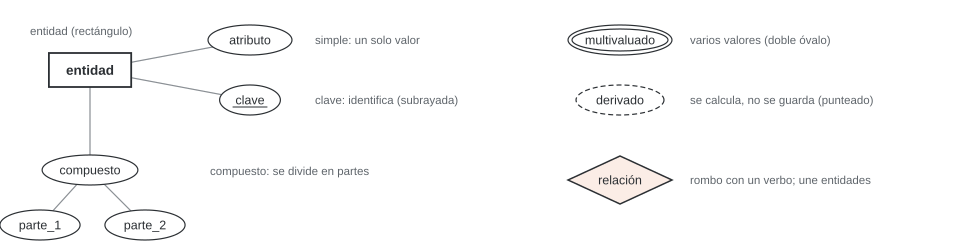
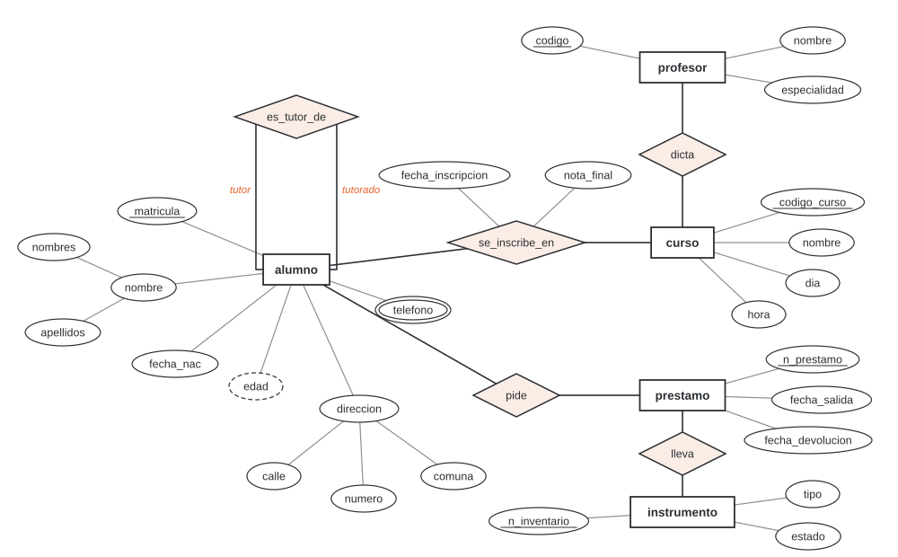
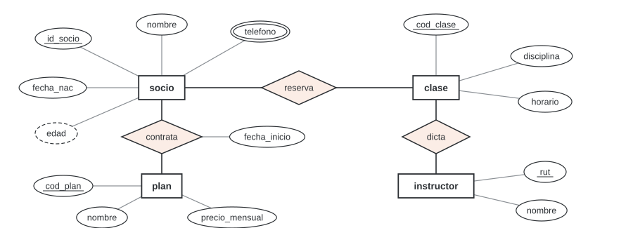
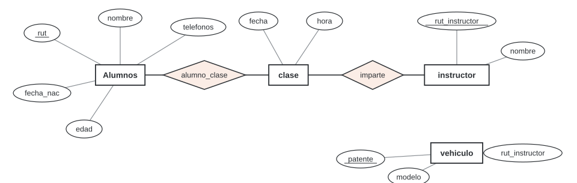
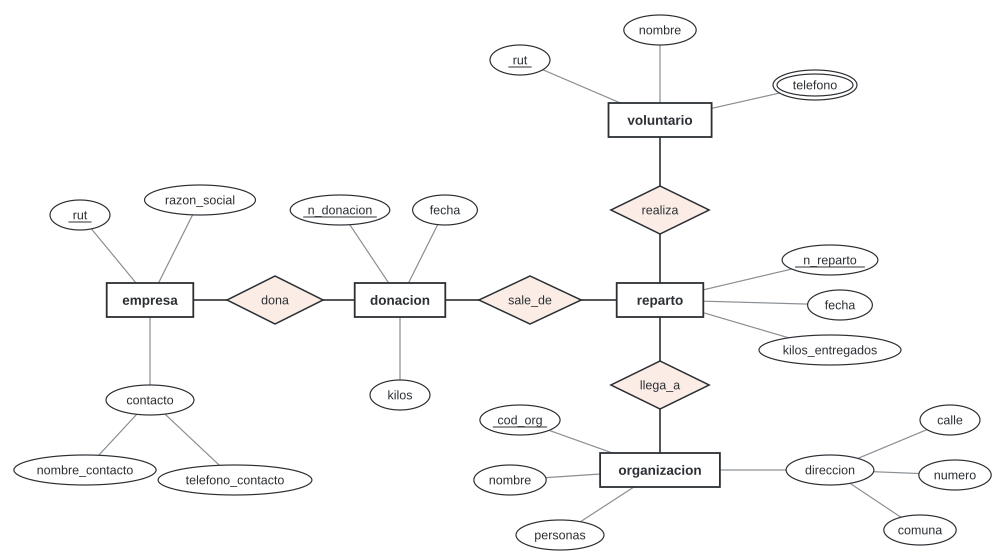
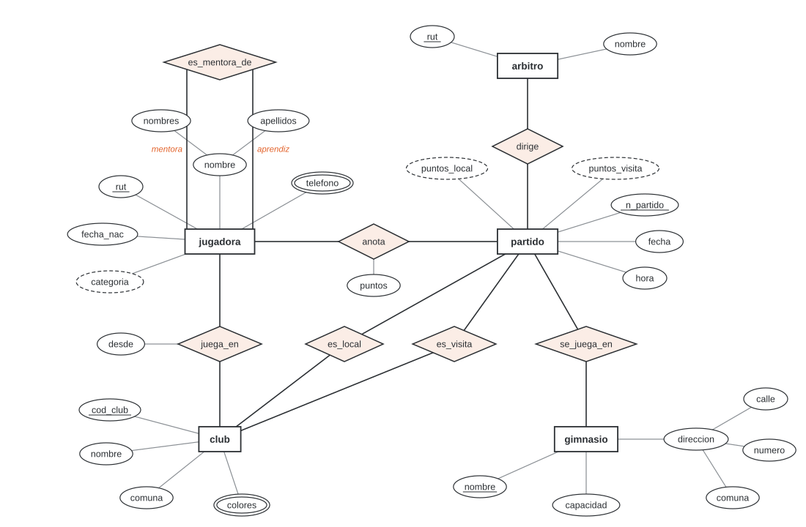
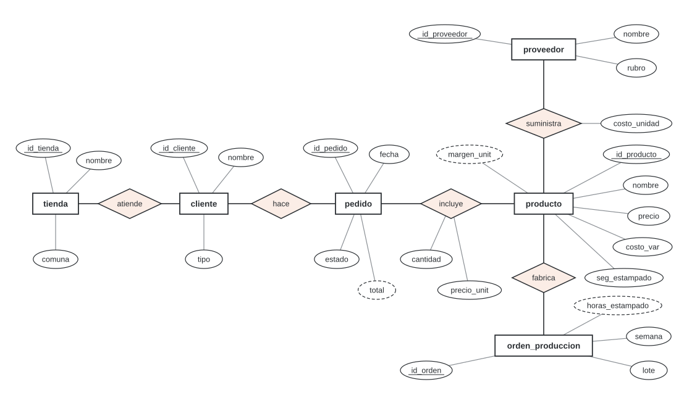

# Unidad 2 · Modelo entidad-relación

**Qué vas a poder hacer.** Leer un enunciado en palabras y sacar de él las entidades, sus atributos
(simples, compuestos, multivaluados, derivados y clave) y las relaciones con su grado; decidir cuándo un
hecho que se repite tiene que ser entidad y no relación; nombrar cada elemento para que pase limpio a
SQL; y dibujar el diagrama en notación de Chen.

**Lo que necesitas antes.** La unidad 1: qué es una base de datos, la idea de guardar cada dato una sola
vez y las cuatro etapas del diseño. Este es el diseño conceptual, la segunda.

**Tiempo.** Unas 5 horas: 2 de lectura y 3 de práctica, con papel y lápiz para dibujar.

---

## 1. Para qué sirve un modelo conceptual

Antes de crear tablas hay que ponerse de acuerdo en *qué cosas* existen en el negocio y *cómo se
conectan*. El **modelo entidad-relación** (MER, propuesto por Peter Chen en 1976) es ese acuerdo,
dibujado. Sirve para tres cosas:

- **Conversar con el cliente.** Un diagrama se discute con el dueño del negocio sin hablar de SQL: «¿un
  pedido puede tener varios productos?» se responde mirando un rombo.
- **Pensar sin ruido.** El modelo no dice nada de tipos de dato, archivos ni SGBD (independencia de la
  unidad 1). Solo qué hay que guardar.
- **Derivar las tablas.** La unidad 4 traduce cada pieza del diagrama a tablas con reglas fijas. Un
  buen diagrama da un buen esquema casi solo.

El ramo usa la **notación de Chen** en todo el diseño conceptual (unidades 2 y 3):



---

## 2. Entidades

Una **entidad** es una cosa del negocio que se distingue de las demás y de la que interesa guardar datos:
*la alumna Josefa Riquelme*, *el curso Guitarra inicial de los martes*. Todas las entidades del mismo tipo
forman un **tipo de entidad** (o conjunto de entidades): `alumno`, `curso`. En el diagrama se dibuja el
tipo, en un rectángulo, con un sustantivo en singular.

**¿Es entidad?** Tres preguntas:

1. ¿Tiene datos propios, además de su nombre?
2. ¿Hay varias, y el negocio necesita distinguirlas una de otra?
3. ¿El negocio pregunta por ella («¿qué cursos dicta este profesor?»)?

Si las tres son sí, es entidad. Si solo es un valor que describe a otra cosa, es atributo. El mismo
concepto puede caer en cualquiera de los dos lados según el negocio: para una escuela, la comuna del
alumno es un atributo (un texto); para una empresa de despachos que cobra según la comuna y le asigna un
camión, `comuna` es una entidad con su tarifa y su camión.

**Cuándo no aplica.** No son entidades el sistema, la base de datos, la planilla, el formulario ni el
usuario que la opera, salvo que el negocio guarde datos *de ellos*. El diagrama describe el negocio, no
el software.

---

## 3. Atributos

Un **atributo** es una característica de una entidad (o de una relación). Cada atributo toma valores de
un **dominio**: la nota final va de 1,0 a 7,0; el día de la semana es uno de siete. En el diagrama es un
óvalo unido a su dueño.

| Tipo | Qué es | Dibujo | Ejemplo (escuela de música, sección 8) |
|---|---|---|---|
| Simple | un valor que no se divide | óvalo | `fecha_nac` |
| Compuesto | se divide en partes con sentido propio | óvalo con óvalos colgando | `direccion` = `calle` + `numero` + `comuna` |
| Multivaluado | puede tener varios valores para la misma entidad | doble óvalo | `telefono`: un alumno deja dos o tres |
| Derivado | se calcula a partir de otros datos; no se guarda | óvalo punteado | `edad`, desde `fecha_nac` y la fecha de hoy |
| Clave | identifica a cada entidad: no hay dos con el mismo valor | nombre subrayado | `matricula` |

**Por qué distinguir los tipos.** Cada uno se guarda distinto (unidad 4): un compuesto se abre en
columnas, un multivaluado necesita su propia tabla y un derivado no se guarda. Si el diagrama no los
marca, el error aparece después, en una tabla con una columna `telefonos` que dice «9 7412 3380 / 9 2210
5547».

**Por qué el derivado no se guarda.** La edad cambia sola cada año; la fecha de nacimiento, nunca. Si se
guardan las dos, tarde o temprano se contradicen. Se guarda el dato estable y el otro se calcula cuando
se pide.

**La clave.** Una entidad puede tener varias **claves candidatas** (un paciente tiene RUT y número de
ficha); se elige una como **clave primaria**. Una buena clave es única, siempre está, no cambia y es
mínima (no le sobra nada). El nombre casi nunca sirve: se repite y se escribe de varias formas. Cuando no
hay una clave natural confiable, se inventa un código (`id_cliente`, `n_prestamo`): una **clave
artificial**. La unidad 5 formaliza las claves.

**Atributos opcionales.** Un atributo puede quedar sin valor (un alumno sin teléfono): en la base será
un `NULL`. El diagrama de Chen no lo marca; se anota como supuesto.

---

## 4. Relaciones

Una **relación** es una conexión entre entidades: *Josefa se inscribe en Guitarra inicial*. Todas las del
mismo tipo forman un **tipo de relación**, que se dibuja como un rombo con un verbo y se une con líneas a
las entidades que conecta. Se lee como una frase: `profesor` **dicta** `curso`.

**Grado.** Es el número de tipos de entidad distintos que participan:

| Grado | Qué es | Ejemplo |
|---|---|---|
| Unaria (o recursiva) | une una entidad consigo misma, con dos **roles** | `alumno` **es_tutor_de** `alumno` (roles tutor y tutorado) |
| Binaria | une dos entidades; es la gran mayoría | `alumno` **se_inscribe_en** `curso` |
| Ternaria | une tres entidades en un mismo hecho | `tutor` **imparte** `asignatura` a `estudiante` (ejercicio 2.9) |

En la unaria los roles son obligatorios: sin ellos no se sabe quién es tutor de quién. Algunos libros
cuentan los roles en vez de las entidades y llaman «binaria recursiva» a la unaria; aquí se cuentan
entidades distintas.

**Atributos de una relación.** Un dato que no es de ninguna de las dos entidades, sino del par, va en el
rombo. La nota final no es del alumno (tiene una por curso) ni del curso (tiene una por alumno): es de la
inscripción. Lo mismo la fecha de inscripción.

**La regla que más se olvida.** Una relación se identifica por las entidades que une: el par
(Josefa, Guitarra inicial) puede estar **una sola vez**. Si el mismo par se repite en el tiempo (Josefa
pide prestado el mismo violín en abril y en septiembre; un paciente vuelve a atenderse con la misma
doctora), la relación no puede guardar las dos veces. Ese hecho tiene que ser una **entidad** con su
propia clave: `prestamo`, `atencion`, `pedido`. Es la razón por la que en el caso integrador el pedido es
una entidad y no un rombo entre cliente y producto.

**Ternaria o binarias.** Una ternaria se justifica cuando un dato o un hecho depende de las tres
entidades a la vez (la tarifa que cobra un tutor por una asignatura a un estudiante). Partirla en tres
binarias pierde información: al volver a juntarlas aparecen combinaciones que nunca ocurrieron. El
ejercicio 2.9 lo cuenta.

**Cuándo no aplica.** Este diagrama todavía no dice *cuántos*: si un curso lo dicta un profesor o
varios, si todo alumno tiene que estar inscrito. Eso es la cardinalidad y la participación, en la
unidad 3. Mientras tanto, las frases de cantidad del enunciado se anotan aparte.

---

## 5. Del enunciado al diagrama

El enunciado en palabras es la fuente. Este método convierte frases en piezas:

| Paso | Pista en el texto | Lo que sale |
|---|---|---|
| 1 | sustantivos | candidatos a entidad o a atributo |
| 2 | «de cada X se guarda A, B y C» | X es entidad; A, B y C, sus atributos |
| 3 | «un número», «un código», «el RUT» | candidato a clave |
| 4 | «calle, número y comuna», «nombres y apellidos» | atributo compuesto |
| 5 | «uno o más», «sus teléfonos» | atributo multivaluado |
| 6 | «se calcula», «la edad», «el total» | atributo derivado |
| 7 | un verbo que une dos sustantivos | relación |
| 8 | un dato del encuentro entre dos cosas («la nota», «la fecha en que») | atributo de la relación |
| 9 | un hecho que se repite en el tiempo con fecha propia | entidad (evento), no relación |
| 10 | «uno», «varios», «solo uno», «todos» | se anota para la unidad 3 |

Después se revisa al revés: **cada pregunta** que la base tiene que responder debe poder contestarse
recorriendo el diagrama. Y **lo que el enunciado no dice se escribe como supuesto**, en vez de
adivinarlo en silencio.

---

## 6. Buenas prácticas de nombres

Los nombres del diagrama pasan tal cual a las tablas y columnas de SQL. Conviene que ya sirvan:

| Regla | Mal | Bien |
|---|---|---|
| Entidades en singular, sustantivo, minúscula | `Clientes`, `CLIENTE` | `cliente` |
| Relaciones con un verbo que se lea de izquierda a derecha | `cliente_pedido`, `relacion1` | `hace`, `se_inscribe_en` |
| Sin espacios, tildes ni eñes; palabras unidas con guion bajo | `Fecha de Nacimiento`, `año` | `fecha_nac`, `anio` |
| Sin palabras reservadas de SQL | `order`, `group`, `desc`, `key` | `pedido`, `grupo`, `descripcion`, `clave` |
| Sin números para repetir un atributo | `tel1`, `tel2`, `tel3` | `telefono` (multivaluado) |
| Un concepto, un nombre, en todo el diagrama | `fecha` aquí, `fec` allá, `date` acá | siempre `fecha` |
| Clave con el nombre de su entidad | `id` en todas | `id_cliente`, `id_pedido` |

La última regla tiene una razón práctica: en la unidad 4 la clave del cliente aparece dentro de la tabla
del pedido, y `id_cliente` dice de dónde viene; `id` no.

---

## 7. Lo que el modelo no dice todavía

El diagrama de esta unidad dice qué cosas hay, qué se sabe de cada una y cómo se conectan. No dice:

- **cuántas** entidades participan en cada relación ni si es obligatorio (unidad 3);
- si una entidad depende de otra para existir (entidades débiles, unidad 3);
- si hay tipos y subtipos (un cliente que es colegio o persona, jerarquías, unidad 3);
- en qué tablas se guarda (unidad 4).

---

## 8. Ejemplo resuelto · La escuela de música de Valdivia

> La Escuela de Música Calle-Calle, de Valdivia, quiere dejar sus planillas. De cada alumno guarda un
> número de matrícula, su nombre (nombres y apellidos por separado), su fecha de nacimiento, su
> dirección (calle, número y comuna) y uno o más teléfonos de contacto. Para las listas de curso necesita
> la edad de cada alumno. De cada profesor guarda un código, su nombre y su especialidad. La escuela
> ofrece cursos (por ejemplo, «Guitarra inicial, martes 18:00»), cada uno con un código, un nombre, un día
> y una hora. Los profesores dictan los cursos; los alumnos se inscriben en cursos y la escuela anota la
> fecha de inscripción y la nota final. La escuela presta instrumentos (número de inventario, tipo y
> estado) y registra cada préstamo con su fecha de salida y su fecha de devolución; un alumno puede pedir
> el mismo instrumento varias veces en el año. Los alumnos de último año pueden ser tutores de alumnos
> nuevos.

**Paso 1 · Sustantivos.** Se subrayan y se decide qué es cada uno:

| Sustantivo | Decisión | Por qué |
|---|---|---|
| alumno | entidad | tiene datos propios, hay muchos, se pregunta por ellos |
| profesor | entidad | ídem |
| curso | entidad | tiene código, día y hora; se pregunta qué alumnos tiene |
| instrumento | entidad | tiene número de inventario, tipo y estado |
| préstamo | entidad | se repite para el mismo alumno e instrumento (paso 4) |
| teléfono, dirección, edad, nota… | atributos | describen a otra cosa |
| especialidad | atributo de profesor | es un texto; nadie pregunta por sus datos |

**Paso 2 · Atributos y su tipo.**

| Entidad | Clave | Simples | Compuestos | Multivaluados | Derivados |
|---|---|---|---|---|---|
| `alumno` | `matricula` | `fecha_nac` | `nombre` (`nombres`, `apellidos`), `direccion` (`calle`, `numero`, `comuna`) | `telefono` | `edad` |
| `profesor` | `codigo` | `nombre`, `especialidad` | | | |
| `curso` | `codigo_curso` | `nombre`, `dia`, `hora` | | | |
| `instrumento` | `n_inventario` | `tipo`, `estado` | | | |
| `prestamo` | `n_prestamo` | `fecha_salida`, `fecha_devolucion` | | | |

El préstamo no traía clave en el enunciado: se le da una artificial (`n_prestamo`), y se anota como
supuesto.

**Paso 3 · Relaciones.**

| Relación | Une | Grado | Atributos |
|---|---|---|---|
| `dicta` | `profesor`, `curso` | binaria | |
| `se_inscribe_en` | `alumno`, `curso` | binaria | `fecha_inscripcion`, `nota_final` |
| `pide` | `alumno`, `prestamo` | binaria | |
| `lleva` | `prestamo`, `instrumento` | binaria | |
| `es_tutor_de` | `alumno`, `alumno` (roles tutor y tutorado) | unaria | |

**Paso 4 · ¿Préstamo como rombo o como rectángulo?** La primera idea es un rombo `presta` entre
`alumno` e `instrumento`, con las dos fechas. Pero el enunciado dice que un alumno puede pedir el mismo
instrumento varias veces: el par (alumno, instrumento) se repetiría, y una relación lo admite una sola
vez. Por eso el préstamo es una entidad, con su número, unida al alumno que lo pide y al instrumento que
lleva. La inscripción, en cambio, sí puede ser rombo: un alumno se inscribe una vez en cada curso (cada
curso es de un semestre).

**Paso 5 · El diagrama.** 5 entidades y 5 relaciones (4 binarias y 1 unaria):



**Paso 6 · Lo que queda anotado para la unidad 3.** «Un curso lo dicta un profesor», «un alumno puede
pedir varios préstamos», «cada préstamo es de un instrumento», «un tutor puede tener varios tutorados»: son
frases de cantidad; la unidad 3 las pone en el diagrama.

**Cómo se lee.** El diagrama responde, recorriéndolo, las preguntas de la escuela: ¿qué alumnos tiene
Guitarra inicial? (`curso` → `se_inscribe_en` → `alumno`); ¿quién tiene hoy el violín 12? (`instrumento` →
`lleva` → `prestamo` sin `fecha_devolucion` → `pide` → `alumno`); ¿qué nota sacó Josefa en Coro? (el
atributo `nota_final` del rombo). **Decisión:** el diseño pasa a la unidad 3 tal como está; si la escuela
quisiera registrar también las clases sueltas que un alumno recupera, cada clase sería un hecho que se
repite, es decir, otra entidad.

---

## 9. Errores típicos

| Error | Cómo evitarlo |
|---|---|
| Un atributo con varios valores dibujado como simple (`telefonos`, que luego será una columna con «9 7412 3380 / 9 2210 5547») | si puede tener varios valores, doble óvalo; la unidad 4 le da su tabla |
| Dibujar la clave de otra entidad como atributo (`id_cliente` dentro de `pedido`) | en el diagrama conceptual esa conexión es un rombo; la clave foránea aparece en la unidad 4 |
| Relación sin verbo (`cliente_pedido`, `relacion1`) | un verbo que se lea de izquierda a derecha: `cliente` **hace** `pedido` |
| Entidad sin clave | toda entidad necesita algo que la identifique; si no lo hay, una clave artificial (o es débil, unidad 3) |
| Guardar un derivado como simple (`edad` junto a `fecha_nac`, `total` junto al detalle) | óvalo punteado: se calcula, no se guarda |
| Un hecho que se repite modelado como rombo (`atiende` entre paciente y médico, con fecha) | si el mismo par puede ocurrir dos veces, es una entidad (`atencion`) |
| Hacer entidad lo que es un valor (`color` sin más datos) o atributo lo que tiene datos propios (`comuna` con tarifa) | aplica las tres preguntas de la sección 2 |
| Partir en tres binarias un hecho de tres (tutor, asignatura, estudiante) | si un dato depende de los tres, es ternaria (ejercicio 2.9) |
| Recursiva sin roles | escribe el rol en cada línea: `tutor`, `tutorado` |
| Dibujar el software (`sistema`, `formulario`, `usuario` que digita) | el diagrama describe el negocio |
| Nombres en plural, con mayúsculas, tildes, espacios o palabras reservadas | aplica la tabla de la sección 6 desde el primer borrador |

---

## 10. Práctica

Diez ejercicios: 2.1 a 2.4 básicos, 2.5 a 2.8 intermedios, 2.9 y 2.10 de desafío. Las pautas están en
la sección 11. Dibuja a mano antes de mirar.

**2.1 · Entidad, atributo o relación (básico).** «Una feria de emprendedores de Rancagua arrienda stands
por los tres días que dura. De cada emprendedor guarda su RUT, su nombre y su rubro; de cada stand, su
número, sus metros cuadrados y si tiene enchufe. Cada emprendedor arrienda un stand y la feria anota el
valor cobrado.» Clasifica: emprendedor, RUT, rubro, stand, número del stand, metros cuadrados, enchufe,
arrienda, valor cobrado.

**2.2 · El tipo de cada atributo (básico).** Un CESFAM de Lirquén guarda de cada paciente: `rut`,
`n_ficha`, `nombre` (nombres, apellido paterno y materno), `fecha_nac`, `edad`, `direccion` (calle, número
y comuna), `alergias`, `telefonos` y `sector`. Di el tipo de cada uno y cuáles podrían ser clave.

**2.3 · El grado (básico).** Di el grado de cada relación y, si hace falta, sus roles:

(a) Un jugador **juega en** un equipo.
(b) Un socio del club **recomienda a** otro socio para que entre.
(c) Un árbitro **dirige** un partido.
(d) Un entrenador **entrena** a un equipo en una temporada, con un sueldo que se pacta para esa
combinación.
(e) Un club es **filial de** otro club.
(f) Un jugador **se lesiona en** un partido.

**2.4 · Leer un diagrama (básico).** Este es el diagrama de un gimnasio de Curicó:



(a) ¿Cuántas entidades y cuántas relaciones tiene? (b) ¿Cuál es la clave de cada entidad? (c) ¿Qué
atributo no se guarda y cuál puede tener varios valores? (d) Escribe en una frase lo que dice el rombo
`contrata` con su atributo. (e) ¿Por qué `fecha_inicio` está en el rombo y no en `socio`? ¿Qué cambiaría si
un socio pudiera volver a contratar el mismo plan más adelante?

**2.5 · Del enunciado al diagrama (intermedio).** «El banco de alimentos de Temuco recibe donaciones de
empresas. De cada empresa guarda su RUT, su razón social y un contacto (nombre y teléfono). Cada
donación tiene un número, una fecha y los kilos donados. Lo donado se entrega a organizaciones (comedores
y ollas comunes), de las que se guarda un código, el nombre, la dirección (calle, número y comuna) y
cuántas personas atienden. Los repartos los hacen voluntarios, de los que se guarda el RUT, el nombre y
uno o más teléfonos. Cada reparto tiene un número, una fecha y los kilos entregados, sale de una donación
y llega a una organización.» Saca entidades, atributos con su tipo y relaciones, y dibuja el diagrama.

**2.6 · ¿Relación o entidad? (intermedio).** (a) Un consultorio de San Pedro de la Paz registra estas
atenciones del año. ¿Puede `atiende` ser un rombo entre `paciente` y `medico`, con la fecha como atributo?
Cuéntalo con los datos.

| paciente | médico | fecha |
|---|---|---|
| Rosa Venegas | Dra. Fuentealba | 2026-05-04 |
| Hugo Toro | Dr. Saavedra | 2026-05-04 |
| Rosa Venegas | Dra. Fuentealba | 2026-06-15 |
| Elena Lagos | Dra. Fuentealba | 2026-06-15 |
| Rosa Venegas | Dr. Saavedra | 2026-07-02 |
| Hugo Toro | Dr. Saavedra | 2026-08-20 |

(b) Un centro cultural inscribe alumnos en talleres por semestre: (Ana, guitarra), (Ana, coro), (Luis,
guitarra), (Marta, coro). ¿Puede `se_inscribe_en` ser un rombo? (c) Escribe la regla general.

**2.7 · Seis errores (intermedio).** Una escuela de conductores dibujó este diagrama. Encuentra los seis
errores y corrígelos.



**2.8 · Ponerle nombre (intermedio).** Una planilla vieja trae estos nombres. Propón el nombre correcto
para el diagrama y di qué regla rompe cada uno: `Clientes`, `Fecha de Nacimiento`, `order`,
`cliente_producto` (es la compra), `Tel1, Tel2, Tel3`, `NombreCompletoDelCliente`, `desc` (la
descripción del producto) y `cód_región`.

**2.9 · ¿Una ternaria o tres binarias? (desafío).** Un preuniversitario de Talca registra qué tutor
le hace qué asignatura a qué estudiante, con una tarifa por hora que se pacta para cada combinación:

| tutor | asignatura | estudiante | tarifa por hora |
|---|---|---|---|
| Rojas | matemática | Ana | $14.000 |
| Rojas | lenguaje | Bruno | $12.500 |
| Muñoz | matemática | Bruno | $15.500 |
| Muñoz | ciencias | Ana | $13.000 |
| Vera | lenguaje | Ana | $11.500 |

Alguien propone tres binarias: `tutor`–`asignatura` (qué asignaturas hace cada tutor),
`asignatura`–`estudiante` (qué asignaturas toma cada estudiante) y `tutor`–`estudiante` (qué tutores
tiene cada estudiante). (a) Escribe los pares de cada binaria. (b) Junta las tres: ¿cuántas
combinaciones (tutor, asignatura, estudiante) son compatibles con los tres pares, y cuáles no ocurrieron?
(c) ¿Dónde quedaría la tarifa en cada modelo? (d) Concluye.

**2.10 · El campeonato completo (desafío).** «La Asociación de Básquetbol Femenino de Los Ángeles quiere
ordenar su campeonato. De cada club guarda un código, su nombre, su comuna y sus colores (uno o más). De
cada jugadora, su RUT, su nombre (nombres y apellidos), su fecha de nacimiento, sus teléfonos y su
categoría, que se calcula por la edad. Una jugadora juega en un club desde una fecha. Cada partido tiene
un número, una fecha y una hora; lo juegan dos clubes, uno de local y otro de visita, y se juega en un
gimnasio, del que se guarda el nombre, la dirección (calle, número y comuna) y la capacidad. Cada partido
lo dirige un árbitro (RUT y nombre). La planilla de cada partido anota cuántos puntos hizo cada jugadora,
y el marcador sale de sumar esos puntos. Algunas jugadoras con experiencia son mentoras de jugadoras
nuevas.» Haz el diagrama completo, con una tabla que muestre de qué frase sale cada pieza.

---

## 11. Pautas

**2.1.**

| Palabra | Es | Por qué |
|---|---|---|
| emprendedor | entidad | tiene RUT, nombre y rubro; hay muchos |
| RUT | atributo clave de emprendedor | identifica al emprendedor |
| rubro | atributo de emprendedor | describe al emprendedor |
| stand | entidad | tiene número, metros y enchufe |
| número del stand | atributo clave de stand | identifica al stand |
| metros cuadrados | atributo de stand | |
| enchufe | atributo de stand | un sí o no |
| arrienda | relación entre emprendedor y stand | un verbo que los une |
| valor cobrado | atributo de la relación arrienda | no es del emprendedor ni del stand, sino del arriendo |

Si el emprendedor pudiera arrendar el mismo stand en varias ferias, el arriendo pasaría a ser entidad
(sección 4).

**2.2.**

| Atributo | Tipo |
|---|---|
| `rut` | simple; clave candidata |
| `n_ficha` | simple; clave candidata |
| `nombre` | compuesto (nombres, apellido paterno, apellido materno) |
| `fecha_nac` | simple |
| `edad` | derivado (de fecha_nac) |
| `direccion` | compuesto (calle, número, comuna) |
| `alergias` | multivaluado |
| `telefonos` | multivaluado |
| `sector` | simple |

Hay dos claves candidatas. El RUT es natural y ya existe; el número de ficha es propio del CESFAM y
sirve también para un paciente que todavía no tiene RUT (un recién nacido o un extranjero recién
llegado). Si eso ocurre en el CESFAM, conviene elegir `n_ficha` como clave primaria. En el diagrama,
`telefonos` y `alergias` se escriben en singular (`telefono`, `alergia`) y con doble óvalo.

**2.3.**

| Relación | Grado | Roles |
|---|---|---|
| (a) `juega_en` | 2 | |
| (b) `recomienda_a` | 1 | recomienda, recomendado |
| (c) `dirige` | 2 | |
| (d) `entrena` | 3 | |
| (e) `es_filial_de` | 1 | filial, matriz |
| (f) `se_lesiona_en` | 2 | |

La (d) es ternaria porque el sueldo depende de la combinación entrenador, equipo y temporada. Las unarias
necesitan roles: sin ellos, «A recomienda a B» y «B recomienda a A» son indistinguibles.

**2.4.** (a) 4 entidades y 3 relaciones, todas binarias. (b) `id_socio`, `cod_plan`, `cod_clase` y `rut`
(del instructor). (c) `edad` no se guarda (punteado); `telefono` puede tener varios (doble óvalo). (d) «Un
socio contrata un plan a partir de una fecha de inicio.» (e) La fecha no es del socio (si cambia de plan,
tiene otra fecha) ni del plan (lo contratan muchos): es del contrato entre los dos. Si un socio pudiera
volver a contratar el mismo plan, el par (socio, plan) se repetiría y `contrata` tendría que pasar a ser
una entidad `contrato`, con su número.

**2.5.** Hay 5 entidades y 4 relaciones, todas binarias:

| Entidad | Clave | Otros atributos |
|---|---|---|
| `empresa` | `rut` | `razon_social`; `contacto` compuesto (`nombre_contacto`, `telefono_contacto`) |
| `donacion` | `n_donacion` | `fecha`, `kilos` |
| `organizacion` | `cod_org` | `nombre`, `personas`; `direccion` compuesto (`calle`, `numero`, `comuna`) |
| `voluntario` | `rut` | `nombre`; `telefono` multivaluado |
| `reparto` | `n_reparto` | `fecha`, `kilos_entregados` |

Relaciones: `empresa` **dona** `donacion`; `reparto` **sale_de** `donacion`; `reparto` **llega_a**
`organizacion`; `voluntario` **realiza** `reparto`.



La decisión clave es que el reparto sea entidad: tiene número, fecha y kilos propios, y la misma
donación puede repartirse varias veces a la misma organización. El supuesto: el enunciado no dice que
un reparto lo hagan varios voluntarios; si fuera así, cambia la cardinalidad (unidad 3), no el dibujo.

**2.6.** (a) Hay 6 atenciones pero solo 4 pares distintos de paciente y médico: Rosa Venegas con la
Dra. Fuentealba y Hugo Toro con el Dr. Saavedra se repiten. Un rombo guarda cada par una vez, así que se
perderían 2 atenciones. `atencion` tiene que ser una entidad (con un número, la fecha y, por ejemplo, el
diagnóstico), unida a `paciente` y a `medico`. (b) Sí: los 4 pares son distintos y, por definición, un
alumno se inscribe una vez en cada taller del semestre; la nota o la fecha de inscripción van en el
rombo. (c) La regla: si el mismo par de entidades puede ocurrir más de una vez, el hecho es una entidad;
si ocurre una vez como máximo, puede ser relación.

**2.7.**

| Error | Corrección |
|---|---|
| `Alumnos`: entidad en plural y con mayúscula | `alumno` |
| `telefonos`: varios valores en un óvalo simple | `telefono`, multivaluado (doble óvalo) |
| `edad`: se guarda junto a `fecha_nac` | derivado (óvalo punteado) |
| `clase` no tiene clave | agregar `n_clase` (subrayado) |
| `alumno_clase`: el nombre de las dos entidades, no un verbo | `toma` |
| `rut_instructor` dibujado como atributo de `vehiculo` | es la clave de `instructor`: va como relación `tiene_asignado` entre `instructor` y `vehiculo` |

El verificador encuentra solo los errores de forma (el plural, la clave que falta, el nombre sin verbo
y la clave de otra entidad); que `telefonos` tenga varios valores y que `edad` se calcule lo sabe quien
lee el negocio.

**2.8.**

| Nombre viejo | Nombre nuevo | Regla que rompe |
|---|---|---|
| Clientes | `cliente` | plural y mayúscula |
| Fecha de Nacimiento | `fecha_nacimiento` | espacios y mayúsculas |
| order | `pedido` | palabra reservada de SQL (`ORDER BY`) |
| cliente_producto | `compra` | una relación se nombra con un verbo, no con sus entidades |
| Tel1, Tel2, Tel3 | `telefono` | números para repetir: es un multivaluado |
| NombreCompletoDelCliente | `nombre` | largo, mezcla mayúsculas y repite la entidad; si se necesitan partes, es compuesto |
| desc | `descripcion` | palabra reservada (`DESC` ordena de mayor a menor) |
| cód_región | `cod_region` | tildes |

**2.9.** (a) Cada binaria tiene 5 pares. Tutor–asignatura: (Rojas, matemática), (Rojas, lenguaje),
(Muñoz, matemática), (Muñoz, ciencias), (Vera, lenguaje). Asignatura–estudiante: (matemática, Ana),
(lenguaje, Bruno), (matemática, Bruno), (ciencias, Ana), (lenguaje, Ana). Tutor–estudiante: (Rojas, Ana),
(Rojas, Bruno), (Muñoz, Bruno), (Muñoz, Ana), (Vera, Ana). (b) Al juntarlas hay 8 combinaciones
compatibles con los tres pares; las 5 reales y 3 que nunca ocurrieron, así que 3 son falsas:
(Muñoz, matemática, Ana), (Rojas, lenguaje, Ana) y (Rojas, matemática, Bruno). Por ejemplo, las binarias
dicen que Rojas hace matemática, que Bruno toma matemática y que Rojas le hace clases a Bruno, pero Rojas
le hace lenguaje a Bruno, no matemática. (c) Con la ternaria, la tarifa es un atributo del rombo
`imparte` ($14.000 para Rojas, matemática y Ana). Con tres binarias no tiene dónde ir: no es de ningún
par. (d) Es una ternaria: el hecho y la tarifa dependen de las tres entidades a la vez.

**2.10.** 5 entidades y 7 relaciones: 6 binarias y 1 unaria.

| Frase del enunciado | Pieza |
|---|---|
| «de cada club guarda un código, su nombre, su comuna y sus colores (uno o más)» | `club`: `cod_club` clave, `nombre`, `comuna`, `colores` multivaluado |
| «de cada jugadora, su RUT, su nombre (nombres y apellidos), su fecha de nacimiento, sus teléfonos» | `jugadora`: `rut` clave, `nombre` compuesto, `fecha_nac`, `telefono` multivaluado |
| «su categoría, que se calcula por la edad» | `categoria` derivado |
| «juega en un club desde una fecha» | relación `juega_en` con atributo `desde` |
| «cada partido tiene un número, una fecha y una hora» | `partido`: `n_partido` clave, `fecha`, `hora` |
| «uno de local y otro de visita» | dos relaciones entre `club` y `partido`: `es_local` y `es_visita` |
| «se juega en un gimnasio… nombre, dirección, capacidad» | `gimnasio` (`nombre` clave, `direccion` compuesto, `capacidad`) y `se_juega_en` |
| «lo dirige un árbitro (RUT y nombre)» | `arbitro` y `dirige` |
| «cuántos puntos hizo cada jugadora» | relación `anota` entre `jugadora` y `partido`, con atributo `puntos` |
| «el marcador sale de sumar esos puntos» | `puntos_local` y `puntos_visita`, derivados |
| «son mentoras de jugadoras nuevas» | `es_mentora_de`, unaria, roles mentora y aprendiz |



Dos decisiones merecen explicación. Los clubes del partido son dos relaciones distintas, no una con
dos líneas, porque juegan papeles distintos (local y visita). Y el marcador es derivado: si se guardara
además de los puntos de cada jugadora, podría no cuadrar con su suma. `anota` puede ser rombo porque una
jugadora juega cada partido una sola vez. Un supuesto: el gimnasio se identifica por su nombre; si dos
comunas tuvieran un gimnasio con el mismo nombre, haría falta un código.

---

## 12. Caso integrador · El diagrama de Estampa Sur

> La unidad 1 levantó los datos del taller y la lista de cosas que necesita guardar. Aquí esa lista se
> vuelve un diagrama entidad-relación, que tiene que calzar con `datos/esquema.sql`: es el destino que
> construyen las unidades 3 a 8.

**El taller en palabras.** Estampa Sur tiene seis tiendas, cada una con su nombre y su comuna. Cada
cliente (colegio, club, empresa o persona) se atiende en una tienda. Los clientes hacen pedidos, con una
fecha y un estado (pendiente, en taller o entregado). Un pedido incluye uno o más de los cinco productos,
con la cantidad y el precio cobrado en ese pedido. De cada producto se guarda su nombre, su precio de
lista, su costo variable y los segundos de estampado por unidad. Los proveedores (nombre y rubro) le
venden al taller las prendas lisas, cada uno a su costo por unidad. Cada semana el taller programa órdenes
de producción de un producto, con un lote. Al taller le interesan además el margen por unidad de cada
producto, el total de cada pedido y las horas de estampado de cada orden.

**Las piezas.**

| Entidad | Clave | Atributos guardados | Derivados |
|---|---|---|---|
| `tienda` | `id_tienda` | `nombre`, `comuna` | |
| `cliente` | `id_cliente` | `nombre`, `tipo` | |
| `pedido` | `id_pedido` | `fecha`, `estado` | `total` |
| `producto` | `id_producto` | `nombre`, `precio`, `costo_var`, `seg_estampado` | `margen_unit` |
| `proveedor` | `id_proveedor` | `nombre`, `rubro` | |
| `orden_produccion` | `id_orden` | `semana`, `lote` | `horas_estampado` |

| Relación | Une | Atributos |
|---|---|---|
| `atiende` | `tienda`, `cliente` | |
| `hace` | `cliente`, `pedido` | |
| `incluye` | `pedido`, `producto` | `cantidad`, `precio_unit` |
| `suministra` | `proveedor`, `producto` | `costo_unidad` |
| `fabrica` | `orden_produccion`, `producto` | |

Son 6 entidades y 5 relaciones binarias, con 23 atributos guardados y 3 derivados.



**Tres decisiones del diseño.**

- **El pedido es entidad.** Un cliente compra el mismo producto muchas veces; un rombo entre `cliente` y
  `producto` guardaría el par una sola vez. El pedido, con su número, fecha y estado, es el hecho que se
  repite, y `incluye` dice qué productos lleva cada uno.
- **`precio_unit` no es derivado.** Parece una copia de `producto.precio`, pero es el precio cobrado en
  ese pedido: si mañana sube el precio de lista, los pedidos de marzo tienen que seguir diciendo lo que se
  cobró. Por eso es atributo de `incluye`.
- **Los tres derivados no se guardan.** `margen_unit` es `precio - costo_var` (en los polerones,
  $9.890 − $5.950 = $3.940); `total` es la suma de cantidad por precio de las líneas del pedido (el pedido
  1 suma $557.590); `horas_estampado` es `lote * seg_estampado / 3600` (la semana 6 suma 33 horas, las
  mismas de la unidad 1).

**Comprobación contra la base** (`sql/u02_mer.sql`, sobre una copia de la base del caso). Primero, que
los atributos de una entidad sean las columnas de su tabla:

```sql
SELECT name, type, pk FROM pragma_table_info('producto');
```

| name | type | pk |
|---|---|---|
| id_producto | INTEGER | 1 |
| nombre | VARCHAR(40) | 0 |
| precio | INTEGER | 0 |
| costo_var | INTEGER | 0 |
| seg_estampado | INTEGER | 0 |

Están los cinco atributos guardados de `producto`, la clave es la clave primaria (`pk` = 1) y no está
`margen_unit`: es derivado. Después, las claves foráneas de toda la base:

```sql
SELECT m.name AS tabla, f."from" AS columna, f."table" AS apunta_a
FROM sqlite_master m
JOIN pragma_foreign_key_list(m.name) f
WHERE m.type = 'table'
ORDER BY m.name, f."from";
```

| tabla | columna | apunta_a |
|---|---|---|
| cliente | id_tienda | tienda |
| detalle_pedido | id_pedido | pedido |
| detalle_pedido | id_producto | producto |
| orden_produccion | id_producto | producto |
| pedido | id_cliente | cliente |
| suministra | id_producto | producto |
| suministra | id_proveedor | proveedor |

Son 7 claves foráneas y cada una sale de un rombo:

| Rombo | Cómo quedó en la base |
|---|---|
| `atiende` | la columna `cliente.id_tienda` |
| `hace` | la columna `pedido.id_cliente` |
| `fabrica` | la columna `orden_produccion.id_producto` |
| `incluye` | una tabla propia, `detalle_pedido`, con dos claves foráneas y los atributos del rombo |
| `suministra` | una tabla propia, `suministra`, con dos claves foráneas y `costo_unidad` |

Las columnas `id_tienda` en `cliente` o `id_cliente` en `pedido` no están en el diagrama, y está bien:
en el modelo conceptual esas conexiones son rombos. Por qué unos rombos se vuelven una columna y otros
una tabla depende de la cardinalidad (unidad 3) y es la regla central de la unidad 4.

> **En MySQL.** Las funciones `pragma_*` son de SQLite. En MySQL, las columnas se consultan con
> `SELECT column_name, data_type, column_key FROM information_schema.columns WHERE table_name =
> 'producto';` y las claves foráneas en `information_schema.key_column_usage`, donde
> `referenced_table_name` no es nulo.

**La cadena.** El verificador arma la base del caso en memoria y exige que el diagrama calce con
`datos/esquema.sql` (`CADENA: OK`): las 6 entidades son tablas, cada atributo guardado es una columna,
ningún derivado lo es, cada clave es la clave primaria, cada rombo es una clave foránea o una tabla con
dos, y ninguna columna de la base queda sin su lugar en el diagrama. Las 6 entidades y las 2 relaciones
con tabla propia dan las 8 tablas.

**Lo que pasa a la unidad siguiente.** El diagrama todavía no dice cuántos: que cada cliente se atiende
en una sola tienda, que un pedido es de un solo cliente, que un producto puede tener varios proveedores.
La unidad 3 agrega la cardinalidad y la participación a estos mismos rombos, y con eso la unidad 4 puede
justificar cada clave foránea de la tabla de arriba.

---

## 13. Para seguir

**En los libros del área** (el programa del ramo no fija bibliografía).

- Elmasri y Navathe, *Fundamentos de sistemas de bases de datos*: el capítulo del modelo entidad-relación
  trae la notación, los tipos de atributo, el grado y una guía de nombres muy parecida a la de la
  sección 6.
- Silberschatz, Korth y Sudarshan, *Fundamentos de bases de datos*: su capítulo de diseño con el modelo
  entidad-relación discute entidad contra atributo y entidad contra relación.

**Abierto y gratis.**

- Adrienne Watt, *Database Design* (2.ª ed., BCcampus, licencia CC BY 4.0), en inglés: el capítulo 8
  (modelo entidad-relación: entidades, atributos, claves y relaciones) y el 10 (modelado ER), con
  ejercicios de diagramas en el apéndice B. https://opentextbc.ca/dbdesign01/

**Con el tutor.** La carpeta `tutor/` trae el contexto de este ramo. Pégalo al inicio de la conversación
con cualquier IA y pídele, por ejemplo: «Dame un enunciado de un negocio chileno con un hecho que se
repite y un atributo multivaluado escondidos, y revisa mi lista de entidades, atributos y relaciones».
