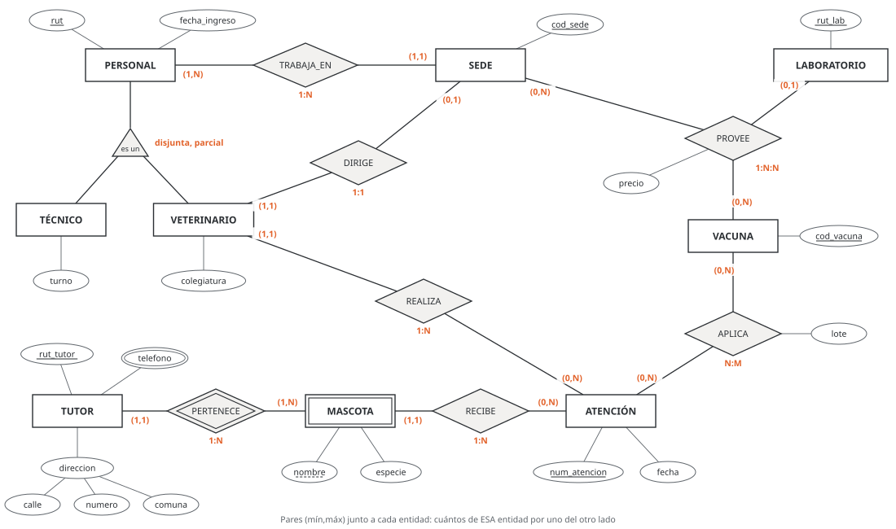
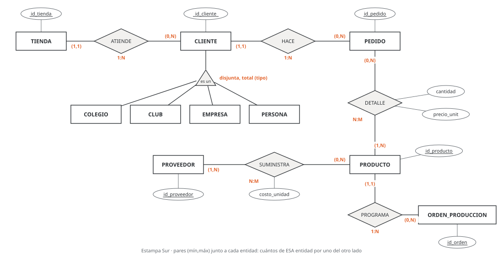

# Unidad 3 · Cardinalidad, participación, entidades débiles y jerarquías

**Qué vas a poder hacer.** Escribir en un diagrama entidad-relación cuántos ejemplares de una entidad
se relacionan con uno de la otra, leerlo en los dos sentidos, decidir si participar es obligatorio,
reconocer una entidad que se identifica a través de otra, poner cada atributo donde corresponde, decidir
si un hecho necesita una relación de tres entidades y ordenar entidades parecidas en una jerarquía; y
comprobar con una consulta que los datos no desmienten lo que dibujaste.

**Lo que necesitas antes.** La unidad 2: entidad, atributo, clave, relación y los símbolos de Chen
(rectángulo, rombo, óvalo). No necesitas SQL: las consultas de esta unidad se leen como receta; la
unidad 9 explica `SELECT` y la unidad 10 explica `JOIN` y `GROUP BY`.

**Tiempo.** Unas 5 horas: 2 de lectura y 3 de práctica.

---

## 1. La idea: sin números, el diagrama no dice nada

Dos diagramas con los mismos rectángulos (CLIENTE y PEDIDO) y el mismo rombo (HACE) pueden describir
dos negocios distintos. Si un pedido es de un solo cliente, la base guarda el cliente dentro del pedido.
Si un pedido puede ser de varios clientes (una compra en grupo), hace falta una tabla aparte para las
parejas cliente-pedido. Lo que separa un caso del otro son dos números escritos junto a las entidades.

Esos números son **reglas del negocio**, no propiedades de los datos. Salen del enunciado o de
preguntarle al dueño: «¿un pedido puede ser de dos clientes?», «¿puede existir un cliente que nunca
compró?». Los datos de hoy pueden desmentir una regla (si aparece un pedido con dos clientes, la regla
«uno» es falsa), pero no la prueban: que hoy todos los productos tengan proveedor no dice que mañana no
pueda entrar uno sin proveedor.

---

## 2. Cardinalidad máxima: 1:1, 1:N y N:M

Una relación $R$ entre las entidades $A$ y $B$ es un conjunto de pares $(a, b)$. Para un ejemplar $a$,
sus compañeros son $R(a) = \{b \in B : (a,b) \in R\}$. La **cardinalidad máxima** responde dos preguntas,
una en cada sentido:

- un $A$, ¿con cuántos $B$ como máximo?
- un $B$, ¿con cuántos $A$ como máximo?

| Un A tiene como máximo… | Un B tiene como máximo… | Tipo | Ejemplo |
|---|---|---|---|
| 1 B | 1 A | 1:1 | sede y su director |
| muchos B | 1 A | 1:N | cliente y sus pedidos |
| muchos B | muchos A | N:M | pedido y productos |

**La notación de esta base.** Junto a cada entidad se escribe un par (mín, máx). El par escrito **junto a
una entidad cuenta ejemplares de esa entidad** por cada ejemplar de la otra:

$$\text{par junto a } B = \Big(\min_{a \in A} |R(a)|,\ \max_{a \in A} |R(a)|\Big)$$

Así, `CLIENTE (1,1) — HACE — (0,N) PEDIDO` se lee en los dos sentidos:

- junto a PEDIDO dice (0,N): un cliente hace entre 0 y muchos pedidos;
- junto a CLIENTE dice (1,1): un pedido es de exactamente un cliente.

La regla para no perderse: **para saber cuántos B tiene un A, mira el par que está junto a B.** El tipo
(1:N) se escribe bajo el rombo y sale de los dos máximos.

**Por qué funciona.** El mínimo y el máximo se toman sobre todos los estados permitidos de la base, no
sobre los datos de hoy. Un máximo «N» significa «más de uno, sin tope fijo». Si el negocio fija un tope
(un puesto de feria por persona, como máximo dos), se escribe el número: (1,2).

**Cuándo no basta.** Un máximo distinto de 1 y de N (el «2» de arriba) se puede dibujar, pero ninguna
clave de una tabla lo hace cumplir: en la unidad 4 queda como una regla que vigila la aplicación o un
disparador. Y hay reglas que ningún par expresa: «el jefe de un sector trabaja en ese mismo sector» une
dos relaciones y se escribe aparte, como restricción en palabras.

**Otras notaciones.** Vas a ver diagramas que escriben lo mismo de otra forma. La que más confunde es la
de Elmasri y Navathe: también escribe pares (mín, máx), pero el par junto a una entidad cuenta **en
cuántas relaciones participa esa entidad**, o sea, lo que esta base escribe al otro lado.

| Notación | Dónde se escribe «un cliente hace muchos pedidos» |
|---|---|
| Esta base (Chen con pares, la de los textos en español) | (0,N) junto a PEDIDO |
| Chen con 1 y N (sin mínimos) | N junto a PEDIDO |
| Pata de gallo y UML | la pata o el `0..*` junto a PEDIDO |
| Elmasri y Navathe (mín, máx) | (0,N) junto a CLIENTE (al revés) |

Antes de leer un diagrama ajeno, pregunta cuál usa.

---

## 3. Participación: total o parcial

La **cardinalidad mínima** dice si participar es obligatorio:

- **total** (mínimo 1): todo ejemplar de la entidad está en al menos una relación. Todo pedido es de un
  cliente.
- **parcial** (mínimo 0): puede haber ejemplares sueltos. Un cliente recién inscrito puede no tener
  pedidos.

En esta notación, la participación de A se lee en el mínimo escrito **junto a B**: en
`CLIENTE (1,1) — HACE — (0,N) PEDIDO`, el 1 junto a CLIENTE dice que todo pedido participa (participación
total de PEDIDO), y el 0 junto a PEDIDO dice que un cliente puede no participar (participación parcial de
CLIENTE). Otros libros marcan la participación total con una línea doble entre la entidad y el rombo;
esta base no la usa, porque el mínimo ya lo dice.

**Por qué importa.** En la unidad 4, la participación total de un lado «muchos» se convierte en
`NOT NULL` sobre la clave foránea, y la base la hace cumplir sola. La participación total en una relación
N:M (todo pedido tiene al menos un producto) no la hace cumplir ninguna clave: queda para la aplicación
(unidad 12).

---

## 4. Entidades débiles

Una **entidad débil** no tiene clave propia: sus ejemplares se distinguen solo **dentro** de su dueño.
Los departamentos de un edificio se llaman 101, 102, 304; el 304 existe en cada edificio. La clave del
departamento es la del edificio más su número, que se llama **clave parcial**.

En Chen se dibuja con rectángulo doble; la relación que la une a su dueño (la **identificadora**) con
rombo doble, y la clave parcial subrayada con línea cortada. La débil siempre tiene participación total
y un solo dueño: junto al dueño va (1,1).

Tres preguntas para decidir:

1. ¿Sus ejemplares repiten identificador entre dueños? (el departamento 304, la cuota 3, la Luna).
2. ¿Deja de tener sentido si se borra el dueño?
3. ¿Nunca cambia de dueño?

Si las tres son sí, es débil. Si cambia de dueño (una mascota adoptada por otra familia), su clave
cambiaría con él, y conviene darle clave propia.

**Cuándo NO es débil.** Depender del dueño para existir no basta. Un pedido no existe sin su cliente
(participación total), pero tiene número propio: es una entidad fuerte con participación total. La
debilidad es de **identificación**, no de existencia.

---

## 5. Relaciones con atributos

Un atributo es de la relación cuando describe **al par** y no a uno de los dos. La cantidad de un
producto en un pedido no es del pedido (el pedido tiene varios productos) ni del producto (el producto
está en muchos pedidos): es de la pareja. La prueba: si el valor cambia al cambiar cualquiera de los dos
ejemplares, es de la relación.

- En una relación **N:M**, el atributo se queda en la relación (en la unidad 4, en la tabla intermedia).
- En una **1:N**, el atributo se puede pasar a la entidad del lado N, porque cada ejemplar de ese lado
  tiene una sola pareja (la unidad 4 lo hace así).

**Un par, una vez.** Un ejemplar de una relación queda identificado por los ejemplares que une: el par
(pedido 17, gorros) aparece una sola vez. Si el mismo par se repite con datos distintos (la misma
mascota atendida por el mismo veterinario en marzo y en mayo), la relación no alcanza: el hecho
repetido es una **entidad** (ATENCIÓN), con clave propia, relacionada con las dos.

---

## 6. Relaciones ternarias

Una relación **ternaria** une tres entidades en un solo hecho: «el laboratorio L le vende la vacuna V a la
sede S a tal precio». El par junto a cada entidad cuenta ejemplares de esa entidad **por cada par de
ejemplares de las otras dos**: (0,1) junto a LABORATORIO dice que una sede le compra cada vacuna a lo
más a un laboratorio.

**Por qué no se parte en tres binarias.** Partir la ternaria en «laboratorio vende vacuna», «sede compra
vacuna» y «laboratorio le vende a sede» parece equivalente y no lo es. Con tres hechos

| Laboratorio | Vacuna | Sede |
|---|---|---|
| L1 | V1 | S1 |
| L1 | V2 | S2 |
| L2 | V1 | S2 |

las tres binarias son verdaderas también para (L1, V1, S2): L1 vende V1, S2 compra V1 y L1 le vende a S2.
Al juntarlas de nuevo salen 4 tríos y uno es falso: (L1, V1, S2). Esto se llama **trampa de conexión**,
y el precio, que es de los tres, no tiene dónde ir.

**Cuándo sí conviene descomponerla.**

- Cuando el hecho no es de los tres: si el precio de la vacuna lo fija el laboratorio igual para todas
  las sedes, son dos hechos («L vende V a tal precio» y «S compra a L») y dos binarias bastan.
- Cuando la ternaria tiene atributos, reglas propias o se relaciona con otras cosas: se convierte en
  **entidad** (OFERTA, con clave propia) unida a las tres por relaciones 1:N. No se pierde nada: cada
  oferta guarda su trío.

---

## 7. Generalización y especialización (jerarquías)

Cuando varias entidades comparten atributos y relaciones pero cada una tiene algo propio, se ordenan en
una **jerarquía**: un supertipo con lo común (PERSONAL: rut, nombre, fecha de ingreso) y subtipos con lo
propio (VETERINARIO: colegiatura; TÉCNICO: turno). Cada subtipo **hereda** los atributos y relaciones del
supertipo. Se llega por dos caminos: **especializar** (partir una entidad en subtipos) o **generalizar**
(juntar entidades parecidas bajo un supertipo).

En Chen se dibuja con un triángulo «es un» bajo el supertipo y dos restricciones escritas al lado:

| | Disjunta (un ejemplar en a lo más un subtipo) | Solapada (puede estar en varios) |
|---|---|---|
| **Total** (todo ejemplar está en algún subtipo) | cliente: colegio, club, empresa o persona | persona del club: socio, monitor o ambos, y nadie más |
| **Parcial** (puede no estar en ninguno) | personal: veterinario, técnico o ninguno (recepción) | persona del centro deportivo: socio, monitor, ambos o ninguno |

**Cuándo NO hace falta.** Si los subtipos no tienen atributos ni relaciones propias, basta un atributo
que diga el tipo (el **discriminador**). La jerarquía se puede dibujar igual para dejar escrita la
regla (disjunta y total), pero en la unidad 4 se guarda como una sola tabla con ese atributo. Y si un
subtipo tiene una relación propia (solo un veterinario puede dirigir una sede), la jerarquía sí paga:
la relación se dibuja contra el subtipo, no contra el supertipo.

---

## 8. Medir en los datos

Una consulta cuenta, para cada ejemplar de A, con cuántos B se relaciona, y se queda con el mínimo y el
máximo. La receta (se explica cláusula por cláusula en la unidad 10):

1. parte de **todos** los ejemplares de A, con `LEFT JOIN` para no perder a los que no tienen ningún B;
2. cuenta los B de cada A con `COUNT(columna de B)`, que cuenta 0 cuando no hay;
3. de esos conteos, toma `MIN` y `MAX`.

El resultado es el par **medido**. Se compara con el **declarado**: si el medido se sale del declarado,
la regla o los datos están mal; si cae dentro, no prueba nada, solo no lo desmiente. El caso de la
sección 13 lo hace con las relaciones de Estampa Sur.

---

## 9. Ejemplo resuelto · Clínica veterinaria Patitas del Sur

Una clínica veterinaria de Puerto Montt quiere su base de datos. El dueño lo cuenta así:

1. La clínica tiene dos sedes (código, nombre, dirección).
2. Del personal se guarda rut, nombre y fecha de ingreso. Cada persona trabaja en una sola sede y cada
   sede tiene al menos una persona.
3. Algunos son veterinarios (con su número de colegiatura) y otros técnicos (con su turno). Hay también
   personal de recepción, que no es ninguna de las dos cosas. Nadie es veterinario y técnico a la vez.
4. Cada sede la dirige un veterinario; un veterinario dirige como máximo una sede.
5. De cada tutor (el dueño de la mascota) se guarda rut, nombre, dirección (calle, número y comuna) y uno
   o más teléfonos.
6. Cada mascota es de un tutor y se reconoce por su nombre **dentro** de ese tutor: dos tutores pueden
   tener una «Luna»; un tutor no tiene dos. Se guarda especie y fecha de nacimiento. Un tutor se
   registra cuando trae su primera mascota.
7. Cada atención tiene número correlativo, fecha y motivo; es de una mascota y la hace un veterinario.
   Una mascota puede tener muchas atenciones, varias con el mismo veterinario.
8. En una atención se pueden aplicar vacunas; por cada vacuna aplicada se anota el lote.
9. Cada sede le compra cada vacuna a un solo laboratorio, a un precio que negocia esa sede.

**Paso 1 · Entidades.** SEDE, PERSONAL (con los subtipos VETERINARIO y TÉCNICO), TUTOR, MASCOTA,
ATENCIÓN, VACUNA y LABORATORIO.

| Entidad | Clave | Otros atributos | Lo especial |
|---|---|---|---|
| SEDE | cod_sede | nombre, dirección | |
| PERSONAL | rut | nombre, fecha_ingreso | supertipo |
| VETERINARIO | (hereda rut) | colegiatura | subtipo |
| TÉCNICO | (hereda rut) | turno | subtipo |
| TUTOR | rut_tutor | nombre, dirección (calle, número, comuna), teléfono | dirección compuesta, teléfono multivaluado |
| MASCOTA | rut del tutor + nombre | especie, fecha_nac | débil: nombre es clave parcial |
| ATENCIÓN | num_atencion | fecha, motivo | entidad, no relación (paso 4) |
| VACUNA | cod_vacuna | nombre | |
| LABORATORIO | rut_lab | nombre | |

**Paso 2 · Pares, sentido por sentido.** Por cada relación se hacen las dos preguntas y se escribe cada
respuesta junto a la entidad que cuenta.

| Relación | Entidades | Par | Par | Tipo |
|---|---|---|---|---|
| PERTENECE (identificadora) | TUTOR — MASCOTA | (1,1) junto a TUTOR | (1,N) junto a MASCOTA | 1:N |
| TRABAJA_EN | SEDE — PERSONAL | (1,1) junto a SEDE | (1,N) junto a PERSONAL | 1:N |
| DIRIGE | VETERINARIO — SEDE | (1,1) junto a VETERINARIO | (0,1) junto a SEDE | 1:1 |
| RECIBE | MASCOTA — ATENCIÓN | (1,1) junto a MASCOTA | (0,N) junto a ATENCIÓN | 1:N |
| REALIZA | VETERINARIO — ATENCIÓN | (1,1) junto a VETERINARIO | (0,N) junto a ATENCIÓN | 1:N |
| APLICA | ATENCIÓN — VACUNA | (0,N) junto a ATENCIÓN | (0,N) junto a VACUNA | N:M |
| PROVEE (ternaria) | LABORATORIO — VACUNA — SEDE | (0,1) junto a LABORATORIO | (0,N) junto a VACUNA; (0,N) junto a SEDE | 1:N:N |

Algunas lecturas, en los dos sentidos:

- DIRIGE: «una sede, ¿cuántos directores?» exactamente uno, (1,1) junto a VETERINARIO; «un
  veterinario, ¿cuántas sedes dirige?» entre cero y una, (0,1) junto a SEDE. Participación total de
  SEDE, parcial de VETERINARIO.
- PERTENECE: un tutor tiene entre una y muchas mascotas (1,N), porque se registra con la primera; una
  mascota es de exactamente un tutor (1,1).
- PROVEE: para una vacuna y una sede, a lo más un laboratorio (0,1); para un laboratorio y una sede,
  muchas vacunas; para un laboratorio y una vacuna, muchas sedes.

**Paso 3 · MASCOTA es débil.** Su nombre se repite entre tutores (pregunta 1), no tiene sentido sin su
tutor (pregunta 2) y la clínica no la cambia de tutor (pregunta 3). Su clave es rut_tutor + nombre.

**Paso 4 · ATENCIÓN es entidad, no relación.** Si se dibujara ATIENDE como relación N:M entre MASCOTA y
VETERINARIO con fecha y motivo, el par (Toby, su veterinaria) solo podría estar una vez, y Toby vuelve al
control con la misma veterinaria. El hecho repetido tiene número propio: es entidad.

**Paso 5 · El lote es de APLICA.** No es de la atención (una atención puede aplicar dos vacunas con lotes
distintos) ni de la vacuna (cada frasco tiene su lote). Es del par atención-vacuna. El precio, igual, es
del trío de PROVEE.

**Paso 6 · Jerarquía disjunta y parcial.** Disjunta porque nadie es veterinario y técnico; parcial
porque recepción no es ninguno. Vale la pena dibujarla: VETERINARIO tiene atributo propio y dos
relaciones propias (DIRIGE y REALIZA), y así el diagrama dice que solo un veterinario puede dirigir una
sede o atender.



**Cómo se lee.**

- **Lo que la base va a impedir.** Una sede sin director (el 1 junto a VETERINARIO), un técnico
  dirigiendo (DIRIGE sale del subtipo), una mascota sin tutor y dos «Luna» del mismo tutor.
- **Lo que la base va a permitir.** Una atención sin vacunas (el 0 junto a VACUNA) y un veterinario que
  no dirige nada (el 0 junto a SEDE). Un tutor sin teléfono no debería existir, pero eso no lo cuida
  ningún par: lo vigila la aplicación al registrarlo.
- **La decisión con el dueño.** La clave de MASCOTA depende de que no cambie de tutor. Si la clínica
  empieza a exigir el microchip (la Ley 21.020 de tenencia responsable obliga a registrar perros y gatos
  con chip), la mascota pasa a ser fuerte con clave chip. Mientras atienda conejos y mascotas sin chip,
  se queda débil.

---

## 10. Errores típicos

| Error | Cómo evitarlo |
|---|---|
| Escribir el par al lado equivocado: «Cliente N — 1 Reserva» para decir que un cliente hace muchas reservas (pasó en un trabajo del curso) | el par junto a una entidad cuenta ejemplares de esa entidad: el N va junto a RESERVA |
| Mezclar la notación de Elmasri y Navathe con la de esta base | pregunta qué notación usa el diagrama; en esta base, «cuántos B tiene un A» está junto a B |
| Declarar el par mirando los datos de hoy («todos tienen proveedor, entonces mínimo 1») | el par es una regla: pregúntale al negocio si puede existir uno sin |
| Dar por débil a toda entidad que depende de otra (el pedido del cliente) | débil es la que no se puede identificar sola; si tiene número propio, es fuerte con participación total |
| Poner un atributo del par en una de las entidades (la fecha de una donación guardada en el donante) | pregunta de quién depende el valor; si cambia con cualquiera de los dos, es de la relación |
| Relación con atributos cuando el mismo par se repite (atenciones, préstamos, viajes) | si el par puede ocurrir dos veces, el hecho es una entidad con clave propia |
| Partir una ternaria en tres binarias | junta de nuevo las binarias con datos de ejemplo y busca tríos falsos |
| Un rol de una persona como entidad suelta (GUÍA aparte de EMPLEADO, repitiendo nombre y contacto) | si es la misma persona con algo propio, es un subtipo |
| Una jerarquía cuyos subtipos no tienen nada propio | un atributo discriminador basta |
| Juntar dos relaciones distintas entre las mismas entidades (trabaja en y dirige) | cada hecho con su rombo y sus pares |

---

## 11. Práctica

Diez ejercicios: 3.1 a 3.4 básicos, 3.5 a 3.8 intermedios, 3.9 y 3.10 de desafío. Las pautas están en la
sección 12. La unidad 4 pasa a tablas los diagramas de 3.1, 3.2 y 3.9.

**3.1 · Feria libre de Chillán (básico, leer).** El municipio describe su feria con estas tres relaciones:

- `FERIANTE (0,1) — ARRIENDA — (1,2) PUESTO`
- `FERIANTE (1,1) — TIENE — (0,1) PATENTE`
- `PUESTO (1,N) — VENDE — (0,N) PRODUCTO`

(a) Lee cada una en los dos sentidos, en palabras. (b) Di su tipo. (c) Di la participación de cada
entidad. (d) ¿Qué cambia si el municipio permite que dos feriantes compartan un puesto?

**3.2 · Cesfam de Los Ángeles (básico, escribir).** Un centro de salud familiar se organiza por sectores.
Cada paciente está inscrito en un solo sector; un sector nuevo puede no tener pacientes todavía. Cada
médico trabaja en un sector y cada sector tiene al menos un médico. Cada sector tiene un médico jefe, y
un médico es jefe de a lo más un sector. Escribe las tres relaciones con sus pares y su tipo. ¿Qué regla
del enunciado no cabe en ningún par?

**3.3 · ¿Débil o no? (básico).** Decide si cada una es entidad débil y, si lo es, di su dueño y su
clave parcial: (a) la cuota de un crédito de consumo, numerada del 1 al 24 dentro del crédito; (b) el
pedido de un cliente, con número correlativo de la empresa; (c) la carga familiar de un trabajador; (d)
el departamento de un edificio; (e) una mascota registrada con su microchip.

**3.4 · Liga de futbolito de Valparaíso (básico, ubicar atributos).** Hay JUGADOR, EQUIPO y PARTIDO.
Cada jugador juega en un solo equipo durante la temporada y en muchos partidos. ¿Dónde va cada atributo?
(a) fecha de nacimiento; (b) goles de un jugador en un partido; (c) minutos jugados; (d) número de
camiseta; (e) cancha del partido.

**3.5 · Talleres del centro cultural de Valdivia (intermedio, medir).** El diagrama declara
`ALUMNO (2,15) — INSCRIBE — (1,2) TALLER`. Las inscripciones de este semestre son:

| Alumno | Talleres |
|---|---|
| A1 | T1, T2 |
| A2 | T1 |
| A3 | T2, T3, T4 |
| A4 | T3 |
| A5 | T1 |
| A6 | T2 |
| A7 | (ninguno) |

(a) Di en palabras lo que declara el diagrama. (b) Mide los dos pares en estos datos. (c) ¿Qué reglas
desmienten los datos y con qué ejemplar? (d) El máximo de 15 alumnos por taller, ¿queda probado?

**3.6 · Centro deportivo de Rancagua (intermedio, jerarquía).** Del centro interesa toda PERSONA (rut,
nombre, teléfono). Algunas son SOCIOS (fecha de alta, plan) y se inscriben en clases; otras son
MONITORES (certificación, valor hora) y dictan clases. Un monitor puede ser socio también, y hay personas
registradas que no son ni socio ni monitor (apoderados que solo retiran a sus hijos). (a) Dibuja la
jerarquía y di si es disjunta o solapada, total o parcial. (b) ¿Qué va en el supertipo y qué en cada
subtipo? (c) ¿Contra qué entidad se dibujan INSCRIBE y DICTA? (d) ¿Por qué aquí no basta un atributo
`tipo`?

**3.7 · Agricultores en ferias de Ñuble (intermedio, ternaria).** Una cooperativa registra qué producto
lleva cada agricultor a cada feria y a qué precio por kilo:

| Agricultor | Feria | Producto | Precio por kilo |
|---|---|---|---|
| Rosa | Chillán | papas | \$700 |
| Rosa | San Carlos | frutillas | $2.800 |
| Luis | Chillán | frutillas | $2.600 |
| Luis | San Carlos | papas | \$750 |
| Rosa | Chillán | porotos verdes | $1.900 |

(a) ¿Es una relación ternaria? ¿De quién es el precio? (b) Parte el hecho en las tres binarias
(agricultor-feria, feria-producto, agricultor-producto), júntalas de nuevo y cuenta los tríos falsos.
(c) Propón un modelo que no pierda información.

**3.8 · Medir dos pares del caso (intermedio, SQL).** Sobre `datos/estampa_sur.db`, con la receta de la
sección 8, mide (a) cuántos clientes tiene cada tienda y (b) cuántas órdenes de producción tiene cada
producto. Compara con los pares declarados en la sección 13. ¿Declararías (5,5) junto a CLIENTE porque
hoy cada tienda tiene cinco?

**3.9 · Liga de básquetbol juvenil de Temuco (desafío, diseñar).** La liga cuenta:

- Cada club (código, nombre, comuna) inscribe equipos por categoría (sub-13, sub-15, sub-17); un equipo
  se reconoce por su club y su categoría. Un club entra a la liga con al menos un equipo.
- Cada jugador (rut, nombre, fecha de nacimiento) está inscrito en un solo equipo, con su número de
  camiseta. Un equipo se inscribe con al menos cinco jugadores.
- Cada equipo tiene un entrenador (rut, nombre); un entrenador dirige uno o dos equipos.
- Cada partido (número, fecha, cancha) enfrenta a un equipo local y a uno visitante.
- Cada partido lo dirigen dos o tres árbitros (rut, nombre), cada uno con un rol (principal o
  auxiliar); un árbitro puede no tener partidos asignados.

Haz la tabla de entidades (marca la débil) y la de relaciones con sus pares y tipo. ¿Qué regla razonable
no cabe en ningún par?

**3.10 · Cabañas en Pucón (desafío, corregir).** Un compañero modeló la reserva de cabañas de un
complejo así:

1. `CLIENTE (0,N) — HACE — (1,1) RESERVA`, «porque un cliente hace muchas reservas».
2. RESERVA es entidad débil de CLIENTE, «porque no existe sin cliente», aunque tiene número de reserva.
3. `fecha_llegada` y `noches` son atributos de CLIENTE.
4. Además dibujó `CABAÑA (0,N) — ALOJA — (0,N) CLIENTE` con atributos `fecha_llegada` y `noches`.
5. CABAÑA tiene dos subtipos, CABAÑA_GRANDE y CABAÑA_CHICA, que no tienen atributos ni relaciones
   propias.

Encuentra el problema de cada punto y escribe el modelo corregido (entidades y relaciones con sus pares).

---

## 12. Pautas

**3.1.**

| Relación | Entidades | Par | Par | Tipo |
|---|---|---|---|---|
| ARRIENDA | FERIANTE — PUESTO | (0,1) junto a FERIANTE | (1,2) junto a PUESTO | 1:N |
| TIENE | FERIANTE — PATENTE | (1,1) junto a FERIANTE | (0,1) junto a PATENTE | 1:1 |
| VENDE | PUESTO — PRODUCTO | (1,N) junto a PUESTO | (0,N) junto a PRODUCTO | N:M |

(a) ARRIENDA: un feriante arrienda uno o dos puestos; un puesto lo arrienda a lo más un feriante (puede
estar libre). TIENE: un feriante tiene cero o una patente (puede estar tramitándola); una patente es de
exactamente un feriante. VENDE: un puesto vende cero o muchos productos (el libre no vende nada); un
producto se vende en uno o muchos puestos (solo se registran productos que alguien vende). (b) Los tipos
de la tabla: el «2» de ARRIENDA sigue siendo «muchos». (c) FERIANTE: total en ARRIENDA, parcial en TIENE.
PUESTO: parcial en ARRIENDA (el 0 junto a FERIANTE) y parcial en VENDE. PATENTE: total. PRODUCTO: total
en VENDE. (d) Junto a FERIANTE pasaría a (0,2) o (0,N): ARRIENDA se vuelve N:M y en la unidad 4 necesita
tabla propia.

**3.2.**

| Relación | Entidades | Par | Par | Tipo |
|---|---|---|---|---|
| INSCRITO | SECTOR — PACIENTE | (1,1) junto a SECTOR | (0,N) junto a PACIENTE | 1:N |
| TRABAJA | SECTOR — MÉDICO | (1,1) junto a SECTOR | (1,N) junto a MÉDICO | 1:N |
| JEFE | MÉDICO — SECTOR | (1,1) junto a MÉDICO | (0,1) junto a SECTOR | 1:1 |

TRABAJA y JEFE son dos relaciones distintas entre las mismas entidades: no se juntan. Lo que no cabe en
un par es que el jefe trabaje en el sector que dirige: une dos relaciones y se escribe como restricción
aparte.

**3.3.** (a) Débil: dueño CRÉDITO, clave parcial número de cuota (la cuota 3 existe en todos los
créditos). (b) Fuerte: tiene número propio; su participación en HACE es total, pero eso no la vuelve
débil. (c) Fuerte en Chile: la carga familiar tiene RUT propio, aunque solo exista en la base por el
trabajador. En un país sin identificador nacional sería débil, con clave parcial nombre. (d) Débil:
dueño EDIFICIO, clave parcial número (el 304 se repite). (e) Fuerte: el microchip la identifica sola y
no cambia si la mascota cambia de familia.

**3.4.** (a) De JUGADOR. (b) De la relación N:M jugador-partido: cambia si cambias el jugador o el
partido. (c) Igual que (b). (d) De la relación jugador-equipo; como es 1:N (un equipo por temporada), en
la unidad 4 queda en la tabla del jugador. (e) De PARTIDO.

**3.5.** (a) Un alumno se inscribe en uno o dos talleres (el par junto a TALLER); un taller tiene entre
2 y 15 alumnos (el par junto a ALUMNO). (b) Los conteos:

| Alumno | Talleres |
|---|---|
| A1 | 2 |
| A2 | 1 |
| A3 | 3 |
| A4 | 1 |
| A5 | 1 |
| A6 | 1 |
| A7 | 0 |

| Taller | Alumnos |
|---|---|
| T1 | 3 |
| T2 | 3 |
| T3 | 2 |
| T4 | 1 |

Pares medidos: talleres por alumno medido: (0,3), contra (1,2) declarado; alumnos por taller medido:
(1,3), contra (2,15) declarado. (c) Tres incumplimientos: A3 en 3 talleres (pasa el máximo 2), A7 en 0
talleres (no llega al mínimo 1) y T4 con 1 alumno (no llega al mínimo 2). O se corrigen los datos o se
corrige la regla con el centro. (d) No: que ningún taller pase de 3 no dice nada del tope de 15. Los
datos solo desmienten.

**3.6.** (a) PERSONA con subtipos SOCIO y MONITOR: **solapada** (un monitor puede ser socio) y
**parcial** (los apoderados no son ninguno). (b) Supertipo: rut, nombre, teléfono. SOCIO: fecha de alta
y plan. MONITOR: certificación y valor hora. (c) INSCRIBE contra SOCIO y DICTA contra MONITOR: así el
diagrama impide que un apoderado se inscriba o que un socio sin certificación dicte. (d) Porque los
subtipos tienen atributos y relaciones propias, y porque es solapada: un solo atributo `tipo` no puede
decir «socio y monitor a la vez».

**3.7.** (a) Sí: el precio depende de los tres (Rosa cobra distinto por las frutillas en San Carlos que
Luis en Chillán; Rosa lleva papas a Chillán y no a San Carlos). (b) Las binarias tienen 4, 5 y 5 pares.
Al juntarlas salen 9 tríos: los 5 verdaderos y 4 falsos: (Luis, Chillán, papas), (Luis, San Carlos,
frutillas), (Rosa, Chillán, frutillas) y (Rosa, San Carlos, papas). Además los precios quedan sin dueño.
(c) La ternaria LLEVA (agricultor, feria, producto) con el atributo precio, o una entidad OFERTA con
clave propia unida a las tres por relaciones 1:N: cinco ofertas, cada una con su precio.

**3.8.** Las dos consultas y sus resultados:

```sql
SELECT MIN(n) AS minimo, MAX(n) AS maximo
FROM (SELECT t.id_tienda, COUNT(c.id_cliente) AS n
      FROM tienda t
      LEFT JOIN cliente c ON c.id_tienda = t.id_tienda
      GROUP BY t.id_tienda) AS x;
```

| minimo | maximo |
|---|---|
| 5 | 5 |

```sql
SELECT MIN(n) AS minimo, MAX(n) AS maximo
FROM (SELECT pr.id_producto, COUNT(o.id_orden) AS n
      FROM producto pr
      LEFT JOIN orden_produccion o ON o.id_producto = pr.id_producto
      GROUP BY pr.id_producto) AS x;
```

| minimo | maximo |
|---|---|
| 2 | 6 |

Los dos caben en lo declarado: (0,N) junto a CLIENTE en ATIENDE y (0,N) junto a ORDEN_PRODUCCIÓN en
PROGRAMA. No se declara (5,5): que hoy cada tienda tenga cinco clientes es un hecho de los datos
simulados, no una regla; una tienda nueva abre sin clientes y la sexta inscripción no puede quedar
prohibida.

**3.9.** Entidades: CLUB (cod_club), EQUIPO **débil** de CLUB con clave parcial categoría, JUGADOR
(rut_jugador), ENTRENADOR (rut_entrenador), PARTIDO (num_partido) y ÁRBITRO (rut_arbitro). Relaciones:

| Relación | Entidades | Par | Par | Tipo |
|---|---|---|---|---|
| INSCRIBE (identificadora) | CLUB — EQUIPO | (1,1) junto a CLUB | (1,N) junto a EQUIPO | 1:N |
| JUEGA_EN | EQUIPO — JUGADOR | (1,1) junto a EQUIPO | (5,N) junto a JUGADOR | 1:N |
| ENTRENA | ENTRENADOR — EQUIPO | (1,1) junto a ENTRENADOR | (1,2) junto a EQUIPO | 1:N |
| LOCAL | EQUIPO — PARTIDO | (1,1) junto a EQUIPO | (0,N) junto a PARTIDO | 1:N |
| VISITA | EQUIPO — PARTIDO | (1,1) junto a EQUIPO | (0,N) junto a PARTIDO | 1:N |
| ARBITRA | ÁRBITRO — PARTIDO | (2,3) junto a ÁRBITRO | (0,N) junto a PARTIDO | N:M |

El número de camiseta va en JUEGA_EN (es del jugador en su equipo) y el rol en ARBITRA (es del árbitro
en ese partido). LOCAL y VISITA son dos relaciones: un partido tiene uno de cada uno. No caben en un par:
que local y visita sean equipos distintos y de la misma categoría, y que un partido tenga un solo
árbitro principal.

**3.10.** (1) Al revés: así escrito dice que una reserva tiene muchos clientes y un cliente una sola
reserva. Lo correcto es `CLIENTE (1,1) — HACE — (0,N) RESERVA`. (2) RESERVA tiene número propio: es
fuerte con participación total en HACE. (3) Llegada y noches cambian con cada reserva: son de RESERVA.
(4) Un cliente puede volver a la misma cabaña en otra fecha y el par se repetiría: ese hecho ya es
RESERVA, y ALOJA sobra; se cambia por `CABAÑA (1,1) — ASIGNADA — (0,N) RESERVA`. (5) Subtipos sin nada
propio: basta un atributo `capacidad` (o `tamaño`) en CABAÑA. Modelo corregido: CLIENTE, RESERVA
(número, fecha_llegada, noches) y CABAÑA (número, capacidad), con HACE y ASIGNADA, las dos 1:N; si el
complejo tiene varios recintos, CABAÑA puede ser débil de COMPLEJO (la cabaña 4 existe en cada uno).

---

## 13. Caso integrador · Las cardinalidades de Estampa Sur

> Este caso sigue al taller Estampa Sur por todo el ramo. La unidad 2 identificó sus entidades
> (TIENDA, CLIENTE, PEDIDO, PRODUCTO, PROVEEDOR y ORDEN_PRODUCCIÓN) y sus relaciones; acá cada relación
> recibe sus pares y se miden contra los 120 pedidos simulados de `datos/estampa_sur.db`.

**Los pares declarados.**

| Relación | Entidades | Par | Par | Tipo |
|---|---|---|---|---|
| ATIENDE | TIENDA — CLIENTE | (1,1) junto a TIENDA | (0,N) junto a CLIENTE | 1:N |
| HACE | CLIENTE — PEDIDO | (1,1) junto a CLIENTE | (0,N) junto a PEDIDO | 1:N |
| DETALLE | PEDIDO — PRODUCTO | (0,N) junto a PEDIDO | (1,N) junto a PRODUCTO | N:M |
| SUMINISTRA | PROVEEDOR — PRODUCTO | (1,N) junto a PROVEEDOR | (0,N) junto a PRODUCTO | N:M |
| PROGRAMA | PRODUCTO — ORDEN_PRODUCCIÓN | (1,1) junto a PRODUCTO | (0,N) junto a ORDEN_PRODUCCIÓN | 1:N |



En palabras: un pedido tiene uno o más productos y un producto puede estar en ninguno o muchos pedidos;
un producto viene de uno o más proveedores y un proveedor puede no surtir ningún producto (el de tintas
surte insumos, no prendas); cada cliente es de una tienda, cada pedido de un cliente y cada orden de
producción de un producto.

**Medidos en los datos.** Las consultas están en `sql/u03_cardinalidad.sql`.

Productos por pedido (el par junto a PRODUCTO en DETALLE):

```sql
SELECT MIN(n) AS minimo, MAX(n) AS maximo
FROM (SELECT p.id_pedido, COUNT(d.id_producto) AS n
      FROM pedido p
      LEFT JOIN detalle_pedido d ON d.id_pedido = p.id_pedido
      GROUP BY p.id_pedido) AS x;
```

| minimo | maximo |
|---|---|
| 1 | 3 |

Pedidos por producto (el par junto a PEDIDO en DETALLE):

```sql
SELECT MIN(n) AS minimo, MAX(n) AS maximo
FROM (SELECT pr.id_producto, COUNT(d.id_pedido) AS n
      FROM producto pr
      LEFT JOIN detalle_pedido d ON d.id_producto = pr.id_producto
      GROUP BY pr.id_producto) AS x;
```

| minimo | maximo |
|---|---|
| 35 | 52 |

Proveedores por producto (el par junto a PROVEEDOR en SUMINISTRA):

```sql
SELECT MIN(n) AS minimo, MAX(n) AS maximo
FROM (SELECT pr.id_producto, COUNT(s.id_proveedor) AS n
      FROM producto pr
      LEFT JOIN suministra s ON s.id_producto = pr.id_producto
      GROUP BY pr.id_producto) AS x;
```

| minimo | maximo |
|---|---|
| 1 | 2 |

Productos por proveedor (el par junto a PRODUCTO en SUMINISTRA):

```sql
SELECT MIN(n) AS minimo, MAX(n) AS maximo
FROM (SELECT pv.id_proveedor, COUNT(s.id_producto) AS n
      FROM proveedor pv
      LEFT JOIN suministra s ON s.id_proveedor = pv.id_proveedor
      GROUP BY pv.id_proveedor) AS x;
```

| minimo | maximo |
|---|---|
| 0 | 3 |

Pedidos por cliente (el par junto a PEDIDO en HACE):

```sql
SELECT MIN(n) AS minimo, MAX(n) AS maximo
FROM (SELECT c.id_cliente, COUNT(p.id_pedido) AS n
      FROM cliente c
      LEFT JOIN pedido p ON p.id_cliente = c.id_cliente
      GROUP BY c.id_cliente) AS x;
```

| minimo | maximo |
|---|---|
| 0 | 9 |

| Lado | Declarado | Medido | Lectura |
|---|---|---|---|
| productos por pedido | (1,N) | (1,3) | ningún pedido vacío; el N no tiene tope |
| pedidos por producto | (0,N) | (35,52) | hoy todos se venden; un producto nuevo empieza en 0 |
| proveedores por producto | (1,N) | (1,2) | poleras básicas y gorros tienen dos proveedores |
| productos por proveedor | (0,N) | (0,3) | Tintas del Bío no surte prendas: el 0 es real |
| pedidos por cliente | (0,N) | (0,9) | hay clientes que todavía no compran |

Ningún medido se sale del declarado. Los dos mínimos 1 de las relaciones N:M (todo pedido tiene un
producto, todo producto un proveedor) se cumplen en los datos, pero en la unidad 4 se verá que ninguna
clave los hace cumplir.

**Cuántas líneas tiene un pedido.**

```sql
SELECT n AS productos, COUNT(*) AS pedidos
FROM (SELECT d.id_pedido, COUNT(*) AS n
      FROM detalle_pedido d
      GROUP BY d.id_pedido) AS x
GROUP BY n
ORDER BY n;
```

| productos | pedidos |
|---|---|
| 1 | 51 |
| 2 | 46 |
| 3 | 23 |

Más de la mitad de los pedidos trae dos o tres productos: un pedido con «una columna por producto» no
sirve, y por eso DETALLE es una relación N:M y no un atributo del pedido.

**El precio es de la relación.** El detalle guarda `precio_unit` aunque el producto ya tiene `precio`.
Hoy coinciden en todas las líneas:

```sql
SELECT COUNT(*) AS lineas_con_otro_precio
FROM detalle_pedido d
JOIN producto pr ON pr.id_producto = d.id_producto
WHERE d.precio_unit <> pr.precio;
```

| lineas_con_otro_precio |
|---|
| 0 |

Pero son dos hechos distintos: `precio` es el de lista de hoy; `precio_unit` es el que se cobró en ese
pedido. Cuando el taller suba los precios, los pedidos de marzo tienen que seguir valiendo lo que
valieron. Es un atributo del par pedido-producto, igual que `costo_unidad` es del par
proveedor-producto.

**¿ORDEN_PRODUCCIÓN es débil?** Podría serlo: «la orden de polerones de la semana 6» se identifica por
producto y semana, y en los datos ese par nunca se repite:

```sql
SELECT COUNT(*) AS pares_repetidos
FROM (SELECT id_producto, semana
      FROM orden_produccion
      GROUP BY id_producto, semana
      HAVING COUNT(*) > 1) AS x;
```

| pares_repetidos |
|---|
| 0 |

El script le dio número propio (`id_orden`) y la dejó fuerte. Es una decisión, no un error: si mañana se
lanzan dos órdenes del mismo producto en la misma semana (una urgente), la clave producto + semana ya no
sirve y el número sí.

**La jerarquía de CLIENTE.** Los clientes son colegios, clubes, empresas o personas: disjunta (cada uno
es de un tipo) y total (no hay otro tipo).

```sql
SELECT tipo, COUNT(*) AS clientes
FROM cliente
GROUP BY tipo
ORDER BY tipo;
```

| tipo | clientes |
|---|---|
| club | 5 |
| colegio | 6 |
| empresa | 7 |
| persona | 12 |

Los subtipos no tienen atributos ni relaciones propias, así que basta el discriminador `tipo`. La
jerarquía queda dibujada para que la regla «disjunta y total» quede escrita.

**La cadena.** El verificador comprueba que `datos/estampa_sur.db` es exactamente la base que genera el
script del caso (las 8 tablas y sus 405 filas, reconstruidas en memoria) y que ninguno de los siete
pares medidos (los cinco de arriba y los dos del ejercicio 3.8) se sale del declarado.

**Lo que pasa a la unidad 4.** Este diagrama, con sus pares, se convierte en las 8 tablas del script: cada
1:N en una clave foránea, cada N:M (DETALLE y SUMINISTRA) en una tabla intermedia y la jerarquía en la
columna `tipo`.

---

## 14. Para seguir

**En los libros del área.**

- Elmasri y Navathe, *Fundamentos de sistemas de bases de datos*: el capítulo del modelo
  entidad-relación trata cardinalidad, participación y entidades débiles, y el del modelo
  entidad-relación extendido trata las jerarquías. Ojo con su notación (mín, máx), que es la inversa de
  la de esta base (sección 2).
- Silberschatz, Korth y Sudarshan, *Fundamentos de bases de datos*: el capítulo de diseño con el modelo
  entidad-relación discute las relaciones ternarias y cuándo convertirlas en entidad.

**Abierto y gratis.**

- Adrienne Watt, *Database Design*, 2.ª ed. (BCcampus, licencia CC BY 4.0), en inglés: el capítulo 8
  («The Entity Relationship Data Model») cubre cardinalidad, entidades débiles y relaciones ternarias, y
  el apéndice B trae ejercicios de diagramas. https://opentextbc.ca/dbdesign01/

**Con el tutor.** La carpeta `tutor/` trae el contexto de este ramo. Pégalo al inicio de la conversación
con cualquier IA y pídele, por ejemplo: «Dame un enunciado de un negocio chileno con seis relaciones y
corrígeme los pares (mín, máx) que yo escriba, en la notación de la base».
