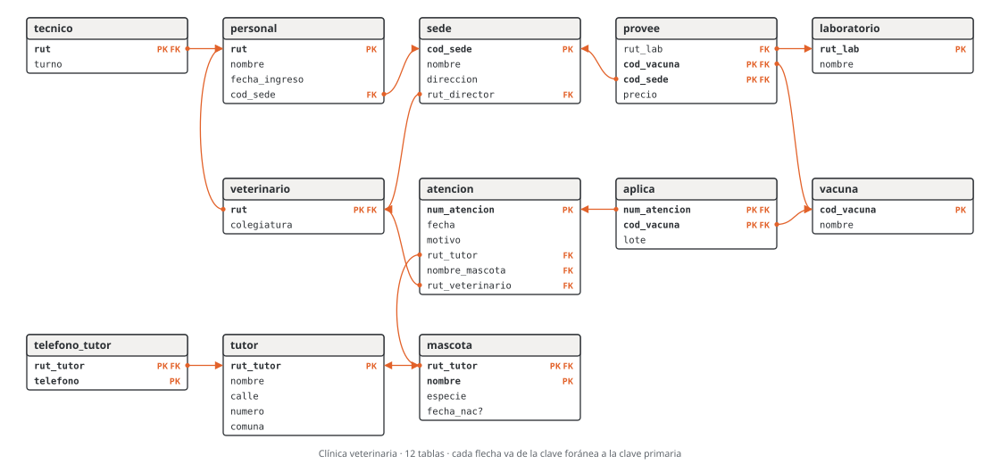
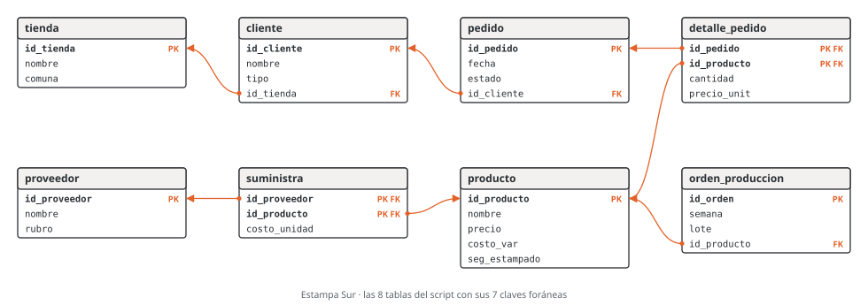

# Unidad 4 · Del modelo entidad-relación al modelo relacional

**Qué vas a poder hacer.** Pasar un diagrama entidad-relación a tablas aplicando ocho reglas, decidir en
qué tabla va cada clave foránea y si admite nulo, elegir cómo guardar una jerarquía sabiendo lo que
cuesta cada opción, dibujar el esquema relacional resultante y escribirlo como `CREATE TABLE`; y hacer
el camino de vuelta: leer un esquema ajeno y reconstruir el diagrama.

**Lo que necesitas antes.** La unidad 3: leer y escribir pares (mín, máx), participación total y
parcial, entidades débiles, relaciones con atributos, ternarias y jerarquías. Del SQL basta reconocer un
`CREATE TABLE`; las consultas del ejemplo se leen como receta (la unidad 10 explica `JOIN`).

**Tiempo.** Unas 6 horas: 2 de lectura con el script abierto y 4 de práctica.

---

## 1. La idea: dónde vive cada hecho

El diagrama sirve para conversar con el dueño del negocio; las tablas, para guardar. El **modelo
relacional** guarda todo en **relaciones** (tablas): cada fila es un hecho (una **tupla**), cada columna
un **atributo** con su **dominio** (el tipo de dato), y la **clave primaria** distingue una fila de
otra. Las tablas se conectan por **claves foráneas**: una columna que guarda el valor de la clave primaria
de otra tabla.

Pasar del diagrama a tablas es decidir, para cada hecho del diagrama, en qué tabla y en qué columnas vive.
Las reglas de esta unidad hacen esa decisión de forma mecánica, con dos metas: **no perder nada** de lo
que el diagrama dice y **no guardar dos veces** lo mismo. Si una regla te obliga a repetir un dato o a
dejar una celda con varios valores, la aplicaste mal.

---

## 2. Cómo se escribe y se dibuja el esquema

**En texto.** Una línea por tabla:

`mascota(rut_tutor PK FK→tutor, nombre PK, especie, fecha_nac?)`

- `PK` marca las columnas de la clave primaria; si son varias, la clave es el conjunto.
- `FK→t` marca una clave foránea hacia la tabla `t`. Si dos columnas apuntan juntas a la misma tabla
  (una clave primaria de dos columnas), las dos llevan `FK→t` y son una sola clave foránea.
- `?` marca una columna que admite nulo. Sin `?`, la columna es `NOT NULL`.
- `UNIQUE` marca una columna que no se repite sin ser la clave primaria.

**En dibujo.** Una caja por tabla con sus columnas; `PK` y `FK` a la derecha; una flecha desde cada
clave foránea hasta la clave primaria a la que apunta (las figuras de esta unidad). Es el diagrama que
dibujan MySQL Workbench y casi todas las herramientas.

**El orden de las columnas no importa.** Una relación es un conjunto de atributos: `pedido(id_pedido,
id_cliente, fecha, estado)` y `pedido(id_pedido, fecha, estado, id_cliente)` son el mismo esquema. El
**orden de las tablas** sí importa al crearlas en MySQL: una tabla se crea después de las tablas a las
que apunta.

---

## 3. Las ocho reglas

### R1 · Entidad fuerte

Cada entidad fuerte es una tabla. Cada atributo simple es una columna y la clave de la entidad es la
clave primaria.

- **Compuesto:** se guarda en sus partes. `dirección (calle, número, comuna)` son tres columnas; así se
  puede preguntar por comuna sin cortar texto.
- **Derivado:** no se guarda; se calcula al consultar. La edad sale de la fecha de nacimiento y la fecha
  de hoy; guardarla obliga a actualizarla cada día.

### R2 · Entidad débil

Tabla propia cuya clave primaria es **la clave del dueño más la clave parcial**. La clave del dueño es,
a la vez, clave foránea hacia él: `mascota(rut_tutor PK FK→tutor, nombre PK, …)`. La relación
identificadora no produce nada más: ya está dentro de la clave.

**Por qué funciona.** La clave compuesta deja que la «Luna» de un tutor y la de otro convivan, e impide
dos «Luna» del mismo tutor. Si la débil es dueña de otra débil, la clave crece: la de la nieta lleva la
del abuelo.

### R3 · Relación 1:N

**La clave foránea va en la tabla del lado N**, la entidad que tiene la N escrita al lado. En
`CLIENTE (1,1) — HACE — (0,N) PEDIDO` la N está junto a PEDIDO: `pedido` lleva `id_cliente FK→cliente`.

- **NOT NULL o nulo:** lo decide el mínimo escrito junto a la otra entidad. El 1 junto a CLIENTE dice
  que todo pedido tiene cliente: `id_cliente` es `NOT NULL`. Con un 0 sería `id_cliente?`.
- Los atributos de la relación van a la misma tabla del lado N.

**Por qué del lado N.** Cada pedido tiene un solo cliente: cabe en una columna. Un cliente tiene muchos
pedidos: del lado 1 haría falta una columna por pedido o una lista en una celda, que es justo lo que una
tabla no debe tener.

### R4 · Relación 1:1

La clave foránea va en **cualquiera de los dos lados**, con `UNIQUE` (eso es lo que la hace 1:1 y no
1:N). Conviene ponerla del lado con **participación total**: ahí siempre tiene valor y puede ser `NOT
NULL`. Del otro lado quedaría llena de nulos (ejercicio 4.6).

Si las dos participaciones son totales y ninguna de las dos entidades tiene otras relaciones, se pueden
juntar en una sola tabla.

### R5 · Relación N:M

Tabla nueva, la **tabla intermedia**, con una clave foránea a cada entidad. Su clave primaria es **la
unión de las dos claves foráneas**, y sus otras columnas son los atributos de la relación:
`detalle_pedido(id_pedido PK FK→pedido, id_producto PK FK→producto, cantidad, precio_unit)`.

**Cuándo NO basta.** La clave de dos columnas dice «un par, una vez». Si el mismo par puede repetirse (un
socio pide el mismo libro en marzo y en mayo), hay que agregar a la clave lo que distingue las
repeticiones (la fecha) o, mejor, tratar el hecho como entidad con clave propia (unidad 3, sección 5).

### R6 · Atributo multivaluado

Tabla nueva con la clave del dueño (clave foránea) y el valor; la clave primaria es **las dos**:
`telefono_tutor(rut_tutor PK FK→tutor, telefono PK)`. Un tutor con tres teléfonos tiene tres filas.

Ni `telefono1, telefono2, telefono3` (¿y el cuarto? ¿cómo se busca un número?) ni `'555 0101, 555
0102'` en una celda.

### R7 · Relación ternaria

Tabla nueva con una clave foránea a cada una de las tres entidades y los atributos de la relación. La
clave primaria la deciden los máximos: entran las claves de las entidades con **N** junto a ellas; una
entidad con **1** junto a ella queda fuera, porque las otras dos ya la determinan.

En `LABORATORIO (0,1) — PROVEE — VACUNA (0,N), SEDE (0,N)`, para cada vacuna y sede hay a lo más un
laboratorio: la clave es (cod_vacuna, cod_sede) y `rut_lab` es una columna más.

### R8 · Jerarquía: tres estrategias

| | (A) Una tabla por tipo | (B) Solo los subtipos | (C) Una sola tabla |
|---|---|---|---|
| Tablas | supertipo y una por subtipo; la del subtipo tiene la clave del supertipo como PK y FK | una por subtipo, cada una con los atributos del supertipo copiados | una, con un **discriminador** (`tipo`) y las columnas de todos los subtipos |
| Leer un subtipo completo | une dos tablas | una tabla | una tabla |
| Nulos | ninguno | ninguno | los atributos de los subtipos que no aplican |
| Un subtipo con relación propia (solo un veterinario dirige) | la clave foránea apunta a la tabla del subtipo: la base lo garantiza | apunta a la tabla del subtipo | apunta a la tabla única: no se puede garantizar el tipo sin una regla aparte |
| Cuándo no sirve | casi nunca; es la opción segura | si la jerarquía es **parcial** (los que no son de ningún subtipo no tienen dónde ir) o **solapada** (el que es de dos se guarda dos veces) | con muchos subtipos con muchos atributos propios: la tabla se llena de nulos |

Regla práctica: (C) si los subtipos casi no tienen nada propio (el `tipo` de los clientes de Estampa
Sur); (A) si tienen atributos o relaciones propias; (B) solo si la jerarquía es total y disjunta, y
nadie apunta al supertipo.

### Resumen

| Regla | En el diagrama | En el esquema |
|---|---|---|
| R1 | entidad fuerte | tabla; compuesto en sus partes; derivado no se guarda |
| R2 | entidad débil | tabla con PK = clave del dueño (FK) + clave parcial |
| R3 | relación 1:N | FK en la tabla del lado N; NOT NULL si el mínimo del otro lado es 1 |
| R4 | relación 1:1 | FK con UNIQUE en el lado de participación total |
| R5 | relación N:M | tabla intermedia; PK = las dos FK; columnas = atributos de la relación |
| R6 | atributo multivaluado | tabla con la clave del dueño y el valor; PK = las dos |
| R7 | relación ternaria | tabla con tres FK; PK = las FK de los lados con N |
| R8 | jerarquía | (A) una tabla por tipo · (B) solo subtipos · (C) una tabla con discriminador |

---

## 4. Lo que las reglas no alcanzan a garantizar

Las claves hacen cumplir los máximos 1 (una columna) y los mínimos 1 de los lados con clave foránea
(`NOT NULL`). Quedan fuera:

- **El mínimo 1 del lado que no tiene la clave foránea**: que todo cliente tenga al menos un pedido, que
  todo pedido tenga al menos una línea de detalle. La base acepta un pedido vacío (sección 10).
- **Los máximos con número**: «un feriante arrienda como máximo dos puestos».
- **Las reglas entre relaciones**: «el jefe de un sector trabaja en ese sector».

Esas reglas se escriben al lado del esquema y las vigila la aplicación, una transacción (unidad 12) o
un disparador. La unidad 5 agrega `CHECK` y `UNIQUE` para las reglas que caben en una fila.

**Ciclos de claves foráneas.** A veces dos reglas apuntan en sentidos opuestos: el personal trabaja en
una sede (`personal.cod_sede`) y la sede la dirige alguien del personal (`sede.rut_director`). Con las
dos `NOT NULL`, no hay fila que se pueda insertar primero. Tres salidas: postergar la revisión de una de
las dos hasta el final de la transacción (`DEFERRABLE INITIALLY DEFERRED`, del estándar SQL, que SQLite
acepta y MySQL no); dejar una de las dos con nulo permitido y completarla después; o crear la tabla sin
esa clave foránea y agregarla con `ALTER TABLE` cuando los datos ya están.

---

## 5. SQLite y MySQL

Todo el SQL de esta unidad corre en SQLite (viene con Python) y en MySQL, con estas diferencias:

- SQLite revisa las claves foráneas solo después de `PRAGMA foreign_keys = ON;`. MySQL (InnoDB) las
  revisa siempre.
- En MySQL 8.0 y anteriores, un `REFERENCES` escrito junto a la columna (`id_cliente INTEGER REFERENCES
  cliente(id_cliente)`) se acepta **sin crear la clave foránea**. La forma que sirve en los dos es la
  cláusula aparte `FOREIGN KEY (id_cliente) REFERENCES cliente(id_cliente)`, la que usan los scripts de
  esta unidad. El script del caso usa la forma junto a la columna; para llevarlo a MySQL 8.0 hay que
  pasarla a cláusula aparte.
- MySQL no tiene `DEFERRABLE`: ver la sección 4.
- SQLite no hace cumplir el largo de `VARCHAR(n)`; MySQL sí.

---

## 6. Ejemplo resuelto · La clínica veterinaria pasa a tablas

> El diagrama es el del ejemplo de la unidad 3: la clínica Patitas del Sur de Puerto Montt, con sedes,
> personal (veterinarios y técnicos), tutores, mascotas, atenciones, vacunas y laboratorios.

**Paso 1 · Regla por regla.**

| Tabla | Sale de | Regla |
|---|---|---|
| sede, personal, tutor, atencion, vacuna, laboratorio | las seis entidades fuertes; la dirección del tutor en tres columnas | R1 |
| veterinario, tecnico | la jerarquía disjunta y parcial, con la estrategia (A) | R8 |
| mascota | entidad débil de TUTOR, clave parcial nombre | R2 |
| telefono_tutor | el teléfono multivaluado | R6 |
| aplica | la relación N:M APLICA con su atributo lote | R5 |
| provee | la ternaria PROVEE con su atributo precio | R7 |

| Clave foránea | Sale de | Regla |
|---|---|---|
| personal.cod_sede → sede | TRABAJA_EN 1:N; `NOT NULL` por el 1 junto a SEDE | R3 |
| sede.rut_director → veterinario, `UNIQUE` | DIRIGE 1:1; va en sede porque su participación es total | R4 |
| atencion.(rut_tutor, nombre_mascota) → mascota | RECIBE 1:N; dos columnas porque la clave de mascota tiene dos | R3 |
| atencion.rut_veterinario → veterinario | REALIZA 1:N; apunta al subtipo, no a personal | R3 |
| veterinario.rut, tecnico.rut → personal | el subtipo es el mismo ejemplar que el supertipo | R8 |
| mascota.rut_tutor → tutor | la relación identificadora PERTENECE | R2 |
| telefono_tutor.rut_tutor → tutor | el dueño del valor | R6 |
| aplica → atencion, aplica → vacuna | las dos patas de APLICA | R5 |
| provee → laboratorio, vacuna, sede | las tres patas de PROVEE | R7 |

**Paso 2 · El esquema.** Son 12 tablas, 40 columnas y 13 claves foráneas:

```text
sede(cod_sede PK, nombre, direccion, rut_director FK→veterinario UNIQUE)
personal(rut PK, nombre, fecha_ingreso, cod_sede FK→sede)
veterinario(rut PK FK→personal, colegiatura)
tecnico(rut PK FK→personal, turno)
tutor(rut_tutor PK, nombre, calle, numero, comuna)
telefono_tutor(rut_tutor PK FK→tutor, telefono PK)
mascota(rut_tutor PK FK→tutor, nombre PK, especie, fecha_nac?)
atencion(num_atencion PK, fecha, motivo, rut_tutor FK→mascota, nombre_mascota FK→mascota, rut_veterinario FK→veterinario)
vacuna(cod_vacuna PK, nombre)
aplica(num_atencion PK FK→atencion, cod_vacuna PK FK→vacuna, lote)
laboratorio(rut_lab PK, nombre)
provee(rut_lab FK→laboratorio, cod_vacuna PK FK→vacuna, cod_sede PK FK→sede, precio)
```



**Paso 3 · En SQL.** El script `sql/u04_mer_a_relacional.sql` crea las tablas. Fíjate en tres cosas: la
clave foránea de dos columnas de `atencion`, la clave de dos columnas de `provee` (sin `rut_lab`) y el
`DEFERRABLE` de `sede`, que rompe el ciclo sede → veterinario → personal → sede (sección 4).

```sql
CREATE TABLE sede (
    cod_sede     VARCHAR(3)  NOT NULL,
    nombre       VARCHAR(30) NOT NULL,
    direccion    VARCHAR(60) NOT NULL,
    rut_director VARCHAR(12) NOT NULL UNIQUE,
    PRIMARY KEY (cod_sede),
    FOREIGN KEY (rut_director) REFERENCES veterinario(rut) DEFERRABLE INITIALLY DEFERRED
);
CREATE TABLE personal (
    rut           VARCHAR(12) NOT NULL,
    nombre        VARCHAR(60) NOT NULL,
    fecha_ingreso DATE        NOT NULL,
    cod_sede      VARCHAR(3)  NOT NULL,
    PRIMARY KEY (rut),
    FOREIGN KEY (cod_sede) REFERENCES sede(cod_sede)
);
CREATE TABLE veterinario (
    rut         VARCHAR(12) NOT NULL,
    colegiatura VARCHAR(10) NOT NULL,
    PRIMARY KEY (rut),
    FOREIGN KEY (rut) REFERENCES personal(rut)
);
CREATE TABLE tecnico (
    rut   VARCHAR(12) NOT NULL,
    turno VARCHAR(6)  NOT NULL,
    PRIMARY KEY (rut),
    FOREIGN KEY (rut) REFERENCES personal(rut)
);
CREATE TABLE tutor (
    rut_tutor VARCHAR(12) NOT NULL,
    nombre    VARCHAR(60) NOT NULL,
    calle     VARCHAR(40) NOT NULL,
    numero    INTEGER     NOT NULL,
    comuna    VARCHAR(30) NOT NULL,
    PRIMARY KEY (rut_tutor)
);
CREATE TABLE telefono_tutor (
    rut_tutor VARCHAR(12) NOT NULL,
    telefono  VARCHAR(16) NOT NULL,
    PRIMARY KEY (rut_tutor, telefono),
    FOREIGN KEY (rut_tutor) REFERENCES tutor(rut_tutor)
);
CREATE TABLE mascota (
    rut_tutor VARCHAR(12) NOT NULL,
    nombre    VARCHAR(30) NOT NULL,
    especie   VARCHAR(20) NOT NULL,
    fecha_nac DATE,
    PRIMARY KEY (rut_tutor, nombre),
    FOREIGN KEY (rut_tutor) REFERENCES tutor(rut_tutor)
);
CREATE TABLE atencion (
    num_atencion    INTEGER     NOT NULL,
    fecha           DATE        NOT NULL,
    motivo          VARCHAR(80) NOT NULL,
    rut_tutor       VARCHAR(12) NOT NULL,
    nombre_mascota  VARCHAR(30) NOT NULL,
    rut_veterinario VARCHAR(12) NOT NULL,
    PRIMARY KEY (num_atencion),
    FOREIGN KEY (rut_tutor, nombre_mascota) REFERENCES mascota(rut_tutor, nombre),
    FOREIGN KEY (rut_veterinario) REFERENCES veterinario(rut)
);
CREATE TABLE vacuna (
    cod_vacuna VARCHAR(3)  NOT NULL,
    nombre     VARCHAR(40) NOT NULL,
    PRIMARY KEY (cod_vacuna)
);
CREATE TABLE aplica (
    num_atencion INTEGER     NOT NULL,
    cod_vacuna   VARCHAR(3)  NOT NULL,
    lote         VARCHAR(12) NOT NULL,
    PRIMARY KEY (num_atencion, cod_vacuna),
    FOREIGN KEY (num_atencion) REFERENCES atencion(num_atencion),
    FOREIGN KEY (cod_vacuna) REFERENCES vacuna(cod_vacuna)
);
CREATE TABLE laboratorio (
    rut_lab VARCHAR(12) NOT NULL,
    nombre  VARCHAR(40) NOT NULL,
    PRIMARY KEY (rut_lab)
);
CREATE TABLE provee (
    rut_lab    VARCHAR(12) NOT NULL,
    cod_vacuna VARCHAR(3)  NOT NULL,
    cod_sede   VARCHAR(3)  NOT NULL,
    precio     INTEGER     NOT NULL,
    PRIMARY KEY (cod_vacuna, cod_sede),
    FOREIGN KEY (rut_lab) REFERENCES laboratorio(rut_lab),
    FOREIGN KEY (cod_vacuna) REFERENCES vacuna(cod_vacuna),
    FOREIGN KEY (cod_sede) REFERENCES sede(cod_sede)
);
```

El verificador lee este esquema con `PRAGMA` y lo compara con el que sale de aplicar las reglas al
diagrama: coinciden columna por columna (tipo y `NOT NULL`), en claves primarias, claves foráneas y
`UNIQUE`.

**Paso 4 · Cargar y mirar.** El script carga dos sedes, seis personas, cuatro tutores, seis mascotas,
siete atenciones, tres vacunas y dos laboratorios (los `INSERT` están en el archivo, entre `BEGIN` y
`COMMIT`). Cada consulta de abajo muestra una regla funcionando.

La débil: dos mascotas se llaman Luna y conviven, porque son de tutores distintos.

```sql
SELECT t.nombre AS tutor, m.nombre AS mascota, m.especie
FROM mascota m
JOIN tutor t ON t.rut_tutor = m.rut_tutor
ORDER BY t.nombre, m.nombre;
```

| tutor | mascota | especie |
|---|---|---|
| Héctor Uribe | Pelusa | conejo |
| Héctor Uribe | Toby | perro |
| Ignacio Paredes | Luna | perro |
| Ignacio Paredes | Michi | gato |
| Marcela Toledo | Rocky | perro |
| Rocío Gallardo | Luna | gato |

El multivaluado: un teléfono por fila.

```sql
SELECT t.nombre AS tutor, f.telefono
FROM telefono_tutor f
JOIN tutor t ON t.rut_tutor = f.rut_tutor
ORDER BY t.nombre, f.telefono;
```

| tutor | telefono |
|---|---|
| Héctor Uribe | +56 65 555 0302 |
| Héctor Uribe | +56 9 5550 0301 |
| Ignacio Paredes | +56 9 5550 0101 |
| Ignacio Paredes | +56 9 5550 0102 |
| Marcela Toledo | +56 9 5550 0401 |
| Rocío Gallardo | +56 9 5550 0201 |

La 1:1 y la jerarquía: el director se busca en `veterinario` (su colegiatura) y en `personal` (su
nombre).

```sql
SELECT s.nombre AS sede, p.nombre AS director, v.colegiatura
FROM sede s
JOIN veterinario v ON v.rut = s.rut_director
JOIN personal p ON p.rut = v.rut
ORDER BY s.nombre;
```

| sede | director | colegiatura |
|---|---|---|
| Alerce | Matías Barría | MV-3017 |
| Centro | Daniela Ojeda | MV-2231 |

La N:M: dos atenciones aplicaron dos vacunas cada una, con su lote.

```sql
SELECT a.num_atencion, a.fecha, a.nombre_mascota, v.nombre AS vacuna, ap.lote
FROM aplica ap
JOIN atencion a ON a.num_atencion = ap.num_atencion
JOIN vacuna v ON v.cod_vacuna = ap.cod_vacuna
ORDER BY a.num_atencion, v.nombre;
```

| num_atencion | fecha | nombre_mascota | vacuna | lote |
|---|---|---|---|---|
| 1 | 2026-03-02 | Luna | antirrábica | L-2611 |
| 1 | 2026-03-02 | Luna | óctuple canina | L-2648 |
| 3 | 2026-03-09 | Luna | triple felina | L-3105 |
| 6 | 2026-04-20 | Rocky | antirrábica | L-2611 |
| 6 | 2026-04-20 | Rocky | óctuple canina | L-2702 |

La ternaria: cada sede compra la antirrábica a su laboratorio, a su precio ($8.900 en Centro y $9.300 en
Alerce).

```sql
SELECT s.nombre AS sede, l.nombre AS laboratorio, p.precio
FROM provee p
JOIN sede s ON s.cod_sede = p.cod_sede
JOIN laboratorio l ON l.rut_lab = p.rut_lab
WHERE p.cod_vacuna = 'ANR'
ORDER BY s.nombre;
```

| sede | laboratorio | precio |
|---|---|---|
| Alerce | BioSur | 9300 |
| Centro | Andes Vet | 8900 |

**Paso 5 · Lo que la base rechaza.** Cuatro intentos que el diagrama prohíbe y el esquema impide (con
`PRAGMA foreign_keys = ON`):

```sql
INSERT INTO mascota VALUES ('99.999.999-9', 'Kira', 'perro', NULL);
```

Respuesta: `FOREIGN KEY constraint failed`. No hay tutor con ese rut (R2).

```sql
INSERT INTO mascota VALUES ('15.630.218-K', 'Luna', 'gato', NULL);
```

Respuesta: `UNIQUE constraint failed: mascota.rut_tutor, mascota.nombre`. Ignacio Paredes ya tiene una
Luna (la clave de la débil).

```sql
UPDATE sede SET rut_director = '13.482.906-0' WHERE cod_sede = 'ALE';
```

Respuesta: `UNIQUE constraint failed: sede.rut_director`. Daniela Ojeda ya dirige Centro (el `UNIQUE` de
la 1:1).

```sql
UPDATE sede SET rut_director = '12.774.351-7' WHERE cod_sede = 'ALE';
```

Respuesta: `FOREIGN KEY constraint failed`. Jorge Cárcamo es técnico: no está en `veterinario`. Con la
clave foránea postergada, el error sale al confirmar la transacción.

**Paso 6 · La otra estrategia para la jerarquía.** Con la estrategia (C), el personal queda en una sola
tabla:

```text
personal(rut PK, nombre, fecha_ingreso, tipo?, colegiatura?, turno?, cod_sede FK→sede)
```

```sql
CREATE TABLE personal_una_tabla (
    rut           VARCHAR(12) NOT NULL,
    nombre        VARCHAR(60) NOT NULL,
    fecha_ingreso DATE        NOT NULL,
    tipo          VARCHAR(12),
    colegiatura   VARCHAR(10),
    turno         VARCHAR(6),
    cod_sede      VARCHAR(3)  NOT NULL,
    PRIMARY KEY (rut),
    FOREIGN KEY (cod_sede) REFERENCES sede(cod_sede)
);
```

Con las mismas seis personas, los nulos:

```sql
SELECT COUNT(*) - COUNT(tipo) AS sin_tipo,
       COUNT(*) - COUNT(colegiatura) AS sin_colegiatura,
       COUNT(*) - COUNT(turno) AS sin_turno
FROM personal_una_tabla;
```

| sin_tipo | sin_colegiatura | sin_turno |
|---|---|---|
| 1 | 3 | 4 |

Ocho celdas vacías de 18 en las tres columnas de la jerarquía. Y lo más caro: `sede.rut_director` y
`atencion.rut_veterinario` tendrían que apuntar a `personal_una_tabla`, y la base aceptaría a un técnico
como director. La estrategia (B) ni siquiera se puede usar: la jerarquía es parcial (la recepcionista no
tendría tabla) y `TRABAJA_EN` apunta al supertipo, que con (B) no existe.

**Cómo se lee.**

- **La clínica eligió (A)** porque VETERINARIO tiene dos relaciones propias: con (A) la base garantiza
  que director y quien atiende sean veterinarios, sin escribir ninguna regla aparte. El costo es una
  unión más al leer un veterinario completo.
- **La clave de `provee` es una decisión del negocio.** Si mañana una sede compra la misma vacuna a dos
  laboratorios, el par junto a LABORATORIO pasa de (0,1) a (0,N) y `rut_lab` entra a la clave primaria.
  Un cambio de una cifra en el diagrama cambia la clave de la tabla.
- **El ciclo es real, no un error.** Toda sede tiene director y todo director trabaja en una sede. La
  base lo sostiene revisando `rut_director` al final de la transacción; en MySQL se carga y después se
  agrega la clave foránea.

---

## 7. Errores típicos

| Error | Cómo evitarlo |
|---|---|
| Clave foránea en el lado 1 (`sector(…, rut_paciente)`): un sector con muchos pacientes no cabe | la FK va donde está la N; pregunta «¿cuántos tiene?»: si es uno, cabe en una columna |
| Relación N:M sin tabla intermedia (una columna «productos» con una lista) | toda N:M es una tabla con las dos claves foráneas |
| Tabla intermedia sin clave primaria, y después un `id` agregado como parche (pasó en un test del curso) | la clave de la intermedia es el par de claves foráneas; un `id` suelto deja repetir el par |
| Atributo multivaluado en una columna (`idiomas = 'español, inglés'`) o en columnas numeradas | tabla aparte, una fila por valor |
| Olvidar `NOT NULL` en una FK con participación total | el mínimo 1 junto a la entidad referida se escribe `NOT NULL` |
| Clave foránea de una sola columna hacia una tabla con clave de dos | la FK tiene tantas columnas como la PK a la que apunta |
| Repetir claves foráneas que se deducen de otra (el viaje con id_cliente, id_destino e id_reserva, cuando la reserva ya los tiene) | cada hecho en un lugar: se llega al cliente por la reserva |
| `REFERENCES` junto a la columna en MySQL 8.0 | usa la cláusula aparte `FOREIGN KEY (…) REFERENCES …` |
| Estrategia (B) con una jerarquía parcial o solapada | (B) solo si es total y disjunta |
| Guardar un atributo derivado (la edad) | se calcula al consultar |

---

## 8. Práctica

Diez ejercicios: 4.1 a 4.4 básicos, 4.5 a 4.8 intermedios, 4.9 y 4.10 de desafío. Las pautas están en la
sección 9; los scripts de 4.5, 4.6, 4.8 y 4.10, en `sql/u04_mer_a_relacional.sql`. Escribe cada esquema
en la notación de la sección 2.

**4.1 · La feria libre a tablas (básico).** Pasa a tablas el diagrama del ejercicio 3.1: FERIANTE
(rut_feriante, nombre, teléfono), PUESTO (id_puesto, pasillo, metros), PATENTE (num_patente, vence) y
PRODUCTO (id_producto, nombre), con

- `FERIANTE (0,1) — ARRIENDA — (1,2) PUESTO`
- `FERIANTE (1,1) — TIENE — (0,1) PATENTE`
- `PUESTO (1,N) — VENDE — (0,N) PRODUCTO`

¿Qué columna admite nulo y por qué? ¿Qué parte del diagrama no queda garantizada?

**4.2 · Socios de un club de montaña de Coyhaique (básico).** SOCIO tiene rut (clave), nombre,
dirección (calle, número, comuna), uno o más correos, fecha de nacimiento y edad. Escribe el esquema.
¿Por qué no `correo1`, `correo2`?

**4.3 · La liga de futbolito a tablas (básico).** Del ejercicio 3.4: EQUIPO (id_equipo, nombre), JUGADOR
(id_jugador, nombre, fecha_nac) y PARTIDO (id_partido, fecha, cancha), con

- `EQUIPO (1,1) — JUEGA_EN — (1,N) JUGADOR`, con el atributo número de camiseta;
- `EQUIPO (1,1) — LOCAL — (0,N) PARTIDO` y `EQUIPO (1,1) — VISITA — (0,N) PARTIDO`;
- `JUGADOR (0,N) — PARTICIPA — (0,N) PARTIDO`, con goles y minutos.

Escribe el esquema. ¿Dónde quedó el número de camiseta y por qué?

**4.4 · Dos errores en el Cesfam (básico).** Para el diagrama del ejercicio 3.2, un compañero propuso:

```text
sector(id_sector PK, nombre, rut_paciente FK→paciente)
paciente(rut_paciente PK, nombre)
medico(rut_medico PK, nombre, id_sector FK→sector, jefe? )
```

donde `jefe` vale «sí» o «no». Encuentra los errores y escribe el esquema correcto. ¿Qué problema aparece
al cargar los datos?

**4.5 · Cuotas de una cooperativa (intermedio, SQL).** CRÉDITO (num_credito, monto, plazo) tiene CUOTAS,
numeradas del 1 al plazo dentro de cada crédito, con fecha de vencimiento y monto. (a) Escribe el esquema
y el `CREATE TABLE`. (b) Carga el crédito 501 (plazo 24, cuotas de $61.250, tres cargadas) y el 502 (plazo
24, cuotas de $48.900, dos cargadas). (c) Intenta cargar de nuevo la cuota 2 del crédito 501, y una
cuota del crédito 503, que no existe. ¿Qué responde la base? (d) Cuenta las cuotas y suma los montos por
crédito.

**4.6 · ¿En qué lado va la clave de la 1:1? (intermedio, SQL).** El Cesfam tiene 4 sectores y 11
médicos; cada sector tiene un jefe. Compara dos versiones de JEFE:

```sql
CREATE TABLE sector_a (
    id_sector INTEGER     NOT NULL,
    nombre    VARCHAR(30) NOT NULL,
    rut_jefe  VARCHAR(12) NOT NULL UNIQUE,
    PRIMARY KEY (id_sector)
);
CREATE TABLE medico_b (
    rut_medico VARCHAR(12) NOT NULL,
    nombre     VARCHAR(60) NOT NULL,
    jefe_de    INTEGER UNIQUE,
    PRIMARY KEY (rut_medico)
);
```

Cuenta las filas y los nulos de la columna de la relación en cada versión y di cuál conviene.

**4.7 · Tres estrategias en el centro deportivo (intermedio).** La jerarquía del ejercicio 3.6 (PERSONA
con SOCIO y MONITOR, solapada y parcial) tiene hoy 54 personas: 43 socios y 8 monitores, de los cuales 3
son ambas cosas. SOCIO tiene dos atributos propios (fecha_alta, plan) y MONITOR otros dos
(certificacion, valor_hora). Para cada estrategia di cuántas tablas y filas tiene y cuántas celdas
nulas deja en los atributos propios. En (C), ¿alcanza una columna `tipo`? ¿Qué pasa con (B)?

**4.8 · La clave de la ternaria (intermedio, SQL).** Con los datos del ejercicio 3.7 (cinco tríos
agricultor, feria, producto con su precio por kilo): (a) escribe el esquema con las entidades AGRICULTOR,
FERIA y PRODUCTO (cada una con id y nombre) y la ternaria LLEVA con todos los pares (0,N). (b) La
cooperativa agrega una regla: «cada agricultor lleva cada producto a una sola feria». ¿Qué par cambia y
qué clave queda? (c) Comprueba en SQL: Rosa quiere llevar papas también a San Carlos, a \$720. ¿Qué
versión lo acepta?

**4.9 · La liga de básquetbol a tablas (desafío).** Pasa a tablas el diagrama del ejercicio 3.9 (pauta
de 3.9). Cuenta tablas y claves foráneas. ¿Cuántas columnas tiene la clave foránea de `partido` hacia el
equipo local, y por qué?

**4.10 · De las tablas al diagrama (desafío).** La biblioteca comunal de Ancud tiene este esquema y nadie
guardó el diagrama. Reconstrúyelo: di qué tabla es entidad fuerte, entidad débil o relación, y de cada
clave foránea, el tipo de relación y el par que se puede leer. ¿Qué no se puede saber mirando solo las
tablas?

```sql
CREATE TABLE socio (
    rut_socio VARCHAR(12) NOT NULL,
    nombre    VARCHAR(60) NOT NULL,
    PRIMARY KEY (rut_socio)
);
CREATE TABLE carnet (
    num_carnet INTEGER     NOT NULL,
    vence      DATE        NOT NULL,
    rut_socio  VARCHAR(12) NOT NULL UNIQUE,
    PRIMARY KEY (num_carnet),
    FOREIGN KEY (rut_socio) REFERENCES socio(rut_socio)
);
CREATE TABLE autor (
    id_autor INTEGER     NOT NULL,
    nombre   VARCHAR(60) NOT NULL,
    PRIMARY KEY (id_autor)
);
CREATE TABLE libro (
    isbn   VARCHAR(17) NOT NULL,
    titulo VARCHAR(80) NOT NULL,
    PRIMARY KEY (isbn)
);
CREATE TABLE escribe (
    isbn     VARCHAR(17) NOT NULL,
    id_autor INTEGER     NOT NULL,
    PRIMARY KEY (isbn, id_autor),
    FOREIGN KEY (isbn) REFERENCES libro(isbn),
    FOREIGN KEY (id_autor) REFERENCES autor(id_autor)
);
CREATE TABLE ejemplar (
    isbn      VARCHAR(17) NOT NULL,
    num_copia INTEGER     NOT NULL,
    estado    VARCHAR(10) NOT NULL,
    PRIMARY KEY (isbn, num_copia),
    FOREIGN KEY (isbn) REFERENCES libro(isbn)
);
CREATE TABLE prestamo (
    id_prestamo INTEGER     NOT NULL,
    fecha       DATE        NOT NULL,
    devuelto    DATE,
    isbn        VARCHAR(17) NOT NULL,
    num_copia   INTEGER     NOT NULL,
    rut_socio   VARCHAR(12) NOT NULL,
    PRIMARY KEY (id_prestamo),
    FOREIGN KEY (isbn, num_copia) REFERENCES ejemplar(isbn, num_copia),
    FOREIGN KEY (rut_socio) REFERENCES socio(rut_socio)
);
```

---

## 9. Pautas

**4.1.** Son 5 tablas y 4 claves foráneas:

```text
feriante(rut_feriante PK, nombre, telefono)
puesto(id_puesto PK, pasillo, metros, rut_feriante? FK→feriante)
patente(num_patente PK, vence, rut_feriante FK→feriante UNIQUE)
producto(id_producto PK, nombre)
vende(id_puesto PK FK→puesto, id_producto PK FK→producto)
```

ARRIENDA es 1:N (el 2 es «muchos») y la clave foránea va en `puesto`. Admite nulo porque junto a
FERIANTE dice (0,1): un puesto puede estar libre. TIENE es 1:1 y va en `patente`, la de participación
total, con `UNIQUE`. No queda garantizado: el máximo de dos puestos por feriante, que todo feriante
arriende al menos un puesto y que todo producto se venda en al menos un puesto.

**4.2.**

```text
socio(rut PK, nombre, calle, numero, comuna, fecha_nac)
correo_socio(rut PK FK→socio, correo PK)
```

La dirección queda en sus tres partes (R1), los correos en su tabla (R6) y la edad no se guarda: se
calcula con la fecha de nacimiento. Con `correo1` y `correo2` el tercer correo no cabe, buscar un correo
obliga a mirar dos columnas y los socios con uno solo dejan nulos.

**4.3.**

```text
equipo(id_equipo PK, nombre)
jugador(id_jugador PK, nombre, fecha_nac, id_equipo FK→equipo, numero_camiseta)
partido(id_partido PK, fecha, cancha, id_local FK→equipo, id_visita FK→equipo)
participa(id_jugador PK FK→jugador, id_partido PK FK→partido, goles, minutos)
```

El número de camiseta es un atributo de JUEGA_EN, que es 1:N: va con la clave foránea, en `jugador`
(R3). LOCAL y VISITA dan dos claves foráneas distintas hacia la misma tabla, con nombres distintos.

**4.4.** Dos errores. (1) `rut_paciente` en `sector` pone la clave foránea en el lado 1: un sector con
200 pacientes necesitaría 200 filas repitiendo su nombre. Va en `paciente`. (2) `jefe` como sí/no no dice
de qué sector es jefe ni impide dos jefes en un sector. La 1:1 va en `sector`, la de participación total,
con `UNIQUE`. Esquema correcto:

```text
sector(id_sector PK, nombre, rut_jefe FK→medico UNIQUE)
paciente(rut_paciente PK, nombre, id_sector FK→sector)
medico(rut_medico PK, nombre, id_sector FK→sector)
```

Al cargar aparece un ciclo: `sector.rut_jefe` apunta a `medico` y `medico.id_sector` apunta a `sector`,
las dos `NOT NULL`. Se resuelve como en la clínica (sección 4).

**4.5.** (a) La cuota es débil de CRÉDITO (R2):

```text
credito(num_credito PK, monto, plazo)
cuota(num_credito PK FK→credito, numero PK, vence, monto)
```

```sql
CREATE TABLE credito (
    num_credito INTEGER NOT NULL,
    monto       INTEGER NOT NULL,
    plazo       INTEGER NOT NULL,
    PRIMARY KEY (num_credito)
);
CREATE TABLE cuota (
    num_credito INTEGER NOT NULL,
    numero      INTEGER NOT NULL,
    vence       DATE    NOT NULL,
    monto       INTEGER NOT NULL,
    PRIMARY KEY (num_credito, numero),
    FOREIGN KEY (num_credito) REFERENCES credito(num_credito)
);
```

(b) Los `INSERT` están en el script. (c) Las dos se rechazan:

```sql
INSERT INTO cuota VALUES (501, 2, '2026-12-05', 61250);
```

Respuesta: `UNIQUE constraint failed: cuota.num_credito, cuota.numero`.

```sql
INSERT INTO cuota VALUES (503, 1, '2026-11-30', 52000);
```

Respuesta: `FOREIGN KEY constraint failed`. (d)

```sql
SELECT num_credito, COUNT(*) AS cuotas, SUM(monto) AS total
FROM cuota
GROUP BY num_credito
ORDER BY num_credito;
```

| num_credito | cuotas | total |
|---|---|---|
| 501 | 3 | 183750 |
| 502 | 2 | 97800 |

Si los créditos se renegocian y las cuotas se renumeran, conviene darle a la cuota una clave propia: la
débil supone que el número no cambia.

**4.6.**

```sql
SELECT COUNT(*) AS filas, COUNT(*) - COUNT(rut_jefe) AS nulos
FROM sector_a;
```

| filas | nulos |
|---|---|
| 4 | 0 |

```sql
SELECT COUNT(*) AS filas, COUNT(*) - COUNT(jefe_de) AS nulos
FROM medico_b;
```

| filas | nulos |
|---|---|
| 11 | 7 |

Conviene `sector_a`: el sector participa totalmente (todo sector tiene jefe), su columna nunca está vacía
y puede ser `NOT NULL`, que obliga a que todo sector tenga jefe. En `medico_b` siete de once filas quedan
en nulo y la base no puede exigir que cada sector tenga jefe.

**4.7.** Hay 40 solo socios, 5 solo monitores, 3 ambas cosas y 6 personas que no son ninguna.

| Estrategia | Tablas | Filas | Celdas nulas en atributos propios |
|---|---|---|---|
| (A) una tabla por tipo | 3 | 105 filas (54 + 43 + 8) | 0 |
| (B) solo subtipos | 2 | 51 filas (43 + 8) | 0, pero no sirve |
| (C) una sola tabla | 1 | 54 | 114 celdas nulas |

En (C), los atributos de socio dejan 22 nulos (2 columnas × 11 no socios) y los de monitor 92 nulos (2 ×
46 no monitores). Una sola columna `tipo` no alcanza porque la jerarquía es solapada: hacen falta dos
banderas, `es_socio` y `es_monitor`. (B) no sirve: las 6 personas que no son socio ni monitor no tienen
tabla, y los 3 que son ambas cosas quedan dos veces, con su nombre y teléfono repetidos. Aquí conviene
(A).

**4.8.** (a) y (b):

```text
agricultor(id_agricultor PK, nombre)
feria(id_feria PK, nombre)
producto(id_producto PK, nombre)
lleva(id_agricultor PK FK→agricultor, id_feria PK FK→feria, id_producto PK FK→producto, precio_kg)
```

Con la regla nueva, para cada agricultor y producto hay a lo más una feria: el par junto a FERIA pasa a
(0,1) y `id_feria` sale de la clave:

```text
lleva(id_agricultor PK FK→agricultor, id_feria FK→feria, id_producto PK FK→producto, precio_kg)
```

(c) En el script, `lleva_a` tiene la clave de los tres y `lleva_b` la de dos (las entidades se reducen a
su nombre para mirar solo la clave):

```sql
CREATE TABLE lleva_a (
    agricultor VARCHAR(20) NOT NULL,
    feria      VARCHAR(20) NOT NULL,
    producto   VARCHAR(20) NOT NULL,
    precio_kg  INTEGER     NOT NULL,
    PRIMARY KEY (agricultor, feria, producto)
);
CREATE TABLE lleva_b (
    agricultor VARCHAR(20) NOT NULL,
    feria      VARCHAR(20) NOT NULL,
    producto   VARCHAR(20) NOT NULL,
    precio_kg  INTEGER     NOT NULL,
    PRIMARY KEY (agricultor, producto)
);
```

`lleva_a` acepta la fila nueva; `lleva_b` la rechaza:

```sql
INSERT INTO lleva_b VALUES ('Rosa', 'San Carlos', 'papas', 720);
```

Respuesta: `UNIQUE constraint failed: lleva_b.agricultor, lleva_b.producto`. En `lleva_a`, Rosa queda
con papas en dos ferias:

```sql
SELECT feria, precio_kg
FROM lleva_a
WHERE agricultor = 'Rosa' AND producto = 'papas'
ORDER BY feria;
```

| feria | precio_kg |
|---|---|
| Chillán | 700 |
| San Carlos | 720 |

La clave es la regla del negocio escrita en la tabla: con la regla nueva, la base la hace cumplir sola.

**4.9.** Son 7 tablas y 7 claves foráneas:

```text
club(cod_club PK, nombre, comuna)
equipo(cod_club PK FK→club, categoria PK, rut_entrenador FK→entrenador)
entrenador(rut_entrenador PK, nombre)
jugador(rut_jugador PK, nombre, fecha_nac, cod_club FK→equipo, categoria FK→equipo, numero_camiseta)
partido(num_partido PK, fecha, cancha, club_local FK→equipo, categoria_local FK→equipo, club_visita FK→equipo, categoria_visita FK→equipo)
arbitro(rut_arbitro PK, nombre)
arbitra(rut_arbitro PK FK→arbitro, num_partido PK FK→partido, rol)
```

EQUIPO es débil (R2), así que toda clave foránea hacia él tiene dos columnas: la del equipo local es
(club_local, categoria_local). Quedan fuera del esquema: los mínimos (5 jugadores por equipo, 2 árbitros
por partido), el máximo de 3 árbitros y de 2 equipos por entrenador, y que local y visita sean distintos
y de la misma categoría.

**4.10.** La lectura, tabla por tabla:

- socio: entidad fuerte
- carnet: entidad fuerte
- carnet → socio: 1:1, (1,1) junto a SOCIO
- autor: entidad fuerte
- libro: entidad fuerte
- escribe: relación N:M entre autor y libro
- ejemplar: entidad débil de libro, clave parcial num_copia
- prestamo: entidad fuerte
- prestamo → socio: 1:N, (1,1) junto a SOCIO
- prestamo → ejemplar: 1:N, (1,1) junto a EJEMPLAR

Cómo se reconoce: una tabla cuya clave primaria es justo la unión de dos claves foráneas es una N:M
(`escribe`); una cuya clave contiene la clave foránea más una columna propia es débil (`ejemplar`); una
clave foránea con `UNIQUE` es 1:1 (`carnet`) y sin `UNIQUE` es 1:N; `NOT NULL` da el 1 del mínimo. Lo
que las tablas no dicen: los mínimos del otro lado (¿todo libro tiene un autor? ¿todo socio tiene
carnet?), los nombres de las relaciones y si `prestamo` es una entidad o una relación N:M entre socio y
ejemplar a la que se le dio clave propia porque el par se repite (lo es: un socio vuelve a pedir el mismo
ejemplar).

---

## 10. Caso integrador · Las 8 tablas de Estampa Sur

> El diagrama de Estampa Sur, con sus pares, salió de la unidad 3. Acá se pasa a tablas con las reglas
> y se compara con el esquema que creó el script del caso (`datos/esquema.sql`).

**Regla por regla.**

| Tabla o columna | Sale de | Regla |
|---|---|---|
| tienda, producto, proveedor, pedido, orden_produccion | las entidades fuertes | R1 |
| cliente | la entidad CLIENTE | R1 |
| cliente.tipo | la jerarquía disjunta y total (colegio, club, empresa, persona) con la estrategia (C): los subtipos no tienen nada propio | R8 |
| cliente.id_tienda → tienda | ATIENDE 1:N; `NOT NULL` por el (1,1) junto a TIENDA | R3 |
| pedido.id_cliente → cliente | HACE 1:N; `NOT NULL` por el (1,1) junto a CLIENTE | R3 |
| orden_produccion.id_producto → producto | PROGRAMA 1:N; `NOT NULL` por el (1,1) junto a PRODUCTO | R3 |
| detalle_pedido, con cantidad y precio_unit | DETALLE N:M con sus dos atributos | R5 |
| suministra, con costo_unidad | SUMINISTRA N:M con su atributo | R5 |

**El esquema derivado.** Son 8 tablas, 30 columnas y 7 claves foráneas:

```text
tienda(id_tienda PK, nombre UNIQUE, comuna)
producto(id_producto PK, nombre UNIQUE, precio, costo_var, seg_estampado)
proveedor(id_proveedor PK, nombre, rubro)
cliente(id_cliente PK, nombre, tipo, id_tienda FK→tienda)
pedido(id_pedido PK, fecha, estado, id_cliente FK→cliente)
orden_produccion(id_orden PK, semana, lote, id_producto FK→producto)
detalle_pedido(id_pedido PK FK→pedido, id_producto PK FK→producto, cantidad, precio_unit)
suministra(id_proveedor PK FK→proveedor, id_producto PK FK→producto, costo_unidad)
```



**La comparación.** El verificador aplica las reglas al diagrama de la unidad 3, lee con `PRAGMA` el
esquema que crea el script del caso y el de `datos/esquema.sql`, y exige que coincidan en tablas,
columnas (con tipo y `NOT NULL`), claves primarias, claves foráneas y `UNIQUE` (`ESQUEMA: OK`). El script
crea las tablas en el orden tienda, producto, proveedor, suministra, cliente, pedido, detalle_pedido,
orden_produccion: cada una después de las que referencia, como pide MySQL. Lo único que el script agrega
y las reglas no dan son los `CHECK` (precio positivo, los cuatro tipos de cliente, los tres estados del
pedido), que son tema de la unidad 5.

**Lo que el esquema no garantiza.** En el diagrama, todo pedido tiene al menos un producto y todo
producto al menos un proveedor (los mínimos 1 de las dos N:M). Hoy se cumple:

```sql
SELECT COUNT(*) AS pedidos_sin_detalle
FROM pedido p
WHERE NOT EXISTS (SELECT 1 FROM detalle_pedido d WHERE d.id_pedido = p.id_pedido);
```

| pedidos_sin_detalle |
|---|
| 0 |

```sql
SELECT COUNT(*) AS productos_sin_proveedor
FROM producto pr
WHERE NOT EXISTS (SELECT 1 FROM suministra s WHERE s.id_producto = pr.id_producto);
```

| productos_sin_proveedor |
|---|
| 0 |

Pero ninguna clave lo exige. En una copia de la base (el script `sql/u04_caso_estampa_sur.sql` dice cómo
hacerla), un pedido vacío entra sin reclamo:

```sql
INSERT INTO pedido VALUES (121, 5, '2026-03-31', 'pendiente');
```

```sql
SELECT COUNT(*) AS pedidos_sin_detalle
FROM pedido p
WHERE NOT EXISTS (SELECT 1 FROM detalle_pedido d WHERE d.id_pedido = p.id_pedido);
```

| pedidos_sin_detalle |
|---|
| 1 |

Lo que sí se rechaza es lo que las claves cubren: una línea con un producto que no existe y un pedido sin
cliente.

```sql
INSERT INTO detalle_pedido VALUES (121, 9, 10, 3990);
```

Respuesta: `FOREIGN KEY constraint failed`.

```sql
INSERT INTO pedido VALUES (122, NULL, '2026-03-31', 'pendiente');
```

Respuesta: `NOT NULL constraint failed: pedido.id_cliente`.

**La cadena.** El verificador imprime `CADENA: OK` cuando el diagrama de la unidad 3, pasado por las
reglas, da exactamente las 8 tablas del script, y cuando las dos primeras consultas dan lo mismo sobre
`datos/estampa_sur.db` y sobre la copia en memoria.

**Lo que pasa a las unidades siguientes.** La unidad 5 agrega a estas tablas los `CHECK` y `UNIQUE` y
explica por qué `id_tienda` es clave y `nombre` es clave candidata. La unidad 6 muestra que este esquema
ya está normalizado: por qué `detalle_pedido` no puede ir dentro de `pedido`. La unidad 12 registra un
pedido con su detalle en una transacción, que es donde se cuida el mínimo 1 que las claves no cubren.

---

## 11. Para seguir

**En los libros del área.**

- Elmasri y Navathe, *Fundamentos de sistemas de bases de datos*: el capítulo de diseño lógico por
  transformación del modelo entidad-relación al relacional sigue el mismo orden de reglas y discute las
  opciones para jerarquías.
- Silberschatz, Korth y Sudarshan, *Fundamentos de bases de datos*: la sección de reducción de un
  esquema entidad-relación a tablas trata entidades débiles, atributos compuestos y multivaluados.

**Abierto y gratis.**

- Adrienne Watt, *Database Design*, 2.ª ed. (BCcampus, licencia CC BY 4.0), en inglés: el capítulo 8 trae
  cómo se resuelven las relaciones 1:N y N:M en tablas, y el capítulo 9 las reglas de integridad que
  siguen en la unidad 5. https://opentextbc.ca/dbdesign01/

**Con el tutor.** La carpeta `tutor/` trae el contexto de este ramo. Pégalo al inicio de la conversación
con cualquier IA y pídele, por ejemplo: «Dame un diagrama entidad-relación en texto, con una débil, una
N:M con atributos y una jerarquía, y corrige el esquema relacional que yo escriba con la notación
`tabla(col PK, col FK→ref)`».
