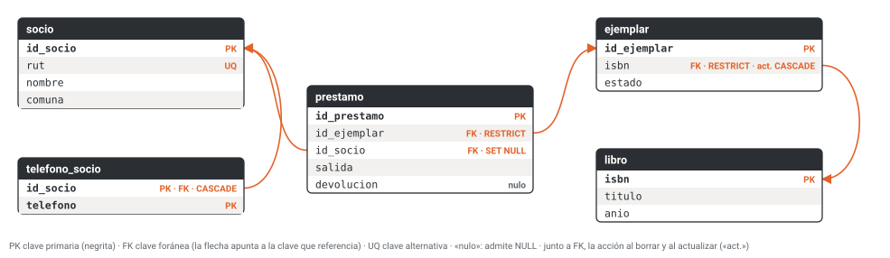
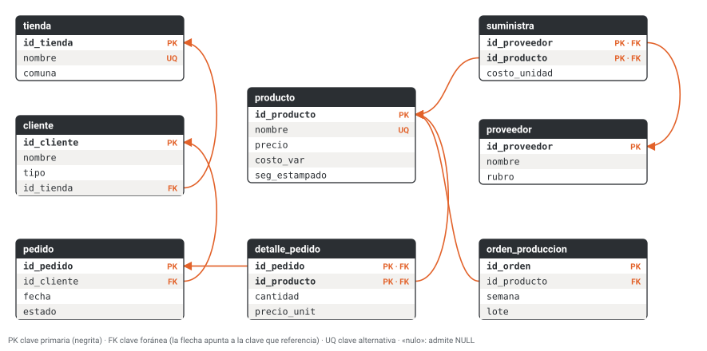

# Unidad 5 · Modelo relacional: claves e integridad

**Qué vas a poder hacer.** Nombrar en una tabla sus atributos, dominios, grado y cardinalidad;
encontrar sus superclaves y claves candidatas y elegir la primaria; declarar en SQL las claves
foráneas y las restricciones (`NOT NULL`, `UNIQUE`, `CHECK`) para que la base rechace sola un dato
imposible, y decidir qué les pasa a las filas hijas cuando se borra o se corrige la fila padre.

**Lo que necesitas antes.** La unidad 4: pasar un diagrama entidad-relación a tablas (una tabla por
entidad, la clave foránea en el lado N de una relación 1:N y una tabla intermedia para una N:M). Saber
leer un `CREATE TABLE` sencillo. Para correr los scripts basta Python, que trae el módulo `sqlite3`.

**Tiempo.** Unas 5 horas: 2 de lectura con los scripts abiertos y 3 de práctica.

**Cómo están hechas las respuestas.** Cada sentencia de esta unidad está en `sql/u05_*.sql` y la corre
el verificador `verificacion/u05_claves.py`, una por una, en una base nueva. Las respuestas que ves
(«acepta», «rechaza» y el mensaje) son las que dio SQLite 3.50.4, la versión que trae Python 3.14. En
MySQL el mensaje cambia de redacción, pero la regla que actúa es la misma; donde el comportamiento
cambia, hay una nota.

---

## 1. La idea: que la base diga que no

Una base sin restricciones acepta todo: un préstamo de un libro que no existe, una nota 8,3, dos
clientes con el mismo RUT. Si la regla vive solo en el programa que carga los datos, basta un segundo
programa (una planilla importada, un script apurado, un practicante con acceso directo) para romperla.

Una **restricción de integridad** es una regla escrita una vez en el esquema que el motor hace cumplir
a cualquiera que escriba. Hay tres familias:

| Familia | Qué protege | Cómo se declara |
|---|---|---|
| Integridad de entidad | que cada fila se pueda identificar | `PRIMARY KEY` (única y no nula) |
| Integridad referencial | que cada referencia apunte a algo que existe | `FOREIGN KEY ... REFERENCES` |
| Integridad de dominio | que cada valor sea posible | tipo, `NOT NULL`, `UNIQUE`, `CHECK`, `DEFAULT` |

La regla práctica que ordena toda la unidad: **lo que el esquema no prohíbe, tarde o temprano pasa.**

---

## 2. El vocabulario del modelo relacional

El modelo relacional (Codd, 1970) guarda todo en **relaciones**. Una relación es un conjunto de tuplas
y se dibuja como una tabla.

| Término formal | En la tabla | Ejemplo en la biblioteca de la sección 8 |
|---|---|---|
| relación | tabla | `socio` |
| tupla | fila | `(1, '41.112.177-1', 'Rosa Paillalef', 'Valdivia')` |
| atributo | columna | `rut` |
| dominio | conjunto de valores que puede tomar un atributo | años entre 1450 y 2026 para `anio` |
| grado | número de atributos | `socio` tiene grado 4 |
| cardinalidad | número de tuplas en un momento dado | `socio` tiene cardinalidad 4 al empezar |
| esquema | la estructura: nombre, atributos y restricciones | `socio(id_socio, rut, nombre, comuna)` |
| instancia (o estado) | las filas que hay ahora | las cuatro filas de la tabla |

**Notación.** En el texto una tabla se escribe con su clave primaria en **negrita** y cada clave foránea
con una flecha a la tabla que referencia:

- socio(**id_socio**, rut, nombre, comuna)
- prestamo(**id_prestamo**, id_ejemplar → ejemplar, id_socio → socio, salida, devolucion)

**Tres propiedades de una relación.** No tiene tuplas repetidas (es un conjunto); el orden de filas y
columnas no significa nada; cada celda tiene un solo valor atómico. Una tabla de SQL sin clave primaria
**sí** admite filas repetidas: es una bolsa, no un conjunto (ejercicio 5.1). La clave primaria es lo que
la vuelve relación.

> **Cuidado con «cardinalidad».** Acá es el número de filas de una tabla. En la unidad 3 era otra cosa:
> cuántas entidades se asocian con cuántas (1:1, 1:N, N:M). Mismo nombre, dos ideas.

**El dominio es más que el tipo.** `anio INTEGER` deja pasar 2062; el dominio real (años en que pudo
editarse un libro) se escribe con un `CHECK`. El tipo es la primera aproximación del dominio y el
`CHECK` lo termina de cerrar.

---

## 3. Claves

Sea $R$ una relación con atributos $A$. Para un subconjunto $S \subseteq A$:

- $S$ es **superclave** si en ningún estado válido de $R$ hay dos tuplas distintas que coincidan en
  todos los atributos de $S$. El conjunto $A$ entero siempre es superclave (no hay tuplas repetidas).
- $S$ es **clave candidata** si es superclave **mínima**: si le quitas cualquier atributo, deja de serlo.
- La **clave primaria** es la candidata que eliges para identificar las filas. Las otras candidatas
  son **claves alternativas** y se declaran `UNIQUE NOT NULL`.
- Un atributo es **primo** si pertenece a alguna clave candidata. La unidad 6 lo necesita.

**Contar superclaves.** Si $R$ tiene grado $n$ y una sola clave candidata $K$, toda superclave es $K$
más cualquier combinación de los otros $n - |K|$ atributos:

$$\#\text{superclaves} = 2^{\,n-|K|}$$

Con dos claves candidatas $K_1$ y $K_2$ se suman las dos familias y se resta lo que se contó dos veces
(las que contienen a ambas):

$$\#\text{superclaves} = 2^{\,n-|K_1|} + 2^{\,n-|K_2|} - 2^{\,n-|K_1 \cup K_2|}$$

En `socio`, de grado 4, las candidatas son {id_socio} y {rut}: $2^3 + 2^3 - 2^2 = 12$, o sea,
12 superclaves. El verificador lo comprueba listando los 15 subconjuntos no vacíos de atributos. La
fórmula no sirve para encontrar claves; sirve para darse cuenta de que «superclave» es un concepto
amplio y «clave candidata» uno estrecho.

**La clave sale de la regla, no de los datos.** Que hoy ningún nombre se repita no hace del nombre una
clave: mañana llega otra Carolina Muñoz. Los datos pueden **refutar** una clave (si hay dos filas
iguales en $S$, $S$ no es superclave), pero nunca **probarla**. La pregunta correcta es «¿puede, según
el negocio, haber dos filas con lo mismo en $S$?» (ejercicio 5.6).

**Cómo se elige la primaria.** Entre las candidatas, la que nunca es nula, nunca cambia, es corta y no
carga significado que pueda quedar obsoleto. Muchas veces ninguna candidata natural cumple las cuatro, y
se agrega una clave subrogada (sección 7).

**Clave compuesta.** Una tabla intermedia de una relación N:M (por ejemplo, `telefono_socio` o
`detalle_pedido` del caso) tiene como clave el par de foráneas: la misma combinación no puede aparecer
dos veces.

---

## 4. Integridad de entidad

La clave primaria no se repite y **ningún atributo de la clave primaria es nulo**: una fila que no se
puede identificar no se puede referenciar, corregir ni borrar con certeza.

- En SQL estándar y en MySQL, `PRIMARY KEY` implica `NOT NULL`.
- **En SQLite no siempre.** Por compatibilidad con versiones antiguas, una clave primaria que no es
  `INTEGER PRIMARY KEY` admite `NULL` si no se le escribe `NOT NULL`. Por eso en esta unidad todas las
  claves de texto se declaran `NOT NULL PRIMARY KEY` (el ejercicio 5.10 muestra el problema).
- `INTEGER PRIMARY KEY` en SQLite es un alias del número de fila: si insertas `NULL` o no la nombras,
  la base asigna el siguiente número. En MySQL eso se escribe `INT AUTO_INCREMENT PRIMARY KEY`; en SQL
  estándar, `INTEGER GENERATED ALWAYS AS IDENTITY`.

---

## 5. Integridad referencial

Una **clave foránea** es un atributo (o conjunto) de la tabla hija cuyos valores tienen que existir
como clave primaria (o alternativa) en la tabla padre. La regla: **todo valor no nulo de la foránea
coincide con una clave del padre.** Si la foránea admite `NULL`, la fila puede no apuntar a nadie;
si es `NOT NULL`, la participación es obligatoria.

Va en el **lado N**: cada préstamo tiene un socio, así que `id_socio` está en `prestamo` y no al revés.
Si se pusiera `id_prestamo` en `socio`, un socio podría tener un solo préstamo.

Se escribe aparte, con la columna entre paréntesis:

```text
FOREIGN KEY (columna_hija) REFERENCES padre (columna_padre) ON DELETE accion ON UPDATE accion
```

**Qué puede romperla.** Insertar o modificar una fila hija con una foránea que no existe: siempre se
rechaza. Borrar o cambiar la clave de una fila padre que tiene hijos: depende de la **acción** que se
declaró.

| Acción | Qué hace al borrar (o cambiar) el padre | Cuándo usarla |
|---|---|---|
| `NO ACTION` (la que rige si no escribes nada) | rechaza si quedan hijos huérfanos | por defecto |
| `RESTRICT` | rechaza, y lo revisa de inmediato | el hijo es historia que hay que conservar (un préstamo, un pedido) |
| `CASCADE` | borra (o actualiza) también a los hijos | el hijo no tiene sentido sin el padre (los teléfonos de un socio, el detalle de un pedido) |
| `SET NULL` | deja la foránea de los hijos en `NULL` | el hijo sobrevive y el vínculo era opcional; la columna tiene que admitir `NULL` |
| `SET DEFAULT` | pone el valor por defecto | rara vez: una categoría «sin asignar» |

La pregunta para elegir: **¿el hijo tiene sentido sin su padre?** No: `CASCADE`. Sí y es historia:
`RESTRICT`, y el padre se marca como inactivo en vez de borrarse. Sí y el vínculo es opcional:
`SET NULL`. `ON UPDATE CASCADE` sirve cuando la clave del padre es natural y puede corregirse (un ISBN
mal digitado).

**Notas de SQLite.**

- Las claves foráneas están **apagadas por defecto** y se encienden por conexión con
  `PRAGMA foreign_keys = ON;`. Sin esa línea, SQLite acepta huérfanos sin aviso (intento i10 del
  ejemplo). `PRAGMA foreign_key_check;` lista los que ya entraron.
- `NO ACTION` revisa al terminar la sentencia; `RESTRICT`, en el momento. La diferencia se nota solo con
  restricciones diferidas o sentencias que dejan un huérfano y lo arreglan en el mismo paso.

**Notas de MySQL.**

- Con InnoDB las foráneas se aplican siempre; `NO ACTION` y `RESTRICT` son lo mismo.
- **En MySQL 8.0, una foránea escrita dentro de la columna** (`id_tienda INTEGER REFERENCES
  tienda(id_tienda)`) **se lee y se ignora sin aviso**: no crea la restricción. El manual lo dice así:
  «MySQL parses but ignores inline REFERENCES specifications». Las versiones 9 recientes ya la aceptan.
  Escríbela siempre aparte, con `FOREIGN KEY (...)`. El esquema del caso de Estampa Sur usa la forma en
  línea: corre bien en SQLite y en MySQL 8.0 quedaría sin foráneas (sección 12).

---

## 6. Integridad de dominio: tipo, `NOT NULL`, `UNIQUE`, `CHECK`, `DEFAULT`

- **`NOT NULL`** obliga a que haya un valor. Es una restricción aparte porque **un `CHECK` deja pasar el
  `NULL`**: la condición `nota BETWEEN 1.0 AND 7.0` con nota nula no es falsa sino desconocida, y SQL
  solo rechaza lo falso. Si el valor es obligatorio, se escriben las dos.
- **`UNIQUE`** impide repetir un valor (o una combinación). Admite varias filas con `NULL`, porque dos
  nulos no se consideran iguales. Una clave alternativa es `UNIQUE NOT NULL`.
- **`CHECK (condición)`** limita el dominio: rangos, listas cerradas (`IN (...)`) y comparaciones entre
  columnas de la misma fila (`devolucion >= salida`). Con nombre (`CONSTRAINT ck_anio CHECK (...)`), el
  mensaje de error dice qué regla falló.
- **`DEFAULT`** pone un valor cuando el `INSERT` no lo trae.

**SQLite es flexible con los tipos, y eso es un riesgo.** `VARCHAR(12)` no limita el largo; una columna
`INTEGER` o `REAL` guarda un texto que no parece número como texto, y en SQLite **un texto es mayor que
cualquier número**, así que `CHECK (nota > 0)` deja pasar `'seis'` (ejercicio 5.8). Las defensas: una
tabla `STRICT` (desde SQLite 3.37), que exige el tipo declarado, o un `CHECK (typeof(nota) = 'real')`.
MySQL en modo estricto (el predeterminado desde la versión 5.7) rechaza el texto y el exceso de largo;
sus `CHECK` se aplican desde la versión 8.0.16 (antes se leían y se ignoraban).

---

## 7. Clave natural o clave subrogada

Una **clave natural** sale del mundo: el RUT, la patente, el ISBN, el código pegado en una bicicleta.
Una **clave subrogada** es un número sin significado que inventa la base (`id_socio`).

| | Natural | Subrogada |
|---|---|---|
| Significado | se entiende sola | no dice nada; hay que hacer un join para saber quién es |
| Estabilidad | puede corregirse o cambiar de formato | no cambia nunca |
| Se repite en cada tabla hija | sí, y con ella el dato personal | solo el número |
| Duplicados del mundo real | la base los impide | hay que agregar un `UNIQUE` sobre la natural |
| Casos sin valor | un extranjero sin RUT, un libro sin ISBN | no existen |

**La regla de esta unidad:** clave subrogada como primaria y la natural como clave alternativa
(`UNIQUE NOT NULL`). La natural queda protegida contra duplicados y, si hay que corregirla, se cambia en
una sola fila. Una natural sirve como primaria cuando es corta, estable y la controlas tú (el código de
inventario `PV-014` del ejercicio 5.5).

Con el RUT hay una razón más. Desde el 01-12-2026 rige la Ley 21.719 de protección de datos personales:
un RUT usado como clave primaria se copia en cada tabla hija y en cada respaldo. Con una subrogada, el
dato personal vive en una sola fila (ejercicio 5.7).

---

## 8. Ejemplo resuelto · La biblioteca vecinal de Valdivia

Una biblioteca vecinal presta libros a sus socios. Las reglas, dichas por la bibliotecaria:

1. Cada socio tiene un RUT que no se repite, un nombre y una comuna; puede dejar varios teléfonos.
2. Un libro se identifica por su ISBN y tiene uno o más ejemplares; cada ejemplar está disponible,
   prestado o dado de baja.
3. Un préstamo es de un ejemplar a un socio, con fecha de salida y, cuando vuelve, de devolución, que no
   puede ser anterior a la salida.
4. Un libro que tiene ejemplares no se borra del catálogo. Un ISBN mal digitado se corrige.
5. Si un socio pide que borren sus datos, sus teléfonos se van con él; sus préstamos quedan para la
   estadística, sin decir de quién eran.

**Paso 1 · Las tablas y sus claves.**

| Tabla | Clave primaria | Clave alternativa | Por qué |
|---|---|---|---|
| socio | id_socio (subrogada) | rut | el RUT es dato personal y puede venir mal digitado |
| telefono_socio | (id_socio, telefono) | | un teléfono por fila (atributo multivaluado); el par no se repite |
| libro | isbn (natural) | | corto, impreso en el libro, controlado por la editorial |
| ejemplar | id_ejemplar | | dos ejemplares del mismo libro son iguales salvo por su número |
| prestamo | id_prestamo | | el mismo ejemplar se presta muchas veces al mismo socio |

**Paso 2 · Las foráneas y sus acciones.** Cada una responde la pregunta de la sección 5.

| Foránea | ¿El hijo tiene sentido sin el padre? | Acción |
|---|---|---|
| telefono_socio.id_socio → socio | no: un teléfono sin dueño no sirve | `ON DELETE CASCADE` |
| ejemplar.isbn → libro | no, pero la regla 4 prohíbe borrar el libro | `ON DELETE RESTRICT ON UPDATE CASCADE` |
| prestamo.id_ejemplar → ejemplar | sí, es historia | `ON DELETE RESTRICT` |
| prestamo.id_socio → socio | sí, y la regla 5 pide conservarlo anónimo | `ON DELETE SET NULL` (la columna admite `NULL`) |

**Paso 3 · El dominio.** `anio` entre 1450 y 2026; `estado` en una lista cerrada con valor por
defecto; `devolucion` no anterior a `salida` (y puede faltar mientras el libro no vuelve: el `CHECK`
deja pasar el `NULL`, que acá es justo lo que se quiere); `comuna` con valor por defecto `'Valdivia'`.

**Paso 4 · El script** (`sql/u05_biblioteca.sql`; la carga de datos está en el archivo):

```sql
-- Unidad 5 · Ejemplo resuelto · biblioteca vecinal de Valdivia (datos inventados)
-- Corre en SQLite (sqlite3 de Python) y en MySQL 8 (ver las notas de la unidad).
-- Las líneas «-- @nombre» marcan los intentos que el verificador muestra con su respuesta.
PRAGMA foreign_keys = ON;

CREATE TABLE socio (
    id_socio   INTEGER PRIMARY KEY,
    rut        VARCHAR(12) NOT NULL UNIQUE,
    nombre     VARCHAR(60) NOT NULL,
    comuna     VARCHAR(40) NOT NULL DEFAULT 'Valdivia'
);
CREATE TABLE telefono_socio (
    id_socio   INTEGER NOT NULL,
    telefono   VARCHAR(16) NOT NULL,
    PRIMARY KEY (id_socio, telefono),
    FOREIGN KEY (id_socio) REFERENCES socio (id_socio) ON DELETE CASCADE
);
CREATE TABLE libro (
    isbn       VARCHAR(17) NOT NULL PRIMARY KEY,
    titulo     VARCHAR(80) NOT NULL,
    anio       INTEGER NOT NULL CONSTRAINT ck_anio CHECK (anio BETWEEN 1450 AND 2026)
);
CREATE TABLE ejemplar (
    id_ejemplar INTEGER PRIMARY KEY,
    isbn        VARCHAR(17) NOT NULL,
    estado      VARCHAR(12) NOT NULL DEFAULT 'disponible'
                CONSTRAINT ck_estado CHECK (estado IN ('disponible', 'prestado', 'baja')),
    FOREIGN KEY (isbn) REFERENCES libro (isbn) ON DELETE RESTRICT ON UPDATE CASCADE
);
CREATE TABLE prestamo (
    id_prestamo INTEGER PRIMARY KEY,
    id_ejemplar INTEGER NOT NULL,
    id_socio    INTEGER,
    salida      DATE NOT NULL,
    devolucion  DATE,
    CONSTRAINT ck_fechas CHECK (devolucion >= salida),
    FOREIGN KEY (id_ejemplar) REFERENCES ejemplar (id_ejemplar) ON DELETE RESTRICT,
    FOREIGN KEY (id_socio) REFERENCES socio (id_socio) ON DELETE SET NULL
);
```

En MySQL cambian dos cosas: `INTEGER PRIMARY KEY` se escribe `INT AUTO_INCREMENT PRIMARY KEY` y el
`PRAGMA` sobra (InnoDB aplica las foráneas siempre). El diagrama, dibujado por el verificador desde los
`PRAGMA` de la base:



**Paso 5 · Los datos.**

| id_socio | rut | nombre | comuna |
|---|---|---|---|
| 1 | 41.112.177-1 | Rosa Paillalef | Valdivia |
| 2 | 41.718.819-3 | Tomás Riquelme | Valdivia |
| 3 | 40.707.749-0 | Marta Huenchullán | Corral |
| 4 | 43.033.210-4 | Diego Altamirano | Valdivia |

| id_socio | telefono |
|---|---|
| 1 | +56 9 0000 0022 |
| 1 | +56 63 221 3390 |
| 2 | +56 9 0000 0037 |
| 3 | +56 9 0000 0010 |
| 3 | +56 9 0000 0039 |
| 4 | +56 9 0000 0043 |

| isbn | titulo | anio |
|---|---|---|
| 978-956-7401-12-3 | Crónicas del Calle-Calle | 2019 |
| 978-956-8820-05-7 | Huertos de invierno | 2022 |
| 978-956-3315-04-9 | Mareas de niebla | 2011 |

| id_ejemplar | isbn | estado |
|---|---|---|
| 1 | 978-956-7401-12-3 | prestado |
| 2 | 978-956-7401-12-3 | disponible |
| 3 | 978-956-8820-05-7 | prestado |
| 4 | 978-956-3315-04-9 | disponible |
| 5 | 978-956-3315-04-9 | baja |

| id_prestamo | id_ejemplar | id_socio | salida | devolucion |
|---|---|---|---|---|
| 1 | 1 | 2 | 2026-08-03 | 2026-08-17 |
| 2 | 3 | 3 | 2026-08-20 | 2026-09-02 |
| 3 | 2 | 3 | 2026-09-05 | 2026-09-19 |
| 4 | 4 | 1 | 2026-09-11 | 2026-09-24 |
| 5 | 1 | 1 | 2026-10-01 | NULL |
| 6 | 3 | 4 | 2026-10-06 | NULL |

El ISBN de *Mareas de niebla* quedó mal: el correcto es 978-956-3315-40-9.

**Paso 6 · Lo que la base acepta y lo que rechaza.** Los intentos, en el mismo script:

```sql
-- @i1 un ejemplar de un libro que no está en el catálogo
INSERT INTO ejemplar (isbn) VALUES ('978-956-9999-99-9');
-- @i2 un socio con un RUT que ya existe
INSERT INTO socio (rut, nombre) VALUES ('41.112.177-1', 'Rosa P. Paillalef');
-- @i3 un socio sin nombre
INSERT INTO socio (rut, comuna) VALUES ('42.628.782-K', 'Paillaco');
-- @i4 un año mal digitado (2062 por 2026)
INSERT INTO libro VALUES ('978-956-6102-77-1', 'Atlas del sur lluvioso', 2062);
-- @i5 una devolución anterior a la salida
INSERT INTO prestamo (id_ejemplar, id_socio, salida, devolucion) VALUES (2, 4, '2026-10-09', '2026-09-23');
-- @i6 un estado que no está en la lista
INSERT INTO ejemplar (isbn, estado) VALUES ('978-956-8820-05-7', 'perdido');
-- @i7 borrar un libro que tiene ejemplares
DELETE FROM libro WHERE isbn = '978-956-7401-12-3';
-- @i8 corregir un ISBN mal digitado
UPDATE libro SET isbn = '978-956-3315-40-9' WHERE isbn = '978-956-3315-04-9';
-- @c8 los ejemplares siguen a su libro
SELECT id_ejemplar, isbn, estado FROM ejemplar WHERE isbn LIKE '978-956-3315%';
-- @i9 Marta pide que borren sus datos
DELETE FROM socio WHERE id_socio = 3;
-- @c9a sus teléfonos se fueron con ella
SELECT COUNT(*) FROM telefono_socio WHERE id_socio = 3;
-- @c9b sus préstamos quedan, sin socio
SELECT id_prestamo, id_ejemplar, id_socio, salida FROM prestamo WHERE id_prestamo IN (2, 3);
-- @i10a se apagan las claves foráneas
PRAGMA foreign_keys = OFF;
-- @i10b un préstamo de un ejemplar que no existe
INSERT INTO prestamo (id_ejemplar, id_socio, salida) VALUES (8, 2, '2026-10-12');
-- @i10c la revisión encuentra al huérfano
PRAGMA foreign_key_check;
-- @i10d se borra el huérfano y se vuelven a encender
DELETE FROM prestamo WHERE id_ejemplar = 8;
PRAGMA foreign_keys = ON;
```

| Intento | Qué se intenta | Respuesta de SQLite |
|---|---|---|
| i1 | un ejemplar de un libro que no está en el catálogo | rechaza: `FOREIGN KEY constraint failed` |
| i2 | un socio con un RUT que ya existe | rechaza: `UNIQUE constraint failed: socio.rut` |
| i3 | un socio sin nombre | rechaza: `NOT NULL constraint failed: socio.nombre` |
| i4 | un año mal digitado (2062 por 2026) | rechaza: `CHECK constraint failed: ck_anio` |
| i5 | una devolución anterior a la salida | rechaza: `CHECK constraint failed: ck_fechas` |
| i6 | un estado que no está en la lista | rechaza: `CHECK constraint failed: ck_estado` |
| i7 | borrar un libro que tiene ejemplares | rechaza: `FOREIGN KEY constraint failed` |
| i8 | corregir un ISBN mal digitado | acepta (1 fila) |
| i9 | Marta pide que borren sus datos | acepta (1 fila) |
| i10a | se apagan las claves foráneas | acepta |
| i10b | un préstamo de un ejemplar que no existe | acepta (1 fila) |
| i10d | se borra el huérfano y se vuelven a encender | acepta (1 fila) |

Las consultas muestran qué hicieron las acciones. Tras i8 (`c8`), los dos ejemplares de *Mareas de
niebla* ya tienen el ISBN corregido, sin tocarlos:

| id_ejemplar | isbn | estado |
|---|---|---|
| 4 | 978-956-3315-40-9 | disponible |
| 5 | 978-956-3315-40-9 | baja |

Tras i9, `c9a` cuenta los teléfonos de Marta y `c9b` muestra sus dos préstamos:

| COUNT(*) |
|---|
| 0 |

| id_prestamo | id_ejemplar | id_socio | salida |
|---|---|---|---|
| 2 | 3 | NULL | 2026-08-20 |
| 3 | 2 | NULL | 2026-09-05 |

Y con las foráneas apagadas, el préstamo del ejemplar 8 entró sin reclamo; `PRAGMA foreign_key_check`
(`i10c`) lo encuentra después: la fila 7 de `prestamo` apunta a un `ejemplar` que no existe.

| table | rowid | parent | fkid |
|---|---|---|---|
| prestamo | 7 | ejemplar | 1 |

**Cómo se lee.**

- **Cada rechazo nombra la regla que actuó.** Los `CHECK` con nombre (`ck_anio`, `ck_fechas`,
  `ck_estado`) dicen cuál falló; el `UNIQUE` y el `NOT NULL` dicen la columna. La foránea solo dice
  `FOREIGN KEY constraint failed`: en SQLite hay que deducir cuál de las foráneas fue.
- **Las acciones hacen el trabajo que nadie recordaría.** Corregir el ISBN tocó una fila y la base
  actualizó los ejemplares; borrar a Marta se llevó sus dos teléfonos y dejó sus préstamos anónimos.
- **i7 es una decisión, no un error.** La biblioteca no pierde ejemplares por borrar mal un libro. Si un
  título sale de circulación, sus ejemplares se marcan `'baja'`.
- **Decisión.** Toda conexión que escriba en esta base empieza con `PRAGMA foreign_keys = ON;` y una vez
  al mes se corre `PRAGMA foreign_key_check;`. Sin la primera línea, i10b muestra lo que pasa: el
  esquema está bien escrito y no sirve de nada.

---

## 9. Errores típicos

| Error | Cómo evitarlo |
|---|---|
| Olvidar `PRAGMA foreign_keys = ON;` en SQLite | escríbelo como primera línea de cada conexión; revisa con `PRAGMA foreign_key_check;` |
| La foránea en el lado equivocado (`id_prestamo` en `socio`) | la foránea va en el lado N: «cada préstamo tiene un socio» la pone en `prestamo` |
| Una relación N:M en una columna de texto (`'joyas, cerámica'`) | tabla intermedia con las dos foráneas como clave compuesta |
| Tabla intermedia sin clave primaria | `PRIMARY KEY (foránea_1, foránea_2)`: sin ella, la misma pareja entra dos veces |
| Creer que un `CHECK` impide el `NULL` | el `CHECK` deja pasar lo desconocido; si el valor es obligatorio, agrega `NOT NULL` |
| Clave primaria de texto sin `NOT NULL` en SQLite | escribe `NOT NULL PRIMARY KEY`; SQLite acepta `NULL` en esa clave por compatibilidad |
| Elegir una clave porque «hoy no se repite» | la clave sale de la regla del negocio; los datos solo pueden refutarla |
| `CASCADE` en todas partes | pregunta si el hijo es historia; un borrado en cascada puede arrastrar filas de otros (ejercicio 5.9) |
| `SET NULL` sobre una columna `NOT NULL` | el error aparece recién al borrar el padre; decide si la columna es opcional |
| Foránea escrita en la columna en MySQL 8.0 | escríbela aparte: `FOREIGN KEY (col) REFERENCES padre (col)`, con paréntesis |
| Confiar en `VARCHAR(n)` e `INTEGER` en SQLite | tabla `STRICT` o `CHECK (typeof(...))`; MySQL estricto sí los hace cumplir |
| RUT como clave primaria repetido en cada tabla hija | subrogada como primaria y el RUT como `UNIQUE NOT NULL` |

---

## 10. Práctica

Diez ejercicios: 5.1 a 5.4 básicos, 5.5 a 5.8 intermedios, 5.9 y 5.10 de desafío. Cada uno tiene su
script en `sql/u05_e*.sql`; las pautas están en la sección 11. Predice la respuesta antes de correrlo.

**5.1 · Carros de comida de la costanera (básico).** La municipalidad de Antofagasta lleva los carros de
comida autorizados en una tabla (`sql/u05_e01_carros.sql`):

```sql
-- Ejercicio 5.1 · carros de comida de la costanera de Antofagasta (datos inventados)
CREATE TABLE carro (
    patente   VARCHAR(8),
    duenio    VARCHAR(60),
    comida    VARCHAR(30),
    metros    INTEGER
);
```

| patente | duenio | comida | metros |
|---|---|---|---|
| EJAG-21 | Juana Sepúlveda | empanadas | 6 |
| EJAH-73 | Luis Fuentealba | jugos | 4 |
| EJAD-08 | Juana Sepúlveda | sopaipillas | 3 |
| EJAJ-45 | Héctor Vergara | ceviche | 5 |
| EJAL-19 | Ana Cifuentes | completos | 6 |
| EJAH-73 | Luis Fuentealba | jugos | 4 |
| EJAO-62 | Ana Cifuentes | café | 3 |

(a) ¿Cuál es el grado y la cardinalidad de la tabla? (b) ¿Es una relación? Si no, ¿cuál sería su
cardinalidad como relación? (c) Propón el dominio de cada atributo. (d) Cada carro tiene una patente y
una dueña puede tener varios carros: ¿qué clave candidata hay y qué declararías para que la fila
repetida no pueda entrar?

**5.2 · Superclaves de una liga (básico).** Una liga de básquetbol de Coyhaique guarda
jugador(rut, nombre, equipo, camiseta). Reglas: el RUT no se repite; en un mismo equipo no hay dos
jugadores con la misma camiseta; puede haber dos jugadores con el mismo nombre. (a) ¿Cuáles son las
claves candidatas? (b) Lista todas las superclaves y comprueba el total con la fórmula de la sección 3.
(c) ¿Es {rut, camiseta} una clave candidata? (d) ¿Cuál declararías primaria y cómo declararías la otra?

**5.3 · Horas de un Cesfam (básico).** El Cesfam asigna horas por box, día y bloque
(`sql/u05_e03_cesfam.sql`):

```sql
-- Ejercicio 5.3 · horas médicas de un Cesfam (datos inventados)
PRAGMA foreign_keys = ON;
CREATE TABLE box (
    id_box  INTEGER PRIMARY KEY,
    piso    INTEGER NOT NULL CHECK (piso IN (1, 2))
);
CREATE TABLE hora (
    id_hora      INTEGER PRIMARY KEY,
    id_box       INTEGER NOT NULL,
    fecha        DATE NOT NULL,
    bloque       INTEGER NOT NULL CHECK (bloque BETWEEN 1 AND 16),
    rut_paciente VARCHAR(12),
    UNIQUE (id_box, fecha, bloque),
    FOREIGN KEY (id_box) REFERENCES box (id_box)
);
```

| id_box | piso |
|---|---|
| 1 | 1 |
| 2 | 1 |
| 3 | 2 |

| id_hora | id_box | fecha | bloque | rut_paciente |
|---|---|---|---|---|
| 1 | 1 | 2026-11-04 | 3 | 41.415.498-0 |

Para cada intento, di si la base lo acepta y, si lo rechaza, qué restricción actúa:

```sql
-- @a otro box, mismo día y bloque
INSERT INTO hora VALUES (2, 2, '2026-11-04', 3, '42.123.247-4');
-- @b el mismo box, día y bloque de la hora 1
INSERT INTO hora VALUES (3, 1, '2026-11-04', 3, '40.909.963-7');
-- @c el bloque 17
INSERT INTO hora VALUES (4, 3, '2026-11-04', 17, '43.639.852-2');
-- @d un box que no existe
INSERT INTO hora VALUES (5, 4, '2026-11-05', 2, '41.011.070-9');
-- @e una hora sin paciente asignado
INSERT INTO hora VALUES (6, 3, '2026-11-05', 2, NULL);
-- @f repetir el id_hora 1
INSERT INTO hora VALUES (1, 2, '2026-11-05', 5, '42.426.568-3');
-- @g un box en el piso 3
INSERT INTO box VALUES (4, 3);
```

**5.4 · Las acciones de un jardín infantil (básico).** Un jardín infantil de Los Ángeles tiene estas
tablas:

- sala(**id_sala**, nombre)
- educadora(**id_educadora**, nombre)
- parvulo(**id_parvulo**, nombre, id_sala → sala, id_educadora → educadora, retirado)
- alergia_parvulo(**id_parvulo → parvulo, alergeno**)
- asistencia(**id_parvulo → parvulo, fecha**)

Reglas: una sala con niños no se cierra; si una educadora deja el jardín, sus niños quedan sin tutora
hasta que se les asigne otra; las alergias de un niño no tienen sentido sin el niño; el registro de
asistencia es un documento que se conserva. (a) Elige la acción `ON DELETE` de cada una de las cuatro
foráneas y justifícala. (b) Con los datos de abajo, predice qué pasa si se borra a la educadora Gloria
(2), si se cierra la sala 1, si se borra a Matías (3) y si se borra a Isidora (4), matriculada por
error.

| id_parvulo | nombre | id_sala | id_educadora | retirado |
|---|---|---|---|---|
| 1 | Agustín | 1 | 1 | 0 |
| 2 | Florencia | 1 | 2 | 0 |
| 3 | Matías | 2 | 2 | 0 |
| 4 | Isidora | 2 | 1 | 0 |

| id_parvulo | alergeno |
|---|---|
| 2 | maní |
| 4 | huevo |
| 4 | kiwi |

| id_parvulo | fecha |
|---|---|
| 1 | 2026-10-05 |
| 2 | 2026-10-05 |
| 3 | 2026-10-05 |
| 1 | 2026-10-06 |
| 3 | 2026-10-06 |

**5.5 · Arriendo de bicicletas (intermedio, escribir).** Un local de Puerto Varas arrienda bicicletas
por hora. Hay que guardar los clientes (RUT que no se repite, nombre y teléfono, todos obligatorios), las
bicicletas (cada una con un código de inventario pegado en el marco, como `PV-014`, un tipo que es
urbana, montaña o eléctrica, y una tarifa por hora mayor que cero) y los arriendos (quién, qué bicicleta,
inicio y, cuando se devuelve, fin, que tiene que ser posterior al inicio). Un cliente con arriendos no se
borra; una bicicleta con arriendos tampoco. Escribe el `CREATE TABLE` de las tres tablas y comprueba que
tu esquema rechace: una bicicleta tándem; una tarifa de cero pesos; un RUT repetido; un arriendo de una
bicicleta que no existe; un arriendo que termina antes de empezar; borrar a una clienta con arriendos.
Y que acepte un arriendo en curso, sin fin.

**5.6 · Lo que los datos no prueban (intermedio).** Una escuela de conductores de Curicó guarda
matricula(rut, nombre, curso, horario) (`sql/u05_e06_conductores.sql`). Reglas: una persona puede
tomar varios cursos; cada curso tiene un horario fijo; nadie puede estar en dos cursos a la misma hora;
puede haber dos alumnos con el mismo nombre.

```sql
-- Ejercicio 5.6 · escuela de conductores de Curicó (datos inventados)
CREATE TABLE matricula (
    rut     VARCHAR(12) NOT NULL,
    nombre  VARCHAR(60) NOT NULL,
    curso   VARCHAR(20) NOT NULL,
    horario VARCHAR(20) NOT NULL
);
```

| rut | nombre | curso | horario |
|---|---|---|---|
| 41.314.391-8 | Carolina Muñoz | clase B | martes 18:00 |
| 41.314.391-8 | Carolina Muñoz | mecánica básica | jueves 19:30 |
| 40.101.107-2 | Pedro Araya | clase A2 | lunes 17:00 |
| 41.819.926-1 | Valentina Rojas | clase B | martes 18:00 |
| 40.202.214-0 | Jorge Lillo | mecánica básica | jueves 19:30 |
| 44.044.280-3 | Camila Soto | clase A2 | lunes 17:00 |
| 41.819.926-1 | Valentina Rojas | clase C | sábado 11:00 |
| 40.202.214-0 | Jorge Lillo | clase C | sábado 11:00 |

(a) ¿Qué conjuntos mínimos de columnas no se repiten en **estos** datos? (b) ¿Cuáles de ellos son claves
candidatas según las reglas? (c) Alguien declaró `PRIMARY KEY (nombre, curso)`: ¿qué pasa cuando se
matricula en clase A2 otro Pedro Araya (RUT 42.426.568-3)? (d) Con las claves correctas, ¿qué pasa si
Carolina pide un segundo curso el martes a las 18:00?

**5.7 · El RUT mal digitado (intermedio).** En una clínica veterinaria de Osorno, la recepcionista
registró a Soledad Ulloa con el RUT 40.505.535-K; el correcto es 40.404.428-1 (los dos tienen dígito
verificador válido, así que el sistema no avisó). Soledad tiene tres mascotas y cinco boletas.

| id_mascota | nombre | rut_dueno |
|---|---|---|
| 1 | Canela | 40.505.535-K |
| 2 | Pelusa | 40.505.535-K |
| 3 | Toby | 40.505.535-K |

| id_boleta | rut_cliente | monto |
|---|---|---|
| 1 | 40.505.535-K | 18500 |
| 2 | 40.505.535-K | 32900 |
| 3 | 40.505.535-K | 7400 |
| 4 | 40.505.535-K | 45200 |
| 5 | 40.505.535-K | 12800 |

El script `sql/u05_e07_veterinaria.sql` arma tres diseños con estos datos: (1) el RUT es la clave
primaria de `cliente` y las foráneas no tienen acción; (2) igual, pero con `ON UPDATE CASCADE`; (3) una
clave subrogada `id_cliente` y el RUT como `UNIQUE`. (a) Predice qué pasa con
`UPDATE cliente_N SET rut = '40.404.428-1' WHERE rut = '40.505.535-K';` en cada diseño. (b) ¿Cuántas
filas reescribe la base en el diseño 2 y cuántas en el 3? (c) ¿Cuál elegirías y por qué?

**5.8 · El `CHECK` y el `NULL` (intermedio).** Un profesor carga las notas del control 2 en
(`sql/u05_e08_notas.sql`):

```sql
-- Ejercicio 5.8 · notas de un control (escala chilena de 1,0 a 7,0; datos inventados)
CREATE TABLE nota (
    rut        VARCHAR(12) NOT NULL,
    evaluacion VARCHAR(20) NOT NULL,
    nota       REAL CHECK (nota BETWEEN 1.0 AND 7.0),
    PRIMARY KEY (rut, evaluacion)
);
```

(a) Intenta seis notas: 5,8; una en blanco (`NULL`); 7,3; el texto `'6,2'` copiado de una planilla; 1,0
y 4,5. ¿Cuáles entran? (b) ¿Cuántas filas quedan, cuántas con nota y cuál es el promedio que calcula
`AVG`? ¿Es el promedio del curso? (c) En otra tabla con `CHECK (nota > 0)`, ¿entra el texto `'seis'`?
¿Por qué? (d) ¿Qué cambia con una tabla `STRICT` con `NOT NULL`?

**5.9 · La cascada que borró la tabla de goleadores (desafío).** Una liga de futbolito de Talca declaró
`ON DELETE CASCADE` en todas sus foráneas (`sql/u05_e09_liga.sql`):

```sql
-- Ejercicio 5.9 · liga de futbolito de Talca (datos inventados): CASCADE en todas partes
PRAGMA foreign_keys = ON;
CREATE TABLE equipo (
    id_equipo  INTEGER PRIMARY KEY,
    nombre     VARCHAR(40) NOT NULL UNIQUE
);
CREATE TABLE jugador (
    id_jugador INTEGER PRIMARY KEY,
    nombre     VARCHAR(60) NOT NULL,
    id_equipo  INTEGER NOT NULL,
    FOREIGN KEY (id_equipo) REFERENCES equipo (id_equipo) ON DELETE CASCADE
);
CREATE TABLE partido (
    id_partido INTEGER PRIMARY KEY,
    fecha      DATE NOT NULL,
    local      INTEGER NOT NULL,
    visita     INTEGER NOT NULL,
    CHECK (local <> visita),
    FOREIGN KEY (local) REFERENCES equipo (id_equipo) ON DELETE CASCADE,
    FOREIGN KEY (visita) REFERENCES equipo (id_equipo) ON DELETE CASCADE
);
CREATE TABLE gol (
    id_gol     INTEGER PRIMARY KEY,
    id_partido INTEGER NOT NULL,
    id_jugador INTEGER NOT NULL,
    minuto     INTEGER NOT NULL CHECK (minuto BETWEEN 1 AND 50),
    FOREIGN KEY (id_partido) REFERENCES partido (id_partido) ON DELETE CASCADE,
    FOREIGN KEY (id_jugador) REFERENCES jugador (id_jugador) ON DELETE CASCADE
);
```

| id_equipo | nombre |
|---|---|
| 1 | Deportivo Lircay |
| 2 | Unión Piduco |
| 3 | Estrella del Maule |
| 4 | Las Rastras |

| id_jugador | nombre | id_equipo |
|---|---|---|
| 1 | Benjamín Pino | 1 |
| 2 | Cristóbal Leiva | 1 |
| 3 | Martín Acevedo | 2 |
| 4 | Joaquín Sanhueza | 2 |
| 5 | Vicente Orellana | 3 |
| 6 | Tomás Bravo | 3 |
| 7 | Lucas Moya | 4 |
| 8 | Felipe Cáceres | 4 |

| id_partido | fecha | local | visita |
|---|---|---|---|
| 1 | 2026-09-05 | 1 | 2 |
| 2 | 2026-09-05 | 3 | 4 |
| 3 | 2026-09-12 | 1 | 3 |
| 4 | 2026-09-12 | 2 | 4 |
| 5 | 2026-09-19 | 4 | 1 |
| 6 | 2026-09-19 | 2 | 3 |

| id_gol | id_partido | id_jugador | minuto |
|---|---|---|---|
| 1 | 1 | 1 | 7 |
| 2 | 1 | 3 | 18 |
| 3 | 1 | 3 | 41 |
| 4 | 2 | 5 | 12 |
| 5 | 2 | 7 | 33 |
| 6 | 3 | 2 | 9 |
| 7 | 3 | 5 | 22 |
| 8 | 3 | 6 | 47 |
| 9 | 4 | 4 | 15 |
| 10 | 4 | 8 | 29 |
| 11 | 4 | 8 | 44 |
| 12 | 5 | 7 | 6 |
| 13 | 5 | 1 | 26 |
| 14 | 5 | 7 | 38 |
| 15 | 6 | 3 | 11 |
| 16 | 6 | 6 | 35 |

Deportivo Lircay se retira de la liga y el delegado corre `DELETE FROM equipo WHERE id_equipo = 1;`.
(a) Sin correrlo, sigue la cascada: ¿cuántos jugadores, partidos y goles desaparecen? (b) ¿Cómo cambia la
tabla de goleadores, incluidos los jugadores de **otros** equipos? (c) Rediseña las acciones para que la
historia no se pierda y di cómo se registra el retiro.

**5.10 · Seis errores en el esquema de una expo (desafío).** Una expo de emprendedores de La Serena
arrienda stands. Cada emprendedor (RUT) puede arrendar uno o más stands, vende en varias categorías y
registra sus ventas. Este es el esquema que dejó un voluntario (`sql/u05_e10_expo_mal.sql`):

```sql
-- Ejercicio 5.10 · expo de emprendedores de La Serena (datos inventados): el esquema con seis errores
PRAGMA foreign_keys = ON;
CREATE TABLE emprendedor (
    rut         VARCHAR(12) PRIMARY KEY,
    nombre      VARCHAR(60) NOT NULL,
    numero_stand INTEGER REFERENCES stand (numero),
    categorias  VARCHAR(200)
);
CREATE TABLE stand (
    numero      INTEGER PRIMARY KEY,
    metros      INTEGER CHECK (metros > 0)
);
CREATE TABLE venta (
    id_venta    INTEGER PRIMARY KEY,
    rut         VARCHAR(12) NOT NULL,
    fecha       DATE NOT NULL,
    monto       INTEGER NOT NULL CHECK (monto > 0),
    FOREIGN KEY (rut) REFERENCES emprendedor (rut) ON DELETE SET NULL
);
```

| numero | metros |
|---|---|
| 1 | 9 |
| 2 | 6 |
| 3 | 6 |

| rut | nombre | numero_stand | categorias |
|---|---|---|---|
| 41.415.498-0 | Daniela Cortés | 1 | joyas, cerámica |
| 42.123.247-4 | Ignacio Pizarro | 2 | papayas, mermeladas |

| id_venta | rut | fecha | monto |
|---|---|---|---|
| 1 | 41.415.498-0 | 2026-12-18 | 24000 |
| 2 | 42.123.247-4 | 2026-12-18 | 8500 |

(a) Encuentra los seis errores y di qué permite cada uno (usa los intentos del script). (b) Escribe el
esquema corregido y comprueba que rechaza lo que debe.

---

## 11. Pautas

**5.1.** Las cuatro consultas del script y lo que responde SQLite:

```sql
-- @grado
SELECT COUNT(*) FROM pragma_table_info('carro');
-- @filas
SELECT COUNT(*) FROM carro;
-- @distintas
SELECT COUNT(*) FROM (SELECT DISTINCT * FROM carro);
-- @repetidas
SELECT patente, duenio, comida, metros, COUNT(*) AS veces
FROM carro
GROUP BY patente, duenio, comida, metros
HAVING COUNT(*) > 1;
```

| COUNT(*) |
|---|
| 4 |

| COUNT(*) |
|---|
| 7 |

| COUNT(*) |
|---|
| 6 |

| patente | duenio | comida | metros | veces |
|---|---|---|---|---|
| EJAH-73 | Luis Fuentealba | jugos | 4 | 2 |

(a) Grado 4 y cardinalidad 7 como tabla. (b) No es una relación: la fila del carro EJAH-73 está dos
veces. Como relación tendría cardinalidad 6. (c) `patente`: texto de cuatro letras, guion y dos dígitos
(se puede cerrar con `CHECK (patente LIKE '____-__')`); `duenio`: nombres de personas, obligatorio;
`comida`: una lista cerrada que fije la municipalidad; `metros`: enteros entre 1 y un máximo, por
ejemplo 8. (d) {patente} es la única candidata: Juana y Ana tienen dos carros, así que el dueño no
identifica. Con `patente VARCHAR(8) NOT NULL PRIMARY KEY` la fila repetida se rechaza. Lectura: sin
clave, la tabla cuenta dos veces el carro de jugos y cualquier cobro por metro le sale doble a Luis.

**5.2.** (a) {rut} y {equipo, camiseta}. (b) Con $n = 4$, $|K_1| = 1$, $|K_2| = 2$ y $|K_1 \cup K_2| = 3$:
$2^3 + 2^2 - 2^1 = 8 + 4 - 2 = 10$, o sea, 10 superclaves: {rut}, {equipo, camiseta}, {rut, camiseta},
{rut, equipo}, {rut, nombre}, {nombre, equipo, camiseta}, {rut, equipo, camiseta}, {rut, nombre, camiseta},
{rut, nombre, equipo} y {rut, nombre, equipo, camiseta}. El verificador las lista por fuerza bruta.
(c) No: es superclave porque contiene a {rut}, pero no es mínima (sin `camiseta` sigue siéndolo).
(d) Primaria: una subrogada `id_jugador`, o el RUT si la liga lo pide siempre; {equipo, camiseta} se
declara `UNIQUE (equipo, camiseta)` con las dos columnas `NOT NULL`. Lectura: el `UNIQUE` compuesto es
lo que impide que el planillero anote dos números 7 en el mismo equipo.

**5.3.** Lo que responde SQLite:

| Intento | Qué se intenta | Respuesta de SQLite |
|---|---|---|
| a | otro box, mismo día y bloque | acepta (1 fila) |
| b | el mismo box, día y bloque de la hora 1 | rechaza: `UNIQUE constraint failed: hora.id_box, hora.fecha, hora.bloque` |
| c | el bloque 17 | rechaza: `CHECK constraint failed: bloque BETWEEN 1 AND 16` |
| d | un box que no existe | rechaza: `FOREIGN KEY constraint failed` |
| e | una hora sin paciente asignado | acepta (1 fila) |
| f | repetir el id_hora 1 | rechaza: `UNIQUE constraint failed: hora.id_hora` |
| g | un box en el piso 3 | rechaza: `CHECK constraint failed: piso IN (1, 2)` |

La b es la clave alternativa (id_box, fecha, bloque): dos pacientes no caben en el mismo box a la misma
hora. La e entra porque `rut_paciente` admite `NULL`: es una hora disponible. La f es la integridad de
entidad: la clave primaria repetida se informa como `UNIQUE`. Lectura: el diseño tiene dos claves
candidatas, la subrogada y la que viene de la regla del Cesfam, y las dos están declaradas.

**5.4.** (a) La pauta del script (`sql/u05_e04_jardin.sql`):

```sql
-- Ejercicio 5.4 · jardín infantil (datos inventados) · el diseño de la pauta
PRAGMA foreign_keys = ON;
CREATE TABLE sala (
    id_sala   INTEGER PRIMARY KEY,
    nombre    VARCHAR(30) NOT NULL UNIQUE
);
CREATE TABLE educadora (
    id_educadora INTEGER PRIMARY KEY,
    nombre       VARCHAR(60) NOT NULL
);
CREATE TABLE parvulo (
    id_parvulo   INTEGER PRIMARY KEY,
    nombre       VARCHAR(60) NOT NULL,
    id_sala      INTEGER NOT NULL,
    id_educadora INTEGER,
    retirado     INTEGER NOT NULL DEFAULT 0 CHECK (retirado IN (0, 1)),
    FOREIGN KEY (id_sala) REFERENCES sala (id_sala) ON DELETE RESTRICT,
    FOREIGN KEY (id_educadora) REFERENCES educadora (id_educadora) ON DELETE SET NULL
);
CREATE TABLE alergia_parvulo (
    id_parvulo INTEGER NOT NULL,
    alergeno   VARCHAR(30) NOT NULL,
    PRIMARY KEY (id_parvulo, alergeno),
    FOREIGN KEY (id_parvulo) REFERENCES parvulo (id_parvulo) ON DELETE CASCADE
);
CREATE TABLE asistencia (
    id_parvulo INTEGER NOT NULL,
    fecha      DATE NOT NULL,
    PRIMARY KEY (id_parvulo, fecha),
    FOREIGN KEY (id_parvulo) REFERENCES parvulo (id_parvulo) ON DELETE RESTRICT
);
```

Sala: `RESTRICT` (una sala con niños no se cierra). Educadora: `SET NULL`, y por eso `id_educadora`
admite `NULL`. Alergias: `CASCADE`. Asistencia: `RESTRICT` (es un documento). (b) Los intentos:

```sql
-- @a la educadora Gloria deja el jardín
DELETE FROM educadora WHERE id_educadora = 2;
-- @b
SELECT id_parvulo, nombre, id_educadora FROM parvulo WHERE id_parvulo IN (2, 3);
-- @c cerrar la sala Chincoles con niños dentro
DELETE FROM sala WHERE id_sala = 1;
-- @d borrar a un niño que ya asistió
DELETE FROM parvulo WHERE id_parvulo = 3;
-- @e borrar a Isidora, matriculada por error (nunca asistió)
DELETE FROM parvulo WHERE id_parvulo = 4;
-- @f
SELECT COUNT(*) FROM alergia_parvulo WHERE id_parvulo = 4;
-- @g el que se va se marca, no se borra
UPDATE parvulo SET retirado = 1 WHERE id_parvulo = 3;
```

| Intento | Qué se intenta | Respuesta de SQLite |
|---|---|---|
| a | la educadora Gloria deja el jardín | acepta (1 fila) |
| c | cerrar la sala Chincoles con niños dentro | rechaza: `FOREIGN KEY constraint failed` |
| d | borrar a un niño que ya asistió | rechaza: `FOREIGN KEY constraint failed` |
| e | borrar a Isidora, matriculada por error (nunca asistió) | acepta (1 fila) |
| g | el que se va se marca, no se borra | acepta (1 fila) |

Tras a, Florencia y Matías quedan sin tutora (`b`); tras e, las dos alergias de Isidora se fueron con
ella (`f`):

| id_parvulo | nombre | id_educadora |
|---|---|---|
| 2 | Florencia | NULL |
| 3 | Matías | NULL |

| COUNT(*) |
|---|
| 0 |

Lectura: las dos acciones sobre `parvulo` conviven. Isidora se pudo borrar porque nunca asistió; Matías
no, y su salida se registra con `retirado = 1`.

**5.5.** Una solución (`sql/u05_e05_bicicletas.sql`):

```sql
-- Ejercicio 5.5 · arriendo de bicicletas en Puerto Varas (datos inventados) · la solución de la pauta
PRAGMA foreign_keys = ON;
CREATE TABLE cliente (
    id_cliente INTEGER PRIMARY KEY,
    rut        VARCHAR(12) NOT NULL UNIQUE,
    nombre     VARCHAR(60) NOT NULL,
    telefono   VARCHAR(16) NOT NULL
);
CREATE TABLE bicicleta (
    codigo      VARCHAR(8) NOT NULL PRIMARY KEY,
    tipo        VARCHAR(10) NOT NULL CHECK (tipo IN ('urbana', 'montaña', 'eléctrica')),
    tarifa_hora INTEGER NOT NULL CHECK (tarifa_hora > 0)
);
CREATE TABLE arriendo (
    id_arriendo INTEGER PRIMARY KEY,
    id_cliente  INTEGER NOT NULL,
    codigo      VARCHAR(8) NOT NULL,
    inicio      DATETIME NOT NULL,
    fin         DATETIME,
    CHECK (fin > inicio),
    FOREIGN KEY (id_cliente) REFERENCES cliente (id_cliente) ON DELETE RESTRICT,
    FOREIGN KEY (codigo) REFERENCES bicicleta (codigo) ON DELETE RESTRICT ON UPDATE CASCADE
);
```

Con estos datos de prueba:

| codigo | tipo | tarifa_hora |
|---|---|---|
| PV-014 | urbana | 2500 |
| PV-022 | montaña | 3800 |
| PV-031 | eléctrica | 6200 |

| id_cliente | rut | nombre | telefono |
|---|---|---|---|
| 1 | 42.123.247-4 | Francisca Oyarzún | +56 9 0000 0026 |
| 2 | 40.909.963-7 | Ignacio Barrientos | +56 9 0000 0030 |

| id_arriendo | id_cliente | codigo | inicio | fin |
|---|---|---|---|---|
| 1 | 1 | PV-022 | 2026-12-28 10:00 | 2026-12-28 13:00 |

los siete intentos:

```sql
-- @a una bicicleta tándem
INSERT INTO bicicleta VALUES ('PV-040', 'tándem', 4500);
-- @b una tarifa de cero pesos
INSERT INTO bicicleta VALUES ('PV-041', 'urbana', 0);
-- @c un RUT que ya existe
INSERT INTO cliente (rut, nombre, telefono) VALUES ('42.123.247-4', 'F. Oyarzún', '+56 9 0000 0026');
-- @d arrendar una bicicleta que no existe
INSERT INTO arriendo (id_cliente, codigo, inicio) VALUES (2, 'PV-099', '2026-12-29 09:30');
-- @e un arriendo que termina antes de empezar
INSERT INTO arriendo (id_cliente, codigo, inicio, fin) VALUES (2, 'PV-014', '2026-12-29 09:30', '2026-12-29 08:30');
-- @f un arriendo en curso (sin fin)
INSERT INTO arriendo (id_cliente, codigo, inicio) VALUES (2, 'PV-031', '2026-12-29 09:30');
-- @g borrar a una clienta con arriendos
DELETE FROM cliente WHERE id_cliente = 1;
```

| Intento | Qué se intenta | Respuesta de SQLite |
|---|---|---|
| a | una bicicleta tándem | rechaza: `CHECK constraint failed: tipo IN ('urbana', 'montaña', 'eléctrica')` |
| b | una tarifa de cero pesos | rechaza: `CHECK constraint failed: tarifa_hora > 0` |
| c | un RUT que ya existe | rechaza: `UNIQUE constraint failed: cliente.rut` |
| d | arrendar una bicicleta que no existe | rechaza: `FOREIGN KEY constraint failed` |
| e | un arriendo que termina antes de empezar | rechaza: `CHECK constraint failed: fin > inicio` |
| f | un arriendo en curso (sin fin) | acepta (1 fila) |
| g | borrar a una clienta con arriendos | rechaza: `FOREIGN KEY constraint failed` |

El código `PV-014` sirve como clave natural: es corto, lo pone el local y no cambia; si se reetiqueta
una bicicleta, `ON UPDATE CASCADE` arrastra el cambio. El cliente lleva subrogada y el RUT como
alternativa (sección 7). La comparación `fin > inicio` funciona porque las fechas van en formato
`AAAA-MM-DD HH:MM`, que ordenado como texto es el orden del tiempo. Lectura: f entra porque el `CHECK`
deja pasar el `NULL`; es el caso en que esa regla de SQL trabaja a favor.

**5.6.** (a) El verificador prueba los 15 subconjuntos de columnas sobre las 8 filas. Los mínimos que no
se repiten son {rut, curso}, {rut, horario}, {nombre, curso} y {nombre, horario}. Ninguna columna sola
sirve; el RUT se repite, como muestra la consulta del script:

```sql
-- @rut
SELECT rut, COUNT(*) FROM matricula GROUP BY rut HAVING COUNT(*) > 1;
-- @nombre_curso
SELECT nombre, curso, COUNT(*) FROM matricula GROUP BY nombre, curso HAVING COUNT(*) > 1;
```

| rut | COUNT(*) |
|---|---|
| 40.202.214-0 | 2 |
| 41.314.391-8 | 2 |
| 41.819.926-1 | 2 |

La segunda consulta no devuelve filas: en estos datos (nombre, curso) no se repite. (b) Según las
reglas, solo {rut, curso} y {rut, horario} son candidatas (la segunda sale de «nadie está en dos cursos a
la misma hora»). {nombre, curso} y {nombre, horario} son únicas por casualidad: hay homónimos. (c) y (d):

```sql
CREATE TABLE matricula_mal (
    rut     VARCHAR(12) NOT NULL,
    nombre  VARCHAR(60) NOT NULL,
    curso   VARCHAR(20) NOT NULL,
    horario VARCHAR(20) NOT NULL,
    PRIMARY KEY (nombre, curso)
);
CREATE TABLE matricula_bien (
    rut     VARCHAR(12) NOT NULL,
    nombre  VARCHAR(60) NOT NULL,
    curso   VARCHAR(20) NOT NULL,
    horario VARCHAR(20) NOT NULL,
    PRIMARY KEY (rut, curso),
    UNIQUE (rut, horario)
);
INSERT INTO matricula_mal SELECT * FROM matricula;
INSERT INTO matricula_bien SELECT * FROM matricula;
-- @mal llega otro Pedro Araya al curso clase A2
INSERT INTO matricula_mal VALUES ('42.426.568-3', 'Pedro Araya', 'clase A2', 'lunes 17:00');
-- @bien el mismo Pedro, con las claves que dicen las reglas
INSERT INTO matricula_bien VALUES ('42.426.568-3', 'Pedro Araya', 'clase A2', 'lunes 17:00');
-- @choque Carolina pide un segundo curso el martes a las 18:00
INSERT INTO matricula_bien VALUES ('41.314.391-8', 'Carolina Muñoz', 'clase D', 'martes 18:00');
```

| Intento | Qué se intenta | Respuesta de SQLite |
|---|---|---|
| mal | llega otro Pedro Araya al curso clase A2 | rechaza: `UNIQUE constraint failed: matricula_mal.nombre, matricula_mal.curso` |
| bien | el mismo Pedro, con las claves que dicen las reglas | acepta (1 fila) |
| choque | Carolina pide un segundo curso el martes a las 18:00 | rechaza: `UNIQUE constraint failed: matricula_bien.rut, matricula_bien.horario` |

Lectura: la clave mal elegida no se nota durante meses y un día deja fuera a un alumno real. La buena
rechaza justo lo que la regla prohíbe. (La unidad 6 va a mostrar que esta tabla además repite el horario
de cada curso en cada matrícula.)

**5.7.** Los tres `UPDATE` del script:

```sql
-- @d1 corregir el RUT en el diseño 1
UPDATE cliente_1 SET rut = '40.404.428-1' WHERE rut = '40.505.535-K';
-- @d2 corregirlo en el diseño 2
UPDATE cliente_2 SET rut = '40.404.428-1' WHERE rut = '40.505.535-K';
-- @d2c cuántas filas cambiaron en el diseño 2
SELECT (SELECT COUNT(*) FROM cliente_2 WHERE rut = '40.404.428-1') AS clientes,
       (SELECT COUNT(*) FROM mascota_2 WHERE rut_dueno = '40.404.428-1') AS mascotas,
       (SELECT COUNT(*) FROM boleta_2 WHERE rut_cliente = '40.404.428-1') AS boletas;
-- @d3 corregirlo en el diseño 3
UPDATE cliente_3 SET rut = '40.404.428-1' WHERE rut = '40.505.535-K';
```

| Intento | Qué se intenta | Respuesta de SQLite |
|---|---|---|
| d1 | corregir el RUT en el diseño 1 | rechaza: `FOREIGN KEY constraint failed` |
| d2 | corregirlo en el diseño 2 | acepta (1 fila) |
| d3 | corregirlo en el diseño 3 | acepta (1 fila) |

| clientes | mascotas | boletas |
|---|---|---|
| 1 | 3 | 5 |

(a) En el diseño 1 la base no deja cambiar el RUT: dejaría huérfanas tres mascotas y cinco boletas; la
única salida es crear un cliente nuevo, mover los hijos y borrar el viejo. En el 2 entra, y en el 3 también.
(b) El diseño 2 reescribe 9 filas (1 cliente, 3 mascotas y 5 boletas); el diseño 3 reescribe una. (c) El
3: el RUT vive en una sola fila, está protegido por el `UNIQUE` y corregirlo no toca a nadie más.
Lectura: el dígito verificador no protege de copiar un RUT ajeno válido; lo que protege es que el error
cueste una fila y no nueve.

Las tablas del script (los tres diseños con los mismos datos):

```sql
-- Ejercicio 5.7 · clínica veterinaria de Osorno (datos inventados): el RUT quedó mal digitado
PRAGMA foreign_keys = ON;

-- Diseño 1: el RUT es la clave primaria, sin acción al actualizar
CREATE TABLE cliente_1 (
    rut       VARCHAR(12) NOT NULL PRIMARY KEY,
    nombre    VARCHAR(60) NOT NULL
);
CREATE TABLE mascota_1 (
    id_mascota INTEGER PRIMARY KEY,
    nombre     VARCHAR(30) NOT NULL,
    rut_dueno  VARCHAR(12) NOT NULL,
    FOREIGN KEY (rut_dueno) REFERENCES cliente_1 (rut)
);
CREATE TABLE boleta_1 (
    id_boleta   INTEGER PRIMARY KEY,
    rut_cliente VARCHAR(12) NOT NULL,
    monto       INTEGER NOT NULL,
    FOREIGN KEY (rut_cliente) REFERENCES cliente_1 (rut)
);

-- Diseño 2: el RUT es la clave primaria, con ON UPDATE CASCADE
CREATE TABLE cliente_2 (
    rut       VARCHAR(12) NOT NULL PRIMARY KEY,
    nombre    VARCHAR(60) NOT NULL
);
CREATE TABLE mascota_2 (
    id_mascota INTEGER PRIMARY KEY,
    nombre     VARCHAR(30) NOT NULL,
    rut_dueno  VARCHAR(12) NOT NULL,
    FOREIGN KEY (rut_dueno) REFERENCES cliente_2 (rut) ON UPDATE CASCADE
);
CREATE TABLE boleta_2 (
    id_boleta   INTEGER PRIMARY KEY,
    rut_cliente VARCHAR(12) NOT NULL,
    monto       INTEGER NOT NULL,
    FOREIGN KEY (rut_cliente) REFERENCES cliente_2 (rut) ON UPDATE CASCADE
);

-- Diseño 3: clave subrogada y el RUT como clave alternativa
CREATE TABLE cliente_3 (
    id_cliente INTEGER PRIMARY KEY,
    rut        VARCHAR(12) NOT NULL UNIQUE,
    nombre     VARCHAR(60) NOT NULL
);
CREATE TABLE mascota_3 (
    id_mascota INTEGER PRIMARY KEY,
    nombre     VARCHAR(30) NOT NULL,
    id_dueno   INTEGER NOT NULL,
    FOREIGN KEY (id_dueno) REFERENCES cliente_3 (id_cliente)
);
CREATE TABLE boleta_3 (
    id_boleta  INTEGER PRIMARY KEY,
    id_cliente INTEGER NOT NULL,
    monto      INTEGER NOT NULL,
    FOREIGN KEY (id_cliente) REFERENCES cliente_3 (id_cliente)
);
```

**5.8.** Los intentos y la consulta:

```sql
-- @a un 5,8
INSERT INTO nota VALUES ('43.639.852-2', 'control 2', 5.8);
-- @b una nota en blanco (NULL)
INSERT INTO nota VALUES ('41.011.070-9', 'control 2', NULL);
-- @c un 7,3
INSERT INTO nota VALUES ('42.426.568-3', 'control 2', 7.3);
-- @d el texto '6,2' copiado de una planilla
INSERT INTO nota VALUES ('40.101.107-2', 'control 2', '6,2');
-- @e un 1,0
INSERT INTO nota VALUES ('41.819.926-1', 'control 2', 1.0);
-- @f un 4,5
INSERT INTO nota VALUES ('44.044.280-3', 'control 2', 4.5);
-- @resumen
SELECT COUNT(*) AS filas, COUNT(nota) AS con_nota, ROUND(AVG(nota), 2) AS promedio FROM nota;

CREATE TABLE nota_floja (
    rut  VARCHAR(12) NOT NULL PRIMARY KEY,
    nota REAL CHECK (nota > 0)
);
-- @g el texto 'seis' con CHECK (nota > 0)
INSERT INTO nota_floja VALUES ('40.202.214-0', 'seis');
-- @h
SELECT rut, nota, typeof(nota) FROM nota_floja;

CREATE TABLE nota_estricta (
    rut        TEXT NOT NULL,
    evaluacion TEXT NOT NULL,
    nota       REAL NOT NULL CHECK (nota BETWEEN 1.0 AND 7.0),
    PRIMARY KEY (rut, evaluacion)
) STRICT;
-- @i 'seis' en la tabla STRICT
INSERT INTO nota_estricta VALUES ('40.202.214-0', 'control 2', 'seis');
-- @j NULL con NOT NULL
INSERT INTO nota_estricta VALUES ('41.011.070-9', 'control 2', NULL);
-- @k el entero 6 en la tabla STRICT
INSERT INTO nota_estricta VALUES ('41.314.391-8', 'control 2', 6);
-- @l
SELECT rut, nota, typeof(nota) FROM nota_estricta;
```

| Intento | Qué se intenta | Respuesta de SQLite |
|---|---|---|
| a | un 5,8 | acepta (1 fila) |
| b | una nota en blanco (NULL) | acepta (1 fila) |
| c | un 7,3 | rechaza: `CHECK constraint failed: nota BETWEEN 1.0 AND 7.0` |
| d | el texto '6,2' copiado de una planilla | rechaza: `CHECK constraint failed: nota BETWEEN 1.0 AND 7.0` |
| e | un 1,0 | acepta (1 fila) |
| f | un 4,5 | acepta (1 fila) |
| g | el texto 'seis' con CHECK (nota > 0) | acepta (1 fila) |
| i | 'seis' en la tabla STRICT | rechaza: `cannot store TEXT value in REAL column nota_estricta.nota` |
| j | NULL con NOT NULL | rechaza: `NOT NULL constraint failed: nota_estricta.nota` |
| k | el entero 6 en la tabla STRICT | acepta (1 fila) |

| filas | con_nota | promedio |
|---|---|---|
| 4 | 3 | 3.77 |

| rut | nota | typeof(nota) |
|---|---|---|
| 40.202.214-0 | seis | text |

| rut | nota | typeof(nota) |
|---|---|---|
| 41.314.391-8 | 6.0 | real |

(a) Entran 5,8, la nota en blanco, 1,0 y 4,5; el 7,3 y el texto `'6,2'` se rechazan. El `'6,2'` se rechaza
por accidente: con coma no parece número, queda como texto, y un texto es mayor que 7,0. (b) Quedan 4
filas, 3 con nota, y `AVG` da 3,77: el promedio de **tres** notas, porque `AVG` ignora el `NULL`. Si la
regla del curso es que quien no rinde tiene un 1,0, el promedio real es otro y hay que calcularlo con
`COALESCE(nota, 1.0)`. (c) Sí: en SQLite el texto `'seis'` es mayor que cualquier número, así que
`'seis' > 0` es verdadero y entra como texto (`typeof` lo confirma). (d) `STRICT` exige el tipo
declarado y `NOT NULL` cierra el blanco; el entero 6 se acepta y se guarda como real. Lectura: el `CHECK`
no es la única defensa; en SQLite, sin `STRICT`, el tipo no protege.

**5.9.** Lo que hace la cascada (`sql/u05_e09_liga.sql`):

```sql
-- @antes
SELECT (SELECT COUNT(*) FROM jugador) AS jugadores, (SELECT COUNT(*) FROM partido) AS partidos,
       (SELECT COUNT(*) FROM gol) AS goles;
-- @goleadores_antes
SELECT j.nombre, COUNT(*) AS goles
FROM gol g JOIN jugador j ON j.id_jugador = g.id_jugador
GROUP BY j.id_jugador, j.nombre
ORDER BY goles DESC, j.nombre;
-- @borrar Deportivo Lircay se retira de la liga
DELETE FROM equipo WHERE id_equipo = 1;
-- @despues
SELECT (SELECT COUNT(*) FROM jugador) AS jugadores, (SELECT COUNT(*) FROM partido) AS partidos,
       (SELECT COUNT(*) FROM gol) AS goles;
-- @goleadores_despues
SELECT j.nombre, COUNT(*) AS goles
FROM gol g JOIN jugador j ON j.id_jugador = g.id_jugador
GROUP BY j.id_jugador, j.nombre
ORDER BY goles DESC, j.nombre;
```

Antes y después del `DELETE`, que SQLite acepta sin reclamo:

| jugadores | partidos | goles |
|---|---|---|
| 8 | 6 | 16 |

| jugadores | partidos | goles |
|---|---|---|
| 6 | 3 | 7 |

| nombre | goles |
|---|---|
| Lucas Moya | 3 |
| Martín Acevedo | 3 |
| Benjamín Pino | 2 |
| Felipe Cáceres | 2 |
| Tomás Bravo | 2 |
| Vicente Orellana | 2 |
| Cristóbal Leiva | 1 |
| Joaquín Sanhueza | 1 |

| nombre | goles |
|---|---|
| Felipe Cáceres | 2 |
| Joaquín Sanhueza | 1 |
| Lucas Moya | 1 |
| Martín Acevedo | 1 |
| Tomás Bravo | 1 |
| Vicente Orellana | 1 |

(a) Desaparecen 2 jugadores, 3 partidos y 9 goles. La cascada va por dos caminos: equipo → jugador → gol
y equipo → partido → gol. (b) Los partidos 1, 3 y 5 se borran enteros, con los goles de los rivales:
Martín Acevedo (Unión Piduco) pierde los dos que le hizo a Lircay y Lucas Moya (Las Rastras) pierde dos;
el líder pasa a ser Felipe Cáceres. Un `DELETE` de una fila cambió la historia de otros tres equipos.
(c) El rediseño (`sql/u05_e09_liga_bien.sql`) marca al equipo y protege la historia:

```sql
-- Ejercicio 5.9 · pauta · la liga rediseñada: la historia no se borra, el equipo se marca inactivo
PRAGMA foreign_keys = ON;
CREATE TABLE equipo (
    id_equipo  INTEGER PRIMARY KEY,
    nombre     VARCHAR(40) NOT NULL UNIQUE,
    activo     INTEGER NOT NULL DEFAULT 1 CHECK (activo IN (0, 1))
);
CREATE TABLE jugador (
    id_jugador INTEGER PRIMARY KEY,
    nombre     VARCHAR(60) NOT NULL,
    id_equipo  INTEGER NOT NULL,
    FOREIGN KEY (id_equipo) REFERENCES equipo (id_equipo) ON DELETE RESTRICT
);
CREATE TABLE partido (
    id_partido INTEGER PRIMARY KEY,
    fecha      DATE NOT NULL,
    local      INTEGER NOT NULL,
    visita     INTEGER NOT NULL,
    CHECK (local <> visita),
    FOREIGN KEY (local) REFERENCES equipo (id_equipo) ON DELETE RESTRICT,
    FOREIGN KEY (visita) REFERENCES equipo (id_equipo) ON DELETE RESTRICT
);
CREATE TABLE gol (
    id_gol     INTEGER PRIMARY KEY,
    id_partido INTEGER NOT NULL,
    id_jugador INTEGER NOT NULL,
    minuto     INTEGER NOT NULL CHECK (minuto BETWEEN 1 AND 50),
    FOREIGN KEY (id_partido) REFERENCES partido (id_partido) ON DELETE CASCADE,
    FOREIGN KEY (id_jugador) REFERENCES jugador (id_jugador) ON DELETE RESTRICT
);

-- @r1 borrar el equipo ya no se puede
DELETE FROM equipo WHERE id_equipo = 1;
-- @r2 se marca inactivo
UPDATE equipo SET activo = 0 WHERE id_equipo = 1;
-- @r3 y los goles de Martín siguen ahí
SELECT COUNT(*) FROM gol WHERE id_jugador = 3;
```

| Intento | Qué se intenta | Respuesta de SQLite |
|---|---|---|
| r1 | borrar el equipo ya no se puede | rechaza: `FOREIGN KEY constraint failed` |
| r2 | se marca inactivo | acepta (1 fila) |

| COUNT(*) |
|---|
| 1 |

(El rediseño carga solo los dos primeros equipos y el partido 1, donde Martín hizo un gol.) El único
`CASCADE` que queda es partido → gol: si un partido se anula por completo, sus goles no tienen sentido.
Lectura: `CASCADE` es correcto cuando el hijo es parte del padre, y peligroso cuando el hijo es parte de
la historia de otros.

**5.10.** (a) Los seis errores:

| N.º | Línea | Qué permite | Corrección |
|---|---|---|---|
| 1 | `rut VARCHAR(12) PRIMARY KEY` sin `NOT NULL` | en SQLite, un emprendedor con RUT nulo (m1) | subrogada `id_emprendedor` y `rut ... NOT NULL UNIQUE` |
| 2 | `numero_stand` en `emprendedor` | la foránea está en el lado equivocado: un emprendedor con dos stands no cabe; arrendar el 3 pisa el 2 (m3) | `id_emprendedor` en `stand` |
| 3 | `REFERENCES stand (numero)` escrito en la columna | en MySQL 8.0 se ignora y no hay foránea | `FOREIGN KEY (...) REFERENCES ...` aparte |
| 4 | `categorias VARCHAR(200)` con una lista | una N:M en una celda: se busca con `LIKE` (m4) y nada impide escribir «mermelada» de tres formas | tablas `categoria` y `vende` con clave compuesta |
| 5 | `metros INTEGER CHECK (metros > 0)` | un stand sin metros (m2): el `CHECK` deja pasar el `NULL` | `NOT NULL CHECK (metros > 0)` |
| 6 | `ON DELETE SET NULL` sobre `rut ... NOT NULL` | nada, hasta que alguien borra: el error aparece recién ahí (m5) | `RESTRICT` y una columna `activo` |

Los intentos sobre el esquema con errores:

```sql
-- @m1 un emprendedor sin RUT
INSERT INTO emprendedor (nombre, numero_stand) VALUES ('Sin RUT', 3);
-- @m2 un stand sin metros
INSERT INTO stand VALUES (4, NULL);
-- @m3 Ignacio arrienda también el stand 3: solo cabe pisando el 2
UPDATE emprendedor SET numero_stand = 3 WHERE rut = '42.123.247-4';
-- @m4 quién vende mermeladas (la columna de texto obliga a buscar con LIKE)
SELECT nombre FROM emprendedor WHERE categorias LIKE '%mermelada%';
-- @m5 Daniela se retira de la expo
DELETE FROM emprendedor WHERE rut = '41.415.498-0';
```

| Intento | Qué se intenta | Respuesta de SQLite |
|---|---|---|
| m1 | un emprendedor sin RUT | acepta (1 fila) |
| m2 | un stand sin metros | acepta (1 fila) |
| m3 | Ignacio arrienda también el stand 3: solo cabe pisando el 2 | acepta (1 fila) |
| m5 | Daniela se retira de la expo | rechaza: `NOT NULL constraint failed: venta.rut` |

| nombre |
|---|
| Ignacio Pizarro |

La m4 encuentra a Ignacio porque escribió «mermeladas»; si hubiera escrito «Mermelada casera» con otra
forma, un `LIKE` distinto lo perdería. (b) El esquema corregido (`sql/u05_e10_expo_bien.sql`):

```sql
-- Ejercicio 5.10 · pauta · el esquema corregido de la expo de emprendedores
PRAGMA foreign_keys = ON;
CREATE TABLE emprendedor (
    id_emprendedor INTEGER PRIMARY KEY,
    rut            VARCHAR(12) NOT NULL UNIQUE,
    nombre         VARCHAR(60) NOT NULL,
    activo         INTEGER NOT NULL DEFAULT 1 CHECK (activo IN (0, 1))
);
CREATE TABLE stand (
    numero         INTEGER PRIMARY KEY,
    metros         INTEGER NOT NULL CHECK (metros > 0),
    id_emprendedor INTEGER,
    FOREIGN KEY (id_emprendedor) REFERENCES emprendedor (id_emprendedor) ON DELETE SET NULL
);
CREATE TABLE categoria (
    id_categoria   INTEGER PRIMARY KEY,
    nombre         VARCHAR(30) NOT NULL UNIQUE
);
CREATE TABLE vende (
    id_emprendedor INTEGER NOT NULL,
    id_categoria   INTEGER NOT NULL,
    PRIMARY KEY (id_emprendedor, id_categoria),
    FOREIGN KEY (id_emprendedor) REFERENCES emprendedor (id_emprendedor) ON DELETE CASCADE,
    FOREIGN KEY (id_categoria) REFERENCES categoria (id_categoria) ON DELETE RESTRICT
);
CREATE TABLE venta (
    id_venta       INTEGER PRIMARY KEY,
    id_emprendedor INTEGER NOT NULL,
    fecha          DATE NOT NULL,
    monto          INTEGER NOT NULL CHECK (monto > 0),
    FOREIGN KEY (id_emprendedor) REFERENCES emprendedor (id_emprendedor) ON DELETE RESTRICT
);

-- @b1 un emprendedor sin RUT
INSERT INTO emprendedor (nombre) VALUES ('Sin RUT');
-- @b2 un stand sin metros
INSERT INTO stand (numero, metros) VALUES (4, NULL);
-- @b3 Ignacio arrienda también el stand 3, sin perder el 2
UPDATE stand SET id_emprendedor = 2 WHERE numero = 3;
-- @b4
SELECT numero, id_emprendedor FROM stand WHERE id_emprendedor = 2;
-- @b5 quién vende mermeladas
SELECT e.nombre FROM emprendedor e
JOIN vende v ON v.id_emprendedor = e.id_emprendedor
JOIN categoria c ON c.id_categoria = v.id_categoria
WHERE c.nombre = 'mermeladas';
-- @b6 la misma categoría dos veces
INSERT INTO vende VALUES (2, 4);
-- @b7 Daniela se retira: con ventas no se borra
DELETE FROM emprendedor WHERE id_emprendedor = 1;
-- @b8 se marca como retirada y sus ventas quedan
UPDATE emprendedor SET activo = 0 WHERE id_emprendedor = 1;
```

| Intento | Qué se intenta | Respuesta de SQLite |
|---|---|---|
| b1 | un emprendedor sin RUT | rechaza: `NOT NULL constraint failed: emprendedor.rut` |
| b2 | un stand sin metros | rechaza: `NOT NULL constraint failed: stand.metros` |
| b3 | Ignacio arrienda también el stand 3, sin perder el 2 | acepta (1 fila) |
| b6 | la misma categoría dos veces | rechaza: `UNIQUE constraint failed: vende.id_emprendedor, vende.id_categoria` |
| b7 | Daniela se retira: con ventas no se borra | rechaza: `FOREIGN KEY constraint failed` |
| b8 | se marca como retirada y sus ventas quedan | acepta (1 fila) |

| numero | id_emprendedor |
|---|---|
| 2 | 2 |
| 3 | 2 |

| nombre |
|---|
| Ignacio Pizarro |

Lectura: los errores 1, 5 y 6 se ven solo cuando alguien hace lo que el esquema no previó; los 2 y 4 son
de modelo (unidad 4) y el 3 depende del motor. Revisa un esquema con los intentos, no solo leyéndolo.

---

## 12. Caso integrador · Las claves y restricciones de Estampa Sur

> Este caso sigue a Estampa Sur por todo el ramo. La unidad 4 pasó su diagrama a las 8 tablas que crea
> `verificacion/caso_estampa_sur_bd.py` en `datos/estampa_sur.db`. Acá se revisan sus claves y se
> comprueba, contra la base misma, qué protege su esquema y qué no.

**Las claves del esquema.** La tabla la arma el verificador desde los `PRAGMA` de la base (grado:
columnas; cardinalidad: filas del caso):

| Tabla | Grado | Cardinalidad | Clave primaria | Claves alternativas | Claves foráneas | CHECK |
|---|---|---|---|---|---|---|
| tienda | 3 | 6 | (id_tienda) | (nombre) | — | — |
| producto | 5 | 5 | (id_producto) | (nombre) | — | `precio > 0`, `costo_var > 0` |
| proveedor | 3 | 4 | (id_proveedor) | — | — | — |
| suministra | 3 | 7 | (id_proveedor, id_producto) | — | id_producto → producto, id_proveedor → proveedor | — |
| cliente | 4 | 30 | (id_cliente) | — | id_tienda → tienda | `tipo IN ('colegio', 'club', 'empresa', 'persona')` |
| pedido | 4 | 120 | (id_pedido) | — | id_cliente → cliente | `estado IN ('pendiente', 'en taller', 'entregado')` |
| detalle_pedido | 4 | 212 | (id_pedido, id_producto) | — | id_producto → producto, id_pedido → pedido | `cantidad > 0` |
| orden_produccion | 4 | 21 | (id_orden) | — | id_producto → producto | — |



Todas las primarias son subrogadas, salvo las dos compuestas de las tablas intermedias (`suministra` y
`detalle_pedido`). `tienda.nombre` y `producto.nombre` son claves alternativas. Ninguna foránea declara
acción: rige `NO ACTION`. El cliente no tiene clave natural (en el caso se llaman «Cliente 01» a
«Cliente 30»); un sistema real agregaría el RUT como `UNIQUE NOT NULL`.

**Lo que acepta y lo que rechaza.** `sql/u05_caso.sql` corre sobre una copia en memoria de la base (la
original no se toca):

```sql
-- Unidad 5 · Caso integrador · qué acepta y qué rechaza la base de Estampa Sur
-- Se corre sobre una COPIA de datos/estampa_sur.db: el verificador la copia en memoria y la original
-- no se toca. Para repetirlo a mano: copia el archivo y abre la copia con sqlite3.
PRAGMA foreign_keys = ON;

-- @a detalle de un pedido que no existe
INSERT INTO detalle_pedido VALUES (999, 1, 10, 3990);
-- @b un tipo de cliente que no está en la lista
INSERT INTO cliente (nombre, tipo, id_tienda) VALUES ('Cliente 31', 'mayorista', 1);
-- @c un cliente de una tienda que no existe
INSERT INTO cliente (nombre, tipo, id_tienda) VALUES ('Cliente 31', 'club', 7);
-- @d un producto con un nombre que ya existe
INSERT INTO producto (nombre, precio, costo_var, seg_estampado) VALUES ('gorros', 3290, 2020, 30);
-- @e un producto con precio cero
INSERT INTO producto (nombre, precio, costo_var, seg_estampado) VALUES ('viseras', 0, 1450, 25);
-- @f la misma prenda dos veces en el mismo pedido
INSERT INTO detalle_pedido VALUES (1, 2, 12, 9890);
-- @g borrar un cliente que tiene pedidos
DELETE FROM cliente WHERE id_cliente = 1;
-- @h borrar un cliente que nunca compró
DELETE FROM cliente WHERE id_cliente = 27;
-- @i borrar un pedido que tiene detalle
DELETE FROM pedido WHERE id_pedido = 3;
-- @j una orden de producción con lote negativo
INSERT INTO orden_produccion (id_producto, semana, lote) VALUES (2, 6, -360);
-- @k una segunda orden de poleras básicas para la semana 6
INSERT INTO orden_produccion (id_producto, semana, lote) VALUES (1, 6, 720);
-- @l dos pedidos del mismo cliente el mismo día
SELECT id_pedido, id_cliente, fecha FROM pedido WHERE id_cliente = 1 AND fecha = '2026-03-17';
-- @m se apagan las claves foráneas
PRAGMA foreign_keys = OFF;
-- @n un pedido del cliente 45, que no existe
INSERT INTO pedido VALUES (121, 45, '2026-03-31', 'pendiente');
-- @o
PRAGMA foreign_key_check;
-- @p se borra ese pedido
DELETE FROM pedido WHERE id_pedido = 121;
PRAGMA foreign_keys = ON;
```

| Intento | Qué se intenta | Respuesta de SQLite |
|---|---|---|
| a | detalle de un pedido que no existe | rechaza: `FOREIGN KEY constraint failed` |
| b | un tipo de cliente que no está en la lista | rechaza: `CHECK constraint failed: tipo IN ('colegio', 'club', 'empresa', 'persona')` |
| c | un cliente de una tienda que no existe | rechaza: `FOREIGN KEY constraint failed` |
| d | un producto con un nombre que ya existe | rechaza: `UNIQUE constraint failed: producto.nombre` |
| e | un producto con precio cero | rechaza: `CHECK constraint failed: precio > 0` |
| f | la misma prenda dos veces en el mismo pedido | rechaza: `UNIQUE constraint failed: detalle_pedido.id_pedido, detalle_pedido.id_producto` |
| g | borrar un cliente que tiene pedidos | rechaza: `FOREIGN KEY constraint failed` |
| h | borrar un cliente que nunca compró | acepta (1 fila) |
| i | borrar un pedido que tiene detalle | rechaza: `FOREIGN KEY constraint failed` |
| j | una orden de producción con lote negativo | acepta (1 fila) |
| k | una segunda orden de poleras básicas para la semana 6 | acepta (1 fila) |
| m | se apagan las claves foráneas | acepta |
| n | un pedido del cliente 45, que no existe | acepta (1 fila) |
| p | se borra ese pedido | acepta (1 fila) |

| id_pedido | id_cliente | fecha |
|---|---|---|
| 30 | 1 | 2026-03-17 |
| 94 | 1 | 2026-03-17 |

| table | rowid | parent | fkid |
|---|---|---|---|
| pedido | 121 | cliente | 0 |

**Lectura.**

- **Lo que el esquema ya protege:** los pedidos y detalles sin padre (a, c), las listas cerradas de
  tipo y estado (b), los nombres de producto (d), el precio (e), la prenda repetida en un pedido gracias a
  la clave compuesta (f) y los clientes con historia (g).
- **(id_cliente, fecha) no es clave** (l): el cliente 1 hizo dos pedidos el 17-03-2026. Por eso el pedido
  lleva su propio número.
- **Tres huecos.** Un lote negativo (j) y una segunda orden del mismo producto para la misma semana (k)
  entran sin reclamo: `orden_produccion` no tiene `CHECK (lote > 0)` ni `UNIQUE (id_producto, semana)`.
  Y borrar un pedido exige borrar antes su detalle a mano (i), porque la foránea del detalle no tiene
  `CASCADE`, aunque un detalle no tiene sentido sin su pedido.
- **En MySQL 8.0 nada de esto funcionaría como acá:** el esquema escribe las foráneas en la columna
  (`id_tienda INTEGER NOT NULL REFERENCES tienda(id_tienda)`), y MySQL 8.0 las ignora. La unidad 8 escribe
  el `CREATE TABLE` en la forma que corre en los dos motores.

**La propuesta.** `sql/u05_caso_propuesta.sql` rehace las dos tablas sobre otra copia (SQLite no cambia
una restricción con `ALTER TABLE`):

```sql
-- Unidad 5 · Caso integrador · propuesta de restricciones para Estampa Sur
-- Se corre sobre OTRA copia de datos/estampa_sur.db. SQLite no cambia una restricción con ALTER TABLE:
-- la tabla se rehace (crear la nueva, copiar las filas, borrar la vieja y renombrar la nueva).
-- En MySQL basta ALTER TABLE ... DROP FOREIGN KEY y ADD CONSTRAINT.
PRAGMA foreign_keys = ON;

CREATE TABLE detalle_nuevo (
    id_pedido   INTEGER NOT NULL,
    id_producto INTEGER NOT NULL,
    cantidad    INTEGER NOT NULL CHECK (cantidad > 0),
    precio_unit INTEGER NOT NULL CHECK (precio_unit > 0),
    PRIMARY KEY (id_pedido, id_producto),
    FOREIGN KEY (id_pedido) REFERENCES pedido (id_pedido) ON DELETE CASCADE,
    FOREIGN KEY (id_producto) REFERENCES producto (id_producto) ON DELETE RESTRICT
);
INSERT INTO detalle_nuevo SELECT * FROM detalle_pedido;
DROP TABLE detalle_pedido;
ALTER TABLE detalle_nuevo RENAME TO detalle_pedido;

CREATE TABLE orden_nueva (
    id_orden    INTEGER PRIMARY KEY,
    id_producto INTEGER NOT NULL,
    semana      INTEGER NOT NULL CHECK (semana BETWEEN 1 AND 52),
    lote        INTEGER NOT NULL CHECK (lote > 0),
    UNIQUE (id_producto, semana),
    FOREIGN KEY (id_producto) REFERENCES producto (id_producto) ON DELETE RESTRICT
);
INSERT INTO orden_nueva SELECT * FROM orden_produccion;
DROP TABLE orden_produccion;
ALTER TABLE orden_nueva RENAME TO orden_produccion;

-- @q1 ahora borrar un pedido se lleva su detalle
DELETE FROM pedido WHERE id_pedido = 3;
-- @q2
SELECT COUNT(*) FROM detalle_pedido WHERE id_pedido = 3;
-- @q3
SELECT COUNT(*) FROM detalle_pedido;
-- @q4 el lote negativo ya no entra
INSERT INTO orden_produccion (id_producto, semana, lote) VALUES (2, 6, -360);
-- @q5 ni la orden repetida
INSERT INTO orden_produccion (id_producto, semana, lote) VALUES (1, 6, 720);
-- @q6 y el cliente con pedidos sigue protegido
DELETE FROM cliente WHERE id_cliente = 1;
```

| Intento | Qué se intenta | Respuesta de SQLite |
|---|---|---|
| q1 | ahora borrar un pedido se lleva su detalle | acepta (1 fila) |
| q4 | el lote negativo ya no entra | rechaza: `CHECK constraint failed: lote > 0` |
| q5 | ni la orden repetida | rechaza: `UNIQUE constraint failed: orden_produccion.id_producto, orden_produccion.semana` |
| q6 | y el cliente con pedidos sigue protegido | rechaza: `FOREIGN KEY constraint failed` |

| COUNT(*) |
|---|
| 0 |

| COUNT(*) |
|---|
| 209 |

El pedido 3 tenía tres prendas: el `DELETE` del pedido se llevó sus 3 filas de detalle y el detalle pasó
de 212 a 209 filas. El cliente sigue con `NO ACTION`: un cliente con pedidos es historia. El orden de los
pasos importa: con `PRAGMA foreign_keys = ON`, un `DROP TABLE` sobre una tabla **padre** hace un borrado
implícito de sus filas y, si los hijos tienen `CASCADE`, se los lleva. Acá solo se rehacen tablas hijas.

**La cadena.** El verificador comprueba que la base del caso tenga el esquema exacto del script del caso,
las mismas filas que genera su semilla y los conteos de su `.json` (`CADENA: OK`), y que todo lo anterior
corra sobre copias.

**Lo que pasa a las unidades siguientes.** La unidad 6 parte de la clave compuesta (id_pedido,
id_producto) del detalle y explica por qué el detalle tiene tabla propia: lo hace partiendo de una
planilla única de pedidos y normalizándola. La unidad 8 escribe el `CREATE TABLE` completo para SQLite y
MySQL; la propuesta de esta sección (el `CASCADE` del detalle y las dos restricciones de
`orden_produccion`) queda para que esa unidad decida si la incorpora.

---

## 13. Para seguir

**En los libros del área.** El ramo no tiene programa con bibliografía. Los textos habituales tratan
estas ideas en sus capítulos sobre el modelo relacional y sus restricciones: Elmasri y Navathe,
*Fundamentos de sistemas de bases de datos*, y Silberschatz, Korth y Sudarshan, *Fundamentos de bases de
datos*.

**Abiertos y gratis.**

- Adrienne Watt, *Database Design*, 2.ª ed. (BCcampus, 2014, licencia CC BY 4.0), en inglés. El capítulo 9,
  «Integrity Rules and Constraints», cubre lo de esta unidad. https://opentextbc.ca/dbdesign01/
- SQLite, «SQLite Foreign Key Support»: cómo encender las foráneas y qué hace cada acción.
  https://www.sqlite.org/foreignkeys.html

**Con el tutor.** La carpeta `tutor/` trae el contexto de este ramo. Pégalo al inicio de la conversación
con cualquier IA y pídele, por ejemplo: «Dame un esquema de cuatro tablas con tres restricciones mal
puestas y seis intentos de `INSERT` o `DELETE`; yo predigo cuáles rechaza la base y tú me corriges».
