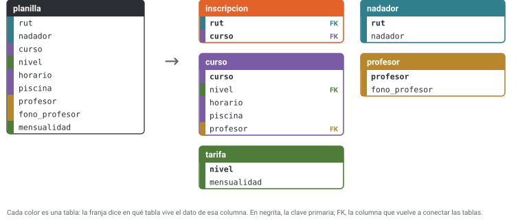
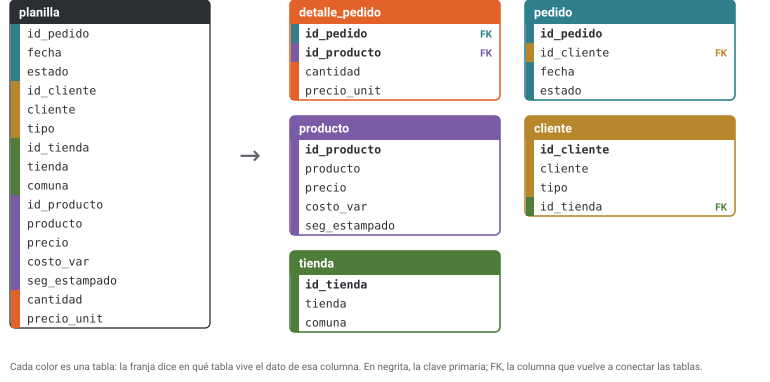

# Unidad 6 · Normalización

**Qué vas a poder hacer.** Mirar una tabla (o una planilla) y señalar sus anomalías de inserción,
borrado y actualización; escribir sus dependencias funcionales a partir de las reglas del negocio;
calcular clausuras para encontrar sus claves; decir en qué forma normal está; descomponerla hasta la
tercera forma normal o la de Boyce-Codd, comprobando con SQL que el join la reconstruye; y decidir
cuándo conviene dejar un dato repetido a propósito.

**Lo que necesitas antes.** La unidad 5: superclave, clave candidata, atributo primo y clave
foránea. De la unidad 4, que una relación N:M necesita su propia tabla. Saber leer un `SELECT` con
`GROUP BY` y un `JOIN` (se explican en las unidades 9 y 10; acá basta seguirlos).

**Tiempo.** Unas 6 horas: 2,5 de lectura con los scripts abiertos y 3,5 de práctica.

**Cómo están hechas las cifras.** Cada consulta está en `sql/u06_*.sql` y la corre
`verificacion/u06_normalizacion.py` con SQLite 3.50.4. El mismo verificador trae un pequeño motor de
dependencias funcionales (clausura, claves, forma normal, síntesis y las dos pruebas de descomposición)
que confirma cada paso de esta unidad por fuerza bruta.

---

## 1. La idea: cada hecho, una sola vez

Una planilla con todas las columnas juntas es cómoda para mirar y mala para guardar. El teléfono de
una profesora que hace dos cursos aparece en cada fila de cada alumno de esos cursos. Eso trae tres
problemas, que se llaman **anomalías**:

| Anomalía | Qué pasa | En el club de natación de la sección 8 |
|---|---|---|
| De actualización | un hecho está escrito muchas veces; si se corrige en unas filas y no en otras, la tabla se contradice | el teléfono de Paz Rivera está 7 veces |
| De inserción | no se puede guardar un hecho sin inventar otro | un curso nuevo no entra hasta que alguien se inscriba |
| De borrado | al borrar un hecho se pierde otro que no se quería perder | si el único alumno de Iván Toro se retira, se pierde el teléfono de Iván |

**Normalizar** es repartir las columnas en varias tablas, guiándose por las dependencias entre ellas,
hasta que cada hecho quede escrito en un solo lugar. No se pierde nada: un `JOIN` vuelve a armar la
planilla cuando se necesita mirarla junta.

Hay dos caminos para llegar a un buen esquema (la clase de modelo relacional del curso los nombra): pasar
un diagrama entidad-relación a tablas (unidad 4) o partir de una tabla grande y normalizarla. En la
práctica se usan los dos: el diagrama da el primer esquema y la normalización lo revisa.

---

## 2. Dependencias funcionales

Sean $X$ e $Y$ conjuntos de atributos de una relación $R$. $X$ **determina funcionalmente** a $Y$,
y se escribe $X \to Y$, si en todo estado válido de $R$ dos tuplas que coinciden en $X$ coinciden
también en $Y$:

$$t_1[X] = t_2[X] \;\Rightarrow\; t_1[Y] = t_2[Y]$$

En palabras: si conoces $X$, conoces $Y$. «Cada curso tiene un solo profesor» se escribe
`curso → profesor`. Una dependencia es **trivial** si $Y \subseteq X$ (`rut, curso → curso` no dice nada).

**Se leen de las reglas, no de los datos.** Igual que una clave (unidad 5): los datos pueden mostrar
que una dependencia **no** vale (dos filas con el mismo $X$ y distinto $Y$), pero nunca probar que vale.
En la planilla del caso, cada producto tiene siempre el mismo precio cobrado; aun así, `id_producto →
precio_unit` no es una regla (sección 12).

**Comprobarlas en los datos con SQL.** Para `X → Y`, agrupa por X y cuenta los Y distintos: si el máximo
es 1, los datos no la contradicen.

**Las reglas de Armstrong** permiten deducir dependencias nuevas de las conocidas:

| Regla | Dice | Ejemplo |
|---|---|---|
| Reflexividad | si $Y \subseteq X$, entonces $X \to Y$ | `rut, curso → rut` |
| Aumento | si $X \to Y$, entonces $XZ \to YZ$ | de `curso → profesor`, sale `curso, rut → profesor, rut` |
| Transitividad | si $X \to Y$ e $Y \to Z$, entonces $X \to Z$ | `curso → profesor` y `profesor → fono_profesor` dan `curso → fono_profesor` |
| Unión (se deduce) | si $X \to Y$ y $X \to Z$, entonces $X \to YZ$ | |
| Descomposición (se deduce) | si $X \to YZ$, entonces $X \to Y$ | |

---

## 3. Clausura y claves

La **clausura** $X^+$ es el conjunto de todos los atributos que $X$ determina. Se calcula así:

1. Parte con $X^+ = X$.
2. Recorre las dependencias: si el lado izquierdo de una está completo dentro de $X^+$, agrega su lado
   derecho.
3. Repite hasta que una vuelta completa no agregue nada.

**Para qué sirve.** $X \to Y$ se deduce de las dependencias conocidas si y solo si $Y \subseteq X^+$. Y
$X$ es **superclave** si $X^+$ tiene todos los atributos de $R$. Una clave candidata es una superclave
que deja de serlo si le quitas cualquier atributo.

**Atajo para encontrar las claves.** Un atributo que no aparece a la derecha de ninguna dependencia
nadie lo determina: tiene que estar en **toda** clave. Se parte de esos atributos y se agregan otros
hasta que la clausura cubra todo.

**Ejemplo.** En la planilla del club (sección 8), con
`rut → nadador`, `curso → nivel, horario, piscina, profesor`, `profesor → fono_profesor` y
`nivel → mensualidad`: `rut` y `curso` no aparecen a la derecha. $\{rut, curso\}^+$ empieza con esos
dos; agrega `nadador` (por `rut`); `nivel`, `horario`, `piscina` y `profesor` (por `curso`);
`fono_profesor` (por `profesor`) y `mensualidad` (por `nivel`). Tiene los 9 atributos: es superclave, y
como ni `rut` ni `curso` solos llegan a todo, es la única clave candidata.

---

## 4. Las formas normales

Cada forma normal prohíbe un tipo de dependencia. Se cumplen en cadena: una tabla en FNBC está en 3FN,
una en 3FN está en 2FN, y así.

| Forma | Pide | Lo que prohíbe |
|---|---|---|
| Primera (1FN) | valores atómicos: una celda, un valor | listas en una celda (`'C1, C2'`) y grupos repetidos (`curso1`, `curso2`, …) |
| Segunda (2FN) | 1FN y que ningún atributo no primo dependa de una **parte** de una clave candidata | la **dependencia parcial**: `rut → nadador` cuando la clave es {rut, curso} |
| Tercera (3FN) | para toda $X \to A$ no trivial: $X$ es superclave **o** $A$ es primo | además, la **dependencia transitiva**: `curso → profesor → fono_profesor` |
| Boyce-Codd (FNBC) | para toda $X \to A$ no trivial: $X$ es superclave | toda dependencia cuyo lado izquierdo no sea superclave, aunque $A$ sea primo |

**La intuición de cada una.** 2FN: si un dato depende de media clave, se repite en cada fila que comparte
esa media clave (el nombre del nadador, una vez por curso). 3FN: si depende de otro atributo que no es
clave, se repite en cada fila que comparte ese atributo (el teléfono de la profesora, una vez por
alumno). FNBC: lo mismo, sin la excepción de los atributos primos.

**Notas sobre 2FN.** Si todas las claves candidatas tienen un solo atributo, no puede haber dependencia
parcial: la tabla ya está en 2FN (ejercicio 6.9). La 2FN mira solo partes de claves; por eso una tabla
con clave subrogada `id` puede estar en 2FN y llena de redundancia (ejercicio 6.1).

**Cuándo 3FN y FNBC difieren.** Solo cuando hay claves candidatas compuestas que se traslapan. Un
gimnasio guarda clase(socio, actividad, instructor) con dos reglas: cada instructor dicta una sola
actividad (`instructor → actividad`) y cada socio tiene un instructor por actividad
(`socio, actividad → instructor`). Las claves candidatas son {socio, actividad} y {socio, instructor}:
los tres atributos son primos. `instructor → actividad` no tiene superclave a la izquierda, pero
`actividad` es primo: la tabla está en 3FN y no en FNBC. El verificador lo confirma.

---

## 5. Descomponer bien: sin pérdida y conservando dependencias

Descomponer $R$ es reemplazarla por tablas $R_1, \dots, R_n$ cuyas columnas cubren las de $R$, cada una
con las filas distintas de su proyección. Una buena descomposición cumple dos cosas.

**Sin pérdida (de join).** El join de las tablas devuelve exactamente $R$: ni una fila menos ni una más.
Con dos tablas hay una prueba directa:

$$R_1 \cap R_2 \to R_1 \quad\text{o}\quad R_1 \cap R_2 \to R_2$$

La columna común tiene que ser clave de alguna de las dos. Si no lo es, el join **inventa** filas
(filas espurias): parece que se gana información y en realidad se pierde, porque ya no se sabe cuáles
filas eran las verdaderas (ejercicio 6.6). Con más de dos tablas se usa el método de la tabla de
prueba («chase»), que el verificador aplica a cada descomposición de la unidad. En SQL se comprueba con
el join y dos `EXCEPT`: lo que falta y lo que sobra tienen que dar cero filas.

**Conserva las dependencias.** Cada dependencia de $R$ se puede revisar dentro de una sola tabla (o se
deduce de las que se revisan así). Si una se pierde, la base deja de poder hacerla cumplir con una clave:
hay que revisarla con un join cada vez.

**El compromiso.** A 3FN siempre se puede llegar sin pérdida y conservando las dependencias. A FNBC
siempre sin pérdida, pero no siempre conservándolas. En el gimnasio, la descomposición FNBC
(instructor, actividad) y (socio, instructor) es sin pérdida, pero `socio, actividad → instructor` ya
no cabe en ninguna tabla: nada impide asignarle a un socio dos instructores de la misma actividad
(ejercicio 6.8 lo muestra en SQL).

---

## 6. Dos algoritmos

**Síntesis en 3FN** (garantiza sin pérdida y conserva dependencias):

1. Calcula un **cubrimiento mínimo** de las dependencias: (a) un solo atributo a la derecha de cada una;
   (b) saca de cada lado izquierdo los atributos que sobran (si $XA \to B$ y ya $X^+$ contiene $B$, la
   $A$ sobra); (c) saca las dependencias que se deducen de las demás.
2. Una tabla por cada lado izquierdo, con ese lado y todo lo que determina.
3. Si ninguna tabla contiene una clave candidata de $R$, agrega una tabla con una clave.
4. Saca las tablas cuyas columnas están contenidas en otra.

**Descomposición en FNBC** (garantiza sin pérdida): mientras alguna tabla $R_i$ tenga una dependencia
$X \to Y$ que viola FNBC, reemplázala por $X^+$ (dentro de $R_i$) y por $X \cup (R_i - X^+)$. La columna
común es $X$, que es clave de la primera: por eso no hay pérdida.

---

## 7. Cuándo conviene desnormalizar

Normalizar optimiza la escritura: cada dato se corrige en un lugar. Leer cuesta joins. Desnormalizar es
**repetir un dato a propósito** para leer más rápido o para guardar algo que de verdad es otro hecho.

- **No es redundancia si es otro hecho.** El precio cobrado en una boleta no es el precio de lista de
  hoy: depende del producto **y** del momento. Por eso `precio_unit` vive en la línea del pedido aunque
  el producto también tenga precio (ejercicio 6.10 y sección 12).
- **Un total guardado es una copia.** El total de una boleta se puede calcular sumando sus líneas;
  guardarlo es válido (la boleta es un documento tributario y su total no debe cambiar), pero hay que
  mantenerlo en la misma transacción que las líneas (unidad 12) o se desalinea.
- **Para reportes.** Una tabla de resumen o un almacén de datos para análisis se arma desnormalizado a
  propósito, se recalcula cada noche y nadie escribe en él a mano.

La regla: primero normaliza hasta 3FN o FNBC; desnormaliza después, con una razón medida (una consulta
lenta, un documento legal) y con un mecanismo que mantenga la copia al día.

---

## 8. Ejemplo resuelto · La planilla de un club de natación

Un club de natación de Coquimbo llevaba sus inscripciones en una planilla. Las reglas, según la
secretaria: cada nadador tiene un RUT y un nombre; cada curso tiene un nivel, un horario, una piscina y un
profesor; cada profesor tiene un teléfono; la mensualidad depende solo del nivel. Un nadador puede
tomar varios cursos.

**Paso 1 · Primera forma normal.** Al principio la secretaria escribía una fila por nadador, con sus
cursos en una celda. La consulta `origen` reconstruye esa vista desde la planilla actual:

```sql
-- @origen así la llevaba la secretaria: una fila por nadador y los cursos en una celda
SELECT rut, nadador, GROUP_CONCAT(curso, ', ' ORDER BY curso) AS cursos
FROM planilla
GROUP BY rut, nadador
ORDER BY nadador;
```

| rut | nadador | cursos |
|---|---|---|
| 44.650.922-5 | Antonia Vega | C3 |
| 44.549.815-7 | Benjamín Rojas | C1, C2 |
| 44.347.601-6 | Emilia Araya | C1 |
| 44.752.029-K | Gaspar Olivares | C4 |
| 44.246.494-4 | Josefa Muñoz | C1, C3 |
| 44.448.708-9 | Sofía Tapia | C1 |
| 44.145.387-6 | Tomás Carvajal | C3, C4 |

La celda `cursos` no es atómica: no hay cómo pegarle a cada curso su horario. En 1FN se escribe una fila
por (nadador, curso), con los datos del curso al lado. Así quedó la planilla (`sql/u06_natacion.sql`):

```sql
-- Unidad 6 · Ejemplo resuelto · la planilla de un club de natación de Coquimbo (datos inventados)
-- Las líneas «-- @nombre» marcan las consultas que el verificador muestra con su resultado.
PRAGMA foreign_keys = ON;

CREATE TABLE planilla (
    rut           VARCHAR(12) NOT NULL,
    nadador       VARCHAR(60) NOT NULL,
    curso         VARCHAR(4)  NOT NULL,
    nivel         VARCHAR(12) NOT NULL,
    horario       VARCHAR(20) NOT NULL,
    piscina       VARCHAR(12) NOT NULL,
    profesor      VARCHAR(60) NOT NULL,
    fono_profesor VARCHAR(16) NOT NULL,
    mensualidad   INTEGER NOT NULL,
    PRIMARY KEY (rut, curso)
);
```

| rut | nadador | curso | nivel | horario | piscina | profesor | fono_profesor | mensualidad |
|---|---|---|---|---|---|---|---|---|
| 44.448.708-9 | Sofía Tapia | C1 | inicial | lun y mié 17:00 | temperada | Paz Rivera | +56 9 0000 0014 | 26500 |
| 44.549.815-7 | Benjamín Rojas | C1 | inicial | lun y mié 17:00 | temperada | Paz Rivera | +56 9 0000 0014 | 26500 |
| 44.549.815-7 | Benjamín Rojas | C2 | inicial | mar y jue 18:00 | olímpica | Iván Toro | +56 9 0000 0021 | 26500 |
| 44.650.922-5 | Antonia Vega | C3 | intermedio | lun y mié 18:30 | temperada | Paz Rivera | +56 9 0000 0014 | 30500 |
| 44.145.387-6 | Tomás Carvajal | C3 | intermedio | lun y mié 18:30 | temperada | Paz Rivera | +56 9 0000 0014 | 30500 |
| 44.145.387-6 | Tomás Carvajal | C4 | avanzado | sáb 10:00 | olímpica | Rocío Godoy | +56 9 0000 0034 | 34500 |
| 44.347.601-6 | Emilia Araya | C1 | inicial | lun y mié 17:00 | temperada | Paz Rivera | +56 9 0000 0014 | 26500 |
| 44.752.029-K | Gaspar Olivares | C4 | avanzado | sáb 10:00 | olímpica | Rocío Godoy | +56 9 0000 0034 | 34500 |
| 44.246.494-4 | Josefa Muñoz | C1 | inicial | lun y mié 17:00 | temperada | Paz Rivera | +56 9 0000 0014 | 26500 |
| 44.246.494-4 | Josefa Muñoz | C3 | intermedio | lun y mié 18:30 | temperada | Paz Rivera | +56 9 0000 0014 | 30500 |

**Paso 2 · Las dependencias.** De las reglas: `rut → nadador`; `curso → nivel, horario, piscina,
profesor`; `profesor → fono_profesor`; `nivel → mensualidad`. Los datos no contradicen ninguna (máximo 1
en cada una):

```sql
-- @dfs cuántos valores distintos toma el lado derecho por cada valor del izquierdo (1 = se cumple)
SELECT 'rut → nadador' AS dependencia, MAX(n) AS maximo
FROM (SELECT COUNT(DISTINCT nadador) AS n FROM planilla GROUP BY rut)
UNION ALL
SELECT 'curso → profesor', MAX(n)
FROM (SELECT COUNT(DISTINCT profesor) AS n FROM planilla GROUP BY curso)
UNION ALL
SELECT 'profesor → fono_profesor', MAX(n)
FROM (SELECT COUNT(DISTINCT fono_profesor) AS n FROM planilla GROUP BY profesor)
UNION ALL
SELECT 'nivel → mensualidad', MAX(n)
FROM (SELECT COUNT(DISTINCT mensualidad) AS n FROM planilla GROUP BY nivel);
```

| dependencia | maximo |
|---|---|
| rut → nadador | 1 |
| curso → profesor | 1 |
| profesor → fono_profesor | 1 |
| nivel → mensualidad | 1 |

**Paso 3 · La clave y la forma normal.** La sección 3 calculó la clausura: la única clave candidata es
{rut, curso}. Contra esa clave, `rut → nadador` y `curso → nivel, horario, piscina, profesor` son
**parciales** (dependen de media clave): la planilla está solo en 1FN. `profesor → fono_profesor` y
`nivel → mensualidad` son **transitivas**. La redundancia se mide:

```sql
-- @repetido cuántas veces está escrito el teléfono de cada profesor
SELECT profesor, fono_profesor, COUNT(*) AS veces
FROM planilla
GROUP BY profesor, fono_profesor
ORDER BY veces DESC;
```

| profesor | fono_profesor | veces |
|---|---|---|
| Paz Rivera | +56 9 0000 0014 | 7 |
| Rocío Godoy | +56 9 0000 0034 | 2 |
| Iván Toro | +56 9 0000 0021 | 1 |

**Paso 4 · Segunda forma normal.** Cada dependencia parcial se lleva a su propia tabla con su lado
izquierdo como clave, y la clave original se queda con lo que depende de ella entera (acá, nada más que
ella misma):

- nadador(**rut**, nadador)
- curso(**curso**, nivel, horario, piscina, profesor, fono_profesor, mensualidad)
- inscripcion(**rut, curso**)

La segunda tabla está en 2FN pero no en 3FN: arrastra dos transitivas.

**Paso 5 · Tercera forma normal.** Cada transitiva sale a su tabla:

- tarifa(**nivel**, mensualidad)
- profesor(**nombre**, fono)
- curso(**curso**, nivel → tarifa, horario, piscina, profesor → profesor)
- nadador(**rut**, nombre)
- inscripcion(**rut → nadador, curso → curso**)

Las cinco quedan en FNBC: en cada una, el único lado izquierdo es la clave. Es exactamente lo que da el
algoritmo de síntesis de la sección 6 (el verificador lo comprueba). En el esquema final convendría una
clave subrogada para el profesor (unidad 5); acá se deja el nombre para que se vea de dónde salió cada
tabla.



**Paso 6 · El script de la descomposición y la prueba.** Cada tabla se llena con un `SELECT DISTINCT`
desde la planilla:

```sql
-- La descomposición en tercera forma normal
CREATE TABLE tarifa (
    nivel       VARCHAR(12) NOT NULL PRIMARY KEY,
    mensualidad INTEGER NOT NULL
);
CREATE TABLE profesor (
    nombre      VARCHAR(60) NOT NULL PRIMARY KEY,
    fono        VARCHAR(16) NOT NULL
);
CREATE TABLE curso (
    curso       VARCHAR(4)  NOT NULL PRIMARY KEY,
    nivel       VARCHAR(12) NOT NULL,
    horario     VARCHAR(20) NOT NULL,
    piscina     VARCHAR(12) NOT NULL,
    profesor    VARCHAR(60) NOT NULL,
    FOREIGN KEY (nivel) REFERENCES tarifa (nivel),
    FOREIGN KEY (profesor) REFERENCES profesor (nombre)
);
CREATE TABLE nadador (
    rut         VARCHAR(12) NOT NULL PRIMARY KEY,
    nombre      VARCHAR(60) NOT NULL
);
CREATE TABLE inscripcion (
    rut         VARCHAR(12) NOT NULL,
    curso       VARCHAR(4)  NOT NULL,
    PRIMARY KEY (rut, curso),
    FOREIGN KEY (rut) REFERENCES nadador (rut),
    FOREIGN KEY (curso) REFERENCES curso (curso)
);
INSERT INTO tarifa SELECT DISTINCT nivel, mensualidad FROM planilla;
INSERT INTO profesor SELECT DISTINCT profesor, fono_profesor FROM planilla;
INSERT INTO curso SELECT DISTINCT curso, nivel, horario, piscina, profesor FROM planilla;
INSERT INTO nadador SELECT DISTINCT rut, nadador FROM planilla;
INSERT INTO inscripcion SELECT rut, curso FROM planilla;

-- @filas cuántas filas quedó en cada tabla
SELECT 'tarifa' AS tabla, COUNT(*) AS filas FROM tarifa
UNION ALL SELECT 'profesor', COUNT(*) FROM profesor
UNION ALL SELECT 'curso', COUNT(*) FROM curso
UNION ALL SELECT 'nadador', COUNT(*) FROM nadador
UNION ALL SELECT 'inscripcion', COUNT(*) FROM inscripcion;
-- @reconstruir el join de las cinco tablas contra la planilla, en los dos sentidos
SELECT
  (SELECT COUNT(*) FROM planilla) AS filas_planilla,
  (SELECT COUNT(*) FROM (
     SELECT i.rut, n.nombre, i.curso, c.nivel, c.horario, c.piscina, c.profesor, p.fono, t.mensualidad
     FROM inscripcion i
     JOIN nadador n  ON n.rut = i.rut
     JOIN curso c    ON c.curso = i.curso
     JOIN profesor p ON p.nombre = c.profesor
     JOIN tarifa t   ON t.nivel = c.nivel)) AS filas_join,
  (SELECT COUNT(*) FROM (
     SELECT * FROM planilla
     EXCEPT
     SELECT i.rut, n.nombre, i.curso, c.nivel, c.horario, c.piscina, c.profesor, p.fono, t.mensualidad
     FROM inscripcion i
     JOIN nadador n  ON n.rut = i.rut
     JOIN curso c    ON c.curso = i.curso
     JOIN profesor p ON p.nombre = c.profesor
     JOIN tarifa t   ON t.nivel = c.nivel)) AS faltan,
  (SELECT COUNT(*) FROM (
     SELECT i.rut, n.nombre, i.curso, c.nivel, c.horario, c.piscina, c.profesor, p.fono, t.mensualidad
     FROM inscripcion i
     JOIN nadador n  ON n.rut = i.rut
     JOIN curso c    ON c.curso = i.curso
     JOIN profesor p ON p.nombre = c.profesor
     JOIN tarifa t   ON t.nivel = c.nivel
     EXCEPT
     SELECT * FROM planilla)) AS sobran;
```

| tabla | filas |
|---|---|
| tarifa | 3 |
| profesor | 3 |
| curso | 4 |
| nadador | 7 |
| inscripcion | 10 |

| filas_planilla | filas_join | faltan | sobran |
|---|---|---|---|
| 10 | 10 | 0 | 0 |

La planilla tenía 90 celdas (10 filas por 9 columnas); las cinco tablas suman 66 celdas. Con 10 filas la
diferencia es chica; crece con cada inscripción, porque una inscripción nueva ahora agrega 2 celdas y
no 9.

**Paso 7 · Las anomalías, antes y después.** El final del script las provoca sobre la planilla:

```sql
-- Las tres anomalías, ahora sobre la planilla
-- @a_insercion un curso nuevo que todavía no tiene nadadores
INSERT INTO planilla (curso, nivel, horario, piscina, profesor, fono_profesor, mensualidad)
VALUES ('C5', 'avanzado', 'dom 09:00', 'olímpica', 'Rocío Godoy', '+56 9 0000 0034', 34500);
-- @a_insercion_bien en las tablas normalizadas entra sin problema
INSERT INTO curso VALUES ('C5', 'avanzado', 'dom 09:00', 'olímpica', 'Rocío Godoy');
-- @a_actualizacion Paz Rivera cambia de teléfono y alguien lo corrige solo en las filas del curso C1
UPDATE planilla SET fono_profesor = '+56 9 0000 0042' WHERE curso = 'C1';
-- @a_actualizacion_ver
SELECT profesor, COUNT(DISTINCT fono_profesor) AS telefonos
FROM planilla
GROUP BY profesor
HAVING COUNT(DISTINCT fono_profesor) > 1;
-- @a_borrado Benjamín deja el curso C2, el único de Iván Toro
DELETE FROM planilla WHERE rut = '44.549.815-7' AND curso = 'C2';
-- @a_borrado_ver
SELECT COUNT(*) AS filas_con_ivan FROM planilla WHERE profesor = 'Iván Toro';
```

| Intento | Qué se intenta | Respuesta de SQLite |
|---|---|---|
| a_insercion | un curso nuevo que todavía no tiene nadadores | rechaza: `NOT NULL constraint failed: planilla.rut` |
| a_insercion_bien | en las tablas normalizadas entra sin problema | acepta (1 fila) |
| a_actualizacion | Paz Rivera cambia de teléfono y alguien lo corrige solo en las filas del curso C1 | acepta (4 filas) |
| a_borrado | Benjamín deja el curso C2, el único de Iván Toro | acepta (1 fila) |

| profesor | telefonos |
|---|---|
| Paz Rivera | 2 |

| filas_con_ivan |
|---|
| 0 |

**Cómo se lee.**

- **Inserción:** la planilla no acepta el curso C5 porque su clave exige un RUT; para guardarlo habría
  que inventar un nadador. En las tablas normalizadas, un curso es una fila de `curso`.
- **Actualización:** se corrigieron 4 filas y quedaron 3 con el teléfono viejo; la planilla ahora dice
  que Paz Rivera tiene dos teléfonos. En la tabla `profesor` el teléfono está una vez.
- **Borrado:** al retirarse Benjamín de C2 no queda ninguna fila con Iván Toro: el club perdió el
  horario de C2 y el teléfono de Iván.
- **Decisión.** El club pasa a las cinco tablas. La planilla no se tira: se vuelve una consulta (el join
  del paso 6), que se puede guardar como vista (unidad 11) para quien quiera seguir mirándola junta.

**Notas para MySQL.** `GROUP_CONCAT` se escribe `GROUP_CONCAT(curso ORDER BY curso SEPARATOR ', ')`.
`EXCEPT` existe desde MySQL 8.0.31; antes se usa `NOT EXISTS` (unidad 11).

---

## 9. Errores típicos

| Error | Cómo evitarlo |
|---|---|
| Sacar las dependencias de los datos («en la planilla siempre coincide») | escríbelas desde las reglas; los datos solo sirven para refutarlas |
| Una lista en una celda (`'C1, C2'`, `'joyas, cerámica'`) | 1FN: una fila por valor, y una tabla aparte si el valor tiene sus propios datos |
| Creer que una clave subrogada `id` deja la tabla normalizada | la 2FN se cumple sola con clave simple, pero las transitivas siguen ahí (ejercicio 6.1) |
| Confundir dependencia parcial con transitiva | parcial: el lado izquierdo es parte de una clave; transitiva: no es parte de ninguna |
| Descomponer por una columna que no es clave de ninguna de las dos tablas | revisa $R_1 \cap R_2 \to R_1$ o $\to R_2$; si no, el join inventa filas |
| Dar por buena una descomposición sin probarla | join más dos `EXCEPT`: lo que falta y lo que sobra tienen que dar cero filas |
| Llevar a FNBC sin mirar qué dependencia se pierde | si se pierde una regla importante, quédate en 3FN o revísala con una consulta |
| «Normalizar» el precio cobrado sacándolo de la línea | el precio de un momento es otro hecho; depende del producto y del pedido |
| Guardar un total calculado y no mantenerlo | se actualiza en la misma transacción que las líneas, o se calcula con una vista |
| Comparar con `=` un valor que puede ser `NULL` al revisar dependencias | `COUNT(DISTINCT ...)` ignora los `NULL`; revisa aparte las filas con nulos |

---

## 10. Práctica

Diez ejercicios: 6.1 a 6.4 básicos, 6.5 a 6.8 intermedios, 6.9 y 6.10 de desafío. Los scripts están en
`sql/u06_e*.sql`; las pautas, en la sección 11.

**6.1 · Reservas de pádel (básico).** Un club de Viña del Mar guarda sus reservas en una tabla con clave
`id_reserva` (`sql/u06_e01_padel.sql`). Reglas: cada cancha tiene una superficie y un precio por hora;
cada cliente, un nombre y un teléfono.

```sql
-- Ejercicio 6.1 · reservas de canchas de pádel en Viña del Mar (datos inventados)
CREATE TABLE reserva (
    id_reserva  INTEGER PRIMARY KEY,
    fecha       DATE NOT NULL,
    hora        VARCHAR(5) NOT NULL,
    cancha      INTEGER NOT NULL,
    superficie  VARCHAR(20) NOT NULL,
    precio_hora INTEGER NOT NULL,
    rut_cliente VARCHAR(12) NOT NULL,
    cliente     VARCHAR(60) NOT NULL,
    fono        VARCHAR(16) NOT NULL
);
```

| id_reserva | fecha | hora | cancha | superficie | precio_hora | rut_cliente | cliente | fono |
|---|---|---|---|---|---|---|---|---|
| 1 | 2026-11-06 | 19:00 | 1 | césped | 14000 | 42.830.996-0 | Ignacia Fuentes | +56 9 0000 0006 |
| 2 | 2026-11-06 | 19:00 | 2 | cemento | 11000 | 43.336.531-3 | Matías León | +56 9 0000 0011 |
| 3 | 2026-11-06 | 20:00 | 1 | césped | 14000 | 43.842.066-5 | Catalina Reyes | +56 9 0000 0025 |
| 4 | 2026-11-07 | 10:00 | 2 | cemento | 11000 | 42.830.996-0 | Ignacia Fuentes | +56 9 0000 0006 |
| 5 | 2026-11-07 | 11:00 | 3 | césped | 16500 | 43.336.531-3 | Matías León | +56 9 0000 0011 |
| 6 | 2026-11-07 | 12:00 | 2 | cemento | 11000 | 42.830.996-0 | Ignacia Fuentes | +56 9 0000 0006 |
| 7 | 2026-11-08 | 18:00 | 2 | cemento | 11000 | 41.921.033-1 | Andrés Silva | +56 9 0000 0036 |
| 8 | 2026-11-08 | 19:00 | 1 | césped | 14000 | 43.842.066-5 | Catalina Reyes | +56 9 0000 0025 |

(a) Da un ejemplo de cada anomalía con estas filas. (b) Si sube el precio de la cancha 2, ¿cuántas filas
hay que corregir? (c) ¿Qué cliente desaparece si se anula su única reserva? (d) La clave es `id_reserva`,
de un solo atributo: ¿en qué forma normal está la tabla? Descomponla en 3FN.

**6.2 · Clausuras (básico).** Sea $R(A, B, C, D, E)$ con las dependencias $A \to B$, $B \to C$,
$CD \to E$ y $E \to A$. (a) Calcula $\{A\}^+$ y $\{C, D\}^+$. (b) Encuentra todas las claves candidatas.
(c) ¿Qué atributos son primos? (d) ¿En qué forma normal está $R$?

**6.3 · Géneros en una celda (básico).** Un club de lectura de Punta Arenas anotó los géneros favoritos
de cada socio en una sola columna (`sql/u06_e03_lectura.sql`):

```sql
-- Ejercicio 6.3 · un club de lectura de Punta Arenas (datos inventados): géneros en una celda
CREATE TABLE socio_planilla (
    id_socio INTEGER PRIMARY KEY,
    nombre   VARCHAR(60) NOT NULL,
    generos  VARCHAR(200)
);
```

| id_socio | nombre | generos |
|---|---|---|
| 1 | Marcela Ojeda | novela negra, poesía |
| 2 | Hernán Barría | Poesía |
| 3 | Lorena Vidal | ciencia ficción, poesia, ensayo |
| 4 | Cristián Andrade | ensayo |
| 5 | Pilar Mansilla | novela negra |
| 6 | Ramón Gallardo | poesía, novela negra |

(a) ¿Por qué no está en 1FN? (b) Llévala a 1FN con un catálogo de géneros. ¿Cuántas filas tiene la tabla
intermedia? (c) ¿Cuántos socios leen poesía según `LIKE '%poesía%'` sobre la celda, y cuántos según las
tablas normalizadas? ¿Por qué difieren?

**6.4 · ¿En qué forma normal está? (básico).** Para cada relación, encuentra sus claves candidatas y su
forma normal más alta:

- arriendo(depto, mes, arrendatario, valor), en un edificio de Viña del Mar, con
  `depto, mes → arrendatario` y `depto → valor` (el arriendo de cada depto es fijo).
- vuelo(numero, fecha, avion, capacidad), de una línea aérea entre Santiago y Calama, con
  `numero, fecha → avion` y `avion → capacidad`.
- atencion(paciente, especialidad, medico), en un centro médico, con `medico → especialidad` y
  `paciente, especialidad → medico`.
- producto(sku, nombre, precio), con `sku → nombre, precio` y `nombre → sku`.

**6.5 · Cajas de un supermercado (intermedio).** Un supermercado de Rancagua guarda
turno(cajero, fecha, caja, piso, supervisor). Reglas: un cajero atiende una sola caja por día; una caja
tiene un solo cajero por día; cada caja está en un piso; cada piso tiene un supervisor por día. (a)
Escribe las dependencias. (b) Encuentra las claves candidatas con clausuras. (c) ¿En qué forma normal
está? (d) Descompón en 3FN con el algoritmo de síntesis y di en qué forma queda cada tabla.

**6.6 · El join que inventa filas (intermedio).** Un condominio de Iquique guarda los turnos de sus
guardias (`sql/u06_e06_guardias.sql`). Regla: cada guardia trabaja siempre en la misma portería.

```sql
-- Ejercicio 6.6 · turnos de guardias de un condominio de Iquique (datos inventados)
-- Regla: cada guardia trabaja siempre en la misma portería.
CREATE TABLE turno (
    guardia  VARCHAR(30) NOT NULL,
    dia      VARCHAR(10) NOT NULL,
    porteria VARCHAR(10) NOT NULL,
    PRIMARY KEY (guardia, dia)
);
```

| guardia | dia | porteria |
|---|---|---|
| Rubén | lunes | norte |
| Elsa | lunes | sur |
| Rubén | martes | norte |
| Mauricio | martes | sur |
| Ximena | miércoles | norte |
| Elsa | miércoles | sur |
| Ximena | jueves | norte |
| Mauricio | jueves | sur |

Dos propuestas: A, (guardia, dia) y (dia, porteria); B, (guardia, dia) y (guardia, porteria). (a) Aplica
la prueba de la sección 5 a cada una. (b) Arma las dos en SQL y cuenta cuántas filas da cada join y
cuántas son inventadas. (c) ¿Qué filas inventa A el lunes?

**6.7 · La planilla de una liga de futsal (intermedio).** Una liga de Antofagasta lleva sus partidos en
una planilla (`sql/u06_e07_futsal.sql`). Reglas: en una cancha se juega un partido por fecha; un equipo
juega a lo más un partido por fecha; cada cancha tiene una dirección; cada árbitro, un teléfono.

```sql
-- Ejercicio 6.7 · planilla de una liga de futsal de Antofagasta (datos inventados)
CREATE TABLE planilla (
    fecha        DATE NOT NULL,
    cancha       VARCHAR(20) NOT NULL,
    direccion    VARCHAR(40) NOT NULL,
    local        VARCHAR(30) NOT NULL,
    visita       VARCHAR(30) NOT NULL,
    goles_local  INTEGER NOT NULL,
    goles_visita INTEGER NOT NULL,
    arbitro      VARCHAR(40) NOT NULL,
    fono_arbitro VARCHAR(16) NOT NULL,
    PRIMARY KEY (fecha, cancha)
);
```

| fecha | cancha | direccion | local | visita | goles_local | goles_visita | arbitro | fono_arbitro |
|---|---|---|---|---|---|---|---|---|
| 2026-08-01 | Coloso | calle Coloso 1170 | Cobre FC | Los Changos | 4 | 2 | Juan Contreras | +56 9 0000 0002 |
| 2026-08-01 | Las Algas | pasaje Las Algas 225 | Atlético Caliche | Puerto Norte | 3 | 3 | Marisol Páez | +56 9 0000 0007 |
| 2026-08-08 | Coloso | calle Coloso 1170 | Unión Salitre | La Portada FS | 1 | 5 | Diego Saavedra | +56 9 0000 0012 |
| 2026-08-08 | Las Algas | pasaje Las Algas 225 | Los Changos | Atlético Caliche | 2 | 0 | Juan Contreras | +56 9 0000 0002 |
| 2026-08-15 | Coloso | calle Coloso 1170 | Puerto Norte | Cobre FC | 2 | 6 | Marisol Páez | +56 9 0000 0007 |
| 2026-08-15 | Las Algas | pasaje Las Algas 225 | La Portada FS | Los Changos | 3 | 1 | Diego Saavedra | +56 9 0000 0012 |
| 2026-08-22 | Coloso | calle Coloso 1170 | Atlético Caliche | Unión Salitre | 4 | 4 | Juan Contreras | +56 9 0000 0002 |
| 2026-08-22 | Las Algas | pasaje Las Algas 225 | Cobre FC | La Portada FS | 2 | 3 | Marisol Páez | +56 9 0000 0007 |

(a) Escribe las dependencias y encuentra las tres claves candidatas. (b) ¿Por qué no está en 2FN?
(c) Llévala a 3FN, escribe el SQL y comprueba con el join que no se pierde nada. (d) ¿Cómo se declaran en
la tabla de partidos las claves que no quedaron como primaria?

**6.8 · Boyce-Codd o tercera (intermedio).** Un preuniversitario de Temuco asigna tutores
(`sql/u06_e08_preu.sql`). Reglas: cada tutor enseña un solo ramo; cada alumno tiene un solo tutor por
ramo.

| alumno | ramo | tutor |
|---|---|---|
| Amanda | matemática | Valeria Sáez |
| Amanda | lenguaje | Fernanda Lagos |
| Bruno | matemática | Ignacio Pino |
| Bruno | ciencias | Claudio Mella |
| Carla | lenguaje | Hugo Neira |
| Carla | matemática | Valeria Sáez |

(a) ¿Cuáles son las claves candidatas? ¿En qué forma normal está tutoria(alumno, ramo, tutor)? (b) Llévala a
FNBC. ¿Es sin pérdida? ¿Qué dependencia se pierde? (c) Prueba en SQL qué acepta y qué rechaza cada
diseño cuando a Amanda se le asigna un segundo tutor de matemática y cuando Valeria Sáez aparece
enseñando lenguaje. ¿Cuál elegirías?

**6.9 · Síntesis para una distribuidora de gas (desafío).** Una distribuidora de gas licuado de Temuco
registra pedido_gas(n_pedido, fecha, rut, cliente, direccion, sector, camion, chofer, cilindros). El
encargado anotó estas reglas, con algunas repetidas o deducibles:

- `n_pedido → fecha, rut, cilindros, camion`
- `rut → cliente, direccion`
- `direccion → sector`
- `rut → sector`
- `sector, fecha → camion` (cada sector lo atiende un camión por día)
- `camion, fecha → chofer`
- `n_pedido, rut → cilindros`

(a) Encuentra las claves candidatas y la forma normal. (b) Calcula un cubrimiento mínimo y di qué
dependencias salieron y por qué. (c) Aplica la síntesis en 3FN. (d) Comprueba que la descomposición es
sin pérdida y conserva las dependencias, y di en qué forma queda cada tabla.

**6.10 · El precio de ayer y el total guardado (desafío).** Un minimarket de Valparaíso guarda boletas
con sus líneas (`sql/u06_e10_minimarket.sql`). El 01-10-2026 subieron el café y los huevos; `producto`
guarda el precio de hoy.

```sql
-- Ejercicio 6.10 · boletas de un minimarket de Valparaíso (datos inventados)
-- El 01-10-2026 subieron el café y los huevos; producto guarda el precio de HOY.
PRAGMA foreign_keys = ON;
CREATE TABLE producto (
    id_producto   INTEGER PRIMARY KEY,
    nombre        VARCHAR(40) NOT NULL UNIQUE,
    precio_actual INTEGER NOT NULL CHECK (precio_actual > 0)
);
CREATE TABLE boleta (
    id_boleta     INTEGER PRIMARY KEY,
    fecha         DATE NOT NULL,
    total         INTEGER NOT NULL
);
CREATE TABLE linea (
    id_boleta     INTEGER NOT NULL,
    id_producto   INTEGER NOT NULL,
    cantidad      INTEGER NOT NULL CHECK (cantidad > 0),
    precio_unit   INTEGER NOT NULL,
    PRIMARY KEY (id_boleta, id_producto),
    FOREIGN KEY (id_boleta) REFERENCES boleta (id_boleta),
    FOREIGN KEY (id_producto) REFERENCES producto (id_producto)
);
```

| id_producto | nombre | precio_actual |
|---|---|---|
| 1 | pan amasado (kg) | 2390 |
| 2 | leche entera 1 L | 1150 |
| 3 | café molido 250 g | 4990 |
| 4 | huevos (docena) | 3590 |
| 5 | aceite 1 L | 2790 |

| id_boleta | fecha | total |
|---|---|---|
| 1 | 2026-09-04 | 12920 |
| 2 | 2026-09-12 | 9370 |
| 3 | 2026-09-25 | 15060 |
| 4 | 2026-10-03 | 7290 |
| 5 | 2026-10-09 | 10760 |
| 6 | 2026-10-15 | 10570 |

| id_boleta | id_producto | cantidad | precio_unit |
|---|---|---|---|
| 1 | 1 | 2 | 2390 |
| 1 | 2 | 3 | 1150 |
| 1 | 3 | 1 | 4690 |
| 2 | 4 | 2 | 3290 |
| 2 | 5 | 1 | 2790 |
| 3 | 3 | 2 | 4690 |
| 3 | 1 | 1 | 2390 |
| 3 | 4 | 1 | 3290 |
| 4 | 3 | 1 | 4990 |
| 4 | 2 | 2 | 1150 |
| 5 | 4 | 1 | 3590 |
| 5 | 1 | 3 | 2390 |
| 6 | 5 | 2 | 2790 |
| 6 | 3 | 1 | 4990 |

(a) Un practicante propone borrar `precio_unit` porque «depende del producto». ¿Es una dependencia
funcional? Calcula las ventas de septiembre con el precio cobrado y con el precio de hoy. (b)
`boleta.total` se puede calcular desde las líneas: ¿es redundancia? Se descubre que la boleta 5 llevaba
2 kg de pan y no 3: corrige la línea y revisa qué pasa con el total. (c) ¿Qué harías con cada columna?

---

## 11. Pautas

**6.1.** (a) Actualización: el precio de la cancha 2 está escrito en 4 filas; inserción: una cancha nueva
no entra sin una reserva; borrado: si se anula la reserva 7, el club pierde el teléfono de Andrés Silva.
(b) y (c), con el script:

```sql
-- @cancha2 filas que hay que corregir si sube el precio de la cancha 2
SELECT COUNT(*) AS filas FROM reserva WHERE cancha = 2;
-- @una_reserva clientes que desaparecen si se anula su única reserva
SELECT rut_cliente, cliente, COUNT(*) AS reservas
FROM reserva
GROUP BY rut_cliente, cliente
HAVING COUNT(*) = 1;
-- @cancha4 registrar una cancha nueva que todavía no tiene reservas
INSERT INTO reserva (cancha, superficie, precio_hora) VALUES (4, 'cemento', 12500);
```

| filas |
|---|
| 4 |

| rut_cliente | cliente | reservas |
|---|---|---|
| 41.921.033-1 | Andrés Silva | 1 |

| Intento | Qué se intenta | Respuesta de SQLite |
|---|---|---|
| cancha4 | registrar una cancha nueva que todavía no tiene reservas | rechaza: `NOT NULL constraint failed: reserva.fecha` |

(d) Con clave de un atributo no hay dependencias parciales: está en 2FN. No está en 3FN por dos
transitivas: `cancha → superficie, precio_hora` y `rut_cliente → cliente, fono`. En 3FN:
cancha(**cancha**, superficie, precio_hora), cliente(**rut_cliente**, cliente, fono) y
reserva(**id_reserva**, fecha, hora, cancha → cancha, rut_cliente → cliente). Lectura: una clave subrogada
no normaliza nada; solo hace que la 2FN se cumpla sola. (Falta además una regla que la tabla no
protege: dos reservas de la misma cancha a la misma hora. Se declara `UNIQUE (fecha, hora, cancha)`.)

**6.2.** (a) $\{A\}^+$: de $A \to B$ sale $B$, de $B \to C$ sale $C$; nada más se dispara (falta $D$):
{A, B, C}. $\{C, D\}^+$: $CD \to E$, $E \to A$, $A \to B$: {A, B, C, D, E}. (b) $D$ no aparece a la
derecha: está en toda clave. $\{D\}^+ = \{D\}$, y $D$ con cualquiera de $A$, $B$, $C$ o $E$ llega a todo.
Las claves candidatas son {A, D}, {B, D}, {C, D}, {D, E}. (c) Los cinco atributos son primos. (d) Ninguna
dependencia tiene una superclave a la izquierda, pero todo lado derecho es primo: está en **3FN** y no
en FNBC. Lectura: con claves que se traslapan, una tabla puede estar en 3FN y seguir repitiendo datos.

**6.3.** (a) La celda `generos` guarda una lista. (b) Un catálogo `genero` y una tabla intermedia
`prefiere`, con 10 filas:

```sql
-- La versión en primera forma normal: un género por fila, contra un catálogo
CREATE TABLE genero (
    id_genero INTEGER PRIMARY KEY,
    nombre    VARCHAR(30) NOT NULL UNIQUE
);
CREATE TABLE socio (
    id_socio  INTEGER PRIMARY KEY,
    nombre    VARCHAR(60) NOT NULL
);
CREATE TABLE prefiere (
    id_socio  INTEGER NOT NULL,
    id_genero INTEGER NOT NULL,
    PRIMARY KEY (id_socio, id_genero),
    FOREIGN KEY (id_socio) REFERENCES socio (id_socio),
    FOREIGN KEY (id_genero) REFERENCES genero (id_genero)
);
INSERT INTO socio SELECT id_socio, nombre FROM socio_planilla;
```

Con el catálogo 1 novela negra, 2 poesía, 3 ciencia ficción y 4 ensayo:

| id_socio | id_genero |
|---|---|
| 1 | 1 |
| 1 | 2 |
| 2 | 2 |
| 3 | 3 |
| 3 | 2 |
| 3 | 4 |
| 4 | 4 |
| 5 | 1 |
| 6 | 2 |
| 6 | 1 |

(c) Las consultas:

```sql
-- @like cuántos socios leen poesía, buscando en la celda
SELECT COUNT(*) AS socios FROM socio_planilla WHERE generos LIKE '%poesía%';
-- @normal lo mismo en las tablas normalizadas
SELECT COUNT(*) AS socios
FROM prefiere pf JOIN genero g ON g.id_genero = pf.id_genero
WHERE g.nombre = 'poesía';
-- @ranking socios por género
SELECT g.nombre, COUNT(*) AS socios
FROM prefiere pf JOIN genero g ON g.id_genero = pf.id_genero
GROUP BY g.nombre
ORDER BY socios DESC, g.nombre;
```

| socios |
|---|
| 3 |

| socios |
|---|
| 4 |

| nombre | socios |
|---|---|
| poesía | 4 |
| novela negra | 3 |
| ensayo | 2 |
| ciencia ficción | 1 |

El `LIKE` encuentra a Marcela, Hernán (en SQLite, `LIKE` no distingue mayúsculas en letras sin tilde) y
Ramón, y pierde a Lorena, que escribió «poesia» sin tilde. En MySQL, con su intercalación habitual que
ignora tildes, el mismo `LIKE` daría 4: el resultado depende del motor. Lectura: con un catálogo, «poesía»
se escribe una vez y la respuesta no depende de cómo tipeó cada socio.

**6.4.** El verificador calcula claves y forma normal de cada una:

| Relación | Claves candidatas | Forma normal | Por qué no sube |
|---|---|---|---|
| arriendo | {depto, mes} | 1FN | `depto → valor` es parcial |
| vuelo | {numero, fecha} | 2FN | `avion → capacidad` es transitiva |
| atencion | {paciente, especialidad} y {paciente, medico} | 3FN | `medico → especialidad`: el lado izquierdo no es superclave, pero especialidad es primo |
| producto | {sku} y {nombre} | FNBC | todo lado izquierdo es clave |

Lectura: atencion es el caso del gimnasio de la sección 4 con otros nombres.

**6.5.** (a) `cajero, fecha → caja`; `caja, fecha → cajero`; `caja → piso`; `piso, fecha → supervisor`.
(b) `fecha` no aparece a la derecha. $\{cajero, fecha\}^+$ agrega caja, piso y supervisor: es clave.
Lo mismo $\{caja, fecha\}^+$. Las claves candidatas son {cajero, fecha} y {fecha, caja}. (c) `caja → piso`
tiene a la izquierda una parte de la clave {fecha, caja} y `piso` no es primo: dependencia parcial, la
tabla está en 1FN. (d) El cubrimiento ya es mínimo. Una tabla por lado izquierdo:
(cajero, fecha, caja) dos veces (por las dos primeras dependencias, que dan la misma tabla),
(caja, piso) y (piso, fecha, supervisor). Contiene una clave, así que no se agrega nada:
{cajero, fecha, caja}, {caja, piso} y {fecha, piso, supervisor}, las tres en FNBC, sin pérdida y sin
perder dependencias. Lectura: la primera tabla tiene dos claves (`UNIQUE` en la que no sea primaria).

**6.6.** (a) A: la columna común es `dia`, y `dia` no determina ni a `guardia` ni a `porteria`: con
pérdida. B: la columna común es `guardia` y `guardia → porteria`: sin pérdida. (b) El script:

```sql
-- Descomposición A: (guardia, dia) y (dia, porteria)
CREATE TABLE a_gd AS SELECT DISTINCT guardia, dia FROM turno;
CREATE TABLE a_dp AS SELECT DISTINCT dia, porteria FROM turno;
-- Descomposición B: (guardia, dia) y (guardia, porteria)
CREATE TABLE b_gd AS SELECT DISTINCT guardia, dia FROM turno;
CREATE TABLE b_gp AS SELECT DISTINCT guardia, porteria FROM turno;

-- @a el join de la descomposición A
SELECT (SELECT COUNT(*) FROM turno) AS filas_originales,
       (SELECT COUNT(*) FROM (SELECT x.guardia, x.dia, y.porteria
                              FROM a_gd x JOIN a_dp y ON y.dia = x.dia)) AS filas_join,
       (SELECT COUNT(*) FROM (SELECT x.guardia, x.dia, y.porteria
                              FROM a_gd x JOIN a_dp y ON y.dia = x.dia
                              EXCEPT SELECT * FROM turno)) AS espurias;
-- @a_ejemplo las filas inventadas del lunes
SELECT x.guardia, x.dia, y.porteria
FROM a_gd x JOIN a_dp y ON y.dia = x.dia
WHERE x.dia = 'lunes'
EXCEPT SELECT * FROM turno;
-- @b el join de la descomposición B
SELECT (SELECT COUNT(*) FROM turno) AS filas_originales,
       (SELECT COUNT(*) FROM (SELECT x.guardia, x.dia, y.porteria
                              FROM b_gd x JOIN b_gp y ON y.guardia = x.guardia)) AS filas_join,
       (SELECT COUNT(*) FROM (SELECT x.guardia, x.dia, y.porteria
                              FROM b_gd x JOIN b_gp y ON y.guardia = x.guardia
                              EXCEPT SELECT * FROM turno)) AS espurias;
```

| filas_originales | filas_join | espurias |
|---|---|---|
| 8 | 16 | 8 |

| guardia | dia | porteria |
|---|---|---|
| Elsa | lunes | norte |
| Rubén | lunes | sur |

| filas_originales | filas_join | espurias |
|---|---|---|
| 8 | 8 | 0 |

(c) El lunes trabajan dos guardias y se usan dos porterías; A ya no sabe quién estuvo en cuál y combina
todo con todo. Lectura: un join con más filas que el original no es más información, es información
perdida.

**6.7.** (a) `fecha, cancha → local, visita, goles_local, goles_visita, arbitro`; `fecha, local →
cancha`; `fecha, visita → cancha`; `cancha → direccion`; `arbitro → fono_arbitro`. Las claves
candidatas son {fecha, cancha}, {fecha, local} y {fecha, visita}. (b) `cancha → direccion`: `cancha` es
parte de la clave {fecha, cancha} y `direccion` no es primo. (c) La pauta del script:

```sql
-- La pauta: tres tablas en tercera forma normal
CREATE TABLE cancha (
    nombre       VARCHAR(20) NOT NULL PRIMARY KEY,
    direccion    VARCHAR(40) NOT NULL
);
CREATE TABLE arbitro (
    nombre       VARCHAR(40) NOT NULL PRIMARY KEY,
    fono         VARCHAR(16) NOT NULL
);
CREATE TABLE partido (
    fecha        DATE NOT NULL,
    cancha       VARCHAR(20) NOT NULL,
    local        VARCHAR(30) NOT NULL,
    visita       VARCHAR(30) NOT NULL,
    goles_local  INTEGER NOT NULL,
    goles_visita INTEGER NOT NULL,
    arbitro      VARCHAR(40) NOT NULL,
    PRIMARY KEY (fecha, cancha),
    UNIQUE (fecha, local),
    UNIQUE (fecha, visita),
    FOREIGN KEY (cancha) REFERENCES cancha (nombre),
    FOREIGN KEY (arbitro) REFERENCES arbitro (nombre)
);
INSERT INTO cancha SELECT DISTINCT cancha, direccion FROM planilla;
INSERT INTO arbitro SELECT DISTINCT arbitro, fono_arbitro FROM planilla;
INSERT INTO partido SELECT fecha, cancha, local, visita, goles_local, goles_visita, arbitro FROM planilla;

-- @filas
SELECT 'cancha' AS tabla, COUNT(*) AS filas FROM cancha
UNION ALL SELECT 'arbitro', COUNT(*) FROM arbitro
UNION ALL SELECT 'partido', COUNT(*) FROM partido;
-- @reconstruir
SELECT
  (SELECT COUNT(*) FROM (
     SELECT * FROM planilla
     EXCEPT
     SELECT p.fecha, p.cancha, c.direccion, p.local, p.visita, p.goles_local, p.goles_visita, p.arbitro, a.fono
     FROM partido p JOIN cancha c ON c.nombre = p.cancha JOIN arbitro a ON a.nombre = p.arbitro)) AS faltan,
  (SELECT COUNT(*) FROM (
     SELECT p.fecha, p.cancha, c.direccion, p.local, p.visita, p.goles_local, p.goles_visita, p.arbitro, a.fono
     FROM partido p JOIN cancha c ON c.nombre = p.cancha JOIN arbitro a ON a.nombre = p.arbitro
     EXCEPT
     SELECT * FROM planilla)) AS sobran;
-- @doble un equipo que juega dos partidos la misma fecha
INSERT INTO partido VALUES ('2026-08-22', 'Norte', 'Cobre FC', 'Puerto Norte', 0, 0, 'Diego Saavedra');
```

| tabla | filas |
|---|---|
| cancha | 2 |
| arbitro | 3 |
| partido | 8 |

| faltan | sobran |
|---|---|
| 0 | 0 |

| Intento | Qué se intenta | Respuesta de SQLite |
|---|---|---|
| doble | un equipo que juega dos partidos la misma fecha | rechaza: `UNIQUE constraint failed: partido.fecha, partido.local` |

(d) Las claves {fecha, local} y {fecha, visita} se declaran `UNIQUE`; el último intento muestra que
funcionan. Las tres tablas quedan en FNBC. Lectura: normalizar no solo quita repeticiones; deja cada
regla en una tabla donde una clave la puede hacer cumplir. (Falta una regla que ninguna clave cubre: que
un equipo no sea local y visita en partidos distintos de la misma fecha; se revisa con una consulta.)

**6.8.** (a) {alumno, ramo} y {alumno, tutor}; los tres atributos son primos: **3FN**, no FNBC
(`tutor → ramo`). (b) tutor(**tutor**, ramo) y asignacion(**alumno, tutor**): sin pérdida (la columna
común `tutor` es clave de la primera), pero se pierde `alumno, ramo → tutor`. (c) El script arma los dos
diseños con los mismos datos:

```sql
-- Ejercicio 6.8 · tutorías de un preuniversitario de Temuco (datos inventados)
-- Reglas: cada tutor enseña un solo ramo; cada alumno tiene un solo tutor por ramo.
PRAGMA foreign_keys = ON;

-- Diseño en tercera forma normal (una tabla)
CREATE TABLE tutoria (
    alumno VARCHAR(40) NOT NULL,
    ramo   VARCHAR(20) NOT NULL,
    tutor  VARCHAR(40) NOT NULL,
    PRIMARY KEY (alumno, ramo),
    UNIQUE (alumno, tutor)
);
-- Diseño en forma normal de Boyce-Codd (dos tablas)
CREATE TABLE tutor (
    tutor  VARCHAR(40) NOT NULL PRIMARY KEY,
    ramo   VARCHAR(20) NOT NULL
);
CREATE TABLE asignacion (
    alumno VARCHAR(40) NOT NULL,
    tutor  VARCHAR(40) NOT NULL,
    PRIMARY KEY (alumno, tutor),
    FOREIGN KEY (tutor) REFERENCES tutor (tutor)
);
INSERT INTO tutor SELECT DISTINCT tutor, ramo FROM tutoria;
INSERT INTO asignacion SELECT alumno, tutor FROM tutoria;

-- @t1 3FN: un segundo tutor de matemática para Amanda
INSERT INTO tutoria VALUES ('Amanda', 'matemática', 'Ignacio Pino');
-- @t2 3FN: Valeria Sáez aparece enseñando lenguaje
INSERT INTO tutoria VALUES ('Diego', 'lenguaje', 'Valeria Sáez');
-- @t2_ver
SELECT tutor, COUNT(DISTINCT ramo) AS ramos FROM tutoria GROUP BY tutor HAVING COUNT(DISTINCT ramo) > 1;
-- @b1 FNBC: un segundo tutor de matemática para Amanda
INSERT INTO asignacion VALUES ('Amanda', 'Ignacio Pino');
-- @b1_ver
SELECT a.alumno, t.ramo, COUNT(*) AS tutores
FROM asignacion a JOIN tutor t ON t.tutor = a.tutor
GROUP BY a.alumno, t.ramo
HAVING COUNT(*) > 1;
-- @b2 FNBC: Valeria Sáez enseñando lenguaje
INSERT INTO tutor VALUES ('Valeria Sáez', 'lenguaje');
```

| Intento | Qué se intenta | Respuesta de SQLite |
|---|---|---|
| t1 | 3FN: un segundo tutor de matemática para Amanda | rechaza: `UNIQUE constraint failed: tutoria.alumno, tutoria.ramo` |
| t2 | 3FN: Valeria Sáez aparece enseñando lenguaje | acepta (1 fila) |
| b1 | FNBC: un segundo tutor de matemática para Amanda | acepta (1 fila) |
| b2 | FNBC: Valeria Sáez enseñando lenguaje | rechaza: `UNIQUE constraint failed: tutor.tutor` |

| tutor | ramos |
|---|---|
| Valeria Sáez | 2 |

| alumno | ramo | tutores |
|---|---|---|
| Amanda | matemática | 2 |

Cada diseño protege una regla y deja pasar la otra. Lectura: si lo que más importa es que un alumno no
tenga dos tutores del mismo ramo (lo que se cobra), quédate en 3FN y revisa `tutor → ramo` con la
consulta `t2_ver`; si importa más que un tutor tenga un solo ramo, FNBC y revisa la otra con `b1_ver`.

**6.9.** (a) `n_pedido` no aparece a la derecha y $\{n\_pedido\}^+$ llega a todo: la única clave es
{n_pedido}. Con clave de un atributo la tabla está en 2FN; no en 3FN (por ejemplo `rut → cliente`).
(b) Partiendo cada dependencia a un atributo a la derecha y limpiando, queda este cubrimiento mínimo:
`n_pedido → cilindros`, `n_pedido → fecha`, `n_pedido → rut`, `rut → cliente`, `rut → direccion`,
`direccion → sector`, `fecha, sector → camion` y `fecha, camion → chofer`. Salieron tres:
`n_pedido → camion` (se deduce: el pedido da la fecha y el RUT, el RUT da la dirección, la dirección el
sector, y fecha y sector dan el camión), `rut → sector` (se deduce por `direccion`) y
`n_pedido, rut → cilindros` (el `rut` sobra a la izquierda y lo que queda ya estaba). (c) Una tabla por lado
izquierdo: {n_pedido, fecha, rut, cilindros}, {rut, cliente, direccion}, {direccion, sector},
{fecha, sector, camion} y {fecha, camion, chofer}. La primera contiene la clave. (d) El verificador
aplica el chase (sin pérdida) y la prueba de conservación (no se pierde ninguna); las cinco tablas
quedan en FNBC. Lectura: la tabla (fecha, sector, camion) es la programación diaria de reparto, un dato
que la planilla tenía escondido y repetido en cada pedido.

**6.10.** (a) No: el mismo producto se cobró a $4.690 en septiembre y a $4.990 en octubre. El precio
cobrado depende de la línea (`id_boleta, id_producto → precio_unit`), no del producto solo.

```sql
-- @sep_cobrado ventas de septiembre con el precio que se cobró
SELECT SUM(l.cantidad * l.precio_unit) AS ventas
FROM linea l JOIN boleta b ON b.id_boleta = l.id_boleta
WHERE b.fecha < '2026-10-01';
-- @sep_hoy las mismas ventas si precio_unit se borra y se usa el precio de hoy
SELECT SUM(l.cantidad * p.precio_actual) AS ventas
FROM linea l JOIN boleta b ON b.id_boleta = l.id_boleta
JOIN producto p ON p.id_producto = l.id_producto
WHERE b.fecha < '2026-10-01';
-- @total_ok boletas cuyo total no calza con la suma de sus líneas
SELECT b.id_boleta, b.total, SUM(l.cantidad * l.precio_unit) AS suma_lineas
FROM boleta b JOIN linea l ON l.id_boleta = b.id_boleta
GROUP BY b.id_boleta, b.total
HAVING b.total <> SUM(l.cantidad * l.precio_unit);
-- @corrige la boleta 5 llevaba 2 kg de pan, no 3: se corrige la línea
UPDATE linea SET cantidad = 2 WHERE id_boleta = 5 AND id_producto = 1;
-- @total_mal
SELECT b.id_boleta, b.total, SUM(l.cantidad * l.precio_unit) AS suma_lineas
FROM boleta b JOIN linea l ON l.id_boleta = b.id_boleta
GROUP BY b.id_boleta, b.total
HAVING b.total <> SUM(l.cantidad * l.precio_unit);
```

| ventas |
|---|
| 37350 |

| ventas |
|---|
| 39150 |

| Intento | Qué se intenta | Respuesta de SQLite |
|---|---|---|
| corrige | la boleta 5 llevaba 2 kg de pan, no 3: se corrige la línea | acepta (1 fila) |

| id_boleta | total | suma_lineas |
|---|---|---|
| 5 | 10760 | 8370 |

Septiembre vendió $37.350; con el precio de hoy, el reporte diría $39.150: $1.800 de ventas que no
existieron. (b) Antes de la corrección, `total_ok` no devuelve filas: los totales calzan. Después, la
boleta 5 dice $10.760 y sus líneas suman $8.370. `total` es una copia derivada: redundancia. (c)
`precio_unit` se queda, porque es otro hecho. `total` puede quedarse porque la boleta es un documento
emitido, pero entonces la corrección no se hace editando la línea: se anula la boleta y se emite una
nota de crédito, o línea y total se actualizan juntos en una transacción (unidad 12). Si no es un
documento, se borra la columna y el total se calcula con una vista (unidad 11). Lectura: antes de llamar
«redundante» a una columna, pregunta de qué depende de verdad.

---

## 12. Caso integrador · La planilla única de pedidos de Estampa Sur

> Este caso sigue a Estampa Sur por todo el ramo. Antes de tener base de datos, el taller llevaba sus
> pedidos en una sola planilla. La unidad 5 dejó las claves del esquema de 8 tablas; acá se arma esa
> planilla desde la base del caso y se normaliza, para ver que las tablas del esquema son exactamente
> las que da la teoría.

**La planilla.** `sql/u06_caso.sql` corre sobre una copia en memoria de la base. Primero arma la planilla
con todo lo que se sabe de cada línea de pedido:

```sql
-- Unidad 6 · Caso integrador · la planilla única de pedidos de Estampa Sur y su normalización
-- Se corre sobre una COPIA de datos/estampa_sur.db (el verificador la copia en memoria).
-- Primero se arma la planilla que el taller llevaba antes de tener base: una fila por línea de pedido.
CREATE TABLE planilla AS
SELECT d.id_pedido, p.fecha, p.estado,
       c.id_cliente, c.nombre AS cliente, c.tipo,
       t.id_tienda, t.nombre AS tienda, t.comuna,
       pr.id_producto, pr.nombre AS producto, pr.precio, pr.costo_var, pr.seg_estampado,
       d.cantidad, d.precio_unit
FROM detalle_pedido d
JOIN pedido p    ON p.id_pedido = d.id_pedido
JOIN cliente c   ON c.id_cliente = p.id_cliente
JOIN tienda t    ON t.id_tienda = c.id_tienda
JOIN producto pr ON pr.id_producto = d.id_producto;

-- @tamano
SELECT COUNT(*) AS filas, (SELECT COUNT(*) FROM pragma_table_info('planilla')) AS columnas FROM planilla;
-- @muestra las tres líneas del pedido 3 (9 de las 16 columnas)
SELECT id_pedido, fecha, cliente, tienda, comuna, producto, precio, cantidad, precio_unit
FROM planilla WHERE id_pedido = 3;
```

| filas | columnas |
|---|---|
| 212 | 16 |

| id_pedido | fecha | cliente | tienda | comuna | producto | precio | cantidad | precio_unit |
|---|---|---|---|---|---|---|---|---|
| 3 | 2026-03-18 | Cliente 10 | Valle | Chiguayante | poleras básicas | 3990 | 64 | 3990 |
| 3 | 2026-03-18 | Cliente 10 | Valle | Chiguayante | polerones | 9890 | 23 | 9890 |
| 3 | 2026-03-18 | Cliente 10 | Valle | Chiguayante | poleras estampado doble | 6290 | 73 | 6290 |

**Las dependencias.** De las reglas del taller: `id_pedido → fecha, estado, id_cliente`;
`id_cliente → cliente, tipo, id_tienda`; `id_tienda → tienda, comuna` y `tienda → id_tienda` (el nombre de
la tienda no se repite); `id_producto → producto, precio, costo_var, seg_estampado` y
`producto → id_producto`; `id_pedido, id_producto → cantidad, precio_unit`. El motor encuentra dos claves
candidatas, `{id_pedido, id_producto}` y `{id_pedido, producto}`, y la planilla está en 1FN: las
dependencias de `id_pedido` y de `id_producto` son parciales y las de `id_cliente` e `id_tienda`,
transitivas. Las consultas lo confirman en los datos y miden la repetición:

```sql
-- @repetidos cuántas veces está escrito cada hecho
SELECT 'fecha y estado de cada pedido' AS hecho, COUNT(*) AS veces_escrito, COUNT(DISTINCT id_pedido) AS hechos FROM planilla
UNION ALL
SELECT 'tipo y tienda de cada cliente', COUNT(*), COUNT(DISTINCT id_cliente) FROM planilla
UNION ALL
SELECT 'comuna de cada tienda', COUNT(*), COUNT(DISTINCT id_tienda) FROM planilla
UNION ALL
SELECT 'precio y costo de cada producto', COUNT(*), COUNT(DISTINCT id_producto) FROM planilla;
-- @dfs las dependencias en los datos (1 = se cumple)
SELECT 'id_pedido → fecha, estado, id_cliente' AS dependencia,
       MAX(n) AS maximo FROM (SELECT COUNT(DISTINCT fecha || '|' || estado || '|' || id_cliente) AS n FROM planilla GROUP BY id_pedido)
UNION ALL
SELECT 'id_cliente → cliente, tipo, id_tienda',
       MAX(n) FROM (SELECT COUNT(DISTINCT cliente || '|' || tipo || '|' || id_tienda) AS n FROM planilla GROUP BY id_cliente)
UNION ALL
SELECT 'id_tienda → tienda, comuna',
       MAX(n) FROM (SELECT COUNT(DISTINCT tienda || '|' || comuna) AS n FROM planilla GROUP BY id_tienda)
UNION ALL
SELECT 'id_producto → producto, precio, costo_var, seg_estampado',
       MAX(n) FROM (SELECT COUNT(DISTINCT producto || '|' || precio || '|' || costo_var || '|' || seg_estampado) AS n FROM planilla GROUP BY id_producto)
UNION ALL
SELECT 'id_producto → precio_unit',
       MAX(n) FROM (SELECT COUNT(DISTINCT precio_unit) AS n FROM planilla GROUP BY id_producto);
```

| hecho | veces_escrito | hechos |
|---|---|---|
| fecha y estado de cada pedido | 212 | 120 |
| tipo y tienda de cada cliente | 212 | 26 |
| comuna de cada tienda | 212 | 6 |
| precio y costo de cada producto | 212 | 5 |

| dependencia | maximo |
|---|---|
| id_pedido → fecha, estado, id_cliente | 1 |
| id_cliente → cliente, tipo, id_tienda | 1 |
| id_tienda → tienda, comuna | 1 |
| id_producto → producto, precio, costo_var, seg_estampado | 1 |
| id_producto → precio_unit | 1 |

(El separador `'|'` evita que dos combinaciones distintas se peguen en el mismo texto. En MySQL, `||` no
concatena: se usa `CONCAT_WS('|', ...)`, y `pragma_table_info` se reemplaza por
`information_schema.columns`.)

La comuna de 6 tiendas está escrita 212 veces. Y la última fila es la trampa: en estos datos cada producto
se cobró siempre a su precio de lista, así que `id_producto → precio_unit` **se cumple en los datos**. No
es una regla: el día que el taller haga un descuento a un colegio, el precio cobrado y el de lista se
separan. Si se declarara, la síntesis se llevaría `precio_unit` a la tabla de productos y el detalle
perdería el precio de cada venta (el error del ejercicio 6.10).

**Las anomalías, con las cifras del caso.**

```sql
-- @a_actualizacion si sube el precio de los gorros, filas que hay que corregir
SELECT COUNT(*) AS filas FROM planilla WHERE producto = 'gorros';
-- @a_insercion clientes de la base que no pueden estar en la planilla (no tienen pedidos)
SELECT COUNT(*) AS clientes FROM cliente WHERE id_cliente NOT IN (SELECT id_cliente FROM planilla);
-- @a_borrado clientes que desaparecen si se anula su único pedido
SELECT id_cliente, cliente, COUNT(DISTINCT id_pedido) AS pedidos
FROM planilla
GROUP BY id_cliente, cliente
HAVING COUNT(DISTINCT id_pedido) = 1;
```

| filas |
|---|
| 52 |

| clientes |
|---|
| 4 |

| id_cliente | cliente | pedidos |
|---|---|---|
| 6 | Cliente 06 | 1 |

Subir el precio de los gorros obliga a corregir 52 filas. Los 4 clientes que todavía no compran (los
mismos que la unidad 10 cuenta con un `LEFT JOIN`) no caben en la planilla. Y si se anula el único pedido
del Cliente 06, el taller pierde su tipo y su tienda.

**La descomposición.** La síntesis en 3FN del motor da cinco tablas: una por cada determinante. Cada una
se llena desde la planilla:

```sql
-- La descomposición: cada tabla nueva sale de la planilla con SELECT DISTINCT
CREATE TABLE n_tienda AS SELECT DISTINCT id_tienda, tienda AS nombre, comuna FROM planilla;
CREATE TABLE n_producto AS SELECT DISTINCT id_producto, producto AS nombre, precio, costo_var, seg_estampado FROM planilla;
CREATE TABLE n_cliente AS SELECT DISTINCT id_cliente, cliente AS nombre, tipo, id_tienda FROM planilla;
CREATE TABLE n_pedido AS SELECT DISTINCT id_pedido, id_cliente, fecha, estado FROM planilla;
CREATE TABLE n_detalle AS SELECT id_pedido, id_producto, cantidad, precio_unit FROM planilla;

-- @contra_la_base cada tabla obtenida contra la tabla del esquema del caso
SELECT 'tienda' AS tabla, (SELECT COUNT(*) FROM n_tienda) AS desde_planilla, (SELECT COUNT(*) FROM tienda) AS en_la_base,
       (SELECT COUNT(*) FROM (SELECT * FROM n_tienda EXCEPT SELECT * FROM tienda)) AS distintas
UNION ALL
SELECT 'producto', (SELECT COUNT(*) FROM n_producto), (SELECT COUNT(*) FROM producto),
       (SELECT COUNT(*) FROM (SELECT * FROM n_producto EXCEPT SELECT * FROM producto))
UNION ALL
SELECT 'cliente', (SELECT COUNT(*) FROM n_cliente), (SELECT COUNT(*) FROM cliente),
       (SELECT COUNT(*) FROM (SELECT * FROM n_cliente EXCEPT SELECT * FROM cliente))
UNION ALL
SELECT 'pedido', (SELECT COUNT(*) FROM n_pedido), (SELECT COUNT(*) FROM pedido),
       (SELECT COUNT(*) FROM (SELECT * FROM n_pedido EXCEPT SELECT * FROM pedido))
UNION ALL
SELECT 'detalle_pedido', (SELECT COUNT(*) FROM n_detalle), (SELECT COUNT(*) FROM detalle_pedido),
       (SELECT COUNT(*) FROM (SELECT * FROM n_detalle EXCEPT SELECT * FROM detalle_pedido));
-- @reconstruir el join de las cinco tablas vuelve a dar la planilla
SELECT
  (SELECT COUNT(*) FROM (
     SELECT d.id_pedido, p.fecha, p.estado, c.id_cliente, c.nombre, c.tipo, t.id_tienda, t.nombre, t.comuna,
            pr.id_producto, pr.nombre, pr.precio, pr.costo_var, pr.seg_estampado, d.cantidad, d.precio_unit
     FROM n_detalle d
     JOIN n_pedido p    ON p.id_pedido = d.id_pedido
     JOIN n_cliente c   ON c.id_cliente = p.id_cliente
     JOIN n_tienda t    ON t.id_tienda = c.id_tienda
     JOIN n_producto pr ON pr.id_producto = d.id_producto)) AS filas_join,
  (SELECT COUNT(*) FROM (
     SELECT * FROM planilla
     EXCEPT
     SELECT d.id_pedido, p.fecha, p.estado, c.id_cliente, c.nombre, c.tipo, t.id_tienda, t.nombre, t.comuna,
            pr.id_producto, pr.nombre, pr.precio, pr.costo_var, pr.seg_estampado, d.cantidad, d.precio_unit
     FROM n_detalle d
     JOIN n_pedido p    ON p.id_pedido = d.id_pedido
     JOIN n_cliente c   ON c.id_cliente = p.id_cliente
     JOIN n_tienda t    ON t.id_tienda = c.id_tienda
     JOIN n_producto pr ON pr.id_producto = d.id_producto)) AS faltan,
  (SELECT COUNT(*) FROM (
     SELECT d.id_pedido, p.fecha, p.estado, c.id_cliente, c.nombre, c.tipo, t.id_tienda, t.nombre, t.comuna,
            pr.id_producto, pr.nombre, pr.precio, pr.costo_var, pr.seg_estampado, d.cantidad, d.precio_unit
     FROM n_detalle d
     JOIN n_pedido p    ON p.id_pedido = d.id_pedido
     JOIN n_cliente c   ON c.id_cliente = p.id_cliente
     JOIN n_tienda t    ON t.id_tienda = c.id_tienda
     JOIN n_producto pr ON pr.id_producto = d.id_producto
     EXCEPT
     SELECT * FROM planilla)) AS sobran;
```

| tabla | desde_planilla | en_la_base | distintas |
|---|---|---|---|
| tienda | 6 | 6 | 0 |
| producto | 5 | 5 | 0 |
| cliente | 26 | 30 | 0 |
| pedido | 120 | 120 | 0 |
| detalle_pedido | 212 | 212 | 0 |

| filas_join | faltan | sobran |
|---|---|---|
| 212 | 0 | 0 |



**Lectura.**

- **Las tablas son las del esquema.** Cada tabla obtenida tiene exactamente las filas de la tabla del
  caso (cero distintas). La única diferencia es la anomalía de inserción: la planilla trae 26 clientes y
  la base tiene 30.
- **No se pierde nada.** El join de las cinco tablas da las 212 filas, sin faltantes ni sobrantes, y el
  motor confirma que la descomposición conserva todas las dependencias y deja cada tabla en FNBC.
- **El detalle tiene tabla propia** porque es lo único que depende de la clave completa:
  `id_pedido, id_producto → cantidad, precio_unit`. Esa es la respuesta a la pregunta que dejó la
  unidad 5.
- **Cuánto se ahorra.** La planilla ocupa 3.392 celdas (212 filas por 16 columnas); las cinco tablas,
  1.475 celdas. Más importante que el espacio: el precio de los gorros se corrige en 1 fila, no en 52.

**La cadena.** El verificador comprueba que la planilla tenga las 212 líneas de detalle del caso, que
cada tabla obtenida coincida con la del esquema, que el join la reconstruya completa y que los 4 clientes
sin pedidos sean los del `.json` del caso (`CADENA: OK`).

**Lo que pasa a las unidades siguientes.** La unidad 7 escribe en álgebra relacional las preguntas del
dueño sobre estas tablas, y la planilla de esta unidad es justo lo que hace una cadena de joins: la
unidad 10 la arma con `JOIN` para calcular las ventas por tienda. Las otras tres tablas del esquema
(`proveedor`, `suministra` y `orden_produccion`) salen de normalizar otras planillas del taller: la de
compras y la de producción.

---

## 13. Para seguir

**En los libros del área.** El ramo no tiene programa con bibliografía. Elmasri y Navathe,
*Fundamentos de sistemas de bases de datos*, y Silberschatz, Korth y Sudarshan, *Fundamentos de bases de
datos*, dedican capítulos a las dependencias funcionales y la normalización, con los algoritmos de
síntesis y de descomposición en FNBC.

**Abierto y gratis.** Adrienne Watt, *Database Design*, 2.ª ed. (BCcampus, 2014, licencia CC BY 4.0), en
inglés: el capítulo 11, «Functional Dependencies», y el 12, «Normalization».
https://opentextbc.ca/dbdesign01/

**Con el tutor.** La carpeta `tutor/` trae el contexto de este ramo. Pégalo al inicio de la conversación
con cualquier IA y pídele, por ejemplo: «Dame una planilla de 8 columnas de un negocio chileno con sus
reglas en palabras; yo escribo las dependencias, la clave y la descomposición en 3FN, y tú me corriges
paso a paso».
