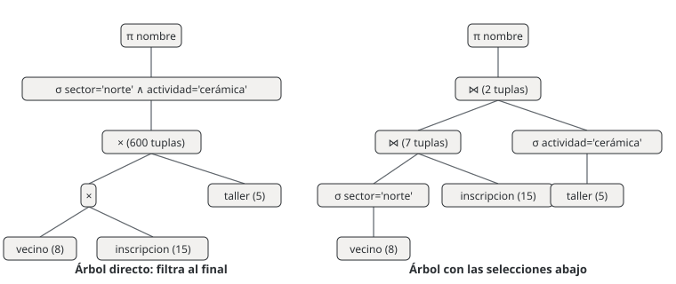

# Unidad 7 · Álgebra relacional

**Qué vas a poder hacer.** Escribir una pregunta en palabras como una expresión de álgebra relacional
(seleccionar, proyectar, renombrar, unir, restar, intersectar, multiplicar, juntar y dividir
relaciones), calcular a mano su resultado, reordenarla para que trabaje con menos tuplas y traducirla
a una consulta SQL que dé exactamente las mismas filas.

**Lo que necesitas antes.** De las unidades 4 y 5: qué es una relación (una tabla con nombre, sus
atributos y sus tuplas), qué es una clave primaria y qué es una clave foránea. De SQL basta haber
visto un `SELECT ... FROM ... WHERE` (la unidad 9 lo desarrolla); aquí cada consulta se muestra
completa y con su resultado.

**Tiempo.** Unas 5 horas: 2 de lectura con `sqlite3` abierto y 3 de práctica.

---

## 1. La idea: una consulta es una cuenta con tablas

En aritmética, $3 + 4 \cdot 2$ toma números y devuelve un número. En álgebra relacional, una
expresión toma **relaciones** y devuelve **una relación**. Esa propiedad (se llama *cerradura*) es la
que permite encadenar operaciones: el resultado de una es la entrada de la siguiente, igual que en
$(3 + 4) \cdot 2$.

¿Para qué sirve si al final se escribe SQL? Por tres razones:

- **Es lo que el motor ejecuta.** MySQL, SQLite o PostgreSQL traducen tu SQL a un árbol de
  operaciones de álgebra, lo reordenan para que sea barato y recién entonces lo corren.
- **Obliga a pensar en conjuntos.** Una pregunta como «los vecinos que van a *todos* los talleres del
  sábado» no tiene una palabra en SQL; en álgebra es una operación (la división, sección 6).
- **Explica los errores.** Casi todo resultado raro en SQL (filas repetidas, filas de más, una tabla
  vacía que no debería estarlo) tiene una explicación de una línea en álgebra.

**Una relación es un conjunto.** No tiene tuplas repetidas y sus tuplas no tienen orden. SQL, en
cambio, trabaja con **multiconjuntos** (bolsas): deja repetidos salvo que se pida `DISTINCT`. Esa es
la diferencia más importante entre las dos notaciones y vuelve en casi todos los ejercicios.

---

## 2. La base de esta unidad

Un centro comunitario de Chillán ofrece talleres a los vecinos del barrio. Guarda tres tablas
(`sql/u07_talleres.sql` las crea y las llena):

**vecino**

| id_vecino | nombre | sector | edad |
|---|---|---|---|
| 1 | Rosa Valdés | norte | 67 |
| 2 | Matías Fuentes | sur | 24 |
| 3 | Carmen Soto | norte | 58 |
| 4 | Diego Parra | centro | 35 |
| 5 | Javiera Lagos | sur | 41 |
| 6 | Luis Contreras | centro | 72 |
| 7 | Paula Rivas | norte | 29 |
| 8 | Héctor Muñoz | sur | 63 |

**taller**

| id_taller | actividad | dia | cupo |
|---|---|---|---|
| 1 | yoga | sábado | 12 |
| 2 | guitarra | martes | 10 |
| 3 | cerámica | sábado | 8 |
| 4 | computación | jueves | 15 |
| 5 | huerto | sábado | 20 |

**inscripcion** (clave primaria compuesta: un vecino se inscribe una vez en cada taller)

| id_vecino | id_taller |
|---|---|
| 1 | 1 |
| 1 | 3 |
| 1 | 5 |
| 2 | 2 |
| 2 | 4 |
| 3 | 3 |
| 3 | 5 |
| 4 | 4 |
| 5 | 1 |
| 5 | 2 |
| 5 | 3 |
| 5 | 5 |
| 6 | 5 |
| 7 | 1 |
| 7 | 2 |

Fíjate en dos detalles que importan más adelante: el atributo con el nombre del taller se llama
`actividad` y no `nombre` (sección 5), y el vecino 8 no tiene ninguna inscripción.

---

## 3. Selección, proyección y renombre

Son las tres operaciones **unarias**: trabajan sobre una sola relación.

**Selección** $\sigma_{c}(R)$: deja las tuplas de $R$ que cumplen la condición $c$. Corta **filas**.
La condición compara atributos con constantes o entre sí ($=, \ne, <, \le, >, \ge$) y se combina con
$\wedge$ (y), $\vee$ (o) y $\neg$ (no):

$$\sigma_{\mathrm{sector} = \text{'norte'} \,\wedge\, \mathrm{edad} \ge 60}(\mathrm{vecino})$$

devuelve solo a Rosa Valdés. El esquema (los atributos) no cambia; cambia cuántas tuplas hay.

**Proyección** $\pi_{A_1, \dots, A_k}(R)$: deja solo esos atributos. Corta **columnas**. Como el
resultado es un conjunto, las tuplas que quedan iguales se funden en una: $\pi_{\mathrm{sector}}(\mathrm{vecino})$
tiene 3 tuplas (norte, sur, centro) aunque `vecino` tenga 8.

**Renombre** $\rho$: cambia el nombre de la relación, $\rho_{S}(R)$, o de un atributo,
$\rho_{\mathrm{nombre} \to \mathrm{tienda}}(R)$. No cambia ningún dato. Parece decorativo y no lo
es: hace falta cada vez que dos relaciones tienen atributos con el mismo nombre y hay que
multiplicarlas o juntarlas (secciones 5 y 11), y cuando una relación se junta consigo misma
(ejercicio 7.6).

**Por qué funciona componerlas.** $\sigma$ y $\pi$ devuelven relaciones, así que
$\pi_{\mathrm{nombre}}(\sigma_{\mathrm{edad} \ge 60}(\mathrm{vecino}))$ se lee de adentro hacia
afuera: primero se filtran filas, después se cortan columnas. El orden importa en un sentido: si
proyectas primero sobre `nombre`, la condición sobre `edad` ya no tiene con qué evaluarse.

---

## 4. Unión, diferencia e intersección

Son las operaciones de conjuntos de siempre, con una condición: $R$ y $S$ tienen que ser
**compatibles**, es decir, tener el mismo número de atributos y que cada par de atributos hable de lo
mismo (el mismo dominio). No se pueden unir vecinos con talleres.

| Operación | Notación | Qué deja |
|---|---|---|
| Unión | $R \cup S$ | lo que está en $R$, en $S$ o en ambas |
| Diferencia | $R - S$ | lo que está en $R$ y no en $S$ |
| Intersección | $R \cap S$ | lo que está en las dos |

La intersección no es indispensable: $R \cap S = R - (R - S)$. Se usa porque se lee mejor.

**La diferencia es la manera de decir «no».** «Los vecinos sin ninguna inscripción» es: todos los
vecinos menos los que aparecen en `inscripcion`,

$$\pi_{\mathrm{id\_vecino}}(\mathrm{vecino}) - \pi_{\mathrm{id\_vecino}}(\mathrm{inscripcion})$$

Las dos proyecciones son las que vuelven compatibles a las relaciones: ambas quedan con un solo
atributo, `id_vecino`.

---

## 5. Producto cartesiano y joins

**Producto cartesiano** $R \times S$: cada tupla de $R$ pegada a cada tupla de $S$. Si $R$ tiene
$m$ tuplas y $S$ tiene $n$, el producto tiene $m \cdot n$. Sus atributos son los de $R$ seguidos de
los de $S$, y por eso no puede haber dos con el mismo nombre: si los hay, se renombra antes con
$\rho$. Solo, el producto casi nunca responde una pregunta: combina a Rosa con inscripciones que no
son suyas.

**Join theta** $R \bowtie_{\theta} S = \sigma_{\theta}(R \times S)$: el producto seguido de una
selección que se queda con las combinaciones que tienen sentido. Cuando la condición $\theta$ es una
igualdad entre la clave foránea y la clave primaria, se llama *equijoin*:

$$\mathrm{vecino} \bowtie_{\mathrm{vecino.id\_vecino} = \mathrm{inscripcion.id\_vecino}} \mathrm{inscripcion}$$

**Join natural** $R \bowtie S$: un equijoin automático que iguala **todos** los atributos que tienen
el mismo nombre en las dos relaciones y deja una sola copia de cada uno. Con `vecino` e `inscripcion`
el único atributo común es `id_vecino`, y el resultado tiene una tupla por inscripción (15).

**Cuándo el join natural se equivoca.** Iguala por nombre, no por significado. Si `taller` hubiera
guardado la actividad en un atributo llamado `nombre`, el join natural de `vecino`, `inscripcion` y
`taller` exigiría además que el nombre del vecino fuera igual al nombre del taller, y el resultado
saldría vacío sin ningún mensaje de error. Por eso esta base llama `actividad` a ese atributo. La
base de Estampa Sur no tiene esa precaución, y la sección 14 muestra lo que pasa.

---

## 6. División: la operación del «todos»

$R \div S$ responde preguntas del tipo «¿qué $x$ están relacionados con **todos** los $y$ de $S$?».
Si $R$ tiene los atributos $X \cup Y$ y $S$ tiene los atributos $Y$, el cociente tiene los atributos
$X$ y contiene cada $x$ tal que, para cada $y$ de $S$, el par $(x, y)$ está en $R$.

No es una operación nueva: se escribe con las anteriores,

$$R \div S = \pi_{X}(R) - \pi_{X}\big((\pi_{X}(R) \times S) - R\big)$$

**Por qué funciona.** $\pi_X(R) \times S$ son todos los pares que *deberían* existir si cada $x$
estuviera relacionado con todos los $y$. Al restarle $R$ quedan los pares que **faltan**. Los $x$ con
algún par faltante son los que fallan; el cociente es el resto.

**Cuándo no aplica.** La división pide «todos», no «alguno». «Los vecinos inscritos en algún taller
del sábado» es un join y una proyección; usar ahí la división deja fuera a casi todos. Y si $S$ está
vacía, la división devuelve **todos** los $x$ de $R$: es verdad que están relacionados con todos los
elementos de un conjunto que no tiene ninguno (ejercicio 7.9).

---

## 7. Componer: árboles y equivalencias

Una expresión larga se escribe en pasos, con relaciones temporales y una flecha de asignación:

$$\mathrm{Norte} \leftarrow \sigma_{\mathrm{sector} = \text{'norte'}}(\mathrm{vecino}) \qquad \mathrm{Resultado} \leftarrow \pi_{\mathrm{nombre}}(\mathrm{Norte} \bowtie \mathrm{inscripcion})$$

O se dibuja como un **árbol**: las hojas son las tablas, cada nodo es una operación y el resultado
sale por la raíz. Dos árboles distintos pueden dar la misma relación. Estas equivalencias son las que
usa el motor para elegir el más barato:

- **Bajar las selecciones.** $\sigma_{c}(R \bowtie S) = \sigma_{c}(R) \bowtie S$ si $c$ usa solo
  atributos de $R$. Filtrar antes deja menos tuplas para juntar.
- **Partir una selección compuesta.** $\sigma_{c_1 \wedge c_2}(R) = \sigma_{c_1}(\sigma_{c_2}(R))$.
- **El join es conmutativo y asociativo.** $(R \bowtie S) \bowtie T = R \bowtie (S \bowtie T)$: se
  puede juntar en el orden que deje menos tuplas en el camino.
- **Proyectar temprano**, siempre que no se pierda un atributo que una operación posterior necesita.

El ejemplo resuelto compara dos árboles para la misma pregunta: uno pasa por una relación intermedia
de 600 tuplas y el otro por una de 7. El resultado es el mismo; el trabajo, no.

---

## 8. De álgebra a SQL

| Álgebra | SQL | Ojo |
|---|---|---|
| $\sigma_c(R)$ | `SELECT * FROM R WHERE c` | en SQL la condición se escribe en el `WHERE`, no en el `SELECT` |
| $\pi_{A,B}(R)$ | `SELECT DISTINCT A, B FROM R` | sin `DISTINCT`, SQL deja las filas repetidas |
| $\rho$ | `AS` (alias de tabla o de columna) | `FROM vecino v` es $\rho_v(\mathrm{vecino})$ |
| $R \cup S$ | `UNION` | `UNION ALL` deja repetidos |
| $R - S$ | `EXCEPT` | MySQL lo tiene desde la versión 8.0.31; antes se escribía con `NOT EXISTS` o `NOT IN` |
| $R \cap S$ | `INTERSECT` | también desde MySQL 8.0.31 |
| $R \times S$ | `FROM R, S` o `FROM R CROSS JOIN S` | es lo que pasa cuando olvidas la condición del join |
| $R \bowtie_{\theta} S$ | `FROM R JOIN S ON θ` | la forma recomendada |
| $R \bowtie S$ | `FROM R NATURAL JOIN S` | iguala todas las columnas de igual nombre |
| $R \div S$ | dos `NOT EXISTS` anidados | no hay palabra para la división (sección 10, paso 3) |

**La división en SQL** se escribe con una doble negación: «no existe un taller del sábado para el
cual no exista la inscripción de este vecino». Es la misma idea de la fórmula de la sección 6: buscar
el par que falta.

**Lo que el álgebra básica no tiene.** Sumas, conteos y promedios (`SUM`, `COUNT`, `AVG` con
`GROUP BY`) son una extensión del álgebra que se ve con SQL en la unidad 10; ordenar (`ORDER BY`)
tampoco es parte del álgebra, porque una relación no tiene orden. Y el álgebra clásica no tiene
`NULL`: el ejercicio 7.10 muestra dónde SQL y el álgebra dejan de coincidir por eso.

**Diferencias entre SQLite y MySQL que tocan esta unidad.** Las dos aceptan `NATURAL JOIN`, `UNION`,
`EXCEPT` e `INTERSECT` (MySQL desde 8.0.31). SQLite no acepta `EXCEPT ALL` ni `INTERSECT ALL`; MySQL
sí. Las consultas de esta unidad usan solo la forma sin `ALL`, que es la de conjuntos.

---

## 9. El álgebra en Python

Para comprobar cada resultado, el verificador de la unidad trae un evaluador de álgebra relacional de
unas 45 líneas. Una relación es un objeto con los nombres de sus atributos y un **conjunto** de tuplas de
Python; cada operación es una función corta. Leerlo es otra forma de entender las definiciones:

```python
class Rel:
    """Una relación: nombres de atributos y un CONJUNTO de tuplas (sin duplicados ni orden)."""
    def __init__(self, attrs, filas):
        self.attrs = tuple(attrs)
        self.filas = {tuple(f) for f in filas}

def sel(R, cond):                      # σ: las tuplas que cumplen la condición
    return Rel(R.attrs, {f for f in R.filas if cond(dict(zip(R.attrs, f)))})

def proy(R, *atr):                     # π: solo esas columnas; el conjunto borra repetidos
    i = [R.attrs.index(a) for a in atr]
    return Rel(atr, {tuple(f[k] for k in i) for f in R.filas})

def ren(R, nuevos):                    # ρ: cambia nombres de atributos {viejo: nuevo}
    return Rel([nuevos.get(a, a) for a in R.attrs], R.filas)

def compatibles(R, S):
    if len(R.attrs) != len(S.attrs):
        raise ValueError("no son compatibles: distinto número de atributos")

def union(R, S): compatibles(R, S); return Rel(R.attrs, R.filas | S.filas)
def dif(R, S):   compatibles(R, S); return Rel(R.attrs, R.filas - S.filas)
def inter(R, S): compatibles(R, S); return Rel(R.attrs, R.filas & S.filas)

def prod(R, S):                        # ×: cada tupla de R con cada tupla de S
    if set(R.attrs) & set(S.attrs):
        raise ValueError("atributos repetidos: renombra con ρ antes del producto")
    return Rel(R.attrs + S.attrs, {f + g for f in R.filas for g in S.filas})

def theta(R, S, cond):                 # ⋈θ = σθ(R × S)
    return sel(prod(R, S), cond)

def natural(R, S):                     # ⋈: iguala TODOS los atributos de igual nombre
    comun = [a for a in R.attrs if a in S.attrs]
    resto = [a for a in S.attrs if a not in comun]
    return Rel(R.attrs + tuple(resto),
               {f + tuple(g[S.attrs.index(a)] for a in resto)
                for f in R.filas for g in S.filas
                if all(f[R.attrs.index(a)] == g[S.attrs.index(a)] for a in comun)})

def div(R, S):                         # ÷ = πX(R) − πX((πX(R) × S) − R)
    X = [a for a in R.attrs if a not in S.attrs]
    rx = proy(R, *X)
    faltan = proy(dif(prod(rx, S), proy(R, *X, *S.attrs)), *X)
    return dif(rx, faltan)
```

Tres cosas que el código deja a la vista: `proy` borra repetidos sin pedirlo, porque `filas` es un
`set`; `prod` se niega a seguir si hay atributos repetidos, que es la razón de ser de $\rho$; y
`natural` iguala por nombre todo lo que encuentra en común. El verificador evalúa cada pregunta de la
unidad con estas funciones, corre la consulta SQL equivalente con `sqlite3` y exige que las dos den
el mismo conjunto de filas.

---

## 10. Ejemplo resuelto · Tres preguntas al centro comunitario

La coordinadora del centro tiene tres preguntas para planificar el próximo mes:

1. ¿Qué vecinos del sector norte están inscritos en cerámica? (Quiere armar un grupo para compartir
   transporte al taller.)
2. ¿Quién no está inscrito en nada? (Va a llamarlo por teléfono.)
3. ¿Quiénes van a **todos** los talleres del sábado? (Les va a ofrecer ser monitores.)

### Paso 1 · Norte y cerámica: dos árboles para la misma pregunta

**En palabras.** Juntar vecinos con sus inscripciones y con los talleres; quedarse con los del norte
y con cerámica; mostrar el nombre.

**Árbol directo.** Multiplicar todo y filtrar al final:

$$\pi_{\mathrm{nombre}}\Big(\sigma_{\mathrm{sector} = \text{'norte'} \,\wedge\, \mathrm{actividad} = \text{'cer}\acute{\text{a}}\text{mica'} \,\wedge\, \text{(igualdad de claves)}}\big(\mathrm{vecino} \times \mathrm{inscripcion} \times \mathrm{taller}\big)\Big)$$

El producto tiene $8 \cdot 15 \cdot 5$ = 600 tuplas. Con el join natural en vez del producto, la
relación intermedia baja a 15 tuplas (una por inscripción), pero todavía se juntan los 8 vecinos y
los 5 talleres antes de filtrar.

**Árbol con las selecciones abajo.** Filtrar cada tabla antes de juntarla:

$$\mathrm{Norte} \leftarrow \sigma_{\mathrm{sector} = \text{'norte'}}(\mathrm{vecino}) \qquad \mathrm{Ceram} \leftarrow \sigma_{\mathrm{actividad} = \text{'cer}\acute{\text{a}}\text{mica'}}(\mathrm{taller})$$

$$\mathrm{Resultado} \leftarrow \pi_{\mathrm{nombre}}\big((\mathrm{Norte} \bowtie \mathrm{inscripcion}) \bowtie \mathrm{Ceram}\big)$$

`Norte` tiene 3 tuplas (Rosa, Carmen y Paula). Juntada con `inscripcion` da 7 tuplas:

| id_vecino | nombre | sector | edad | id_taller |
|---|---|---|---|---|
| 1 | Rosa Valdés | norte | 67 | 1 |
| 1 | Rosa Valdés | norte | 67 | 3 |
| 1 | Rosa Valdés | norte | 67 | 5 |
| 3 | Carmen Soto | norte | 58 | 3 |
| 3 | Carmen Soto | norte | 58 | 5 |
| 7 | Paula Rivas | norte | 29 | 1 |
| 7 | Paula Rivas | norte | 29 | 2 |

`Ceram` tiene una sola tupla (el taller 3). El join con ella deja 2 tuplas y la proyección, dos
nombres.



**En SQL.** El motor hace solo lo de bajar las selecciones; tú escribes la pregunta:

```sql
SELECT DISTINCT v.nombre
FROM vecino v
NATURAL JOIN inscripcion i
NATURAL JOIN taller t
WHERE v.sector = 'norte' AND t.actividad = 'cerámica';
```

| nombre |
|---|
| Rosa Valdés |
| Carmen Soto |

### Paso 2 · Nadie inscrito: la diferencia

$$\mathrm{Sin} \leftarrow \pi_{\mathrm{id\_vecino}}(\mathrm{vecino}) - \pi_{\mathrm{id\_vecino}}(\mathrm{inscripcion}) \qquad \pi_{\mathrm{id\_vecino},\,\mathrm{nombre}}(\mathrm{Sin} \bowtie \mathrm{vecino})$$

La diferencia en SQL es `EXCEPT`, con las dos consultas compatibles (una columna cada una):

```sql
SELECT id_vecino FROM vecino
EXCEPT
SELECT id_vecino FROM inscripcion;
```

| id_vecino |
|---|
| 8 |

Para ver el nombre, se junta el resultado con `vecino` (aquí con `IN`, que la unidad 11 desarrolla):

```sql
SELECT v.id_vecino, v.nombre
FROM vecino v
WHERE v.id_vecino IN (SELECT id_vecino FROM vecino
                      EXCEPT
                      SELECT id_vecino FROM inscripcion);
```

| id_vecino | nombre |
|---|---|
| 8 | Héctor Muñoz |

### Paso 3 · Todos los del sábado: la división

**El divisor** son los talleres del sábado: $S \leftarrow \pi_{\mathrm{id\_taller}}(\sigma_{\mathrm{dia} = \text{'s}\acute{\text{a}}\text{bado'}}(\mathrm{taller}))$,
con los talleres 1, 3 y 5. **El dividendo** es `inscripcion`, con los atributos `id_vecino` e
`id_taller`. El cociente queda con `id_vecino`.

Paso a paso con la fórmula de la sección 6:

1. $\pi_{\mathrm{id\_vecino}}(\mathrm{inscripcion})$: los 7 vecinos con alguna inscripción (todos
   menos el 8).
2. $\pi_{\mathrm{id\_vecino}}(\mathrm{inscripcion}) \times S$: los 21 pares que existirían si cada
   uno fuera a los tres talleres del sábado.
3. Restarle `inscripcion` deja los 11 pares que faltan:

| id_vecino | id_taller |
|---|---|
| 2 | 1 |
| 2 | 3 |
| 2 | 5 |
| 3 | 1 |
| 4 | 1 |
| 4 | 3 |
| 4 | 5 |
| 6 | 1 |
| 6 | 3 |
| 7 | 3 |
| 7 | 5 |

4. Los vecinos de esos pares (2, 3, 4, 6 y 7) son los que fallan. Quedan el 1 y el 5.

**En SQL**, la doble negación: no existe un taller del sábado al que este vecino no esté inscrito.

```sql
SELECT v.id_vecino, v.nombre
FROM vecino v
WHERE NOT EXISTS (
    SELECT * FROM taller t
    WHERE t.dia = 'sábado'
      AND NOT EXISTS (
          SELECT * FROM inscripcion i
          WHERE i.id_vecino = v.id_vecino AND i.id_taller = t.id_taller));
```

| id_vecino | nombre |
|---|---|
| 1 | Rosa Valdés |
| 5 | Javiera Lagos |

**Cómo se lee.**

- **Transporte compartido a cerámica:** Rosa Valdés y Carmen Soto. Paula Rivas también es del norte,
  pero va a yoga y guitarra.
- **Llamar a Héctor Muñoz**, el único vecino registrado sin ningún taller. Una consulta de este tipo
  (todos menos los que aparecen) es la que encuentra clientes inactivos en cualquier negocio.
- **Monitoras del sábado:** Rosa Valdés y Javiera Lagos, las únicas que van a los tres. Carmen va a
  dos de tres (le falta yoga): la división no da puntos parciales.
- **Lo que no cambió el resultado y sí el trabajo:** el árbol con las selecciones abajo pasó por 7
  tuplas intermedias en vez de 600. Con 8 vecinos da lo mismo; con 80.000 inscripciones es la
  diferencia entre una consulta instantánea y una que se cuelga.

---

## 11. Errores típicos

| Error | Cómo evitarlo |
|---|---|
| Creer que `SELECT columna` es la proyección: SQL devuelve las filas repetidas | si la pregunta es un conjunto («qué sectores hay»), escribe `SELECT DISTINCT` |
| Join natural entre tablas que comparten un atributo por casualidad (`nombre`) | antes de un `NATURAL JOIN`, lista los atributos comunes; si hay más de la clave, usa `JOIN ... ON` o renombra con $\rho$ |
| Olvidar la condición del join: `FROM productor, ofrece WHERE precio > 1000` | cada tabla nueva del `FROM` necesita su condición de unión; cuenta las filas y compáralas con la tabla más grande |
| Unir o restar relaciones que no son compatibles | proyecta las dos sobre los mismos atributos antes de $\cup$, $-$ o $\cap$ |
| Escribir «todos» como un join (que significa «alguno») | si la pregunta dice *todos*, *cada uno* o *cualquiera de*, es una división |
| Proyectar antes de seleccionar y perder el atributo de la condición | selecciona primero, proyecta al final (o proyecta dejando los atributos que se usarán después) |
| Escribir «no son de San Carlos» como `comuna <> 'San Carlos'` cuando hay `NULL` | decide si un dato desconocido entra o no; la diferencia de conjuntos lo incluye, el `<>` lo deja fuera (ejercicio 7.10) |
| Comparar con `NULL` usando `=` | `= NULL` nunca es verdadero; se escribe `IS NULL` |

---

## 12. Práctica

Diez ejercicios: 7.1 a 7.4 básicos, 7.5 a 7.8 intermedios, 7.9 y 7.10 de desafío. Las pautas están en
la sección 13 y todas las consultas, en `sql/u07_talleres.sql` y `sql/u07_feria.sql`. Escribe primero
la expresión de álgebra y calcula el resultado a mano; después corre el SQL y compara.

Los ejercicios 7.1 a 7.4 usan la base de los talleres (sección 2). Los ejercicios 7.5 a 7.10 usan la
base de una feria de productores de Ñuble:

**productor** (Campo Lindo no tiene la comuna registrada)

| id_productor | nombre | comuna |
|---|---|---|
| 1 | Huerta Los Robles | San Carlos |
| 2 | Agrícola Ñiquén | Ñiquén |
| 3 | Don Tito | Coihueco |
| 4 | Las Camelias | San Carlos |
| 5 | Campo Lindo | NULL |

**producto**

| id_producto | descripcion | tipo |
|---|---|---|
| 1 | tomate | hortaliza |
| 2 | papa | hortaliza |
| 3 | lechuga | hortaliza |
| 4 | frutilla | fruta |
| 5 | manzana | fruta |
| 6 | zapallo | hortaliza |

**ofrece** (precio en pesos por kilo o por unidad)

| id_productor | id_producto | precio |
|---|---|---|
| 1 | 1 | 1290 |
| 1 | 2 | 790 |
| 1 | 3 | 650 |
| 1 | 6 | 890 |
| 2 | 2 | 750 |
| 2 | 4 | 2990 |
| 2 | 5 | 1150 |
| 3 | 1 | 1190 |
| 3 | 3 | 700 |
| 3 | 4 | 3190 |
| 4 | 1 | 1350 |
| 4 | 2 | 820 |
| 4 | 3 | 600 |
| 4 | 6 | 950 |
| 4 | 5 | 1090 |
| 5 | 4 | 2790 |
| 5 | 5 | 990 |

**7.1 · Filas y columnas (básico, calcular).** (a) Calcula $\sigma_{\mathrm{edad} \ge 60}(\mathrm{vecino})$.
(b) ¿Cuántas tuplas tiene $\pi_{\mathrm{sector}}(\mathrm{vecino})$? (c) ¿Cuántas filas devuelve
`SELECT sector FROM vecino;` y por qué no es lo mismo que (b)?

**7.2 · De la pregunta a la expresión (básico, escribir).** Escribe en álgebra y en SQL: (a) las
actividades en que está inscrita Paula Rivas; (b) los nombres de los vecinos del sector sur que van a
algún taller del sábado. Calcula los resultados.

**7.3 · Conjuntos de vecinos (básico, calcular).** Sea
$\mathrm{Yoga} = \pi_{\mathrm{id\_vecino}}(\mathrm{inscripcion} \bowtie \sigma_{\mathrm{actividad} = \text{'yoga'}}(\mathrm{taller}))$,
y así también $\mathrm{Guitarra}$ y $\mathrm{Centro} = \pi_{\mathrm{id\_vecino}}(\sigma_{\mathrm{sector} = \text{'centro'}}(\mathrm{vecino}))$.
Calcula (a) $\mathrm{Yoga} \cup \mathrm{Centro}$, (b) $\mathrm{Yoga} \cap \mathrm{Guitarra}$ y
(c) $\mathrm{Yoga} - \mathrm{Guitarra}$, y escribe cada una en SQL. (d) ¿Por qué
$\mathrm{Yoga} \cup \sigma_{\mathrm{sector} = \text{'centro'}}(\mathrm{vecino})$ no es una expresión válida?

**7.4 · Del SQL al álgebra (básico, leer).** Escribe en álgebra esta consulta y calcula su resultado.
¿Cuántas filas devuelve si se le quita el `DISTINCT`, y cuál se repite?

```sql
SELECT DISTINCT t.actividad
FROM taller t
JOIN inscripcion i ON i.id_taller = t.id_taller
JOIN vecino v ON v.id_vecino = i.id_vecino
WHERE v.edad < 30;
```

**7.5 · Tomate y papa (intermedio).** Escribe en álgebra y en SQL, con `INTERSECT` y `EXCEPT`:
(a) los productores que ofrecen tomate **y** papa; (b) los que ofrecen tomate pero **no** papa.

**7.6 · Quién vende más barato (intermedio, renombre).** Para el tomate, lista todos los pares de
productores en que el primero lo vende más barato que el segundo, con los dos precios. Necesitas
juntar `ofrece` consigo misma: escribe la expresión con $\rho$ y explica qué pasaría sin él. ¿Cuántas
tuplas tiene el producto de las dos copias antes del join theta?

**7.7 · Los surtidos (intermedio, división).** ¿Qué productores ofrecen **todas** las hortalizas?
¿Y todas las frutas? Escribe la división en álgebra (di quién es el dividendo y quién el divisor) y
tradúcela a SQL con dos `NOT EXISTS`.

**7.8 · El join que se olvidó (intermedio).** Sin correr nada, predice cuántas filas devuelve cada
consulta y luego compruébalo: (a) `SELECT COUNT(*) FROM productor, ofrece;`
(b) `SELECT COUNT(*) FROM productor p, ofrece o WHERE p.id_productor = o.id_productor;`
(c) `SELECT COUNT(*) FROM productor, ofrece WHERE precio > 1000;`
(d) la misma (c) con la condición del join. Escribe cada una en álgebra. ¿Cuál es el error de (c)?

**7.9 · Tres divisiones y un divisor vacío (desafío).** (a) Escribe «productores que ofrecen todas las
hortalizas» con `GROUP BY` y `HAVING COUNT(*)` (contando, sin `NOT EXISTS`) y comprueba que da lo
mismo que en 7.7. (b) La feria agrega el tipo `legumbre`, pero todavía no hay ninguna legumbre en
`producto`. Calcula «productores que ofrecen todas las legumbres» con la fórmula del álgebra, con
`NOT EXISTS` y con el conteo. ¿Cuál de las tres respuestas difiere y por qué? ¿Cuál es la correcta?

**7.10 · Lo que el álgebra no sabe de NULL (desafío).** La feria quiere invitar a los productores
que **no** son de San Carlos. (a) Calcula
$\pi_{\mathrm{nombre}}(\mathrm{productor}) - \pi_{\mathrm{nombre}}(\sigma_{\mathrm{comuna} = \text{'San Carlos'}}(\mathrm{productor}))$
y tradúcela con `EXCEPT`. (b) Corre `SELECT nombre FROM productor WHERE comuna <> 'San Carlos';`.
¿Por qué las dos respuestas difieren? (c) ¿Cuántas filas cuentan `WHERE comuna = NULL` y
`WHERE comuna IS NULL`? (d) ¿Qué lista le mandarías a la feria?

---

## 13. Pautas

**7.1.** (a) Quedan tres tuplas completas, con todos los atributos:

```sql
SELECT * FROM vecino WHERE edad >= 60;
```

| id_vecino | nombre | sector | edad |
|---|---|---|---|
| 1 | Rosa Valdés | norte | 67 |
| 6 | Luis Contreras | centro | 72 |
| 8 | Héctor Muñoz | sur | 63 |

(b) 3 tuplas: norte, sur y centro. (c) `SELECT sector FROM vecino;` devuelve 8 filas, una por vecino,
con repetidos; es una bolsa, no un conjunto. La proyección corresponde a `SELECT DISTINCT`:

```sql
SELECT sector FROM vecino;
```

| sector |
|---|
| norte |
| sur |
| norte |
| centro |
| sur |
| centro |
| norte |
| sur |

```sql
SELECT DISTINCT sector FROM vecino;
```

| sector |
|---|
| norte |
| sur |
| centro |

**7.2.** (a) $\pi_{\mathrm{actividad}}\big((\sigma_{\mathrm{nombre} = \text{'Paula Rivas'}}(\mathrm{vecino}) \bowtie \mathrm{inscripcion}) \bowtie \mathrm{taller}\big)$:

```sql
SELECT DISTINCT t.actividad
FROM taller t
JOIN inscripcion i ON i.id_taller = t.id_taller
JOIN vecino v ON v.id_vecino = i.id_vecino
WHERE v.nombre = 'Paula Rivas';
```

| actividad |
|---|
| yoga |
| guitarra |

(b) $\pi_{\mathrm{nombre}}\big((\sigma_{\mathrm{sector} = \text{'sur'}}(\mathrm{vecino}) \bowtie \mathrm{inscripcion}) \bowtie \sigma_{\mathrm{dia} = \text{'s}\acute{\text{a}}\text{bado'}}(\mathrm{taller})\big)$.
Del sur son Matías, Javiera y Héctor; Matías va a guitarra (martes) y computación (jueves) y Héctor
no está inscrito, así que queda una sola:

```sql
SELECT DISTINCT v.nombre
FROM vecino v
JOIN inscripcion i ON i.id_vecino = v.id_vecino
JOIN taller t ON t.id_taller = i.id_taller
WHERE v.sector = 'sur' AND t.dia = 'sábado';
```

| nombre |
|---|
| Javiera Lagos |

**7.3.** Yoga = {1, 5, 7}, Guitarra = {2, 5, 7}, Centro = {4, 6}.

(a) $\mathrm{Yoga} \cup \mathrm{Centro}$ = {1, 4, 5, 6, 7}:

```sql
SELECT i.id_vecino FROM inscripcion i JOIN taller t ON t.id_taller = i.id_taller WHERE t.actividad = 'yoga'
UNION
SELECT id_vecino FROM vecino WHERE sector = 'centro';
```

| id_vecino |
|---|
| 1 |
| 4 |
| 5 |
| 6 |
| 7 |

(b) $\mathrm{Yoga} \cap \mathrm{Guitarra}$ = {5, 7}, Javiera y Paula:

```sql
SELECT i.id_vecino FROM inscripcion i JOIN taller t ON t.id_taller = i.id_taller WHERE t.actividad = 'yoga'
INTERSECT
SELECT i.id_vecino FROM inscripcion i JOIN taller t ON t.id_taller = i.id_taller WHERE t.actividad = 'guitarra';
```

| id_vecino |
|---|
| 5 |
| 7 |

(c) $\mathrm{Yoga} - \mathrm{Guitarra}$ = {1}, Rosa:

```sql
SELECT i.id_vecino FROM inscripcion i JOIN taller t ON t.id_taller = i.id_taller WHERE t.actividad = 'yoga'
EXCEPT
SELECT i.id_vecino FROM inscripcion i JOIN taller t ON t.id_taller = i.id_taller WHERE t.actividad = 'guitarra';
```

| id_vecino |
|---|
| 1 |

(d) `Yoga` tiene un atributo y la selección sobre `vecino` tiene cuatro: no son compatibles. El
evaluador de la sección 9 se detiene con «no son compatibles: distinto número de atributos», y SQLite
con un error parecido:

`SELECTs to the left and right of UNION do not have the same number of result columns`

Se arregla proyectando la selección sobre `id_vecino`, como en (a).

**7.4.** $\pi_{\mathrm{actividad}}\big((\sigma_{\mathrm{edad} < 30}(\mathrm{vecino}) \bowtie \mathrm{inscripcion}) \bowtie \mathrm{taller}\big)$.
Menores de 30 son Matías (24) y Paula (29):

| actividad |
|---|
| guitarra |
| computación |
| yoga |

Sin el `DISTINCT` devuelve 4 filas: guitarra aparece dos veces, porque la toman los dos.

```sql
SELECT t.actividad
FROM taller t
JOIN inscripcion i ON i.id_taller = t.id_taller
JOIN vecino v ON v.id_vecino = i.id_vecino
WHERE v.edad < 30;
```

| actividad |
|---|
| guitarra |
| computación |
| yoga |
| guitarra |

**7.5.** Con $\mathrm{Tom} = \pi_{\mathrm{id\_productor}}(\mathrm{ofrece} \bowtie \sigma_{\mathrm{descripcion} = \text{'tomate'}}(\mathrm{producto}))$
= {1, 3, 4} y $\mathrm{Pap}$ = {1, 2, 4}: (a) $\pi_{\mathrm{nombre}}((\mathrm{Tom} \cap \mathrm{Pap}) \bowtie \mathrm{productor})$.

```sql
SELECT p.nombre FROM productor p
WHERE p.id_productor IN (
    SELECT o.id_productor FROM ofrece o JOIN producto pr ON pr.id_producto = o.id_producto
    WHERE pr.descripcion = 'tomate'
    INTERSECT
    SELECT o.id_productor FROM ofrece o JOIN producto pr ON pr.id_producto = o.id_producto
    WHERE pr.descripcion = 'papa');
```

| nombre |
|---|
| Huerta Los Robles |
| Las Camelias |

(b) $\pi_{\mathrm{nombre}}((\mathrm{Tom} - \mathrm{Pap}) \bowtie \mathrm{productor})$:

```sql
SELECT p.nombre FROM productor p
WHERE p.id_productor IN (
    SELECT o.id_productor FROM ofrece o JOIN producto pr ON pr.id_producto = o.id_producto
    WHERE pr.descripcion = 'tomate'
    EXCEPT
    SELECT o.id_productor FROM ofrece o JOIN producto pr ON pr.id_producto = o.id_producto
    WHERE pr.descripcion = 'papa');
```

| nombre |
|---|
| Don Tito |

Un error frecuente es escribir (a) como `WHERE descripcion = 'tomate' AND descripcion = 'papa'`: una
misma fila no puede tener dos descripciones, y el resultado sale vacío.

**7.6.** Con $T \leftarrow \pi_{\mathrm{id\_productor},\,\mathrm{precio}}(\mathrm{ofrece} \bowtie \sigma_{\mathrm{descripcion} = \text{'tomate'}}(\mathrm{producto})) \bowtie \mathrm{productor}$,
se hacen dos copias renombradas, $A \leftarrow \rho_{a}(T)$ y $B \leftarrow \rho_{b}(T)$, y se
juntan con $A \bowtie_{A.\mathrm{precio} < B.\mathrm{precio}} B$. Sin $\rho$, las dos copias tienen
los mismos atributos y el producto no está definido; el evaluador lo dice así: «atributos repetidos:
renombra con ρ antes del producto». En SQL, los alias `oa`, `ob`, `a` y `b` son ese renombre. Tres
productores venden tomate, así que el producto $A \times B$ tiene 9 tuplas, y la condición deja 3:

```sql
SELECT a.nombre AS mas_barato, b.nombre AS mas_caro, oa.precio AS precio_a, ob.precio AS precio_b
FROM ofrece oa
JOIN ofrece ob    ON ob.id_producto = oa.id_producto AND oa.precio < ob.precio
JOIN producto pr  ON pr.id_producto = oa.id_producto
JOIN productor a  ON a.id_productor = oa.id_productor
JOIN productor b  ON b.id_productor = ob.id_productor
WHERE pr.descripcion = 'tomate';
```

| mas_barato | mas_caro | precio_a | precio_b |
|---|---|---|---|
| Huerta Los Robles | Las Camelias | 1290 | 1350 |
| Don Tito | Huerta Los Robles | 1190 | 1290 |
| Don Tito | Las Camelias | 1190 | 1350 |

Don Tito es el más barato ($1.190) y Las Camelias la más cara ($1.350). Con $\le$ en vez de $<$
aparecerían además los tres pares de cada productor consigo mismo.

**7.7.** Dividendo: $\pi_{\mathrm{id\_productor},\,\mathrm{id\_producto}}(\mathrm{ofrece})$. Divisor:
$\pi_{\mathrm{id\_producto}}(\sigma_{\mathrm{tipo} = \text{'hortaliza'}}(\mathrm{producto}))$, los
productos 1, 2, 3 y 6. El cociente se junta con `productor` para tener el nombre.

```sql
SELECT p.nombre FROM productor p
WHERE NOT EXISTS (
    SELECT * FROM producto pr WHERE pr.tipo = 'hortaliza'
      AND NOT EXISTS (SELECT * FROM ofrece o
                      WHERE o.id_productor = p.id_productor AND o.id_producto = pr.id_producto));
```

| nombre |
|---|
| Huerta Los Robles |
| Las Camelias |

Con el divisor de las frutas (productos 4 y 5):

```sql
SELECT p.nombre FROM productor p
WHERE NOT EXISTS (
    SELECT * FROM producto pr WHERE pr.tipo = 'fruta'
      AND NOT EXISTS (SELECT * FROM ofrece o
                      WHERE o.id_productor = p.id_productor AND o.id_producto = pr.id_producto));
```

| nombre |
|---|
| Agrícola Ñiquén |
| Campo Lindo |

Don Tito ofrece frutilla pero no manzana: no entra. Las Camelias ofrece manzana pero no frutilla:
tampoco.

**7.8.** (a) $\mathrm{productor} \times \mathrm{ofrece}$: $5 \cdot 17$ = 85 filas.

```sql
SELECT COUNT(*) FROM productor, ofrece;
```

| COUNT(*) |
|---|
| 85 |

(b) $\mathrm{productor} \bowtie_{p.\mathrm{id\_productor} = o.\mathrm{id\_productor}} \mathrm{ofrece}$:
17 filas, una por oferta, porque cada oferta tiene un solo productor.

```sql
SELECT COUNT(*) FROM productor p, ofrece o WHERE p.id_productor = o.id_productor;
```

| COUNT(*) |
|---|
| 17 |

(c) $\mathrm{productor} \times \sigma_{\mathrm{precio} > 1000}(\mathrm{ofrece})$: hay 8 ofertas sobre
\$1.000 y cada una se pega a los 5 productores, 40 filas.

```sql
SELECT COUNT(*) FROM productor, ofrece WHERE precio > 1000;
```

| COUNT(*) |
|---|
| 40 |

(d) Con la condición del join vuelven a ser 8 filas:

```sql
SELECT COUNT(*) FROM productor p JOIN ofrece o ON o.id_productor = p.id_productor WHERE o.precio > 1000;
```

| COUNT(*) |
|---|
| 8 |

El error de (c) es el producto cartesiano por un join sin condición: la consulta corre, no da error y
multiplica las filas por el tamaño de la otra tabla. La prueba rápida es la de esta pauta: si el
conteo supera al de la tabla más grande del `FROM` sin que la pregunta lo explique, falta una
condición. Con `JOIN ... ON` el olvido es más difícil, porque el `ON` es obligatorio.

**7.9.** (a) Contando: un productor ofrece todas las hortalizas si el número de hortalizas que
ofrece es igual al número de hortalizas que existen.

```sql
SELECT p.nombre
FROM productor p
JOIN ofrece o    ON o.id_productor = p.id_productor
JOIN producto pr ON pr.id_producto = o.id_producto
WHERE pr.tipo = 'hortaliza'
GROUP BY p.id_productor, p.nombre
HAVING COUNT(*) = (SELECT COUNT(*) FROM producto WHERE tipo = 'hortaliza');
```

| nombre |
|---|
| Huerta Los Robles |
| Las Camelias |

Coincide con 7.7. Funciona porque la clave primaria de `ofrece` impide contar dos veces el mismo
producto de un productor; sin esa clave habría que contar `COUNT(DISTINCT o.id_producto)`.

(b) Con el divisor vacío, la fórmula del álgebra da los 5 productores que aparecen en `ofrece`: no
falta ningún par, porque $\pi_X(R) \times \varnothing = \varnothing$. Con `NOT EXISTS` sale lo mismo:

```sql
SELECT p.nombre FROM productor p
WHERE NOT EXISTS (
    SELECT * FROM producto pr WHERE pr.tipo = 'legumbre'
      AND NOT EXISTS (SELECT * FROM ofrece o
                      WHERE o.id_productor = p.id_productor AND o.id_producto = pr.id_producto));
```

| nombre |
|---|
| Huerta Los Robles |
| Agrícola Ñiquén |
| Don Tito |
| Las Camelias |
| Campo Lindo |

El conteo, en cambio, no devuelve ninguna fila: el `WHERE pr.tipo = 'legumbre'` deja vacío el join
antes de agrupar, y sin grupos no hay `HAVING` que comparar con 0.

```sql
SELECT p.nombre
FROM productor p
JOIN ofrece o    ON o.id_productor = p.id_productor
JOIN producto pr ON pr.id_producto = o.id_producto
WHERE pr.tipo = 'legumbre'
GROUP BY p.id_productor, p.nombre
HAVING COUNT(*) = (SELECT COUNT(*) FROM producto WHERE tipo = 'legumbre');
```

| nombre |
|---|

Lógicamente correcta es la respuesta de la división (todos cumplen una condición sobre un conjunto
vacío). Para la feria, ninguna de las dos sirve: la pregunta no tiene sentido mientras no haya
legumbres. La lección práctica es revisar el tamaño del divisor antes de leer una división.

**7.10.** (a) La diferencia deja a los tres productores que no están en la selección de San Carlos,
incluido Campo Lindo:

```sql
SELECT nombre FROM productor
EXCEPT
SELECT nombre FROM productor WHERE comuna = 'San Carlos';
```

| nombre |
|---|
| Agrícola Ñiquén |
| Campo Lindo |
| Don Tito |

(b) El `<>` deja solo dos:

```sql
SELECT nombre FROM productor WHERE comuna <> 'San Carlos';
```

| nombre |
|---|
| Agrícola Ñiquén |
| Don Tito |

Para Campo Lindo, `NULL <> 'San Carlos'` no es verdadero ni falso: es *desconocido*, y el `WHERE`
solo deja pasar lo verdadero. La diferencia de conjuntos razona distinto: Campo Lindo no está en la
lista de San Carlos, así que queda. (c) `WHERE comuna = NULL` cuenta 0 filas (la comparación con
`NULL` siempre es desconocida) y `WHERE comuna IS NULL` cuenta 1:

```sql
SELECT COUNT(*) FROM productor WHERE comuna = NULL;
```

| COUNT(*) |
|---|
| 0 |

```sql
SELECT COUNT(*) FROM productor WHERE comuna IS NULL;
```

| COUNT(*) |
|---|
| 1 |

(d) Hay que decidir qué significa el dato faltante. Si la invitación es para quienes viajan desde
fuera de San Carlos, Campo Lindo puede ser de San Carlos y conviene preguntarle antes; lo honesto es
mandar las dos listas: dos productores seguros y uno por confirmar. Y registrar la comuna, que es la
solución de fondo (la unidad 8 muestra cómo exigirla con `NOT NULL`).

---

## 14. Caso integrador · Las preguntas del dueño de Estampa Sur

> Este caso sigue a Estampa Sur por todo el ramo. Las unidades 4 y 5 dejaron sus 8 tablas con claves
> primarias y foráneas; acá se le hacen las primeras preguntas, en álgebra y en SQL, sobre la base
> `datos/estampa_sur.db` que crea el script del caso. Las consultas están en `sql/u07_caso.sql`.

Las tablas que se usan: `producto` (5 productos), `proveedor` (4), `suministra` (7 pares proveedor y
producto con su costo), `cliente` (30), `tienda` (6), `pedido` (120, de marzo de 2026) y
`detalle_pedido` (212 líneas).

**Pregunta 1 · ¿Qué productos cuestan más de $4.000?**

$$\pi_{\mathrm{nombre},\,\mathrm{precio}}\big(\sigma_{\mathrm{precio} > 4000}(\mathrm{producto})\big)$$

```sql
SELECT nombre, precio FROM producto WHERE precio > 4000;
```

| nombre | precio |
|---|---|
| polerones | 9890 |
| poleras estampado doble | 6290 |

Es la misma consulta con que la unidad 9 abre el `WHERE`. Los polerones ($9.890) y las poleras de
estampado doble ($6.290) son los dos productos de precio alto.

**Pregunta 2 · ¿Qué clientes todavía no han hecho ningún pedido?**

$$\mathrm{Sin} \leftarrow \pi_{\mathrm{id\_cliente}}(\mathrm{cliente}) - \pi_{\mathrm{id\_cliente}}(\mathrm{pedido}) \qquad \pi_{\mathrm{id\_cliente},\,\mathrm{nombre}}(\mathrm{Sin} \bowtie \mathrm{cliente})$$

```sql
SELECT c.id_cliente, c.nombre
FROM cliente c
WHERE c.id_cliente IN (SELECT id_cliente FROM cliente
                       EXCEPT
                       SELECT id_cliente FROM pedido);
```

| id_cliente | nombre |
|---|---|
| 27 | Cliente 27 |
| 28 | Cliente 28 |
| 29 | Cliente 29 |
| 30 | Cliente 30 |

Cuatro clientes registrados que no compran. La unidad 10 llega al mismo número con un `LEFT JOIN`.

**Pregunta 3 · ¿Qué proveedor me vende poleras básicas y también gorros?** (Para concentrar la compra
en uno.)

$$\mathrm{Prov}(x) = \pi_{\mathrm{id\_proveedor}}\big(\mathrm{suministra} \bowtie \sigma_{\mathrm{nombre} = x}(\pi_{\mathrm{id\_producto},\,\mathrm{nombre}}(\mathrm{producto}))\big)$$

$$\pi_{\mathrm{nombre}}\big((\mathrm{Prov}(\text{'poleras b}\acute{\text{a}}\text{sicas'}) \cap \mathrm{Prov}(\text{'gorros'})) \bowtie \mathrm{proveedor}\big)$$

$\mathrm{Prov}(x)$ se proyecta sobre `id_proveedor` antes de juntarlo con `proveedor`, y no es un adorno:
si el nombre del producto siguiera adentro, el join natural con `proveedor` (que también tiene
`nombre`) igualaría nombres de producto con nombres de proveedor y no quedaría nada.

```sql
SELECT pv.nombre
FROM proveedor pv
WHERE pv.id_proveedor IN (
    SELECT s.id_proveedor FROM suministra s JOIN producto pr ON pr.id_producto = s.id_producto
    WHERE pr.nombre = 'poleras básicas'
    INTERSECT
    SELECT s.id_proveedor FROM suministra s JOIN producto pr ON pr.id_producto = s.id_producto
    WHERE pr.nombre = 'gorros');
```

| nombre |
|---|
| Algodones Sur |

**Pregunta 4 · ¿De qué tienda es cada pedido pendiente?** Aquí aparece la trampa del join natural.
Escrita sin cuidado,

$$\sigma_{\mathrm{estado} = \text{'pendiente'}}(\mathrm{pedido}) \bowtie \mathrm{cliente} \bowtie \mathrm{tienda}$$

el segundo join natural iguala `id_tienda` **y** `nombre`, porque `cliente` y `tienda` tienen las dos
un atributo `nombre`. Ningún cliente se llama como su tienda, y el resultado sale vacío:

```sql
SELECT COUNT(*) FROM pedido NATURAL JOIN cliente NATURAL JOIN tienda WHERE estado = 'pendiente';
```

| COUNT(*) |
|---|
| 0 |

SQLite no avisa nada: la consulta es válida, solo que pregunta otra cosa. La versión correcta
renombra antes de juntar,

$$\pi_{\mathrm{id\_pedido},\,\mathrm{cliente},\,\mathrm{tienda}}\Big(\big(\sigma_{\mathrm{estado} = \text{'pendiente'}}(\mathrm{pedido}) \bowtie \rho_{\mathrm{nombre} \to \mathrm{cliente}}(\mathrm{cliente})\big) \bowtie \rho_{\mathrm{nombre} \to \mathrm{tienda}}(\mathrm{tienda})\Big)$$

y en SQL se escribe con `JOIN ... ON`, que dice exactamente qué columnas se igualan:

```sql
SELECT p.id_pedido, c.nombre AS cliente, t.nombre AS tienda
FROM pedido p
JOIN cliente c ON c.id_cliente = p.id_cliente
JOIN tienda t  ON t.id_tienda = c.id_tienda
WHERE p.estado = 'pendiente'
ORDER BY p.id_pedido;
```

| id_pedido | cliente | tienda |
|---|---|---|
| 15 | Cliente 14 | Puerto |
| 28 | Cliente 14 | Puerto |
| 32 | Cliente 10 | Valle |
| 68 | Cliente 17 | Costa |
| 72 | Cliente 04 | Valle |
| 73 | Cliente 24 | Cerro |
| 92 | Cliente 24 | Cerro |
| 120 | Cliente 22 | Valle |

Ocho pedidos pendientes, tres de ellos de la tienda Valle. Sin ninguna condición, `cliente` por
`pedido` serían 3.600 tuplas; la condición de clave deja una por pedido.

**Pregunta 5 · ¿Qué clientes ya compraron los cinco productos del catálogo?** (Para ofrecerles un
descuento por volumen.) Es una división: el dividendo son los pares cliente y producto comprados, el
divisor es el catálogo.

$$\mathrm{Compras} \leftarrow \pi_{\mathrm{id\_cliente},\,\mathrm{id\_producto}}(\mathrm{pedido} \bowtie \mathrm{detalle\_pedido}) \qquad \pi_{\mathrm{id\_cliente},\,\mathrm{nombre},\,\mathrm{tipo}}\big((\mathrm{Compras} \div \pi_{\mathrm{id\_producto}}(\mathrm{producto})) \bowtie \mathrm{cliente}\big)$$

`Compras` tiene 107 pares de 26 clientes con compras; si cada uno hubiera comprado todo, serían
130 pares.

```sql
SELECT c.id_cliente, c.nombre, c.tipo
FROM cliente c
WHERE NOT EXISTS (
    SELECT * FROM producto pr
    WHERE NOT EXISTS (
        SELECT * FROM pedido p JOIN detalle_pedido d ON d.id_pedido = p.id_pedido
        WHERE p.id_cliente = c.id_cliente AND d.id_producto = pr.id_producto))
ORDER BY c.id_cliente;
```

| id_cliente | nombre | tipo |
|---|---|---|
| 1 | Cliente 01 | colegio |
| 2 | Cliente 02 | colegio |
| 3 | Cliente 03 | colegio |
| 4 | Cliente 04 | colegio |
| 5 | Cliente 05 | colegio |
| 7 | Cliente 07 | club |
| 10 | Cliente 10 | club |
| 21 | Cliente 21 | persona |
| 25 | Cliente 25 | persona |

Nueve clientes compran el catálogo completo. Cinco de los seis colegios están entre ellos y ninguna de
las siete empresas: el descuento por catálogo completo hay que ofrecérselo a los colegios.

**La cadena.** El verificador arma en memoria una copia de la base del caso con los datos del script
(no toca `datos/estampa_sur.db`), evalúa cada pregunta con el evaluador de la sección 9, corre el SQL
y exige que coincidan. Además compara con el script del caso: los dos productos sobre $4.000, los 4
clientes sin pedidos y los 8 pedidos pendientes son los mismos (`CADENA: OK`).

**Lo que pasa a las unidades siguientes.** La unidad 8 escribe el `CREATE TABLE` de estas 8 tablas,
carga una semana nueva de pedidos y corrige precios. Las unidades 9 a 11 retoman estas mismas
preguntas con todo SQL: la 9 filtra y ordena una tabla, la 10 junta y agrega (ventas por tienda,
margen por tipo de cliente) y la 11 escribe divisiones y diferencias con subconsultas.

---

## 15. Para seguir

**En los libros del área.** El programa del ramo no fija bibliografía. Los dos textos habituales
traen el álgebra relacional con la misma notación de esta unidad:

- Elmasri y Navathe, *Fundamentos de sistemas de bases de datos*: el capítulo de álgebra y cálculo
  relacional, con la división y los árboles de consulta.
- Silberschatz, Korth y Sudarshan, *Fundamentos de bases de datos*: el capítulo del modelo relacional
  y el de procesamiento de consultas, donde se ven las equivalencias de la sección 7.

**Abierto y gratis.**

- RelaX, calculadora de álgebra relacional en el navegador (Universidad de Innsbruck, licencia MIT):
  se escriben expresiones con $\sigma$, $\pi$, $\bowtie$ y $\div$ sobre tablas propias y muestra el
  resultado y el árbol. https://dbis-uibk.github.io/relax/ (código en
  https://github.com/dbis-uibk/relax).

**Con el tutor.** La carpeta `tutor/` trae el contexto de este ramo. Pégalo al inicio de la
conversación con cualquier IA y pídele, por ejemplo: «Dame una pregunta sobre la base de los talleres
que se responda con una división, deja que la escriba en álgebra y en SQL, y corrígeme comparando
los resultados».
