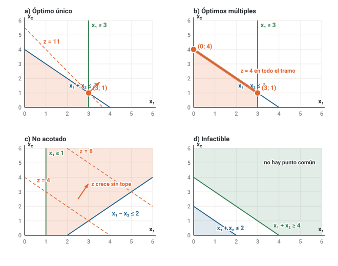
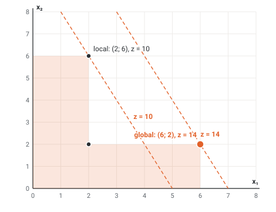
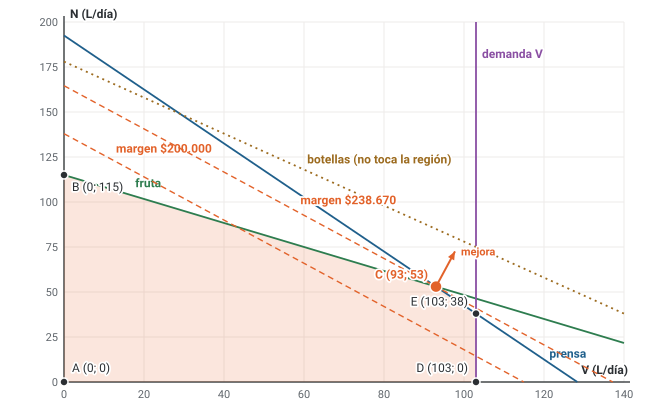
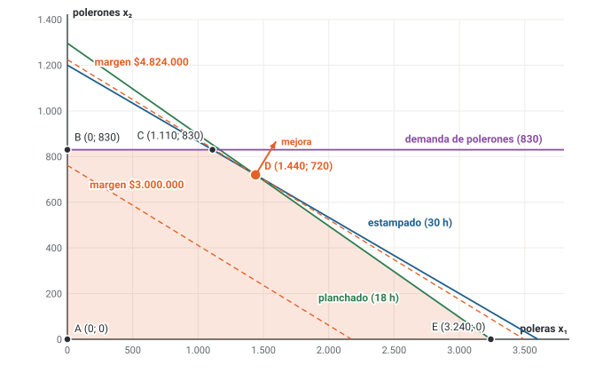

# Unidad 2 · Geometría de la optimización y método gráfico

**Qué vas a poder hacer.** Dibujar un modelo de dos variables, sombrear su región factible, desplazar
las rectas de nivel hasta encontrar el óptimo y calcularlo exacto; reconocer en el dibujo si el
problema tiene óptimo único, múltiples óptimos, si es no acotado o infactible; decidir si un conjunto
o una función son convexos, distinguir un óptimo local de uno global, y explicar por qué en
programación lineal basta con mirar los vértices.

**Lo que necesitas antes.** La unidad 1: leer un enunciado y escribir su modelo. De matemática:
graficar una recta $ax_1 + bx_2 = c$ (cortes con los ejes), resolver un sistema de dos ecuaciones y,
para la convexidad, segundas derivadas.

**Tiempo.** Unas 5 horas: 2 de lectura con el ejemplo y 3 de práctica (con lápiz, regla y papel
cuadriculado).

---

## 1. La idea: un problema de dos variables se puede dibujar

Con dos variables, cada plan es un **punto** $(x_1, x_2)$ del plano. Cada restricción de desigualdad
es un **semiplano**: la recta $a_1x_1 + a_2x_2 = b$ lo limita y la desigualdad dice de qué lado está.
Los puntos que cumplen todas las restricciones a la vez forman la **región factible**.

La función objetivo $z = c_1x_1 + c_2x_2$ se dibuja con sus **rectas de nivel**: todos los puntos con
el mismo $z$ (las rectas de isobeneficio o de isocosto). Cambiar $z$ desplaza la recta en paralelo. El
vector $\nabla z = (c_1, c_2)$, perpendicular a esas rectas, apunta hacia donde $z$ crece: es la
**dirección de mejora** de un máximo. En un mínimo se avanza al revés, en $-\nabla z$.

### El método en cuatro pasos

1. **Dibujar cada restricción.** La recta pasa por sus cortes con los ejes; para saber qué lado vale,
   prueba un punto que no esté en la recta (el origen, si se puede).
2. **Sombrear la región factible**: la intersección de todos los lados que valen, incluida la no
   negatividad.
3. **Dibujar una recta de nivel y desplazarla** en la dirección de mejora hasta el último punto que
   todavía toca la región.
4. **Calcular ese punto exacto** resolviendo el sistema de las dos rectas que se cruzan ahí, y
   evaluar $z$. El dibujo dice *dónde*; el álgebra dice *cuánto*.

El método sirve solo con dos variables (tres, con mucha paciencia), pero es la mejor forma de entender
todo lo que viene después: el simplex, la dualidad y la sensibilidad son esta misma geometría escrita
en tablas.

---

## 2. Vocabulario: vértices, activas, holguras y redundantes

| Concepto | Qué es | Cómo se ve en el dibujo |
|---|---|---|
| **Solución factible** | Un punto que cumple todas las restricciones | Está dentro de la región o en su borde |
| **Vértice** (punto extremo) | Punto de la región donde se cruzan dos rectas de restricción | Una esquina del polígono |
| **Restricción activa** | Se cumple con igualdad en el punto que miras | La recta pasa por ese punto |
| **Holgura** | $s = b - (a_1x_1 + a_2x_2)$ en una restricción $\le$: cuánto sobra | Distancia (en unidades del recurso) a la recta |
| **Restricción redundante** | Sacarla no cambia la región factible | Su recta no toca la región |
| **Vértice degenerado** | En el plano, un vértice por donde pasan tres o más rectas | Tres rectas que se cruzan en el mismo punto |

Una restricción **inactiva** en el óptimo no es lo mismo que una **redundante**. La inactiva sobra en
ese plan, pero recorta la región en otra parte; la redundante no recorta nada en ninguna parte.
Ningún solver avisa que una restricción es redundante: hay que darse cuenta.

---

## 3. Los cuatro casos



- **a) Óptimo único.** $\max\, 3x_1 + 2x_2$ s.a. $x_1 + x_2 \le 4$, $x_1 \le 3$, $x \ge 0$. La última recta
  de nivel que toca la región la toca en un solo vértice, $(3, 1)$, con $z^* = 11$.
- **b) Óptimos múltiples.** Misma región, $\max\, x_1 + x_2$. La recta de nivel es **paralela** a
  $x_1 + x_2 = 4$, así que toca un tramo entero: todos los puntos
  $\lambda(0, 4) + (1 - \lambda)(3, 1)$ con $0 \le \lambda \le 1$ valen $z = 4$. El software entrega uno
  solo, casi siempre un vértice.
- **c) No acotado.** $\max\, x_1 + x_2$ s.a. $x_1 - x_2 \le 2$, $x_1 \ge 1$, $x \ge 0$. La región se
  abre hacia arriba y $z$ crece sin tope. Suele ser un error del modelo: una restricción olvidada o un
  signo al revés. Ojo: una región **no acotada** no implica un problema no acotado; depende de hacia
  dónde mejora $z$ (ejercicios 2.2 y 2.7).
- **d) Infactible.** $x_1 + x_2 \le 2$ y $x_1 + x_2 \ge 4$ no tienen ningún punto en común. Solo
  dependen las restricciones, no el objetivo. Suele venir de un requisito mínimo demasiado alto, de
  un recurso mal medido o de abusar de las igualdades.

---

## 4. ¿Cuándo existe un óptimo? El teorema de existencia

**Teorema (Weierstrass).** Si la función objetivo es **continua** y la región factible es **no vacía,
cerrada y acotada**, entonces el problema tiene máximo y mínimo.

- **Cerrada** quiere decir que contiene su borde. Las restricciones con $\le$, $\ge$ o $=$ dan
  regiones cerradas; una desigualdad estricta ($<$) no.
- **Acotada** quiere decir que cabe dentro de algún círculo: no se escapa al infinito en ninguna
  dirección.

**La intuición.** Si la región se escapa al infinito, $z$ puede crecer sin fin. Si a la región le
falta un punto del borde, $z$ puede acercarse a un valor sin alcanzarlo nunca ($\max x$ con $x < 5$:
4,9; 4,99; 4,999…). Cerrada y acotada cierra las dos puertas.

**Cuándo NO aplica.** El teorema es **suficiente, no necesario**. Si la región no es acotada, puede
igual haber óptimo (el mínimo del ejercicio 2.2); el teorema simplemente no lo garantiza.

---

## 5. Convexidad de conjuntos y de funciones

**Conjunto convexo.** $S$ es convexo si, para dos puntos cualesquiera $x, y \in S$, todo el segmento
que los une queda dentro:

$$\lambda x + (1 - \lambda) y \in S \qquad \forall \lambda \in [0, 1]$$

Un semiplano es convexo; una recta (un hiperplano) también. La intersección de convexos es convexa.
Por eso la región factible de un modelo lineal, que es una intersección de semiplanos (un
**poliedro**, o **polígono** en el plano), siempre es convexa. Un conjunto con un hoyo o con forma de
L no lo es.

**Función convexa y cóncava.** $f$ es **convexa** si la cuerda entre dos puntos de su gráfico queda
por encima del gráfico, y **cóncava** si queda por debajo:

$$f(\lambda x + (1-\lambda) y) \le \lambda f(x) + (1 - \lambda) f(y) \quad \text{(convexa)} \qquad \ge \quad \text{(cóncava)}$$

Una función lineal cumple las dos con igualdad: es convexa y cóncava a la vez. Para funciones con
segundas derivadas hay una prueba práctica con la matriz hessiana $H$ (las segundas derivadas):

| Autovalores de $H$ en todo el dominio | La función es |
|---|---|
| Todos $\ge 0$ | convexa (forma de taza) |
| Todos $\le 0$ | cóncava (forma de cerro) |
| Unos positivos y otros negativos | ni convexa ni cóncava (forma de silla) |

En una variable basta con el signo de $f''(x)$. Un dato útil: si $g$ es convexa, el conjunto
$\{x : g(x) \le b\}$ es convexo (por ejemplo, un disco $x_1^2 + x_2^2 \le 9$).

---

## 6. Óptimo local y óptimo global

Un **óptimo local** es mejor que todos los puntos factibles **cercanos**; un **óptimo global** es
mejor que **todos** los puntos factibles. Los algoritmos miran localmente: desde un punto, buscan
hacia dónde mejorar. Si ningún paso pequeño mejora, se detienen, aunque haya algo mejor lejos.



En la figura, $\max\, 2x_1 + x_2$ sobre una región en forma de L. Desde el punto $(2, 6)$, con
$z = 10$, cualquier paso pequeño que siga dentro de la región empeora o deja $z$ igual: es un óptimo
local. Pero $(6, 2)$ vale $z = 14$: ese es el global. El problema es que la región no es convexa.

**Programación convexa.** Un problema es de programación convexa si **maximiza una función cóncava**
(o **minimiza una convexa**) sobre una **región convexa**.

**Teorema.** En un problema de programación convexa, todo óptimo local es óptimo global.

**La intuición.** Supón que $x$ es óptimo local y que existe $y$ factible mejor. Como la región es
convexa, el segmento de $x$ a $y$ está entero dentro de ella. Como la función es cóncava (en un
máximo), sobre ese segmento queda por encima de la cuerda, y la cuerda sube hacia $y$. Entonces hay
puntos factibles **pegados a $x$** que son mejores que $x$: contradicción. Un modelo lineal es
convexo (función lineal, región poliédrica), así que en programación lineal **un óptimo local ya es
global**. Esta garantía se pierde, por ejemplo, al maximizar una función convexa (ejercicio 2.9).

---

## 7. Por qué en programación lineal el óptimo está en un vértice

**Teorema fundamental.** Si un modelo lineal tiene óptimo y su región tiene al menos un vértice,
entonces algún vértice es óptimo.

**Por qué.** Sobre un segmento, una función lineal cambia en forma lineal: o sube, o baja, o se queda
igual. Su máximo sobre el segmento está en un extremo (o en todo el segmento, si es constante). Y
todo punto de un polígono acotado es una combinación $\sum_k \lambda_k v_k$ de sus vértices, con
$\lambda_k \ge 0$ y $\sum_k \lambda_k = 1$, así que

$$z\left(\sum_k \lambda_k v_k\right) = \sum_k \lambda_k\, z(v_k) \le \max_k z(v_k)$$

Ningún punto puede valer más que el mejor vértice. Con óptimos múltiples hay un lado entero óptimo,
pero sus extremos son vértices, así que la afirmación sigue en pie.

**La consecuencia.** En vez de infinitos puntos, hay que revisar una cantidad finita de vértices.
Con $n$ variables y $m$ restricciones (más las $n$ de no negatividad), cada vértice candidato se
obtiene cruzando $n$ de esas $m + n$ igualdades: a lo más $\binom{m+n}{n}$ candidatos, que crecen muy
rápido. El método simplex (unidad 8) los recorre con inteligencia: salta de un vértice a uno vecino
mejor y se detiene cuando ningún vecino mejora, cosa que por convexidad basta.

**Cuándo NO aplica.** En un modelo **no lineal** el óptimo puede estar en el interior (donde la
derivada se anula) o en un punto curvo del borde que no es esquina. La unidad 3 trata esos casos.

---

## 8. Ejemplo resuelto · Jugos prensados en frío

Un emprendimiento de Talca (ficticio) prensa en frío dos jugos, verde ($V$) y naranja-zanahoria
($N$), en litros por día. El litro de jugo verde deja $1.740 de margen y el de naranja-zanahoria
$1.450. La prensa trabaja 385 minutos al día (lo que queda después de la limpieza): el litro de verde
toma 3 minutos y el de naranja-zanahoria 2. Cada mañana llegan 207 kg de fruta y verdura: el litro
de verde usa 1,2 kg y el de naranja-zanahoria 1,8. Del jugo verde no se venden más de 103 litros
diarios, y hay 178 botellas limpias por día.

**El modelo.**

$$\max\; z = 1{.}740\,V + 1{.}450\,N$$

$$\text{s.a.} \quad 3V + 2N \le 385 \;\text{[prensa]} \qquad 1{,}2V + 1{,}8N \le 207 \;\text{[fruta]} \qquad V \le 103 \;\text{[demanda V]} \qquad V + N \le 178 \;\text{[botellas]} \qquad V, N \ge 0$$

En OPL (`modelos/u02_jugos.mod`), con los datos dentro del mismo archivo:

```opl
{string} Jugos = {"verde", "naranja"};
float margen[Jugos] = [1740, 1450];
float prensa[Jugos] = [3, 2];
float fruta[Jugos]  = [1.2, 1.8];
dvar float+ x[Jugos];
maximize sum(j in Jugos) margen[j] * x[j];
subject to {
  ctPrensa:   sum(j in Jugos) prensa[j] * x[j] <= 385;
  ctFruta:    sum(j in Jugos) fruta[j] * x[j]  <= 207;
  ctVerde:    x["verde"] <= 103;
  ctBotellas: sum(j in Jugos) x[j] <= 178;
}
```

**Paso 1 · Dibujar las restricciones.** Los cortes con los ejes:

| Recta | Corta el eje $V$ en | Corta el eje $N$ en | Lado que vale |
|---|---|---|---|
| Prensa $3V + 2N = 385$ | 128,33 | 192,5 | el del origen |
| Fruta $1{,}2V + 1{,}8N = 207$ | 172,5 | 115 | el del origen |
| Demanda $V = 103$ | 103 | (vertical) | a la izquierda |
| Botellas $V + N = 178$ | 178 | 178 | el del origen |

**Paso 2 y 3 · Región y rectas de nivel.**



La recta de nivel de $200.000 se desplaza en la dirección de mejora (la flecha, perpendicular a las
rectas de nivel) hasta tocar la región por última vez. Eso ocurre en el vértice C, donde se cruzan la
prensa y la fruta.

**Paso 4 · Calcular el vértice y comprobar con todos.** El sistema
$3V + 2N = 385$, $1{,}2V + 1{,}8N = 207$ da $V = 93$ y $N = 53$. Para confirmarlo, todos los vértices:

| Vértice | Se cruzan | V | N | Margen |
|---|---|---|---|---|
| A | N ≥ 0 y V ≥ 0 | 0 L | 0 L | \$0 |
| B | V ≥ 0 y fruta | 0 L | 115 L | $166.750 |
| C | fruta y prensa | 93 L | 53 L | **$238.670** |
| D | N ≥ 0 y demanda V | 103 L | 0 L | $179.220 |
| E | demanda V y prensa | 103 L | 38 L | $234.320 |

El óptimo es 93 litros de jugo verde y 53 de naranja-zanahoria, con **$238.670** al día. Las holguras
en el óptimo:

- prensa: 0 min (activa)
- fruta: 0 kg (activa)
- demanda V: 10 L (inactiva: se venderían hasta 103)
- botellas: 32 botellas (inactiva y, además, redundante)

La restricción de botellas es **redundante**: lo más que la región permite es $V + N = 146$ (en el
vértice C), muy por debajo de 178. Su recta no toca la región, como se ve en la figura.

**Cómo se lee.**

- Lo que aprieta son la prensa y la fruta. La demanda de jugo verde no es el problema: no conviene
  hacer más verde, porque cada litro de verde gasta más prensa.
- El vértice C no cambia mientras la pendiente de las rectas de nivel quede entre las de la fruta y la
  prensa, es decir, mientras $1{,}2/1{,}8 \le c_V/c_N \le 3/2$. Con el margen del naranja-zanahoria
  fijo en $1.450, el plan (93, 53) sigue siendo óptimo para cualquier margen del verde entre \$967 y
  $2.175. Es una holgura amplia: un cambio de precios razonable no cambia la decisión.
- **Decisión:** prensar 93 L de verde y 53 de naranja-zanahoria. Si se quiere crecer, hay que
  conseguir más fruta **y** más minutos de prensa, porque las dos aprietan a la vez; comprar
  botellas no sirve de nada.

---

## 9. Errores típicos

| Error | Cómo evitarlo |
|---|---|
| Sombrear el lado equivocado de una recta | Prueba siempre un punto (el origen) en la desigualdad original |
| Olvidar la no negatividad y dibujar en los cuatro cuadrantes | $x \ge 0$ deja solo el primer cuadrante; escríbela primero |
| Leer el óptimo «a ojo» del dibujo | El dibujo elige el vértice; el valor sale del sistema de ecuaciones |
| Avanzar en $+\nabla z$ en un problema de mínimo | En un mínimo la mejora es $-\nabla z$ |
| Confundir una restricción inactiva con una redundante | Inactiva: sobra en el óptimo; redundante: sacarla no cambia la región |
| Concluir «no acotado» porque la región es no acotada | Depende del objetivo: puede haber mínimo finito (2.2) |
| Decir que no hay óptimo porque no se cumple Weierstrass | El teorema es suficiente, no necesario |
| Creer que un óptimo local de cualquier problema es global | Solo en programación convexa; en PL siempre lo es |
| Buscar el óptimo de un problema no lineal solo en los vértices | El óptimo no lineal puede estar en el interior o en un borde curvo |

---

## 10. Práctica

Diez ejercicios: 2.1 a 2.4 básicos, 2.5 a 2.8 intermedios, 2.9 y 2.10 de desafío. Dibuja a mano
antes de mirar la pauta (sección 11).

**2.1 · Máximo con tres restricciones (básico).** Resuelve con el método gráfico: dibuja las
restricciones, la región y dos rectas de nivel, y calcula todos los vértices.

$$\max\; z = 7x_1 + 5x_2 \quad \text{s.a.} \quad x_1 + x_2 \le 11 \;\text{(R1)} \qquad 3x_1 + x_2 \le 27 \;\text{(R2)} \qquad x_2 \le 8 \;\text{(R3)} \qquad x_1, x_2 \ge 0$$

**2.2 · Mínimo con restricciones de «al menos» (básico).** Resuelve gráficamente. Después responde:
si el problema fuera de máximo, ¿qué pasaría?

$$\min\; z = 5x_1 + 4x_2 \quad \text{s.a.} \quad 2x_1 + x_2 \ge 12 \;\text{(R1)} \qquad x_1 + 3x_2 \ge 21 \;\text{(R2)} \qquad x_1, x_2 \ge 0$$

**2.3 · Activas, holguras y redundantes (básico).** Para el modelo siguiente, encuentra el óptimo,
di qué restricciones son activas, calcula la holgura de las demás e identifica las redundantes. ¿Es
redundante R3?

$$\max\; z = 4x_1 + 3x_2 \quad \text{s.a.} \quad 2x_1 + x_2 \le 16 \;\text{(R1)} \quad x_1 + x_2 \le 10 \;\text{(R2)} \quad x_1 \le 7 \;\text{(R3)} \quad x_2 \le 9 \;\text{(R4)} \quad x_1 + 2x_2 \le 22 \;\text{(R5)} \quad x \ge 0$$

**2.4 · ¿Convexo o no? (básico).** (a) Decide cuáles conjuntos son convexos; para los que no,
muestra dos puntos cuyo segmento se sale.

- $S_a = \{x_1 + x_2 \le 4,\ x_1 \ge 0,\ x_2 \ge 0\}$
- $S_b = \{x_1^2 + x_2^2 \ge 1\}$
- $S_c = \{x_1 > 0,\ x_1 x_2 \ge 1\}$
- $S_d = \{x_1 \le 2\} \cup \{x_1 \ge 5\}$
- $S_e = \{x_1^2 + x_2^2 \le 4,\ x_2 \ge x_1^2 - 1\}$

(b) Clasifica cada función como convexa, cóncava, ambas o ninguna: $f_1 = 3x_1 - 2x_2 + 5$;
$f_2 = x_1^2 + 2x_2^2 - x_1x_2$; $f_3 = -x_1^2 + 4x_1 - x_2^2$; $f_4 = x_1^2 - x_2^2$;
$f_5 = e^{x_1} + x_2^2$; $f_6 = x_1 x_2$.

**2.5 · Cuándo hay óptimos múltiples (intermedio).** Sobre la región del ejercicio 2.1, el objetivo
es $\max\; c_1x_1 + 6x_2$. (a) ¿Para qué valores de $c_1$ hay óptimos múltiples? (b) Para cada uno,
escribe todas las soluciones óptimas como combinación de dos vértices y da $z^*$. (c) ¿Para qué
rango de $c_1$ el óptimo es único en $(8, 3)$?

**2.6 · Mover una restricción (intermedio).** En el modelo del ejercicio 2.3, el lado derecho de R2
pasa de 10 a un valor $b$. (a) Encuentra el óptimo y $z$ para $b = 9$, 10, 11 y 12,5. (b) Muestra que
entre $b = 9$ y $b = 12{,}5$ se cumple $z = 16 + 2b$ y explica qué significa el 2. (c) ¿Qué pasa si
$b$ sube de 12,5?

**2.7 · Diagnosticar tres modelos (intermedio).** Sin resolver con software, di si cada modelo tiene
óptimo, es infactible o es no acotado, y qué restricción lo provoca.

- (a) $\max\; 2x_1 + 3x_2$ s.a. $x_1 + x_2 \ge 4$, $x_1 - x_2 \le 2$, $x \ge 0$.
- (b) $\max\; x_1 + x_2$ s.a. $x_1 + 2x_2 \le 6$, $x_1 + x_2 \ge 8$, $x \ge 0$.
- (c) $\min\; x_1 + x_2$ s.a. las mismas restricciones de (a).

**2.8 · ¿Garantiza Weierstrass un óptimo? (intermedio).** Para cada problema, di si la región es
cerrada y acotada, si el teorema garantiza óptimo y si de hecho existe; si existe, encuéntralo.

- (a) $\max\; x_1 + x_2$ s.a. $x_1^2 + x_2^2 \le 9$.
- (b) $\max\; x$ s.a. $0 \le x < 5$.
- (c) $\min\; x_1 + x_2$ s.a. $x_1 x_2 \ge 4$, $x_1, x_2 \ge 0$.
- (d) $\min\; 1/x$ s.a. $x \ge 1$.

**2.9 · Maximizar una función convexa (desafío).** Sobre la región $x_1 + x_2 \le 6$, $x_1 \le 5$,
$x_2 \le 4$, $x \ge 0$, considera $f(x_1, x_2) = (x_1 - 2)^2 + (x_2 - 1)^2$ (el cuadrado de la
distancia al punto $(2, 1)$). (a) Encuentra todos los máximos locales y el global. (b) Encuentra el
mínimo. (c) ¿Por qué en (a) hay varios óptimos locales y en (b) no puede haberlos?

**2.10 · Tres variables: recorrer los vértices (desafío).** Una conservera hace tres productos que
pasan por tres líneas, cada una con 24 horas a la semana. Resuelve sin dibujar, enumerando vértices:
(a) ¿cuántos puntos candidatos hay?, (b) ¿cuántos son vértices factibles?, (c) ¿cuál es el óptimo?
Confírmalo con `modelos/u02_e10_tres_variables.mod`.

$$\max\; 5x_1 + 4x_2 + 6x_3 \quad \text{s.a.} \quad x_1 + x_2 + 2x_3 \le 24 \qquad 2x_1 + x_2 + x_3 \le 24 \qquad x_1 + 2x_2 + x_3 \le 24 \qquad x \ge 0$$

---

## 11. Pautas

**2.1.** Cortes: R1 en (11, 0) y (0, 11); R2 en (9, 0) y (0, 27); R3 horizontal en $x_2 = 8$.

| Vértice | Se cruzan | x₁ | x₂ | z |
|---|---|---|---|---|
| A | x₁ ≥ 0 y x₂ ≥ 0 | 0 | 0 | 0 |
| B | R3 y x₁ ≥ 0 | 0 | 8 | 40 |
| C | R1 y R3 | 3 | 8 | 61 |
| D | R1 y R2 | 8 | 3 | **71** |
| E | R2 y x₂ ≥ 0 | 9 | 0 | 63 |

Óptimo en $(8, 3)$ con $z^* = 71$: la recta de nivel tiene pendiente $-7/5$, entre la de R1 ($-1$)
y la de R2 ($-3$), por eso toca justo la esquina donde se cruzan.

**2.2.** La región está sobre las dos rectas y es **no acotada** (se abre hacia arriba y a la
derecha), pero tiene esquinas:

| Vértice | Se cruzan | x₁ | x₂ | z |
|---|---|---|---|---|
| A | R1 y x₁ ≥ 0 | 0 | 12 | 48 |
| B | R1 y R2 | 3 | 6 | **39** |
| C | R2 y x₂ ≥ 0 | 21 | 0 | 105 |

En un mínimo se avanza en $-\nabla z$, hacia el origen. El óptimo es $(3, 6)$ con $z^* = 39$. Si
fuera de máximo, $z$ crecería sin tope: **no acotado**. La misma región da un mínimo finito y un
máximo infinito.

**2.3.**

| Vértice | Se cruzan | x₁ | x₂ | z |
|---|---|---|---|---|
| A | x₁ ≥ 0 y x₂ ≥ 0 | 0 | 0 | 0 |
| B | R4 y x₁ ≥ 0 | 0 | 9 | 27 |
| C | R2 y R4 | 1 | 9 | 31 |
| D | R1 y R2 | 6 | 4 | **36** |
| E | R3 y x₂ ≥ 0 | 7 | 0 | 28 |
| F | R1 y R3 | 7 | 2 | 34 |

Óptimo $(6, 4)$ con $z^* = 36$. Activas: R1 y R2. R3 tiene holgura 1, R4 holgura 5 y R5 holgura 8.
**R5 es redundante:** dentro de la región, $x_1 + 2x_2 = (x_1 + x_2) + x_2 \le 10 + 9 = 19 < 22$, así
que nunca aprieta. **R3 no es redundante**, aunque esté inactiva en el óptimo: si se saca, aparece el
vértice (8, 0) (donde R1 corta el eje) y la región crece.

**2.4.** (a) $S_a$: convexo (intersección de semiplanos). $S_b$: **no** (es el plano sin un disco): los
puntos (1, 0) y (−1, 0) están en $S_b$, pero su punto medio (0, 0) no. $S_c$: convexo (es la zona sobre
la rama de la hipérbola $x_2 = 1/x_1$, que es una función convexa para $x_1 > 0$). $S_d$: **no**: (2, 0)
y (5, 0) están, (3,5; 0) no. $S_e$: convexo (intersección de un disco con la zona sobre una parábola
convexa).

(b) $f_1$ es lineal: **convexa y cóncava**. $f_2$: $H = \begin{pmatrix} 2 & -1 \\ -1 & 4 \end{pmatrix}$,
autovalores 1,59 y 4,41, ambos positivos: **convexa**. $f_3$: autovalores -2 y -2: **cóncava**.
$f_4$: autovalores -2 y 2: **ninguna** (silla). $f_5$: $H = \text{diag}(e^{x_1}, 2)$, positiva en todo
punto: **convexa**. $f_6$: autovalores -1 y 1: **ninguna**.

**2.5.** (a) Hay óptimos múltiples cuando la recta de nivel es paralela a un lado de la región que
queda «al frente». Paralela a R1: $c_1/6 = 1/1$, o sea $c_1 = 6$. Paralela a R2: $c_1/6 = 3/1$, o sea
$c_1 = 18$. (b) Con $c_1 = 6$ son óptimos todos los puntos $\lambda(3, 8) + (1 - \lambda)(8, 3)$,
$0 \le \lambda \le 1$ (por ejemplo, el punto medio (5,5; 5,5)), con $z^* = 66$. Con $c_1 = 18$, todos
los $\lambda(8, 3) + (1 - \lambda)(9, 0)$, con $z^* = 162$. (c) Óptimo único en $(8, 3)$ cuando
$6 < c_1 < 18$: la pendiente queda estrictamente entre las de R1 y R2.

**2.6.** (a) Mientras R1 y R2 sean las activas, el óptimo es su cruce: $x_1 = 16 - b$, $x_2 = 2b - 16$.

| $b$ | Óptimo | $z$ |
|---|---|---|
| 9 | (7, 2) | z = 34 |
| 10 | (6, 4) | z = 36 |
| 11 | (5, 6) | z = 38 |
| 12,5 | (3,5; 9) | z = 41 |

(b) $z = 4(16 - b) + 3(2b - 16) = 16 + 2b$. El 2 es **cuánto vale una unidad más de R2**: cada unidad
de lado derecho sube el margen en 2. Es el primer encuentro con el **precio sombra**, que vuelve en las
unidades 10 y 12. (c) En $b = 12{,}5$ el cruce llega a $x_2 = 9$ y R4 pasa a ser activa. Desde ahí, más
R2 ya no sirve: con $b = 13$ el óptimo sigue en (3,5; 9) con $z = 41$, y el valor de una unidad más de
R2 cae a 0. El precio sombra vale solo dentro de un rango.

**2.7.** (a) **No acotado.** Sobre la recta $x_1 - x_2 = 2$ no hay límite hacia arriba: $x_2$ puede
crecer junto con $x_1$, y $2x_1 + 3x_2$ crece sin fin. Lo provoca que nada limite a $x_2$ por arriba.
(b) **Infactible.** Con $x \ge 0$, la primera restricción deja $x_1 + x_2 \le 6$ (el máximo de
$x_1 + x_2$ ahí es 6, en (6, 0)), y la segunda pide al menos 8. (c) **Óptimo finito, y múltiple**,
aunque la región es la de (a), no acotada. En un mínimo se baja hacia el origen; la recta de nivel es
paralela a $x_1 + x_2 = 4$, así que todo el tramo de (0, 4) a (3, 1) es óptimo, con $z^* = 4$.

**2.8.** (a) El disco es cerrado y acotado: el teorema garantiza óptimo. Está donde la recta de nivel
toca el círculo en la dirección (1, 1): $x_1 = x_2 = 3/\sqrt{2} \approx 2{,}12$, con
$z = 3\sqrt{2} \approx 4{,}24$. (b) $[0, 5)$ es acotado pero **no cerrado**: no hay máximo (4,9; 4,99; … nunca 5). Sí
hay mínimo, en 0. (c) La región **no es acotada**: el teorema no garantiza nada, pero el mínimo
existe: $(2, 2)$ con $z = 4$ (la recta $x_1 + x_2 = 4$ toca la hipérbola $x_1x_2 = 4$). (d) Cerrada
pero **no acotada**, y no hay mínimo: $1/x$ se acerca a 0 sin llegar nunca. (c) y (d) muestran que
sin acotación puede pasar cualquier cosa.

**2.9.** Vértices de la región y valor de $f$:

| Vértice | $f$ |
|---|---|
| (0, 0) | 5 |
| (0, 4) | 13 |
| (2, 4) | 9 |
| (5, 0) | 10 |
| (5, 1) | 9 |

(a) Una función convexa crece al alejarse de su centro, así que sus máximos sobre un polígono están en
vértices, pero puede haber varios locales. Son máximos locales (0, 0), (5, 0) y (0, 4): desde cada uno,
cualquier paso que se quede en la región acerca al punto (2, 1) y baja $f$. El **global** es (0, 4),
con $f = 13$. (2, 4) y (5, 1) no son locales: desde (2, 4) moverse hacia (0, 4) sube $f$, y desde (5, 1)
moverse hacia (5, 0) también. (b) El mínimo es (2, 1), en el **interior**, con $f = 0$: no es un
vértice. (c) Minimizar una convexa sobre una región convexa es programación convexa: todo mínimo local
es global. Maximizar una convexa no lo es, y por eso un algoritmo que solo mira cerca podría
detenerse en (5, 0) o en (0, 0).

**2.10.** (a) Hay 6 planos (3 líneas y 3 de no negatividad) y cada candidato cruza 3 de ellos:
$\binom{6}{3} =$ 20 candidatos. Acá ningún trío es paralelo, así que los 20 tienen solución. (b) 12 no
cumplen alguna restricción y 8 son vértices factibles:

| Punto | $x_1$ | $x_2$ | $x_3$ | $z$ |
|---|---|---|---|---|
| P1 | 0 | 0 | 0 | 0 |
| P2 | 0 | 0 | 12 | 72 |
| P3 | 0 | 8 | 8 | 80 |
| P4 | 0 | 12 | 0 | 48 |
| P5 | 6 | 6 | 6 | **90** |
| P6 | 8 | 0 | 8 | 88 |
| P7 | 8 | 8 | 0 | 72 |
| P8 | 12 | 0 | 0 | 60 |

(c) El óptimo es $(6, 6, 6)$, con $z = 90$, donde las tres líneas quedan llenas. El modelo en OPL da lo
mismo. Con 20 candidatos todavía se puede a mano; con 50 variables y 50 restricciones habría del orden
de $10^{29}$. Por eso existe el simplex.

---

## 12. Caso integrador · Estampa Sur, la mezcla de dos prendas

> Este caso sigue a Estampa Sur por todo el ramo. La unidad 1 planteó el problema de las cinco
> prendas; acá se resuelve una **versión reducida con sus propios datos**, para poder dibujarla:
> solo poleras básicas ($x_1$) y polerones ($x_2$), 30 horas de estampado, 18 de planchado y un tope
> de venta de 830 polerones. Las cifras salen de `verificacion/caso_estampa_sur_lp.py`.

**En palabras.** Se decide cuántas poleras y cuántos polerones hacer en la semana, para ganar el
mayor margen, con los segundos de estampado y de planchado y lo que se puede vender de polerones como
límites.

**Algebraico.** Margen de $1.380 por polera y $3.940 por polerón; en segundos, 30 h son 108.000 s y
18 h son 64.800 s.

$$\max\; 1{.}380\,x_1 + 3{.}940\,x_2 \quad \text{s.a.} \quad 30x_1 + 90x_2 \le 108{.}000 \;\text{[estampado]} \qquad 20x_1 + 50x_2 \le 64{.}800 \;\text{[planchado]} \qquad x_2 \le 830 \;\text{[demanda]} \qquad x_1, x_2 \ge 0$$

**En OPL** (`modelos/u02_estampa_sur.mod`):

```opl
{string} Prendas = {"poleras", "polerones"};
float margen[Prendas] = [1380, 3940];
float est[Prendas]    = [30, 90];
float pla[Prendas]    = [20, 50];
dvar float+ x[Prendas];
maximize sum(i in Prendas) margen[i] * x[i];
subject to {
  ctEstampado: sum(i in Prendas) est[i] * x[i] <= 30 * 3600;
  ctPlanchado: sum(i in Prendas) pla[i] * x[i] <= 18 * 3600;
  ctDemanda:   x["polerones"] <= 830;
}
```



| Vértice | Se cruzan | Poleras | Polerones | Margen |
|---|---|---|---|---|
| A | x₁ ≥ 0 y x₂ ≥ 0 | 0 | 0 | \$0 |
| B | demanda y x₁ ≥ 0 | 0 | 830 | $3.270.200 |
| C | demanda y estampado | 1.110 | 830 | $4.802.000 |
| D | estampado y planchado | 1.440 | 720 | **$4.824.000** |
| E | planchado y x₂ ≥ 0 | 3.240 | 0 | $4.471.200 |

**Lectura.**

- El óptimo es **1.440 poleras y 720 polerones**, con **$4.824.000** a la semana. Aprietan el
  estampado y el planchado; la demanda de polerones queda con holgura de 110 unidades.
- El atajo intuitivo («el polerón deja casi el triple, que se vendan todos los polerones posibles y
  el resto en poleras») lleva al vértice C: 830 polerones y 1.110 poleras, con $4.802.000. Es un
  vértice, pero no el mejor: pierde $22.000 a la semana.
- ¿Por qué? Por segundo de estampado la polera deja más (46,0 contra 43,8 CLP/s); por segundo de
  planchado gana el polerón (69,0 contra 78,8 CLP/s). Como los dos recursos aprietan, la mejor mezcla
  es la que los llena juntos.
- **Hasta dónde vale la decisión.** El vértice D sigue siendo óptimo mientras la pendiente del margen
  quede entre la del estampado ($30/90$) y la del planchado ($20/50$). Con el margen de la polera fijo,
  eso es un margen del polerón entre $3.450 y $4.140; con el del polerón fijo, un margen de la polera
  entre $1.313 y $1.576. Si el polerón llegara a dejar más de $4.140, convendría el vértice C.

**Lo que pasa a las siguientes.** La unidad 3 deja libre el precio de los polerones (con su
demanda) y busca el que maximiza la utilidad: un problema no lineal cuyo óptimo ya no está en una
esquina. Las unidades 8 y 9 resuelven este mismo modelo con el simplex a mano: la tabla final tiene
que terminar en el vértice D, (1.440, 720).

---

## 13. Para seguir

**En los libros del ramo.**

- Winston, *Investigación de operaciones: aplicaciones y algoritmos* (4.ª ed., 2005), el que fija el
  programa: en la introducción a la programación lineal resuelve modelos de dos variables con el
  método gráfico y muestra los casos de óptimos múltiples, no acotado e infactible.
- Hillier y Lieberman, *Introducción a la investigación de operaciones* (7.ª ed., 2001): su
  introducción a la programación lineal parte con un ejemplo gráfico, y la parte de programación no
  lineal trata convexidad y óptimos locales.

**Abierto y gratis.**

- Bradley, Hax y Magnanti, *Applied Mathematical Programming* (Addison-Wesley, 1977), en inglés,
  publicado completo por el MIT. La sección 1.4 (*A Geometrical Preview*) es el método gráfico con
  sus casos especiales; el capítulo 13 (*Nonlinear Programming*) trata convexidad:
  https://web.mit.edu/15.053/www/AMP.htm

**Con el tutor.** La carpeta `tutor/` trae el contexto de este ramo. Pégalo al inicio de la
conversación con cualquier IA y pídele, por ejemplo: «Dame un modelo de dos variables con una
restricción redundante y otra que lo haga degenerado, y revísame el dibujo paso a paso».
