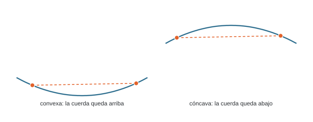
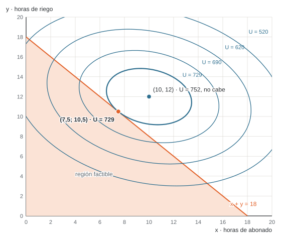
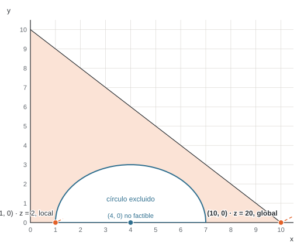
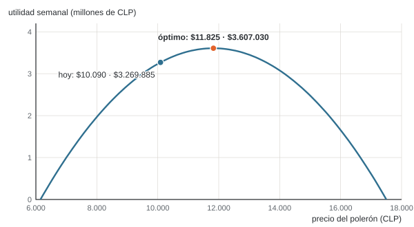

# Unidad 3 · Optimización no lineal básica

**Qué vas a poder hacer.** Decidir si una función es convexa o cóncava con su segunda derivada o su
hessiano, encontrar sus puntos críticos con las condiciones de primer orden, distinguir un óptimo
local de uno global y justificar cuándo el local basta, resolver gráficamente un problema no lineal
de dos variables y explicar por qué lo no lineal cuesta más que lo lineal.

**Lo que necesitas antes.** La geometría de la optimización de la unidad 2: región factible, curvas de
nivel y dirección de mejora. Del cálculo, derivar una función de una y de dos variables y resolver un
sistema de dos ecuaciones.

**Tiempo.** Unas 5 horas: 2 de lectura con el ejemplo y 3 de práctica.

---

## 1. La idea

En la unidad 2 el objetivo y las restricciones eran rectas: el margen crecía en proporción a lo que se
producía. Muchas decisiones no son así:

- Si subes el precio, vendes menos. La venta es precio por cantidad, y la cantidad depende del precio:
  el ingreso queda con un término $p^2$.
- El abono y el riego rinden cada vez menos: la décima hora de riego aporta menos que la primera.
- El costo de un horno sube más que proporcional cuando se lo exige cerca de su tope.

Cuando el objetivo o alguna restricción tiene productos, potencias o raíces de las variables, el
problema es de **programación no lineal (PNL)**. La diferencia con lo lineal (PL) cambia dónde se
busca el óptimo:

| | Lineal (PL) | No lineal (PNL) |
|---|---|---|
| Dónde está el óptimo | en un vértice de la región (o en un borde entero) | en un vértice, en medio de un borde o en el interior |
| Óptimo local y global | todo óptimo local es global | un óptimo local puede no ser global |
| Cómo se resuelve | se recorren vértices (simplex, unidad 8) | se sigue la pendiente desde un punto de partida |

Esta unidad da las herramientas para saber cuándo lo no lineal se porta bien (es **convexo**) y qué
hacer cuando no.

---

## 2. Funciones convexas y cóncavas

### La definición

Una función es **convexa** si el segmento (la cuerda) entre dos puntos cualesquiera de su gráfico
queda por encima del gráfico; es **cóncava** si queda por debajo. Con $0 \le t \le 1$:

$$f\big(t x_1 + (1-t) x_2\big) \le t\, f(x_1) + (1-t)\, f(x_2) \quad \text{(convexa; con } \ge \text{, cóncava)}$$

La intuición: una función convexa tiene forma de valle, una cóncava de cerro. En un valle, bajar
siempre lleva al fondo; en un cerro, subir siempre lleva a la cumbre. Esa es la propiedad que importa.

Una función lineal es convexa y cóncava a la vez (la cuerda coincide con el gráfico). Por eso la PL
nunca tiene trampas.

### Una variable · la segunda derivada

$$f''(x) \ge 0 \text{ en todo el intervalo} \iff f \text{ convexa} \qquad f''(x) \le 0 \text{ en todo el intervalo} \iff f \text{ cóncava}$$

La segunda derivada mide cómo cambia la pendiente. Si la pendiente siempre crece ($f'' \ge 0$), la
curva se dobla hacia arriba: valle. Ojo con dos detalles:

- La condición es **en todo el intervalo**, no en un punto. $h(x) = x^3$ tiene $h''(x) = 6x$: es
  cóncava para $x \le 0$ y convexa para $x \ge 0$. En $x = 0$ cambia de forma (punto de inflexión).
- $f''(x) = 0$ en un punto no rompe la convexidad: $x^4$ tiene $f''(0) = 0$ y es convexa.

### Dos variables · el hessiano

Con $f(x, y)$, el papel de la segunda derivada lo cumple la **matriz hessiana**:

$$H = \begin{pmatrix} f_{xx} & f_{xy} \\ f_{xy} & f_{yy} \end{pmatrix}$$

Sus **menores principales** son los determinantes de las submatrices que se forman quitando filas y
columnas con el mismo índice: los de orden 1 son $f_{xx}$ y $f_{yy}$; el de orden 2 es
$\det H = f_{xx} f_{yy} - f_{xy}^2$. La regla para una matriz de $2 \times 2$:

| Si en toda la región | $H$ es | $f$ es |
|---|---|---|
| $f_{xx} > 0$ y $\det H > 0$ | definida positiva | estrictamente convexa |
| $f_{xx} < 0$ y $\det H > 0$ | definida negativa | estrictamente cóncava |
| $f_{xx} \ge 0$, $f_{yy} \ge 0$ y $\det H \ge 0$ | semidefinida positiva | convexa |
| $f_{xx} \le 0$, $f_{yy} \le 0$ y $\det H \ge 0$ | semidefinida negativa | cóncava |
| $\det H < 0$ | indefinida | ni convexa ni cóncava (hay punto silla) |

Por qué funciona: $\det H > 0$ dice que las dos curvaturas principales tienen el **mismo signo**; el
signo de $f_{xx}$ dice cuál. Si $\det H < 0$, la superficie sube en una dirección y baja en otra, como
una silla de montar.

Para las semidefinidas se miran **todos** los menores principales ($f_{xx}$, $f_{yy}$ y $\det H$), no
solo los «de la esquina». La matriz con $f_{xx} = 0$, $f_{yy} = 2$ y $f_{xy} = 0$ es semidefinida
positiva aunque su primer menor sea 0.

Si la función es cuadrática (como todas las de esta unidad), el hessiano es una matriz de números y
basta revisarlo una vez. Si no, depende del punto y hay que revisarlo en toda la región.

### Conjuntos convexos

Un conjunto es **convexo** si el segmento entre dos puntos cualesquiera del conjunto queda dentro.
Lo que hay que saber para modelar:

- Toda restricción lineal ($a_1 x + a_2 y \le b$) define un semiplano, que es convexo.
- $g(x, y) \le b$ con $g$ convexa define un conjunto convexo (el interior de un círculo, por ejemplo).
- $g(x, y) \ge b$ con $g$ convexa **no** suele serlo (el exterior de un círculo).
- Una igualdad no lineal ($x^2 + y^2 = 4$) es una curva: no es convexa.
- La intersección de conjuntos convexos es convexa. Por eso la región de una PL siempre lo es.

---

## 3. Óptimo local, óptimo global y el teorema fundamental

Un punto factible $x^*$ es un **mínimo local** si ningún punto factible *cercano* es mejor; es un
**mínimo global** si ningún punto factible, cerca o lejos, es mejor. Para un máximo, igual.

**Existencia (Weierstrass).** Si $f$ es continua y la región es cerrada (incluye su borde) y acotada,
el problema tiene mínimo y máximo global. Si la región no es acotada, puede no haber óptimo; si es
abierta, el óptimo puede quedar «en el borde que falta».

**Teorema fundamental de la programación convexa.** Si se minimiza una función **convexa** (o se
maximiza una **cóncava**) sobre un conjunto **convexo**, todo óptimo local es global.

La razón, en una línea: si hubiera un punto mejor lejos de $x^*$, el segmento entre los dos queda
dentro de la región (conjunto convexo) y a lo largo de él la función mejora desde el primer paso
(función convexa). Entonces habría puntos mejores tan cerca de $x^*$ como se quiera, y $x^*$ no sería
óptimo local.

**Cuándo NO aplica.** Basta que falle una de las dos condiciones. Maximizar algo convexo, o trabajar
sobre una región no convexa (el exterior de un círculo, ejercicio 3.7), puede dejar varios óptimos
locales y no hay garantía de que el que encontraste sea el mejor.

---

## 4. Condiciones de primer orden sin restricciones

### Una variable

Un óptimo en el interior de la región tiene pendiente cero:

$$f'(x^*) = 0 \qquad\text{y luego}\qquad f''(x^*) < 0 \Rightarrow \text{máximo local}, \quad f''(x^*) > 0 \Rightarrow \text{mínimo local}$$

Si $f''(x^*) = 0$, la prueba no decide: se sigue derivando (la primera derivada que no se anula, si
es de orden par, decide como la segunda; si es impar, es inflexión).

### Dos variables

$$\nabla f(x^*, y^*) = \begin{pmatrix} f_x \\ f_y \end{pmatrix} = \begin{pmatrix} 0 \\ 0 \end{pmatrix}$$

y el hessiano en ese punto decide: definido negativo, máximo local estricto; definido positivo,
mínimo local estricto; indefinido, punto silla.

**De local a global.** Si además $f$ es cóncava en toda la región (o convexa, para un mínimo), el
teorema del punto 3 convierte el máximo local en global. Esa es la gracia de revisar la convexidad:
con ella, resolver $\nabla f = 0$ termina el problema.

**Cuándo no basta.** $\nabla f = 0$ solo encuentra óptimos **interiores**. Si el punto crítico cae
fuera de la región, el óptimo está en el borde y hay que buscarlo ahí (punto 5).

---

## 5. Solución gráfica de un problema no lineal con dos variables

Se dibuja igual que en la unidad 2 (región factible y curvas de nivel), con dos diferencias:

1. Las curvas de nivel ya no son rectas paralelas: son círculos, elipses o curvas.
2. El óptimo es el punto de la región que toca la mejor curva de nivel. Puede ser un **vértice**, un
   punto **en medio de un borde** (donde la curva de nivel es tangente al borde) o un punto
   **interior** (el centro de las elipses, si cae dentro de la región).

Por eso revisar solo los vértices, que en PL basta, en PNL puede dar una respuesta mala (el ejemplo lo
muestra).

### Con una restricción activa · la idea de Lagrange

Si el óptimo está sobre un borde $g(x, y) = b$, en ese punto la curva de nivel y el borde son
tangentes: sus gradientes son paralelos.

$$\nabla f(x^*, y^*) = \lambda\, \nabla g(x^*, y^*) \qquad g(x^*, y^*) = b$$

Son tres ecuaciones para tres incógnitas ($x$, $y$ y el **multiplicador** $\lambda$). Es lo mismo que
buscar los puntos críticos del lagrangiano $\mathcal{L} = f + \lambda\,(b - g)$. El multiplicador se
lee como un precio: **cuánto mejora el objetivo por cada unidad más de $b$**. Es la misma idea que el
precio sombra de la PL (unidad 10).

Con una restricción de desigualdad hay dos casos, y se revisan los dos (son las condiciones de
Karush, Kuhn y Tucker, KKT):

- **Inactiva** ($\lambda = 0$): el óptimo es el punto crítico libre; vale si cumple la restricción.
- **Activa** ($g = b$): se resuelve con Lagrange; en un máximo con $g \le b$ vale si $\lambda \ge 0$
  (aflojar la restricción no puede empeorar).

La condición «o la restricción está activa o su multiplicador es cero» se llama holgura
complementaria y vuelve en la unidad 11. Con $m$ restricciones hay hasta $2^m$ combinaciones de casos;
por eso KKT a mano sirve para problemas chicos.

---

## 6. Ejemplo resuelto · el invernadero

Un invernadero de tomates en la Región de Ñuble decide cuántas horas por semana dedica al abonado ($x$)
y al riego por goteo ($y$). Con lo que midió la temporada pasada ajustó el margen semanal de la
cosecha, en miles de pesos:

$$U(x, y) = 52x + 82y - 2x^2 - 3y^2 - xy$$

Los términos al cuadrado son los rendimientos decrecientes; el $-xy$ dice que abonar y regar a la vez
satura la planta. El encargado tiene **18 horas** a la semana para las dos tareas.

**En palabras.** Se decide cuántas horas abonar y cuántas regar; se busca el mayor margen; limita el
tiempo del encargado.

$$\max\; U(x, y) \quad \text{s.a.} \quad x + y \le 18, \quad x, y \ge 0$$

**Paso 1 · ¿Es cóncava?** Derivando dos veces:

$$H = \begin{pmatrix} -4 & -1 \\ -1 & -6 \end{pmatrix} \qquad f_{xx} = -4 < 0, \quad \det H = (-4)(-6) - (-1)^2 = 23 > 0$$

Los menores principales son −4, −6 y 23: el hessiano es definido negativo, $U$ es estrictamente
cóncava y la región (un triángulo de restricciones lineales) es convexa. Por el teorema fundamental,
**el máximo local que encontremos es global**.

**Paso 2 · Primer orden sin la restricción.**

$$U_x = 52 - 4x - y = 0 \qquad U_y = 82 - x - 6y = 0 \quad\Rightarrow\quad (x, y) = (10, 12), \quad U = 752$$

Pero $10 + 12 = 22 > 18$: el punto ideal **no cabe** en las horas del encargado. La restricción va a
estar activa.

**Paso 3 · Sobre el borde $x + y = 18$ (Lagrange).**

$$52 - 4x - y = \lambda \qquad 82 - x - 6y = \lambda \qquad x + y = 18$$

Igualando las dos primeras: $-30 - 3x + 5y = 0$; con $y = 18 - x$ sale $8x = 60$. Resultado:
**(7,5; 10,5)**, con $\lambda = 52 - 30 - 10{,}5 = 11{,}5$ y $U = 729$. Como $\lambda \ge 0$, el caso
activo es válido.

**Paso 4 · Comparar con los vértices.**

| Punto | Qué es | $U$ (miles de \$) |
|---|---|---|
| (0, 0) | vértice | 0 |
| (18, 0) | vértice | 288 |
| (0, 18) | vértice | 504 |
| (7,5; 10,5) | tangencia en medio del borde | **729** |
| (10, 12) | óptimo libre, fuera de la región | 752 |

La elipse de $U = 729$ toca la recta $x + y = 18$ en un solo punto, que no es vértice. Quien busque el
óptimo solo en los vértices se queda con 504, un 31 % menos.

**Cómo se lee.**

- Con 18 horas, el encargado abona 7,5 h y riega 10,5 h. El margen es de 729 mil pesos por semana.
- La restricción de horas cuesta 752 − 729 = 23 mil pesos por semana: es lo que se deja de ganar por
  no tener tiempo para el punto ideal.
- El multiplicador dice que **una hora más vale unos 11,5 mil pesos**. Si se puede contratar a alguien
  por menos de eso la hora, conviene. Es una tasa en el margen: con 19 horas el óptimo pasa a
  (8,125; 10,875) y el margen a 739,06, una ganancia de 10,06 mil, algo menos que 11,5 porque cada
  hora extra rinde menos que la anterior (concavidad).

---

## 7. Por qué lo no lineal es más difícil

- **El óptimo no está en una lista finita.** En PL basta revisar vértices; en PNL puede estar en
  cualquier punto de un borde o del interior.
- **Puede haber varios óptimos locales.** Un método que sube por la pendiente se detiene en la primera
  cumbre que encuentra. Sin convexidad, no hay cómo saber si era la más alta (ejercicio 3.7).
- **Las condiciones de primer orden dan candidatos, no respuestas.** Con restricciones, KKT pide
  revisar combinaciones de restricciones activas, que crecen como $2^m$.
- **Los computadores lo resuelven, con matices.** CPLEX (el motor de OPL) resuelve programas
  **cuadráticos convexos**: minimizar una cuadrática convexa, o maximizar una cóncava, con
  restricciones lineales. El caso de esta unidad está escrito así en
  `modelos/u03_precio_polerones.mod`. Un modelo no lineal cualquiera necesita otro tipo de solver (en
  Excel, el método GRG de Solver), que entrega un óptimo **local** que depende del punto de partida.

Por eso, cuando se puede, se modela de forma lineal (unidad 4) o se comprueba la convexidad antes de
confiar en el resultado.

---

## 8. Errores típicos

| Error | Cómo evitarlo |
|---|---|
| Revisar solo los vértices en un problema no lineal | El óptimo puede estar en medio de un borde o en el interior; dibuja las curvas de nivel |
| Concluir «máximo global» con solo $f'' < 0$ en el punto crítico | Eso da máximo **local**; para global, la función tiene que ser cóncava en toda la región (o compara con los bordes) |
| Declarar convexa una función porque $f'' > 0$ en un punto | La condición es en todo el intervalo; $x^3$ cambia de forma en 0 |
| Clasificar el hessiano mirando solo $f_{xx}$ | Mira también $\det H$; con $\det H < 0$ es indefinido aunque $f_{xx} > 0$ |
| En semidefinidas, revisar solo los menores «de la esquina» | Revisa todos los menores principales: $f_{xx}$, $f_{yy}$ y $\det H$ |
| Dar por bueno el punto crítico sin ver si es factible | Si $\nabla f = 0$ cae fuera de la región, el óptimo está en el borde |
| Usar el teorema fundamental sobre una región no convexa | El exterior de un círculo o una igualdad no lineal rompen la garantía |
| Dejar de lado un caso de KKT o aceptar un $\lambda$ con el signo equivocado | Revisa los dos casos de cada restricción; en un máximo con $g \le b$, $\lambda \ge 0$ |

---

## 9. Práctica

Diez ejercicios: 3.1 a 3.4 básicos, 3.5 a 3.8 intermedios, 3.9 y 3.10 de desafío. Las pautas están en
la sección 10. Intenta cada uno antes de mirarla.

**3.1 · Convexa, cóncava o ninguna (básico).** Clasifica cada función en todo $\mathbb{R}$, encuentra su
punto crítico y di si es mínimo o máximo global. (a) $f(x) = 3x^2 - 12x + 7$. (b)
$g(x) = 40 + 6x - 0{,}5x^2$. (c) $k(x) = x^4$: ¿qué dice la prueba de la segunda derivada en su punto
crítico y qué dice la convexidad?

**3.2 · Local no es global (básico).** Para $h(x) = 2x^3 - 15x^2 + 24x + 10$ en el intervalo
$[0, 6]$: encuentra los puntos críticos, clasifícalos, ubica el punto de inflexión y di en qué parte
del intervalo es convexa y en cuál cóncava. ¿Dónde están el máximo y el mínimo **global** del
intervalo?

**3.3 · Cuatro hessianos (básico).** Calcula el hessiano y clasifica cada función.
(a) $f = x^2 + 2y^2 - 2xy + 4x$. (b) $g = -3x^2 - y^2 + 4xy$. (c) $h = -x^2 - 4y^2 + 2xy + 6y$.
(d) $k = x^2 + 4xy + 4y^2$.

**3.4 · Un mínimo en dos variables (básico).** Encuentra el punto crítico de
$f(x, y) = x^2 + 3y^2 - 2xy - 4x + 8y + 5$ y demuestra que es un mínimo global.

**3.5 · El precio de un queque (intermedio).** Una pastelería de barrio vende queques de zanahoria. Con
los registros de ventas estimó la demanda semanal $q = 960 - 0{,}32\,p$ (unidades, con $p$ en pesos), y
cada queque le cuesta $1.150. (a) Plantea la utilidad semanal en función del precio y demuestra que es
cóncava. (b) Encuentra el precio óptimo, las unidades y la utilidad. (c) Si el costo sube a $1.390,
¿cuánto conviene subir el precio? ¿Qué parte del alza de costo se traspasa al cliente?

**3.6 · Lo más cerca posible (intermedio).** Resuelve gráficamente
$\min\, (x - 6)^2 + (y - 5)^2$ s.a. $x + 2y \le 10$, $x, y \ge 0$. (a) Dibuja la región y tres curvas de
nivel; encuentra el óptimo y su valor. (b) Evalúa la función en los tres vértices: ¿qué habría
respondido alguien que solo revisa vértices? (c) ¿Qué pasa si el objetivo cambia a
$(x - 2)^2 + (y - 1)^2$?

**3.7 · Una región con un hueco (intermedio).** Resuelve gráficamente
$\max\, z = 2x - 3y$ s.a. $(x - 4)^2 + y^2 \ge 9$, $x + y \le 10$, $x, y \ge 0$. (a) Dibuja la región.
¿Es convexa? Muéstralo con dos puntos. (b) Encuentra todos los máximos locales y el global. (c) Un
método que parte en (0, 0) y avanza por el eje $x$ mientras $z$ mejora, ¿dónde se detiene?

**3.8 · Dos hornos y 1.200 panes (intermedio).** Una panadería debe hornear 1.200 marraquetas al día en
dos hornos. El costo diario (en pesos) de hornear $q_1$ en el horno antiguo es
$C_1 = 0{,}02\,q_1^2 + 35\,q_1$, y de $q_2$ en el nuevo, $C_2 = 0{,}05\,q_2^2 + 20\,q_2$. Reparte la
producción al menor costo con Lagrange, demuestra que es mínimo global e interpreta $\lambda$.

**3.9 · Café y sándwich (desafío).** Una cafetería fija el precio del café ($p_1$) y del sándwich
($p_2$). Las demandas diarias son complementarias:

$$q_1 = 870 - 0{,}24\,p_1 - 0{,}06\,p_2 \qquad q_2 = 690 - 0{,}15\,p_2 - 0{,}06\,p_1$$

Cada café cuesta $500 y cada sándwich $1.400. (a) Encuentra los precios que maximizan la utilidad
conjunta y demuestra que es máximo global. (b) Si cada precio lo fija un encargado distinto que solo
mira la utilidad de su producto (tomando el otro precio como dado), ¿qué precios resultan y cuánta
utilidad se pierde? Explica por qué.

**3.10 · El queque con el horno lleno (desafío).** Vuelve a la pastelería del 3.5 (con costo $1.150). El
horno solo alcanza para 240 queques a la semana. (a) Escribe el problema con la cantidad $q$ como
variable y la restricción $q \le 240$, y resuélvelo con los dos casos de KKT. (b) Interpreta el
multiplicador. (c) ¿Cuánto vale, en total, ampliar el horno hasta donde ya no sirva ampliarlo más?

---

## 10. Pautas

**3.1.** (a) $f''(x) = 6 > 0$: convexa. $f'(x) = 6x - 12 = 0$ da $x = 2$, con $f(2) = -5$: mínimo
global. (b) $g''(x) = -1 < 0$: cóncava. $g'(x) = 6 - x = 0$ da $x = 6$, con $g(6) = 58$: máximo global.
(c) $k''(x) = 12x^2 \ge 0$: convexa. El punto crítico es $x = 0$, pero $k''(0) = 0$ y la prueba no
decide (habría que llegar a la cuarta derivada, 24 > 0). La convexidad lo resuelve de una vez: es un
mínimo global. Lectura: cuando la función es convexa, la segunda derivada en el punto sobra.

**3.2.** $h'(x) = 6x^2 - 30x + 24 = 6(x - 1)(x - 4)$. Puntos críticos: $x = 1$ con $h''(1) = -18$
(máximo local, $h(1) = 21$) y $x = 4$ con $h''(4) = 18$ (mínimo local, $h(4) = -6$). $h''(x) = 12x - 30$
se anula en 2,5: cóncava en $[0;\ 2{,}5]$ y convexa en $[2{,}5;\ 6]$. En los extremos, $h(0) = 10$ y
$h(6) = 46$. Máximo global del intervalo: $x = 6$, con 46 (un extremo, no un punto crítico). Mínimo
global: $x = 4$, con −6. Lectura: el máximo local en $x = 1$ no es global; sin concavidad hay que
comparar candidatos, incluidos los bordes.

**3.3.**

| | Hessiano | $f_{xx}$ | $\det H$ | Clasificación |
|---|---|---|---|---|
| (a) | $\begin{pmatrix} 2 & -2 \\ -2 & 4 \end{pmatrix}$ | 2 | $\det H = 4$ | definido positivo: estrictamente convexa |
| (b) | $\begin{pmatrix} -6 & 4 \\ 4 & -2 \end{pmatrix}$ | −6 | $\det H = -4$ | indefinido: punto silla, ni convexa ni cóncava |
| (c) | $\begin{pmatrix} -2 & 2 \\ 2 & -8 \end{pmatrix}$ | −2 | $\det H = 12$ | definido negativo: estrictamente cóncava |
| (d) | $\begin{pmatrix} 2 & 4 \\ 4 & 8 \end{pmatrix}$ | 2 | $\det H = 0$ | semidefinido positivo ($f_{xx}$, $f_{yy} \ge 0$): convexa, no estricta |

Lectura: en (b) $f_{xx} < 0$ haría pensar en cóncava; el determinante negativo lo desmiente. En (d),
$k = (x + 2y)^2$: es plana a lo largo de la recta $x + 2y = 0$.

**3.4.** $f_x = 2x - 2y - 4 = 0$ y $f_y = 6y - 2x + 8 = 0$ dan $(x^*, y^*) = (1, -1)$, con $f(1, -1) = -1$.
$H = \begin{pmatrix} 2 & -2 \\ -2 & 6 \end{pmatrix}$, con $f_{xx} = 2 > 0$ y $\det H = 8 > 0$: definido
positivo en todo el plano, $f$ convexa y el mínimo local es global. Lectura: no hace falta comparar con
nada más; la convexidad cierra el problema.

**3.5.** (a) $U(p) = (p - 1150)(960 - 0{,}32\,p)$, con $U''(p) = -0{,}64 < 0$: cóncava. (b)
$U'(p) = 960 - 0{,}64\,p + 0{,}32 \cdot 1150 = 0$ da $p = $2.075, con 296 unidades y una utilidad de
$273.800 por semana. (c) Con costo $1.390, el precio óptimo es $2.195: sube \$120, la mitad del alza de
\$240. Se venden 257,6 queques y la utilidad baja a $207.368. Lectura: con demanda lineal, el precio
óptimo es $p^* = (a + b\,c)/(2b)$, y la mitad de cada peso de alza de costo se traspasa al cliente.

**3.6.** (a) Las curvas de nivel son círculos con centro en (6, 5), que no es factible ($6 + 10 > 10$).
El óptimo es el punto de la recta $x + 2y = 10$ más cercano al centro: la proyección (4,8; 2,6), con
valor 7,2. Lagrange lo confirma: $2(x - 6) = -\lambda$ y $2(y - 5) = -2\lambda$ dan $\lambda = 2{,}4$.
(b) En los vértices: (0, 0) vale 61, (10, 0) vale 41 y (0, 5) vale 36. Quien revisa solo vértices
responde 36, cinco veces el óptimo. (c) El centro (2, 1) es factible ($2 + 2 \le 10$): el óptimo es
interior, con valor 0, y ninguna restricción está activa. Lectura: el mismo problema puede tener el
óptimo en un borde o adentro según dónde caiga el centro.

**3.7.**

(a) No es convexa: (1, 0) y (7, 0) son factibles, pero su punto medio (4, 0) es el centro del círculo
excluido. (b) Hay dos máximos locales sobre el eje $x$. En (1, 0), con $z = 2$: hacia la derecha se
entra al círculo; hacia la izquierda o subiendo por el arco, $z$ baja (la penalización de $-3y$ pesa
más). En (10, 0), con $z = 20$: el vértice del triángulo, máximo global. (c) Se detiene en (1, 0) con
$z = 2$: no puede cruzar el círculo y no ve que al otro lado hay un valor diez veces mayor. Lectura: en
una región no convexa, un óptimo local puede estar muy lejos del global, y un método local no lo sabe.

**3.8.** Lagrange: $0{,}04\,q_1 + 35 = \lambda = 0{,}10\,q_2 + 20$ con $q_1 + q_2 = 1.200$. Da
$q_1 = 750$ y $q_2 = 450$, con $\lambda = $ \$65. Costos: horno antiguo $37.500, nuevo $19.125, total
$56.625 al día. El hessiano del costo es diagonal con 0,04 y 0,10 (definido positivo) y la restricción
es lineal: es un problema convexo y el mínimo es global. Lectura: en el óptimo los dos hornos tienen el
mismo costo marginal, \$65; si un horno costara menos en el margen, convendría pasarle pan. La
marraqueta número 1.201 costaría unos \$65.

**3.9.** (a) Las condiciones de primer orden de la utilidad conjunta son
$870 - 0{,}48\,p_1 - 0{,}12\,p_2 + 0{,}24 \cdot 500 + 0{,}06 \cdot 1400 = 0$ y
$690 - 0{,}30\,p_2 - 0{,}12\,p_1 + 0{,}15 \cdot 1400 + 0{,}06 \cdot 500 = 0$. Resultado: café a $1.625 y
sándwich a $2.450, con 333 cafés y 225 sándwiches al día y una utilidad de $610.875. El hessiano tiene
$-0{,}48$ y $-0{,}30$ en la diagonal y $-0{,}12$ fuera, con $\det H = 0{,}1296 > 0$: definido negativo,
cóncava, máximo global. (b) Cada encargado resuelve solo su derivada:
$0{,}48\,p_1 + 0{,}06\,p_2 = 990$ y $0{,}06\,p_1 + 0{,}30\,p_2 = 900$. Resultan $1.731 y $2.654, con
295,4 cafés, 188,1 sándwiches y una utilidad de $599.370: se pierden $11.505 al día. Los precios
separados son **más altos** porque cada encargado no ve que su alza le quita clientes al otro
producto (son complementarios). Lectura: con productos que se venden juntos, el precio se decide en
conjunto.

**3.10.** (a) Con $p = (960 - q)/0{,}32 = 3000 - 3{,}125\,q$, la utilidad es
$\pi(q) = (1850 - 3{,}125\,q)\,q$, cóncava. Caso inactivo ($\mu = 0$): $\pi'(q) = 1850 - 6{,}25\,q = 0$
da $q = 296$, que no cumple $q \le 240$. Se descarta. Caso activo: $q = 240$, precio $2.250, utilidad
$264.000, y $\mu = \pi'(240) = $ \$350 $\ge 0$: válido. Como el objetivo es cóncavo y la restricción
lineal, es el máximo global. (b) Cada queque más de capacidad vale unos \$350 de utilidad por semana:
es el precio sombra del horno. (c) Ampliar sirve hasta 296 queques (el óptimo libre); de ahí en
adelante el multiplicador vale cero. La utilidad sube de $264.000 a $273.800: la ampliación vale
$9.800 por semana en total. Lectura: el multiplicador es el valor de la **primera** unidad extra; el
valor total es menor que $56 \times 350$ porque cada unidad rinde menos que la anterior.

---

## 11. Caso integrador · Estampa Sur pone precio a sus polerones

> Este caso sigue a Estampa Sur, un taller de serigrafía ficticio, por todo el ramo. Las cifras salen
> de `verificacion/caso_estampa_sur_lp.py`. En la unidad 2 el polerón dejaba un margen de $3.940 y la
> semana tenía un tope de 830 polerones.

**Lo que recibe.** El margen de $3.940 de la unidad 2 corresponde al precio de lista actual: $6.150 de
costo más $3.940 de margen, $10.090. Con los registros de la tienda, el dueño estimó la demanda
semanal de polerones: q = 1.960 − 0,112·p (unidades por semana, con el precio p en pesos). A $10.090
se venden 829,92 polerones por semana: los «unos 830» que usó la unidad 2 como tope.

**Pregunta.** ¿Está bien puesto el precio? ¿Cuál maximiza la utilidad de los polerones?

**Desarrollo.**

$$U(p) = (p - 6150)(1960 - 0{,}112\,p) \qquad U'(p) = 1960 + 0{,}112 \cdot 6150 - 0{,}224\,p = 0 \qquad U''(p) = -0{,}224$$

| | Precio | Polerones por semana | Utilidad semanal |
|---|---|---|---|
| Hoy | $10.090 | 829,92 | $3.269.885 |
| Óptimo | **$11.825** | **635,6** | **$3.607.030** |

- $U''(p) = -0{,}224 < 0$ en todo el rango: la utilidad es cóncava y el precio óptimo es global. El
  rango posible va de $6.150 (el costo) a $17.500 (el precio que deja la demanda en cero).
- El margen por polerón pasa a $5.675. Se venden 635,6 polerones, justo la mitad de los 1.271,2 que se
  venderían a precio de costo: es una propiedad de la demanda lineal.
- La utilidad sube $337.145 por semana.

El modelo está en OPL en `modelos/u03_precio_polerones.mod`: como la utilidad es una cuadrática
cóncava, CPLEX la maximiza directo y da el mismo precio.

**Lectura.** El taller vende barato: subir el polerón a $11.825 deja de vender unos 194 polerones por
semana, pero gana más en cada uno. Hay dos cosas que este cálculo **no** mira: que los polerones
compiten con las otras cuatro prendas por las horas de planchado y la tinta, y que la cantidad no es
entera. Las dos se resuelven con un modelo lineal de toda la mezcla.

**Lo que pasa a la unidad 4.** La unidad 4 arma el modelo de las cinco prendas compitiendo por los
recursos. Ese modelo trabaja con margen fijo por prenda, que es lo que lo hace lineal: toma el margen
de lista de $3.940 y un tope semanal de 520 polerones. La pregunta de precio de esta unidad queda como
una decisión del dueño que el modelo lineal no toma solo.

---

## 12. Para seguir

**En los libros del ramo.**

- Winston, *Investigación de operaciones: aplicaciones y algoritmos* (4.ª ed., 2005), el capítulo de
  programación no lineal: convexidad, condiciones de optimalidad, Lagrange y KKT.
- Hillier y Lieberman, *Introducción a la investigación de operaciones* (7.ª ed., 2001), el capítulo
  de programación no lineal y los apéndices de convexidad y optimización clásica.

**Abiertos y gratis.**

- Bradley, Hax y Magnanti, *Applied Mathematical Programming* (Addison-Wesley, 1977), en inglés, que
  el MIT deja descargar completo. El capítulo 13, «Nonlinear Programming», cubre convexidad, óptimos
  locales y globales y KKT con ejemplos de precios: https://web.mit.edu/15.053/www/AMP.htm
- Boyd y Vandenberghe, *Convex Optimization* (Cambridge University Press, 2004), en inglés, con el PDF
  completo autorizado por la editorial, para quien quiera ir más hondo en conjuntos y funciones
  convexas: https://web.stanford.edu/~boyd/cvxbook/

**Con el tutor.** La carpeta `tutor/` trae el contexto de este ramo. Pégalo al inicio de la
conversación con cualquier IA y pídele, por ejemplo: «Dame una función de dos variables, déjame
clasificar su hessiano y después corrígeme el punto crítico paso a paso».
