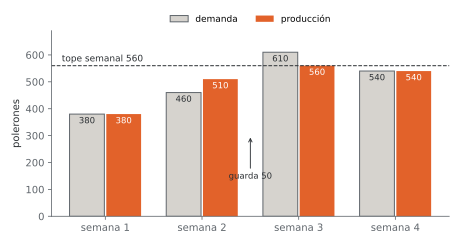
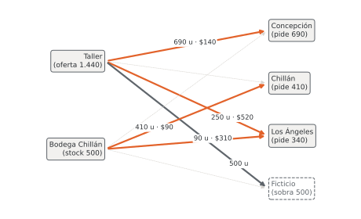

# Unidad 5 · Modelamiento lineal II · multiperíodo, transporte y asignación

**Qué vas a poder hacer.** Encadenar períodos con una ecuación de balance de inventario; plantear
un problema de transporte, balanceado o no, y una asignación como caso particular; armar redes con
nodos de transbordo; dimensionar turnos y dotación de personal, y leer en la solución qué período,
qué ruta o qué centro aprieta y cuánto vale aflojarlo.

**Lo que necesitas antes.** La unidad 4: formular un modelo de producción y mezcla con conjuntos,
parámetros y variables, y escribirlo en OPL. Basta saber que una variable es lo que se decide, un
parámetro es un dato y que una restricción activa es la que se cumple con igualdad. Los **precios
sombra** se justifican en la unidad 12; acá se usan con su lectura práctica: cuánto cambia el
objetivo si el lado derecho de una restricción sube en una unidad.

**Tiempo.** Unas 5 horas: 2 de lectura con los ejemplos y 3 de práctica.

---

## 1. La idea

Los modelos de esta unidad no son más difíciles que los de la unidad 4; son **más largos**, porque
repiten la misma pieza muchas veces. Un plan de cuatro meses es el modelo de un mes copiado cuatro
veces y cosido con el inventario. Un plan de despacho es la misma decisión («cuánto mando por esta
ruta») repetida en cada par origen y destino.

Casi todo se arma con dos herramientas:

1. **El balance.** En cada período, en cada bodega, en cada nodo de una red: lo que entra es igual a
   lo que sale. Si el balance está bien escrito, el modelo está casi listo.
2. **El «para todo» ($\forall$).** Una restricción con índices es una familia de restricciones. Escribir
   $\forall t \in T$ o `forall(t in Meses)` es lo que hace que un modelo de 4 o de 52 semanas tenga el
   mismo largo en el papel.

| Estructura | Lo que se repite | La pieza que las une |
|---|---|---|
| Multiperíodo | la decisión de cada período | el inventario que pasa de un período al siguiente |
| Transporte | la cantidad por ruta | la oferta de cada origen y la demanda de cada destino |
| Asignación | «sí o no» por par persona-tarea | cada persona una tarea, cada tarea una persona |
| Transbordo y redes | el flujo por arco | el balance en cada nodo intermedio |
| Personal | cuántos entran a cada turno | la cobertura de cada bloque horario |

---

## 2. Modelos multiperíodo

### Notación

| Símbolo | Qué es | Tipo |
|---|---|---|
| $T = \{1, \dots, n\}$ | períodos (semanas, meses) | conjunto |
| $d_t$ | demanda del período $t$ | parámetro |
| $I_0$ | inventario al empezar | parámetro |
| $x_t$ | cuánto se produce en $t$ | variable |
| $I_t$ | inventario al **cierre** de $t$ | variable |

### La ecuación de balance

$$I_{t-1} + x_t - I_t = d_t \qquad \forall t \in T, \quad \text{con } I_0 \text{ dado}$$

Se lee de izquierda a derecha como una bodega: lo que había, más lo que llega, menos lo que se guarda
para el próximo período, es lo que se entrega. En el primer período $I_{t-1}$ es el dato $I_0$, no una
variable; por eso en OPL se escribe aparte o con una condición sobre $t$.

**Por qué funciona.** El inventario es producción **movida en el tiempo**. Guardar una unidad de la
semana 2 para la semana 3 equivale a producirla en la semana 2 y «enviarla» a la semana 3 por una
ruta que cuesta el costo de mantener inventario. Con esa mirada, el modelo elige producir antes solo
cuando producir después no alcanza o sale más caro que guardar.

### Variantes que aparecen siempre

| Situación | Cómo se escribe |
|---|---|
| Dos formas de producir (turno regular y extra) | $R_t + E_t$ en lugar de $x_t$, cada una con su tope y su costo |
| Bodega con tope | $I_t \le K$ (el tope va sobre el inventario, no sobre la producción) |
| Varios productos y una bodega común | balance $\forall i, t$; bodega $\sum_i e_i I_{it} \le K \;\; \forall t$ |
| Inventario mínimo al final | $I_n \ge F$ (si no se pide, el modelo deja $I_n = 0$) |
| Demanda como **máximo** de venta | variable de venta $z_t \le d_t$ y balance $I_{t-1} + x_t - I_t = z_t$ |
| Atraso permitido (pedidos pendientes) | inventario neto $I_t^+ - I_t^-$, con costo por unidad atrasada |
| Producto que se puede despachar recién $s$ períodos después | lo producido en $t$ entra al balance de $t+s$ |

**Cuándo NO basta.** Si encender la línea tiene un costo fijo, si se compra una máquina o si el
tamaño de lote es mínimo, aparecen variables binarias (unidad 4 y siguientes). Si la demanda es
incierta, el modelo lineal planifica contra un solo escenario: sirve para decidir, no para garantizar.

### En OPL

```opl
int NMeses = ...;
range Meses = 1..NMeses;              // un conjunto de enteros: se puede escribir t-1

forall(t in Meses: t == 1)  Balance1: inv0     + R[t] + E[t] - I[t] == demanda[t];
forall(t in Meses: t > 1)   Balance:  I[t-1]   + R[t] + E[t] - I[t] == demanda[t];
// o en una sola línea, con el operador condicional:
// forall(t in Meses) Balance: (t > 1 ? I[t-1] : inv0) + R[t] + E[t] - I[t] == demanda[t];
```

Si los períodos son textos (`{"abril", "mayo"}`), no se puede escribir `t-1` ni `t == 1`: se usan
`first(Meses)` y `prev(Meses, t)`.

---

## 3. Ejemplo resuelto · Pellet del Laja

Una pyme de Los Ángeles fabrica pellet de madera en bolsas de 15 kg y planifica de abril a julio,
cuando sube la calefacción. Datos:

| Mes | abril | mayo | junio | julio |
|---|---|---|---|---|
| Demanda (bolsas) | 1.850 | 2.700 | 3.450 | 3.150 |

- Turno regular: hasta 2.480 bolsas al mes, a \$2.140 por bolsa.
- Turno extra (noche): hasta 690 bolsas al mes, a \$2.590 por bolsa.
- Bodega: caben 1.250 bolsas; guardar una bolsa de un mes al siguiente cuesta \$95.
- Empieza abril con 240 bolsas y debe cerrar julio con al menos 180 (reserva para agosto).

**Paso 1 · En palabras.** Se decide cuántas bolsas producir en cada turno cada mes y cuántas guardar.
Se busca el menor costo de producción y bodega. Limitan los topes de cada turno, el de la bodega, la
demanda de cada mes y la reserva final.

**Paso 2 · Algebraico.** $T = \{1, 2, 3, 4\}$ (abril a julio). Variables $R_t, E_t, I_t \ge 0$.

$$\min \sum_{t \in T} \left( 2{.}140\, R_t + 2{.}590\, E_t + 95\, I_t \right)$$

$$I_{t-1} + R_t + E_t - I_t = d_t \;\; \forall t \in T, \;\; I_0 = 240 \qquad R_t \le 2{.}480 \qquad E_t \le 690 \qquad I_t \le 1{.}250 \qquad I_4 \ge 180$$

**Paso 3 · OPL** (`modelos/u05_pellets.mod`, datos en `u05_pellets.dat`).

```opl
int NMeses = ...;
range Meses = 1..NMeses;
float demanda[Meses] = ...;
float capReg = ...;  float cReg = ...;
float capExt = ...;  float cExt = ...;
float cInv = ...;    float bodega = ...;
float inv0 = ...;    float invFin = ...;

dvar float+ R[Meses];   // turno regular
dvar float+ E[Meses];   // turno extra
dvar float+ I[Meses];   // en bodega al cierre del mes

minimize sum(t in Meses) (cReg*R[t] + cExt*E[t] + cInv*I[t]);

subject to {
  forall(t in Meses) {
    Regular: R[t] <= capReg;
    Extra:   E[t] <= capExt;
    Bodega:  I[t] <= bodega;
  }
  forall(t in Meses: t == 1) Balance1: inv0   + R[t] + E[t] - I[t] == demanda[t];
  forall(t in Meses: t > 1)  Balance:  I[t-1] + R[t] + E[t] - I[t] == demanda[t];
  Final: I[NMeses] >= invFin;
}
```

**Paso 4 · Solución** (CPLEX y HiGHS dan lo mismo).

| Mes | Regular | Extra | Bodega al cierre | Costo marginal de una bolsa más de demanda |
|---|---|---|---|---|
| abril | 2.480 | 0 | 870 | \$2.400 |
| mayo | 2.480 | 0 | 650 | \$2.495 |
| junio | 2.480 | 480 | 160 | \$2.590 |
| julio | 2.480 | 690 | 180 | \$2.685 |

Costo total: **$24.435.800** = $21.228.800 del turno regular (9.920 bolsas) + $3.030.300 del extra
(1.170 bolsas) + $176.700 de bodega (1.860 bolsas-mes).

**Cómo se lee.**

- El turno regular trabaja al tope los cuatro meses: producir en abril y guardar hasta junio cuesta
  $2{.}140 + 2 \cdot 95 = 2{.}330$, menos que una bolsa en turno extra. Por eso abril produce 630 bolsas
  más de las que vende.
- El turno extra solo se enciende en junio y julio. En julio queda al tope (690); en junio sobran 210
  bolsas de capacidad extra.
- La bodega nunca se llena: en abril, su peor mes, le sobran 380 bolsas de espacio. Arrendar más
  bodega no sirve de nada (su precio sombra es cero).
- La última columna son los precios sombra de los balances. Una bolsa más pedida en julio cuesta
  \$2.685, no \$2.590: el extra de julio ya está lleno, así que esa bolsa se hace en el extra de junio y
  se guarda un mes ($2{.}590 + 95$). Una bolsa más pedida en abril cuesta solo \$2.400: sale de la bodega,
  así que esa bolsa ya no se guarda hasta junio (ahorra $2 \cdot 95$) y junio la repone con turno extra
  ($2{.}590 - 190$).
- La reserva de 180 bolsas a fin de julio cuesta \$2.780 por bolsa en el margen: es una bolsa del extra
  de junio guardada dos meses ($2{.}590 + 2 \cdot 95$). Si el cliente de agosto se conforma con 100 bolsas,
  bajar la reserva ahorra ese monto por cada bolsa que se deja de guardar.

**Decisión.** Programar el turno de noche solo en junio y julio, con 480 y 690 bolsas, y cotizar
cualquier pedido adicional de julio a no menos de \$2.685 la bolsa en costo.

---

## 4. El problema de transporte

Hay orígenes $i \in O$ con una oferta $a_i$, destinos $j \in D$ con una demanda $b_j$ y un costo
$c_{ij}$ por unidad en cada ruta. Se decide $x_{ij}$, cuánto se manda de $i$ a $j$.

$$\min \sum_{i \in O} \sum_{j \in D} c_{ij}\, x_{ij} \qquad \text{s.a.} \qquad \sum_{j \in D} x_{ij} \le a_i \;\; \forall i \in O \qquad \sum_{i \in O} x_{ij} \ge b_j \;\; \forall j \in D \qquad x_{ij} \ge 0$$

Fíjate en qué índice recorre cada suma: la oferta de un origen suma **sobre los destinos**; la
demanda de un destino suma **sobre los orígenes**. Es el error de notación más frecuente.

### Balanceado o no

| Caso | Qué pasa | Qué se hace |
|---|---|---|
| $\sum a_i = \sum b_j$ (balanceado) | todo lo ofrecido se despacha | las restricciones se pueden escribir con igualdad |
| $\sum a_i > \sum b_j$ | sobra oferta | con $\le$ en la oferta basta; o se agrega un **destino ficticio** con costo 0 que recibe lo que sobra |
| $\sum a_i < \sum b_j$ | falta oferta: el modelo es **infactible** | se agrega un **origen ficticio** cuyo costo es la penalización por demanda no atendida |

Con igualdades en un problema no balanceado el modelo no tiene solución. Antes de escribir `==`,
suma las ofertas y las demandas.

### Dos propiedades que ahorran trabajo

1. **Soluciones enteras gratis.** Si las ofertas y demandas son enteras, los vértices del transporte
   son enteros: no hace falta declarar variables enteras. La matriz de restricciones tiene solo ceros
   y unos, con cada variable en exactamente una fila de oferta y una de demanda.
2. **Pocas rutas usadas.** Una solución básica usa a lo más $m + n - 1$ rutas ($m$ orígenes, $n$
   destinos). Un despacho óptimo nunca reparte un poco por todas partes.

### Mini ejemplo · huevos de dos granjas

Dos granjas despachan docenas de huevos por semana a tres supermercados (costo en pesos por docena):

| | Viña | Valparaíso | Quilpué | Oferta |
|---|---|---|---|---|
| Limache | 58 | 72 | 41 | 900 |
| Casablanca | 66 | 49 | 83 | 700 |
| Demanda | 620 | 480 | 350 | |

Oferta 1.600 y demanda 1.450: sobran 150 docenas. Solución (`u05_transporte.mod` con `u05_huevos.dat`):
Limache manda 550 a Viña y 350 a Quilpué; Casablanca manda 70 a Viña y 480 a Valparaíso. Costo
semanal **$74.390**. Usa 4 rutas; con el destino ficticio serían $2 + 4 - 1 = 5$ variables básicas,
contando las 150 docenas que Casablanca no despacha.

Precios sombra: Limache $-8$, Casablanca 0, Viña 66, Valparaíso 49, Quilpué 49. Se leen así: una
docena más en Limache ahorra \$8 (reemplaza una docena que Casablanca llevaba a Viña a \$66 por una
de Limache a \$58); Casablanca vale cero porque ya le sobran 150. Una docena más pedida en Quilpué
cuesta \$49 y no \$41, aunque la ruta directa cueste 41: Limache está lleno, así que le quita una docena
a Viña ($-58$) y Viña la recibe de Casablanca ($+66$).

---

## 5. Asignación

$n$ personas, $n$ tareas, un costo $c_{ij}$ por asignar la persona $i$ a la tarea $j$. Es un
transporte con todas las ofertas y demandas iguales a 1:

$$\min \sum_{i}\sum_{j} c_{ij} x_{ij} \qquad \sum_{j} x_{ij} = 1 \;\; \forall i \qquad \sum_{i} x_{ij} = 1 \;\; \forall j \qquad x_{ij} \ge 0$$

Por la propiedad de integralidad, el modelo lineal entrega $x_{ij} \in \{0, 1\}$ sin pedirlo. A mano se
resuelve con el método húngaro (unidad 10 de Gestión de Operaciones). Variantes:

- **Más personas que tareas:** $\sum_j x_{ij} \le 1$ para las personas.
- **Una persona puede tomar hasta $k$ tareas:** $\sum_j x_{ij} \le k$, y si además debe tomar al menos
  una, $\sum_j x_{ij} \ge 1$.
- **Pares prohibidos:** se fija $x_{ij} = 0$ (o un costo muy alto).

---

## 6. Transbordo y flujo en redes

Cuando la mercadería pasa por un **centro intermedio** antes de llegar al cliente, hay dos tramos y un
balance en el medio. Con plantas $P$, centros $C$ y clientes $K$:

$$\sum_{p \in P} x_{pc} = \sum_{k \in K} y_{ck} \qquad \forall c \in C \qquad \text{(lo que sale del centro tuvo que haber llegado)}$$

Si se permite mover carga entre centros, se agrega $z_{cc'}$ y el balance queda
$\sum_p x_{pc} + \sum_{c'} z_{c'c} = \sum_k y_{ck} + \sum_{c'} z_{cc'}$.

**La forma general: flujo de costo mínimo.** Todo lo anterior es un caso de un solo modelo. En una
red con nodos $N$ y arcos $A$, cada nodo tiene un dato $b_n$ (positivo si ofrece, negativo si pide,
cero si es de paso):

$$\min \sum_{(i,j) \in A} c_{ij} f_{ij} \qquad \sum_{j:(n,j) \in A} f_{nj} - \sum_{i:(i,n) \in A} f_{in} = b_n \;\; \forall n \in N \qquad 0 \le f_{ij} \le u_{ij}$$

Transporte, asignación, transbordo, ruta más corta y también el plan multiperíodo caben aquí: un
plan de producción es una red cuyos nodos son los meses y cuyos arcos de inventario van de un mes al
siguiente (el ejercicio 5.10 lo aprovecha).

---

## 7. Personal: turnos y dotación

**Turnos que se traslapan.** El día se divide en bloques y cada persona trabaja varios bloques
seguidos. La variable no es «cuántos hay en el bloque $b$» sino **cuántos entran** al inicio de $b$.
Con turnos de dos bloques y un día cíclico:

$$\min \sum_{b} x_b \qquad x_b + x_{b-1} \ge r_b \;\; \forall b \quad (\text{con } x_0 \equiv x_n)$$

Los presentes en un bloque son los que entraron en ese bloque y los que entraron en el anterior. Si
se modela «cuántos hay», una persona queda contada dos veces y el modelo no sabe que su turno dura
ocho horas.

**Contratar y despedir.** La dotación también es un inventario: hay $W_{t-1}$ personas, se contratan
$H_t$, se despiden $F_t$.

$$W_t = W_{t-1} + H_t - F_t \qquad h\, W_t \ge \text{horas}_t$$

Es la ecuación de balance con otro nombre. Con personas, la solución lineal puede salir fraccionaria;
se declara la variable entera o se redondea y se comprueba (ejercicio 5.8).

---

## 8. Errores típicos

| Error | Cómo evitarlo |
|---|---|
| Escribir el balance del primer período con $I_{t-1}$ (en OPL, `I[0]` fuera de rango) | El primer período usa el dato $I_0$: filtro `t == 1` o el operador `(t > 1 ? I[t-1] : inv0)` |
| Poner el tope de bodega sobre la producción | La bodega guarda $I_t$, no $x_t$: lo que se produce y se vende en el mismo período no ocupa bodega |
| Sumar sobre el índice equivocado: $\sum_i x_{ij} \le a_i$ | La oferta del origen $i$ suma sobre $j$; la demanda del destino $j$ suma sobre $i$. Comprueba que el índice libre quede en el $\forall$ |
| Balancear varios productos en agregado, $\sum_i(\dots) \;\forall t$ | El balance es por producto, $\forall i, t$: si no, el modelo «convierte» inventario de un producto en ventas de otro |
| Escribir con igualdad un transporte que no está balanceado | Suma ofertas y demandas antes; si no calzan, usa $\le$ / $\ge$ o agrega el nodo ficticio |
| Modelar turnos con «cuántos hay» en vez de «cuántos entran» | La variable es la entrada; los presentes se calculan sumando las entradas que cubren el bloque |
| Confundir un dato con una variable: dejar la demanda $d_t$ como `dvar` | Lo que se conoce antes de decidir es parámetro (`float d[T] = ...;`), lo que se decide es `dvar` |
| Olvidar la no negatividad del inventario | Con `dvar float` (sin `+`) el inventario negativo aparece como «pedido pendiente» gratis |
| Leer con el signo de un máximo el precio sombra de un mínimo | En un mínimo, un precio sombra de capacidad negativo significa **ahorro** por unidad extra de capacidad |

---

## 9. Práctica

Diez ejercicios: 5.1 a 5.4 básicos, 5.5 a 5.8 intermedios, 5.9 y 5.10 de desafío. Las pautas están en
la sección 10. Intenta cada uno antes de mirarla. Los modelos OPL de los que lo piden están en
`modelos/`.

**5.1 · Mermelada, inventario a mano (básico).** Una fábrica de mermelada tiene 60 frascos al
empezar y un plan fijo de 500 frascos por semana. Guardar un frasco una semana cuesta \$40.

| Semana | 1 | 2 | 3 | 4 |
|---|---|---|---|---|
| Demanda | 380 | 520 | 610 | 450 |

(a) Calcula el inventario al cierre de cada semana y el costo de bodega. (b) Si la demanda de la
semana 3 sube a 720, ¿qué dice la ecuación de balance? ¿Qué significa para el plan?

**5.2 · Leche de tres predios (básico).** Una cooperativa recoge leche de tres predios y la lleva a
tres plantas (litros por día; costo en pesos por litro). Formula el modelo, explica por qué se puede
escribir con igualdades y resuélvelo con `u05_transporte.mod` y `u05_leche.dat`. ¿Cuántas rutas usa la
solución y por qué ese número?

| | Planta 1 | Planta 2 | Planta 3 | Oferta |
|---|---|---|---|---|
| Predio A | 18 | 25 | 31 | 4.200 |
| Predio B | 22 | 15 | 27 | 3.100 |
| Predio C | 29 | 20 | 14 | 4.700 |
| Demanda | 3.600 | 4.300 | 4.100 | |

**5.3 · Cuatro buses, cuatro recorridos (básico).** Minutos que tarda cada bus en vacío desde donde
quedó hasta el inicio de cada recorrido. Escribe la asignación como modelo lineal, resuélvela y
explica por qué no hizo falta declarar las variables binarias.

| | R1 | R2 | R3 | R4 |
|---|---|---|---|---|
| B1 | 14 | 9 | 12 | 17 |
| B2 | 11 | 13 | 16 | 10 |
| B3 | 15 | 12 | 8 | 14 |
| B4 | 10 | 16 | 13 | 11 |

**5.4 · Encuentra los cuatro errores (básico).** Este modelo quiere planificar productos $P$ en meses
$1..T$ con una bodega común de capacidad `K`. Señala cada error, explica qué haría el modelo con él y
corrígelo.

```opl
dvar float x[P][1..T];                 // producción
dvar float+ I[P][1..T];                // inventario al cierre
dvar float+ dem[P][1..T];              // demanda de cada producto y mes
minimize sum(p in P, t in 1..T) h[p]*I[p][t];
subject to {
  forall(p in P, t in 1..T) I[p][t-1] + x[p][t] - I[p][t] == dem[p][t];
  forall(p in P, t in 1..T) sum(q in P) I[q][t] <= K[p];
}
```

**5.5 · Bicicletas eléctricas con atraso (intermedio).** Un taller arma hasta 170 bicicletas al mes.
Guardar una bicicleta un mes cuesta \$9.000; atrasar una entrega un mes cuesta \$15.000 (descuento al
cliente). No hay inventario inicial y al final del cuarto mes no puede quedar nada pendiente.

| Mes | 1 | 2 | 3 | 4 |
|---|---|---|---|---|
| Demanda | 120 | 160 | 210 | 150 |

Formula con inventario neto $I_t^+ - I_t^-$, resuelve e interpreta el precio sombra del balance del
mes 4.

**5.6 · Alimento para mascotas con transbordo (intermedio).** Dos plantas (Rancagua, 1.180 t al mes;
Talca, 870 t) despachan a dos centros (San Bernardo, recibe hasta 2.000 t; Chillán, hasta 960 t) y de
ahí a tres clientes (Santiago 780 t, Concepción 640 t, Temuco 470 t). Costos en pesos por tonelada:

| Planta → centro | San Bernardo | Chillán |
|---|---|---|
| Rancagua | 4.100 | 12.800 |
| Talca | 8.700 | 6.300 |

| Centro → cliente | Santiago | Concepción | Temuco |
|---|---|---|---|
| San Bernardo | 2.400 | 14.600 | 20.700 |
| Chillán | 13.900 | 3.300 | 9.200 |

Formula, resuelve (`u05_transbordo.mod`) y responde: ¿cuánto pagarías por una tonelada más de
capacidad en el centro de Chillán? ¿Por qué Temuco tiene el precio sombra que tiene?

**5.7 · Turnos en un call center (intermedio).** El call center de una clínica trabaja las 24 horas en
bloques de 4 horas. Cada persona trabaja 8 horas seguidas y puede entrar al inicio de cualquier
bloque (el turno de las 20:00 termina a las 4:00). Personas necesarias:

| Bloque | 0-4 | 4-8 | 8-12 | 12-16 | 16-20 | 20-24 |
|---|---|---|---|---|---|---|
| Personas | 4 | 6 | 15 | 13 | 11 | 7 |

Encuentra la dotación mínima (`u05_turnos.mod`) y demuestra, sin computador, que no se puede con
menos.

**5.8 · Aseo industrial: contratar y despedir (intermedio).** Una empresa necesita 3.200, 4.100,
4.800 y 3.600 horas en los próximos cuatro meses. Cada persona trabaja 160 horas al mes y cuesta
\$720.000 de sueldo mensual; contratar cuesta \$380.000 y despedir \$520.000. Hoy hay 22 personas.
(a) Resuelve el modelo lineal. (b) Resuelve con dotación entera y compara. (c) ¿Por qué el modelo
despide en el mes 4 y no en el mes 1?

**5.9 · Transporte multiperíodo (desafío).** Dos plantas abastecen tres clientes por tres meses. Cada
planta puede guardar inventario de un mes al siguiente.

| Planta | Capacidad al mes | Costo de producir | Inventario (por unidad y mes) | → Curicó | → Linares | → Los Ángeles |
|---|---|---|---|---|---|---|
| Talca | 880 | \$1.170 | \$60 | 95 | 117 | 370 |
| Chillán | 690 | \$1.020 | \$75 | 285 | 155 | 138 |

| Demanda | Mes 1 | Mes 2 | Mes 3 |
|---|---|---|---|
| Curicó | 430 | 370 | 590 |
| Linares | 380 | 390 | 470 |
| Los Ángeles | 360 | 415 | 570 |

Formula con conjuntos e índices, implementa en OPL y resuelve. ¿Quién guarda inventario, cuándo y
por qué? ¿Cuánto vale una unidad más de capacidad en Chillán cada mes?

**5.10 · El plan de 5.5 como transporte (desafío).** Reescribe 5.5 como un problema de transporte sin
variables de inventario: los orígenes son «producir en el mes $i$» (oferta 170) y los destinos
«atender el mes $j$». (a) Arma la matriz de costos y resuelve con `u05_transporte.mod`. ¿Da el mismo
costo? (b) Si la penalización por atraso sube a \$20.000 por bicicleta y mes, ¿qué cambia?

---

## 10. Pautas

**5.1.** (a) Inventario al cierre: 180, 160, 50 y 100 frascos ($60 + 500 - 380 = 180$, y así). Costo de
bodega: $40 \cdot (180 + 160 + 50 + 100) = 19{.}600$, o sea **$19.600**. (b) El balance de la semana 3 da
$160 + 500 - 720 = -60$: el inventario tendría que ser negativo y el de la semana 4 queda en $-10$. Con
$I_t \ge 0$ el plan es **infactible**: faltan 60 frascos en la semana 3. Hay que producir más antes, o
aceptar atraso y modelarlo como en 5.5.

**5.2.** Oferta total 12.000 y demanda total 12.000: está balanceado, así que todo lo que se recoge se
entrega y las restricciones pueden ser igualdades. Solución: A → Planta 1 3.600, A → Planta 2 600,
B → Planta 2 3.100, C → Planta 2 600, C → Planta 3 4.100, con costo diario de **$195.700**. Usa 5 rutas,
exactamente $m + n - 1 = 3 + 3 - 1$: en un transporte balanceado una de las igualdades sobra (se deduce
de las otras), así que una solución básica tiene 5 variables positivas. Ojo: en un transporte
balanceado los precios sombra no son únicos (se les puede sumar una constante); por eso no se
interpretan uno por uno.

**5.3.** Modelo: $\min \sum c_{ij} x_{ij}$, $\sum_j x_{ij} = 1$ por bus, $\sum_i x_{ij} = 1$ por recorrido,
$x_{ij} \ge 0$. Óptimo: B1 → R2, B2 → R4, B3 → R3, B4 → R1, con **37 minutos** en vacío ($9 + 10 + 8 + 10$).
Es único: la siguiente mejor asignación suma 39 minutos. No hizo falta pedir variables binarias
porque la asignación es un transporte con datos enteros: sus vértices son enteros y, con ofertas y
demandas iguales a 1, cada $x_{ij}$ vale 0 o 1.

**5.4.** (1) `x` sin `+`: permite producción negativa, es decir, «desproducir» para bajar inventario;
va `dvar float+`. (2) `dem` declarada como variable: el modelo elegiría demandas cero y no produciría
nada; es un parámetro, `float dem[P][1..T] = ...;`. (3) El balance usa `I[p][t-1]` también para `t = 1`,
fuera de rango; el primer mes usa el inventario inicial: `(t > 1 ? I[p][t-1] : inv0[p])`. (4) La bodega
se escribe `forall(p in P, t in 1..T)` con `K[p]`: repite la misma restricción por cada producto con un
tope que no corresponde (la bodega es común, `K` es un solo número); va `forall(t in 1..T) sum(q in P)
I[q][t] <= K;`.

**5.5.** Variables $x_t$, $I_t^+$ (guardadas), $I_t^-$ (pendientes). Balance:
$I_{t-1}^+ - I_{t-1}^- + x_t - I_t^+ + I_t^- = d_t$, con $x_t \le 170$ e $I_4^- = 0$. Objetivo
$\min \sum_t (9{.}000\, I_t^+ + 15{.}000\, I_t^-)$. Solución: producir 130, 170, 170 y 170; guardar 10 al
cierre del mes 1 y 20 al cierre del mes 2; el mes 3 queda con 20 bicicletas pendientes, que se
entregan en el mes 4. Costo **$570.000**. Lectura del mes 3: le faltan 40; 20 vienen guardadas
(10 del mes 1 por dos meses y 10 del mes 2), y las otras 20 conviene atrasarlas un mes (\$15.000) antes
que guardarlas dos meses (\$18.000). Precio sombra del balance del mes 4: **\$3.000**. Una bicicleta
más en el mes 4 no cabe (el mes 4 está lleno); se fabrica en el mes 1 y se guarda hasta el mes 3
(\$18.000), lo que libera una bicicleta del mes 4 que antes cubría un atraso (\$15.000): $18{.}000 - 15{.}000$.

**5.6.** Balance en cada centro: $\sum_p x_{pc} - \sum_k y_{ck} = 0$; capacidad de cada centro sobre lo
que recibe. Solución: Rancagua → San Bernardo 930, Rancagua → Chillán 90, Talca → Chillán 870; San
Bernardo → Santiago 780 y → Concepción 150; Chillán → Concepción 490 y → Temuco 470. Costo mensual
**$20.449.000**. Rancagua deja 160 t sin usar; Talca y el centro de Chillán quedan al tope.

- Una tonelada más de capacidad en Chillán vale **\$2.600**: permite mandar una tonelada más por
  Chillán a Concepción ($12{.}800 + 3{.}300 = 16{.}100$) en vez de por San Bernardo ($4{.}100 + 14{.}600 = 18{.}700$).
- Precio sombra de Temuco: **\$24.600**. La ruta barata a Temuco pasa por Chillán, que está lleno: se
  manda una tonelada más a Temuco por Chillán ($9{.}200$) y Concepción se compensa por San Bernardo, lo
  que cuesta en total $24{.}600$, menos que ir directo por San Bernardo ($4{.}100 + 20{.}700 = 24{.}800$).
- Una tonelada más en Talca ahorra \$6.500: reemplaza una de Rancagua a Chillán (12.800) por una de
  Talca (6.300).

**5.7.** Con $x_b$ = personas que entran al inicio del bloque $b$: $\min \sum_b x_b$ con
$x_b + x_{b-1} \ge r_b$ y $x_1 + x_6 \ge r_1$. Mínimo: **30 personas**; por ejemplo 4 entran a las 0:00, 2 a
las 4:00, 13 a las 8:00 y 11 a las 16:00 (hay otras soluciones con 30). Por qué no se puede con menos:
los bloques 0-4, 8-12 y 16-20 no comparten a nadie (cada persona cubre dos bloques seguidos, así que
toca a lo más uno de esos tres), y entre los tres piden $4 + 15 + 11 = 30$ personas distintas. El modelo
lineal sin pedir enteros también da 30, y sus precios sombra (1 en esos tres bloques, 0 en los otros)
son exactamente ese argumento.

**5.8.** (a) Dotación necesaria: 20; 25,625; 30 y 22,5 personas ($\text{horas}/160$). Solución lineal:
mantener 22 en el mes 1, contratar 3,625 en el mes 2 y 4,375 en el mes 3, despedir 7,5 en el mes 4. Costo
**$79.030.000**. (b) Con enteros: 22, 26, 30 y 23 personas (contratar 4 y 4, despedir 7), costo
**$79.400.000**, \$370.000 más: redondear tiene precio. (c) En el mes 1 sobran 2 personas, pero despedirlas
(\$520.000 cada una) y volver a contratar en el mes 2 (\$380.000) cuesta \$900.000 por persona, más que
un mes de sueldo (\$720.000). En el mes 4 no hay mes 5 en el modelo: despedir sale más barato que un
sueldo y el modelo no ve que quizás haya que recontratar. Es un **efecto de borde** del horizonte;
se corrige pidiendo una dotación mínima al final.

**5.9.** Conjuntos $P$ (plantas), $K$ (clientes), $T$ (meses). Variables $Y_{pt}$ producción, $Z_{pt}$
inventario al cierre, $X_{pkt}$ envíos.

$$\min \sum_{p,t} (c_p Y_{pt} + h_p Z_{pt}) + \sum_{p,k,t} e_{pk} X_{pkt} \qquad Y_{pt} + Z_{p,t-1} - Z_{pt} = \sum_k X_{pkt} \;\; \forall p,t \qquad \sum_p X_{pkt} \ge d_{kt} \;\; \forall k,t \qquad Y_{pt} \le \text{cap}_p$$

El modelo está en `u05_transporte_multiperiodo.mod`. Solución, costo **$4.834.140**:

| | Mes 1 | Mes 2 | Mes 3 |
|---|---|---|---|
| Talca produce | 480 | 545 | 880 |
| Talca guarda al cierre | 0 | 60 | 0 |
| Chillán produce | 690 | 690 | 690 |
| Talca → Curicó / Linares | 430 / 50 | 370 / 115 | 590 / 350 |
| Chillán → Linares / Los Ángeles | 330 / 360 | 275 / 415 | 120 / 570 |

El mes 3 pide 1.630 unidades y entre las dos plantas caben 1.570: faltan 60, y las guarda Talca en el
mes 2 (le cuesta \$60 por unidad, menos que los \$75 de Chillán, que además ya produce al tope todos los
meses). Chillán es la planta barata y trabaja siempre llena; Talca cubre lo que falta en Linares. Una
unidad más de capacidad en Chillán vale **\$112** en los meses 1 y 2 y **\$172** en el mes 3: es el precio
sombra de Linares (\$1.287 y \$1.347) menos lo que cuesta llevar esa unidad desde Chillán
($1{.}020 + 155$).

**5.10.** (a) Costo de producir en $i$ para atender $j$: $9{.}000\,(j - i)$ si $j \ge i$ (se guarda) y
$15{.}000\,(i - j)$ si $j < i$ (se atrasa).

| Producir en ↓ / atender → | 1 | 2 | 3 | 4 |
|---|---|---|---|---|
| Mes 1 | 0 | 9.000 | 18.000 | 27.000 |
| Mes 2 | 15.000 | 0 | 9.000 | 18.000 |
| Mes 3 | 30.000 | 15.000 | 0 | 9.000 |
| Mes 4 | 45.000 | 30.000 | 15.000 | 0 |

La oferta (680) supera a la demanda (640), así que con $\le$ en la oferta no hace falta destino ficticio.
Resultado: **$570.000**, el mismo de 5.5. El reparto que entrega el solver puede verse distinto (por
ejemplo, el mes 2 manda 20 al mes 3 y el mes 1 manda 10 al mes 2), pero mueve las mismas unidades por
los mismos meses. No hacen falta variables de inventario porque cada ruta ya «sabe» cuántos meses
espera la unidad. (b) Con \$20.000 por atraso, atrasar ya no conviene: el mes 1 produce 150 y guarda
30, el mes 2 guarda 40 y nada queda pendiente. Costo **$630.000**: el atraso era la válvula barata y
ahora hay que guardar dos meses (\$18.000) en vez de atrasar.

---

## 11. Caso integrador · Estampa Sur, cuatro semanas y tres tiendas

> Este caso sigue a Estampa Sur, el taller de serigrafía ficticio de la Región del Biobío, por todo
> el ramo. La unidad 4 dejó el modelo de una semana; acá el modelo se repite en el tiempo (polerones
> de cuatro semanas) y en el espacio (envío a tres tiendas). Las cifras salen de
> `verificacion/caso_estampa_sur_lp.py`.

### Parte A · Polerones en cuatro semanas

Se viene la temporada de polerones. El taller puede hacer hasta 560 polerones por semana, caben 380
guardados y guardar uno una semana cuesta \$210. No hay inventario al empezar.

| Semana | 1 | 2 | 3 | 4 |
|---|---|---|---|---|
| Demanda | 380 | 460 | 610 | 540 |

**En palabras.** Se decide cuántos polerones hacer y guardar cada semana; se busca el menor costo de
guardar; limitan el tope semanal, la bodega y la demanda de cada semana.

**Algebraico.** $\min \sum_t 210\, I_t$ s.a. $I_{t-1} + x_t - I_t = d_t$ ($I_0 = 0$), $x_t \le 560$,
$I_t \le 380$, $x_t, I_t \ge 0$.

**OPL** (`modelos/u05_polerones.mod` con `u05_polerones.dat`):

```opl
dvar float+ x[Semanas];
dvar float+ I[Semanas];
minimize sum(t in Semanas) cInv * I[t];
subject to {
  forall(t in Semanas) {
    Capacidad: x[t] <= cap;
    Bodega:    I[t] <= invMax;
    Balance:   (t > 1 ? I[t-1] : 0) + x[t] - I[t] == demanda[t];
  }
}
```

**Solución.** Producir **380, 510, 560 y 540**; guardar **0, 50, 0 y 0**. Costo **$10.500** (50 polerones
guardados una semana).



**Lectura.** La semana 3 pide 610 y el taller hace 560: faltan 50, y se adelantan a la semana 2, la
más cercana (guardarlos desde la semana 1 costaría el doble). La única restricción de capacidad activa
es la de la semana 3, con precio sombra $-210$: un polerón más de capacidad en esa semana ahorra \$210,
porque evita guardar uno. Las otras tres semanas y la bodega tienen holgura (precio sombra cero): no
vale la pena pagar horas extra en ellas. El precio sombra del balance de la semana 3 es \$210: un
pedido extra esa semana cuesta \$210 de bodega.

### Parte B · Envío a tres tiendas

Las 1.440 poleras básicas de la semana van a tres tiendas. Si todo sale del taller:

| Tienda | Pedido | Costo por unidad desde el taller | Costo |
|---|---|---|---|
| Concepción | 690 | \$140 | $96.600 |
| Chillán | 410 | \$390 | $159.900 |
| Los Ángeles | 340 | \$520 | $176.800 |
| **Total** | **1.440** | | **$433.300** |

Eso no es todavía un transporte: con un solo origen no hay nada que decidir. Se vuelve uno si se
agrega un segundo origen. Supón (dato propio de esta unidad) que el taller tiene 500 poleras de la
temporada anterior en una bodega de Chillán, con estos costos por unidad: Concepción \$380, Chillán
\$90, Los Ángeles \$310. Ahora hay 1.940 unidades para 1.440 pedidas: sobran 500 y se agrega un destino
ficticio con costo cero (lo que llega ahí se queda donde está).



Solución (`u05_transporte.mod` con `u05_tiendas.dat`): la bodega manda 410 a Chillán y 90 a Los
Ángeles; el taller manda 690 a Concepción y 250 a Los Ángeles, y 500 quedan en el taller. Costo
**$291.400**: **$141.900** menos que despachar todo desde el taller.

**Lectura.** La bodega es la que aprieta: su precio sombra es $-210$, o sea, cada polera más guardada
en Chillán ahorraría \$210 (una polera menos que el taller lleva a Los Ángeles a \$520, reemplazada por
una de la bodega a \$310). El taller tiene holgura (precio sombra 0). Una polera más pedida en
Chillán cuesta \$300 y no \$90: la bodega ya está vacía, así que la manda a Chillán en vez de a Los
Ángeles, y Los Ángeles la recibe del taller ($90 - 310 + 520$).

**Decisión.** Despachar la temporada pasada desde Chillán antes de mover stock nuevo del taller, y si
se repone la bodega, hacerlo pensando en Los Ángeles: cada polera ahí vale \$210 de flete ahorrado.

**Lo que pasa a la unidad 6.** El plan semanal. La unidad 6 vuelve a la mezcla de una semana y le
agrega un segundo objetivo: además de ganar margen, gastar menos tinta.

---

## 12. Para seguir

**En los libros del ramo.**

- Winston, *Investigación de operaciones: aplicaciones y algoritmos* (4.ª ed., 2005), capítulo 3:
  sección 3.5 (programación de turnos), 3.10 (problemas multiperíodo con inventario) y 3.12 (personal
  en varios períodos). El capítulo de transporte, asignación y transbordo del mismo libro desarrolla
  las secciones 4 a 6 de esta unidad.
- Hillier y Lieberman, *Introducción a la investigación de operaciones* (7.ª ed., 2001), capítulos
  sobre el problema de transporte y asignación y sobre modelos de redes.

**Abierto y gratis.**

- Bradley, Hax y Magnanti, *Applied Mathematical Programming*, Addison-Wesley (1977), en inglés,
  capítulo 8 (*Network Models*): transporte, asignación y flujo en redes. El MIT lo publica completo en
  https://web.mit.edu/15.053/www/AMP.htm

**Con el tutor.** La carpeta `tutor/` trae el contexto de este ramo. Pégalo al inicio de la
conversación con cualquier IA y pídele, por ejemplo: «Dame un problema de transbordo con un centro
lleno y pídeme interpretar los precios sombra antes de mostrarme la pauta».
