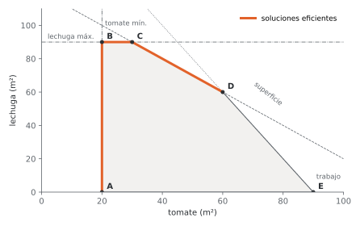
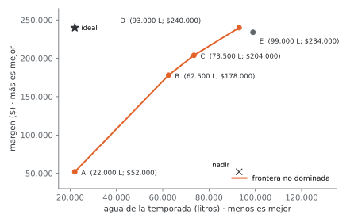
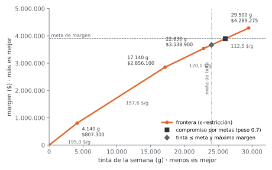

# Unidad 6 · Modelos con varios objetivos

**Qué vas a poder hacer.** Distinguir soluciones dominadas de no dominadas; armar la matriz de pagos
con sus puntos ideal y nadir; trazar la frontera de soluciones no dominadas con ε-restricción;
normalizar y ponderar objetivos; plantear metas con variables de desviación; resolver por
prioridades, y explicar qué cuesta, en un objetivo, cada unidad que se gana en el otro.

**Lo que necesitas antes.** Formular y resolver un modelo lineal (unidades 4 y 5) y leer un precio
sombra como «cuánto cambia el objetivo por una unidad más de lado derecho». Del método gráfico
(unidad 2) basta saber que el óptimo de un modelo lineal está en un vértice.

**Tiempo.** Unas 4,5 horas: 1,5 de lectura con el ejemplo y 3 de práctica.

---

## 1. La idea

Hasta ahora cada modelo tenía **una** función objetivo. Las decisiones reales casi nunca: se quiere
ganar más y contaminar menos, gastar menos y atender mejor, terminar antes y pagar menos horas
extra. Cuando dos objetivos tiran para lados distintos, no existe «la» solución óptima: existe un
conjunto de soluciones que son buenas en sentidos distintos, y elegir entre ellas requiere algo que
el modelo no tiene, **las preferencias de quien decide**.

Esta unidad hace dos cosas:

1. **Ordenar las opciones.** Descartar las que son peores en todo (dominadas) y dibujar la frontera de
   las que quedan, con lo que cuesta moverse por ella.
2. **Elegir con una regla explícita.** Ponderar (suma ponderada), fijar metas (programación por metas)
   o fijar un orden (programación por prioridades). Cada regla es una forma distinta de poner las
   preferencias dentro del modelo.

Un caso aparte: si los dos objetivos se pueden medir en la misma unidad (por ejemplo, los dos en
pesos), basta sumarlos y el modelo vuelve a tener un objetivo. Esta unidad trata los casos en que eso
no es razonable: pesos contra litros de agua, pesos contra gramos de tinta, costo contra cobertura.

---

## 2. Dominancia y frontera

Sea un problema con objetivos $f_1, \dots, f_p$ y soluciones factibles $X$. Una solución $x$
**domina** a otra $x'$ si no es peor en ningún objetivo y es estrictamente mejor en al menos uno.

- **Solución no dominada** (u óptimo de Pareto): ninguna otra la domina. Mejorar un objetivo obliga a
  empeorar otro.
- **Débilmente no dominada**: ninguna otra es estrictamente mejor en **todos** los objetivos, pero sí
  hay alguna igual en uno y mejor en otro. Aparece en los bordes horizontales o verticales del dibujo.

Hay dos espacios donde mirar:

| Espacio | Qué se dibuja | Qué se ve |
|---|---|---|
| De decisiones | las variables $x$ (por ejemplo, m² de cada cultivo) | la región factible; las soluciones **eficientes** |
| De objetivos | los valores $(f_1(x), f_2(x))$ | la **frontera** de puntos no dominados |

Una solución es eficiente en el espacio de decisiones exactamente cuando su imagen es no dominada en
el espacio de objetivos: son dos nombres para lo mismo, mirado desde lados distintos.

**Por qué importa la frontera.** Todo lo que está fuera de ella es un error que se puede evitar: hay
otra solución mejor en algo sin ser peor en nada. Sobre la frontera, en cambio, ya no hay almuerzos
gratis, y la **pendiente** dice el precio de cambio: cuánto de un objetivo se entrega por cada unidad
del otro.

### Matriz de pagos, ideal y nadir

Se optimiza cada objetivo por separado y se anota cuánto valen todos los objetivos en esa solución.
Cada fila es «lo que pasa si solo me importa $f_k$».

- **Ideal** (o utopía) $u$: el mejor valor de cada objetivo, la diagonal de la matriz. Casi nunca es
  factible: si lo fuera, no habría conflicto.
- **Nadir** $n$: el peor valor de cada objetivo **entre las soluciones no dominadas**. Con dos objetivos
  se lee exacto en la matriz de pagos (el peor valor de cada columna), siempre que cada óptimo
  individual sea único o se desempate con el otro objetivo; con tres o más, la matriz solo lo estima.

La distancia entre ideal y nadir es el rango en que cada objetivo realmente se mueve. Sirve para
normalizar.

### Trazar la frontera: ε-restricción

Se optimiza un objetivo y el otro pasa a ser restricción con un tope $\varepsilon$:

$$\max f_1(x) \quad \text{s.a.} \quad f_2(x) \le \varepsilon, \;\; x \in X$$

Moviendo $\varepsilon$ se recorre la frontera completa. En un modelo lineal la frontera es una
poligonal y el **precio sombra** de la restricción $f_2(x) \le \varepsilon$ es la pendiente del tramo:
cuánto sube $f_1$ por cada unidad más de $f_2$ permitida. Donde el precio sombra cambia, la frontera
tiene un quiebre.

---

## 3. Suma ponderada (normalizar antes de ponderar)

Se combinan los objetivos en uno solo:

$$\max \;\; \sum_{k} w_k\, \tilde f_k(x), \qquad \sum_k w_k = 1, \;\; w_k \ge 0$$

donde $\tilde f_k$ es el objetivo **normalizado**. Sin normalizar, un objetivo en pesos (millones) aplasta
a uno en porcentaje (decenas): el peso $w_k$ deja de significar lo que uno cree (ejercicio 6.4). Las
dos normalizaciones habituales:

$$\text{por la utopía:} \;\; \tilde f_k = \frac{f_k(x)}{u_k} \qquad\qquad \text{por utopía y nadir:} \;\; \tilde f_k = \frac{f_k(x) - n_k}{u_k - n_k}$$

La segunda vale 1 en el mejor valor y 0 en el peor, sirve igual para objetivos de máximo y de
mínimo (si $f_k$ se minimiza, $u_k < n_k$ y la fracción igual queda entre 0 y 1) y no falla cuando la
utopía es cero. Es la que usa esta unidad.

**Cómo funciona en un modelo lineal.** Con dos objetivos, la suma ponderada equivale a ponerle un
**precio implícito** a un objetivo en unidades del otro. Si $f_1$ es margen y $f_2$ es agua:

$$\text{precio implícito del agua} = \frac{w_2}{w_1}\cdot\frac{u_1 - n_1}{n_2 - u_2} \quad \text{pesos por litro}$$

El modelo avanza por la frontera mientras la pendiente del tramo (lo que se gana de margen por litro)
supere ese precio, y se detiene en el vértice donde deja de superarlo.

**Cuándo NO basta.**

- La suma ponderada de un modelo lineal **salta de vértice en vértice** de la frontera. Los puntos del
  medio de un tramo nunca salen (salvo empate exacto), por mucho que se ajusten los pesos.
- Si las soluciones son discretas (proyectos que se hacen o no), la frontera puede tener puntos no
  dominados «hundidos» que ninguna combinación de pesos encuentra (ejercicio 6.9). Para esos están
  las metas y la ε-restricción.

---

## 4. Programación por metas

Cada objetivo se convierte en una **meta** $G_k$, un valor que se quiere alcanzar. Las restricciones
del sistema que no se pueden violar (superficie, horas, capacidad) son **duras**; las metas son
**blandas** y se escriben con dos **variables de desviación** $d_k^- , d_k^+ \ge 0$:

$$f_k(x) + d_k^- - d_k^+ = G_k$$

$d_k^-$ es cuánto falta para llegar a la meta y $d_k^+$ cuánto se pasa. Solo una de las dos es
**no deseada**, y depende del sentido de la meta:

| Meta | Desviación no deseada | Se penaliza |
|---|---|---|
| $f_k(x) \ge G_k$ (llegar al menos a) | quedarse corto | $d_k^-$ |
| $f_k(x) \le G_k$ (no pasarse de) | pasarse | $d_k^+$ |
| $f_k(x) = G_k$ (exacto) | las dos | $d_k^- + d_k^+$ |

El objetivo minimiza las desviaciones no deseadas, **divididas por su meta** para que sean
comparables (un 5 % de la meta de margen contra un 5 % de la meta de agua), con pesos que dicen
cuánto importa cada una:

$$\min \sum_k \frac{w_k^- d_k^- + w_k^+ d_k^+}{G_k}$$

**Por qué funciona.** El modelo «paga» por cada unidad que falta o sobra. Si cumplir una meta cuesta
alejarse de la otra, compara los dos castigos relativos y elige el más barato. Las dos variables de
desviación de una meta nunca son positivas a la vez en el óptimo, si al menos una se castiga: bajar
las dos en lo mismo mantiene la igualdad y quita castigo.

**Cuándo NO aplica.** Si una meta es imposible aunque se ignoren las demás, el modelo igual entrega
una solución (con la desviación grande): revisa siempre las desviaciones, no solo las variables.

---

## 5. Programación por prioridades (lexicográfica)

A veces no hay pesos razonables, pero sí un **orden**: primero cumplir el contrato, después gastar lo
menos posible. Se resuelve en etapas:

1. Se optimiza la meta de prioridad 1 (por ejemplo, $\min d_1^-$).
2. Se **fija** lo logrado ($d_1^- = d_1^{-*}$ o $f_1(x) \ge f_1^*$) y se optimiza la prioridad 2 sobre ese
   conjunto más chico.
3. Así hasta la última, que suele ser simplemente $\max$ o $\min$ del último objetivo.

Se escribe $\text{lex}\min\,(P_1, P_2, \dots)$. Cada etapa reduce el conjunto factible de la
siguiente, y una prioridad baja nunca puede empeorar lo que logró una alta. Si la etapa 1 tiene una
sola solución, las demás ya no tienen margen para mover nada.

Una variante útil es dar **tolerancia**: en la etapa 2 se permite que el objetivo 1 empeore hasta un
porcentaje fijo (ejercicio 6.10). Así se evita pagar cualquier precio en el segundo objetivo por un
peso del primero.

---

## 6. Ejemplo resuelto · el huerto de Quillón

Una familia de Quillón cultiva tomate ($x$, en m²) y lechuga ($y$, en m²) para la temporada. Quiere
ganar más y gastar menos agua, que viene de un pozo que el verano pasado casi se seca.

| | Tomate | Lechuga | Disponible |
|---|---|---|---|
| Margen por m² | \$2.600 | \$1.400 | |
| Agua por m² (litros) | 1.100 | 450 | |
| Trabajo por m² (minutos) | 168 | 84 | 15.120 minutos |
| Superficie | 1 | 1 | 120 m² |

Además, un restaurante compró por adelantado la producción de 20 m² de tomate ($x \ge 20$) y la feria
alcanza a comprar la lechuga de 90 m² ($y \le 90$).

**Paso 1 · En palabras.** Se decide cuántos m² sembrar de cada cultivo. Hay dos objetivos: máximo
margen y mínima agua. Limitan la superficie, los minutos de trabajo, el contrato del restaurante y lo
que compra la feria.

**Paso 2 · Algebraico.**

$$\max\; M = 2{.}600\,x + 1{.}400\,y \qquad \min\; W = 1{.}100\,x + 450\,y$$

$$x + y \le 120 \qquad 168\,x + 84\,y \le 15{.}120 \qquad x \ge 20 \qquad 0 \le y \le 90$$

**Paso 3 · Vértices y espacio de objetivos.** Con dos variables se enumeran los vértices de la región:

| Vértice | Tomate | Lechuga | Margen | Agua (litros) |
|---|---|---|---|---|
| A | 20 | 0 | $52.000 | 22.000 |
| B | 20 | 90 | $178.000 | 62.500 |
| C | 30 | 90 | $204.000 | 73.500 |
| D | 60 | 60 | $240.000 | 93.000 |
| E | 90 | 0 | $234.000 | 99.000 |



E está **dominado** por D: D gana más ($240.000 contra $234.000) y gasta menos agua (93.000 contra
99.000 litros). Los otros cuatro son no dominados y la frontera es la poligonal A–B–C–D.



**Paso 4 · Matriz de pagos.**

| Se optimiza | Margen | Agua (litros) |
|---|---|---|
| máx margen | **$240.000** | 93.000 |
| mín agua | $52.000 | **22.000** |

Ideal: ($240.000; 22.000 litros). Nadir: ($52.000; 93.000 litros). Pendientes de la frontera, en pesos
de margen por litro adicional: A→B **3,11**, B→C **2,36**, C→D **1,85**. Cada tramo rinde menos que el
anterior: primero conviene la lechuga (gasta poca agua por peso), después agregar tomate y al final
cambiar lechuga por tomate.

**Paso 5 · Suma ponderada.** Con normalización utopía-nadir:

$$\max\;\; w\,\frac{M - 52{.}000}{188{.}000} + (1 - w)\,\frac{93{.}000 - W}{71{.}000}$$

Con $w = 0{,}5$ el precio implícito del agua es $\frac{0{,}5}{0{,}5}\cdot\frac{188{.}000}{71{.}000} = 2{,}65$ pesos por
litro: el tramo A→B (3,11) lo supera y el tramo B→C (2,36) no, así que el modelo se detiene en **B**
(20 m² de tomate, 90 de lechuga; $178.000 y 62.500 litros). Con $w = 0{,}7$ el precio baja a 1,13 y el
modelo llega hasta **D**, el de máximo margen. Los pesos en los que la solución salta de un vértice al
siguiente son $w = 0{,}46$ (de A a B), $0{,}53$ (de B a C) y $0{,}59$ (de C a D).

**Paso 6 · Metas.** La familia se pone dos metas: margen de al menos $200.000 y no más de 68.000 litros.

$$2{.}600\,x + 1{.}400\,y + d_M^- - d_M^+ = 200{.}000 \qquad 1{.}100\,x + 450\,y + d_W^- - d_W^+ = 68{.}000$$

$$\min\;\; w_M \frac{d_M^-}{200{.}000} + w_W \frac{d_W^+}{68{.}000}$$

Las dos metas no se pueden cumplir juntas: con 68.000 litros el margen máximo es $191.000. El modelo
(`modelos/u06_huerto_metas.mod`, en OPL igual que en Python) entrega:

| Pesos $(w_M, w_W)$ | Tomate | Lechuga | Margen | Agua (litros) | Desviación |
|---|---|---|---|---|---|
| (0,5; 0,5) | 25 | 90 | $191.000 | 68.000 | faltan $9.000 de margen |
| (0,7; 0,3) | 28,46 | 90 | $200.000 | 71.807,69 | sobran 3.807,69 litros |

```opl
dvar float+ x[1..2];
dvar float+ dmMenos;  dvar float+ dmMas;    // margen bajo / sobre la meta
dvar float+ daMenos;  dvar float+ daMas;    // agua bajo / sobre la meta
dexpr float Margen = sum(i in 1..2) margen[i] * x[i];
dexpr float Agua   = sum(i in 1..2) agua[i] * x[i];

minimize wMargen * dmMenos / metaMargen + wAgua * daMas / metaAgua;

subject to {
  Superficie: x[1] + x[2] <= superficie;                    // duras
  Trabajo:    sum(i in 1..2) trabajo[i] * x[i] <= minutos;
  Tomate:     x[1] >= tomateMin;
  Lechuga:    x[2] <= lechugaMax;
  MetaMargen: Margen + dmMenos - dmMas == metaMargen;       // blandas
  MetaAgua:   Agua   + daMenos - daMas == metaAgua;
}
```

**Paso 7 · Prioridades.** Si lo primero es el margen: se exige $M \ge 200{.}000$ y después se minimiza el
agua, y queda en 71.807,69 litros (28,46 m² de tomate y 90 de lechuga). Si lo primero es el agua: se
exige $W \le 68{.}000$ y después se maximiza el margen, y queda en $191.000 (25 m² de tomate). Son las
mismas dos soluciones de las metas: cambiar el orden de prioridad es, en este caso, mover todo el peso
a un objetivo.

**Cómo se lee.**

- Todas las respuestas razonables están sobre el tramo B–C: lechuga al máximo (90 m²) y entre 20 y 30
  m² de tomate. Lo que se discute es solo cuánto tomate agregar.
- En ese tramo cada litro extra rinde \$2,36 de margen. Para pasar de la meta de agua (68.000 litros)
  a la de margen ($200.000) hacen falta 3.807,69 litros más, que dejan $9.000 de margen.
- **Decisión.** Si el pozo es el riesgo real (el verano pasado casi se seca), la familia siembra 25 m²
  de tomate y 90 de lechuga y acepta $9.000 menos. Si el pozo aguanta, sube a 28,46 m² de tomate. La
  frontera le permite decidir con el precio a la vista: \$2,36 por litro.

---

## 7. Errores típicos

| Error | Cómo evitarlo |
|---|---|
| Sumar objetivos en unidades distintas sin normalizar | Normaliza (utopía-nadir) antes de ponderar; si no, el peso no significa nada |
| Normalizar un objetivo de mínimo como si fuera de máximo | Usa $(f - n)/(u - n)$, que vale 1 en el mejor valor en los dos casos |
| Castigar la desviación equivocada | Meta «al menos»: castiga $d^-$; meta «a lo más»: castiga $d^+$. Escribe la tabla antes del modelo |
| Escribir la meta como restricción dura | Una meta lleva variables de desviación; si es dura, el modelo puede quedar infactible |
| Sumar desviaciones absolutas de metas distintas | Divide cada desviación por su meta: pesos y litros no se suman |
| En prioridades, no fijar lo logrado en la etapa anterior | La etapa 2 lleva como restricción el valor óptimo de la etapa 1 (o su tolerancia) |
| Confundir eficiente con no dominado | Son lo mismo visto en dos espacios: eficiente en decisiones, no dominado en objetivos |
| Creer que ajustando pesos se llega a cualquier punto de la frontera | En un modelo lineal la suma ponderada solo entrega vértices; en uno discreto, ni siquiera todos los no dominados |
| Leer el precio sombra de la restricción $f_2 \le \varepsilon$ con el signo de un mínimo | En $\max f_1$ con $f_2 \le \varepsilon$, el precio sombra es positivo: lo que **gana** $f_1$ por unidad de $\varepsilon$ |

---

## 8. Práctica

Diez ejercicios: 6.1 a 6.4 básicos, 6.5 a 6.8 intermedios, 6.9 y 6.10 de desafío. Las pautas están en
la sección 9. Intenta cada uno antes de mirarla.

**6.1 · Siete departamentos (básico).** Una estudiante compara arriendos según precio mensual y minutos
de viaje a la universidad. Indica cuáles son dominados y por quién, cuáles forman la frontera, y el
ideal y el nadir.

| Depto | A | B | C | D | E | F | G |
|---|---|---|---|---|---|---|---|
| Arriendo | $520.000 | $480.000 | $610.000 | $550.000 | $450.000 | $590.000 | $500.000 |
| Minutos | 35 | 50 | 20 | 40 | 65 | 25 | 55 |

**6.2 · Matriz de pagos con tres objetivos (básico).** Un plan de buses tiene tres objetivos: costo
(millones de pesos, mínimo), cobertura (% de la población a menos de 500 m de un paradero, máximo) y
emisiones (toneladas de CO2 al año, mínimo). Al optimizar cada uno por separado se obtuvo:

| Se optimiza | Costo | Cobertura | Emisiones |
|---|---|---|---|
| costo | 12,4 | 61 | 830 |
| cobertura | 19,8 | 88 | 1.140 |
| emisiones | 15,1 | 70 | 610 |

(a) Identifica el ideal y estima el nadir. (b) Normaliza con utopía-nadir la solución (16,0; 80; 760)
y calcula su puntaje con pesos 0,5; 0,3 y 0,2.

**6.3 · Escribir metas y leer desviaciones (básico).** Una planta tiene tres metas: utilidad de al menos
5,0 millones, no más de 40 horas extra y que el producto premium sea exactamente el 30 % de la
producción. (a) Escribe las tres restricciones blandas e indica qué desviación se castiga en cada una.
(b) Un plan da 4,6 millones, 52 horas extra y 27 % de premium: calcula las desviaciones no deseadas,
en valor y relativas a su meta, y la penalización con pesos 0,5; 0,3 y 0,2.

**6.4 · Cuatro proveedores (básico).** Se elige un proveedor según precio, plazo de entrega y
porcentaje de fallas (los tres se minimizan), con pesos 0,5; 0,3 y 0,2.

| Proveedor | Precio por unidad | Plazo (días) | Fallas (%) |
|---|---|---|---|
| P1 | $8.400 | 12 | 2,1 |
| P2 | $7.900 | 20 | 3,4 |
| P3 | $9.100 | 7 | 1,3 |
| P4 | $8.700 | 15 | 1,7 |

(a) Calcula la suma ponderada **sin normalizar**. ¿Quién gana y por qué? (b) Normaliza con utopía-nadir
(entre los cuatro) y vuelve a elegir.

**6.5 · Cooperativa de reciclaje (intermedio).** Una cooperativa procesa $x$ toneladas de PET y $y$ de
cartón a la semana. Ingreso: 180 y 90 (miles de pesos por tonelada); viajes de camión: 3 y 4 por
tonelada. Hay a lo más 30 t de PET y 35 de cartón disponibles; el contrato municipal exige procesar al
menos 25 t y la planta procesa a lo más 50 t. (a) Encuentra los vértices, la matriz de pagos y la
frontera (máx ingreso, mín viajes). (b) Resuelve la suma ponderada normalizada con $w = 0{,}5$ y con
$w = 0{,}7$ para el ingreso. Explica cada resultado con el precio implícito.

**6.6 · Mueblería con tres metas (intermedio).** Una mueblería hace sillas, mesas y estantes.

| | Sillas | Mesas | Estantes | Disponible |
|---|---|---|---|---|
| Utilidad por unidad | $17.000 | $45.000 | $32.000 | |
| Horas por unidad | 2 | 5 | 3,4 | 480 h (con sobretiempo) |
| Tablero por unidad (m²) | 0,65 | 2,25 | 1,75 | 225 m² |
| Venta máxima | 135 | 90 | 50 | |

Metas: utilidad de al menos $4.000.000, no más de 410 horas (lo que cubre el turno sin sobretiempo) y
al menos 60 mesas para un pedido de un colegio. Formula el modelo por metas y resuélvelo con pesos
(0,5; 0,3; 0,2) y con pesos iguales (`modelos/u06_muebles_metas.mod`). Compara.

**6.7 · Mueblería por prioridades (intermedio).** Con los datos de 6.6, resuelve lexicográficamente
en dos órdenes: (A) mesas, luego horas, luego máxima utilidad; (B) utilidad, luego mínimas horas,
luego máximas mesas. ¿Qué cambia y por qué?

**6.8 · Mueblería: la frontera utilidad-horas (intermedio).** Con los datos de 6.6, calcula la máxima
utilidad si las horas se limitan a 300, 360, 410, 450 y 480, con el precio sombra de las horas en cada
caso. ¿Dónde cambia la pendiente de la frontera y por qué?

**6.9 · Cinco proyectos y dos objetivos (desafío).** Con un presupuesto de 10 millones se eligen
proyectos (cada uno se hace entero o no se hace) para maximizar el VAN y los empleos creados:

| Proyecto | P1 | P2 | P3 | P4 | P5 |
|---|---|---|---|---|---|
| Costo (MM$) | 6 | 4 | 5 | 5 | 3 |
| VAN (MM$) | 9 | 5 | 3 | 2 | 2 |
| Empleos | 2 | 3 | 8 | 9 | 4 |

(a) Enumera las carteras factibles y encuentra las no dominadas. (b) ¿Cuáles se pueden obtener con una
suma ponderada, para algún peso? (c) Si la meta es un VAN de al menos 8 millones y, cumplido eso, el
máximo de empleos, ¿qué cartera sale?

**6.10 · Transporte con costo y emisiones (desafío).** Dos plantas despachan a tres clientes. Costo en
pesos por tonelada y emisiones en kg de CO2 por tonelada (el tren contamina menos que el camión):

| Ruta | → D1 | → D2 | → D3 | Oferta |
|---|---|---|---|---|
| Norte (costo) | 2.100 | 3.400 | 4.800 | 620 |
| Sur (costo) | 3.900 | 2.600 | 2.900 | 480 |
| Norte (CO2) | 38 | 22 | 95 | |
| Sur (CO2) | 72 | 55 | 44 | |
| Demanda | 340 | 410 | 290 | |

(a) Minimiza el costo y anota sus emisiones. (b) Minimiza las emisiones y anota su costo. (c) Resuelve
por prioridades con tolerancia: primero el costo, después las emisiones, aceptando hasta un 1 % más
de costo que el mínimo. (d) ¿Cuántos pesos cuesta cada kg de CO2 evitado, y qué relación tiene con el
precio sombra de la restricción de tolerancia?

---

## 9. Pautas

**6.1.** D está dominado por A (A es más barato y más cerca) y G por B (más barato y más cerca). La
frontera: E, B, A, F y C, de más barato y lejano a más caro y cercano. Ideal: ($450.000; 20 minutos);
nadir: ($610.000; 65 minutos). Ningún depto real es el ideal: el más barato es el más lejos. Elegir
entre E, B, A, F y C es cuestión de cuánto vale el tiempo de la estudiante; elegir D o G es un error.

**6.2.** (a) Ideal (diagonal): costo 12,4, cobertura 88, emisiones 610. Nadir estimado (el peor de cada
columna): costo 19,8, cobertura 61, emisiones 1.140. (b) Con $(f - n)/(u - n)$: costo
$(16{,}0 - 19{,}8)/(12{,}4 - 19{,}8) = 0{,}5135$; cobertura $(80 - 61)/(88 - 61) = 0{,}7037$; emisiones
$(760 - 1{.}140)/(610 - 1{.}140) = 0{,}7170$. Puntaje: $0{,}5 \cdot 0{,}5135 + 0{,}3 \cdot 0{,}7037 + 0{,}2 \cdot 0{,}7170 = 0{,}6113$.
Fíjate que la misma fórmula sirvió para los objetivos de mínimo y de máximo.

**6.3.** (a) Utilidad: $U + d_U^- - d_U^+ = 5{,}0$, se castiga $d_U^-$. Horas extra: $E + d_E^- - d_E^+ = 40$, se
castiga $d_E^+$. Premium: $P - 0{,}30\,Q + d_P^- - d_P^+ = 0$ (con $Q$ la producción total, para que quede
lineal), se castigan las dos. (b) Faltan 0,4 millones de utilidad (8 % de la meta), sobran 12 horas
extra (30 %) y faltan 3 puntos de premium (10 %). Penalización:
$0{,}5 \cdot 0{,}08 + 0{,}3 \cdot 0{,}30 + 0{,}2 \cdot 0{,}10 = 0{,}15$. Lo que más pesa son las horas extra, aunque su peso
sea menor: se pasaron un 30 %.

**6.4.** (a) Sin normalizar: P1 4.204,02; P2 3.956,68; P3 4.552,36; P4 4.354,84. Gana **P2** (el más barato
y el más lento y con más fallas): el precio, en miles, aplasta a los días y a los porcentajes. Los
pesos 0,3 y 0,2 no hicieron nada. (b) Normalizados (1 es el mejor de los cuatro):

| Proveedor | Precio | Plazo | Fallas | Puntaje |
|---|---|---|---|---|
| P1 | 0,5833 | 0,6154 | 0,6190 | 0,6001 |
| P2 | 1 | 0 | 0 | 0,5000 |
| P3 | 0 | 1 | 1 | 0,5000 |
| P4 | 0,3333 | 0,3846 | 0,8095 | 0,4440 |

Gana **P1**, el más equilibrado. P2 y P3 empatan: cada uno es el mejor en algo y el peor en lo demás.

**6.5.** (a) Vértices (PET, cartón): (0; 25), (0; 35), (15; 35), (25; 0), (30; 0) y (30; 20). Matriz de
pagos: máximo ingreso 7.200 en (30; 20), con 170 viajes; mínimo de viajes 75 en (25; 0), con ingreso
4.500. Ideal (7.200; 75), nadir (4.500; 170). Frontera: (25; 0) → (30; 0) → (30; 20), con pendientes de 60
y 22,5 miles de pesos por viaje. (b) Precio implícito de un viaje: $\frac{1 - w}{w}\cdot\frac{2{.}700}{95}$. Con
$w = 0{,}5$ vale 28,42: el primer tramo (60) conviene y el segundo (22,5) no, así que el óptimo es
(30; 0): ingreso 5.400 y 90 viajes. Con $w = 0{,}7$ vale 12,18 y los dos tramos convienen: (30; 20),
ingreso 7.200 y 170 viajes.

**6.6.** Variables $x_S, x_M, x_E$ y desviaciones. Metas: $17{.}000x_S + 45{.}000x_M + 32{.}000x_E + d_U^- - d_U^+ = 4{.}000{.}000$;
$2x_S + 5x_M + 3{,}4x_E + d_H^- - d_H^+ = 410$; $x_M + d_M^- - d_M^+ = 60$. Objetivo
$\min\; w_1 d_U^-/4{.}000{.}000 + w_2 d_H^+/410 + w_3 d_M^-/60$, con las horas (480), el tablero y las ventas
como restricciones duras.

| Pesos | Sillas | Mesas | Estantes | Utilidad | Horas | Desviación |
|---|---|---|---|---|---|---|
| (0,5; 0,3; 0,2) | 0 | 60 | 40,625 | $4.000.000 | 438,125 | 28,125 h de sobretiempo |
| iguales | 0 | 60 | 32,35 | $3.735.294 | 410 | faltan $264.706 de utilidad |

Con 410 horas la utilidad máxima posible es $3.760.000, así que las metas de utilidad y de horas
chocan. Con más peso en la utilidad se paga sobretiempo; con pesos iguales, una hora extra cuesta
relativamente más ($1/410$) que el margen que trae ($9{.}412/4{.}000{.}000$ por hora en estantes) y el modelo
prefiere quedarse corto en utilidad. Las sillas no entran: dejan menos por hora que mesas y estantes.

**6.7.** (A) Mesas ≥ 60 se cumple; con eso, 410 horas también se pueden respetar; con las dos fijas, la
máxima utilidad es **$3.735.294** (0 sillas, 60 mesas, 32,35 estantes), igual que la solución de pesos
iguales. (B) Utilidad ≥ $4.000.000 se cumple; con eso, lo mínimo son **436,67 horas** (53,33 mesas y 50
estantes, los que dejan más por hora); con utilidad y horas fijas ya no queda margen para más mesas,
y quedan **53,33 mesas**, 6,67 menos que la meta. El orden decide quién se sacrifica: en (A) la
utilidad, en (B) las mesas del colegio.

**6.8.**

| Horas permitidas | 300 | 360 | 410 | 450 | 480 |
|---|---|---|---|---|---|
| Utilidad máxima | $2.770.000 | $3.310.000 | $3.760.000 | $4.120.000 | $4.382.000 |
| Precio sombra de la hora | $9.000 | $9.000 | $9.000 | $9.000 | $7.200 |

Entre 170 y 475,56 horas cada hora vale $9.000: con los 50 estantes ya hechos, cada hora adicional se va a
mesas (\$45.000 cada 5 horas). En **475,56 horas** (y $4.350.000) se acaba el tablero: con 61,11 mesas y 50
estantes se usan los 225 m². Desde ahí, una hora más solo sirve cambiando tablero de mesas a sillas y
vale $7.200. La frontera tiene un quiebre donde otra restricción se vuelve activa.

**6.9.** (a) Hay 14 carteras que caben en 10 millones. No dominadas (VAN; empleos): P1+P2 (14; 5),
P1+P5 (11; 6), P2+P3 (8; 11), P2+P4 (7; 12) y P3+P4 (5; 17). (b) Solo **(14; 5)** y **(5; 17)**, los
extremos: los otros tres quedan bajo la recta que une los extremos (por ejemplo, en VAN 8 esa recta
pasa por 13 empleos y P2+P3 tiene 11), así que para cualquier peso un extremo les gana. Son no
dominados **no soportados**: la suma ponderada nunca los encuentra. (c) Con VAN ≥ 8 y después máximo
empleo: **P2+P3**, con VAN 8 y 11 empleos. La meta encontró un punto que ningún peso habría entregado.

**6.10.** (a) Mínimo costo: **$2.797.000** (Norte → D1 340 y → D2 220; Sur → D2 190 y → D3 290), con
40.970 kg de CO2. (b) Mínimas emisiones: **38.990 kg**, con costo $2.845.000 (Norte manda 280 a D2 en
vez de 220, Sur solo 130). (c) Tope de costo: $2{.}797{.}000 \times 1{,}01 = 2{.}824{.}970$. Con ese tope las emisiones
mínimas son **39.816,24 kg**: Norte manda 254,96 t a D2 y Sur 155,04. Se usa todo el 1 % de tolerancia.
(d) Pasar de (a) a (b) cuesta $48.000 más para evitar 1.980 kg: **\$24,24 por kg**. El precio sombra de la
restricción de tolerancia es $-0{,}04125$ kg por peso: cada peso más de presupuesto evita 0,04125 kg, que
es lo mismo dicho al revés ($1/24{,}24$). Hay un solo tramo entre (a) y (b), por eso el precio medio y el
marginal coinciden.

---

## 10. Caso integrador · Estampa Sur, margen contra tinta

> Este caso sigue a Estampa Sur, el taller de serigrafía ficticio de la Región del Biobío, por todo
> el ramo. La unidad 4 encontró la mezcla semanal de máximo margen; la unidad 5 la repitió en el tiempo
> y en el espacio. Acá aparece un segundo objetivo. Las cifras salen de
> `verificacion/caso_estampa_sur_lp.py`.

La tinta plastisol es cara y deja residuos que el taller quiere reducir (una tienda de Concepción le
pidió un sello de producción más limpia). Con la mezcla de máximo margen de la unidad 4, el taller
gasta toda la tinta de la semana. ¿Cuánto margen cuesta gastar menos?

| Prenda | Margen | Tinta (g) | Margen por gramo |
|---|---|---|---|
| Poleras básicas | \$1.380 | 12 | \$115,0 |
| Polerones | \$3.940 | 25 | \$157,6 |
| Poleras estampado doble | \$2.270 | 22 | \$103,2 |
| Bolsas | \$960 | 8 | \$120,0 |
| Gorros | \$1.170 | 6 | \$195,0 |

Las restricciones duras son las de la unidad 4: 40 horas de estampado, 18 de planchado, 29.500 g de
tinta y la demanda máxima de cada prenda.

**Matriz de pagos.** Máximo margen: **$4.289.275**, usando **29.500 g** de tinta (toda). Mínima tinta: 0 g,
con margen \$0 (no producir nada). Ideal ($4.289.275; 0 g), nadir (\$0; 29.500 g). La mínima tinta sin
condición no sirve para decidir, pero fija el rango para normalizar.

**La frontera (ε-restricción).** Se maximiza el margen con la tinta acotada por $\varepsilon$
(`modelos/u06_estampa_epsilon.mod`) y se sigue el precio sombra de la tinta:

| Tinta (g) | Margen máximo | Qué se agrega en el tramo | Pendiente del tramo |
|---|---|---|---|
| 0 | \$0 | | |
| 4.140 | $807.300 | gorros, hasta 690 | \$195,0 por g |
| 17.140 | $2.856.100 | polerones, hasta 520 | \$157,6 por g |
| 22.830 | $3.538.900 | bolsas, hasta 711,25 (el planchado se llena) | \$120,0 por g |
| 29.500 | $4.289.275 | cambiar bolsas por poleras básicas | \$112,5 por g |



El orden de entrada es el margen por gramo de la tabla anterior, hasta que el planchado se llena.
Desde ahí, cada gramo extra se usa cambiando una bolsa por dos poleras básicas (mismo planchado,
16 g más de tinta, \$1.800 más de margen): \$112,5 por gramo, el precio sombra de la tinta en la
unidad 4.

**Suma ponderada con peso 0,7 para el margen.** El precio implícito de la tinta es
$\frac{0{,}3}{0{,}7}\cdot\frac{4{.}289{.}275}{29{.}500} = 62{,}31$ pesos por gramo. Todos los tramos rinden más que eso (el
peor, \$112,5), así que la suma ponderada se queda en el **máximo margen**: no hay compromiso. Para que
deje de usar toda la tinta, el peso del margen tendría que bajar de 0,5638; con menos de 0,5479 salta
al vértice de 22.830 g, con menos de 0,4799 al de 17.140 g y con menos de 0,4271 al de 4.140 g.

**Metas.** El taller se pone dos metas: margen de al menos $3.900.000 y no más de 24.000 g de tinta
(`modelos/u06_estampa_metas.mod`):

| Pesos (margen; tinta) | Margen | Tinta (g) | Desviación |
|---|---|---|---|
| (0,7; 0,3) | $3.900.000 | 26.039,78 | sobran 2.039,78 g de tinta |
| (0,5; 0,5) | $3.670.525 | 24.000 | faltan $229.475 de margen |

Con peso 0,7 al margen, cada gramo de tinta ahorrado cuesta \$112,5 de margen, y en términos relativos
ese margen pesa más ($0{,}7 \cdot 112{,}5/3{.}900{.}000$) que el gramo de tinta que sobra ($0{,}3/24{.}000$): el modelo
cumple la meta de margen y se pasa en tinta.

**Prioridades.** Primero el margen ($\ge$ $3.900.000) y después la mínima tinta da **26.039,78 g**, la misma
solución de las metas con peso 0,7. Primero la tinta ($\le$ 24.000 g) y después el máximo margen da
**$3.670.525**.

**La mezcla de compromiso** (metas con peso 0,7, o prioridad al margen):

| Prenda | Máximo margen (unidad 4) | Compromiso |
|---|---|---|
| Poleras básicas | 833,75 | 401,22 |
| Polerones | 520 | 520 |
| Poleras estampado doble | 0 | 0 |
| Bolsas | 294,38 | 510,64 |
| Gorros | 690 | 690 |
| Margen | $4.289.275 | $3.900.000 |
| Tinta | 29.500 g | 26.039,78 g |

**Lectura.** El compromiso deja intactos polerones y gorros (los que más rinden por gramo) y cambia
poleras básicas por bolsas: 432,53 poleras menos y 216,26 bolsas más. Cuesta $389.275 de margen y ahorra
3.460,22 g de tinta, \$112,5 por gramo, exactamente la pendiente del último tramo. Las cantidades no
son enteras porque el modelo es continuo, y redondear sin mirar no basta: 401 poleras y 511 bolsas se
pasan del planchado. Con 402 poleras y 510 bolsas caben el planchado (64.790 de 64.800 segundos) y la
tinta (26.044 g), y el margen queda en $3.900.460.

**Decisión.** Si el sello de producción limpia trae más de \$112,5 por gramo ahorrado (por ejemplo,
una tienda que compra más o un precio mejor), conviene la mezcla de compromiso. Si no, el taller
debería seguir con la mezcla de máximo margen y buscar ahorrar tinta en otra parte (mallas, recuperación
de tinta) antes que cambiando lo que produce.

**Lo que pasa a la unidad 7.** El modelo de una semana, que la unidad 7 escribe completo en OPL con
sus `.mod` y `.dat`; los modelos de esta unidad ya muestran cómo un mismo `.mod` se reutiliza
cambiando solo el `.dat`.

---

## 11. Para seguir

**En los libros del ramo.**

- Winston, *Investigación de operaciones: aplicaciones y algoritmos* (4.ª ed., 2005), sección 4.14:
  programación por metas, con metas con prioridades.
- Hillier y Lieberman, *Introducción a la investigación de operaciones* (7.ª ed., 2001), la parte de
  programación por metas.

**Abierto y gratis.**

- Martins y Ning, *Engineering Design Optimization*, Cambridge University Press (2021), en inglés,
  capítulo 9 (*Multiobjective Optimization*): frontera de Pareto, suma ponderada y ε-restricción. Los
  autores lo publican completo en https://mdobook.github.io/

**Con el tutor.** La carpeta `tutor/` trae el contexto de este ramo. Pégalo al inicio de la
conversación con cualquier IA y pídele, por ejemplo: «Dame un problema lineal con dos objetivos,
pídeme la frontera por ε-restricción y después pregúntame qué pesos dejan cada vértice».
