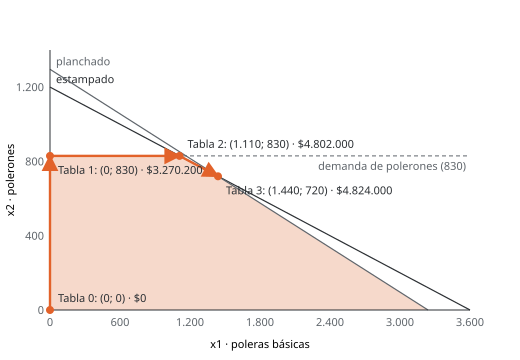

# Unidad 8 · Forma estándar y método simplex

**Qué vas a poder hacer.** Llevar un modelo lineal a forma estándar, encontrar sus soluciones
básicas y distinguir las que son vértices, resolverlo con el simplex en tabla (elegir la variable que
entra, aplicar la razón mínima, pivotear) y leer en la tabla final la solución, los precios sombra y
los costos reducidos.

**Lo que necesitas antes.** De la unidad 2, que el óptimo de un modelo lineal está en un vértice. De
álgebra lineal, resolver un sistema de ecuaciones y la inversa de una matriz. De la unidad 7, qué
significan `.dual`, `.slack` y `.reducedCost`: acá vas a ver de dónde salen.

**Tiempo.** Unas 6 horas: 2,5 de lectura con lápiz y papel y 3,5 de práctica.

---

## 1. La idea

Con dos variables el óptimo se ve en el gráfico. Con cincuenta no se ve nada, pero la geometría
sigue siendo la misma: la región factible es un poliedro y el óptimo está en un vértice. El método
simplex (Dantzig, 1947) recorre vértices con una regla simple:

1. parte de un vértice factible (casi siempre el origen);
2. mira los vértices vecinos y pregunta si moverse a alguno mejora el objetivo;
3. si alguno mejora, se mueve al que mejora más rápido; si ninguno mejora, ese vértice es óptimo.

Como el objetivo es lineal y la región es convexa, un vértice sin vecinos mejores es el óptimo global:
no hay mínimos locales que engañen. Todo el trabajo está en hacer esto con álgebra, sin dibujar.

---

## 2. Forma estándar

El simplex trabaja con igualdades. La **forma estándar** de un modelo lineal es

$$\max\; z = c^{T}x \quad \text{s.a.} \quad Ax = b, \qquad x \ge 0, \qquad b \ge 0$$

Cualquier modelo lineal se lleva a esa forma con estas reglas:

| Lo que aparece | Cómo se convierte | Qué significa la variable nueva |
|---|---|---|
| restricción $\le$ | se suma una **holgura** $s \ge 0$ | lo que sobra del recurso (el `.slack` de OPL) |
| restricción $\ge$ | se resta un **exceso** $e \ge 0$ | cuánto se pasa del mínimo |
| restricción $=$ | queda igual | |
| lado derecho negativo | se multiplica la fila por $-1$ (y un $\le$ se vuelve $\ge$) | |
| $\min z$ | $\max\,(-z)$ | el óptimo es el mismo; el valor cambia de signo |
| $x \le 0$ | $x = -x'$, con $x' \ge 0$ | |
| $x$ libre | $x = x' - x''$, con $x', x'' \ge 0$ | la parte positiva y la negativa |

**Por qué funciona.** Una holgura convierte «a lo más 18 horas» en «las horas usadas más las que
sobran suman 18»: es la misma condición, porque lo que sobra no puede ser negativo. Una variable libre
se puede escribir siempre como diferencia de dos no negativas; en el óptimo, a lo más una de las dos
es positiva (ejercicio 8.9).

**Cuándo no aplica directo.** El simplex de esta unidad arranca con las holguras como base, y eso
exige que el origen sea factible: todas las restricciones $\le$ con lado derecho $\ge 0$. Si hay
restricciones $\ge$ o $=$, el origen no sirve de partida y hace falta el método de dos fases o el de
la gran M (unidad 9).

---

## 3. Soluciones básicas y vértices

En forma estándar hay $m$ ecuaciones y $n$ variables, con $n > m$. Una **solución básica** se obtiene
así: se eligen $m$ variables (las **básicas**), se fijan las otras $n - m$ en cero (las **no
básicas**) y se resuelve el sistema de $m \times m$ que queda. Si además todas las básicas salen
$\ge 0$, es una **solución básica factible**, y cada una corresponde a un vértice del poliedro.

- Hay a lo más $\binom{n}{m}$ soluciones básicas (algunas elecciones dan un sistema sin solución).
- Dos vértices son **adyacentes** si sus bases difieren en una sola variable: una entra y otra sale.
  Eso es exactamente lo que hace cada iteración del simplex.

En notación matricial, si $B$ es la matriz con las columnas de las variables básicas y $N$ la de las
no básicas:

$$B\,x_B + N\,x_N = b \quad\Rightarrow\quad x_B = B^{-1}b - B^{-1}N\,x_N$$

y con $x_N = 0$, la solución básica es $x_B = B^{-1}b$. La base es factible si $B^{-1}b \ge 0$.

---

## 4. Costos reducidos: cuándo un vértice es óptimo

Reemplazando $x_B$ en el objetivo $z = c_B^{T}x_B + c_N^{T}x_N$:

$$z = c_B^{T}B^{-1}b + \left(c_N^{T} - c_B^{T}B^{-1}N\right)x_N$$

El primer término es el valor del vértice actual. El paréntesis es el vector de **costos reducidos**
$\bar c_N$: cuánto cambia $z$ por cada unidad que se aumente una variable no básica, **ya descontado**
lo que hay que mover a las básicas para seguir cumpliendo las restricciones.

- **Criterio de optimalidad (máximo).** Si ningún costo reducido es positivo, ningún vecino mejora: el
  vértice es óptimo. En un mínimo, el criterio es que ninguno sea negativo.
- **Variable que entra.** Si hay costos reducidos positivos, entra la variable con el **mayor** (en un
  mínimo, el más negativo). Es la que más sube $z$ por unidad.
- **Variable que sale.** Al subir la que entra, $x_e$, las básicas cambian a razón
  $\alpha_e = B^{-1}A_{\cdot e}$. Las que tienen $\alpha_{ie} > 0$ bajan, y la primera que llega a cero
  sale de la base. Esa es la **prueba de la razón mínima**:

$$\text{sale la fila } s \text{ con } \frac{(B^{-1}b)_s}{\alpha_{se}} = \min_{i\,:\,\alpha_{ie} > 0} \frac{(B^{-1}b)_i}{\alpha_{ie}}$$

Las filas con $\alpha_{ie} \le 0$ no entran a la comparación: esa básica no baja (o sube) cuando $x_e$
crece, así que nunca limita. Si ninguna fila tiene $\alpha_{ie} > 0$, $x_e$ puede crecer sin límite y
el problema es no acotado (unidad 9).

**Por qué la razón mínima y no otra.** Si sale una fila que no es la de razón mínima, la variable que
entra sube demasiado y alguna básica queda negativa: se salta a un punto fuera de la región. El
ejercicio 8.8 lo muestra.

---

## 5. El simplex en tabla

La **tabla** (o *tableau*) guarda todo lo anterior en un arreglo que se actualiza con operaciones de
fila, sin invertir matrices:

- una fila por restricción, con su variable básica a la izquierda y el lado derecho (LD) a la derecha;
- una fila final con los **costos reducidos** de todas las variables y, en la columna LD, el valor
  $-z$ (por eso la fila se rotula $-z$).

El procedimiento, para un máximo con restricciones $\le$ y $b \ge 0$:

0. **Tabla inicial.** Las holguras son las básicas ($x = 0$, $s = b$). La fila $-z$ tiene los
   coeficientes $c_j$ del objetivo, y 0 en las holguras y en LD.
1. **¿Es óptima?** Si ningún número de la fila $-z$ es positivo, sí: se termina.
2. **Columna que entra.** La del número más positivo de la fila $-z$.
3. **Fila que sale.** Para cada fila con coeficiente positivo en esa columna, LD dividido por ese
   coeficiente; sale la de menor razón. El número en el cruce es el **pivote**.
4. **Pivotear.** Se divide la fila pivote por el pivote (queda un 1) y a cada otra fila, incluida la
   $-z$, se le resta la fila pivote nueva multiplicada por su número en la columna que entra (quedan
   ceros):

$$\text{fila}_i^{\text{nueva}} = \text{fila}_i - a_{ie}\cdot \text{fila}_s^{\text{nueva}}$$

5. Volver al paso 1.

En las tablas de esta unidad, el pivote va en **negrita** y la columna «Razón» muestra la prueba de
la razón mínima. Todas las tablas las genera el verificador con fracciones exactas.

---

## 6. Leer la tabla final

La tabla óptima trae mucho más que la solución:

| Dónde se mira | Qué dice |
|---|---|
| columna LD de cada fila | el valor de la variable básica de esa fila; las no básicas valen 0 |
| LD de la fila $-z$ | menos el valor óptimo: $z^* = -(\text{ese número})$ |
| fila $-z$ bajo una variable de decisión no básica | su costo reducido: cuánto baja $z$ por cada unidad que se fuerce (el `.reducedCost` de OPL) |
| fila $-z$ bajo la holgura $s_i$ | **menos el precio sombra** del recurso $i$: $-y_i$ (el `.dual` de OPL) |
| columnas de las holguras, en las filas | la matriz $B^{-1}$ |

**Por qué el precio sombra aparece bajo la holgura.** La columna de $s_i$ en la tabla inicial es
$e_i$ (un 1 en la fila $i$) y su costo es 0, así que su costo reducido es
$0 - c_B^{T}B^{-1}e_i = -y_i$, donde $y = c_B^{T}B^{-1}$. Forzar una unidad de holgura es «regalar» una
unidad del recurso, y eso cuesta exactamente su precio sombra.

**Comprobación rápida.** En el óptimo se cumple $z^* = \sum_i b_i\,y_i$. Es la dualidad fuerte de la
unidad 10, y sirve para pillar errores de aritmética.

**El simplex matricial** hace las mismas cuentas sin la tabla: con la base $B$ calcula
$x_B = B^{-1}b$, los costos reducidos $c_N^{T} - c_B^{T}B^{-1}N$ y, si entra $x_e$,
$\alpha_e = B^{-1}A_{\cdot e}$. La tabla es la versión «a mano» y el matricial es lo que programan los
solvers (ejercicio 8.7).

---

## 7. Ejemplo resuelto · La pastelería de los viernes

Una pastelería de Concepción prepara los pedidos del viernes: **tortas** ($x_1$), **kuchenes** ($x_2$)
y **pies de limón** ($x_3$). Tiene 18 horas de horno y 15 horas de decoración.

| Por unidad | Torta | Kuchen | Pie de limón | Disponible |
|---|---|---|---|---|
| Margen (miles de pesos) | 8 | 6 | 5 | |
| Horno (h) | 2 | 1 | 2 | 18 h |
| Decoración (h) | 1 | 2 | 1 | 15 h |

**Paso 1 · Modelo y forma estándar.** En miles de pesos:

$$\max\; z = 8x_1 + 6x_2 + 5x_3 \quad \text{s.a.}\quad 2x_1 + x_2 + 2x_3 + s_1 = 18, \quad x_1 + 2x_2 + x_3 + s_2 = 15, \quad x, s \ge 0$$

$s_1$ son las horas de horno que sobran y $s_2$ las de decoración.

**Paso 2 · Tabla inicial.** Base $\{s_1, s_2\}$: no se produce nada y $z = 0$. Los costos reducidos
son los márgenes. Entra $x_1$ (8 es el mayor) y la razón mínima es la del horno: con 18 horas caben
9 tortas, con 15 de decoración cabrían 15. Sale $s_1$.

| Base | x1 | x2 | x3 | s1 | s2 | LD | Razón |
|---|---|---|---|---|---|---|---|
| s1 | **2** | 1 | 2 | 1 | 0 | 18 | 18 ÷ 2 = 9 |
| s2 | 1 | 2 | 1 | 0 | 1 | 15 | 15 ÷ 1 = 15 |
| −z | 8 | 6 | 5 | 0 | 0 | 0 |  |

**Paso 3 · Primera iteración.** Se divide la fila de $s_1$ por 2; se le resta a la de $s_2$ una vez y
a la $-z$ ocho veces. Ahora se hacen 9 tortas y $z = 72$. El kuchen todavía tiene costo reducido
positivo (2): cada kuchen que entre suma 6, pero obliga a sacar media torta del horno (−4). Entra
$x_2$; la razón mínima es la de la decoración (4 contra 18). Sale $s_2$.

| Base | x1 | x2 | x3 | s1 | s2 | LD | Razón |
|---|---|---|---|---|---|---|---|
| x1 | 1 | 1/2 | 1 | 1/2 | 0 | 9 | 9 ÷ 1/2 = 18 |
| s2 | 0 | **3/2** | 0 | −1/2 | 1 | 6 | 6 ÷ 3/2 = 4 |
| −z | 0 | 2 | −3 | −4 | 0 | −72 |  |

**Paso 4 · Segunda iteración.** Ningún número de la fila $-z$ es positivo: la tabla es óptima.

| Base | x1 | x2 | x3 | s1 | s2 | LD |
|---|---|---|---|---|---|---|
| x1 | 1 | 0 | 1 | 2/3 | −1/3 | 7 |
| x2 | 0 | 1 | 0 | −1/3 | 2/3 | 4 |
| −z | 0 | 0 | −3 | −10/3 | −4/3 | −80 |

**Paso 5 · Lectura.**

| | Valor | Lectura |
|---|---|---|
| Plan | 7 tortas, 4 kuchenes, x3 = 0 | margen $80.000 |
| Horno | holgura 0, precio sombra 10/3 | una hora más de horno vale $3.333 |
| Decoración | holgura 0, precio sombra 4/3 | una hora más de decoración vale $1.333 |
| Pie de limón | costo reducido −3 | cada pie forzado baja el margen en $3.000 |
| $B^{-1}$ | columnas de $s_1$ y $s_2$: $\begin{pmatrix} 2/3 & -1/3 \\ -1/3 & 2/3 \end{pmatrix}$ | |

Comprobación: $18 \cdot \tfrac{10}{3} + 15 \cdot \tfrac{4}{3} = 60 + 20 = 80$. Coincide con $z^*$.

**Cómo se lee.**

- **Los pies no entran**, aunque su margen (5) parece razonable: usan 2 horas de horno y 1 de
  decoración, que en el óptimo «valen» $2 \cdot \tfrac{10}{3} + 1 \cdot \tfrac{4}{3} = 8$ mil. Dejan 5:
  pierden 3 mil por pie. Para que entren, su margen tendría que pasar de 8 mil.
- **El horno es el recurso más valioso.** Si la pastelería puede arrendar un horno por menos de
  $3.333 la hora, conviene; pagar horas extra de decoración solo conviene bajo $1.333 la hora (dentro
  del rango que calcula la unidad 12).
- **El camino tiene sentido económico.** Primero se llena el horno con lo que más deja por unidad
  (tortas); después se cambia media torta por un kuchen mientras eso convenga, hasta que la decoración
  también se agota.

---

## 8. Errores típicos

| Error | Cómo evitarlo |
|---|---|
| Olvidar la holgura o ponerle signo menos en una $\le$ | $\le$ suma holgura; $\ge$ resta exceso |
| Llevar a forma estándar sin dejar $b \ge 0$ | si un lado derecho es negativo, multiplica la fila entera por $-1$ antes |
| Tratar una variable libre como no negativa | reemplázala por $x' - x''$; si no, el simplex nunca la deja negativa |
| Elegir la fila que sale por el coeficiente más grande | se elige por la **razón** LD/coeficiente, y solo con coeficientes positivos |
| Incluir en la razón filas con coeficiente negativo o cero | esas filas no limitan: se marcan con «—» |
| Olvidar actualizar la fila $-z$ al pivotear | la fila $-z$ se trata como cualquier otra fila |
| Leer $z^*$ con el signo del LD de la fila $-z$ | el LD guarda $-z$: el óptimo es el número con el signo cambiado |
| Leer el precio sombra con el signo de la tabla | bajo la holgura está $-y_i$; el precio sombra es $y_i$ |
| En un mínimo, usar el criterio del máximo | en un mínimo entra el más negativo y es óptimo cuando no queda ninguno negativo (o se maximiza $-z$) |

---

## 9. Práctica

Diez ejercicios: 8.1 a 8.4 básicos, 8.5 a 8.8 intermedios, 8.9 y 8.10 de desafío. Las pautas están
en la sección 10. Usa fracciones, no decimales: el simplex a mano se descuadra con redondeos.

**8.1 · Forma estándar (básico).** Lleva a forma estándar (máximo, igualdades, $b \ge 0$, todas las
variables $\ge 0$):

$$\min\; z = 4x_1 - 3x_2 - 2x_3 \quad \text{s.a.}\quad 2x_1 - x_2 + x_3 \ge 5, \quad x_1 + 3x_2 \le 12, \quad x_1 - x_2 + 2x_3 = -4, \quad x_1 \ge 0,\; x_2 \le 0,\; x_3 \text{ libre}$$

Después resuelve los dos modelos con un solver (OPL, Solver o Python) y comprueba que dan el mismo
óptimo.

**8.2 · Soluciones básicas (básico).** Para el sistema

$$x_1 + 2x_2 + x_3 = 8, \qquad 3x_1 + x_2 + x_4 = 9, \qquad x \ge 0$$

calcula las seis soluciones básicas, di cuáles son factibles y dibuja en el plano $(x_1, x_2)$ los
vértices que les corresponden. ¿Qué pares de vértices son adyacentes?

**8.3 · Una iteración (básico).** Para $\max\; z = 4x_1 + 2x_2 + 5x_3$ con
$x_1 + x_2 + 2x_3 \le 12$, $2x_1 + x_2 + x_3 \le 14$, $x_1 + 3x_2 + x_3 \le 15$ y $x \ge 0$: arma la
tabla inicial, di qué variable entra y cuál sale (con la razón mínima) y haz una iteración. ¿La tabla
nueva es óptima? Si no, ¿qué variable entraría?

**8.4 · Leer una tabla final (básico).** Una imprenta decide cuántos miles de afiches ($x_1$),
folletos ($x_2$) y calendarios ($x_3$) imprimir, con margen 6, 5 y 4 (miles de pesos por mil) y tres
recursos: horas de impresión (10), de corte (18) y de encuadernación (14). Esta es su tabla óptima:

| Base | x1 | x2 | x3 | s1 | s2 | s3 | LD |
|---|---|---|---|---|---|---|---|
| x2 | 0 | 1 | −1 | 2 | −1 | 0 | 2 |
| x1 | 1 | 0 | 2 | −1 | 1 | 0 | 8 |
| s3 | 0 | 0 | 1 | −3 | 1 | 1 | 2 |
| −z | 0 | 0 | −3 | −4 | −1 | 0 | −58 |

(a) ¿Qué se imprime y cuánto deja? (b) ¿Qué recursos se agotan y cuánto sobra del otro? (c) ¿Cuánto
vale una hora más de cada recurso? (d) ¿Cuánto tendría que subir el margen de los calendarios para
que convenga imprimirlos? (e) Comprueba $z^* = \sum_i b_i y_i$.

**8.5 · Simplex y gráfico (intermedio).** Resuelve con el simplex en tabla
$\max\; z = 5x_1 + 4x_2$ con $x_1 + x_2 \le 9$, $3x_1 + x_2 \le 21$, $x_2 \le 7$ y $x \ge 0$. Dibuja la
región factible y marca el vértice de cada tabla. ¿Por qué el simplex no pasa por $(2; 7)$?

**8.6 · Tres productos, tres iteraciones (intermedio).** Una planta de compost mezcla tres productos
(en toneladas): $\max\; z = 7x_1 + 6x_2 + 5x_3$ con $2x_1 + x_2 + x_3 \le 16$,
$x_1 + 2x_2 + x_3 \le 14$, $x_2 + 2x_3 \le 10$ y $x \ge 0$. Resuelve con el simplex en tabla e
informa la solución, el valor óptimo y los tres precios sombra.

**8.7 · Simplex matricial (intermedio).** Con el modelo de 8.3 (holguras $s_1, s_2, s_3$):
(a) para la base $\{x_3, s_2, s_3\}$ calcula $B^{-1}$, $x_B = B^{-1}b$ y los costos reducidos de las
no básicas; ¿es óptima? Si no, ¿qué entra y qué sale? (b) Repite con la base $\{x_1, x_3, s_3\}$ y
muestra que es óptima.

**8.8 · Encuentra el error (intermedio).** Un estudiante resolvió el modelo de 8.5 y en la primera
iteración hizo salir a $s_1$:

| Base | x1 | x2 | s1 | s2 | s3 | LD | Razón |
|---|---|---|---|---|---|---|---|
| s1 | **1** | 1 | 1 | 0 | 0 | 9 | 9 ÷ 1 = 9 |
| s2 | 3 | 1 | 0 | 1 | 0 | 21 | 21 ÷ 3 = 7 |
| s3 | 0 | 1 | 0 | 0 | 1 | 7 | — |
| −z | 5 | 4 | 0 | 0 | 0 | 0 |  |

| Base | x1 | x2 | s1 | s2 | s3 | LD |
|---|---|---|---|---|---|---|
| x1 | 1 | 1 | 1 | 0 | 0 | 9 |
| s2 | 0 | −2 | −3 | 1 | 0 | −6 |
| s3 | 0 | 1 | 0 | 0 | 1 | 7 |
| −z | 0 | −1 | −5 | 0 | 0 | −45 |

Su tabla dice que no hay costos reducidos positivos y que el óptimo es $z = 45$. ¿Dónde está el error,
cómo se nota en la tabla y qué punto representa en el gráfico?

**8.9 · Una variable libre (desafío).** Una distribuidora decide $x_1$, las cajas que despacha, y
$x_2$, el cambio de su inventario (puede subir o bajar, así que $x_2$ es libre):
$\max\; z = 3x_1 + x_2$ con $x_1 + x_2 \le 4$, $x_1 - x_2 \le 8$ y $x_1 \ge 0$. Reemplaza
$x_2 = x_2' - x_2''$, resuelve con el simplex en tabla y recupera $x_2$. ¿Qué relación hay entre las
columnas de $x_2'$ y $x_2''$ en todas las tablas, y por qué nunca son básicas a la vez?

**8.10 · La que entra primero no siempre se queda (desafío).** Un taller de sublimación produce lotes
de tazas ($x_1$), termos ($x_2$) y cojines ($x_3$), con margen 34, 36 y 42 mil pesos por lote, 200
horas de prensa (2, 4 y 3 h por lote) y 180 horas de diseño (3, 2 y 4 h por lote). Resuelve con el
simplex en tabla. (a) ¿Qué variable entra primero y está en la solución final? (b) Lee los precios
sombra. (c) ¿Desde qué margen por lote conviene producir cojines?

---

## 10. Pautas

**8.1.** Con $x_2 = -x_2'$ y $x_3 = x_3' - x_3''$, multiplicando el objetivo por $-1$ y la igualdad por
$-1$ (su lado derecho era $-4$):

$$\max\; w = -4x_1 - 3x_2' + 2x_3' - 2x_3''$$

$$\begin{aligned} 2x_1 + x_2' + x_3' - x_3'' - e_1 &= 5 \\ x_1 - 3x_2' + h_2 &= 12 \\ -x_1 - x_2' - 2x_3' + 2x_3'' &= 4 \\ x_1, x_2', x_3', x_3'', e_1, h_2 &\ge 0 \end{aligned}$$

$e_1$ es el exceso de la primera restricción y $h_2$ la holgura de la segunda. Los dos modelos dan el
mismo óptimo: $x_1 = 14/3$, $x_2 = 0$, $x_3 = −13/3$, con $z^* = 82/3$ (y $w^* = -82/3$). Fíjate que
$x_3$ salió negativa: si se hubiera tratado como no negativa, el modelo habría dado otra respuesta.

**8.2.** Con $(x_1; x_2; x_3; x_4)$:

| Básicas | Solución | ¿Factible? | Vértice en $(x_1, x_2)$ |
|---|---|---|---|
| $x_1, x_2$ | (2; 3; 0; 0) | sí | $(2, 3)$, donde se cortan las dos rectas |
| $x_1, x_3$ | (3; 0; 5; 0) | sí | $(3, 0)$ |
| $x_1, x_4$ | (8; 0; 0; −15) | no | $(8, 0)$ queda fuera |
| $x_2, x_3$ | (0; 9; −10; 0) | no | $(0, 9)$ queda fuera |
| $x_2, x_4$ | (0; 4; 0; 5) | sí | $(0, 4)$ |
| $x_3, x_4$ | (0; 0; 8; 9) | sí | $(0, 0)$, el origen |

Cuatro de las seis son factibles: los cuatro vértices del cuadrilátero. Son adyacentes los que
difieren en una básica: $(0,0)$ con $(3,0)$ y con $(0,4)$; $(2,3)$ con $(3,0)$ y con $(0,4)$. El
origen y $(2,3)$ no son adyacentes: no comparten ninguna básica.

**8.3.** Tabla inicial: entra $x_3$ (5 es el mayor) y sale $s_1$ (razón 6).

| Base | x1 | x2 | x3 | s1 | s2 | s3 | LD | Razón |
|---|---|---|---|---|---|---|---|---|
| s1 | 1 | 1 | **2** | 1 | 0 | 0 | 12 | 12 ÷ 2 = 6 |
| s2 | 2 | 1 | 1 | 0 | 1 | 0 | 14 | 14 ÷ 1 = 14 |
| s3 | 1 | 3 | 1 | 0 | 0 | 1 | 15 | 15 ÷ 1 = 15 |
| −z | 4 | 2 | 5 | 0 | 0 | 0 | 0 |  |

Después de pivotear:

| Base | x1 | x2 | x3 | s1 | s2 | s3 | LD | Razón |
|---|---|---|---|---|---|---|---|---|
| x3 | 1/2 | 1/2 | 1 | 1/2 | 0 | 0 | 6 | 6 ÷ 1/2 = 12 |
| s2 | **3/2** | 1/2 | 0 | −1/2 | 1 | 0 | 8 | 8 ÷ 3/2 = 16/3 |
| s3 | 1/2 | 5/2 | 0 | −1/2 | 0 | 1 | 9 | 9 ÷ 1/2 = 18 |
| −z | 3/2 | −1/2 | 0 | −5/2 | 0 | 0 | −30 |  |

$z = 30$ con $x_3 = 6$. No es óptima: $x_1$ tiene costo reducido $3/2 > 0$. Entraría $x_1$ y saldría
$s_2$ (razón 16/3). El 8.7 sigue desde aquí.

**8.4.** (a) 8 mil afiches, 2 mil folletos y ningún calendario: $(8; 2; 0)$, con $z = 58$ mil pesos.
(b) Se agotan impresión y corte ($s_1 = s_2 = 0$); sobran 2 horas de encuadernación ($s_3 = 2$).
(c) Los precios sombra son 4 (impresión), 1 (corte) y 0 (encuadernación), en miles de pesos por hora:
el negativo de la fila $-z$ bajo cada holgura. (d) El costo reducido de $x_3$ es −3: su margen tendría
que subir 3 mil, de 4 a 7. (e) $10 \cdot 4 + 18 \cdot 1 + 14 \cdot 0 = 58$.

**8.5.** Entra $x_1$; la razón mínima es la de $s_2$ (7 contra 9).

| Base | x1 | x2 | s1 | s2 | s3 | LD | Razón |
|---|---|---|---|---|---|---|---|
| s1 | 1 | 1 | 1 | 0 | 0 | 9 | 9 ÷ 1 = 9 |
| s2 | **3** | 1 | 0 | 1 | 0 | 21 | 21 ÷ 3 = 7 |
| s3 | 0 | 1 | 0 | 0 | 1 | 7 | — |
| −z | 5 | 4 | 0 | 0 | 0 | 0 |  |

| Base | x1 | x2 | s1 | s2 | s3 | LD | Razón |
|---|---|---|---|---|---|---|---|
| s1 | 0 | **2/3** | 1 | −1/3 | 0 | 2 | 2 ÷ 2/3 = 3 |
| x1 | 1 | 1/3 | 0 | 1/3 | 0 | 7 | 7 ÷ 1/3 = 21 |
| s3 | 0 | 1 | 0 | 0 | 1 | 7 | 7 ÷ 1 = 7 |
| −z | 0 | 7/3 | 0 | −5/3 | 0 | −35 |  |

| Base | x1 | x2 | s1 | s2 | s3 | LD |
|---|---|---|---|---|---|---|
| x2 | 0 | 1 | 3/2 | −1/2 | 0 | 3 |
| x1 | 1 | 0 | −1/2 | 1/2 | 0 | 6 |
| s3 | 0 | 0 | −3/2 | 1/2 | 1 | 4 |
| −z | 0 | 0 | −7/2 | −1/2 | 0 | −42 |

Óptimo $(6; 3)$ con $z = 42$. El camino es $(0; 0)$ → $(7; 0)$ → $(6; 3)$: dos vértices vecinos por
el borde de abajo y el de la derecha. El vértice $(2; 7)$ queda del otro lado de la región: el simplex
partió hacia $x_1$ porque su margen (5) era mayor, y desde ahí el óptimo estaba a un paso.

**8.6.**

| Base | x1 | x2 | x3 | s1 | s2 | s3 | LD | Razón |
|---|---|---|---|---|---|---|---|---|
| s1 | **2** | 1 | 1 | 1 | 0 | 0 | 16 | 16 ÷ 2 = 8 |
| s2 | 1 | 2 | 1 | 0 | 1 | 0 | 14 | 14 ÷ 1 = 14 |
| s3 | 0 | 1 | 2 | 0 | 0 | 1 | 10 | — |
| −z | 7 | 6 | 5 | 0 | 0 | 0 | 0 |  |

| Base | x1 | x2 | x3 | s1 | s2 | s3 | LD | Razón |
|---|---|---|---|---|---|---|---|---|
| x1 | 1 | 1/2 | 1/2 | 1/2 | 0 | 0 | 8 | 8 ÷ 1/2 = 16 |
| s2 | 0 | **3/2** | 1/2 | −1/2 | 1 | 0 | 6 | 6 ÷ 3/2 = 4 |
| s3 | 0 | 1 | 2 | 0 | 0 | 1 | 10 | 10 ÷ 1 = 10 |
| −z | 0 | 5/2 | 3/2 | −7/2 | 0 | 0 | −56 |  |

| Base | x1 | x2 | x3 | s1 | s2 | s3 | LD | Razón |
|---|---|---|---|---|---|---|---|---|
| x1 | 1 | 0 | 1/3 | 2/3 | −1/3 | 0 | 6 | 6 ÷ 1/3 = 18 |
| x2 | 0 | 1 | 1/3 | −1/3 | 2/3 | 0 | 4 | 4 ÷ 1/3 = 12 |
| s3 | 0 | 0 | **5/3** | 1/3 | −2/3 | 1 | 6 | 6 ÷ 5/3 = 18/5 |
| −z | 0 | 0 | 2/3 | −8/3 | −5/3 | 0 | −66 |  |

| Base | x1 | x2 | x3 | s1 | s2 | s3 | LD |
|---|---|---|---|---|---|---|---|
| x1 | 1 | 0 | 0 | 3/5 | −1/5 | −1/5 | 24/5 |
| x2 | 0 | 1 | 0 | −2/5 | 4/5 | −1/5 | 14/5 |
| x3 | 0 | 0 | 1 | 1/5 | −2/5 | 3/5 | 18/5 |
| −z | 0 | 0 | 0 | −14/5 | −7/5 | −2/5 | −342/5 |

Solución: $x_1 = 24/5$, $x_2 = 14/5$, $x_3 = 18/5$ toneladas, con $z = 342/5$ (68,4). Los tres recursos
se agotan; sus precios sombra son 14/5, 7/5 y 2/5. Comprobación:
$16 \cdot \tfrac{14}{5} + 14 \cdot \tfrac{7}{5} + 10 \cdot \tfrac{2}{5} = \tfrac{224 + 98 + 20}{5} = \tfrac{342}{5}$.

**8.7.** (a) Base $\{x_3, s_2, s_3\}$: $B$ tiene las columnas $(2, 1, 1)$, $(0, 1, 0)$ y $(0, 0, 1)$.

$$B^{-1} = \begin{pmatrix} 1/2 & 0 & 0 \\ -1/2 & 1 & 0 \\ -1/2 & 0 & 1 \end{pmatrix}, \qquad x_B = B^{-1}b = \begin{pmatrix} 6 \\ 8 \\ 9 \end{pmatrix}, \qquad z = 30$$

Con $y = c_B^{T}B^{-1} = (5/2,\, 0,\, 0)$, los costos reducidos son $\bar c_{x_1} = 4 - 5/2 = 3/2$,
$\bar c_{x_2} = 2 - 5/2 = −1/2$ y $\bar c_{s_1} = −5/2$. No es óptima: entra $x_1$ con
$\alpha_1 = B^{-1}A_{\cdot 1} = (1/2,\, 3/2,\, 1/2)$; las razones son 12, 16/3 y 18, y sale $s_2$. Es la
segunda tabla de 8.3. (b) Base $\{x_1, x_3, s_3\}$:

$$B^{-1} = \begin{pmatrix} -1/3 & 2/3 & 0 \\ 2/3 & -1/3 & 0 \\ -1/3 & -1/3 & 1 \end{pmatrix}, \qquad x_B = \begin{pmatrix} 16/3 \\ 10/3 \\ 19/3 \end{pmatrix}, \qquad z = 38$$

Con $y = (2,\, 1,\, 0)$: $\bar c_{x_2} = 2 - (2 + 1 + 0) = −1$, $\bar c_{s_1} = −2$ y $\bar c_{s_2} = −1$.
Ninguno es positivo: es óptima, con $x_1 = 16/3$, $x_3 = 10/3$ y sobran 19/3 de la tercera restricción.

**8.8.** El error está en la prueba de la razón: la menor razón era la de $s_2$ (21 ÷ 3 = 7), no la
de $s_1$ (9). Al sacar $s_1$, $x_1$ subió a 9, más de lo que permite la segunda restricción. Se nota
en la tabla siguiente: el LD de la fila de $s_2$ quedó en −6, y una tabla del simplex nunca tiene un
LD negativo (sería una básica negativa). El punto $(9; 0)$ está fuera de la región, porque
$3 \cdot 9 = 27 > 21$, y su «$z = 45$» es mayor que el óptimo verdadero (42) justamente porque viola
una restricción. La tabla correcta es la segunda de 8.5.

**8.9.** Con $x_2 = x_2' - x_2''$ el modelo queda $\max\; 3x_1 + x_2' - x_2''$ con
$x_1 + x_2' - x_2'' \le 4$ y $x_1 - x_2' + x_2'' \le 8$.

| Base | x1 | x2' | x2'' | s1 | s2 | LD | Razón |
|---|---|---|---|---|---|---|---|
| s1 | **1** | 1 | −1 | 1 | 0 | 4 | 4 ÷ 1 = 4 |
| s2 | 1 | −1 | 1 | 0 | 1 | 8 | 8 ÷ 1 = 8 |
| −z | 3 | 1 | −1 | 0 | 0 | 0 |  |

| Base | x1 | x2' | x2'' | s1 | s2 | LD | Razón |
|---|---|---|---|---|---|---|---|
| x1 | 1 | 1 | −1 | 1 | 0 | 4 | — |
| s2 | 0 | −2 | **2** | −1 | 1 | 4 | 4 ÷ 2 = 2 |
| −z | 0 | −2 | 2 | −3 | 0 | −12 |  |

| Base | x1 | x2' | x2'' | s1 | s2 | LD |
|---|---|---|---|---|---|---|
| x1 | 1 | 0 | 0 | 1/2 | 1/2 | 6 |
| x2'' | 0 | −1 | 1 | −1/2 | 1/2 | 2 |
| −z | 0 | 0 | 0 | −2 | −1 | −16 |

$x_1 = 6$, $x_2'' = 2$ y $x_2' = 0$, así que x2 = −2 (el inventario baja 2), con z = 16. La columna de
$x_2''$ es siempre la de $x_2'$ cambiada de signo, porque las operaciones de fila son lineales y
partieron así. Por eso las dos no pueden ser básicas juntas: sus columnas son linealmente
dependientes, y una base necesita columnas independientes. En la tabla final, $x_2'$ tiene costo
reducido 0 sin ser básica; no es un segundo óptimo, es la misma solución escrita de otra forma.

**8.10.**

| Base | x1 | x2 | x3 | s1 | s2 | LD | Razón |
|---|---|---|---|---|---|---|---|
| s1 | 2 | 4 | 3 | 1 | 0 | 200 | 200 ÷ 3 = 200/3 |
| s2 | 3 | 2 | **4** | 0 | 1 | 180 | 180 ÷ 4 = 45 |
| −z | 34 | 36 | 42 | 0 | 0 | 0 |  |

| Base | x1 | x2 | x3 | s1 | s2 | LD | Razón |
|---|---|---|---|---|---|---|---|
| s1 | −1/4 | **5/2** | 0 | 1 | −3/4 | 65 | 65 ÷ 5/2 = 26 |
| x3 | 3/4 | 1/2 | 1 | 0 | 1/4 | 45 | 45 ÷ 1/2 = 90 |
| −z | 5/2 | 15 | 0 | 0 | −21/2 | −1.890 |  |

| Base | x1 | x2 | x3 | s1 | s2 | LD | Razón |
|---|---|---|---|---|---|---|---|
| x2 | −1/10 | 1 | 0 | 2/5 | −3/10 | 26 | — |
| x3 | **4/5** | 0 | 1 | −1/5 | 2/5 | 32 | 32 ÷ 4/5 = 40 |
| −z | 4 | 0 | 0 | −6 | −6 | −2.280 |  |

| Base | x1 | x2 | x3 | s1 | s2 | LD |
|---|---|---|---|---|---|---|
| x2 | 0 | 1 | 1/8 | 3/8 | −1/4 | 30 |
| x1 | 1 | 0 | 5/4 | −1/4 | 1/2 | 40 |
| −z | 0 | 0 | −5 | −5 | −8 | −2.440 |

(a) Entran en orden cojines, termos y tazas, y en la última iteración los cojines salen: la solución es
$(40; 30; 0)$, con margen 2.440 mil ($2.440.000). El cojín entró primero porque deja más por lote
(42), pero usa 7 horas por lote, y a los precios sombra finales esas horas valen más de lo que deja.
La regla de Dantzig mira el margen por unidad de la variable que entra, no lo que cuesta en recursos
al final: no anticipa la solución, solo garantiza mejorar en cada paso.
(b) Precios sombra: 5 mil por hora de prensa y 8 mil por hora de diseño
($200 \cdot 5 + 180 \cdot 8 = 2.440$). (c) El costo reducido de los cojines es −5: su margen tendría que
llegar a 47 mil por lote ($3 \cdot 5 + 4 \cdot 8 = 47$). El verificador resuelve con un margen apenas
mayor y los cojines entran.

---

## 11. Caso integrador · Estampa Sur, a mano

> Este caso sigue a Estampa Sur por todo el ramo. La unidad 2 dibujó la versión de dos productos
> (poleras básicas y polerones) y encontró el óptimo mirando los vértices; la unidad 7 corrió en OPL
> la mezcla completa. Acá se resuelve la versión de dos productos a mano, para ver de dónde salen los
> precios sombra que OPL entrega con `.dual`.

**El modelo.** $x_1$ poleras básicas y $x_2$ polerones por semana; margen $1.380 y $3.940; 30 horas de
estampado (108.000 s) y 18 de planchado (64.800 s); a lo más 830 polerones:

$$\max\; z = 1{.}380\,x_1 + 3{.}940\,x_2 \quad \text{s.a.}\quad 30x_1 + 90x_2 + s_1 = 108{.}000, \quad 20x_1 + 50x_2 + s_2 = 64{.}800, \quad x_2 + s_3 = 830$$

**Tabla 0.** Entran los polerones (3.940 es el mayor margen) y manda su demanda: la razón 830 es
menor que las 1.200 que permitiría el estampado y los 1.296 del planchado.

| Base | x1 | x2 | s1 | s2 | s3 | LD | Razón |
|---|---|---|---|---|---|---|---|
| s1 | 30 | 90 | 1 | 0 | 0 | 108.000 | 108.000 ÷ 90 = 1.200 |
| s2 | 20 | 50 | 0 | 1 | 0 | 64.800 | 64.800 ÷ 50 = 1.296 |
| s3 | 0 | **1** | 0 | 0 | 1 | 830 | 830 ÷ 1 = 830 |
| −z | 1.380 | 3.940 | 0 | 0 | 0 | 0 |  |

**Tabla 1.** Vértice (0; 830), margen $3.270.200. Las poleras todavía suman 1.380 por unidad: entran.
El estampado se agota primero (1.110 contra 1.165).

| Base | x1 | x2 | s1 | s2 | s3 | LD | Razón |
|---|---|---|---|---|---|---|---|
| s1 | **30** | 0 | 1 | 0 | −90 | 33.300 | 33.300 ÷ 30 = 1.110 |
| s2 | 20 | 0 | 0 | 1 | −50 | 23.300 | 23.300 ÷ 20 = 1.165 |
| x2 | 0 | 1 | 0 | 0 | 1 | 830 | — |
| −z | 1.380 | 0 | 0 | 0 | −3.940 | −3.270.200 |  |

**Tabla 2.** Vértice (1.110; 830), margen $4.802.000. Ahora el número positivo está bajo $s_3$, la
holgura de la demanda de polerones: conviene **dejar de vender** polerones hasta su tope. Cada unidad
de $s_3$ (un polerón menos) libera 90 s de estampado, que hacen 3 poleras: $3 \cdot 1.380 - 3.940 = 200$.
Entra $s_3$ y sale $s_2$: el planchado pasa a ser el límite.

| Base | x1 | x2 | s1 | s2 | s3 | LD | Razón |
|---|---|---|---|---|---|---|---|
| x1 | 1 | 0 | 1/30 | 0 | −3 | 1.110 | — |
| s2 | 0 | 0 | −2/3 | 1 | **10** | 1.100 | 1.100 ÷ 10 = 110 |
| x2 | 0 | 1 | 0 | 0 | 1 | 830 | 830 ÷ 1 = 830 |
| −z | 0 | 0 | −46 | 0 | 200 | −4.802.000 |  |

**Tabla 3 (óptima).**

| Base | x1 | x2 | s1 | s2 | s3 | LD |
|---|---|---|---|---|---|---|
| x1 | 1 | 0 | −1/6 | 3/10 | 0 | 1.440 |
| s3 | 0 | 0 | −1/15 | 1/10 | 1 | 110 |
| x2 | 0 | 1 | 1/15 | −1/10 | 0 | 720 |
| −z | 0 | 0 | −98/3 | −20 | 0 | −4.824.000 |

**Lectura.**

| | Valor | Lectura |
|---|---|---|
| Plan | (1.440; 720) | 1.440 poleras básicas y 720 polerones |
| Margen | $4.824.000 | el mismo óptimo de la unidad 2 |
| Polerones | $s_3 = 110$ | se venden 110 menos que el tope de 830 |
| Estampado | fila $-z$: −98/3 | precio sombra 98/3 = 32,67 pesos por segundo: $117.600 por hora |
| Planchado | fila $-z$: −20 | 20 pesos por segundo: $72.000 por hora |
| Demanda de polerones | fila $-z$: 0 | no aprieta: vender más polerones no vale nada |

Comprobación: $108{.}000 \cdot \tfrac{98}{3} + 64{.}800 \cdot 20 = 3{.}528{.}000 + 1{.}296{.}000 = 4{.}824{.}000$.

**La cadena.** El verificador comprueba que el simplex a mano termina en el óptimo y con los precios
sombra (32,67 y 20 por segundo) que el script del caso calcula para la unidad 2, y que cada tabla
corresponde a uno de sus vértices (`CADENA: OK`).

**Cómo se lee.** Con solo dos productos, una hora de planchado vale $72.000, mucho más que los $5.400
de la mezcla completa de la unidad 7. No es contradicción: acá hay 30 horas de estampado en vez
de 40 y solo dos productos, así que estampado y planchado aprietan juntos y cada segundo extra se
convierte directo en más poleras; en la mezcla completa sobra estampado, la tinta también limita y hay
más prendas para reacomodar. El precio sombra depende de todo el modelo, no solo del recurso.

**Lo que pasa a las unidades siguientes.** La unidad 9 resuelve casos que esta tabla no tuvo (empates
en la razón, óptimos múltiples, orígenes no factibles). La unidad 10 parte de la fila $-z$ final: los
números bajo $s_1$, $s_2$ y $s_3$ son, cambiados de signo, la solución del problema dual.

---

## 12. Para seguir

**En los libros del ramo.**

- Winston, *Investigación de operaciones: aplicaciones y algoritmos* (4.ª ed., 2005): el capítulo del
  algoritmo simplex trae la forma estándar, las soluciones básicas y el simplex en tabla con muchos
  ejercicios resueltos.
- Hillier y Lieberman, *Introducción a la investigación de operaciones* (7.ª ed., 2001): el capítulo
  del método simplex explica la forma algebraica y la tabular en paralelo.

**Abiertos y gratis.**

- Bradley, Hax y Magnanti, *Applied Mathematical Programming* (Addison-Wesley, 1977), en inglés, que
  el MIT publica gratis. El capítulo 2, *Solving Linear Programs*, desarrolla la forma canónica, el
  pivoteo y la prueba de la razón. https://web.mit.edu/15.053/www/AMP.htm

**Con el tutor.** La carpeta `tutor/` trae el contexto de este ramo. Pégalo al inicio de la
conversación con cualquier IA y pídele, por ejemplo: «Dame un modelo de tres variables para resolver
con simplex en tabla y corrígeme tabla por tabla: variable que entra, razón mínima y pivote».
