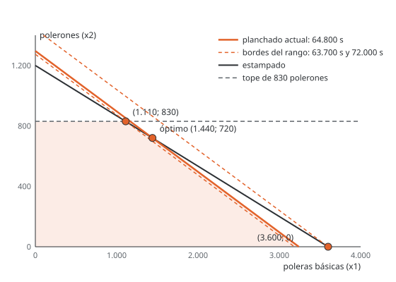

# Unidad 12 · Análisis de sensibilidad y precios sombra

**Qué vas a poder hacer.** Calcular hasta dónde puede moverse un lado derecho sin que su precio
sombra deje de valer, y hasta dónde un margen sin que cambie el plan; decir cuánto tiene que mejorar
un producto para entrar; evaluar un producto nuevo sin volver a resolver; leer el informe de
sensibilidad de CPLEX y de Solver, y decidir con eso si conviene comprar un recurso.

**Lo que necesitas antes.** La tabla final del simplex y la matriz $B^{-1}$ (unidad 8); el precio
sombra como variable dual (unidad 10); la holgura complementaria y el costo reducido (unidad 11).

**Tiempo.** Unas 4,5 horas: 1,5 de lectura con el ejemplo y 3 de práctica.

---

## 1. La idea

Un modelo se resuelve con datos que nadie conoce exacto: la demanda es un pronóstico, el margen
depende de un precio que se negocia, las horas disponibles dependen de quién falte. El análisis de
sensibilidad responde, sin volver a resolver, dos preguntas:

- **¿Cuánto vale una unidad más de un recurso, y hasta dónde vale eso?** (rango del lado derecho)
- **¿Cuánto puede cambiar un margen o un costo sin que cambie la decisión?** (rango del coeficiente)

Las dos respuestas salen de la misma idea: la **base óptima** (qué variables son básicas) sigue
siendo óptima mientras se cumplan sus dos condiciones. Una es la **factibilidad**, $x_B = B^{-1}b \ge 0$;
la otra es la **optimalidad**, que todos los costos reducidos tengan el signo correcto. Cambiar $b$
toca solo la primera; cambiar $c$ toca solo la segunda.

Si el dato se sale del rango, la base cambia y hay que volver a resolver (eso es el **análisis
postóptimo**). El rango es justamente la frontera hasta donde no hace falta.

---

## 2. Rango del lado derecho

### En dos dimensiones

Mover el lado derecho de una restricción activa desplaza su recta en paralelo. El vértice óptimo
corre a lo largo de la otra restricción activa y el margen cambia a razón de su precio sombra. Eso
dura hasta que el vértice choca con otra restricción (o con un eje): ahí la base cambia y el precio
sombra también.



En la versión de dos prendas de Estampa Sur (unidad 2), el óptimo es 1.440 poleras y 720 polerones,
donde se cruzan el estampado y el planchado. Si el planchado cambia, el vértice se mueve por la recta
del estampado. Bajando, choca con el tope de 830 polerones en (1.110; 830), que usa 63.700 s de
planchado. Subiendo, llega al eje en (3.600; 0), que usa 72.000 s. Entre **63.700 y 72.000 s** el precio
sombra del planchado de esa versión no cambia.

### En general

Si $b_i$ pasa a $b_i + \Delta$, las variables básicas pasan a

$$x_B(\Delta) = B^{-1}(b + \Delta e_i) = x_B + \Delta \cdot \big(\text{columna } i \text{ de } B^{-1}\big)$$

y la base sigue factible mientras todas sean no negativas. Cada fila $k$ con coeficiente positivo en
esa columna pone un piso a $\Delta$, y cada una con coeficiente negativo, un techo:

$$\max_{k:\ \beta_{ki} > 0} \left(-\frac{x_{B_k}}{\beta_{ki}}\right) \ \le\ \Delta\ \le\ \min_{k:\ \beta_{ki} < 0} \left(-\frac{x_{B_k}}{\beta_{ki}}\right)$$

donde $\beta_{ki}$ es el elemento $(k,i)$ de $B^{-1}$. En la tabla final del simplex, $B^{-1}$ está en
las columnas de las holguras.

Dentro del rango:

- El **precio sombra no cambia** y el objetivo cambia en $y_i \cdot \Delta$.
- La **solución sí cambia** (las básicas se mueven), pero la lista de básicas es la misma.
- En una restricción **inactiva** ($\le$ con holgura $s_i$) el precio es cero, la solución no cambia, el
  aumento permitido es ilimitado y la disminución permitida es la holgura.

> **Por qué el precio sombra es constante en el rango.** Con la base fija, $z = c_B B^{-1} b = y\,b$: el
> objetivo es lineal en $b$ con pendiente $y$. Lo único que puede romper la fórmula es que una básica
> se haga negativa, y eso es justo lo que mide el rango.

---

## 3. Rango de los coeficientes del objetivo

Cambiar $c_j$ no mueve la región factible: solo gira las curvas de nivel del objetivo. La solución
sigue siendo la misma mientras siga siendo la mejor entre sus vértices vecinos.

**Variable no básica** (un producto que no se fabrica). Su costo reducido es
$d_j = c_j - a_j^{T}y$: margen menos lo que valen sus recursos. En un máximo, $d_j \le 0$. Si su margen
sube, solo cambia su propio $d_j$. Entonces:

$$c_j \text{ puede subir hasta } a_j^{T}y = c_j - d_j \quad\text{y bajar sin límite}$$

El costo reducido es **cuánto tiene que mejorar el producto para entrar**. Al pasar ese umbral, entra a
la base y el plan cambia.

**Variable básica** (un producto que se fabrica). Su margen está en $c_B$, así que cambia **todos** los
costos reducidos: si $c_k$ pasa a $c_k + \delta$, cada no básica $q$ queda con

$$d_q(\delta) = d_q - \delta\,\alpha_{kq}$$

donde $\alpha_{kq}$ es el número de la fila de $x_k$ y la columna $q$ en la tabla final. En un máximo se
exige $d_q(\delta) \le 0$ para todas las $q$: las que tienen $\alpha_{kq} > 0$ ponen un piso a $\delta$ y
las que tienen $\alpha_{kq} < 0$, un techo. En un mínimo los signos se invierten ($d_q \ge 0$).

**En dos dimensiones** es más corto: la pendiente del objetivo tiene que quedar entre las pendientes de
las dos restricciones activas.

Dentro del rango, la solución no cambia; el objetivo sí, en $\delta \cdot x_k$.

---

## 4. Un producto nuevo

Para evaluar un producto que no estaba en el modelo, con consumo $a_{\text{nuevo}}$ y margen
$c_{\text{nuevo}}$, se **valoriza** con los precios sombra actuales:

$$d_{\text{nuevo}} = c_{\text{nuevo}} - a_{\text{nuevo}}^{T}\,y$$

Si $d_{\text{nuevo}} \le 0$ (en un máximo), sus recursos valen más de lo que deja y el plan no cambia.
Si es positivo, conviene: entra a la base y hay que volver a resolver para saber cuánto producir. Es
holgura complementaria aplicada a una columna que todavía no existe.

## 5. Varios cambios a la vez · regla del 100 %

Los rangos de un informe valen **uno a la vez**. Si cambian varios lados derechos juntos, la regla
del 100 % da una condición suficiente: se suma, para cada cambio, qué fracción de su margen permitido
usa (el aumento permitido si sube, la disminución permitida si baja).

$$\sum_i \frac{|\Delta_i|}{\text{permitido}_i} \le 1 \ \Rightarrow\ \text{la base sigue siendo óptima}$$

Lo mismo vale para varios coeficientes del objetivo. Si la suma pasa de 100 %, la regla **no dice
nada**: la base puede seguir o no, y hay que comprobarlo (ejercicio 12.9).

---

## 6. Leer el informe del software

**CPLEX y OPL.** En CPLEX Studio, después de resolver, la vista de la solución muestra para cada
restricción su holgura (`slack`) y su dual (`dual`), y para cada variable su costo reducido
(`reducedCost`); desde un bloque `execute` se imprimen con `Restriccion.dual`, `Restriccion.slack` y
`x.reducedCost`. Los rangos no aparecen ahí: hay que pedirlos aparte. Dos caminos:

1. Exportar el modelo y pedirle los rangos al optimizador interactivo de CPLEX:
   `oplrun -e modelo.lp modelo.mod datos.dat`, luego `cplex`, `read modelo.lp`, `optimize`,
   `display sensitivity rhs -` y `display sensitivity obj -`.
2. Escribir el «código extra» en un bloque `main` que cambia el dato, vuelve a resolver y anota cuándo
   cambia el precio (el caso integrador lo hace con el planchado).

**Solver de Excel.** Al terminar, en el mensaje de solución encontrada se pide el informe de
sensibilidad (en Excel en español aparece como informe de «Confidencialidad»). Trae dos tablas: las
celdas variables (valor final, costo reducido, coeficiente objetivo, aumento y reducción permisibles)
y las restricciones (valor final, precio sombra, lado derecho, aumento y reducción permisibles). Un
permisible de **1E+30** significa «sin límite». El método tiene que ser Simplex LP: con GRG no
lineal el informe no trae rangos.

**El signo.** Los dos programas informan el precio sombra como $\partial z / \partial b_i$: cuánto cambia
el **objetivo** si el lado derecho sube en uno. En un máximo, un recurso escaso tiene precio positivo
(el margen sube). En un mínimo, una exigencia $\ge$ activa tiene precio positivo porque el **costo**
sube: no es una ganancia. Leer el precio de un mínimo como si fuera de un máximo es el error de signo
más frecuente. Lo mismo con el costo reducido: en un máximo, el de un producto fuera del plan es
negativo; en un mínimo, positivo.

### Cuándo NO aplica tal cual

- **Fuera del rango** el precio sombra deja de valer. Con un recurso de más, el precio siguiente es
  menor o igual (rendimientos decrecientes, en un máximo); con uno de menos, mayor o igual (12.1 y 12.10).
- **Solución degenerada:** los rangos pueden salir con un permisible cero y el precio sombra depende de
  la dirección del cambio (unidad 11, ejercicio 11.9).
- **Óptimos alternativos:** un costo reducido cero en una variable fuera de la base avisa que el
  informe muestra una de varias soluciones.
- **Modelos enteros:** el informe de sensibilidad de un modelo entero no tiene esta interpretación.

---

## 7. Ejemplo resuelto · La tostaduría vuelve

La tostaduría de la unidad 11 tuesta 250 kg de espresso, nada de filtro y 100 kg de descafeinado, con
margen $1.560.000. Recursos: 2.400 minutos de tostadora, 1.000 de envasadora y 350 bolsas. Precios
sombra: \$300 por minuto de tostadora, $0 por minuto de envasadora, $2.400 por bolsa.

El dueño pregunta cuatro cosas. ¿Cuántas bolsas más le conviene conseguir a $2.400 de valor? ¿Qué pasa
si arrienda 300 minutos más de tostadora? ¿Cuánto puede bajar el margen del espresso sin cambiar el
plan? Y un cliente le ofrece una mezcla orgánica: ¿la agrega?

**Paso 1 · La tabla final.** El simplex con fracciones (modelo con $s_1, s_2, s_3$ holguras de
tostadora, envasadora y bolsas) termina en:

| Básica | $x_1$ | $x_2$ | $x_3$ | $s_1$ | $s_2$ | $s_3$ | Valor |
|---|---|---|---|---|---|---|---|
| $x_1$ | 1 | 5/3 | 0 | −1/3 | 0 | 3 | 250 |
| $x_3$ | 0 | −2/3 | 1 | 1/3 | 0 | −2 | 100 |
| $s_2$ | 0 | −5/3 | 0 | 1/3 | 1 | −5 | 50 |
| $c_j - z_j$ | 0 | −150 | 0 | −300 | 0 | −2.400 | $z = 1.560.000$ |

Las columnas de $s_1$, $s_2$ y $s_3$ son $B^{-1}$. La fila de abajo trae los costos reducidos y, con
signo cambiado bajo las holguras, los precios sombra.

**Paso 2 · Rangos de los lados derechos.** Para las bolsas se usa la columna de $s_3$, $(3;\ -2;\ -5)$:

$$250 + 3\Delta \ge 0 \qquad 100 - 2\Delta \ge 0 \qquad 50 - 5\Delta \ge 0$$

La primera da $\Delta \ge -83{,}33$; la segunda, $\Delta \le 50$; la tercera, $\Delta \le 10$. Las bolsas
pueden ir de 266,67 a **360**. Para la tostadora, con la columna de $s_1$, $(-1/3;\ 1/3;\ 1/3)$: de
2.250 a 3.150 minutos. La envasadora tiene 50 minutos de holgura: puede bajar a 950 y subir sin límite.

**Paso 3 · Una nueva disponibilidad dentro del rango.** Con 2.700 minutos de tostadora ($\Delta = 300$,
dentro del rango) no hace falta resolver:

$$x_B = (250;\ 100;\ 50) + 300\,(-1/3;\ 1/3;\ 1/3) = (150;\ 200;\ 150)$$

150 kg de espresso, 200 de descafeinado y 150 minutos de envasadora libres. El margen sube a
${1{.}560{.}000} + 300 \cdot 300 = 1{.}650{.}000$: **$1.650.000**.

**Paso 4 · Rangos de los márgenes.** El filtro no es básico: su margen puede subir hasta
${3{.}450} + 150 = 3{.}600$. El espresso es básico, en la fila de $x_1$. Sus no básicas son $x_2$, $s_1$ y $s_3$:

$$-150 - \tfrac{5}{3}\delta \le 0 \qquad -300 + \tfrac{1}{3}\delta \le 0 \qquad -2{.}400 - 3\delta \le 0$$

que dan $\delta \ge -90$, $\delta \le 900$ y $\delta \ge -800$. El margen del espresso puede ir de
4.110 a 5.100. Con la fila de $x_3$, el descafeinado puede ir de 4.200 a 5.325.

**Paso 5 · La mezcla orgánica.** Usa 4 minutos de tostadora, 2 de envasadora y una bolsa por kilo, y
deja $3.700. A precios sombra, sus recursos valen $4(300) + 2(0) + 1(2{.}400) = 3{.}600$: **$3.600**. Su
costo reducido es $+100$, así que conviene. Corriendo el mismo `u11_mezcla.mod` con
`u12_tostaduria_organico.dat` (el modelo no cambia, solo los datos), el nuevo óptimo es 0 kg de
espresso, 0 de filtro, 200 de descafeinado y 150 de orgánico, con margen **$1.575.000**, y los precios
pasan a 280 por minuto de tostadora y 2.580 por bolsa.

**Paso 6 · Lo mismo en el informe de CPLEX.** La tabla de rangos que se calculó a mano:

| Restricción | Precio sombra | Desde | Actual | Hasta |
|---|---|---|---|---|
| Tostadora (min) | 300 | 2.250 | 2.400 | 3.150 |
| Envasadora (min) | 0 | 950 | 1.000 | sin límite |
| Bolsas | 2.400 | 266,67 | 350 | 360 |

| Variable | Costo reducido | Desde | Actual | Hasta |
|---|---|---|---|---|
| Espresso | 0 | 4.110 | 4.200 | 5.100 |
| Filtro | −150 | sin límite | 3.450 | 3.600 |
| Descafeinado | 0 | 4.200 | 5.100 | 5.325 |

y lo que entrega el optimizador interactivo a partir del modelo que exporta OPL:

```text
Constraint Name                Dual Price            Down         Current              Up
Capacidad("tostadora")           300.0000       2250.0000       2400.0000       3150.0000
Capacidad("envasadora")              zero        950.0000       1000.0000       +infinity
Capacidad("bolsas")             2400.0000        266.6667        350.0000        360.0000

Variable Name          Reduced Cost            Down         Current              Up
x("espresso")                  zero       4110.0000       4200.0000       5100.0000
x("filtro")               -150.0000       -infinity       3450.0000       3600.0000
x("descafeinado")              zero       4200.0000       5100.0000       5325.0000
```

**Cómo se lee.**

- Una bolsa más vale $2.400, pero **solo 10 más**: con 360 bolsas la envasadora se copa y el precio de
  la bolsa cae. Conseguir 50 bolsas extra a ese valor sería un error de cálculo.
- La tostadora vale \$300 el minuto por 750 minutos más (12,5 horas): si arrendarla cuesta menos, conviene.
- El plan aguanta que el margen del espresso baje 90 pesos por kilo o suba 900: no hay que rehacerlo
  por una variación normal del precio del grano.
- La mezcla orgánica entra porque deja 100 pesos más de lo que valen sus recursos. El dueño la agrega
  y reemplaza el espresso: el modelo le dice qué dejar de hacer, no solo qué agregar.

---

## 8. Errores típicos

| Error | Cómo evitarlo |
|---|---|
| Usar el precio sombra para un cambio fuera de su rango | Revisa el permisible antes de multiplicar; fuera de él, vuelve a resolver (12.1, 12.10) |
| Creer que dentro del rango del lado derecho la solución no cambia | Lo que no cambia es la base y el precio; los valores de las básicas sí se mueven (paso 3 del ejemplo) |
| Leer el precio sombra de un mínimo como ganancia | En un mínimo, un precio positivo es cuánto **sube el costo** si la exigencia sube en uno (12.8) |
| Calcular el rango de un coeficiente básico mirando solo su costo reducido | Un coeficiente básico mueve todos los costos reducidos: usa su fila de la tabla final (12.6) |
| Aplicar dos cambios del informe a la vez como si fueran independientes | Usa la regla del 100 %; si pasa de 100 %, comprueba resolviendo (12.9) |
| Comparar un precio por segundo con un costo por hora | Pasa los dos a la misma unidad antes de decidir (el caso: 1,5 \$/s son $5.400 la hora) |
| Pedir el informe de Solver con el método GRG | El informe con rangos sale con Simplex LP |

---

## 9. Práctica

Diez ejercicios: 12.1 a 12.4 básicos, 12.5 a 12.8 intermedios, 12.9 y 12.10 de desafío. Varios retoman
modelos de la unidad 11, ya resueltos; acá se les pregunta qué pasa si cambian los datos. Las pautas
están en la sección 10.

**12.1 · El informe de la imprenta (básico).** La imprenta de etiquetas del ejercicio 11.4 pidió el
informe de sensibilidad de Solver:

| Celda | Valor final | Costo reducido | Coeficiente objetivo | Aumento permisible | Reducción permisible |
|---|---|---|---|---|---|
| Etiqueta A | 185 | 0 | 40.000 | 60.000 | 10.000 |
| Etiqueta B | 135 | 0 | 100.000 | 60.000 | 60.000 |
| Etiqueta C | 0 | −60.000 | 80.000 | 60.000 | 1E+30 |

| Restricción | Valor final | Precio sombra | Lado derecho | Aumento permisible | Reducción permisible |
|---|---|---|---|---|---|
| Prensa (h) | 860 | 15.000 | 860 | 740 | 540 |
| Adhesivo (m²) | 640 | 0 | 1.000 | 1E+30 | 360 |
| Troquel (h) | 320 | 25.000 | 320 | 180 | 148 |

(a) Se consiguen 100 horas más de prensa: ¿cuál es el nuevo margen? (b) El troquel pierde 200 horas
por una mantención: ¿se puede calcular el nuevo margen con el informe? ¿Qué se puede afirmar?
(c) El margen de la etiqueta B baja $50.000: ¿cambia el plan? ¿Cuál es el nuevo margen? (d) ¿Qué
margen necesitaría la etiqueta C para entrar? (e) ¿Qué significa el 1E+30 del adhesivo?

**12.2 · Huerto: rango de la tierra (básico).** Un huerto cerca de Chillán reparte su superficie entre
arándano ($x_1$, hectáreas) y frambuesa ($x_2$), con márgenes de $1.400.000 y $1.000.000 por hectárea.
Dispone de 28 ha, 96 mil m³ de agua de riego (4 y 2 mil m³ por ha) y 90 jornadas de cosecha
(2 y 4 por ha). El óptimo es 20 ha de arándano y 8 de frambuesa, con margen $36.000.000; tierra y
agua están activas. (a) Calcula los precios sombra de la tierra y del agua. (b) Encuentra el rango de
la tierra moviendo su recta hasta los vértices vecinos. (c) Un vecino le arrienda 2 ha: ¿cuál es el
nuevo margen?

**12.3 · Huerto: rango del margen del arándano (básico).** Con el mismo huerto, ¿entre qué valores
puede moverse el margen del arándano sin que cambie el plan? Usa las pendientes de las restricciones
activas.

**12.4 · Mermeladas: lo que le falta a la mora (básico).** En la fábrica del ejercicio 11.2 la mora no
se produce. (a) ¿Cuánto tiene que subir su margen para que entre? (b) Si un cliente paga un margen de
$2.400 por caja de mora, ¿cuál es el nuevo plan y su margen?

**12.5 · Quesería: rangos con la tabla final (intermedio).** La quesería del ejercicio 11.5 (gauda,
mantecoso y fresco, con holguras $s_1$ de leche, $s_2$ de cámara y $s_3$ de envasado) termina el simplex
en esta tabla:

| Básica | $x_1$ | $x_2$ | $x_3$ | $s_1$ | $s_2$ | $s_3$ | Valor |
|---|---|---|---|---|---|---|---|
| $x_1$ | 1 | −1 | 0 | 0 | 1 | −1 | 40 |
| $x_3$ | 0 | 3 | 1 | 0 | −1 | 2 | 220 |
| $s_1$ | 0 | 1 | 0 | 1 | −1 | −2 | 140 |
| $c_j - z_j$ | 0 | −200 | 0 | 0 | −700 | −1.200 | $z = 522.000$ |

(a) Calcula el rango de las horas de cámara y de envasado. (b) Si se contrata media jornada más de
envasado y hay 290 horas, ¿cuál es el nuevo plan y su margen, sin resolver de nuevo?

**12.6 · Quesería: rango de los márgenes (intermedio).** Con la misma tabla, calcula el rango del
margen del gauda y del queso fresco. ¿Cuál de los dos es más sensible?

**12.7 · Chocolatería: una caja nueva (intermedio).** La chocolatería del ejercicio 11.8 evalúa una
caja degustación que usa 2 minutos de templado y 3 de envasado, deja $2.000 y se venderían a lo más
150. (a) Valorízala con los precios sombra actuales: ¿conviene? (b) Resuelve en OPL
(`u12_mezcla_topes.mod` con `u12_chocolateria.dat`) y explica qué deja de hacerse.

**12.8 · Alimento: el informe de un mínimo (intermedio).** La lechería del ejercicio 11.6 pidió el
informe de Solver para su mezcla de menor costo:

| Celda | Valor final | Costo reducido | Coeficiente objetivo | Aumento permisible | Reducción permisible |
|---|---|---|---|---|---|
| Afrecho | 0 | 280 | 840 | 1E+30 | 280 |
| Pellet | 36 | 0 | 320 | 600 | 257,14 |
| Maíz | 22 | 0 | 440 | 300 | 333,33 |

| Restricción | Valor final | Precio sombra | Lado derecho | Aumento permisible | Reducción permisible |
|---|---|---|---|---|---|
| Proteína | 190 | 50 | 190 | 720 | 132,17 |
| Energía | 390 | 30 | 390 | 1.320 | 308,57 |
| Fibra | 342 | 0 | 190 | 152 | 1E+30 |

(a) ¿Qué significa el precio sombra 50 de la proteína? ¿Es bueno o malo que sea positivo? (b) El
veterinario sube la exigencia de proteína a 200: ¿cuál es el nuevo costo? (c) ¿Y si sube la de fibra a
300? (d) ¿Hasta qué precio puede subir el pellet sin cambiar la mezcla? (e) ¿A qué precio tendría que
bajar el afrecho para entrar?

**12.9 · Huerto: dos cambios a la vez (desafío).** En el huerto de 12.2 cambian a la vez la tierra y el
agua. (a) La tierra sube 2 ha y el agua baja 6 mil m³. Aplica la regla del 100 %: ¿se puede asegurar
que la base sigue? Calcula el nuevo plan y el margen. (b) La tierra sube 3 ha y el agua sube 12 mil m³.
¿Qué dice la regla? Comprueba resolviendo y saca una conclusión sobre la regla.

**12.10 · Amasandería: más allá del rango (desafío).** La amasandería del ejercicio 11.1 tiene un
horno con precio sombra $2.200 por hora. (a) Calcula el margen con 40, 42, 45 y 50 horas de horno y
explica qué pasa con el precio de la hora. (b) Un vecino le arrienda horas de horno a $1.500 cada
una, hasta 10 horas. ¿Cuántas arrienda? (c) Además, una amasadora particular le ofrece horas de
amasado a \$650, hasta 30 horas. Resuelve en OPL (`u12_arriendo.mod`) y compara con (b).

---

## 10. Pautas

**12.1.** (a) 100 horas está dentro del aumento permisible (740): el margen sube
$100 \cdot 15{.}000 = 1{.}500{.}000$, a **$22.400.000**. (b) No: 200 pasa la reducción permisible (148).
El informe solo permite acotar: en un máximo, con menos recurso el precio sombra sube, así que se
pierde **al menos** $200 \cdot 25{.}000$; el margen queda en $15.900.000 o menos. Resolviendo con
120 horas de troquel, el margen real es **$12.000.000**. (c) Bajar 50.000 está dentro de la reducción
permisible (60.000): el plan no cambia y el margen baja ${50{.}000} \cdot 135$, a **$14.150.000**. (d) Su
aumento permisible es 60.000: con un margen sobre $140.000 por millar, C entra. (e) Sin límite: el
adhesivo sobra, así que más adhesivo nunca cambia el plan. *Lectura:* antes de usar un precio sombra
se mira el permisible; fuera de él, el precio solo sirve como cota.

**12.2.** (a) Con arándano y frambuesa básicas, $y_1 + 4y_2 = 1{.}400{.}000$ e $y_1 + 2y_2 = 1{.}000{.}000$:
$y_2 = 200{.}000$ por mil m³ de agua e $y_1 = 600{.}000$ por hectárea: **$600.000** y **$200.000**.
(b) Al cambiar la tierra, el vértice se mueve por la recta del agua $4x_1 + 2x_2 = 96$. Bajando, llega
a $x_2 = 0$ en (24; 0), con 24 ha; subiendo, choca con las jornadas: $x_1 + x_2 = T$ y
$2x_1 + 4x_2 = 90$ junto con el agua dan (17; 14), con 31 ha. Rango: **24 a 31 ha**. (c) 30 ha está en
el rango: $36{.}000{.}000 + 2 \cdot 600{.}000 =$ **$37.200.000**. *Lectura:* la hectárea arrendada vale
$600.000 de margen, pero solo hasta 3 ha más; después aprietan las jornadas de cosecha.

**12.3.** La pendiente del objetivo es $c_1/c_2$. La tierra tiene pendiente $1/1$ y el agua $4/2$. El
vértice sigue siendo óptimo mientras $1 \le c_1/1{.}000{.}000 \le 2$: el margen del arándano puede ir
de **$1.000.000** a **$2.000.000** por hectárea. *Lectura:* el plan aguanta una caída de 29 % en el
margen del arándano; bajo $1.000.000 conviene más frambuesa y la tierra se llena distinto.

**12.4.** (a) Sus recursos valen $4(480) + 2(180) = 2{.}280$ y deja 2.100: el margen tiene que pasar de
**$2.280**. (b) Con $2.400 entra, y al resolver el plan cambia a 0 cajas de frambuesa, 105 de mora y 90
de membrillo, con margen **$387.000**. *Lectura:* cuando un producto entra, desplaza a otro: la
frambuesa sale entera, y los precios sombra cambian (525 por kg de azúcar y 150 por hora de paila).

**12.5.** (a) Columna de $s_2$, $(1;\ -1;\ -1)$: $40 + \Delta \ge 0$, $220 - \Delta \ge 0$,
$140 - \Delta \ge 0$, así que $-40 \le \Delta \le 140$: la cámara va de **260 a 440** horas. Columna de
$s_3$, $(-1;\ 2;\ -2)$: $40 - \Delta \ge 0$, $220 + 2\Delta \ge 0$, $140 - 2\Delta \ge 0$, así que
$-110 \le \Delta \le 40$: el envasado va de **150 a 300** horas. (b) 290 está en el rango ($\Delta = 30$):
$x_B = (40;\ 220;\ 140) + 30(-1;\ 2;\ -2) = (10;\ 280;\ 80)$. Se hacen 10 hormas de gauda y 280 de fresco,
sobran 80 decenas de litros de leche, y el margen sube $30 \cdot 1{.}200$, a **$558.000**. *Lectura:* la
hora de envasado vale $1.200, pero solo 40 horas más; con más envasado, el gauda sale del plan.

**12.6.** Gauda, fila de $x_1$; no básicas $x_2$, $s_2$, $s_3$ con $\alpha = (-1;\ 1;\ -1)$:
$-200 + \delta \le 0$, $-700 - \delta \le 0$, $-1{.}200 + \delta \le 0$, así que $-700 \le \delta \le 200$:
de **$1.900** a **$2.800**. Fresco, fila de $x_3$ con $\alpha = (3;\ -1;\ 2)$: $-200 - 3\delta \le 0$,
$-700 + \delta \le 0$, $-1{.}200 - 2\delta \le 0$, así que $-66{,}67 \le \delta \le 700$: de **$1.833,33**
a **$2.600**. *Lectura:* el fresco es el más sensible: si su margen baja más de $66,67 por horma, el plan
cambia (entra el mantecoso).

**12.7.** (a) Templado vale 820 el minuto y el envasado sobra (precio 0): la caja degustación usa
recursos por $2(820) + 3(0) =$ **$1.640** y deja 2.000, un costo reducido de **$360**: conviene. (b) OPL
entrega 24 clásicas, 0 surtidas, 80 de trufas y 150 degustación, con margen **$758.400** (sube
54.000, que son $150 \cdot 360$). *Lectura:* la degustación usa menos templado por peso de margen que la
clásica; se fabrica hasta su tope y la clásica cede el templado (baja de 84 a 24 cajas).

**12.8.** (a) Si la exigencia de proteína sube en una unidad, el **costo** de la ración sube \$50. En un
mínimo, un precio positivo es un costo, no una ganancia: indica que la proteína es una exigencia cara.
(b) Subir 10 está dentro del aumento permisible (720): el costo pasa de $21.200 a **$21.700**.
(c) Fibra 300 está dentro de su aumento permisible (hasta 342): la mezcla y el costo no cambian, siguen en
$21.200. (d) El pellet puede subir 600: hasta **$920** por kg. (e) El afrecho tiene costo reducido 280:
tendría que bajar a **$560** por kg. *Lectura:* en un mínimo el costo reducido positivo es lo que le
sobra de costo a un insumo para competir.

**12.9.** Del informe del huerto: tierra sube hasta 3 ha y baja hasta 4; agua sube hasta 16 y baja
hasta 18. (a) $2/3 + 6/18 = 66{,}7\ \% + 33{,}3\ \% =$ **100,0 %**: la regla asegura la base. El nuevo
plan resuelve $x_1 + x_2 = 30$ y $4x_1 + 2x_2 = 90$: 15 ha de cada uno. Margen
$36{.}000{.}000 + 2(600{.}000) - 6(200{.}000) =$ **$36.000.000** (las jornadas quedan justo en 90: es el
borde). (b) $3/3 + 12/16 = 100\ \% + 75\ \% =$ **175,0 %**: la regla no asegura nada. Al resolver,
$x_1 + x_2 = 31$ y $4x_1 + 2x_2 = 108$ dan 23 ha de arándano y 8 de frambuesa, con 78 jornadas (cabe):
la base aguanta y el margen es **$40.200.000**. *Lectura:* la regla del 100 % es suficiente, no
necesaria. Cuando falla, no significa que la base cambie; significa que hay que comprobarlo.

**12.10.** (a) Con 40, 42, 45 y 50 horas el margen es **$115.000**, **$119.400**, **$126.000** y
**$126.000**. Hasta 45 horas cada hora vale $2.200 (el rango del horno llega a 45). Ahí la hallulla
toca su tope de 18 lotes: con más horno no hay qué hornear, porque la marraqueta está limitada por el
amasado. Desde 45 horas, el precio del horno es cero. (b) Pagar $1.500 por una hora que vale 2.200
conviene, pero solo 5 horas: margen neto ${126{.}000} - 5 \cdot 1{.}500 =$ **$118.500**. (c) OPL arrienda
las 10 horas de horno y 15 de amasado: 18 lotes de hallulla y 14 de marraqueta, margen neto
**$121.250**. Cada lote extra de marraqueta usa 1 hora de horno y 3 de amasado, que cuestan
${1{.}500} + 3 \cdot 650 = 3{.}450$ y deja 4.000. *Lectura:* los precios sombra miden un recurso a la vez. Si
se compran dos recursos que se complementan, el valor de uno depende de cuánto se compre del otro, y
la decisión se toma dentro del modelo, no con el informe.

---

## 11. Caso integrador · ¿Horas extra de planchado?

> Este caso sigue a Estampa Sur por todo el ramo. La unidad 4 encontró la mezcla semanal y las
> unidades 10 y 11 mostraron que el planchado vale 1,5 \$/s y el estampado nada. Si no las has hecho,
> parte de esta tabla.

**Pregunta.** La hora extra de planchado cuesta $6.750 (Gestión de Operaciones, unidad 6). ¿Conviene
pagar horas extra de planchado para ganar margen? ¿Y hasta cuántas horas vale el cálculo?

**Paso 1 · El informe completo.** Con `u12_mezcla_topes.mod` y `u12_estampa.dat` (las cifras de la
unidad 4), exportado con `oplrun -e` y leído con `display sensitivity`. Los rangos coinciden con los que
calcula el verificador a mano.

| Restricción | Precio sombra | Desde | Actual | Hasta |
|---|---|---|---|---|
| Estampado (s) | 0 | 98.400 | 144.000 | sin límite |
| Planchado (s) | 1,5 | 56.950 | 64.800 | 79.883,33 |
| Tinta (g) | 112,5 | 22.830 | 29.500 | 34.210 |
| Tope poleras | 0 | 833,75 | 1.450 | sin límite |
| Tope polerones | 1.052,5 | 191,33 | 520 | 964,67 |
| Tope doble | 0 | 0 | 380 | sin límite |
| Tope bolsas | 0 | 294,375 | 860 | sin límite |
| Tope gorros | 472,5 | 0 | 690 | 2.260 |

| Variable | Costo reducido | Desde | Actual | Hasta |
|---|---|---|---|---|
| Poleras básicas | 0 | 1.255 | 1.380 | 1.440 |
| Polerones | 0 | 2.887,5 | 3.940 | sin límite |
| Estampado doble | −250 | sin límite | 2.270 | 2.520 |
| Bolsas | 0 | 920 | 960 | 1.960 |
| Gorros | 0 | 697,5 | 1.170 | sin límite |

**Paso 2 · Cuánto vale una hora de planchado.** $1{,}5 \text{ \$/s} \times 3{.}600 \text{ s/h} =$
**$5.400** por hora. Ese precio vale entre 56.950 y 79.883,33 segundos: de **15,82 h** a **22,19 h** de
planchado. Desde las 18 horas actuales, se puede subir hasta **4,19 h** al mismo precio.

**Paso 3 · El código extra en OPL.** `u12_planchado_parametrico.mod` incluye el modelo, y en un bloque
`main` lo vuelve a resolver con 18, 19, …, 24 horas de planchado:

```opl
include "u12_mezcla_topes.mod";

main {
  thisOplModel.generate();
  var def   = thisOplModel.modelDefinition;
  var datos = thisOplModel.dataElements;
  for (var h = 18; h <= 24; h++) {
    var m = new IloOplModel(def, cplex);
    datos.cap["planchado"] = h * 3600;
    m.addDataSource(datos);
    m.generate();
    cplex.solve();
    writeln("margen_", h, "h = ", cplex.getObjValue());
    writeln("dual_planchado_", h, "h = ", m.Capacidad["planchado"].dual);
    m.end();
  }
}
```

| Horas de planchado | Margen | Precio sombra (\$/s) |
|---|---|---|
| 18 | $4.289.275 | 1,5 |
| 19 | $4.294.675 | 1,5 |
| 20 | $4.300.075 | 1,5 |
| 21 | $4.305.475 | 1,5 |
| 22 | $4.310.875 | 1,5 |
| 23 | $4.311.900 | 0 |
| 24 | $4.311.900 | 0 |

Hasta las 22 horas cada hora suma $5.400. Pasado el borde de 22,19 h el planchado deja de limitar
(la base cambia y otras restricciones pasan a mandar) y el margen se queda en $4.311.900: más horas
no sirven.

**Paso 4 · La decisión.** Una hora extra cuesta $6.750 y genera $5.400 de margen: cada hora **pierde
$1.350**. Por margen, **no conviene** pagar horas extra de planchado. Convendría solo si la hora costara
menos de $5.400. El estampado, con 45.600 s de holgura (**12,67 h**), vale cero: tampoco tiene sentido
reforzarlo.

**Paso 5 · Lo demás que dice el informe.**

- La polera de estampado doble necesita **$250** más de margen por unidad (llegar a $2.520) para entrar.
- Los polerones aguantan cualquier alza de margen y una baja hasta $2.887,5 sin cambiar el plan.
- Lo más valioso es más demanda: cada polerón adicional vale $1.052,5 hasta 964,67 unidades, y cada
  gorro $472,5 hasta 2.260.
- La tinta vale $112,5 el gramo hasta 34.210 g: si un proveedor la vende más barata, comprar tinta sí
  sube el margen.

**Conexión con Gestión de Operaciones.** En la semana 6 de Gestión de Operaciones (unidades 9 y 10 de
ese ramo) Estampa Sur sí trabajó **2 horas extra de planchado**. Las 2 horas caben en el rango (hasta
4,19 h), así que el cálculo de este caso vale: sumaron **$10.800** de margen y costaron **$13.500**, una
pérdida de **$2.700**. No fue un error: esas horas se pagaron para **cumplir las fechas de entrega**, no
para ganar margen. El modelo de una semana no ve las fechas; el programa de producción sí. Las dos
herramientas responden preguntas distintas, y la decisión correcta usa las dos: la hora extra se
justifica por servicio al cliente, y su costo económico es de $2.700 por semana.

---

## 12. Para seguir

**En los libros del ramo.**

- Winston, *Investigación de operaciones: aplicaciones y algoritmos* (4.ª ed., 2005), capítulo de
  análisis de sensibilidad y dualidad: rangos con la tabla final, la regla del 100 % y los informes
  de software.
- Hillier y Lieberman, *Introducción a la investigación de operaciones* (7.ª ed., 2001), capítulo de
  análisis de sensibilidad: rangos de los lados derechos y de los coeficientes, y agregar una variable.

**Abierto y gratis.**

- Bradley, Hax y Magnanti, *Applied Mathematical Programming* (Addison-Wesley, 1977), en inglés,
  publicado por el MIT. El capítulo 3 («Sensitivity Analysis») trae rangos, precios sombra y la
  lectura del informe del computador: https://web.mit.edu/15.053/www/AMP-Chapter-03.pdf

**Con el tutor.** Pega `tutor/contexto.md` al inicio de la conversación con cualquier IA y pídele, por
ejemplo: «Dame el informe de sensibilidad de Solver de un problema de mínimo costo y hazme preguntas
de qué pasa si cambian dos datos a la vez».
