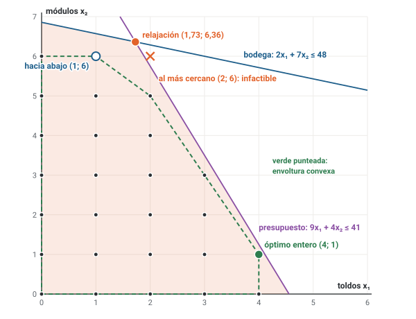
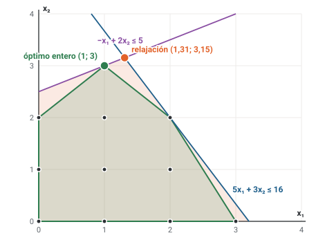

# Unidad 1 · Programación entera: por qué no basta redondear

**Qué vas a poder hacer.** Reconocer cuándo una decisión exige variables enteras o binarias, clasificar
un modelo (lineal, entero puro, entero mixto o binario), usar la relajación lineal como cota del óptimo
entero, mostrar con números por qué redondear puede dar un plan infactible o malo, dibujar la región
entera y su envoltura convexa en dos variables, y escribir un modelo entero pieza por pieza en papel y
en OPL.

**Lo que necesitas antes.** De Optimización: el método gráfico (unidad 2), la formulación de modelos de
producción y mezcla (unidad 4) y OPL (unidad 7). Basta con saber resolver un modelo lineal de dos
variables dibujando la región y con leer un `.mod` y su `.dat`.

**Tiempo.** Unas 5 horas: 2 de lectura con el ejemplo y 3 de práctica.

---

## 1. La idea · cuando la respuesta tiene que ser entera

En Optimización las variables eran kilos, litros u horas: cantidades que se pueden partir. Muchas
decisiones no se pueden partir. No se compran 1,73 toldos, no se contratan 2,29 camiones y no se abre
media bodega. Cuando la respuesta tiene que ser un número entero, el modelo es de **programación
entera**.

La tentación es resolver el modelo lineal de siempre y redondear. Esta unidad muestra por qué eso falla:

- **Puede dar un plan infactible.** Redondear hacia arriba usa recursos que no existen.
- **Puede dar un plan malo.** Redondear hacia abajo es factible (si todas las restricciones son $\le$ con
  coeficientes positivos), pero puede dejar mucha plata sobre la mesa.
- **El mejor plan entero puede estar lejos.** No es una de las cuatro esquinas que rodean al óptimo
  lineal: puede cambiar de estructura.

La palabra «entero» parece un detalle al final del modelo. No lo es: cambia el algoritmo, el tiempo que
tarda y la forma de leer la solución. Las unidades 5 y 6 enseñan cómo se resuelve; esta unidad enseña
por qué hace falta.

---

## 2. Qué es un problema entero

### La forma general

Un problema de programación lineal entera es un modelo lineal con una línea más: algunas variables (o
todas) tienen que ser enteras.

$$\max\; z = \sum_{j=1}^{n} c_j x_j \quad\text{s.a.}\quad \sum_{j=1}^{n} a_{ij} x_j \le b_i \;\; \forall i = 1, \dots, m, \qquad x_j \ge 0 \;\; \forall j, \qquad x_j \in \mathbb{Z} \;\; \forall j \in E$$

$E$ es el conjunto de las variables enteras. El objetivo y las restricciones siguen siendo lineales: lo
único nuevo es la última familia, la **naturaleza** de las variables.

### Las familias

| Familia | Qué variables tiene | Ejemplo |
|---|---|---|
| Programación lineal (PL) | todas continuas | litros de cada vino en un ensamblaje |
| Entera pura (PLE) | todas enteras, $x_j \in \mathbb{Z}_0^+$ | cuántos buses de cada tipo contratar |
| Entera mixta (PEM) | enteras y continuas juntas | cuántos camiones arrendar y cuántas toneladas mandar en tren |
| Binaria (PEB) | todas en $\{0, 1\}$ | qué proyectos aprobar |
| No lineal (PNL) | productos o divisiones de variables | un precio que depende de la cantidad vendida |

Una variable binaria es una entera con cota 0 a 1: $\{0, 1\} \subset \mathbb{Z}_0^+$. Escribir «binaria y
además entera» no agrega nada. La unidad 2 se dedica a las binarias, que son las que expresan
decisiones de sí o no.

### Cuándo basta con la PL

Si la cantidad es grande, la fracción pesa poco: 554,6 unidades se redondean a 554 y se pierde menos
de un margen unitario por producto. Si la cantidad es chica (4 toldos, 2 camiones, 38 cajas), la
fracción pesa mucho y hay que resolver el modelo entero. El ejercicio 1.9 lo mide con el mismo modelo
en unidades y en lotes de 40.

---

## 3. Cómo se escribe un modelo entero, pieza por pieza

En este ramo un modelo se corrige **por piezas**, y cada pieza vale por sí sola aunque otra esté mal.
Por eso se escribe siempre en el mismo orden:

1. **Conjuntos y parámetros**, con su unidad.
2. **Variables de decisión.** Cada una tiene **tres piezas**: el índice con su rango, qué significa el
   valor (o el 1, si es binaria) y, en una binaria, el «en otro caso». Ejemplo completo:
   $x_j$ = unidades del equipo $j$ que se compran en la temporada, $\forall j \in J$.
3. **Función objetivo**, con un término por concepto de plata.
4. **Restricciones**, una familia por idea, cada familia con su «$\forall$» (para todo) y una frase
   que diga qué hace. Todo índice de una restricción está sumado o en el «$\forall$».
5. **Naturaleza de las variables.** Una línea por familia: $x_j \in \mathbb{Z}_0^+ \;\; \forall j \in J$,
   $y_i \in \{0, 1\} \;\; \forall i \in I$, $t \ge 0$. Es la línea que más se olvida y la que convierte
   el modelo en entero: sin ella, el modelo es lineal.

Una variable sin rango del índice («$x$ = toldos que se compran» usada después como $x_j$) o una
naturaleza sin «$\forall$» son errores que restan aunque el resto esté bien.

---

## 4. La relajación lineal es una cota

La **relajación lineal** de un problema entero es el mismo modelo sin la línea de integralidad. Su región
factible contiene a todos los puntos enteros factibles (y a muchos más), así que su óptimo no puede ser
peor:

$$\text{máximo:}\quad z_{\text{PLE}} \le z_{\text{PL}} \qquad\qquad \text{mínimo:}\quad z_{\text{PLE}} \ge z_{\text{PL}}$$

La intuición: optimizar sobre un conjunto más grande nunca da un resultado peor. En un máximo, la
relajación es una **cota superior**; en un mínimo, una **cota inferior**.

Del otro lado, **cualquier solución entera factible** que se tenga a mano es una cota por el otro lado:
en un máximo, el óptimo entero vale al menos eso. Juntando las dos,

$$z_{\text{factible}} \;\le\; z_{\text{PLE}} \;\le\; z_{\text{PL}} \qquad \text{(máximo)}$$

El óptimo entero está atrapado entre dos números que se pueden calcular. Esa es la idea que mueve todos
los algoritmos exactos del ramo.

**Dos medidas de distancia.**

- **Gap de integralidad**, cuando se conoce el óptimo entero: $\dfrac{|z_{\text{PL}} - z_{\text{PLE}}|}{|z_{\text{PLE}}|}$.
  Dice cuánto «promete de más» la relajación.
- **Gap de una solución**, cuando todavía no se conoce el óptimo: $\dfrac{|\text{cota} - z_{\text{factible}}|}{|z_{\text{factible}}|}$.
  Es lo más que se podría estar perdiendo al quedarse con esa solución. Mide lo que no se sabe, no el
  error real: el error real puede ser cero aunque el gap no lo sea.

**Un dato que achica la cota.** Si todos los coeficientes del objetivo son enteros (o múltiplos de
$1.000) y las variables son enteras, el óptimo también es entero (o múltiplo de $1.000). Una relajación
que vale 94,7 dice entonces que el óptimo entero vale a lo más 94 (ejercicio 1.2).

**Cuándo no aplica.** Si la relajación es infactible, el problema entero también lo es. Pero si la
relajación es factible, el entero puede no serlo: una región que no contiene ningún punto entero (por
ejemplo $2x = 1$) tiene relajación con solución y problema entero sin ninguna.

---

## 5. Redondear: cuatro formas de equivocarse

Con dos variables, el óptimo lineal $(x_1, x_2)$ tiene cuatro vecinos enteros: los redondeos hacia abajo
y hacia arriba de cada coordenada. Redondear es elegir uno de esos cuatro. Puede salir mal de cuatro
maneras:

| Lo que pasa | Por qué | Dónde se ve |
|---|---|---|
| El redondeo es infactible | subir una variable usa recurso que no hay | ejemplo, $(2; 6)$ |
| El redondeo es factible pero malo | bajar todo deja recurso ocioso | ejemplo, $(1; 6)$ |
| Ninguna de las cuatro esquinas es el óptimo | el óptimo entero cambia la mezcla | ejemplo, $(4; 1)$ |
| Redondear una binaria no tiene sentido | $x = 0{,}5$ no dice «medio proyecto», dice «el modelo no decidió» | unidad 2 |

**Redondear hacia abajo tiene una cota.** En un máximo con todas las restricciones $\le$ y todos los
coeficientes $a_{ij} \ge 0$, bajar cada variable a su parte entera $\lfloor x_j \rfloor$ siempre es
factible, y lo que se pierde es

$$z_{\text{PL}} - z_{\text{abajo}} = \sum_j c_j \left( x_j - \lfloor x_j \rfloor \right) < \sum_j c_j$$

Si $\sum_j c_j$ es chico frente a $z_{\text{PL}}$, redondear basta. Si es grande (lotes de 40, cajas de 24,
equipos que valen millones), hay que resolver el problema entero. En un mínimo con restricciones $\ge$ y
coeficientes positivos, lo seguro es redondear **hacia arriba**, y la cota es la misma.

**Cuándo el redondeo ni siquiera hace falta.** Hay estructuras (asignación, transporte con datos
enteros) en que la relajación ya entrega una solución entera: su matriz de restricciones es
**totalmente unimodular**. Las unidades 9 y 10 lo aprovechan. Basta una restricción extra para perder la
propiedad (ejercicio 1.10).

---

## 6. La región entera y su envoltura convexa

En un modelo lineal, la región factible es un **poliedro**: un cuerpo convexo, y el óptimo está en un
vértice. En un modelo entero, la región es un **conjunto de puntos sueltos**: los enteros que caen dentro
del poliedro. No hay vértices que recorrer ni convexidad, y por eso el simplex no sirve solo.

La **envoltura convexa** de esos puntos es el polígono más chico que los contiene a todos: se obtiene
tendiendo un elástico alrededor de los puntos. Tiene una propiedad que lo explica todo:

> Si se conocieran las desigualdades de la envoltura convexa, bastaría resolver un modelo **lineal**
> sobre ella: sus vértices son puntos enteros, así que el simplex entregaría el óptimo entero.

El problema es que casi nunca se conocen. El poliedro de la relajación contiene a la envoltura, y lo
que sobra entre los dos es lo que hace que la relajación prometa de más. Dos ideas salen de aquí:

- **Una formulación es mejor si su relajación se parece más a la envoltura.** Dos modelos pueden tener
  los mismos puntos enteros y relajaciones muy distintas (ejercicio 1.8 y el caso).
- **Los planos cortantes** (unidad 6) agregan desigualdades que cortan pedazos de la relajación sin
  cortar ningún punto entero, acercándola a la envoltura.

---

## 7. Por qué no se prueba todo

Con $n$ variables binarias hay $2^n$ combinaciones. Con 30 son mil millones; con 80, más que lo que un
computador puede revisar en la edad del universo (ejercicio 1.4). Con variables enteras de 0 a 99, diez
variables ya dan $10^{20}$ combinaciones. La enumeración solo sirve para modelos de juguete y para
comprobar a mano.

Los métodos que funcionan **enumeran con inteligencia**: dividen el problema en ramas y descartan ramas
completas usando la cota de la relajación (ramificación y acotamiento, unidad 5), o ajustan la
relajación hasta que su óptimo sea entero (planos cortantes, unidad 6). Cuando ni así alcanza, se
renuncia a la garantía de óptimo y se usan heurísticas (unidades 11 y 12).

---

## 8. En OPL

Un modelo entero en OPL es un modelo lineal con otra palabra en la declaración:

| Naturaleza | En papel | En OPL |
|---|---|---|
| Continua no negativa | $x \ge 0$ | `dvar float+ x;` |
| Entera no negativa | $x \in \mathbb{Z}_0^+$ | `dvar int+ x;` |
| Binaria | $x \in \{0, 1\}$ | `dvar boolean x;` |

Tres cosas cambian al resolver:

- CPLEX usa ramificación y corte en vez de simplex, y el registro muestra nodos, cotas y gap.
- **No hay precios sombra.** En un modelo entero, `Restriccion.dual` no tiene valor: OPL imprime
  `undefined`. Para saber cuánto vale un recurso hay que volver a resolver con otro lado derecho.
- **La relajación se obtiene cambiando `int+` por `float+`** (y `boolean` por `float+` con cota 1). Es
  la forma rápida de tener la cota.

---

## 9. Ejemplo resuelto · toldos y módulos para la temporada

Una empresa de eventos de Pucón compra equipos para arrendar en la temporada de verano: **toldos
grandes** y **módulos de escenario**. Cada toldo deja un margen de $1.300.000 en la temporada y cada
módulo $600.000. Un toldo ocupa 2 m² de bodega y cuesta \$9 millones; un módulo ocupa 7 m² y cuesta
\$4 millones. Hay 48 m² de bodega y \$41 millones para comprar.

**Paso 1 · En palabras.** Se decide cuántos toldos y cuántos módulos comprar. Se busca el mayor margen de
la temporada. Limitan la bodega y el presupuesto. No se compran fracciones de equipo.

**Paso 2 · Pieza por pieza.**

- Conjunto: $J$ = {toldo (1), módulo (2)}.
- Parámetros: $c_j$ margen por temporada (pesos), $a_j$ m² de bodega, $p_j$ precio de compra (millones).
- Variable: $x_j$ = unidades del equipo $j$ que se compran para la temporada, $\forall j \in J$.

$$\max\; z = 1{.}300{.}000\, x_1 + 600{.}000\, x_2$$

$$2x_1 + 7x_2 \le 48 \qquad \text{(bodega, m²)}$$

$$9x_1 + 4x_2 \le 41 \qquad \text{(presupuesto, millones)}$$

$$x_j \in \mathbb{Z}_0^+ \;\; \forall j \in J \qquad \text{(naturaleza)}$$

**Paso 3 · La relajación.** Sin la naturaleza entera, el óptimo está en el cruce de las dos
restricciones: $(1{,}73; 6{,}36)$, con un margen de $6.063.636. Es la cota superior: ningún plan entero puede
dejar más.

**Paso 4 · Redondear.** Los cuatro vecinos enteros:

| Plan $(x_1; x_2)$ | Bodega (≤ 48) | Presupuesto (≤ 41) | ¿Factible? | Margen |
|---|---|---|---|---|
| (1; 6) | 44 | 33 | sí | $4.900.000 |
| (2; 6) | 46 | 42 | no, se pasa del presupuesto | — |
| (1; 7) | 51 | 37 | no, se pasa de la bodega | — |
| (2; 7) | 53 | 46 | no, se pasa de las dos | — |

El redondeo al más cercano, $(2; 6)$, es infactible: pide \$42 millones. El único redondeo factible es
hacia abajo, $(1; 6)$, que deja $4.900.000: $1.163.636 bajo la relajación.

**Paso 5 · El óptimo entero.** Hay 26 planes enteros factibles. Enumerándolos (o con `dvar int+`), el
mejor es **$(4; 1)$: cuatro toldos y un módulo, con $5.800.000**. Usa 15 m² de bodega y \$40 millones. El
segundo mejor es $(3; 3)$, con $5.700.000.



La envoltura convexa de los 26 puntos (línea verde) tiene vértices $(0; 0)$, $(4; 0)$, $(4; 1)$, $(2; 5)$,
$(1; 6)$ y $(0; 6)$, y la describen $x_1 \le 4$, $x_2 \le 6$, $2x_1 + x_2 \le 9$ y $x_1 + x_2 \le 7$. Resolver el
modelo lineal con esas cuatro desigualdades da directamente $(4; 1)$: es lo que dice el punto 6.

**En OPL** (`modelos/u01_eventos.mod`):

```opl
// Unidad 1 · ejemplo: toldos y módulos de escenario para la temporada
range Equipos = 1..2;                        // 1 = toldo, 2 = módulo de escenario
float margen[Equipos] = [1300000, 600000];   // CLP por temporada y por unidad
float bodega[Equipos] = [2, 7];              // m² de bodega por unidad
float compra[Equipos] = [9, 4];              // millones de CLP por unidad

dvar int+ x[Equipos];                        // unidades que se compran de cada equipo

maximize sum(e in Equipos) margen[e] * x[e];

subject to {
  Bodega:      sum(e in Equipos) bodega[e] * x[e] <= 48;
  Presupuesto: sum(e in Equipos) compra[e] * x[e] <= 41;
}

execute {
  for (var e in Equipos) writeln("x[", e, "] = ", x[e]);
}
```

**Cómo se lee.**

- **Comprar 4 toldos y 1 módulo.** El plan entero óptimo no se parece a la relajación, que pedía casi
  todo en módulos: el entero cambia la mezcla.
- **Redondear habría costado $900.000 por temporada** ($5.800.000 contra $4.900.000), y redondear al más
  cercano ni siquiera era comprable.
- **La relajación prometía un 4,5 % más** que el óptimo entero (el gap de integralidad). Esa diferencia no
  es plata perdida: es plata que nunca existió, porque nadie compra 1,73 toldos.
- **Sobra bodega** (33 m² libres) y sobra \$1 millón: con equipos indivisibles es normal que los recursos
  no se agoten.

---

## 10. Errores típicos

| Error | Cómo evitarlo |
|---|---|
| Resolver la relajación y redondear sin revisar | Revisa la factibilidad del redondeo y compáralo con el óptimo entero cuando las cantidades son chicas |
| Creer que el óptimo entero está entre los cuatro vecinos del lineal | Enumera o resuelve con `dvar int+`: el entero puede cambiar de estructura |
| Leer la relajación al revés en un mínimo | En un mínimo, la relajación es cota **inferior** del costo |
| Olvidar la línea de naturaleza ($x_j \in \mathbb{Z}_0^+ \;\forall j$) | Escríbela siempre al final, una por familia; sin ella el modelo es lineal |
| Definir la variable sin el rango del índice o sin decir qué mide | Tres piezas: índice con rango, significado, «en otro caso» si es binaria |
| Una familia de restricciones sin su «$\forall$» | Cada familia lleva su cuantificador; un índice suelto es un error |
| Pedir `.dual` a un modelo entero | No existe: vuelve a resolver con el lado derecho cambiado |
| Confundir el gap con el error | El gap es lo más que se podría perder; el error real puede ser menor, incluso cero |
| Escribir «binaria y entera» | $\{0, 1\}$ ya es entero; basta $x_j \in \{0, 1\}$ |
| Clasificar como PEB un modelo con una variable continua | Si hay continuas y enteras, es mixto (PEM) |

---

## 11. Práctica

Diez ejercicios: 1.1 a 1.4 básicos, 1.5 a 1.8 intermedios, 1.9 y 1.10 de desafío. Las pautas están en la
sección 12. Escribe cada modelo pieza por pieza: variables con sus tres piezas, objetivo, restricciones
con su «$\forall$» y naturaleza.

**1.1 · Clasificar (básico).** Para cada situación, define las variables con su dominio y clasifica el
modelo (PL, PLE pura, PEM, PEB o PNL). Di en una línea si la integralidad es indispensable. (a) Una
refinería decide cuántos litros de cada combustible mezclar. (b) Un banco decide cuántos cajeros abrir en
cada franja horaria del sábado. (c) Una distribuidora decide qué bodegas abrir y cuántas toneladas mandar
desde cada una a cada cliente. (d) Un entrenador decide qué 8 de sus 20 jugadores convoca. (e) Una tienda
decide el precio de un producto sabiendo que la demanda baja cuando el precio sube. (f) Una empresa
eléctrica decide cuántos paneles solares instalar en un parque de 3.000 paneles.

**1.2 · Cotas (básico).** (a) Un problema de máximo tiene relajación de $1.284.600 y una solución entera
conocida de $1.212.000. ¿Entre qué valores está el óptimo entero? Calcula el gap de esa solución. (b) Si
además todos los coeficientes del objetivo son múltiplos de $1.000, ¿cómo cambia la cota y el gap?
(c) Un problema de mínimo (costo en miles de pesos, coeficientes enteros) tiene relajación de 418,5 y una
solución entera de 431. Acota el óptimo y calcula los dos gaps.

**1.3 · A mano, en dos variables (básico).**

$$\max\; z = 10x_1 + 11x_2 \quad\text{s.a.}\quad 4x_1 + 5x_2 \le 41, \quad 8x_1 + x_2 \le 31, \quad x_1, x_2 \in \mathbb{Z}_0^+$$

(a) Resuelve la relajación gráficamente. (b) Revisa los cuatro redondeos. (c) Encuentra el óptimo entero
enumerando los puntos factibles. (d) Calcula el gap de integralidad.

**1.4 · Probar todo (básico).** Un computador revisa mil millones de combinaciones por segundo.
¿Cuánto tarda en revisar todas las combinaciones de 30, 50 y 80 variables binarias? ¿Y de 10 variables
enteras que van de 0 a 99?

**1.5 · Minimizar con buses (intermedio).** Una faena contrata buses (70 pasajeros, $70.000 por día) y
minibuses (50 pasajeros, $60.000 por día). Debe mover al menos 470 pasajeros por turno. Además, los
caminos interiores exigen 21 recorridos al día: un bus alcanza a hacer 1 (es lento en ripio) y un minibús
hace 4. Formula pieza por pieza (en decenas de pasajeros), resuelve la relajación, revisa los redondeos y
encuentra el óptimo entero.

**1.6 · La envoltura convexa (intermedio).**

$$\max\; z = 3x_1 + 4x_2 \quad\text{s.a.}\quad 5x_1 + 3x_2 \le 16, \quad -x_1 + 2x_2 \le 5, \quad x_1, x_2 \in \mathbb{Z}_0^+$$

(a) Dibuja la región y marca los puntos enteros factibles. (b) Encuentra los vértices de su envoltura
convexa y las desigualdades que la describen. (c) Resuelve el modelo lineal sobre la envoltura y
compáralo con la relajación original.

**1.7 · Un modelo mixto (intermedio).** Una exportadora debe llevar 47,5 toneladas diarias de fruta a la
planta. Puede arrendar camiones (12 t, $180.000 por día) y furgones (3,5 t, $65.000 por día), y puede
mandar carga en tren a $9.000 por tonelada, hasta 20 t por día. Formula el modelo de menor costo pieza
por pieza, escríbelo en OPL, resuélvelo y compáralo con su relajación. ¿Qué pasa si se redondea el
número de camiones de la relajación hacia arriba? ¿Y hacia abajo?

**1.8 · Dos formulaciones, los mismos enteros (intermedio).** Tres binarias $x_1, x_2, x_3$ y la regla «a lo
más una vale 1». Formulación A: $x_1 + x_2 + x_3 \le 1$. Formulación B: $x_1 + x_2 \le 1$, $x_1 + x_3 \le 1$,
$x_2 + x_3 \le 1$. (a) Comprueba que las dos aceptan los mismos puntos binarios. (b) Resuelve la relajación
de cada una con objetivo $\max\; 5x_1 + 4x_2 + 3x_3$ y $0 \le x_j \le 1$. (c) ¿Cuál es mejor formulación y
por qué?

**1.9 · El tamaño del lote (desafío).** Una fábrica de muebles hace tres líneas con margen de $4.200,
$2.900 y $6.100 por unidad. Cada unidad usa 3, 2 y 5 horas de corte y 2, 3 y 2 horas de armado; hay 1.853
horas de corte y 1.393 de armado al mes. (a) Resuelve la relajación en unidades, redondea hacia abajo y
encuentra el óptimo entero. ¿Cuánto se pierde? (b) Ahora la producción sale en lotes de 40 unidades.
Repite todo en lotes. (c) Calcula en los dos casos la cota de lo que se pierde al redondear hacia abajo
(punto 5) y explica cuándo conviene resolver el problema entero.

**1.10 · Cuándo el redondeo ni siquiera hace falta (desafío).** Tres técnicos atienden tres servicios, uno
cada uno. Costo (miles de pesos) y horas de traslado:

| Costo · horas | Servicio 1 | Servicio 2 | Servicio 3 |
|---|---|---|---|
| Técnico 1 | 13 · 9 | 8 · 5 | 15 · 2 |
| Técnico 2 | 9 · 4 | 15 · 3 | 15 · 7 |
| Técnico 3 | 14 · 9 | 12 · 5 | 4 · 8 |

(a) Formula la asignación de menor costo y resuelve su **relajación** con $0 \le x_{ij} \le 1$. ¿Sale entera?
(b) Agrega una política: las horas totales de traslado no pueden pasar de 14. Resuelve la relajación y el
problema entero. (c) Explica qué cambió.

---

## 12. Pautas

**1.1.** (a) $x_j \ge 0$ litros del combustible $j$: **PL**; los litros se pueden partir. (b) $x_t \in
\mathbb{Z}_0^+$ cajeros abiertos en la franja $t$: **PLE pura**; con números chicos, medio cajero no
existe. (c) $y_i \in \{0, 1\}$ (1 si se abre la bodega $i$, 0 en otro caso) y $x_{ij} \ge 0$ toneladas de
$i$ al cliente $j$: **PEM**. (d) $x_k \in \{0, 1\}$ (1 si se convoca al jugador $k$, 0 en otro caso), con
$\sum_k x_k = 8$: **PEB**. (e) Precio $p$ y demanda $d(p)$: el ingreso $p \cdot d(p)$ multiplica variables,
es **PNL**. (f) $x \in \mathbb{Z}_0^+$ paneles: formalmente PLE pura, pero con 3.000 paneles la fracción no
importa y basta la PL redondeada (la pérdida es a lo más el margen de un panel). Lectura: lo que decide
la familia es la naturaleza de cada variable, no el tema.

**1.2.** (a) $1.212.000 \le z^* \le 1.284.600$. Gap = $72.600 / $1.212.000 = 5,99 %: quedarse con esa solución
podría costar, a lo más, ese porcentaje. (b) Si el óptimo es múltiplo de $1.000, no puede pasar de
$1.284.000: la cota baja y el gap queda en 5,94 %. (c) En un mínimo la relajación es cota inferior:
$418{,}5 \le z^* \le 431$, y como el costo es entero, $419 \le z^* \le 431$. Gap = 12,5 / 431 = 2,90 %, y con la
cota redondeada, 12 / 431 = 2,78 %. Lectura: un dato tan simple como «los coeficientes son enteros»
achica la cota gratis.

**1.3.** (a) La relajación tiene óptimo en el cruce de las dos restricciones: $(3{,}17; 5{,}67)$, $z = 94$.
(b) $(3; 5)$ es factible con $z = 85$; $(4; 5)$ viola la segunda; $(3; 6)$ viola la primera; $(4; 6)$ viola
las dos. (c) Hay 30 puntos enteros factibles; el mejor es $(0; 8)$ con $z = 88$, y el segundo $(1; 7)$ con
87. (d) Gap = (94 − 88) / 88 = 6,8 %. Lectura: el óptimo entero abandona por completo $x_1$, que la
relajación usaba; redondear hacia abajo deja 3 puntos bajo el óptimo.

**1.4.** Con $2^{30} = 1{.}073{.}741{.}824$ combinaciones: 1,07 s. Con $2^{50}$: 13,0 días. Con $2^{80}$:
38,3 millones de años. Diez enteras de 0 a 99 son $10^{20}$ combinaciones: unos 3 mil años. Lectura: con 80
binarias (un modelo chico en la industria) la enumeración ya es imposible; por eso hacen falta cotas.

**1.5.** Variables: $x_1$ = buses contratados por día, $x_2$ = minibuses contratados por día, $x_1, x_2 \in
\mathbb{Z}_0^+$.

$$\min\; 70{.}000\,x_1 + 60{.}000\,x_2 \quad\text{s.a.}\quad 7x_1 + 5x_2 \ge 47 \;\;\text{(decenas de pasajeros)}, \quad x_1 + 4x_2 \ge 21 \;\;\text{(recorridos interiores)}$$

Relajación: $(3{,}61; 4{,}35)$, con $513.478 por día (cota **inferior**). Redondeos: $(3; 4)$ y $(3; 5)$ no
llevan a todos los pasajeros; el más cercano, $(4; 4)$, se queda en 20 recorridos; solo $(4; 5)$ es
factible, con $580.000. El óptimo entero es $(1; 8)$: un bus y ocho minibuses, con $550.000 (el segundo
mejor es $(2; 7)$ con $560.000). Gap de integralidad: 6,6 %. Lectura: en un mínimo lo seguro es redondear
hacia arriba, pero cuesta $30.000 diarios más que el óptimo entero.

**1.6.** (a) Hay 11 puntos enteros factibles. (b) Los vértices de la envoltura son
(0; 0), (0; 2), (1; 3), (2; 2), (3; 0); la describen $x_1, x_2 \ge 0$ y tres desigualdades nuevas: $x_1 + x_2 \le 4$, $2x_1 + x_2 \le 6$ y
$-x_1 + x_2 \le 2$. (c) La relajación original da $(1{,}31; 3{,}15)$ con $z = 16{,}54$; sobre la envoltura, el
óptimo es directamente $(1; 3)$ con $z = 15$, que es el óptimo entero.



Lectura: la franja naranja que no es verde es todo lo que la relajación agrega sin que haya ahí un solo
punto entero; los planos cortantes de la unidad 6 la van recortando.

**1.7.** Variables: $u_c \in \mathbb{Z}_0^+$ camiones arrendados por día, $u_f \in \mathbb{Z}_0^+$ furgones
arrendados por día, $t \ge 0$ toneladas por tren al día. Es **mixto**.

$$\min\; 180{.}000\,u_c + 65{.}000\,u_f + 9{.}000\,t \quad\text{s.a.}\quad 12u_c + 3{,}5u_f + t \ge 47{,}5, \quad t \le 20$$

En OPL (`modelos/u01_e07_fruta.mod`):

```opl
// Ejercicio 1.7 · fruta a la planta: camiones y furgones (enteros) y tren (continuo)
float carga       = 47.5;     // toneladas por día que hay que mover
float capCamion   = 12;       // toneladas por camión
float costoCamion = 180000;   // CLP por camión y día
float capFurgon   = 3.5;      // toneladas por furgón
float costoFurgon = 65000;    // CLP por furgón y día
float costoTren   = 9000;     // CLP por tonelada
float topeTren    = 20;       // toneladas por día que admite el tren

dvar int+   camiones;         // camiones que se arriendan por día
dvar int+   furgones;         // furgones que se arriendan por día
dvar float+ tren;             // toneladas que van en tren por día

minimize costoCamion * camiones + costoFurgon * furgones + costoTren * tren;

subject to {
  Carga:    capCamion * camiones + capFurgon * furgones + tren >= carga;
  TopeTren: tren <= topeTren;
}

execute {
  writeln("camiones = ", camiones);
  writeln("furgones = ", furgones);
  writeln("toneladas_tren = ", tren);
}
```

La relajación usa el tren al tope (es lo más barato por tonelada) y 2,2917 camiones: $592.500 por día. El
óptimo entero: **2 camiones, 1 furgón y 20 t en tren, con $605.000** (gap de 2,1 %). Redondear los camiones
hacia arriba y dejar el tren en 20 t cuesta $720.000; si después se vuelve a optimizar el tren (11,5 t),
baja a $643.500, todavía peor que el óptimo. Redondear hacia abajo deja 3,5 t sin transporte. Lectura: en
un mixto, la parte continua se ajusta sola alrededor de la entera; el furgón existe justamente para
cubrir el pedazo que el redondeo deja colgando.

**1.8.** (a) Los cuatro puntos binarios con a lo más un 1 cumplen las dos; cualquier punto con dos o tres
unos viola las dos. Mismo conjunto entero. (b) Relajación A: $(1; 0; 0)$, $z = 5$, que ya es entera.
Relajación B: $(0{,}5; 0{,}5; 0{,}5)$, $z = 6$. (c) A es mejor: su relajación coincide con la envoltura
convexa, mientras B deja el punto $(0{,}5; 0{,}5; 0{,}5)$ que no está cerca de ningún entero. Lectura: tres
restricciones «más detalladas» no hacen una formulación mejor; la que importa es la que deja menos
relajación de sobra.

**1.9.** (a) En unidades, la relajación es (554,6; 94,6; 0) con $2.603.660. Hacia abajo, $(554; 94; 0)$; el
óptimo entero es (555; 94; 0) con $2.603.600: se pierden \$60 (0,002 %). La cota del punto 5 es la suma de
los márgenes, $13.200, insignificante frente al total. (b) En lotes de 40 la relajación es la misma
producción: (13,865; 2,365; 0) lotes. Hacia abajo, (13; 2; 0), con $2.416.000; el óptimo entero es
(14; 2; 0), con $2.584.000. (c) Redondear hacia abajo en lotes pierde $187.660, que es exactamente la cota
$\sum_j c_j (x_j - \lfloor x_j \rfloor)$ con márgenes por lote; el óptimo entero pierde $19.660 (0,8 %) frente a
la relajación. Lectura: el mismo modelo pasa de «redondear da lo mismo» a «redondear cuesta un 7 %»
solo porque la unidad de decisión creció 40 veces.

**1.10.** (a) Variables: $x_{ij}$ = 1 si el técnico $i$ atiende el servicio $j$, 0 en otro caso,
$\forall i, j \in \{1, 2, 3\}$. Restricciones: $\sum_j x_{ij} = 1 \;\forall i$ y $\sum_i x_{ij} = 1 \;\forall j$;
naturaleza $x_{ij} \in \{0, 1\} \;\forall i, j$. La relajación sale entera: técnico 1 al servicio 2,
técnico 2 al 1 y técnico 3 al 3, con $21.000 y 17 horas de traslado. (b) Con $\sum_{i,j} h_{ij} x_{ij} \le 14$, la
relajación ya no es entera: reparte a los técnicos 1 y 3 por mitades entre los servicios 2 y 3 y promete
$28.500. El óptimo entero es técnico 1 al 3, técnico 2 al 1 y técnico 3 al 2, con $36.000 y 11 horas
(solo dos de las seis asignaciones cumplen el tope). (c) La asignación pura es totalmente unimodular y su
relajación tiene vértices enteros; la restricción de horas rompe esa estructura. Lectura: la regla
«redondear no hace falta» vale para la estructura, no para el problema: una sola restricción lateral la
borra.

---

## 13. Caso integrador · Estampa Sur en cajas de 24

> Este caso sigue a Estampa Sur, un taller de serigrafía ficticio, por todo el ramo. Las cifras salen de
> `verificacion/caso_estampa_sur_red.py`. Optimización (unidad 4) resolvió su mezcla semanal en prendas
> sueltas: 833,75 poleras, 520 polerones, 294,375 bolsas y 690 gorros, con $4.289.275.

**Lo que recibe.** La mezcla de Optimización: márgenes, tiempos de estampado y planchado, tinta,
capacidades (144.000 s, 64.800 s y 29.500 g por semana) y ventas máximas. Lo nuevo: el cliente mayorista
ahora compra **en cajas de 24 prendas**, y no acepta cajas incompletas.

**Pieza por pieza.**

- Conjuntos: $I$ = prendas, $R$ = {estampado, planchado, tinta}.
- Parámetros: $c_i$ margen por prenda, $a_{ri}$ uso del recurso $r$ por prenda, $b_r$ disponible, $d_i$ venta
  máxima (prendas), $q = 24$ prendas por caja.
- Variable: $u_i$ = cajas de 24 de la prenda $i$ que se producen en la semana, $\forall i \in I$.

$$\max \sum_{i \in I} q\, c_i\, u_i \quad\text{s.a.}\quad \sum_{i \in I} q\, a_{ri}\, u_i \le b_r \;\; \forall r \in R, \qquad q\, u_i \le d_i \;\; \forall i \in I, \qquad u_i \in \mathbb{Z}_0^+ \;\; \forall i \in I$$

El margen por caja es 24 veces el de la prenda: $33.120, $94.560, $54.480, $23.040 y $28.080.

**En OPL** (`modelos/u01_estampa_cajas.mod` y `.dat`). Es el modelo de Optimización con dos cambios: la
variable cuenta cajas y se declara `int+`.

```opl
// Unidad 1 · caso Estampa Sur: la mezcla de la unidad 4 de Optimización, en cajas de 24
{string} Prendas  = ...;
{string} Recursos = ...;

int   caja                   = ...;   // prendas por caja
float margen[Prendas]        = ...;   // CLP por prenda
float uso[Recursos][Prendas] = ...;   // segundos o gramos por prenda
float cap[Recursos]          = ...;   // segundos o gramos por semana
float demanda[Prendas]       = ...;   // prendas por semana, máximo

dvar int+ cajas[Prendas];             // cajas de 24 prendas que se producen en la semana

dexpr float Margen = sum(i in Prendas) caja * margen[i] * cajas[i];
maximize Margen;

subject to {
  forall(r in Recursos)
    Capacidad: sum(i in Prendas) caja * uso[r][i] * cajas[i] <= cap[r];
  forall(i in Prendas)
    Demanda: caja * cajas[i] <= demanda[i];
}

execute {
  writeln("margen = ", Margen);
  for (var i in Prendas) writeln("cajas[", i, "] = ", cajas[i]);
}
```

```opl
Prendas  = {"poleras", "polerones", "doble", "bolsas", "gorros"};
Recursos = {"estampado", "planchado", "tinta"};
caja     = 24;
margen   = [1380, 3940, 2270, 960, 1170];
uso      = [[30, 90, 110, 20, 30],
            [20, 50, 30, 40, 15],
            [12, 25, 22, 8, 6]];
cap      = [144000, 64800, 29500];
demanda  = [1450, 520, 380, 860, 690];
```

**Desarrollo.** La relajación (el mismo `.mod` con `float+`) es la mezcla de Optimización dividida por 24:
34,74 cajas de poleras, 21,67 de polerones, 0 de estampado doble, 12,27 de bolsas y 28,75 de gorros, con
$4.289.275. Tres planes enteros:

| Plan (cajas) | Poleras | Polerones | Doble | Bolsas | Gorros | Margen |
|---|---|---|---|---|---|---|
| Al más cercano | 35 | 22 | 0 | 12 | 29 | infactible |
| Hacia abajo | 34 | 21 | 0 | 12 | 28 | $4.174.560 |
| Óptimo entero | 38 | 21 | 0 | 10 | 28 | $4.260.960 |


| Recurso | Disponible | Al más cercano | Hacia abajo | Óptimo entero |
|---|---|---|---|---|
| Estampado (s) | 144.000 | 99.360 | 95.760 | 97.680 |
| Planchado (s) | 64.800 | 65.160 | 63.120 | 63.120 |
| Tinta (g) | 29.500 | 29.760 | 28.728 | 29.496 |

El redondeo al más cercano se pasa del planchado y de la tinta, y además vende 528 polerones y 696 gorros,
sobre los máximos de 520 y 690. Hacia abajo es factible y deja $4.174.560: $114.715 bajo la relajación
(2,67 %), justo la cota $\sum_j c_j (x_j - \lfloor x_j \rfloor)$ del punto 5 con márgenes por caja. El óptimo
entero (único, comprobado enumerando) deja $4.260.960: solo $28.315 bajo la relajación (0,66 %), y
$86.400 más que redondear hacia abajo. En prendas son 912 poleras, 504 polerones, 240 bolsas y 672 gorros.

**Lectura.**

- **El óptimo entero no es el redondeo.** Sube las poleras de 34,74 a 38 cajas y baja las bolsas de
  12,27 a 10. Con cajas, lo que importa es cómo encajan los bloques de 24 en los recursos, no estar cerca
  del plan continuo.
- **La tinta queda casi exacta** (29.496 de 29.500 g) y sobran 1.680 s de planchado: el plan entero busca
  la combinación de cajas que llena mejor la tinta, que era el recurso más valioso de la mezcla.
- **Redondear hacia abajo cuesta $86.400 por semana.** En Optimización, con prendas sueltas, el entero
  quedaba a \$15 del lineal y redondear bastaba. La caja de 24 multiplicó por 24 lo que pesa cada fracción.
- **Dos formulaciones, los mismos enteros.** Si en vez de $24\,u_i \le d_i$ se escribe el tope ya redondeado
  ($u_i \le 21$ para polerones, $u_i \le 28$ para gorros), los planes enteros son los mismos y la relajación
  baja a $4.263.930: más cerca del óptimo entero. Es el punto 6 en un caso real: escribir el tope entero
  ajusta la formulación.
- **No hay precios sombra.** En el modelo entero, `Capacidad["planchado"].dual` imprime `undefined`. Para
  saber cuánto vale una hora más de planchado hay que volver a resolver con 68.400 s.

**Lo que pasa a las unidades siguientes.** La unidad 2 pregunta qué productos nuevos lanzar con un
presupuesto (decisiones de sí o no). La unidad 3 decide si comprar una segunda máquina para hacer más
cajas (costo fijo y lote mínimo). Las unidades 5 y 6 resuelven a mano, con ramificación y acotamiento y
con planos cortantes, una versión chica de este mismo problema de cajas.

---

## 14. Para seguir

**En los libros del ramo.**

- Winston, *Investigación de operaciones: aplicaciones y algoritmos* (4.ª ed., 2005), el capítulo de
  programación entera: formulación de problemas enteros y por qué la relajación no basta, con muchos
  ejercicios de dos variables para resolver a mano.
- Hillier y Lieberman, *Introducción a la investigación de operaciones* (7.ª ed., 2001), el capítulo de
  programación entera: aplicaciones de las variables binarias y la relación entre el problema entero y su
  relajación.

**Abierto y gratis.**

- Bradley, Hax y Magnanti, *Applied Mathematical Programming* (Addison-Wesley, 1977), en inglés, que el
  MIT deja descargar completo. El capítulo 9, «Integer Programming», parte justamente de por qué redondear
  no basta y muestra la región entera de problemas de dos variables:
  https://web.mit.edu/15.053/www/AMP.htm

**Con el tutor.** La carpeta `tutor/` trae el contexto de este ramo. Pégalo al inicio de la conversación
con cualquier IA y pídele, por ejemplo: «Dame un problema entero de dos variables donde redondear al más
cercano sea infactible, déjame resolverlo a mano y corrígeme la enumeración».
