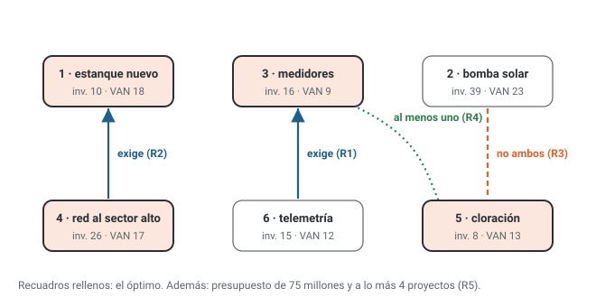

# Unidad 2 · Variables binarias I: decisiones, dependencias, mochila y asignación

**Qué vas a poder hacer.** Definir una variable binaria con sus tres piezas, traducir frases de la
gerencia («si se hace A, hay que hacer B», «no ambos», «al menos uno», «a lo más k», «todos o
ninguno») a restricciones lineales y comprobarlas con una tabla de verdad, formular y resolver la
mochila 0-1, la asignación (balanceada y no balanceada) y una programación simple de máquinas, y
escribir todo eso en OPL con `dvar boolean`.

**Lo que necesitas antes.** La unidad 1: qué es un modelo entero, la relajación como cota y cómo se
escribe un modelo pieza por pieza. De Optimización, la unidad 7 (OPL con conjuntos, `forall` y `.dat`).

**Tiempo.** Unas 6 horas: 2 de lectura con el ejemplo y 4 de práctica.

---

## 1. La variable que dice sí o no

Una variable binaria no mide una cantidad: **responde una pregunta cerrada**. ¿Se ejecuta el proyecto?
¿Se lanza el producto? ¿Va este técnico a este servicio? Por eso solo puede valer 0 o 1.

### Las tres piezas

Una binaria bien definida tiene tres piezas, y cada una vale puntos por sí sola:

$$x_j = \begin{cases} 1 & \text{si se ejecuta el proyecto } j \\ 0 & \text{en otro caso} \end{cases} \qquad \forall j \in J = \{1, \dots, 6\}$$

1. **El índice con su rango:** $\forall j \in J$, y $J$ definido.
2. **Qué significa el 1:** una acción concreta («se ejecuta»), no un objeto.
3. **El «en otro caso»:** qué significa el 0.

La prueba para saber si está completa: muéstrale solo esa línea a alguien que no leyó el enunciado. Si
puede decir qué significa cada valor de cada variable, está bien definida.

### Decisión, no objeto

«$x_j$: el proyecto $j$» no es una definición: un proyecto no es un número. La variable es la **decisión
sobre** el proyecto. Y si la decisión empareja dos cosas (un técnico y un servicio, una pieza y una
máquina), la variable lleva **dos índices**: $x_{ij}$ = 1 si el técnico $i$ atiende el servicio $j$.

### Naturaleza

Al final del modelo va una línea por familia: $x_j \in \{0, 1\} \;\; \forall j \in J$. No hace falta agregar
«entera»: $\{0, 1\}$ ya lo es. Sin esa línea, el solver resuelve la relajación y puede devolver
$x_j = 0{,}5$, que no responde la pregunta.

---

## 2. Relaciones lógicas: el catálogo

Sea $x_a$, $x_b$, $x_c$ binarias («1 si se hace»). Casi toda frase de un enunciado cae en uno de estos
patrones:

| Frase | Restricción lineal | Prohíbe |
|---|---|---|
| Si se hace $a$, se hace $b$ (o «$a$ solo si $b$», «$a$ exige $b$») | $x_a \le x_b$ | $a$ sin $b$ |
| $a$ y $b$ se excluyen (no ambos) | $x_a + x_b \le 1$ | los dos |
| Al menos uno de $a$, $b$ | $x_a + x_b \ge 1$ | ninguno |
| Exactamente uno de $a$, $b$ | $x_a + x_b = 1$ | ninguno y los dos |
| Todos o ninguno (van juntos) | $x_a = x_b$ | uno sin el otro |
| A lo más $k$ de un grupo $G$ | $\sum_{j \in G} x_j \le k$ | más de $k$ |
| Al menos $k$ de un grupo $G$ | $\sum_{j \in G} x_j \ge k$ | menos de $k$ |
| Si se hace $a$, se hacen $b$ **y** $c$ | $x_a \le x_b$ y $x_a \le x_c$ (o $2x_a \le x_b + x_c$) | $a$ sin alguno de los dos |
| Si se hace $a$, se hace $b$ **o** $c$ | $x_a \le x_b + x_c$ | $a$ sin ninguno |
| Si se hacen $a$ **y** $b$, se hace $c$ | $x_a + x_b - 1 \le x_c$ | $a$ y $b$ sin $c$ |
| Si **no** se hace $a$, se hace $b$ | $1 - x_a \le x_b$, o sea $x_a + x_b \ge 1$ | ni $a$ ni $b$ |
| Si se hace $a$, **no** se hace $b$ | $x_a \le 1 - x_b$, o sea $x_a + x_b \le 1$ | los dos |
| Precedencia en cadena | $x_j \le x_{j-1} \;\; \forall j = 2, \dots, n$ | una etapa sin la anterior |

### Las tres reglas que evitan casi todos los errores

1. **La flecha manda.** Lo que va después del «si» queda a la izquierda del $\le$. «Si $a$, entonces $b$» es
   $x_a \le x_b$; escrito al revés ($x_b \le x_a$) prohíbe lo que estaba permitido y permite lo que estaba
   prohibido.
2. **El coeficiente cuenta cuántas se exigen.** $x_a \le x_b + x_c$ pide una (es un «o»); $2x_a \le x_b + x_c$
   pide las dos (es un «y»). Escribir el «o» como dos restricciones separadas lo convierte en «y».
3. **Una negación es $1 - x$.** «No se hace $a$» se escribe $1 - x_a$ y se reemplaza en la plantilla.

### La tabla de verdad comprueba

Una restricción lógica está bien si deja factibles **exactamente** las combinaciones que la frase
permite: ni una más, ni una menos. Con dos o tres binarias son 4 u 8 filas, y revisarlas toma un
minuto. Ejemplo con «si $a$, entonces $b$»:

| $x_a$ | $x_b$ | ¿La frase lo permite? | $x_a \le x_b$ |
|---|---|---|---|
| 0 | 0 | sí | $0 \le 0$, pasa |
| 0 | 1 | sí ($b$ sin $a$ está permitido) | $0 \le 1$, pasa |
| 1 | 0 | no | $1 \le 0$, no pasa |
| 1 | 1 | sí | $1 \le 1$, pasa |

### Agregar o desagregar

«Si se hace $a$, se hacen $b$ y $c$» admite dos escrituras con los mismos puntos enteros: dos
restricciones ($x_a \le x_b$, $x_a \le x_c$) o una agregada ($2x_a \le x_b + x_c$). La desagregada tiene una
relajación más ajustada: con $x_b = 1$ y $x_c = 0$, la agregada deja pasar $x_a = 0{,}5$ y la desagregada
obliga $x_a = 0$. Es la idea de la unidad 1 (dos formulaciones, los mismos enteros): **si puedes
desagregar, desagrega**.

---

## 3. La mochila 0-1

Hay un recurso escaso (presupuesto, peso, horas) y varios ítems indivisibles, cada uno con un valor
$v_j$ y un consumo $w_j$. Se elige el subconjunto de mayor valor que cabe en la capacidad $W$:

$$\max \sum_{j \in J} v_j x_j \quad\text{s.a.}\quad \sum_{j \in J} w_j x_j \le W, \qquad x_j \in \{0, 1\} \;\; \forall j \in J$$

con $x_j$ = 1 si se lleva el ítem $j$, 0 en otro caso. La misma estructura aparece con otros nombres:
selección de proyectos (el peso es la inversión, el valor es el VAN), carga de un camión, funciones de un
software en un sprint.

**El voraz falla.** Ordenar por razón $v_j / w_j$ y meter ítems mientras quepan es intuitivo y **no da el
óptimo**: al no poder partir el último ítem queda capacidad ociosa que otra combinación aprovecharía
(ejercicio 2.4).

**Pero el voraz sí da la cota.** Si se pudiera llevar una fracción del último ítem (la **mochila
fraccionaria**), ordenar por razón y partir el que no cabe es óptimo. Y la mochila fraccionaria es
exactamente la relajación lineal de la 0-1. Así que el voraz «con fracción» entrega la cota superior de la
unidad 1 sin resolver ningún modelo. La unidad 5 la usa en cada nodo de ramificación y acotamiento.

**Varios recursos.** Con presupuesto y horas, es una **mochila multidimensional**: una restricción por
recurso, sobre las mismas variables. Nunca se suman pesos con horas en una sola fila.

---

## 4. La asignación

Dos conjuntos (técnicos y servicios, cuadrillas y obras) y un costo $c_{ij}$ por cada pareja. Cada
elemento de cada lado se empareja con exactamente uno del otro:

$$\min \sum_{i \in I} \sum_{j \in J} c_{ij} x_{ij} \quad\text{s.a.}\quad \sum_{j \in J} x_{ij} = 1 \;\; \forall i \in I, \qquad \sum_{i \in I} x_{ij} = 1 \;\; \forall j \in J, \qquad x_{ij} \in \{0, 1\} \;\; \forall i \in I, j \in J$$

con $x_{ij}$ = 1 si $i$ se asigna a $j$, 0 en otro caso. **Dos familias**: una por fila y una por columna.
Con solo la de filas, el solver manda a todos al servicio más barato.

**No balanceada.** Si hay más de un lado (5 conductores, 3 rutas), la igualdad va en el lado escaso y la
desigualdad en el abundante: cada ruta recibe exactamente un conductor ($= 1$) y cada conductor va a lo
más a una ruta ($\le 1$). Al revés, el modelo es infactible. La alternativa es agregar rutas ficticias de
costo 0 y volver al caso balanceado.

**Reglas sobre celdas.** Las $x_{ij}$ son binarias como cualquiera: «el técnico 2 no puede ir al servicio
3» es $x_{23} = 0$; «si la cuadrilla 1 va a la obra A, la 3 no va a la B» es $x_{1A} + x_{3B} \le 1$. Se
agregan sin tocar las dos familias base.

**Un regalo de la estructura.** La relajación de la asignación pura sale entera sola (unidad 1, punto 5).
La unidad 10 lo aprovecha con el método húngaro. Una restricción lateral puede romper ese regalo.

---

## 5. Programación simple de máquinas

Una variante muy común: $n$ trabajos con duración $p_j$ y $m$ máquinas iguales. Cada trabajo va a una
máquina, y se quiere que **todo termine lo antes posible**: minimizar la carga de la máquina más cargada
(el *makespan*).

- $x_{jk}$ = 1 si el trabajo $j$ se hace en la máquina $k$, 0 en otro caso, $\forall j \in J, k \in K$.
- $C$ = horas hasta que termina la máquina más cargada (continua).

$$\min\; C \quad\text{s.a.}\quad \sum_{k \in K} x_{jk} = 1 \;\; \forall j \in J, \qquad \sum_{j \in J} p_j\, x_{jk} \le C \;\; \forall k \in K$$

$$x_{jk} \in \{0, 1\} \;\; \forall j \in J, k \in K, \qquad C \ge 0$$

El «máximo de las cargas» no es lineal, pero se linealiza con un truco que se repite en todo el ramo:
**una variable que es mayor o igual que cada carga**. Como se minimiza, $C$ baja hasta tocar la mayor.

Hay una cota fácil: el óptimo no puede bajar de $\max\{\lceil \sum_j p_j / m \rceil, \max_j p_j\}$ (el trabajo
repartido perfecto, o el trabajo más largo). Y hay una heurística conocida: ordenar los trabajos de más
largo a más corto y dar cada uno a la máquina menos cargada (LPT, del inglés *longest processing time*).
El ejercicio 2.9 compara los tres números.

---

## 6. En OPL

`dvar boolean` declara la naturaleza binaria. Las reglas se escriben tal como en papel:

| En papel | En OPL |
|---|---|
| $x_j \in \{0, 1\}$ | `dvar boolean x[J];` |
| $x_a \le x_b$ | `x[a] <= x[b];` |
| $x_a + x_b \le 1$ | `x[a] + x[b] <= 1;` |
| $x_a = x_b$ | `x[a] == x[b];` |
| $\sum_{j \in G} x_j \ge k$ | `sum(j in G) x[j] >= k;` |
| $x_{ij} \in \{0, 1\} \;\forall i, j$ | `dvar boolean x[I][J];` |

Como en la unidad 1, un modelo con binarias no tiene `.dual`. Para saber cuánto cuesta una regla se
vuelve a resolver sin ella (el ejemplo lo hace con cada regla).

---

## 7. Ejemplo resuelto · seis proyectos para la cooperativa de agua

La cooperativa de agua potable rural de un valle del Maule (ficticia) tiene 75 millones de pesos para
proyectos del próximo año y evalúa seis. Montos en millones de pesos:

| N.º | Proyecto | Inversión | VAN |
|---|---|---|---|
| 1 | Estanque nuevo | 10 | 18 |
| 2 | Bomba solar | 39 | 23 |
| 3 | Medidores inteligentes | 16 | 9 |
| 4 | Red al sector alto | 26 | 17 |
| 5 | Planta de cloración | 8 | 13 |
| 6 | Telemetría | 15 | 12 |

El directorio fija cinco reglas: (R1) la telemetría solo sirve si hay medidores; (R2) la red al sector
alto necesita el estanque nuevo; (R3) la bomba solar y la planta de cloración usan el mismo terreno: no
ambas; (R4) por exigencia sanitaria, se hace al menos uno entre medidores y cloración; (R5) la directiva
solo puede gestionar a lo más cuatro proyectos.

**Paso 1 · En palabras.** Se decide qué proyectos ejecutar. Se busca el mayor VAN total. Limitan el
presupuesto y las cinco reglas.

**Paso 2 · Pieza por pieza.**

- Conjunto: $J = \{1, \dots, 6\}$, proyectos. Parámetros: $I_j$ inversión, $V_j$ VAN (millones), $B = 75$,
  $k = 4$.
- Variable: $x_j$ = 1 si se ejecuta el proyecto $j$, 0 en otro caso, $\forall j \in J$.

$$\max \sum_{j \in J} V_j x_j \qquad \text{s.a.} \qquad \sum_{j \in J} I_j x_j \le 75 \quad \text{(presupuesto)}$$

$$x_6 \le x_3 \;\;\text{(R1)}, \qquad x_4 \le x_1 \;\;\text{(R2)}, \qquad x_2 + x_5 \le 1 \;\;\text{(R3)}, \qquad x_3 + x_5 \ge 1 \;\;\text{(R4)}, \qquad \sum_{j \in J} x_j \le 4 \;\;\text{(R5)}$$

$$x_j \in \{0, 1\} \;\; \forall j \in J$$



**Paso 3 · En OPL** (`modelos/u02_cooperativa.mod` y `.dat`).

```opl
// Unidad 2 · ejemplo: seis proyectos de una cooperativa de agua potable rural
int n = ...;
range Proyectos = 1..n;
float inversion[Proyectos] = ...;   // millones de CLP
float van[Proyectos]       = ...;   // millones de CLP
float presupuesto          = ...;   // millones de CLP
int   maxProyectos         = ...;

dvar boolean x[Proyectos];          // 1 si se ejecuta el proyecto j, 0 en otro caso

maximize sum(j in Proyectos) van[j] * x[j];

subject to {
  Presupuesto:   sum(j in Proyectos) inversion[j] * x[j] <= presupuesto;
  R1_telemetria: x[6] <= x[3];                 // la telemetría exige los medidores
  R2_red:        x[4] <= x[1];                 // la red al sector alto exige el estanque
  R3_terreno:    x[2] + x[5] <= 1;             // bomba solar y cloración: no ambas
  R4_sanitaria:  x[3] + x[5] >= 1;             // al menos medidores o cloración
  R5_gestion:    sum(j in Proyectos) x[j] <= maxProyectos;
}

execute {
  for (var j in Proyectos) writeln("x[", j, "] = ", x[j]);
}
```

```opl
n            = 6;
inversion    = [10, 39, 16, 26, 8, 15];
van          = [18, 23, 9, 17, 13, 12];
presupuesto  = 75;
maxProyectos = 4;
```

**Paso 4 · La solución.** Las reglas solas dejan 19 de las 64 combinaciones posibles; con el presupuesto,
quedan 17. Las cuatro mejores (OPL y la enumeración coinciden):

| Proyectos | Inversión | VAN |
|---|---|---|
| {1, 3, 4, 5} | 60 | 57 |
| {1, 3, 4, 6} | 67 | 56 |
| {1, 3, 5, 6} | 49 | 52 |
| {1, 2, 3} | 65 | 50 |

El óptimo es **{1, 3, 4, 5}: estanque, medidores, red al sector alto y cloración, con un VAN de
57 millones** e inversión de 60 millones (sobran 15 millones). La relajación lineal promete 63,5 millones,
con la bomba solar, los medidores, la cloración y la telemetría en 0,5: ninguna respuesta útil, pero sí la
cota.

**Paso 5 · Cuánto cuesta cada regla.** Sin `.dual`, se vuelve a resolver quitando una regla a la vez:

| Regla | VAN que se gana sin ella (millones) | Qué dice |
|---|---|---|
| R1 | 3 | la telemetría exige medidores |
| R2 | 0 | la red exige el estanque |
| R3 | 6 | bomba solar y cloración se excluyen |
| R4 | 1 | al menos medidores o cloración |
| R5 | 12 | a lo más cuatro proyectos |

Sin ninguna regla, el óptimo sería {1, 3, 4, 5, 6} con 69 millones, usando los 75 millones completos.

**Cómo se lee.**

- **Ejecutar estanque, medidores, red al sector alto y cloración.** La bomba solar, el proyecto de mayor
  VAN, queda fuera: excluye a la cloración y se come más de la mitad del presupuesto.
- **La regla que más cuesta es la de gestión (R5): 12 millones.** Si la directiva pudiera llevar cinco
  proyectos, agregaría la telemetría. Esa es la conversación que vale tener con el directorio: contratar
  apoyo de gestión cuesta menos de 12 millones.
- **R2 no cuesta nada**: el estanque entra igual al óptimo. Una regla que no cuesta no es una regla
  inútil: sigue prohibiendo planes absurdos si cambian los datos.
- **Sobran 15 millones** y no alcanzan para nada más que respete las reglas: con binarias es normal que
  el presupuesto no se agote.

---

## 8. Errores típicos

| Error | Cómo evitarlo |
|---|---|
| Definir «$x$ = 1 si se hace el proyecto» y usar después $x_j$ | Tres piezas: índice con rango, qué es el 1, «en otro caso» |
| Definir la variable sobre el objeto («$x_j$: el proyecto $j$») | La variable es la decisión sobre el objeto |
| Escribir la implicación al revés ($x_b \le x_a$ para «si $a$, entonces $b$») | Lo que va después del «si» queda a la izquierda del $\le$; comprueba con la tabla de verdad |
| Escribir un «o» como dos restricciones | «Si $a$, $b$ o $c$» es una sola: $x_a \le x_b + x_c$ |
| Escribir un «y» con coeficiente 1 | «Si $a$, $b$ y $c$»: dos restricciones o $2x_a \le x_b + x_c$ |
| Olvidar la línea $x_j \in \{0, 1\} \;\forall j$ | Sin ella el modelo es la relajación y devuelve fracciones |
| Asignación con una sola familia de restricciones | Una por fila y una por columna |
| En la asignación no balanceada, poner la igualdad en el lado abundante | Igualdad en el lado escaso; si no, es infactible |
| Imponer una condición con una multa en el objetivo | Una condición se impone con una restricción; una multa es un incentivo |
| Resolver la mochila con el voraz por razón | El voraz da la cota (con fracción), no el óptimo |
| Sumar dos recursos distintos en una fila | Una restricción por recurso |
| Una familia de restricciones sin su «$\forall$» | Cada familia lleva su cuantificador |

---

## 9. Práctica

Diez ejercicios: 2.1 a 2.4 básicos, 2.5 a 2.8 intermedios, 2.9 y 2.10 de desafío. Las pautas están en la
sección 10. Escribe los modelos pieza por pieza.

**2.1 · Definiciones con fallas (básico).** Corrige cada definición y escribe su línea de naturaleza.
(a) «$x$ = 1 si se abre la sucursal.» (b) «$x_i$: sucursal $i$.» (c) «$x_{ij}$ = 1 si el técnico $i$
trabaja, 0 si no.» (d) «$y_k \in \{0, 1\}$, 1 si se compra la máquina.»

**2.2 · Seis frases (básico).** Una productora evalúa seis contrataciones para un aniversario: escenario
(1), sonido (2), carro de comida (3), banquetería (4), banda en vivo (5) y DJ (6). Con $x_j$ = 1 si se
contrata $j$, 0 en otro caso, escribe: (a) si se arrienda el escenario, hay que contratar sonido; (b) el
carro de comida y la banquetería se excluyen; (c) al menos uno entre banda y DJ; (d) a lo más cuatro
contrataciones; (e) la banda y el escenario van juntos o no va ninguno; (f) si no hay banquetería, hay
carro de comida. ¿Cuántas de las 64 combinaciones quedan factibles?

**2.3 · Tablas de verdad (básico).** (a) Para «si se abre la bodega A, se abre la B o la C», un alumno
escribió $x_A \le x_B$ y $x_A \le x_C$. Construye la tabla de 8 filas y di cuántas combinaciones deja la
restricción correcta y cuántas la del alumno. ¿Cuáles prohíbe de más? (b) Comprueba con la tabla que
$x_A + x_B - 1 \le x_C$ dice «si se abren A y B, se abre C».

**2.4 · El carro de comida (básico).** Un carro de comida puede llevar 190 kg de equipos a una feria.
Venta extra esperada (miles de pesos) y peso:

| Ítem | Equipo | Peso (kg) | Venta extra (miles de $) |
|---|---|---|---|
| 1 | Freidora extra | 50 | 41 |
| 2 | Plancha | 90 | 54 |
| 3 | Máquina de jugos | 70 | 49 |
| 4 | Conservadora grande | 110 | 28 |
| 5 | Toldo con mesas | 90 | 11 |

(a) Formula la mochila. (b) Resuelve por enumeración. (c) Aplica el voraz por razón venta/peso. (d) Calcula
la cota de la mochila fraccionaria.

**2.5 · El óptimo que no crece en orden (intermedio).** Seis proyectos con utilidad 24, 20, 21, 7, 21 y 12
(millones). Reglas: 1 y 2 se excluyen; 2 y 3 van juntos o ninguno; si se hace el 6, se hace el 4 o el 5.
Además se ejecutan a lo más $k$ proyectos. (a) Formula. (b) Resuelve para $k = 1, \dots, 5$. (c) ¿Qué tiene
de raro la solución de $k = 3$?

**2.6 · Cuadrillas y obras (intermedio).** Costo en UF de cada cuadrilla en cada obra:

| UF | Obra A | Obra B | Obra C | Obra D |
|---|---|---|---|---|
| Cuadrilla 1 | 16 | 31 | 38 | 24 |
| Cuadrilla 2 | 27 | 34 | 22 | 32 |
| Cuadrilla 3 | 20 | 16 | 37 | 39 |
| Cuadrilla 4 | 31 | 14 | 28 | 31 |

(a) Formula la asignación y resuelve (24 permutaciones). (b) La cuadrilla 2 no está certificada para la
obra C. (c) Además, si la cuadrilla 1 va a la obra A, la 3 no puede ir a la B (comparten camioneta).
Escribe cada regla y resuelve de nuevo.

**2.7 · Más conductores que rutas (intermedio).** Cinco conductores y tres rutas; costo en miles de pesos:

| Miles de $ | Ruta 1 | Ruta 2 | Ruta 3 |
|---|---|---|---|
| Conductor 1 | 23 | 25 | 20 |
| Conductor 2 | 44 | 53 | 59 |
| Conductor 3 | 50 | 50 | 29 |
| Conductor 4 | 24 | 46 | 24 |
| Conductor 5 | 32 | 48 | 50 |

(a) Formula el modelo no balanceado, di qué familia va con $=$ y cuál con $\le$, y resuelve. (b) La ruta 3
pasa a necesitar dos conductores. ¿Qué cambia en el modelo y cuál es el nuevo óptimo?

**2.8 · Fondo concursable (intermedio).** Un fondo regional elige iniciativas con 24 millones y 260 horas
de su equipo técnico. Las 1, 2 y 3 son rurales y deben financiarse al menos dos; la 4 y la 5 son las dos
fases de un mismo programa: van juntas o ninguna.

| Iniciativa | 1 | 2 | 3 | 4 | 5 | 6 | 7 | 8 |
|---|---|---|---|---|---|---|---|---|
| Millones | 3 | 8 | 3 | 5 | 4 | 4 | 3 | 7 |
| Horas | 67 | 53 | 58 | 65 | 35 | 41 | 76 | 32 |
| Puntos | 27 | 18 | 30 | 18 | 16 | 13 | 16 | 8 |

Formula pieza por pieza, escríbelo en OPL y resuélvelo. Compara con el óptimo sin reglas y con la
relajación lineal.

**2.9 · Tres impresoras 3D (desafío).** Un taller imprime ocho piezas de 12, 10, 9, 8, 7, 6, 6 y 3 horas en
tres impresoras iguales. (a) Formula el modelo que termina todo lo antes posible. (b) Calcula la cota
fácil y aplica la heurística LPT. (c) Resuelve el óptimo. (d) Las piezas 2 y 7 usan el mismo filamento y
deben ir en la misma impresora; las piezas 1 y 3 tienen que ir en impresoras distintas. Agrega las reglas
y resuelve.

**2.10 · Feria de dos días (desafío).** Una feria costumbrista elige números artísticos de un catálogo de
diez: 3 números el sábado y 4 el domingo, cada número a lo más un día. Los números 1 a 4 son de folclor;
el sábado debe tener al menos uno y el domingo al menos dos. Presupuesto (cientos de miles de pesos): 13 el
sábado y 12 el domingo.

| Número | 1 | 2 | 3 | 4 | 5 | 6 | 7 | 8 | 9 | 10 |
|---|---|---|---|---|---|---|---|---|---|---|
| Costo | 3 | 4 | 2 | 4 | 5 | 2 | 2 | 2 | 5 | 6 |
| Público (cientos) | 7 | 3 | 8 | 8 | 8 | 6 | 6 | 7 | 7 | 6 |

(a) Formula con $x_{it}$ (doble índice) y maximiza el público total. (b) Un organizador «miope» arma el
mejor sábado posible y después el mejor domingo con lo que queda. ¿Cuánto logra? (c) ¿Cuánto daría armar
cada día como si el otro no existiera? (d) Ordena los tres números y explica qué restricción los separa.

---

## 10. Pautas

**2.1.** (a) Falta el índice: $x_s$ = 1 si se abre la sucursal en la comuna $s$, 0 en otro caso,
$\forall s \in S$; naturaleza $x_s \in \{0, 1\} \;\forall s \in S$. (b) Define el objeto, no la decisión, y le
falta el 0: $x_i$ = 1 si se abre la sucursal $i$, 0 en otro caso, $\forall i \in I$. (c) El índice $j$ no
aparece en el significado: $x_{ij}$ = 1 si el técnico $i$ atiende el servicio $j$, 0 en otro caso,
$\forall i \in I, j \in J$; naturaleza $x_{ij} \in \{0, 1\} \;\forall i \in I, j \in J$. (d) Falta el rango y
el «en otro caso»: $y_k$ = 1 si se compra la máquina $k$, 0 en otro caso, $\forall k \in K$. Lectura: cada
pieza que falta es un punto que se pierde aunque el resto del modelo esté bien.

**2.2.** (a) $x_1 \le x_2$. (b) $x_3 + x_4 \le 1$. (c) $x_5 + x_6 \ge 1$. (d) $\sum_{j=1}^{6} x_j \le 4$.
(e) $x_5 = x_1$. (f) $1 - x_4 \le x_3$, o sea $x_3 + x_4 \ge 1$. Juntas, (b) y (f) dicen «exactamente uno
entre carro y banquetería»: $x_3 + x_4 = 1$. Quedan 6 de las 64 combinaciones. Lectura: dos frases
escritas por separado pueden fundirse en una igualdad; verlo simplifica el modelo y la lectura.

**2.3.** (a) La restricción correcta, $x_A \le x_B + x_C$, deja 7 de las 8 combinaciones (solo prohíbe abrir A
sin B ni C). La del alumno deja 5 de las 8: prohíbe además A con B sin C y A con C sin B, que la frase
permite. Convirtió el «o» en «y». (b) $x_A + x_B - 1 \le x_C$ deja 7 de las 8: con A y B abiertas, el lado
izquierdo vale 1 y obliga $x_C = 1$; en cualquier otra fila vale 0 o menos y no exige nada. Lectura: la
tabla de verdad caza en un minuto los errores que el solver nunca va a avisar.

**2.4.** (a) $x_j$ = 1 si se lleva el equipo $j$, 0 en otro caso, $\forall j \in \{1, \dots, 5\}$:

$$\max\; 41x_1 + 54x_2 + 49x_3 + 28x_4 + 11x_5 \quad\text{s.a.}\quad 50x_1 + 90x_2 + 70x_3 + 110x_4 + 90x_5 \le 190, \qquad x_j \in \{0, 1\} \;\; \forall j$$

(b) De las 32 combinaciones, 14 caben. El óptimo es {2, 3}, plancha y máquina de jugos: $103.000 con
160 kg. (c) Las razones son 0,82, 0,6, 0,7, 0,25 y 0,12 (miles de pesos por kg). El voraz toma la freidora
(1) y la máquina de jugos (3), llega a 120 kg, y ya no cabe la plancha: {1, 3} con $90.000. (d) La
fraccionaria agrega 0,78 de la plancha (70 kg de 90): cota de $132.000. Lectura: el ítem con mejor razón
(la freidora) no está en el óptimo; la cota de $132.000 queda lejos, y por eso la ramificación de la
unidad 5 tiene trabajo que hacer.

**2.5.** (a) $x_1 + x_2 \le 1$, $x_2 = x_3$, $x_6 \le x_4 + x_5$, $\sum_j x_j \le k$, $x_j \in \{0, 1\} \;\forall j$; las
reglas solas dejan 21 de las 64 combinaciones. (b)

| $k$ | Óptimo | Utilidad |
|---|---|---|
| 1 | {1} | 24 |
| 2 | {1, 5} | 45 |
| 3 | {2, 3, 5} | 62 |
| 4 | {2, 3, 5, 6} | 74 |
| 5 | {2, 3, 4, 5, 6} | 81 |

(c) Al pasar de $k = 2$ a $k = 3$ el óptimo **suelta** el proyecto 1, el de mayor utilidad, para tomar la
pareja 2 y 3, que solo vale si entran las dos. Lectura: con reglas lógicas el óptimo no se arma sumando
«el siguiente mejor»; cada $k$ es un problema nuevo.

**2.6.** (a) $x_{ij}$ = 1 si la cuadrilla $i$ va a la obra $j$, 0 en otro caso; $\sum_j x_{ij} = 1 \;\forall i$,
$\sum_i x_{ij} = 1 \;\forall j$, $x_{ij} \in \{0, 1\} \;\forall i, j$. Óptimo: 1→D, 2→C, 3→A, 4→B, con 80 UF
(la peor asignación costaría 142 UF). (b) $x_{2C} = 0$: el óptimo cambia a 1→A, 2→D, 3→B, 4→C, con 92 UF.
(c) $x_{1A} + x_{3B} \le 1$: el óptimo pasa a 1→D, 2→A, 3→B, 4→C, con 95 UF. Lectura: cada regla cuesta lo
que sube el costo (12 UF y 3 UF); la segunda se escribe sobre dos celdas, sin tocar las familias base.

**2.7.** (a) $x_{ij}$ = 1 si el conductor $i$ hace la ruta $j$, 0 en otro caso. Cada ruta, exactamente uno:
$\sum_i x_{ij} = 1 \;\forall j$; cada conductor, a lo más una: $\sum_j x_{ij} \le 1 \;\forall i$. Óptimo:
conductor 4 a la ruta 1, conductor 1 a la ruta 2 y conductor 3 a la ruta 3, con $78.000; los
conductores 2 y 5 descansan. (b) La familia de la ruta 3 pasa a $\sum_i x_{i3} = 2$. Nuevo óptimo: conductor 5
a la ruta 1, conductor 1 a la ruta 2 y conductores 3 y 4 a la ruta 3, con $110.000. Lectura: el conductor
4 deja la ruta 1 porque es el segundo más barato de la ruta 3; el cambio de una sola restricción reordena
a todos.

**2.8.** $x_j$ = 1 si se financia la iniciativa $j$, 0 en otro caso, $\forall j \in \{1, \dots, 8\}$.
Restricciones: presupuesto $\sum_j I_j x_j \le 24$, horas $\sum_j h_j x_j \le 260$, rurales $x_1 + x_2 + x_3 \ge 2$,
fases $x_4 = x_5$, naturaleza $x_j \in \{0, 1\} \;\forall j$. En OPL (`modelos/u02_e08_fondo.mod`), cada una
es una línea del `subject to`. Óptimo: {1, 3, 4, 5, 8}, con 99 puntos, 257 horas y 22 millones: mandan
las horas, el presupuesto sobra. Sin reglas, el óptimo sería {1, 2, 3, 5, 6} con 104 puntos: financia la
fase 2 del programa sin la fase 1, que la regla prohíbe. La relajación promete 102,89 puntos, con la
iniciativa 2 a medias. Lectura: la regla de las fases cuesta 5 puntos y evita un plan sin sentido.

**2.9.** (a) Con $x_{jk}$ = 1 si la pieza $j$ se imprime en la impresora $k$, 0 en otro caso, y $C$ las horas
hasta que termina la última impresora, el modelo es el del punto 5. En OPL
(`modelos/u02_e09_impresoras.mod`, ya con las reglas de (d)):

```opl
// Ejercicio 2.9 · ocho piezas en tres impresoras 3D: terminar todo lo antes posible
int nPiezas     = ...;
int nImpresoras = ...;
range Piezas     = 1..nPiezas;
range Impresoras = 1..nImpresoras;
float horas[Piezas] = ...;            // horas de impresión de cada pieza
int juntaA = ...;      int juntaB = ...;       // van en la misma impresora
int separadaA = ...;   int separadaB = ...;    // van en impresoras distintas

dvar boolean x[Piezas][Impresoras];   // 1 si la pieza j se imprime en la impresora k, 0 en otro caso
dvar float+  Cmax;                    // horas hasta que termina la impresora más cargada

minimize Cmax;

subject to {
  forall(j in Piezas)
    Una:       sum(k in Impresoras) x[j][k] == 1;
  forall(k in Impresoras)
    Carga:     sum(j in Piezas) horas[j] * x[j][k] <= Cmax;
  forall(k in Impresoras)
    Juntas:    x[juntaA][k] == x[juntaB][k];
  forall(k in Impresoras)
    Separadas: x[separadaA][k] + x[separadaB][k] <= 1;
}

execute {
  writeln("cmax = ", Cmax);
}
```

(b) Son 61 horas en tres impresoras: la cota es $\lceil 61/3 \rceil$ = 21 horas (la pieza más larga dura 12).
LPT reparte {1, 6}, {2, 5, 7} y {3, 4, 8} y termina en 23 horas. (c) El óptimo (sin las reglas) es
{1, 3}, {2, 4, 8} y {5, 6, 7}, con 21 horas: iguala la cota, así que es óptimo sin necesidad de más
pruebas. (d) «Misma impresora» es $x_{2k} = x_{7k} \;\forall k$; «distintas» es $x_{1k} + x_{3k} \le 1 \;\forall k$.
El óptimo sube a 22 horas: {1, 4}, {2, 6, 7} y {3, 5, 8}. Lectura: cota ≤ óptimo ≤ heurística
(21 ≤ 21 ≤ 23); y las reglas tecnológicas cuestan una hora, porque impiden el reparto perfecto.

**2.10.** (a) $x_{it}$ = 1 si el número $i$ se presenta el día $t$, 0 en otro caso, $\forall i \in \{1, \dots,
10\}, t \in \{\text{sáb}, \text{dom}\}$. Restricciones: $\sum_t x_{it} \le 1 \;\forall i$ (cada número a lo más
un día); $\sum_i x_{it} = N_t \;\forall t$ (3 y 4 exactos); $\sum_i c_i x_{it} \le B_t \;\forall t$;
$\sum_{i \in F} x_{it} \ge f_t \;\forall t$ (folclor); naturaleza $x_{it} \in \{0, 1\} \;\forall i, t$. El modelo
OPL está en `modelos/u02_e10_feria.mod`. Una solución óptima: sábado {4, 8, 9} y domingo {1, 3, 5, 7}, con
22 + 29 = 51 cientos de personas (hay otras con el mismo público). (b) El miope arma el mejor sábado,
{3, 4, 5}, y con lo que queda el domingo da {1, 2, 7, 8}: 24 + 23 = 47. (c) Cada día por separado con
el catálogo completo: 24 + 30 = 54, imposible de lograr porque los dos días quieren a los mismos
números. (d) 47 ≤ 51 ≤ 54. Los separa la restricción $\sum_t x_{it} \le 1$: sin ella el problema se parte en
dos mochilas y da la cota; respetándola día a día, el miope se gasta el sábado los números 3 y 5 que el
domingo necesitaba para cumplir el folclor. Lectura: una decisión de hoy se juzga por cómo deja el
problema de mañana; la cota de 54 dice que nada puede superar el 51 por más de 3.

---

## 11. Caso integrador · Estampa Sur elige qué lanzar

> Este caso sigue a Estampa Sur, el taller de serigrafía ficticio del ramo. Las cifras salen de
> `verificacion/caso_estampa_sur_red.py`. La unidad 1 dejó la mezcla en cajas de 24, con $4.260.960 por
> semana.

**Lo que recibe.** El taller ya produce sus cinco prendas en cajas. Ahora tiene $5.200.000 para lanzar
productos nuevos y evalúa seis. Inversión de lanzamiento y margen del primer año:

| Producto | Inversión | Margen anual | Valor neto |
|---|---|---|---|
| Chaquetas | $2.850.000 | $4.120.000 | $1.270.000 |
| Buzos | $1.960.000 | $2.740.000 | $780.000 |
| Parches | $430.000 | $790.000 | $360.000 |
| Banderines | $610.000 | $980.000 | $370.000 |
| Toallas | $1.380.000 | $1.890.000 | $510.000 |
| Delantales | $920.000 | $1.430.000 | $510.000 |

Dos reglas: los parches se venden en kit con los banderines (parches exige banderines), y chaquetas y buzos
usan la misma línea de bordado (no ambos).

**Pieza por pieza.** $P$ = productos; $I_p$ inversión, $M_p$ margen anual; $B = 5{.}200{.}000$. Variable: $y_p$ = 1 si
se lanza el producto $p$, 0 en otro caso, $\forall p \in P$.

$$\max \sum_{p \in P} (M_p - I_p)\, y_p \quad\text{s.a.}\quad \sum_{p \in P} I_p\, y_p \le B, \qquad y_{\text{parches}} \le y_{\text{banderines}}, \qquad y_{\text{chaquetas}} + y_{\text{buzos}} \le 1, \qquad y_p \in \{0, 1\} \;\; \forall p \in P$$

**En OPL** (`modelos/u02_lanzamientos.mod` y `.dat`):

```opl
// Unidad 2 · caso Estampa Sur: qué productos nuevos lanzar
{string} Productos = ...;
float inversion[Productos] = ...;   // CLP de lanzamiento
float margen[Productos]    = ...;   // CLP de margen anual esperado
float presupuesto          = ...;   // CLP para lanzamientos

dvar boolean lanza[Productos];      // 1 si se lanza el producto p, 0 en otro caso

maximize sum(p in Productos) (margen[p] - inversion[p]) * lanza[p];

subject to {
  Presupuesto: sum(p in Productos) inversion[p] * lanza[p] <= presupuesto;
  Dependencia: lanza["parches"] <= lanza["banderines"];      // parches exige banderines
  Exclusion:   lanza["chaquetas"] + lanza["buzos"] <= 1;     // chaquetas y buzos: no ambos
}

execute {
  for (var p in Productos) writeln("lanza[", p, "] = ", lanza[p]);
}
```

```opl
Productos   = {"chaquetas", "buzos", "parches", "banderines", "toallas", "delantales"};
inversion   = [2850000, 1960000, 430000, 610000, 1380000, 920000];
margen      = [4120000, 2740000, 790000, 980000, 1890000, 1430000];
presupuesto = 5200000;
```

**Desarrollo.** Las dos reglas dejan 36 de las 64 combinaciones; con el presupuesto, 32. El óptimo (OPL y la
enumeración coinciden, y es único) es **lanzar banderines, chaquetas, delantales y parches**: inversión de
$4.810.000 y **valor neto de $2.510.000** en el primer año. Sobran $390.000. La relajación lineal promete
$2.654.130, con un 28 % de las toallas.

Volviendo a resolver con otros presupuestos:

| Presupuesto | Lanza | Inversión | Valor neto |
|---|---|---|---|
| $3.500.000 | banderines, delantales, parches, toallas | $3.340.000 | $1.750.000 |
| $4.500.000 | banderines, chaquetas, delantales | $4.380.000 | $2.150.000 |
| $5.200.000 | banderines, chaquetas, delantales, parches | $4.810.000 | $2.510.000 |
| $6.500.000 | banderines, chaquetas, delantales, parches, toallas | $6.190.000 | $3.020.000 |

**Lectura.**

- **Lanzar chaquetas, delantales y el kit de parches con banderines.** Las chaquetas son el producto que
  más deja ($1.270.000) y se comen más de la mitad del presupuesto; el resto lo llenan los productos
  chicos.
- **Las reglas no cuestan nada esta vez.** Sin ellas el óptimo es el mismo ($2.510.000): los buzos no
  entran aunque se pudiera, y los banderines entran por su cuenta. Las reglas siguen en el modelo porque
  con otros datos sí mandarían.
- **El voraz acierta, pero por suerte.** Ordenando por valor neto sobre inversión (parches, banderines,
  delantales, chaquetas…) llega al mismo $2.510.000. En la tabla de presupuestos se ve que no es una regla:
  con $4.500.000 el óptimo **deja fuera los parches**, que son el producto de mejor razón, y con $3.500.000
  deja fuera las chaquetas. El plan óptimo no crece en orden, como en el ejercicio 2.5.
- **Los $390.000 que sobran no sirven**: ningún producto que falte cabe en ellos.

**Lo que pasa a las unidades siguientes.** La unidad 3 decide si comprar una segunda máquina para
producir más cajas (un costo fijo que se paga entero o no se paga) y con qué lote mínimo. La unidad 5
resuelve una mochila como esta con ramificación y acotamiento, usando la cota de la mochila fraccionaria.
La unidad 10 vuelve a la asignación: qué operario va a cada máquina, con el método húngaro.

---

## 12. Para seguir

**En los libros del ramo.**

- Hillier y Lieberman, *Introducción a la investigación de operaciones* (7.ª ed., 2001), el capítulo de
  programación entera: las aplicaciones de las variables binarias (decisiones de inversión, localización,
  producción y programación) y las restricciones que relacionan decisiones.
- Winston, *Investigación de operaciones: aplicaciones y algoritmos* (4.ª ed., 2005), el capítulo de
  programación entera para la formulación con binarias, y el de transporte y asignación para el problema
  de asignación.

**Abierto y gratis.**

- Bradley, Hax y Magnanti, *Applied Mathematical Programming* (Addison-Wesley, 1977), en inglés, que el
  MIT deja descargar completo. El capítulo 9, «Integer Programming», formula selección de proyectos con
  binarias, restricciones lógicas y la mochila: https://web.mit.edu/15.053/www/AMP.htm

**Con el tutor.** La carpeta `tutor/` trae el contexto de este ramo. Pégalo al inicio de la conversación
con cualquier IA y pídele, por ejemplo: «Dame seis frases de un acta de directorio sobre proyectos,
déjame traducirlas a restricciones y corrígeme con la tabla de verdad».
