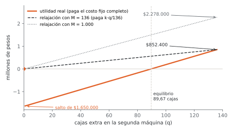

# Unidad 3 · Variables binarias II · costo fijo, gran M, K de N, lote mínimo y funciones por partes

**Qué vas a poder hacer.** Encender con una binaria un costo que se paga completo o no se paga,
acoplarlo a su cantidad con una gran M que justificas con los datos, imponer un lote mínimo, dejar
que el modelo decida qué restricciones rigen, restringir una variable a una lista de valores y
linealizar costos por tramos, secuenciar trabajos en máquinas con restricciones disyuntivas; y medir con
la relajación lineal cuánto te cuesta una M mal elegida.

**Lo que necesitas antes.** De la unidad 1, qué es la relajación lineal de un modelo entero y por qué
su valor es una cota. De la unidad 2, las binarias como decisiones de sí o no y las relaciones lógicas
básicas: implicación ($x_a \le x_b$), exclusión ($x_a + x_b \le 1$) y conteo ($\sum_j x_j \le k$). De
Optimización (unidad 7), escribir un modelo con conjuntos e índices y correrlo en OPL.

**Tiempo.** Unas 6 horas: 2,5 de lectura con OPL abierto y 3,5 de práctica.

---

## 1. La idea: costos que se pagan completos o no se pagan

Arrendar un carro para la feria, preparar un juego de moldes, encender un horno, abrir una bodega:
en todos hay dos costos distintos. Uno crece con lo que haces ($c$ por unidad). El otro se paga entero
por el solo hecho de empezar ($k$), hagas una unidad o mil. La función de costo real es

$$f(x) = \begin{cases} k + c\,x & \text{si } x > 0 \\ 0 & \text{si } x = 0 \end{cases}$$

Tiene un salto en el origen. Una función lineal no salta, y una convexa tampoco: la programación
lineal no puede representarla. La salida es una variable binaria que «enciende» el costo fijo.

Todo lo de esta unidad sale de la misma pieza: **una binaria que abre o cierra algo**. En costo fijo
abre una variable; en lote mínimo la abre y además le pone piso; en K de N abre o cierra una
restricción; en N valores elige un valor de una lista; en funciones por partes elige un tramo.

---

## 2. Costo fijo: la binaria de activación y el acoplamiento

**Las variables, con sus tres piezas.** En este ramo una variable está bien definida cuando trae su
índice con su rango, qué significa su valor (o su 1) y, si es binaria, qué significa el «en otro
caso». La naturaleza va aparte, en una línea que no se olvida.

- $x_j$: unidades de la actividad $j$ en el período, $\forall j \in J$.
- $y_j = 1$ si se habilita la actividad $j$ (y se paga su costo fijo $k_j$); $y_j = 0$ en otro caso,
  $\forall j \in J$.
- Naturaleza: $x_j \in \mathbb{Z}_0^+$ (o $x_j \ge 0$ si la cantidad es continua) e
  $y_j \in \{0,1\}$, $\forall j \in J$.

**El objetivo ya es lineal.** Con $m_j$ el margen por unidad:

$$\max \; z = \sum_{j \in J} \left( m_j\,x_j - k_j\,y_j \right)$$

**Falta el acoplamiento.** Nada obliga todavía a que $y_j$ valga 1 cuando $x_j > 0$: el modelo
pondría $y_j = 0$, produciría igual y no pagaría nada. La restricción que lo impide es

$$x_j \le M_j\, y_j \qquad \forall j \in J$$

Si $y_j = 0$, queda $x_j \le 0$: la actividad se cierra. Si $y_j = 1$, queda $x_j \le M_j$, que no
debe estorbar. **Por qué basta una dirección.** El caso «pago el costo fijo y no produzco»
($y_j = 1$, $x_j = 0$) es factible, pero el objetivo nunca lo elige: pagar por nada empeora $z$. Solo
si la binaria aparece también en otra restricción que la premie (un conteo «al menos tres líneas
abiertas») hay que agregar un piso, que es el lote mínimo de la sección 4.

---

## 3. Cómo elegir la gran M: válida y ajustada

Una M es **válida** si no corta ninguna solución factible: tiene que ser mayor o igual que el valor
más alto que $x_j$ puede tomar en cualquier solución que el resto del modelo permita. Es
**ajustada** si además es la más chica de las válidas. Se calcula con los datos, tomando la cota más
estrecha que tenga sentido físico:

$$M_j = \min\left\{ D_j,\; \min_{r \in R} \frac{b_r}{a_{rj}} \right\}$$

donde $D_j$ es lo que se vende como máximo, $b_r$ lo disponible del recurso $r$ y $a_{rj}$ lo que
consume una unidad de $j$ (solo los $a_{rj} > 0$).

**Si M es chica, el modelo miente.** Una $M_j$ menor que lo que de verdad cabe prohíbe soluciones
válidas y el «óptimo» es el de otro problema, más estrecho. No hay mensaje de error (ejercicio 3.2).

**Si M es enorme, el modelo se vuelve lento.** El óptimo entero no cambia, pero la relajación lineal
sí. Con $y_j$ continua entre 0 y 1, al modelo le conviene poner $y_j$ lo más chica posible:

$$y_j^{\text{rel}} = \frac{x_j}{M_j} \quad\Longrightarrow\quad \text{costo fijo que la relajación paga} = k_j\,\frac{x_j}{M_j}$$

O sea, la relajación reparte el costo fijo como si fuera un costo variable de $k_j/M_j$ por unidad.
Con $M_j$ ajustada y $x_j$ en su tope, paga el costo completo; con $M_j = 10^6$, casi no lo paga y la
cota queda lejos del óptimo entero. Esa distancia es el **gap** de la relajación, y es lo que decide
cuántos nodos explora la ramificación y acotamiento de la unidad 5.



**Una restricción por par es más ajustada que una por instalación.** Si un centro $i$ abastece a
varios clientes $j$, el acoplamiento agregado $\sum_j x_{ij} \le K_i\, y_i$ es correcto. La versión
desagregada $x_{ij} \le d_j\, y_i$ $\forall i, j$ describe las mismas soluciones enteras con más
restricciones, pero su relajación es más estrecha. La unidad 4 lo mide en localización de
instalaciones.

---

## 4. Lote mínimo: cero, o al menos L

Una máquina que arranca no hace tres unidades; un mayorista no despacha bajo cierto pedido. La
variable debe valer **cero o estar entre $L_j$ y $U_j$**: el conjunto $\{0\} \cup [L_j, U_j]$, un punto
suelto más un intervalo. Una variable así se llama semicontinua. Se escribe con una binaria y dos
desigualdades:

$$L_j\, y_j \;\le\; x_j \;\le\; U_j\, y_j \qquad \forall j \in J$$

Con $y_j = 0$ queda $0 \le x_j \le 0$: no se produce. Con $y_j = 1$ queda $L_j \le x_j \le U_j$. **Cada
mitad hace un trabajo distinto.** El techo $x_j \le U_j y_j$ es el que apaga: sin él, con $y_j = 0$ se
produce igual. El piso $L_j y_j \le x_j$ impone el mínimo: sin él, encender no obliga a nada. Y
$x_j \ge L_j$ a secas está mal por otra razón: elimina el cero, que tiene que seguir siendo posible.

El hueco entre 0 y $L_j$ es lo que rompe la convexidad: el punto medio entre $x_j = 0$ y $x_j = L_j$
es $L_j/2$, y no es factible. **La misma binaria sirve para tres cosas**: activa el lote mínimo, cobra
el costo fijo ($-k_j y_j$ en el objetivo) y cuenta líneas ($\sum_j y_j \le 2$). No inventes otra.

---

## 5. Elegir K de N restricciones

En programación lineal todas las restricciones rigen a la vez: la región factible es una
intersección. A veces las restricciones son **alternativas**: la planta opera con una tecnología o con
la otra; basta cumplir 3 de 5 normas. La región pasa a ser una unión, y deja de ser convexa.

**Apagar una restricción es aflojarla: se suma M al lado derecho, nunca se multiplica.** Con
$w_i = 1$ si la restricción $i$ se exige y $w_i = 0$ si se relaja, $\forall i \in I$:

$$\sum_{j} a_{ij}\,x_j \;\le\; b_i + M_i\,(1 - w_i) \qquad \forall i \in I, \qquad\qquad \sum_{i \in I} w_i = K$$

Con $w_i = 1$ rige la original; con $w_i = 0$ el lado derecho sube en $M_i$ y la restricción deja de
cortar. «Exactamente K» es la igualdad; «al menos K» es $\sum_i w_i \ge K$. Multiplicar el lado
derecho por la binaria ($\le b_i w_i$) hace lo contrario: con $w_i = 0$ la vuelve $\le 0$, más dura.

- **La M de cada restricción.** Para una restricción $\le$: $M_i = (\text{máximo del lado izquierdo en
  la caja de las variables}) - b_i$. Para una $\ge$ se relaja **restando**:
  $\sum_j a_{ij} x_j \ge b_i - M_i(1 - w_i)$, con $M_i = b_i - (\text{mínimo del lado izquierdo})$.
  Sin cotas en las variables no hay M válida: acota primero.
- **La convención.** En las láminas del curso suele usarse la binaria al revés ($y_i = 1$ si la
  restricción se relaja), y entonces el término es $+M_i\, y_i$ y el conteo $\sum_i y_i = N - K$. Las
  dos son correctas; mezclarlas no.
- **Dos modos completos, una sola binaria.** Si el modo A trae un grupo de restricciones y el modo B
  otro, una sola $w$ apaga a todo el grupo A y su complemento $1 - w$ a todo el B. Con una binaria por
  restricción el modelo mezclaría reglas de los dos modos.
- **Si el objetivo depende del modo, desdobla las variables.** Escribir el margen como
  $w \cdot m^B x + (1 - w)\, m^A x$ no es lineal. Se crean $x^A$ y $x^B$, cada grupo de restricciones
  sobre sus propias variables, y se apaga el modo no elegido con el patrón de costo fijo
  ($x^A \le U\,(1 - w)$, $x^B \le U\,w$). Ahí sí se multiplica: lo que se apaga es una variable, no una
  restricción compartida (ejercicio 3.6).

Fijar la binaria es quedarse en una rama, y ahí todo es lineal. Dejar que el modelo la elija es
quedarse con la unión de las ramas: eso es lo que se paga con la binaria.

---

## 6. Una variable con N valores posibles

El ancho de banda se compra en planes; un contenedor es de 20 o de 40 pies; una planta se diseña en
tres tamaños. La variable debe valer $d_1$ o $d_2$ o … o $d_N$, y solo uno de ellos. Con
$z_i = 1$ si se elige el valor $d_i$; $0$ en otro caso, $\forall i \in \{1,\dots,N\}$:

$$x = \sum_{i=1}^{N} d_i\, z_i, \qquad \sum_{i=1}^{N} z_i = 1, \qquad z_i \in \{0,1\}$$

La igualdad es la que obliga a elegir **exactamente uno**. Con $\le 1$ el modelo podría no elegir
ninguno y dejar $x = 0$ gratis; sin el conteo, podría prender dos y sumar un valor que no está en la
lista. Si «no hacer nada» es una opción legítima, entra como un valor más ($d_1 = 0$) y la igualdad
se mantiene. **Índice y valor no son lo mismo**: $d_i$ es un dato (cuántas unidades vale el nivel
$i$); $z_i$ es la decisión. Este patrón no usa gran M: es una suma ponderada de binarias.

Si un mismo nivel trae varias magnitudes (capacidad y costo), todas se escriben con **las mismas**
$z_i$: capacidad $= \sum_i d_i z_i$ y costo $= \sum_i c_i z_i$. Así cambian juntas.

---

## 7. Funciones lineales por partes

Un costo con pendientes distintas por tramo (tarifas escalonadas, horas extra, descuentos por
volumen) se escribe con una variable por tramo. Con anchos $w_1, w_2, \dots$ y precios
$p_1, p_2, \dots$: $q = q_1 + q_2 + q_3$, costo $= p_1 q_1 + p_2 q_2 + p_3 q_3$, $0 \le q_s \le w_s$.

**Cuándo hacen falta binarias.** Depende de la forma de la función y del sentido del objetivo:

| Función de costo | Ejemplo | En un mínimo |
|---|---|---|
| Convexa: pendientes que suben | horas normales, recargo, horas extra | el modelo llena primero el tramo barato, que es el primero: **no hacen falta binarias** |
| Cóncava: pendientes que bajan | descuento incremental, economías de escala | el modelo querría llenar primero el tramo barato, que es el último: **hacen falta binarias** que impongan el orden |

Las binarias del orden, con $u_s = 1$ si se empieza a usar el tramo $s$; $0$ en otro caso:

$$q_1 \ge w_1\,u_2, \qquad q_2 \le w_2\,u_2, \qquad q_2 \ge w_2\,u_3, \qquad q_3 \le M_3\,u_3, \qquad u_3 \le u_2$$

Se lee así: no se entra al tramo 2 sin llenar el 1, ni al 3 sin llenar el 2 (ejercicio 3.7).

**SOS2, como mención.** La otra forma escribe $x$ como mezcla de los puntos de quiebre $a_k$:
$x = \sum_k \lambda_k a_k$, $f = \sum_k \lambda_k f(a_k)$, $\sum_k \lambda_k = 1$, $\lambda_k \ge 0$, con la
condición de que a lo más dos $\lambda$ consecutivas sean positivas. Esa condición se llama SOS2
(*special ordered set* de tipo 2) y el solver la maneja en su ramificación sin binarias explícitas.
OPL lo hace por ti con `piecewise`: le das las pendientes y los quiebres, y CPLEX agrega lo que haga
falta si la función no es convexa.

---

## 8. Descuentos por volumen

Hay dos clases, y se modelan distinto:

- **Incremental (por tramos).** Cada tramo se paga a su precio, como los tramos de un impuesto. Es la
  función por partes de la sección 7: continua y cóncava, con binarias de orden.
- **Sobre todas las unidades.** Si llegas al tramo, **todas** las unidades se pagan a ese precio. La
  función salta hacia abajo en cada quiebre: no es continua. Se modela como N valores de tramo con lote
  mínimo: con $v_s = 1$ si la compra cae en el tramo $s$; $0$ en otro caso, y $q_s$ la cantidad comprada
  en ese tramo,

$$\text{desde}_s\,v_s \;\le\; q_s \;\le\; \text{hasta}_s\,v_s \quad \forall s, \qquad \sum_s v_s = 1, \qquad \text{costo} = \sum_s p_s\,q_s$$

En un descuento sobre todas las unidades **comprar más puede costar menos**: si te falta poco para el
tramo siguiente, conviene saltar (ejercicio 3.8).

---

## 9. Programación de máquinas con gran M

Hasta acá la binaria decidía **qué** hacer. En programación de máquinas decide **en qué orden**. Un
**flow shop** es un taller donde todos los trabajos pasan por las mismas máquinas en el mismo orden
(imprimir y después encuadernar; cortar, soldar y pintar). Cada máquina hace un trabajo a la vez, sin
interrumpirlo, y se conoce el tiempo $p_{jk}$ del trabajo $j$ en la máquina $k$. El objetivo más común
es el **makespan** $C_{\max}$: la hora en que termina el último trabajo.

**Las variables, con sus tres piezas.** Con $J$ los trabajos y $K = \{1, \dots, m\}$ las máquinas, en
el orden en que se recorren:

- $s_{jk}$: hora de inicio del trabajo $j$ en la máquina $k$, $\forall j \in J,\; k \in K$.
- $z_{ijk} = 1$ si el trabajo $i$ va antes que el $j$ en la máquina $k$; $z_{ijk} = 0$ si $j$ va antes
  que $i$, $\forall i, j \in J,\; i < j,\; k \in K$.
- $C_{\max}$: makespan.
- Naturaleza: $s_{jk} \ge 0$, $z_{ijk} \in \{0,1\}$, $C_{\max} \ge 0$.

**El modelo.**

$$\begin{aligned}
&\min\; C_{\max}\\
&s_{j,k+1} \ge s_{jk} + p_{jk} && \forall j \in J,\; k < m\\
&s_{ik} + p_{ik} \le s_{jk} + M\,(1 - z_{ijk}) && \forall i, j \in J,\; i < j,\; k \in K\\
&s_{jk} + p_{jk} \le s_{ik} + M\, z_{ijk} && \forall i, j \in J,\; i < j,\; k \in K\\
&C_{\max} \ge s_{jm} + p_{jm} && \forall j \in J
\end{aligned}$$

La primera es la **ruta**: un trabajo pasa a la máquina siguiente cuando terminó en la anterior. La
segunda y la tercera son la **disyunción**: con $z_{ijk} = 1$ rige «$i$ antes que $j$», con
$z_{ijk} = 0$ rige «$j$ antes que $i$». La última acota el makespan con el término de cada trabajo en
la última máquina.

**La disyunción es la K de N de la sección 5.** Para cada par de trabajos y cada máquina hay dos
restricciones candidatas, «$i$ antes que $j$» o «$j$ antes que $i$», y debe regir exactamente una.
Una sola binaria y su complemento apagan la otra sumándole $M$, como en los modos de operación. La
binaria no multiplica el lado derecho: le suma $M$ a la restricción que no rige.

**La M de la disyunción.** Tiene que ser mayor que cualquier diferencia de horas que pueda aparecer.
La suma de todos los tiempos, $\sum_j \sum_k p_{jk}$, sirve: un programa óptimo nunca termina después
de hacer todo uno detrás de otro. Con una M así la relajación lineal es muy floja: con $z = 0{,}5$ las dos
desigualdades quedan sueltas y la cota cae a la duración del trabajo más largo. Por eso los modelos de
secuencia con gran M cuestan tanto de resolver cuando crecen.

**Otras formas y parientes.**

- **Variables de posición.** La lámina del curso usa $x_{ijk} = 1$ si el trabajo $i$ ocupa la posición
  $j$ en la máquina $k$: una asignación por máquina más tiempos de término. Describe lo mismo con otra
  pieza; la disyuntiva es la que conecta con la gran M de esta unidad.
- **Mismo orden en todas las máquinas.** El modelo disyuntivo deja que cada máquina tenga su propio
  orden. Con dos o tres máquinas y makespan, siempre hay un óptimo con el mismo orden en todas (un
  flow shop de permutación), y por eso basta probar las $n!$ secuencias.
- **Job shop, como mención.** Si cada trabajo tiene su propia ruta de máquinas, la restricción de
  ruta sigue el orden de cada trabajo y las disyunciones quedan iguales. Es mucho más difícil de
  resolver.
- **Dos máquinas: la regla de Johnson.** Con dos máquinas en serie y makespan, la regla de Johnson
  (Gestión de Operaciones, unidad 10) da un óptimo sin modelo: los trabajos con su menor tiempo en la
  máquina 1 van adelante, en orden creciente de ese tiempo; los que lo tienen en la máquina 2 van al
  final, en orden decreciente.

**Un ejemplo chico · La encuadernadora.** Una imprenta tiene cuatro libros (L1 a L4) que pasan por
impresión y después por encuadernación. Tiempos en horas:

| | L1 | L2 | L3 | L4 |
|---|---|---|---|---|
| Impresión | 6 | 3 | 5 | 2 |
| Encuadernación | 2 | 7 | 4 | 5 |

El `.mod` (`modelos/u03_flowshop.mod`) calcula la M desde los datos ($M = 34$) y tiene 12 binarias
(6 pares de libros por 2 máquinas):

```opl
/*********************************************
 * Unidad 3 · Programación de máquinas con gran M
 * Flow shop: todos los trabajos pasan por las máquinas en el mismo orden.
 * Restricciones disyuntivas con gran M; se minimiza el makespan.
 * Datos en u03_flowshop.dat. Base abierta de ingeniería.
 *********************************************/

{string} Trabajos = ...;
{string} Maquinas = ...;              // en el orden en que se recorren

float p[Trabajos][Maquinas] = ...;    // horas del trabajo j en la máquina k

// gran M: si todo se hiciera uno detrás de otro, nada termina después de la suma de tiempos
float M = sum(j in Trabajos, k in Maquinas) p[j][k];

dvar float+  s[Trabajos][Maquinas];          // hora de inicio del trabajo j en la máquina k
dvar boolean z[Trabajos][Trabajos][Maquinas]; // 1 si i va antes que j en la máquina k; 0 si j va antes
dvar float+  Cmax;                            // makespan: hora en que termina el último trabajo

minimize Cmax;

subject to {
  // ruta: un trabajo pasa a la máquina siguiente solo cuando terminó en la anterior
  forall(j in Trabajos, k in Maquinas: k != last(Maquinas))
    Ruta:
      s[j][next(Maquinas, k)] >= s[j][k] + p[j][k];
  // disyunción: en cada máquina, i antes que j o j antes que i
  forall(i in Trabajos, j in Trabajos, k in Maquinas: ord(Trabajos, i) < ord(Trabajos, j)) {
    Antes:
      s[i][k] + p[i][k] <= s[j][k] + M * (1 - z[i][j][k]);
    Despues:
      s[j][k] + p[j][k] <= s[i][k] + M * z[i][j][k];
  }
  // el makespan no es menor que el término de ningún trabajo en la última máquina
  forall(j in Trabajos)
    Fin:
      Cmax >= s[j][last(Maquinas)] + p[j][last(Maquinas)];
}

execute {
  writeln("makespan = ", Cmax);
  for (var k in Maquinas) {
    var orden = "";
    var usados = new Array();
    for (var paso = 1; paso <= Trabajos.size; paso++) {
      var mejor = "";
      for (var j in Trabajos)
        if (usados[j] != 1 && (mejor == "" || s[j][k] < s[mejor][k])) mejor = j;
      usados[mejor] = 1;
      orden = orden + (paso > 1 ? "-" : "") + mejor;
    }
    writeln("orden[", k, "] = ", orden);
  }
}
```

```opl
// Unidad 3 · sección 9 · encuadernadora: impresión y luego encuadernación (horas)

Trabajos = {"L1", "L2", "L3", "L4"};
Maquinas = {"impresion", "encuadernacion"};

p = [
  [6 2]     // L1
  [3 7]     // L2
  [5 4]     // L3
  [2 5]     // L4
];
```

**La corrida y las comparaciones.**

| Camino | Secuencia | Makespan |
|---|---|---|
| OPL con el modelo disyuntivo | L4, L3, L2, L1 (la misma en las dos máquinas) | 20 h |
| Regla de Johnson | L4, L2, L3, L1 | 20 h |
| Fuerza bruta sobre las 24 secuencias | 3 secuencias de 24 llegan a 20 h | mínimo 20 h |
| El orden en que llegaron los pedidos | L1, L2, L3, L4 | 25 h |
| La peor secuencia | | 27 h |
| Relajación lineal del modelo disyuntivo | | 10 h |

Las tres secuencias óptimas son L4, L2, L1, L3; L4, L2, L3, L1 y L4, L3, L2, L1.

**Cómo se lee.** El makespan de 20 h no se puede mejorar con ninguna secuencia: la encuadernación
suma 18 h de trabajo y no puede empezar antes de que se imprima el primer libro, que como mínimo toma
2 h (L4). Johnson y el modelo llegan a secuencias distintas con el mismo makespan: hay empates, y cada
método rompe el empate a su manera. Ordenar bien ahorra 5 h frente al orden de llegada. La relajación
lineal (10 h, la duración de L2) muestra lo floja que queda la gran M de las disyunciones: cota y
óptimo se separan a la mitad, aunque el problema tenga cuatro trabajos.

---
## 10. Cuándo NO aplica

- **Si el costo fijo ya está pagado o no se puede evitar**, no es una decisión: no lleva binaria.
- **Si la condición se conoce antes de resolver** («este mes el acero está bajo»), es un parámetro:
  se cambia el dato y se resuelve otro escenario, sin binarias nuevas.
- **Si la variable no tiene cota**, no existe M válida. Busca primero una cota física (demanda,
  capacidad, presupuesto); si no la hay, el modelo está mal planteado.
- **Una función convexa en un mínimo** (o cóncava en un máximo) no necesita binarias: agregarlas solo
  vuelve lento el modelo.
- **Muchas binarias con M flojas** vuelven intratable un modelo que con M ajustadas resuelve en
  segundos. Antes de culpar al solver, revisa tus M.

---

## 11. Ejemplo resuelto · Taller de velas de soya

Un taller de Valdivia hace tres líneas de velas: en **frasco**, **pilar** y **derretibles**. Preparar
una línea en la semana (limpiar moldes, templar la cera, montar mechas) tiene un costo fijo que se
paga completo, haga una vela o trescientas. Además, el molde de cada línea rinde un mínimo de velas
por tanda.

| | Frasco | Pilar | Derretible | Disponible en la semana |
|---|---|---|---|---|
| Margen por vela | $3.190 | $2.530 | $1.045 | |
| Costo fijo de preparar la línea | $70.400 | $24.200 | $30.800 | |
| Cera (kg/vela) | 0,32 | 0,30 | 0,08 | 132 kg |
| Vertido (min/vela) | 6 | 4 | 2 | 2.640 min |
| Se venden como máximo | 330 | 198 | 660 | |
| Lote mínimo si se prepara | 66 | 132 | 165 | |

**Paso 1 · En palabras.** Se decide qué líneas preparar y cuántas velas hacer en cada una. Se busca la
mayor utilidad: margen de las velas menos los costos fijos de las líneas preparadas. Limitan la cera,
los minutos de vertido y lo que se vende; una línea no preparada no produce, y una preparada hace al
menos su lote mínimo.

**Paso 2 · Conjuntos, parámetros y variables.** $V = \{\text{frasco}, \text{pilar}, \text{derretible}\}$,
con índice $v$; $R = \{\text{cera}, \text{vertido}\}$, con índice $r$. Parámetros: $m_v$, $k_v$,
$a_{rv}$, $b_r$, $D_v$, $L_v$ y $M_v$ (la cota del paso 4).

- $x_v$: velas de la línea $v$ que se hacen en la semana, $\forall v \in V$.
- $y_v = 1$ si se prepara la línea $v$ (se paga $k_v$ y rige su lote mínimo); $y_v = 0$ en otro caso,
  $\forall v \in V$.

**Paso 3 · El modelo.**

$$\max\; z = \sum_{v \in V} \left( m_v\,x_v - k_v\,y_v \right)$$

$$\begin{aligned}
&\textstyle\sum_{v \in V} a_{rv}\, x_v \le b_r && \forall r \in R && \text{(recursos)}\\
&x_v \le D_v && \forall v \in V && \text{(demanda)}\\
&x_v \le M_v\, y_v && \forall v \in V && \text{(techo: sin línea no hay velas)}\\
&x_v \ge L_v\, y_v && \forall v \in V && \text{(piso: lote mínimo)}\\
&x_v \in \mathbb{Z}_0^+,\; y_v \in \{0,1\} && \forall v \in V && \text{(naturaleza)}
\end{aligned}$$

**Paso 4 · La M ajustada de cada línea.** Lo máximo que cabe de cada vela, mirando una restricción a la
vez:

| Línea | Demanda | Por cera ($132/a$) | Por vertido ($2{.}640/a$) | $M_v$ = el menor |
|---|---|---|---|---|
| Frasco | 330 | 412,5 | 440 | 330 |
| Pilar | 198 | 440 | 660 | 198 |
| Derretible | 660 | 1.650 | 1.320 | 660 |

Acá manda la demanda en las tres líneas. Si el pilar se vendiera sin límite, su M sería 440 (la
cera).

**Paso 5 · El `.mod`** (`modelos/u03_velas.mod`). La M no se escribe a mano: el modelo la calcula
desde los datos con `minl` (el menor de una lista) y `min(r in Recursos)`.

```opl
/*********************************************
 * Unidad 3 · Ejemplo resuelto
 * Taller de velas: costo fijo de moldes, gran M ajustada y lote mínimo
 * Datos en u03_velas.dat. Base abierta de ingeniería.
 *********************************************/

{string} Velas    = ...;
{string} Recursos = ...;

float margen[Velas]        = ...;   // CLP por vela
float fijo[Velas]          = ...;   // CLP por semana si se prepara la línea
float uso[Recursos][Velas] = ...;   // kg de cera o minutos de vertido por vela
float disp[Recursos]       = ...;   // kg o minutos por semana
float demanda[Velas]       = ...;   // velas que se venden como máximo
float minimo[Velas]        = ...;   // lote mínimo si se prepara la línea

// gran M ajustada: lo máximo que cabe de cada vela, mirando demanda y recursos
float M[v in Velas] = minl(demanda[v], min(r in Recursos) disp[r] / uso[r][v]);

dvar int+    x[Velas];              // velas de cada línea en la semana
dvar boolean y[Velas];              // 1 si se prepara la línea v; 0 en otro caso

dexpr float Utilidad = sum(v in Velas) (margen[v] * x[v] - fijo[v] * y[v]);

maximize Utilidad;

subject to {
  forall(r in Recursos)
    Recurso:
      sum(v in Velas) uso[r][v] * x[v] <= disp[r];
  forall(v in Velas)
    Demanda:
      x[v] <= demanda[v];
  forall(v in Velas)
    Techo:
      x[v] <= M[v] * y[v];
  forall(v in Velas)
    Piso:
      x[v] >= minimo[v] * y[v];
}

execute {
  writeln("utilidad = ", Utilidad);
  for (var v in Velas) {
    writeln("M[", v, "] = ", M[v]);
    writeln("x[", v, "] = ", x[v]);
    writeln("y[", v, "] = ", y[v]);
  }
}
```

**Paso 6 · El `.dat`** (`modelos/u03_velas.dat`):

```opl
// Unidad 3 · ejemplo resuelto · datos del taller de velas (una semana)

Velas    = {"frasco", "pilar", "derretible"};
Recursos = {"cera", "vertido"};

margen  = [3190 2530 1045];
fijo    = [70400 24200 30800];

uso = [
  [0.32 0.30 0.08]      // cera (kg/vela)
  [6    4    2   ]      // vertido (min/vela)
];

disp    = [132 2640];     // 132 kg de cera y 2.640 min de vertido
demanda = [330 198 660];
minimo  = [66 132 165];
```

**Paso 7 · Correr y leer.** `python herramientas/opl.py` sobre el modelo imprime
`OBJECTIVE: 1296350` y:

```text
utilidad = 1296350
M[frasco] = 330
x[frasco] = 330
y[frasco] = 1
M[pilar] = 198
x[pilar] = 0
y[pilar] = 0
M[derretible] = 660
x[derretible] = 330
y[derretible] = 1
```

El plan: **330 velas de frasco y 330 derretibles, sin pilar**, con utilidad $1.296.350. Se usan los
132 kg de cera y los 2.640 minutos de vertido: los dos recursos aprietan.

**Paso 8 · Qué hace cada pieza.** Tres corridas más del mismo modelo (el verificador las repite en
OPL y en Python):

| Variante | Plan (frasco, pilar, derretible) | Valor | Lectura |
|---|---|---|---|
| El modelo entero | 330, 0, 330 | $1.296.350 | el óptimo real |
| Sin el piso del lote mínimo | 153, 101, 659 | $1.306.855 | haría 101 pilares, menos que su lote de 132: no se puede |
| Relajación lineal con M ajustada | 152,31, 101,54, 660 | $1.356.751 | cota superior; gap 4,7 % |
| Relajación lineal con $M = 10{.}000$ | 152,31, 101,54, 660 | $1.429.103 | cota superior; gap 10,2 % |
| Programación lineal sin costos fijos | igual | $1.432.454 | lo que vería quien ignora los costos fijos |

**Cómo se lee.**

- **El costo fijo cambia el plan, no solo su valor.** Sin costos fijos, la mezcla haría un poco de las
  tres velas. Con ellos, preparar el pilar para un centenar de velas no paga sus $24.200 más lo que
  desplaza, y además el molde exige 132: el pilar sale del plan.
- **El lote mínimo también decide.** Sin el piso, el óptimo haría 101 pilares. Con el piso, esos 101
  no existen como opción, y el plan cambia entero: más frascos (hasta su demanda) y la mitad de
  derretibles.
- **La M decide la calidad de la cota.** En la relajación con M ajustada, $y_{\text{frasco}} = 0{,}462$
  y $y_{\text{pilar}} = 0{,}513$: paga el 46 % del costo fijo del frasco, $32.492 de $70.400. Con
  $M = 10{.}000$, $y_{\text{derretible}} = 0{,}066$: paga $2.033 de $30.800. Esa relajación casi ignora
  los costos fijos ($1.429.103 contra $1.432.454 de la que no los tiene) y su gap se duplica. Los dos
  modelos tienen el mismo óptimo entero; el de M grande tarda más en probarlo.
- **Decisión.** Esta semana no se prepara el pilar. Si se quiere vender pilar, hay que negociar un
  molde con lote menor o juntar pedidos hasta pasar las 132 velas.

---

## 12. Errores típicos

| Error | Cómo evitarlo |
|---|---|
| Definir la variable sin sus tres piezas («$y$: si se produce») | índice con su rango, qué significa el 1 y qué significa el 0: «$y_v = 1$ si se prepara la línea $v$; 0 en otro caso, $\forall v \in V$» |
| Olvidar la línea de naturaleza | al final, siempre: $x_v \in \mathbb{Z}_0^+$, $y_v \in \{0,1\}$, con su $\forall$ |
| Escribir una familia de restricciones sin su $\forall$ | cada restricción que se repite lleva su «para todo»; sin él no se sabe cuántas son |
| Acoplar con «$M$ grande» sin justificar, o con $10^6$ | calcula $M_j = \min\{D_j, b_r / a_{rj}\}$; escribe de dónde sale |
| Usar una M menor que lo que cabe | la M es válida solo si no corta soluciones factibles; chica, el óptimo es de otro problema |
| Lote mínimo como $x_j \ge L_j$ a secas | elimina el cero; va $L_j y_j \le x_j \le U_j y_j$ |
| Lote mínimo con solo el piso o solo el techo | sin techo no apaga; sin piso no impone el mínimo; van las dos |
| Apagar una restricción multiplicando su lado derecho por la binaria | se suma $M_i(1 - w_i)$; multiplicar la endurece |
| Relajar una restricción $\ge$ sumando M | una $\ge$ se relaja restando: $\ge b_i - M_i(1 - w_i)$ |
| Mezclar convenciones en K de N | si $w_i = 1$ es «se exige», el conteo es $\sum w_i = K$; si es «se relaja», $\sum w_i = N - K$ |
| Una binaria por restricción para elegir entre dos modos | una sola binaria por grupo; si no, el modelo mezcla reglas de los dos modos |
| Escribir el margen que depende del modo como $w \cdot x$ | desdobla las variables por modo y apaga el modo no elegido |
| $\sum_i z_i \le 1$ en una variable con N valores | es $= 1$; si «no hacer nada» vale, agrégalo como un valor $d_1 = 0$ |
| Cobrar el costo fijo por unidad ($k_j x_j$) | el costo fijo va con la binaria, $k_j y_j$ (ejercicio 3.10) |
| Secuenciar con una binaria por restricción disyuntiva, o sin la restricción de ruta | una binaria por par de trabajos y máquina, con su complemento; y la ruta $s_{j,k+1} \ge s_{jk} + p_{jk}$ para cada trabajo |
| Linealizar una función cóncava en un mínimo sin binarias de orden | el modelo llenaría primero el tramo barato del final; agrega las binarias o usa `piecewise` |

---

## 13. Práctica

Diez ejercicios: 3.1 a 3.4 básicos, 3.5 a 3.8 intermedios, 3.9 y 3.10 de desafío. Las pautas están en
la sección 14. En cada modelo escribe las variables con sus tres piezas, cada restricción con su
$\forall$ y la línea de naturaleza.

**3.1 · El segundo carro de sopaipillas (básico).** Para la feria del domingo, un carro de sopaipillas
puede arrendar un segundo carro: arriendo, gas y permiso suman $26.000 y se pagan completos. Cada
sopaipilla deja \$310 de margen y el segundo carro alcanza a freír 140 en la jornada. (a) Define las
variables con sus tres piezas y escribe el modelo con gran M. (b) ¿Qué M usas y por qué? (c) ¿Desde
cuántas sopaipillas conviene arrendar? (d) ¿Se arrienda y cuánto se gana? (e) Si la feria solo deja
vender 80 sopaipillas en el segundo carro, ¿qué cambia?

**3.2 · Una M que corta (básico).** Un taller de bicicletas arma kits urbanos y de montaña. Preparar la
línea de cada kit en el mes cuesta $86.000 y $137.000; el margen es $7.300 y $10.600 por kit; cada kit
usa 1,6 h y 2,4 h de armado, de 412 h disponibles; se venden hasta 236 urbanos y 118 de montaña.
(a) Calcula la M ajustada de cada kit. (b) Resuelve el modelo entero. (c) Un compañero usó $M = 150$
para el urbano «porque es un número redondo». Resuelve su modelo: ¿qué plan da y cuánto se pierde?
(d) ¿Por qué ningún mensaje de OPL avisa el error?

**3.3 · Tres trabajos, tres máquinas (básico).** Una maestranza tiene tres trabajos (A, B y C) que pasan
por corte, soldadura y pintura, en ese orden. Tiempos en horas: A tarda 4, 2 y 5; B tarda 3, 6 y 2; C
tarda 2, 4 y 3. (a) Calcula el makespan de las seis secuencias (la misma en las tres máquinas) y elige
la mejor. (b) Escribe las dos restricciones disyuntivas de A y B en la soldadura, con su binaria
definida en tres piezas y una M que justifiques con los datos. (c) La relajación lineal del modelo
disyuntivo da 11 h. ¿Por qué es tan baja?

**3.4 · Potencia contratada (básico).** Una amasandería contrata potencia eléctrica en planes de 10, 20,
30 o 50 kW, con cargos fijos mensuales de $18.000, $31.000, $43.000 y $66.000; debe contratar uno y su
peak de consumo es 26 kW. (a) Formula la elección del plan como una variable con N valores y
resuélvela. (b) Si hornea de noche el pan del día siguiente, el peak baja a 19 kW, pero el turno de
noche cuesta $9.000 al mes. Agrega esa decisión con una binaria y di si conviene.

**3.5 · Tres de cuatro (intermedio).** Maximiza $z = 4x_1 + 3x_2$ con $0 \le x_1, x_2 \le 9$ y estas
candidatas: R1: $x_1 + x_2 \le 7$; R2: $3x_1 + x_2 \le 15$; R3: $x_1 + 4x_2 \le 20$; R4:
$x_2 - x_1 \ge 1$. Deben cumplirse **al menos tres**. (a) Formula con $w_i = 1$ si la restricción $i$
se exige. (b) Calcula la M ajustada de cada una (cuidado con R4). (c) Resuelve: ¿cuál se relaja y
cuánto vale $z$? Compara con exigir las cuatro.

**3.6 · PLA o PETG (intermedio).** Un taller de impresión 3D hace soportes y carcasas, y cada semana
imprime con un solo filamento (cambiar la boquilla toma un día). Tiene 126 h de impresora y vende
hasta 160 soportes y 84 carcasas.

| | Modo PLA | Modo PETG |
|---|---|---|
| Horas por soporte · por carcasa | 0,75 · 1,45 | 1,05 · 1,9 |
| Margen por soporte · por carcasa | $2.350 · $4.150 | $2.350 · $5.650 |
| Condición propia del modo | carcasas a lo más 48 (solo interior) | al menos 32 carcasas (pedido comprometido) y soportes a lo más 66 |

(a) Explica por qué basta una sola binaria. (b) El margen de la carcasa depende del modo: formula
el modelo desdoblando las variables. (c) Resuelve (`modelos/u03_e06_impresion.mod`) y compara los dos
modos.

**3.7 · Cera con descuento por tramos (intermedio).** El proveedor de cera cobra los primeros 200 kg a
$1.900 el kg, del 201 al 500 a $1.600 y sobre 500 a $1.350, cada tramo a su precio. La bodega recibe
como máximo 1.000 kg. (a) ¿Cuánto cuesta comprar 640 kg y cuál es el precio promedio? (b) Formula el
costo con $q_1, q_2, q_3$ y binarias de orden. (c) Sin las binarias, ¿qué costo daría el modelo para
640 kg y por qué está mal? (d) Si en vez de un descuento fuera un recargo (horas extra que suben de
precio), ¿harían falta las binarias? (e) Escribe la misma función con `piecewise` en OPL.

**3.8 · Tela polar sobre todas las unidades (intermedio).** Una tienda necesita al menos 280 m de tela
polar. El mayorista cobra $3.200 el metro si la compra es menor que 300 m, $2.900 entre 300 y 599 m y
$2.650 desde 600 m, a **todas** las unidades. (a) Formula la compra con un tramo por binaria. (b)
¿Cuánto se compra y cuánto cuesta? (c) ¿Desde cuántos metros necesarios conviene saltar a 300?

**3.9 · Kombucha de tres sabores (desafío).** Una fábrica de kombucha decide la semana. Cada sabor que
fermenta tiene un costo fijo (inóculo y limpieza) y un lote mínimo; el embotellado se contrata en uno
de tres turnos, y por espacio de fermentadores se hacen **a lo más dos sabores**.

| | Jengibre | Frambuesa | Maqui |
|---|---|---|---|
| Margen por litro | $1.150 | $1.480 | $1.720 |
| Costo fijo semanal | $47.000 | $63.000 | $98.000 |
| Lote mínimo (L) | 320 | 260 | 210 |
| Demanda máxima (L) | 880 | 690 | 470 |

| Turno de embotellado | Simple | Extendido | Doble |
|---|---|---|---|
| Litros por semana | 1.250 | 1.750 | 2.300 |
| Costo fijo semanal | $0 | $165.000 | $385.000 |

(a) Formula el modelo completo y córrelo (`modelos/u03_e09_kombucha.mod`). (b) ¿Cuánto vale la regla
de «a lo más dos sabores»? (c) Si la demanda de frambuesa cae a 230 L, ¿qué pasa? (d) Calcula la
relajación lineal con la M ajustada (la demanda) y con $M = 10{.}000$, y el gap de cada una.

**3.10 · Corrige pieza por pieza (desafío).** Una mueblería hace bancas y mesas de terraza. Datos:
margen $21.400 y $33.800; costo fijo de la matriz de corte $147.000 y $212.000; soldadura 1,25 h y
2,05 h por unidad (316 h al mes); pintura 0,55 h y 1,4 h (149 h); demanda máxima 174 y 88; lote mínimo
42 y 28. Un estudiante entrega:

> $y_i$: si se produce el mueble.
> $\max\; z = \sum_i (m_i - k_i)\, x_i$
> s.a. $\sum_i a_{ri}\, x_i \le b_r$; $\quad x_i \le 95\, y_i$; $\quad x_i \ge L_i \;\; \forall i$

Encuentra cada error, di qué pieza falla (variable, objetivo, restricción, $\forall$, naturaleza) y
corrige el modelo. Resuelve el modelo correcto y mide el efecto de dos errores: la M de 95 y el
objetivo.

---

## 14. Pautas

**3.1.** (a) $q$: sopaipillas que se fríen en el segundo carro el domingo. $y = 1$ si se arrienda el
segundo carro; 0 en otro caso. Modelo: $\max\; 310\,q - 26{.}000\,y$ s.a. $q \le 140\,y$;
$q \in \mathbb{Z}_0^+$, $y \in \{0,1\}$. (b) $M = 140$, lo que el carro alcanza a freír: es la cota
física más chica. (c) El arriendo se paga desde $26{.}000/310 = 83{,}87$: hay que vender al menos 84.
(d) Sí: $310 \cdot 140 - 26{.}000$ deja $17.400. (e) Con 80 sopaipillas el margen es $24.800, menos
que el arriendo: arrendar perdería $1.200. El modelo pone $y = 0$ y $q = 0$. El punto de equilibrio es
lo que hay que comparar con lo que se puede vender, no con lo que se puede freír.

**3.2.** (a) Urbano: $\min\{236,\; 412/1{,}6 = 257{,}5\} = 236$. Montaña:
$\min\{118,\; 412/2{,}4 = 171{,}67\} = 118$. (b) El urbano deja $4.562,5 por hora de armado y el de
montaña $4.416,7: se llena primero el urbano. El óptimo entero arma 235 urbanos y 15 de montaña, con
utilidad $1.651.500 (las 412 h justas; con 236 urbanos sobrarían horas que no alcanzan para un kit
más de montaña). (c) Con $M = 150$ el modelo arma 148 urbanos y 73 de montaña: $1.631.200, $20.300 menos.
(d) Porque el modelo con M chica es factible y tiene óptimo: es el óptimo de otro problema, uno donde
no se pueden armar más de 150 urbanos. Solo se detecta revisando de dónde salió cada M.

**3.3.** (a) Makespan de cada secuencia, simulando el taller:

| Secuencia | Makespan (h) |
|---|---|
| ABC | 20 |
| ACB | 18 |
| BAC | 19 |
| BCA | 21 |
| CAB | 17 |
| CBA | 19 |

La mejor es C, A, B con 17 h, y es la única con ese valor. (b) $z_{AB,2} = 1$ si A va antes que B en la
soldadura; $z_{AB,2} = 0$ si B va antes que A; $z_{AB,2} \in \{0,1\}$.
$s_{A2} + 2 \le s_{B2} + M(1 - z_{AB,2})$ y $s_{B2} + 6 \le s_{A2} + M\, z_{AB,2}$, con
$M = 31$, la suma de los nueve tiempos: ningún trabajo empieza después de que todo se hizo en fila.
(c) Con $z$ fraccionarias las dos disyuntivas quedan sueltas a la vez y solo pesan las rutas: la cota
es la duración del trabajo más largo (B, 11 h), lejos de los 17 h. Lectura: la gran M de las
disyunciones es válida pero deja una relajación muy floja.

**3.4.** (a) $z_i = 1$ si se contrata el plan $i$; 0 en otro caso, $\forall i \in \{1,2,3,4\}$. Modelo:
$\min\; 18{.}000 z_1 + 31{.}000 z_2 + 43{.}000 z_3 + 66{.}000 z_4$ s.a. $\sum_i z_i = 1$ (exactamente un
plan) y $10 z_1 + 20 z_2 + 30 z_3 + 50 z_4 \ge 26$ (la potencia cubre el peak); $z_i \in \{0,1\}$. Se
contrata el plan de 30 kW por $43.000. (b) $h = 1$ si se hornea de noche; 0 en otro caso. El objetivo
suma $9{.}000\,h$ y la cobertura pasa a $\sum_i d_i z_i \ge 26 - 7h$. Con el turno de noche basta el
plan de 20 kW: $31.000 + $9.000 = $40.000, $3.000 menos al mes. Conviene.

**3.5.** (a) $\max\; 4x_1 + 3x_2$ s.a. $x_1 + x_2 \le 7 + M_1(1 - w_1)$; $3x_1 + x_2 \le 15 + M_2(1 - w_2)$;
$x_1 + 4x_2 \le 20 + M_3(1 - w_3)$; $x_2 - x_1 \ge 1 - M_4(1 - w_4)$; $\sum_{i=1}^4 w_i \ge 3$;
$0 \le x_1, x_2 \le 9$; $w_i \in \{0,1\}$ $\forall i$. (b) Con la caja: $M_1 = 18 - 7$, o sea $M_1 = 11$,
$M_2 = 36 - 15$, o sea $M_2 = 21$, y $M_3 = 45 - 20$, o sea $M_3 = 25$. R4 es $\ge$: su lado izquierdo
baja hasta $0 - 9 = -9$, así que $M_4 = 1 - (-9)$, es decir $M_4 = 10$, y se resta. (c) Con las cuatro,
$z = 24$ en $(3; 4)$. Relajando de a una: sin R1, $z = 25{,}4$; sin R2, 24; sin R3, 24; sin R4, 25. El
óptimo relaja R1 y llega a $z = 25{,}4$ en (3,2; 4,2), donde R3 y R4 quedan activas. Relajar R2 o R3
no sirve: no eran las que cortaban.

**3.6.** (a) Una sola $w$ ($w = 1$ si la semana se imprime en PETG; 0 si en PLA) porque el modo es una
decisión de toda la semana: con una binaria por restricción el modelo podría usar las horas del PLA
con el pedido del PETG. (b) $x_{mp}$: piezas $p$ hechas en el modo $m$, $\forall m \in \{\text{PLA},
\text{PETG}\}$, $\forall p$. Cada modo con sus restricciones sobre sus variables, apagado por su
binaria: $0{,}75 x_{\text{PLA},s} + 1{,}45 x_{\text{PLA},c} \le 126\,(1 - w)$;
$x_{\text{PLA},c} \le 48\,(1 - w)$; $1{,}05 x_{\text{PETG},s} + 1{,}9 x_{\text{PETG},c} \le 126\,w$;
$x_{\text{PETG},c} \ge 32\,w$; $x_{\text{PETG},s} \le 66\,w$; y la demanda $\sum_m x_{mp} \le D_p$
$\forall p$; $x_{mp} \in \mathbb{Z}_0^+$, $w \in \{0,1\}$. (c) PLA: 160 soportes y 4 carcasas, 125,8 h,
$392.600. PETG: 66 carcasas y ningún soporte, 125,4 h, $372.900. Gana el PLA: el PETG paga mejor la
carcasa, pero imprime más lento y la carcasa usa casi el doble de horas que el soporte. El modelo
elige $w = 0$.

**3.7.** (a) $200 \cdot 1{.}900 + 300 \cdot 1{.}600 + 140 \cdot 1{.}350 = 1{.}049{.}000$: $1.049.000,
en promedio $1.639,1 el kg. (b) $q_1 \le 200$, $q_2 \le 300$, $q_3 \le 500$ (lo que cabe en la
bodega sobre los 500 kg), $q_1 + q_2 + q_3 = 640$, y con $u_2, u_3 \in \{0,1\}$: $q_1 \ge 200\,u_2$,
$q_2 \le 300\,u_2$, $q_2 \ge 300\,u_3$, $q_3 \le 500\,u_3$, $u_3 \le u_2$. (c) Sin binarias el modelo
llena primero lo barato: 500 kg a $1.350 y 140 kg a $1.600, por $899.000. Es un precio que el
proveedor no cobra: la función es cóncava y en un mínimo la programación lineal la recorre al revés.
(d) No: si el precio sube por tramo, la función es convexa y el modelo llena solo el tramo barato
primero, que es el que de verdad viene primero. (e) `piecewise{1900 -> 200; 1600 -> 500; 1350} q`
(`modelos/u03_e07_cera.mod`); CPLEX da el mismo $1.049.000.

**3.8.** (a) $v_s = 1$ si la compra cae en el tramo $s$; 0 en otro caso, $\forall s \in \{1,2,3\}$;
$q_s$: metros comprados en el tramo $s$. $\min\; 3{.}200 q_1 + 2{.}900 q_2 + 2{.}650 q_3$ s.a.
$0 \le q_1 \le 299\,v_1$; $300\,v_2 \le q_2 \le 599\,v_2$; $600\,v_3 \le q_3 \le 1{.}500\,v_3$ (la
cota del último tramo es lo que cabe en la tienda); $\sum_s v_s = 1$; $\sum_s q_s \ge 280$;
$q_s \in \mathbb{Z}_0^+$, $v_s \in \{0,1\}$. (b) Se compran 300 m por $870.000: comprar los 280 m justos
cuesta $896.000, así que sobran 20 m y se ahorran $26.000. Saltar a 600 m costaría $1.590.000. (c) 300 m
a $2.900 cuestan lo mismo que $870{.}000/3{.}200 = 271{,}9$ m al precio alto: si se necesitan más de
271,9 m, conviene comprar 300.

**3.9.** (a) $x_s$: litros del sabor $s$ en la semana; $y_s = 1$ si se fermenta el sabor $s$; 0 en
otro caso; $t_k = 1$ si se contrata el turno $k$; 0 en otro caso.
$\max\; \sum_s (m_s x_s - k_s y_s) - \sum_k c_k t_k$ s.a. $\sum_k t_k = 1$ (un turno: N valores);
$\sum_s x_s \le \sum_k \text{cap}_k\, t_k$ (embotellado); $L_s y_s \le x_s \le D_s y_s$ $\forall s$
(lote mínimo y techo con la demanda como M); $\sum_s y_s \le 2$; $x_s \ge 0$, $y_s, t_k \in \{0,1\}$. El
óptimo hace 880 L de jengibre y 690 de frambuesa con el turno extendido, sin maqui: $1.758.200. El
maqui, el de mayor margen, queda fuera: su costo fijo es el más alto y su demanda la más chica.
(b) Sin la regla se hacen los tres con turno doble: $2.248.600. La regla cuesta $490.400 a la semana:
es lo que valdría un tercer fermentador. (c) Con 230 L de frambuesa, bajo su lote de 260, la frambuesa
no se puede hacer (el techo queda bajo el piso). El óptimo pasa a jengibre y maqui con turno simple,
recortando el jengibre a 780 L para caber en 1.250 L: $1.560.400. (d) Relajación con M ajustada:
$1.817.600, gap 3,4 %. Con $M = 10{.}000$: $2.547.511, gap 44,9 %. La M grande deja que la relajación
«haga» los tres sabores pagando menos del 10 % de cada costo fijo.

**3.10.** Los errores, pieza por pieza: (1) **Variable**: $y_i$ no tiene índice con rango ni «en otro
caso»; va «$y_i = 1$ si se fabrica el mueble $i$ (se paga su matriz y rige su lote); 0 en otro caso,
$\forall i \in \{\text{banca}, \text{mesa}\}$», y falta definir $x_i$. (2) **Objetivo**: cobra el
costo fijo por unidad, $(m_i - k_i)x_i$; va $\sum_i (m_i x_i - k_i y_i)$. (3) **$\forall$**: la
restricción de recursos no dice para qué $r$; va $\forall r \in \{\text{soldadura}, \text{pintura}\}$.
(4) **M**: 95 no sale de ningún dato. Las ajustadas son bancas
$\min\{174,\, 316/1{,}25,\, 149/0{,}55\} = 174$ y mesas $\min\{88,\, 316/2{,}05,\, 149/1{,}4\} = 88$.
(5) **Lote mínimo**: $x_i \ge L_i$ obliga a fabricar los dos muebles; va $L_i y_i \le x_i$. (6)
**Naturaleza**: falta $x_i \in \mathbb{Z}_0^+$, $y_i \in \{0,1\}$ $\forall i$. El modelo correcto
fabrica 174 bancas y 38 mesas, con $4.649.000; usa 295,4 de las 316 h de soldadura y casi toda la
pintura. Con la M de 95 el plan baja a 95 bancas y 69 mesas: $4.006.200, $642.800 menos. Con el
objetivo mal escrito cada mueble «pierde» plata ($21.400 − $147.000 por banca), así que el modelo
no fabrica nada y reporta utilidad \$0. El error del piso no cambia el resultado con estos datos,
porque el óptimo fabrica los dos; con otra demanda obligaría a hacer un mueble que no conviene.

---

## 15. Caso integrador · Estampa Sur evalúa una segunda máquina

> Estampa Sur es el taller ficticio que sigue todo el ramo. La unidad 2 decidió qué productos nuevos
> lanzar: banderines, chaquetas, delantales y parches, con $4.810.000 de inversión y un valor neto de
> $2.510.000. Con esos lanzamientos aparece demanda de cajas que la máquina actual no alcanza a hacer.

**La decisión.** Una segunda máquina de estampado cuesta $1.650.000 en el horizonte de evaluación y se
paga completa. Cada caja extra deja $18.400 de margen; la máquina alcanza a hacer como máximo 136
cajas, y si se compra, el proveedor de insumos exige un lote mínimo de 40 cajas.

**El modelo.** $q$: cajas extra que se hacen en la segunda máquina. $y = 1$ si se compra la segunda
máquina; 0 en otro caso.

$$\max\; z = 18{.}400\,q - 1{.}650{.}000\,y \quad \text{s.a.} \quad q \le 136, \quad q \le 136\,y, \quad q \ge 40\,y, \quad q \in \mathbb{Z}_0^+,\; y \in \{0,1\}$$

La gran M es 136: la capacidad de la máquina, la cota física más chica.

**En OPL** (`modelos/u03_segunda_maquina.mod`):

```opl
/*********************************************
 * Unidad 3 · Caso integrador
 * Estampa Sur: ¿comprar la segunda máquina y cuántas cajas hacer en ella?
 * Costo fijo con gran M y lote mínimo. Datos en u03_segunda_maquina.dat.
 *********************************************/

float margen = ...;   // CLP por caja extra
float fijo   = ...;   // CLP, costo fijo de la segunda máquina
int   tope   = ...;   // cajas que la máquina alcanza a hacer como máximo
int   minimo = ...;   // lote mínimo de cajas si se compra
float M      = ...;   // gran M del acoplamiento (la ajustada es el tope)

dvar int+    q;       // cajas extra que se hacen en la segunda máquina
dvar boolean y;       // 1 si se compra la segunda máquina; 0 en otro caso

dexpr float Utilidad = margen * q - fijo * y;

maximize Utilidad;

subject to {
  Tope:  q <= tope;
  Techo: q <= M * y;
  Piso:  q >= minimo * y;
}

execute {
  writeln("utilidad = ", Utilidad);
  writeln("q = ", q);
  writeln("y = ", y);
}
```

```opl
// Unidad 3 · caso integrador · la segunda máquina de Estampa Sur

margen = 18400;      // CLP por caja extra
fijo   = 1650000;    // CLP
tope   = 136;        // cajas como máximo
minimo = 40;         // lote mínimo
M      = 136;        // gran M ajustada = el tope
```

**La corrida.** OPL da `OBJECTIVE: 852400` con `q = 136` e `y = 1`.

| Pregunta | Respuesta |
|---|---|
| ¿Se compra la máquina? | sí |
| ¿Cuántas cajas? | 136 cajas, el tope |
| ¿Cuánto deja? | $2.502.400 de margen menos $1.650.000: utilidad $852.400 |
| ¿Desde cuántas cajas se paga? | $1{.}650{.}000 / 18{.}400 = 89{,}67$ cajas; el lote mínimo de 40 no muerde |
| ¿Y si el mercado tomara solo 85 cajas? | no se compra: perdería $86.000 |
| Relajación lineal con $M = 136$ | $852.400, igual al óptimo entero: gap cero |
| Relajación lineal con $M = 1{.}000$ (y el tope aparte) | $2.278.000: con $y = 0{,}136$ paga solo $224.400 del costo fijo |

**Lectura.** La compra se decide comparando las 136 cajas que la máquina puede hacer con las 89,67
del punto de equilibrio: hay 46 cajas de holgura. Con la M ajustada, la relajación lineal ya entrega la
respuesta entera; con una M floja, la cota casi triplica la utilidad real. Las dos dan el mismo
óptimo, pero solo una lo prueba sin ramificar.

**La cadena.** El verificador resuelve este modelo en Python y en OPL, y exige que compra, cajas,
utilidad y punto de equilibrio sean los del script del caso (`CADENA: OK`).

**Lo que pasa a la unidad siguiente.** Con la segunda máquina el taller produce 136 cajas más, que
hay que repartir. La unidad 4 busca la ruta más corta del camión que sale del taller y visita las seis
tiendas (vendedor viajero).

---

## 16. Para seguir

**En los libros del ramo.**

- Hillier y Lieberman, *Introducción a la investigación de operaciones* (7.ª ed., 2001): en el capítulo
  de programación entera, la sección sobre usos innovadores de variables binarias (decisiones
  contingentes, restricciones excluyentes, funciones con N valores y costo fijo) es la base de esta
  unidad.
- Winston, *Investigación de operaciones: aplicaciones y algoritmos* (4.ª ed., 2005): en el capítulo de
  programación entera, los problemas de formulación con costo fijo y restricciones «o bien» traen
  mucha práctica.

**Abierto y gratis.**

- Bradley, Hax y Magnanti, *Applied Mathematical Programming* (MIT), capítulo 9 «Integer
  Programming», en inglés. La sección 9.2 formula con binarias el costo fijo y las restricciones
  alternativas. https://web.mit.edu/15.053/www/AMP-Chapter-09.pdf

**Con el tutor.** La carpeta `tutor/` trae el contexto del ramo. Pégalo al inicio de la conversación y
pide, por ejemplo: «Dame un modelo con costo fijo y lote mínimo donde la M esté mal elegida, y
corrígeme cuando calcule la M ajustada».
