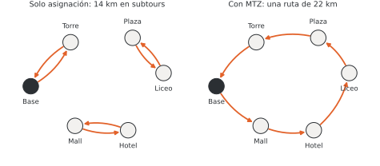
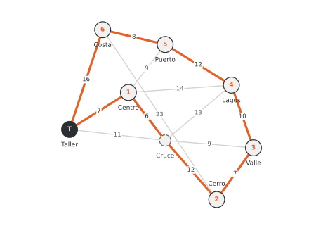

# Unidad 4 · Problemas clásicos · vendedor viajero, ruteo, corte, cobertura y localización

**Qué vas a poder hacer.** Reconocer, bajo el vocabulario de un enunciado, cuál de los problemas
clásicos tienes delante; formular el vendedor viajero con la eliminación de subtours MTZ y explicar
por qué funciona; escribir un ruteo con capacidad, un corte por patrones, una cobertura, un
empaquetamiento, una partición y una localización con costo fijo; correrlos en OPL y leer qué tan
buena es su relajación lineal.

**Lo que necesitas antes.** De la unidad 2, el problema de asignación (cada uno a exactamente uno)
y la mochila. De la unidad 3, el costo fijo con una binaria de activación y la diferencia entre un
acoplamiento agregado y uno desagregado. De la unidad 1, que la relajación lineal es una cota.

**Tiempo.** Unas 6 horas: 2,5 de lectura con OPL abierto y 3,5 de práctica.

---

## 1. La idea: reconocer la estructura

Una ruta de reparto, un turno de enfermería, un pedido de tablas cortadas y la ubicación de un
desfibrilador parecen problemas distintos. Son media docena de estructuras que se repiten con otros
nombres. Quien reconoce la estructura hereda su modelo, sus trampas conocidas y décadas de algoritmos;
quien no la reconoce empieza de cero.

| Estructura | La pregunta | La marca en el enunciado |
|---|---|---|
| Vendedor viajero | ¿en qué orden visito todos los lugares una vez y vuelvo? | «recorre», «visita cada uno», «vuelve al origen» |
| Ruteo de vehículos | ¿qué vehículo atiende a quién, y en qué orden? | varios vehículos con capacidad |
| Corte de piezas | ¿cómo corto el material estándar para cubrir un pedido? | barras, rollos o tablas de largo fijo |
| Cobertura | ¿cuál es lo mínimo que deja a todos atendidos? | «al menos uno», «que nadie quede sin» |
| Empaquetamiento | ¿qué elijo sin que choquen? | «sin traslape», «a lo más uno» |
| Partición | ¿cómo reparto sin traslape ni omisión? | «exactamente uno» |
| Localización con costo fijo | ¿qué abro y quién se atiende desde dónde? | costo de abrir más costo de servir |

---

## 2. El vendedor viajero

Un vehículo sale de una base, visita $n - 1$ lugares una sola vez y vuelve. Se busca el recorrido más
corto. Con $N = \{1, \dots, n\}$ los lugares (el 1 es la base) y $d_{ij}$ la distancia de $i$ a $j$:

- $x_{ij} = 1$ si la ruta va de $i$ directo a $j$; $x_{ij} = 0$ en otro caso, $\forall i, j \in N$,
  $i \ne j$.

**El modelo empieza como una asignación.** De cada lugar se sale una vez y a cada lugar se entra una
vez:

$$\min \sum_{i \in N} \sum_{j \in N,\, j \ne i} d_{ij}\, x_{ij} \quad \text{s.a.} \quad \sum_{j \ne i} x_{ij} = 1 \;\; \forall i \in N, \qquad \sum_{i \ne j} x_{ij} = 1 \;\; \forall j \in N$$

**Y la asignación no basta.** Toda ruta cumple esas restricciones, pero no al revés: la asignación
acepta varios circuitos cerrados que no se tocan, los **subtours**. En el ejemplo de la sección 8, la
asignación «visita» los seis lugares con tres idas y vueltas de a dos, y ninguna pasa por todos.

**Eliminar subtours: dos formas.**

- **DFJ** (Dantzig, Fulkerson y Johnson): para cada subconjunto $S$ de lugares que no es todo $N$,
  $\sum_{i \in S} \sum_{j \in S, j \ne i} x_{ij} \le |S| - 1$. Un subconjunto no puede cerrarse sobre
  sí mismo. Es la formulación de relajación más fuerte, pero tiene una restricción por subconjunto:
  del orden de $2^n$. Se usa agregándolas a medida que aparecen subtours.
- **MTZ** (Miller, Tucker y Zemlin): una variable de posición por lugar.

**MTZ, con sus piezas.**

- $u_i$: posición del lugar $i$ en la ruta, $\forall i \in N$; la base tiene $u_1 = 1$.

$$u_i - u_j + 1 \le (n - 1)(1 - x_{ij}) \qquad \forall i, j \in N \setminus \{1\},\; i \ne j$$

$$2 \le u_i \le n \quad \forall i \in N \setminus \{1\}, \qquad u_1 = 1, \qquad x_{ij} \in \{0,1\} \;\; \forall i \ne j$$

**La intuición.** Si la ruta va de $i$ a $j$ ($x_{ij} = 1$), la restricción queda $u_j \ge u_i + 1$:
$j$ va al menos una posición después de $i$. Ahora piensa en un subtour que no pasa por la base, por
ejemplo $2 \to 4 \to 5 \to 2$. Pediría $u_4 \ge u_2 + 1$, $u_5 \ge u_4 + 1$ y $u_2 \ge u_5 + 1$: sumadas,
$0 \ge 3$. Imposible. Un ciclo de posiciones que siempre crecen no puede cerrarse, salvo pasando por la
base, que está excluida de esas restricciones. Por eso queda una sola ruta, la que sale y vuelve a la
base. Si $x_{ij} = 0$, el lado derecho vale $n - 1$ y la restricción no corta: la mayor diferencia
posible, $u_i = n$ y $u_j = 2$, da justo $n - 2 + 1 = n - 1$. Es una gran M ajustada, de la unidad 3.

**El precio de MTZ.** Tiene $(n-1)(n-2)$ restricciones en vez de $2^n$, pero su relajación lineal es
débil: con $x$ fraccionarios, las $u$ casi no estorban. Sirve bien para problemas chicos como los de
esta unidad; para cientos de lugares se usan cortes DFJ o las heurísticas de la unidad 11.

**Distancias de un mapa que no es completo.** Si entre dos tiendas no hay camino directo, $d_{ij}$ es
el largo de la **ruta más corta** entre ellas por los caminos que existen (la unidad 8 enseña a
calcularla con Dijkstra). La ruta del vendedor viajero dice el orden de las visitas; entre dos
visitas el vehículo puede pasar por lugares que no visita, como un cruce.

---

## 3. Ruteo de vehículos (mención y modelo chico)

Con varios vehículos de capacidad $Q$ y lugares que piden $q_i$, el problema pasa a ser de **ruteo de
vehículos con capacidad**: cada lugar lo atiende exactamente un vehículo, cada vehículo sale y vuelve a
la base, y ninguno lleva más de $Q$. El modelo cambia en tres cosas respecto del vendedor viajero:

- de la base salen hasta $K$ arcos, y vuelven los mismos: $\sum_{j} x_{1j} \le K$;
- a cada lugar se entra una vez y se sale una vez (sin contar la base);
- la variable $u_i$ ya no es una posición, sino la **carga acumulada** al llegar a $i$:

$$u_j \ge u_i + q_j - Q\,(1 - x_{ij}) \qquad \forall i \in N,\; j \in N \setminus \{1\},\; i \ne j; \qquad q_i \le u_i \le Q$$

La misma desigualdad hace dos trabajos: elimina subtours (la carga crece a lo largo de un ciclo) y
respeta la capacidad (nunca pasa de $Q$). Las variantes reales agregan ventanas de horario, flota
distinta o varias bases; con cientos de clientes se resuelven con heurísticas.

---

## 4. Corte de piezas por patrones

Una maestranza compra barras de largo fijo y las corta en piezas pedidas. Un **patrón** es una forma
de cortar una barra: cuántas piezas de cada tipo salen de ella. Lo que sobra es merma.

- Un patrón es **maximal** si en lo que sobra ya no cabe ninguna pieza. Basta con los maximales: un
  patrón no maximal es uno maximal con una pieza menos, y cortar esa pieza de más nunca empeora.
- $P$: patrones; $I$: tipos de pieza; $a_{pi}$: piezas $i$ del patrón $p$; $D_i$: piezas pedidas.
- $x_p$: barras que se cortan con el patrón $p$, $\forall p \in P$; $x_p \in \mathbb{Z}_0^+$.

$$\min \sum_{p \in P} x_p \quad \text{s.a.} \quad \sum_{p \in P} a_{pi}\, x_p \ge D_i \;\; \forall i \in I, \qquad x_p \in \mathbb{Z}_0^+ \;\; \forall p \in P$$

**Minimizar barras es minimizar desperdicio.** Con barras de largo $\ell$, lo desperdiciado es
$\ell \sum_p x_p - \sum_i \ell_i D_i$: el material pedido es fijo, así que bajar las barras baja el
desperdicio (merma de los patrones más piezas cortadas de más). La restricción es de cobertura
($\ge$): exigir $=$ suele volver infactible el pedido. Con muchos largos los patrones son millones; se
generan solo los que convienen (**generación de columnas**), y el problema que decide el patrón nuevo
es una mochila, la de la unidad 2.

---

## 5. Cobertura, empaquetamiento y partición

Una matriz de incidencia $a_{ij} = 1$ si el candidato $j$ atiende al elemento $i$. Con $J_i$ el
conjunto de candidatos que atienden a $i$ y $x_j = 1$ si se elige el candidato $j$; 0 en otro caso,
$\forall j \in J$, las tres estructuras cambian **solo el signo**:

| | Restricción, $\forall i \in I$ | Objetivo típico | Ejemplo |
|---|---|---|---|
| Cobertura | $\sum_{j \in J_i} x_j \ge 1$ | mínimo costo o cantidad | desfibriladores, estaciones de bomberos |
| Empaquetamiento | $\sum_{j \in J_i} x_j \le 1$ | máximo valor | reservas de salas sin choques |
| Partición | $\sum_{j \in J_i} x_j = 1$ | mínimo costo | tripulaciones, turnos exactos |

La asignación es una partición; la mochila es pariente del empaquetamiento. Escribir la suma sobre
$J_i$ y no sobre todos los $j$ con su $a_{ij}$ es lo mismo, pero no multiplica por ceros.

**Cobertura máxima.** Si el presupuesto no alcanza para cubrir todo, se maximiza lo cubierto. Aparece
una variable de consecuencia: $z_i = 1$ si el elemento $i$ queda cubierto; 0 en otro caso. Con $w_i$
la población de $i$:

$$\max \sum_{i \in I} w_i\, z_i \quad \text{s.a.} \quad z_i \le \sum_{j \in J_i} x_j \;\; \forall i \in I, \qquad \sum_{j \in J} c_j\, x_j \le B$$

$x_j$ decide dónde instalar; $z_i$ registra quién quedó cubierto. El acoplamiento impide declarar
cubierto a quien no lo está, y como el objetivo premia $z_i$, el modelo la pone en 1 cada vez que
puede.

---

## 6. Localización de instalaciones con costo fijo

Qué bodegas abrir (cada una con costo fijo $f_i$) y desde cuál atender a cada cliente $j$ (demanda
$d_j$, costo por unidad $c_{ij}$). Es el costo fijo de la unidad 3 multiplicado por una asignación.

- $y_i = 1$ si se abre la bodega $i$; 0 en otro caso, $\forall i \in I$.
- $x_{ij}$: fracción de la demanda del cliente $j$ que se atiende desde $i$, $\forall i \in I, j \in J$;
  $0 \le x_{ij} \le 1$.

$$\min \sum_{i \in I} f_i\, y_i + \sum_{i \in I} \sum_{j \in J} c_{ij}\, d_j\, x_{ij} \quad \text{s.a.} \quad \sum_{i \in I} x_{ij} = 1 \;\; \forall j \in J, \qquad x_{ij} \le y_i \;\; \forall i \in I, j \in J$$

**Agregada o desagregada.** El acoplamiento $\sum_j x_{ij} \le |J|\, y_i$ $\forall i$ es correcto y tiene
menos restricciones, pero en la relajación lineal deja abrir «un quinto» de bodega y atender igual a un
cliente completo. El desagregado $x_{ij} \le y_i$ obliga a abrir al menos tanto como se usa para cada
cliente: su relajación queda casi pegada al óptimo entero (ejercicio 4.7).

**Con capacidad.** Si la bodega $i$ despacha a lo más $K_i$: $\sum_j d_j\, x_{ij} \le K_i\, y_i$
$\forall i$. Si además cada cliente debe atenderse desde una sola bodega, $x_{ij}$ pasa a ser binaria
(ejercicio 4.10).

---

## 7. Cuándo NO aplica

- **Si el orden no importa**, no es un vendedor viajero: elegir qué tiendas abastecer es una mochila o
  una cobertura.
- **Si se puede volver a pasar por un lugar sin costo** y el mapa no es completo, no uses las
  distancias directas: usa las de ruta más corta, o el modelo creerá que dos tiendas sin camino directo
  no se pueden encadenar.
- **Con cientos de lugares**, MTZ resuelve mal; se usan cortes DFJ dentro del solver o heurísticas
  (unidades 11 y 12).
- **Si las piezas se pueden pegar o el material es continuo** (líquidos, rollos que se empalman), el
  corte por patrones sobra: basta un balance lineal.
- **Si cada cliente puede partirse entre bodegas sin costo extra**, no impongas una sola bodega por
  cliente: encarece el plan (ejercicio 4.10).

---

## 8. Ejemplo resuelto · El técnico de ascensores

Un técnico sale de la base de su empresa y tiene que revisar los ascensores de cinco edificios (una
torre de oficinas, un edificio en la plaza, un liceo, un hotel y un mall) y volver. Las distancias en
km por la ciudad:

| | Base | Torre | Plaza | Liceo | Hotel | Mall |
|---|---|---|---|---|---|---|
| Base | — | 3 | 7 | 8 | 6 | 5 |
| Torre | 3 | — | 5 | 7 | 8 | 6 |
| Plaza | 7 | 5 | — | 2 | 6 | 8 |
| Liceo | 8 | 7 | 2 | — | 5 | 7 |
| Hotel | 6 | 8 | 6 | 5 | — | 2 |
| Mall | 5 | 6 | 8 | 7 | 2 | — |

**Paso 1 · En palabras.** Se decide en qué orden visitar los cinco edificios, saliendo de la base y
volviendo a ella. Se busca el menor recorrido. Cada edificio se visita una vez, y la ruta tiene que ser
una sola.

**Paso 2 · Solo la asignación.** Si se resuelve únicamente «salir una vez, entrar una vez», el óptimo
mide 14 km y es esto:

- Base → Torre → Base
- Plaza → Liceo → Plaza
- Hotel → Mall → Hotel

Tres subtours de ida y vuelta: cada edificio con su vecino más cercano. Cumple todas las restricciones
de la asignación y no es una ruta. Esos 14 km son una cota inferior del recorrido real.



**Paso 3 · El modelo completo en OPL** (`modelos/u04_tsp.mod`). El mismo `.mod` sirve para el caso
integrador de la sección 12; solo cambia el `.dat`.

```opl
/*********************************************
 * Unidad 4 · Vendedor viajero con eliminación de subtours MTZ
 * Un modelo para dos juegos de datos: u04_ascensores.dat (ejemplo resuelto)
 * y u04_ruta_camion.dat (caso integrador). Base abierta de ingeniería.
 *********************************************/

{string} Lugares = ...;              // la base y los lugares que hay que visitar
string   base    = ...;              // desde donde sale y adonde vuelve la ruta
float    d[Lugares][Lugares] = ...;  // km entre cada par de lugares

int n = card(Lugares);

dvar boolean x[Lugares][Lugares];    // 1 si la ruta va de i directo a j; 0 en otro caso
dvar float+  u[Lugares];             // posición del lugar en la ruta (la base es la 1)

dexpr float Km = sum(i in Lugares, j in Lugares: i != j) d[i][j] * x[i][j];

minimize Km;

subject to {
  forall(i in Lugares)
    SinLazo:
      x[i][i] == 0;
  forall(i in Lugares)
    Sale:
      sum(j in Lugares: j != i) x[i][j] == 1;
  forall(j in Lugares)
    Entra:
      sum(i in Lugares: i != j) x[i][j] == 1;
  // MTZ: si la ruta va de i a j (ninguno es la base), j queda al menos una posición después de i
  forall(i in Lugares, j in Lugares: i != base && j != base && i != j)
    MTZ:
      u[i] - u[j] + 1 <= (n - 1) * (1 - x[i][j]);
  PosicionBase:
    u[base] == 1;
  forall(i in Lugares: i != base)
    Posicion:
      2 <= u[i] <= n;
}

execute {
  writeln("km = ", Km);
  var ruta = base;
  var actual = base;
  for (var paso = 1; paso <= n; paso++) {
    for (var j in Lugares)
      if (x[actual][j] > 0.5) { actual = j; break; }
    ruta = ruta + "-" + actual;
  }
  writeln("ruta = ", ruta);
  for (var i in Lugares)
    writeln("u[", i, "] = ", u[i]);
}
```

El `.dat` (`modelos/u04_ascensores.dat`):

```opl
// Unidad 4 · ejemplo resuelto · visita del técnico de ascensores (km)

Lugares = {"Base", "Torre", "Plaza", "Liceo", "Hotel", "Mall"};
base    = "Base";

d = [
  [0 3 7 8 6 5]     // Base
  [3 0 5 7 8 6]     // Torre
  [7 5 0 2 6 8]     // Plaza
  [8 7 2 0 5 7]     // Liceo
  [6 8 6 5 0 2]     // Hotel
  [5 6 8 7 2 0]     // Mall
];
```

**Paso 4 · La salida.** OPL entrega `km = 22` y la ruta Base, Mall, Hotel, Liceo, Plaza, Torre, Base,
con $u$ = 1, 2, 3, 4, 5, 6 en ese orden. Una fuerza bruta sobre las $5! = 120$ rutas lo confirma: hay
una sola ruta óptima, que se puede recorrer en los dos sentidos.

**Paso 5 · Cuánto ayudan las MTZ en la relajación.** Con seis lugares hay 20 restricciones MTZ.

| Modelo | Valor | Distancia al óptimo de 22 km |
|---|---|---|
| Asignación entera (sin MTZ) | 14 km | 36,4 % |
| Relajación lineal con MTZ | 17,2 km | 21,8 % |
| Vendedor viajero entero | 22 km | — |

**Cómo se lee.**

- **La asignación no es una ruta.** Junta cada edificio con su vecino más cercano y se queda ahí. Las
  MTZ son las que obligan a encadenar los tres pares en un solo recorrido.
- **La ruta óptima recorre los pares.** Mall y Hotel (2 km), Liceo y Plaza (2 km), Torre y de vuelta
  a la base (3 km): aprovecha las cercanías que la asignación vio, pero conectadas.
- **La relajación de MTZ es floja**: queda 21,8 % bajo el óptimo. En un problema chico no importa; en
  uno grande, esa distancia es la que hace lenta la ramificación (unidad 5).
- **Decisión.** El técnico parte por el mall y termina en la torre, 22 km en total.

---

## 9. Errores típicos

| Error | Cómo evitarlo |
|---|---|
| Escribir el vendedor viajero solo con «sale una vez, entra una vez» | eso es una asignación: acepta subtours; agrega MTZ o cortes DFJ |
| Incluir la base en las restricciones MTZ | MTZ va solo para $i, j \ne$ base; si no, la ruta tampoco podría cerrarse en la base |
| Definir $u_i$ sin decir qué es | «posición del lugar $i$ en la ruta», con su rango $2 \le u_i \le n$ y $u_{\text{base}} = 1$ |
| Usar distancias directas en un mapa incompleto | usa la ruta más corta entre cada par; el camión puede pasar por lugares que no visita |
| Olvidar $x_{ii} = 0$ | sin eso, «salir de $i$ hacia $i$» cumple la asignación con costo 0 |
| En ruteo, poner la carga como posición | $u_i$ es carga acumulada: $u_j \ge u_i + q_j - Q(1 - x_{ij})$, con $q_i \le u_i \le Q$ |
| Enumerar patrones de corte que no son maximales | basta con los maximales; los otros solo agrandan el modelo |
| Exigir $=$ en la demanda del corte | es $\ge$: un patrón trae piezas de más; con $=$ el pedido suele quedar infactible |
| Usar $\ge 1$ cuando el enunciado prohíbe el traslape (o $= 1$ cuando lo permite) | pregúntate: ¿hay que cubrir todo? ¿se permite el traslape? Eso decide el signo |
| Cobertura máxima sin la variable de consecuencia | $z_i$ registra quién quedó cubierto y se acopla con $z_i \le \sum_{j \in J_i} x_j$ |
| Localización con el acoplamiento agregado «porque son menos restricciones» | el desagregado $x_{ij} \le y_i$ da una relajación mucho más ajustada |
| Escribir una familia sin su $\forall$ o una variable sin su naturaleza | cada restricción con su «para todo»; al final, $x \in \{0,1\}$, $u \ge 0$, con sus índices |

---

## 10. Práctica

Diez ejercicios: 4.1 a 4.4 básicos, 4.5 a 4.8 intermedios, 4.9 y 4.10 de desafío. Las pautas están en
la sección 11. Cada variable con sus tres piezas, cada restricción con su $\forall$ y la naturaleza al
final.

**4.1 · ¿Qué estructura es? (básico).** Di qué estructura clásica es cada caso y con qué signo o
restricción característica se escribe. (a) Un hospital elige qué turnos de 12 horas contratar para que
cada hora del día tenga al menos una matrona. (b) Un auditor visita las siete sucursales de un banco en
un día y vuelve a la oficina. (c) Una imprenta corta pliegos de papel de 100 cm en etiquetas de tres
anchos. (d) Un municipio asigna cada feria libre a exactamente un fiscalizador. (e) Un centro cultural
acepta reservas de salas, cada una pidiendo varios bloques horarios, sin que dos reservas choquen. (f)
Una cadena de farmacias decide qué bodegas abrir y desde cuál surtir cada local.

**4.2 · Desfibriladores (básico).** Una comuna evalúa siete sitios para instalar desfibriladores
públicos. Un sitio cubre a las juntas de vecinos que quedan a menos de tres minutos a pie:

| Sitio | S1 | S2 | S3 | S4 | S5 | S6 | S7 |
|---|---|---|---|---|---|---|---|
| Cubre a las juntas | 1, 2, 4 | 2, 3, 5 | 1, 4, 7 | 3, 5, 6, 9 | 4, 7, 8 | 6, 8, 9 | 2, 5, 6 |
| Costo (miles de pesos) | 410 | 390 | 350 | 820 | 340 | 560 | 310 |

(a) Escribe los conjuntos $J_i$ y el modelo de mínimo número de sitios. (b) Resuélvelo. (c) Ahora con
costos: ¿cambia la solución? (d) Las juntas tienen 640, 410, 980, 520, 730, 870, 470, 590 y 690 vecinos
(J1 a J9). Si el presupuesto es de $910.000, formula y resuelve la cobertura máxima de vecinos.

**4.3 · Por qué MTZ corta los subtours (básico).** Con cinco lugares (el 1 es la base) y $n = 5$: (a)
la asignación da $1 \to 3 \to 1$ y $2 \to 4 \to 5 \to 2$. Escribe las tres restricciones MTZ del
segundo ciclo y muestra que juntas son imposibles. (b) Para la ruta $1 \to 3 \to 2 \to 5 \to 4 \to 1$,
calcula las posiciones $u_i$ y verifica las restricciones MTZ de los arcos no usados $(4,2)$ y $(5,3)$.
(c) ¿Por qué el lado derecho es $n - 1$ y no un número cualquiera?

**4.4 · Los patrones de una tabla (básico).** Una mueblería corta tablas de 320 cm en piezas de 110 cm
(A), 80 cm (B) y 50 cm (C). (a) Enumera los patrones maximales con su merma. (b) ¿Por qué basta con los
maximales? (c) ¿Cuántos patrones habría contando también los no maximales?

**4.5 · Los turnos de una clínica veterinaria (intermedio).** Una clínica de urgencias divide el día
en seis franjas de 4 horas (F1 a F6) y tiene siete turnos posibles:

| Turno | T1 | T2 | T3 | T4 | T5 | T6 | T7 |
|---|---|---|---|---|---|---|---|
| Franjas | F1, F2 | F2, F3 | F3, F4 | F4, F5 | F5, F6 | F6, F1 | F3, F4, F5 |
| Costo diario | $95.000 | $82.000 | $71.000 | $76.000 | $91.000 | $108.000 | $66.000 |
| Veterinarios que lo prefieren | 4 | 6 | 3 | 5 | 2 | 3 | 8 |

(a) Cobertura: cada franja con al menos un turno, al menor costo. (b) Partición: cada franja con
exactamente un turno, al menor costo. ¿Cuánto cuesta la exactitud? (c) Empaquetamiento: sin cubrir
todo, elegir turnos que no se traslapen y maximicen las preferencias. Formula los tres y resuélvelos.

**4.6 · El pedido de la mueblería (intermedio).** Con los patrones de 4.4, la mueblería necesita 40
piezas A, 65 piezas B y 90 piezas C. (a) Formula el modelo y resuélvelo (`modelos/u04_e06_corte.mod`).
(b) ¿Cuántos centímetros se desperdician? Separa la merma de los patrones de las piezas cortadas de
más. (c) ¿Cuál es la cota de «material pedido dividido por el largo de la tabla»? ¿Y la relajación
lineal? ¿Qué dicen?

**4.7 · Tres bodegas candidatas (intermedio).** Una distribuidora evalúa bodegas en Norte, Río y Sur
para atender a cinco clientes (`modelos/u04_e07_bodegas.mod`).

| CLP por caja | C1 | C2 | C3 | C4 | C5 | Costo fijo mensual |
|---|---|---|---|---|---|---|
| Norte | 1.800 | 2.600 | 4.150 | 3.350 | 5.200 | $430.000 |
| Río | 3.400 | 1.900 | 2.300 | 4.550 | 3.100 | $380.000 |
| Sur | 4.950 | 3.800 | 2.700 | 2.100 | 1.650 | $410.000 |
| Cajas al mes | 120 | 85 | 145 | 65 | 105 | |

(a) Formula la localización con el acoplamiento desagregado y resuélvela. (b) ¿Cuánto costaría operar
con cada bodega sola? (c) Calcula la relajación lineal con el acoplamiento agregado
($\sum_j x_{ij} \le 5\,y_i$) y con el desagregado, y el gap de cada una.

**4.8 · El caso sin MTZ (intermedio).** Toma el `.dat` del caso integrador (sección 12). (a) Borra las
restricciones MTZ y resuelve: ¿qué devuelve el modelo y cuánto mide? (b) ¿Por qué el resultado es una
cota inferior de la ruta del camión? (c) Resuelve la relajación lineal del modelo completo con MTZ y
compara las dos cotas con los 78 km.

**4.9 · Dos camionetas (desafío).** Estampa Sur evalúa reemplazar el camión por dos camionetas de 80
cajas. Las tiendas piden: Centro 31, Puerto 24, Lagos 19, Valle 36, Costa 14 y Cerro 22 cajas. Con las
distancias del caso: (a) formula el ruteo con capacidad usando la carga acumulada; (b) resuélvelo
(`modelos/u04_e09_camionetas.mod`); (c) ¿cuántos km más que el camión recorren entre las dos? (d) ¿Por
qué ya no sirve una sola camioneta?

**4.10 · Bodegas con capacidad (desafío).** Retoma 4.7. Ahora cada bodega despacha como máximo 290
(Norte), 260 (Río) y 270 (Sur) cajas al mes, y cada cliente se atiende desde **una sola** bodega
(`modelos/u04_e10_capacidad.mod`). (a) Formula y resuelve. (b) ¿Cuánto cuesta la regla de una sola
bodega por cliente? Resuelve también permitiendo repartir clientes. (c) ¿Por qué ya no basta la bodega
que ganó en 4.7?

---

## 11. Pautas

**4.1.** (a) Cobertura: cada hora $\ge 1$ turno; el traslape se permite. (b) Vendedor viajero:
asignación más eliminación de subtours. (c) Corte de piezas por patrones, con demanda $\ge$. (d)
Partición (es una asignación): cada feria $= 1$ fiscalizador. (e) Empaquetamiento: cada bloque
$\le 1$ reserva elegida, maximizando lo aceptado. (f) Localización con costo fijo: $y_i$ por bodega y
$x_{ij} \le y_i$. Lectura: el signo de la restricción sale de dos preguntas, ¿hay que atender a todos?
y ¿se permite el traslape?

**4.2.** (a) $J_1 = \{S1, S3\}$, $J_2 = \{S1, S2, S7\}$, $J_3 = \{S2, S4\}$, $J_4 = \{S1, S3, S5\}$,
$J_5 = \{S2, S4, S7\}$, $J_6 = \{S4, S6, S7\}$, $J_7 = \{S3, S5\}$, $J_8 = \{S5, S6\}$,
$J_9 = \{S4, S6\}$. Con $x_j = 1$ si se instala en el sitio $j$; 0 en otro caso, $\forall j$:
$\min \sum_j x_j$ s.a. $\sum_{j \in J_i} x_j \ge 1$ $\forall i \in \{1, \dots, 9\}$;
$x_j \in \{0,1\}$ $\forall j$. (b) Bastan 3 sitios, y hay dos formas: S1, S4, S5 o S2, S3, S6. El
solver entrega S1, S4, S5. (c) Con costos, la más barata de las dos es S2, S3, S6, por $1.300.000; no
hay cobertura más barata con más sitios. (d) Con $z_i$ y el presupuesto, el óptimo instala en S3, S6,
gasta $910.000 y cubre 3.780 de los 5.900 vecinos. Lectura: el mínimo número de sitios no decide entre
empates; el costo sí, y el presupuesto obliga a dejar juntas sin cubrir.

**4.3.** (a) Para $2 \to 4 \to 5 \to 2$, con $x = 1$ en esos tres arcos: $u_2 - u_4 + 1 \le 0$,
$u_4 - u_5 + 1 \le 0$, $u_5 - u_2 + 1 \le 0$. Sumadas, las $u$ se cancelan y queda $3 \le 0$: imposible.
(b) $u_1 = 1$, $u_3 = 2$, $u_2 = 3$, $u_5 = 4$, $u_4 = 5$. Arco $(4,2)$, no usado: $u_4 - u_2 + 1$ da
$3 \le 4$. Arco $(5,3)$: $u_5 - u_3 + 1$ da $3 \le 4$. (c) Porque $n - 1$ es la mayor diferencia
posible: con $u_i = 5$ y $u_j = 2$ el lado izquierdo vale 4. Es la gran M ajustada: más chica cortaría
rutas válidas; más grande debilitaría la relajación.

**4.4.** (a) Los patrones maximales (piezas A, B, C, cm usados y merma):

| A | B | C | Usados (cm) | Merma (cm) |
|---|---|---|---|---|
| 2 | 1 | 0 | 300 | 20 |
| 2 | 0 | 2 | 320 | 0 |
| 1 | 2 | 1 | 320 | 0 |
| 1 | 1 | 2 | 290 | 30 |
| 1 | 0 | 4 | 310 | 10 |
| 0 | 4 | 0 | 320 | 0 |
| 0 | 3 | 1 | 290 | 30 |
| 0 | 2 | 3 | 310 | 10 |
| 0 | 1 | 4 | 280 | 40 |
| 0 | 0 | 6 | 300 | 20 |

Son 10 patrones maximales. (b) Si en la merma cabe otra pieza, cortarla nunca empeora: el patrón con
la pieza extra cubre lo mismo y algo más. (c) Contando todos los que caben en la tabla (con al menos
una pieza) son 32 patrones. Lectura: con tres largos se cuentan a mano; con veinte son millones, y por
eso se generan solo los que convienen.

**4.5.** Con $x_t = 1$ si se contrata el turno $t$; 0 en otro caso, $\forall t$, y $T_f$ los turnos que
cubren la franja $f$. (a) $\min \sum_t c_t x_t$ s.a. $\sum_{t \in T_f} x_t \ge 1$ $\forall f$: T1, T5, T7
por $252.000; la franja F5 queda con dos turnos. (b) Con $= 1$: T1, T3, T5 por $257.000. La exactitud
cuesta $5.000 al día: el turno largo y barato T7 se traslapa con T5 y la partición no lo deja. (c)
$\max \sum_t p_t x_t$ s.a. $\sum_{t \in T_f} x_t \le 1$ $\forall f$: T2, T4, T6, con 14 puntos de
preferencia. T7, el más preferido, choca con T2 y T4 a la vez y deja menos. Lectura: misma matriz,
tres signos, tres respuestas distintas.

**4.6.** (a) $x_p$: tablas cortadas con el patrón $p$, $\forall p \in \{P1, \dots, P10\}$;
$\min \sum_p x_p$ s.a. $\sum_p a_{pi} x_p \ge D_i$ $\forall i \in \{A, B, C\}$; $x_p \in \mathbb{Z}_0^+$.
Se necesitan 45 tablas. Una solución óptima (hay otras con 45): 28 tablas con el patrón (1, 2, 1), 12
con (1, 0, 4) y 5 con (0, 2, 3). (b) Se compran $45 \cdot 320 = 14{.}400$ cm y el pedido usa 14.100 cm:
se desperdician 300 cm. En esa solución, 170 cm son merma de los patrones y 130 cm son una pieza B y una
C cortadas de más; otra solución óptima puede repartirlos distinto, pero el total es el mismo. (c) La
cota de material es $14{.}100/320 = 44{,}06$ tablas y la relajación lineal da 44,58: las dos dicen que
hacen falta al menos 45. Lectura: el óptimo alcanza la cota redondeada hacia arriba; no hay forma de
cortar mejor.

**4.7.** (a) Con $y_i$ y $x_{ij}$ de la sección 6, el óptimo abre solo Río: $380.000 de costo fijo y
$1.524.250 de despacho, total $1.904.250. (b) Solo Norte: $2.232.500; solo Río: $1.904.250; solo Sur:
$2.028.250. Abrir una segunda bodega ahorra despacho, pero no tanto como su costo fijo. (c) La
relajación desagregada da $1.902.250 (gap 0,1 %); la agregada, $1.422.750 (gap 25,3 %). La agregada
abre «un quinto» de Norte ($y = 0{,}2$) y aun así puede despachar desde ahí un cliente completo, pagando
un quinto del costo fijo. Lectura: las mismas soluciones enteras; una cota casi exacta contra una que
queda un cuarto bajo el óptimo.

**4.8.** (a) Sin MTZ el modelo devuelve 64 km en tres subtours: Taller → Centro → Taller,
Puerto → Costa → Puerto y Lagos → Valle → Cerro → Lagos. (b) Toda ruta es una asignación, así que la
mejor asignación no puede medir más que la mejor ruta: 64 km es una cota inferior. (c) La relajación
lineal con MTZ da 65,33 km. Las dos cotas quedan lejos de los 78 km: 17,9 % y 16,2 % bajo el óptimo.
Lectura: las MTZ casi no mejoran la cota lineal; lo que hacen es prohibir, en el modelo entero, las
soluciones con subtours.

**4.9.** (a) Con $q_j$ los pedidos, $Q = 80$ y $K = 2$: $x_{ij} = 1$ si una camioneta va de $i$
directo a $j$; 0 en otro caso; $u_i$: cajas entregadas por esa camioneta hasta $i$, inclusive.
$\min \sum d_{ij} x_{ij}$ s.a. a cada tienda se entra una vez y se sale una vez $\forall$ tienda;
$\sum_j x_{\text{Taller},j} \le 2$ y vuelven las mismas que salen;
$u_j \ge u_i + q_j - 80(1 - x_{ij})$ $\forall i, \forall j \ne \text{Taller}$, $i \ne j$;
$q_i \le u_i \le 80$; $u_{\text{Taller}} = 0$. (b) Una camioneta hace Taller, Centro, Puerto, Costa (40
km, 69 cajas) y la otra Taller, Lagos, Valle, Cerro (61 km, 77 cajas): 101 km. (c) Son 23 km más que la
ruta del camión. (d) Las tiendas piden 146 cajas: una camioneta de 80 no alcanza. Lectura: la capacidad
parte la ruta en dos, y cada vuelta extra a la base cuesta kilómetros.

**4.10.** (a) Con $x_{ij} \in \{0,1\}$ y $\sum_j d_j x_{ij} \le K_i y_i$ $\forall i$: se abren Norte y
Sur, con Norte: 270 cajas (C1, C2 y C4) y Sur: 250 cajas (C3 y C5); costo $2.059.500. (b) Permitiendo
repartir clientes, $2.034.500: la regla de una sola bodega cuesta $25.000 al mes. (c) Los clientes
piden 520 cajas y Río despacha a lo más 260: ninguna bodega sola alcanza, y la mejor pareja ya no
incluye a Río. Lectura: la capacidad cambia qué se abre, no solo cuánto se despacha.

---

## 12. Caso integrador · La ruta del camión de Estampa Sur

> Estampa Sur es el taller ficticio que sigue todo el ramo. En la unidad 3 decidió comprar una segunda
> máquina y hacer 136 cajas más. Ahora esas cajas hay que llevarlas: un camión sale del taller,
> visita las seis tiendas una vez y vuelve.

**La red.** Las tiendas y los caminos son ficticios. Cruce es un empalme de caminos, no una tienda: el
camión puede pasar por él, pero no lo visita.



**Las distancias que usa el modelo.** Como no todas las tiendas tienen camino directo, la matriz es la
de **ruta más corta** por los caminos (km). La calcula el script del caso; la unidad 8 enseña a
hacerlo a mano con Dijkstra.

| | Taller | Centro | Puerto | Lagos | Valle | Costa | Cerro |
|---|---|---|---|---|---|---|---|
| Taller | — | 7 | 16 | 21 | 20 | 16 | 23 |
| Centro | 7 | — | 9 | 14 | 15 | 17 | 18 |
| Puerto | 16 | 9 | — | 12 | 22 | 8 | 27 |
| Lagos | 21 | 14 | 12 | — | 10 | 20 | 17 |
| Valle | 20 | 15 | 22 | 10 | — | 30 | 7 |
| Costa | 16 | 17 | 8 | 20 | 30 | — | 23 |
| Cerro | 23 | 18 | 27 | 17 | 7 | 23 | — |

**El modelo** es el mismo `u04_tsp.mod` de la sección 8. Solo cambia el `.dat`
(`modelos/u04_ruta_camion.dat`):

```opl
// Unidad 4 · caso integrador · el camión de Estampa Sur y las seis tiendas
// km de ruta más corta por los caminos (sale de verificacion/caso_estampa_sur_red.py)

Lugares = {"Taller", "Centro", "Puerto", "Lagos", "Valle", "Costa", "Cerro"};
base    = "Taller";

d = [
  [ 0  7 16 21 20 16 23]     // Taller
  [ 7  0  9 14 15 17 18]     // Centro
  [16  9  0 12 22  8 27]     // Puerto
  [21 14 12  0 10 20 17]     // Lagos
  [20 15 22 10  0 30  7]     // Valle
  [16 17  8 20 30  0 23]     // Costa
  [23 18 27 17  7 23  0]     // Cerro
];
```

**La corrida.** OPL da `km = 78` y la ruta Taller, Costa, Puerto, Lagos, Valle, Cerro, Centro, Taller.
El script del caso la reporta en el otro sentido:
Taller, Centro, Cerro, Valle, Lagos, Puerto, Costa, Taller. Es la misma ruta: con distancias simétricas, recorrerla al revés mide lo mismo. La fuerza bruta
sobre las 720 rutas confirma que no hay otra de 78 km.

**La ruta, tramo por tramo** (en el sentido del script del caso):

| Tramo | km | Por dónde va |
|---|---|---|
| Taller → Centro | 7 | directo |
| Centro → Cerro | 18 | por Cruce (6 + 12) |
| Cerro → Valle | 7 | directo |
| Valle → Lagos | 10 | directo |
| Lagos → Puerto | 12 | directo |
| Puerto → Costa | 8 | directo |
| Costa → Taller | 16 | directo |

Total: 78 km.

**Lectura.**

- **El camión no pasa dos veces por ninguna tienda** y aprovecha los tramos cortos: Cerro y Valle
  (7 km), Puerto y Costa (8 km), Valle y Lagos (10 km).
- **Centro → Cerro pasa por Cruce.** En la matriz es un solo salto de 18 km; en el mapa son dos
  tramos. Por eso la matriz se arma con rutas más cortas y no con caminos directos.
- **Las cotas lineales son flojas.** Sin MTZ, la asignación da 64 km en tres subtours (ejercicio 4.8),
  17,9 % bajo el óptimo; la relajación lineal con MTZ da 65,33 km, 16,2 % bajo. El modelo entero cierra
  esa distancia en una fracción de segundo porque el problema es chico.
- **Decisión.** El camión sale del taller hacia Centro (o hacia Costa) y recorre 78 km.

**La cadena.** El verificador resuelve la ruta en Python, por fuerza bruta y con OPL, y exige que km y
recorrido sean los del script del caso (`CADENA: OK`).

**Lo que pasa a las unidades siguientes.** La misma red alimenta la unidad 7 (los enlaces de radio de
menor largo que conectan tiendas y taller) y la unidad 8 (la ruta más corta a cada tienda, que es la
que llenó esta matriz). La unidad 11 vuelve a esta ruta con una heurística: vecino más cercano y 2-opt
se quedan en 84 km, contra los 78 km de este óptimo.

---

## 13. Para seguir

**En los libros del ramo.**

- Hillier y Lieberman, *Introducción a la investigación de operaciones* (7.ª ed., 2001): en el capítulo
  de programación entera, las aplicaciones con binarias (ubicación de instalaciones, cobertura, ruteo)
  muestran estas mismas estructuras con otros datos.
- Winston, *Investigación de operaciones: aplicaciones y algoritmos* (4.ª ed., 2005): en el capítulo de
  programación entera, el vendedor viajero y los problemas de cobertura de conjuntos traen formulaciones
  y ejercicios.

**Abierto y gratis.**

- Bradley, Hax y Magnanti, *Applied Mathematical Programming* (MIT), capítulo 9 «Integer
  Programming», en inglés. Su sección 9.1 formula la localización de bodegas y el vendedor viajero, y
  muestra cómo la asignación produce subtours. https://web.mit.edu/15.053/www/AMP-Chapter-09.pdf

**Con el tutor.** La carpeta `tutor/` trae el contexto del ramo. Pégalo al inicio de la conversación y
pide, por ejemplo: «Dame una matriz de distancias de cinco lugares cuya asignación forme subtours y
guíame para escribir las restricciones MTZ que los eliminan».
