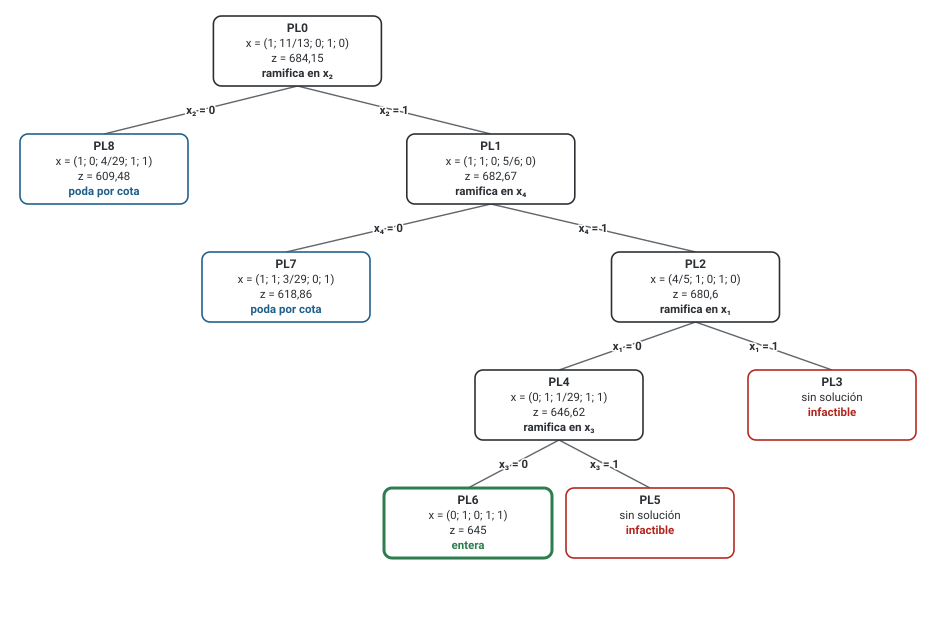
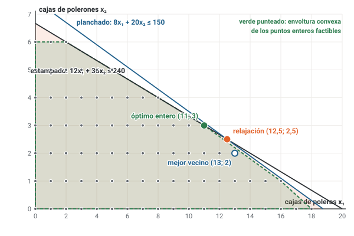
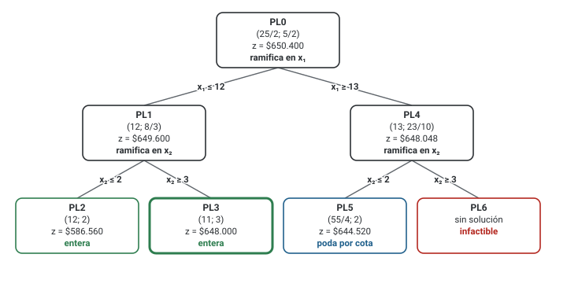

# Unidad 5 · Solución gráfica y ramificación y acotamiento

**Qué vas a poder hacer.** Dibujar un problema entero de dos variables con sus puntos enteros y su
relajación, resolverlo con ramificación y acotamiento (relajar, ramificar, acotar y podar), llevar
la incumbente, la mejor cota y el gap después de cada PL, elegir variable y nodo según la estrategia
que te pidan, y hacer lo mismo con una mochila binaria resolviendo cada nodo por ranking.

**Lo que necesitas antes.** De la unidad 1: la relajación lineal, por qué es una cota y por qué
redondear no basta. De la unidad 2: el modelo de la mochila 0-1. De Optimización: el método gráfico
(resolver un PL de dos variables intersectando rectas y evaluando vértices).

**Tiempo.** Unas 6 horas: 2 de lectura con el ejemplo y el caso en papel, y 4 de práctica. Los
árboles se aprenden haciéndolos: cada ejercicio de esta unidad se hace con lápiz.

---

## 1. La idea · cotas que descartan regiones enteras

Un problema entero acotado tiene una cantidad finita de soluciones, pero esa cantidad crece tan rápido
que probarlas todas no es un método (unidad 1, punto 7). Lo que sí se sabe resolver rápido es un PL. La
**ramificación y acotamiento** (en inglés *branch and bound*) usa ese PL de dos maneras:

- **Para acotar.** La relajación de una región dice lo mejor que podría haber ahí dentro. En un máximo,
  ningún punto entero de esa región vale más que su óptimo relajado.
- **Para partir.** Si el óptimo relajado tiene una variable fraccional, por ejemplo $x_1 = 12{,}5$, entre
  12 y 13 no hay ningún entero. Se puede prohibir esa franja sin perder ninguna solución: un lado con
  $x_1 \le 12$ y otro con $x_1 \ge 13$.

Con esas dos herramientas se arma un árbol. Cada nodo es una región con su PL. Un nodo se **poda**
(se deja de mirar) cuando su cota dice que ahí no hay nada mejor que lo que ya se tiene. La gracia
del método es que muchas regiones se descartan enteras, sin revisar uno por uno sus puntos.

---

## 2. La solución gráfica de un problema entero

Con dos variables todo se ve en un dibujo, y conviene hacerlo antes de cualquier árbol.

1. **La relajación.** Se dibujan las restricciones como en el método gráfico. La región sombreada es la
   de la relajación; su óptimo está en un vértice.
2. **Los puntos enteros.** Se marcan los puntos de la grilla que caen dentro de la región. Son los
   únicos planes que el problema acepta.
3. **El óptimo entero.** Se desliza la recta de nivel del objetivo desde el óptimo relajado hacia
   adentro; el primer punto entero que toca es el óptimo. Con pocos puntos, basta evaluarlos.
4. **La envoltura convexa.** Si se estira un elástico alrededor de los puntos enteros factibles, la
   figura que queda es la **envoltura convexa** $\text{conv}(S)$ (unidad 1, punto 6). Todos sus vértices son
   enteros. Si el modelo estuviera escrito con las desigualdades de la envoltura, el PL daría
   directamente el óptimo entero. La unidad 6 trata de cómo acercarse a esa figura con cortes.

El dibujo responde además una pregunta que el árbol no: **por qué** el redondeo falla. El óptimo
entero queda donde la región tiene puntos de la grilla, que no tiene por qué ser al lado del vértice
fraccional.

**Cuándo no aplica.** Con tres variables o más ya no se dibuja. Lo que sigue (el árbol) funciona con
cualquier número de variables; el dibujo es solo la forma de resolver a mano cada PL cuando hay dos.

---

## 3. Relajar, ramificar, acotar y podar

**Notación.** $PL_0$ es la relajación del problema completo. $PL_k$ es el PL del nodo $k$: la relajación
original **más** las restricciones de rama acumuladas en el camino desde la raíz. Los nodos se
numeran **en el orden en que se resuelven** (si usas otra convención, decláralo). $z_k$ es el óptimo de
$PL_k$.

**Ramificar.** Si en $PL_k$ la variable entera $x_j$ vale $v$ fraccional:

$$\text{hijo 1: } PL_k \;+\; x_j \le \lfloor v \rfloor \qquad\qquad \text{hijo 2: } PL_k \;+\; x_j \ge \lfloor v \rfloor + 1$$

$\lfloor v \rfloor$ es la parte entera de $v$ (el piso). Ningún entero queda afuera, porque entre
$\lfloor v \rfloor$ y $\lfloor v \rfloor + 1$ no hay enteros; y los dos hijos no comparten ningún punto.
En binarias, la rama es $x_j = 0$ y $x_j = 1$.

**En cada nodo se resuelve un PL, no un PLE.** El modelo del nodo no lleva la línea de naturaleza
entera; lleva solo las cotas de rama. Es el error de planteamiento más común.

**Acotar.** Agregar una restricción solo puede empeorar el óptimo: en un máximo $z_{\text{hijo}} \le z_{\text{padre}}$; en un mínimo, $z_{\text{hijo}} \ge z_{\text{padre}}$. Si un hijo «mejora» a su padre, hay un
error de cálculo.

**Podar.** Un nodo se deja de mirar por una de tres razones, y siempre se escribe cuál:

| Poda | Cuándo | Por qué es seguro |
|---|---|---|
| Por infactibilidad | el PL del nodo no tiene solución | si la región grande está vacía, la de enteros también |
| Por integralidad (factibilidad) | el óptimo del PL ya es entero | nada en esa región supera a su propio óptimo, y ese óptimo es un plan válido: pasa a incumbente si mejora a la que había |
| Por cota | máx.: $z_k \le$ incumbente · mín.: $z_k \ge$ incumbente | ni lo mejor de esa región le gana a lo que ya se tiene |

Un nodo con solución entera **peor** que la incumbente se cierra igual: por cota (con el sentido de la
tabla) o por integralidad sin mejorar. Cualquiera de las dos sirve, pero hay que escribir una.

**Termina** cuando no queda ningún nodo abierto. La respuesta es la incumbente.

---

## 4. Las dos cotas y el gap

Mientras el árbol corre se llevan dos números:

- **La incumbente** $\hat z$: la mejor solución entera encontrada. Ya está en la mano.
- **La mejor cota abierta** $\bar z$: lo mejor que todavía podría aparecer, el mejor $z_k$ entre los
  nodos que no se han cerrado.

$$\text{máximo: } \hat z \le z^* \le \bar z \qquad\qquad \text{mínimo: } \bar z \le z^* \le \hat z$$

En un máximo la incumbente es la cota inferior y la relajación de los abiertos la superior; en un
mínimo, al revés. La distancia entre ambas es el **gap**:

$$g_{\text{abs}} = |\bar z - \hat z| \qquad\qquad g_{\text{rel}} = \frac{|\bar z - \hat z|}{|\hat z|}$$

Se divide **por la incumbente**, en máximo y en mínimo, porque el gap se mide contra lo que se entrega.
Mientras no hay incumbente, el gap está indefinido (y tampoco se puede podar por cota).

**La herencia de cota.** Un nodo que ya se creó pero todavía no se resuelve no desaparece: entra a la
mejor cota con la $z$ de su padre, que es lo mejor que podría dar. Sin herencia, en profundidad la
primera entera daría siempre gap 0 % aunque falte medio árbol.

**Qué garantiza.** El gap es la peor pérdida posible si se para ahora, no la pérdida real: con 6 % de
gap la incumbente puede ya ser la óptima. Por eso un solver se configura con una **tolerancia**: para
cuando $g_{\text{rel}}$ baja de ese número y entrega la incumbente con la garantía «a lo más tanto peor
que el óptimo». La tolerancia razonable se compara con el error de los datos: perseguir el 0,01 % con
demandas que se conocen al 5 % es trabajo perdido.

**La poda gratis.** Si todos los coeficientes del objetivo son enteros (o múltiplos de un mismo número
$g$) y las variables son enteras, toda solución entera vale un entero (o un múltiplo de $g$). Una cota
de 44,8 en un máximo significa «a lo más 44»; en un mínimo, una cota de 79,4 significa «al menos 80».
Redondear la cota así poda antes y achica el gap, sin perder nada.

---

## 5. Qué variable y qué nodo

El orden no cambia el óptimo (el método es exacto con cualquier orden), pero cambia cuántos PL cuesta
llegar y qué tan rápido baja el gap.

**Qué variable ramificar** si hay varias fraccionales:

| Regla | Cuál | Argumento |
|---|---|---|
| La más fraccional | parte fraccional más cerca de 0,5 | la decisión más indecisa parte el problema por la mitad |
| La más cercana a un entero | parte fraccional más cerca de 0 o de 1 | un hijo se vuelve entero rápido |
| Pseudo-costo (los solvers) | la que más mueve la cota | se estima con lo que pasó en ramificaciones anteriores |

En esta unidad, salvo que el enunciado diga otra cosa, se ramifica en **la más fraccional** y con
empate en $x_1$.

**Qué nodo resolver:**

| Estrategia | Qué nodo sigue | A favor | En contra |
|---|---|---|---|
| Profundidad primero | el último hijo creado: se baja por una rama hasta cerrarla y se vuelve al último pendiente | encuentra una incumbente temprano, que habilita la poda por cota; poca memoria | puede hundirse en una rama mala; la cota baja lento |
| Mejor primero | se resuelven los dos hijos y se ramifica el nodo abierto de mejor $z$ | baja la cota más rápido y suele resolver menos PL | tarda en encontrar la primera entera; guarda todos los abiertos |
| Híbrida (los solvers) | profundidad hasta tener incumbente, después mejor primero | lo bueno de las dos | más difícil de seguir a mano |

El enunciado fija además **qué rama va primero** («$\le$ antes que $\ge$», «$= 1$ antes que $= 0$»).

**Redondear para conseguir incumbente.** Redondear no es un método de solución (unidad 1), pero
dentro del árbol es una **heurística** legítima: se redondea la solución de un nodo hacia el lado que
conserva la factibilidad, se revisa que cumpla todo y, si cumple, se usa como incumbente. No se
afirma que sea la óptima: sirve para podar antes.

---

## 6. La mochila binaria: cada nodo por ranking

En una mochila con una sola restricción ($\max \sum_j v_j x_j$ s.a. $\sum_j a_j x_j \le b$, $x_j \in \{0, 1\}$) la relajación de cada nodo se resuelve sin simplex:

1. Se descuenta de la capacidad lo que ocupan las variables **fijas en 1** por las ramas. Si eso ya
   pasa la capacidad, el nodo es **infactible** (no «$z = 0$»).
2. Se ordenan las libres por **valor por unidad de recurso** $v_j / a_j$, de mayor a menor.
3. Se llenan en ese orden con 1 mientras caben. La primera que no cabe entra con la fracción
   $\text{capacidad libre} / a_j$ y ahí se para.

Por eso la relajación de una mochila tiene **a lo más una variable fraccional**: no hay que elegir en
qué ramificar. La intuición es la del vendedor que llena el maletero con lo que más rinde por litro y
corta el último bulto. Funciona porque con una sola restricción el mejor uso de cada litro es siempre
el mismo orden.

**Cuándo deja de bastar.** Con dos o más restricciones (litros y kilos, presupuesto y horas) ya no hay
un orden único, y cada nodo se resuelve con simplex o gráficamente.

---

## 7. Un modelo entero, pieza por pieza, y en OPL

Cada modelo de esta unidad se escribe como se corrige en el ramo: **por piezas**, y cada pieza vale por
sí sola.

- **Variables con sus tres piezas:** el índice con su rango, qué significa el valor (o el 1) y, en una
  binaria, el «en otro caso». Ejemplo: $x_j = 1$ si se lleva la caja del producto $j$ a la feria; $0$ en
  otro caso, $\forall j \in J$.
- **Cada familia de restricciones con su «$\forall$».**
- **La naturaleza en una línea propia:** $x_j \in \{0, 1\} \;\; \forall j \in J$ o $u_i \in   \mathbb{Z}_0^+ \;\; \forall i \in I$. Sin ella el modelo es lineal y ninguna de las ideas de esta
  unidad hace falta.

En OPL la naturaleza es la declaración: `dvar boolean x[J];` o `dvar int+ u[I];`. CPLEX resuelve el
modelo entero con una ramificación y acotamiento (con cortes, heurísticas y preprocesamiento, que son
la unidad 6) y en su registro muestra exactamente las columnas de esta unidad: nodos, mejor entera,
mejor cota y gap. Su tolerancia de parada se llama `epgap` (gap relativo). En un modelo entero no
existen precios sombra: `.dual` responde `undefined`.

---

## 8. Cuándo no aplica y qué cuesta

- **Solo se ramifica sobre variables enteras.** En un modelo mixto (unas enteras, otras continuas) una
  continua fraccional no se toca: el nodo se poda por integralidad apenas las **enteras** lo son.
- **El peor caso sigue siendo exponencial.** El método garantiza el óptimo, no que sea rápido. Una mala
  formulación (una gran M floja, unidad 3) da relajaciones lejanas y árboles enormes. Ajustar la
  formulación achica el árbol más que cualquier estrategia.
- **Sin cotas no hay poda.** Si la relajación es no acotada, el método no arranca: hay que acotar el
  modelo primero.

---

## 9. Ejemplo resuelto · qué llevar a la feria navideña

Una artesana de Chillán va a una feria navideña con su auto. Puede llevar a lo más una caja de cada
producto, y el maletero tiene 165 litros. Cada caja tiene una ganancia esperada si se vende en la feria:

| Producto | Tazones | Velas | Lámparas | Mantas | Jabones |
|---|---|---|---|---|---|
| Ganancia (miles de pesos) | 217 | 259 | 47 | 248 | 138 |
| Volumen de la caja (litros) | 50 | 65 | 145 | 60 | 35 |
| Ganancia por litro | 4,34 | 3,985 | 0,324 | 4,133 | 3,943 |

**Paso 1 · En palabras.** Se decide qué cajas llevar. Se busca la mayor ganancia. Limita el maletero.

**Paso 2 · Pieza por pieza.**

- Conjunto: $J = \{1, \dots, 5\}$ productos (1 tazones, 2 velas, 3 lámparas, 4 mantas, 5 jabones).
- Parámetros: $v_j$ ganancia de la caja $j$ (miles de pesos), $a_j$ litros de la caja $j$, $b = 165$ litros.
- Variable: $x_j = 1$ si se lleva la caja del producto $j$; $0$ en otro caso, $\forall j \in J$.

$$\max z = \sum_{j \in J} v_j x_j \quad \text{s.a.} \quad \sum_{j \in J} a_j x_j \le b, \qquad x_j \in \{0, 1\} \;\; \forall j \in J$$

**Paso 3 · La raíz por ranking.** El orden por ganancia por litro es tazones (4,34), mantas (4,133),
velas (3,985), jabones (3,943) y lámparas (0,324). Entran tazones (50 L) y mantas (60 L); quedan 55
litros y las velas ocupan 65: entran con $55/65 = 11/13$. $PL_0$ da $z_0 = 684{,}15$: ningún plan de
cajas completas gana más de 684,15 mil pesos. Redondear hacia abajo (tazones y mantas) da 465.

**Paso 4 · El árbol.** Profundidad primero, rama «$= 1$» primero (el enunciado lo fija así):

| PL | Ramas acumuladas | Solución relajada | z | Qué pasa |
|---|---|---|---|---|
| PL0 | — | (1; 11/13; 0; 1; 0) | 684,15 | fraccional en x₂ = 11/13 → ramifica |
| PL1 | x₂ = 1 | (1; 1; 0; 5/6; 0) | 682,67 | fraccional en x₄ = 5/6 → ramifica |
| PL2 | x₂ = 1, x₄ = 1 | (4/5; 1; 0; 1; 0) | 680,6 | fraccional en x₁ = 4/5 → ramifica |
| PL3 | x₂ = 1, x₄ = 1, x₁ = 1 | infactible | — | infactible → poda |
| PL4 | x₂ = 1, x₄ = 1, x₁ = 0 | (0; 1; 1/29; 1; 1) | 646,62 | fraccional en x₃ = 1/29 → ramifica |
| PL5 | x₂ = 1, x₄ = 1, x₁ = 0, x₃ = 1 | infactible | — | infactible → poda |
| PL6 | x₂ = 1, x₄ = 1, x₁ = 0, x₃ = 0 | (0; 1; 0; 1; 1) | 645 | entera → primera incumbente |
| PL7 | x₂ = 1, x₄ = 0 | (1; 1; 3/29; 0; 1) | 618,86 | poda por cota |
| PL8 | x₂ = 0 | (1; 0; 4/29; 1; 1) | 609,48 | poda por cota |



Tres momentos que conviene mirar:

- **PL3 es infactible sin resolver nada:** velas, mantas y tazones fijados en 1 ocupan 175 litros.
- **PL4 no se poda aunque su cota (646,62) esté cerca:** todavía no hay incumbente, así que no hay con
  qué podar por cota.
- **PL7 y PL8 se podan por cota:** después de PL6 la incumbente vale 645, y sus relajaciones prometen
  618,86 y 609,48. No hace falta abrirlos.

**Paso 5 · Las cotas.** Antes de PL6 no hay gap. Después, PL7 y PL8 están pendientes y heredan las cotas
de sus padres (682,67 y 684,15); la mejor es 684,15:

| Tras | Incumbente (cota inferior) | Mejor cota (superior) | Gap absoluto | Gap relativo |
|---|---|---|---|---|
| PL0 | — | 684,15 | — | indefinido |
| PL1 | — | 684,15 | — | indefinido |
| PL2 | — | 684,15 | — | indefinido |
| PL3 | — | 684,15 | — | indefinido |
| PL4 | — | 684,15 | — | indefinido |
| PL5 | — | 684,15 | — | indefinido |
| PL6 | 645 | 684,15 | 39,15 | 6,07 % |
| PL7 | 645 | 684,15 | 39,15 | 6,07 % |
| PL8 | 645 | 645 | 0 | 0,00 % |

**El óptimo:** velas, mantas y jabones (160 de los 165 litros), con 645 mil pesos. Comprobado con
`milp` de scipy y enumerando las 32 combinaciones.

**En OPL** (`modelos/u05_feria.mod` y `.dat`):

```opl
/*********************************************
 * Unidad 5 · Ejemplo resuelto
 * Feria navideña: qué cajas de productos llevar en el maletero (mochila binaria)
 * Datos en u05_feria.dat. Base abierta de ingeniería.
 *********************************************/

{string} Productos = ...;

float ganancia[Productos] = ...;   // miles de pesos por caja vendida en la feria
float litros[Productos]   = ...;   // volumen de cada caja
float maletero            = ...;   // litros disponibles

dvar boolean x[Productos];         // 1 si se lleva la caja del producto; 0 en otro caso

dexpr float Ganancia = sum(p in Productos) ganancia[p] * x[p];

maximize Ganancia;

subject to {
  Maletero:
    sum(p in Productos) litros[p] * x[p] <= maletero;
}

execute {
  writeln("ganancia = ", Ganancia);
  for (var p in Productos) writeln("x[", p, "] = ", x[p]);
}
```

```opl
// Unidad 5 · ejemplo · cinco cajas y un maletero de 165 litros
Productos = {"tazones", "velas", "lámparas", "mantas", "jabones"};
ganancia  = [217 259 47 248 138];
litros    = [50 65 145 60 35];
maletero  = 165;
```

**Cómo se lee.**

- **Los tazones, que rinden más por litro, no van.** Su caja de 50 litros no encaja con las otras: con
  ellos sobran litros que nada aprovecha. Rankear y llenar es la relajación, no la respuesta.
- **El gap de 6,07 % tras PL6 no era pérdida real.** La incumbente ya era la óptima; el gap medía lo que
  faltaba por saber. Si a la artesana le basta una garantía del 7 %, podía parar ahí.
- **Con mejor primero** el árbol de esta mochila también usa 9 PL: con una incumbente que aparece tarde,
  las dos estrategias abren los mismos nodos. El ejercicio 5.10 muestra un caso donde no.

---

## 10. Errores típicos

| Error | Cómo evitarlo |
|---|---|
| Escribir la naturaleza entera en el PL de un nodo | el nodo es un PL: relajación original más cotas de rama, sin $\in \mathbb{Z}$ |
| Ramificar con $x_j \le v$ y $x_j \ge v$ (con $v$ fraccional) o con $x_j = \lfloor v \rfloor$ | las ramas son $x_j \le \lfloor v \rfloor$ y $x_j \ge \lfloor v \rfloor + 1$; con «$=$» se pierden enteros |
| Podar por cota en el sentido equivocado | en máx. se poda si $z_k \le$ incumbente; en mín., si $z_k \ge$ incumbente. Si un hijo mejora a su padre, revisa la cuenta |
| Dividir el gap por la cota en un mínimo | se divide por la incumbente, siempre |
| Olvidar la herencia de cota | si te da gap 0 % con nodos sin resolver, faltó contar a los pendientes con la cota de su padre |
| Seguir ramificando un nodo entero | su relajación ya es lo mejor de su región: se poda |
| Tratar como «$z = 0$» un nodo de mochila donde lo fijo en 1 no cabe | es infactible |
| Ramificar sobre una variable continua en un modelo mixto | solo las enteras se ramifican |
| Numerar los PL por creación y no por resolución | numéralos en el orden en que se resuelven, o declara la convención |
| Definir la variable sin rango ni «en otro caso», u olvidar la línea de naturaleza | tres piezas por variable y una línea $x_j \in \{0,1\} \;\forall j$; cada familia con su «$\forall$» |

---

## 11. Práctica

Diez ejercicios: 5.1 a 5.4 básicos, 5.5 a 5.8 intermedios, 5.9 y 5.10 de desafío. Salvo que se diga otra
cosa: profundidad primero, rama «$\le$» (o «$= 1$») primero, la variable más fraccional y, con empate,
$x_1$. Las pautas están en la sección 12.

**5.1 · El carro de sopaipillas (básico, gráfico).** Un carro decide cuántas tandas de sopaipillas
($x_1$) y de empanadas ($x_2$) preparar en una tarde. Cada tanda deja 3 y 8 mil pesos. Masa: $x_1 + 2x_2 \le 8$ (kilos); horno: $x_1 + 8x_2 \le 25$ (bandejas-hora). Las tandas son enteras. (a) Escribe el modelo
pieza por pieza. (b) Dibuja la región y marca los puntos enteros factibles. ¿Cuántos son? (c) Resuelve la
relajación. (d) Redondea al más cercano y hacia abajo: ¿qué pasa con cada uno? (e) Encuentra el óptimo
entero y di si es vecino del óptimo relajado. (f) Dibuja la envoltura convexa y lista sus vértices.

**5.2 · Ramificar y escribir el nodo (básico).** Con el problema de 5.1: (a) ¿en qué variable se
ramifica la raíz y por qué? Escribe los dos hijos. (b) Resuélvelos gráficamente. (c) Escribe completo el
PL del nodo al que se llega con $x_1 \ge 3$ y después $x_2 \le 2$, y resuélvelo. ¿Qué tipo de poda le toca?

**5.3 · Podar o ramificar (básico).** En un problema de **máximo** con coeficientes del objetivo enteros,
un árbol en profundidad resolvió estos PL en este orden:

| PL | z | ¿Entera? |
|---|---|---|
| PL0 | 47,7 | no |
| PL1 | 45,2 | no |
| PL2 | 44 | sí |
| PL3 | infactible | — |
| PL4 | 44,8 | no |
| PL5 | 46,8 | no |
| PL6 | 44 | sí |
| PL7 | 45 | sí |
| PL8 | 45,1 | no |

(a) Para cada PL di si se ramifica o se poda, y por qué razón. (b) Repite usando que toda solución entera
vale un entero (la poda gratis). ¿Qué nodos cambian?

**5.4 · Calcular el gap (básico).** (a) En un **máximo** (miles de pesos) la incumbente vale 1.240. Hay dos
nodos abiertos ya resueltos con cotas 1.315 y 1.288, y un nodo creado sin resolver cuyo padre tiene cota
1.331. Calcula la mejor cota, el gap absoluto y el relativo. ¿Cuánto daría el gap si olvidaras la
herencia? (b) En un **mínimo** la incumbente vale 86 y los abiertos tienen cotas 79,4; 81 y 83,5. Calcula
el gap absoluto y el relativo. ¿Cuánto da si divides por la cota, y por qué está mal? (c) Si los
coeficientes del objetivo de (b) son enteros, ¿cuál es el gap con la cota redondeada?

**5.5 · Un árbol completo (intermedio).** Resuelve con ramificación y acotamiento:
$\max z = 9x_1 + 7x_2$ s.a. $9x_1 + 8x_2 \le 28$, $4x_1 + 2x_2 \le 9$, $x_1, x_2 \in \mathbb{Z}_0^+$.
(a) Resuelve cada PL gráficamente y arma la tabla de nodos con la razón de cada poda. (b) Lleva la
incumbente, la mejor cota y el gap tras cada PL. (c) Repite ramificando siempre en $x_1$ cuando sea
fraccional: ¿cuántos PL cuesta ahora?

**5.6 · El fondo vecinal (intermedio).** Una junta de vecinos tiene $1.320.000 para cinco proyectos, que
se hacen completos o no se hacen. Cada uno tiene un puntaje de impacto:

| Proyecto | Luminarias | Plaza | Huerto | Talleres | Cámaras |
|---|---|---|---|---|---|
| Puntaje | 132 | 151 | 207 | 216 | 77 |
| Costo (miles de pesos) | 980 | 640 | 360 | 340 | 560 |

(a) Escribe el modelo pieza por pieza. (b) Resuelve con ramificación y acotamiento, profundidad primero y rama **«$= 0$» primero**, cada nodo por ranking. (c) Lleva el gap. (d) ¿Cuántos PL cuesta con «$= 1$» primero?

**5.7 · Compost y humus con mejor primero (intermedio).** Un vivero compra bolsas de compost ($x_1$, 2 mil pesos) y de humus ($x_2$, 7 mil) para un jardín que necesita al menos 15 unidades de materia orgánica ($4x_1 + 4x_2 \ge 15$) y 18 de nitrógeno ($2x_1 + 9x_2 \ge 18$). Las bolsas son enteras. (a) Resuelve con **mejor primero**, minimizando el costo. (b) Lleva incumbente, cota y gap (cuidado: es un mínimo). (c) ¿Cuántos PL cuesta en profundidad primero?

**5.8 · Turnos enteros y toneladas continuas (intermedio).** Una planta de compost decide cuántos turnos completos de volteo programar ($x_1$, entero) y cuántas toneladas de material verde comprar ($x_2$,
continua). Cada turno deja 120 mil pesos y cada tonelada 70 mil. Cargador: $6x_1 + 2x_2 \le 29$ horas;
cancha de secado: $6x_1 + 8x_2 \le 45$ metros. (a) Escribe el modelo pieza por pieza y en OPL. (b) Resuelve
con ramificación y acotamiento: ¿en qué variable se ramifica y en cuál no? (c) Resuelve también la versión
con las dos variables enteras y ordena los tres óptimos (relajado, mixto, entero) sin calcular, solo con
el argumento de inclusión. (d) ¿Cuánto cuesta exigir toneladas enteras?

**5.9 · Leer un árbol ajeno (desafío).** De un problema de dos variables enteras con coeficientes del
objetivo enteros se conocen los PL resueltos, en orden, con profundidad primero:

| PL | Ramas acumuladas | Solución relajada | z |
|---|---|---|---|
| PL0 | — | (8/7; 36/7) | 36,57 |
| PL1 | x₁ ≥ 2 | (2; 24/5) | 38,8 |
| PL2 | x₁ ≥ 2, x₂ ≥ 5 | (2; 5) | 40 |
| PL3 | x₁ ≥ 2, x₂ ≤ 4 | (4; 4) | 44 |
| PL4 | x₁ ≤ 1 | (1; 27/5) | 37,4 |
| PL5 | x₁ ≤ 1, x₂ ≥ 6 | (2/3; 6) | 39,33 |
| PL6 | x₁ ≤ 1, x₂ ≥ 6, x₁ ≥ 1 | (1; 6) | 41 |
| PL7 | x₁ ≤ 1, x₂ ≥ 6, x₁ ≤ 0 | (0; 36/5) | 43,2 |
| PL8 | x₁ ≤ 1, x₂ ≤ 5 | infactible | — |

(a) ¿Es de máximo o de mínimo? Justifica sin mirar el objetivo. (b) ¿Qué rama se resolvió primero en cada
ramificación? (c) Di qué pasa con cada nodo. (d) Arma la tabla de incumbente, cota y gap con herencia.
(e) Con tolerancia de 8 %, ¿en qué PL se para, qué plan se entrega y qué se garantiza? ¿Y con la cota
redondeada?

**5.10 · La imprenta y las dos estrategias (desafío).** Una imprenta tiene 162 horas-máquina para el fin
de semana y seis pedidos que acepta completos o no acepta:

| Pedido | 1 | 2 | 3 | 4 | 5 | 6 |
|---|---|---|---|---|---|---|
| Margen (miles de pesos) | 133 | 232 | 157 | 124 | 48 | 144 |
| Horas-máquina | 34 | 44 | 84 | 54 | 59 | 74 |

(a) Resuelve con profundidad primero y con mejor primero (rama «$= 1$» primero en las dos). ¿Cuántos PL
cuesta cada una? (b) ¿En qué PL aparece la primera incumbente en cada una y con qué gap? (c) Con
tolerancia de 8 %, ¿dónde para cada estrategia, qué entrega y cuánto pierde de verdad? (d) Escribe el
modelo en OPL y compruébalo.

---

## 12. Pautas

**5.1.** (a) $x_1$ = tandas de sopaipillas y $x_2$ = tandas de empanadas que se preparan en la tarde.
$\max z = 3x_1 + 8x_2$ s.a. $x_1 + 2x_2 \le 8$ (masa), $x_1 + 8x_2 \le 25$ (horno), $x_1, x_2 \in \mathbb{Z}_0^+$. (b) Hay 23 puntos enteros factibles. (c) El óptimo relajado está en el cruce de las dos
rectas: $(7/3; 17/6)$, con $z = 29{,}67$. (d) Al más cercano, $(2; 3)$: pide 26 bandejas-hora de horno y
hay 25, infactible. Hacia abajo, $(2; 2)$: factible, $z = 22$. (e) El óptimo entero es $(4; 2)$ con $z = 28$,
a 5,95 % de la relajación. No es vecino de $(7/3; 17/6)$: el mejor vecino factible, $(3; 2)$, vale 25. (f)
Vértices de la envoltura: (0; 0), (8; 0), (4; 2), (1; 3), (0; 3). Lectura: el óptimo entero usa toda la masa
con más sopaipillas y menos empanadas, un plan que el redondeo ni siquiera mira.

**5.2.** (a) $x_1 = 7/3$ tiene parte fraccional 1/3 y $x_2 = 17/6$ tiene 5/6; la más cercana a 0,5 es la de
$x_1$. Hijos: $PL_1$ con $x_1 \le 2$ y $PL_2$ con $x_1 \ge 3$. (b) $PL_1$: $(2; 23/8)$, $z = 29$. $PL_2$:
$(3; 5/2)$, $z = 29$. Los dos hijos empatan y los dos valen menos que el padre (29,67), como debe ser. (c)
$\max 3x_1 + 8x_2$ s.a. $x_1 + 2x_2 \le 8$, $x_1 + 8x_2 \le 25$, $x_1 \ge 3$, $x_2 \le 2$, $x_1, x_2 \ge 0$
(sin naturaleza entera). Óptimo $(4; 2)$ con $z = 28$: entero, se poda por integralidad y es incumbente.
Lectura: es el óptimo de 5.1; el resto del árbol solo confirma que nada le gana.

**5.3.**

| PL | z | ¿Entera? | Incumbente al resolverlo | Decisión | Con la cota redondeada |
|---|---|---|---|---|---|
| PL0 | 47,7 | no | — | ramifica | igual |
| PL1 | 45,2 | no | — | ramifica | igual |
| PL2 | 44 | sí | — | entera: incumbente | igual |
| PL3 | infactible | — | 44 | poda por infactibilidad | igual |
| PL4 | 44,8 | no | 44 | ramifica | poda por cota |
| PL5 | 46,8 | no | 44 | ramifica | igual |
| PL6 | 44 | sí | 44 | poda por cota | igual |
| PL7 | 45 | sí | 44 | entera: incumbente | igual |
| PL8 | 45,1 | no | 45 | ramifica | poda por cota |

(a) PL6 es entera pero no mejora a 44: se cierra (por cota o por integralidad sin mejorar). PL7 mejora a 44
y es la nueva incumbente, 45. (b) Con la poda gratis, PL4 (44,8 significa «a lo más 44») y PL8 (45,1 significa
«a lo más 45») se podan por cota: dos ramas menos. Lectura: redondear la cota es gratis y nunca pierde un
óptimo, porque ninguna solución entera puede valer 44,8.

**5.4.** (a) Mejor cota: 1.331 (la del pendiente, heredada de su padre). Gap absoluto 91, relativo
$91 / 1{.}240 =$ 7,34 %. Sin herencia la cota sería 1.315 y el gap 6,05 %: se subestimaría lo que falta. (b)
Mejor cota 79,4 (la menor, porque es un mínimo). Gap absoluto 6,6; relativo $6{,}6 / 86 =$ 7,67 %. Dividiendo
por la cota da 8,31 %: mide contra un número que no es un plan. (c) Toda solución entera cuesta un entero,
así que la cota 79,4 significa «al menos 80»: gap $6 / 86 =$ 6,98 %. Lectura: el gap es la peor pérdida
posible frente a lo que se entrega.

**5.5.** En la raíz $(8/7; 31/14)$ las partes fraccionales son 1/7 para $x_1$ y 3/14 para $x_2$; la de $x_2$
queda más cerca de 0,5, así que se ramifica en $x_2$:

| PL | Ramas acumuladas | Solución relajada | z | Qué pasa |
|---|---|---|---|---|
| PL0 | — | (8/7; 31/14) | 25,79 | fraccional en x₂ = 31/14 → ramifica |
| PL1 | x₂ ≤ 2 | (5/4; 2) | 25,25 | fraccional en x₁ = 5/4 → ramifica |
| PL2 | x₂ ≤ 2, x₁ ≤ 1 | (1; 2) | 23 | entera → primera incumbente |
| PL3 | x₂ ≤ 2, x₁ ≥ 2 | (2; 1/2) | 21,5 | poda por cota |
| PL4 | x₂ ≥ 3 | (4/9; 3) | 25 | fraccional en x₁ = 4/9 → ramifica |
| PL5 | x₂ ≥ 3, x₁ ≤ 0 | (0; 7/2) | 24,5 | fraccional en x₂ = 7/2 → ramifica |
| PL6 | x₂ ≥ 3, x₁ ≤ 0, x₂ ≤ 3 | (0; 3) | 21 | poda por cota |
| PL7 | x₂ ≥ 3, x₁ ≤ 0, x₂ ≥ 4 | infactible | — | infactible → poda |
| PL8 | x₂ ≥ 3, x₁ ≥ 1 | infactible | — | infactible → poda |

| Tras | Incumbente (cota inferior) | Mejor cota (superior) | Gap absoluto | Gap relativo |
|---|---|---|---|---|
| PL0 | — | 25,79 | — | indefinido |
| PL1 | — | 25,79 | — | indefinido |
| PL2 | 23 | 25,79 | 2,79 | 12,11 % |
| PL3 | 23 | 25,79 | 2,79 | 12,11 % |
| PL4 | 23 | 25 | 2 | 8,70 % |
| PL5 | 23 | 25 | 2 | 8,70 % |
| PL6 | 23 | 25 | 2 | 8,70 % |
| PL7 | 23 | 25 | 2 | 8,70 % |
| PL8 | 23 | 23 | 0 | 0,00 % |

Óptimo $(1; 2)$ con $z = 23$, en 9 PL. (c) Ramificando siempre en $x_1$ se resuelven 7 PL. Lectura: la regla
de la variable no cambia el óptimo, sí el trabajo; ninguna regla gana siempre.

**5.6.** (a) $x_j = 1$ si se financia el proyecto $j$; $0$ en otro caso, $\forall j \in \{1, \dots, 5\}$.
$\max 132x_1 + 151x_2 + 207x_3 + 216x_4 + 77x_5$ s.a. $980x_1 + 640x_2 + 360x_3 + 340x_4 + 560x_5 \le 1{.}320$, $x_j \in \{0,1\} \;\forall j$. (b) Puntaje por mil pesos: 0,135; 0,236; 0,575; 0,635; 0,138.
Ranking: talleres, huerto, plaza, cámaras, luminarias.

| PL | Ramas acumuladas | Solución relajada | z | Qué pasa |
|---|---|---|---|---|
| PL0 | — | (0; 31/32; 1; 1; 0) | 569,28 | fraccional en x₂ = 31/32 → ramifica |
| PL1 | x₂ = 0 | (3/49; 0; 1; 1; 1) | 508,08 | fraccional en x₁ = 3/49 → ramifica |
| PL2 | x₂ = 0, x₁ = 0 | (0; 0; 1; 1; 1) | 500 | entera → primera incumbente |
| PL3 | x₂ = 0, x₁ = 1 | (1; 0; 0; 1; 0) | 348 | poda por cota |
| PL4 | x₂ = 1 | (0; 1; 17/18; 1; 0) | 562,5 | fraccional en x₃ = 17/18 → ramifica |
| PL5 | x₂ = 1, x₃ = 0 | (0; 1; 0; 1; 17/28) | 413,75 | poda por cota |
| PL6 | x₂ = 1, x₃ = 1 | (0; 1; 1; 16/17; 0) | 561,29 | fraccional en x₄ = 16/17 → ramifica |
| PL7 | x₂ = 1, x₃ = 1, x₄ = 0 | (0; 1; 1; 0; 4/7) | 402 | poda por cota |
| PL8 | x₂ = 1, x₃ = 1, x₄ = 1 | infactible | — | infactible → poda |

| Tras | Incumbente (cota inferior) | Mejor cota (superior) | Gap absoluto | Gap relativo |
|---|---|---|---|---|
| PL0 | — | 569,28 | — | indefinido |
| PL1 | — | 569,28 | — | indefinido |
| PL2 | 500 | 569,28 | 69,28 | 13,86 % |
| PL3 | 500 | 569,28 | 69,28 | 13,86 % |
| PL4 | 500 | 562,5 | 62,5 | 12,50 % |
| PL5 | 500 | 562,5 | 62,5 | 12,50 % |
| PL6 | 500 | 561,29 | 61,29 | 12,26 % |
| PL7 | 500 | 561,29 | 61,29 | 12,26 % |
| PL8 | 500 | 500 | 0 | 0,00 % |

Óptimo: huerto, talleres y cámaras, 500 puntos con $1.260.000. PL3 es entera (348) pero vale menos que la
incumbente: se cierra por cota. (d) Con «$= 1$» primero se resuelven 17 PL: casi el doble. Lectura: la plaza, que
la raíz casi elige entera (31/32), queda fuera; redondear hacia abajo la raíz daba 423 puntos.

**5.7.** (a) y (b), con mejor primero (se resuelven los dos hijos y se ramifica el abierto de menor $z$):

| PL | Ramas acumuladas | Solución relajada | z | Qué pasa |
|---|---|---|---|---|
| PL0 | — | (9/4; 3/2) | 15 | fraccional en x₂ = 3/2 → ramifica |
| PL1 | x₂ ≤ 1 | (9/2; 1) | 16 | fraccional en x₁ = 9/2 → ramifica |
| PL2 | x₂ ≥ 2 | (7/4; 2) | 17,5 | poda por cota tras PL6 |
| PL3 | x₂ ≤ 1, x₁ ≤ 4 | infactible | — | infactible → poda |
| PL4 | x₂ ≤ 1, x₁ ≥ 5 | (5; 8/9) | 16,22 | fraccional en x₂ = 8/9 → ramifica |
| PL5 | x₂ ≤ 1, x₁ ≥ 5, x₂ ≤ 0 | (9; 0) | 18 | entera → primera incumbente |
| PL6 | x₂ ≤ 1, x₁ ≥ 5, x₂ ≥ 1 | (5; 1) | 17 | entera → nueva incumbente |

| Tras | Incumbente (cota superior) | Mejor cota (inferior) | Gap absoluto | Gap relativo |
|---|---|---|---|---|
| PL0 | — | 15 | — | indefinido |
| PL1 | — | 15 | — | indefinido |
| PL2 | — | 16 | — | indefinido |
| PL3 | — | 16 | — | indefinido |
| PL4 | — | 16,22 | — | indefinido |
| PL5 | 18 | 16,22 | 1,78 | 9,88 % |
| PL6 | 17 | 17 | 0 | 0,00 % |

Óptimo $(5; 1)$: 5 bolsas de compost y 1 de humus, 17 mil pesos, en 7 PL. PL2 (17,5) queda abierto hasta
que PL6 encuentra 17: ahí se poda por cota sin ramificarlo. En un mínimo la incumbente es la cota
**superior**, y se divide por ella. (c) En profundidad primero también se resuelven 7 PL. Lectura: el
óptimo $(5; 1)$ está lejos de la relajación $(9/4; 3/2)$: el humus es caro y conviene reemplazarlo por
compost apenas se exige comprar bolsas completas.

**5.8.** (a) $x_1$ = turnos completos de volteo en la semana, $x_1 \in \mathbb{Z}_0^+$; $x_2$ = toneladas de
material verde compradas en la semana, $x_2 \ge 0$. $\max 120x_1 + 70x_2$ s.a. $6x_1 + 2x_2 \le 29$, $6x_1 + 8x_2 \le 45$. En OPL (`modelos/u05_e08_compost.mod`):

```opl
/*********************************************
 * Unidad 5 · Ejercicio 5.8
 * Planta de compost: turnos completos (enteros) y toneladas compradas (continuas)
 * Base abierta de ingeniería.
 *********************************************/

dvar int+   turnos;      // turnos completos de volteo que se programan en la semana
dvar float+ toneladas;   // toneladas de material verde que se compran en la semana

maximize 120 * turnos + 70 * toneladas;   // miles de pesos

subject to {
  Cargador: 6 * turnos + 2 * toneladas <= 29;   // horas de cargador frontal
  Cancha:   6 * turnos + 8 * toneladas <= 45;   // metros de cancha de secado
}

execute {
  writeln("turnos = ", turnos);
  writeln("toneladas = ", toneladas);
}
```

(b) Relajación $(71/18; 8/3)$ con $z = 660$. Solo se ramifica en $x_1$; $x_2$ puede quedar fraccional:

| PL | Ramas acumuladas | Solución relajada | z | Qué pasa |
|---|---|---|---|---|
| PL0 | — | (71/18; 8/3) | 660 | fraccional en x₁ = 71/18 → ramifica |
| PL1 | x₁ ≤ 3 | (3; 27/8) | 596,25 | entera → primera incumbente |
| PL2 | x₁ ≥ 4 | (4; 5/2) | 655 | entera → nueva incumbente |

El óptimo mixto es $(4; 5/2)$: 4 turnos y 2,5 toneladas, 655 mil pesos, en 3 PL. PL1 es «entera» aunque
$x_2 = 27/8$, porque $x_2$ es continua. (c) Con las dos enteras el óptimo es $(4; 2)$ con 620, en 7 PL.
Orden: $660 \ge 655 \ge 620$, porque cada conjunto factible contiene al siguiente (relajación ⊇ mixto ⊇
entero). (d) Exigir toneladas enteras cuesta 35 mil pesos por semana. Lectura: no impongas integralidad
donde la realidad no la pide; cuesta plata y PL.

**5.9.** (a) Es un **mínimo**: los hijos valen más que su padre (36,57 → 38,8 → 40; 37,4 → 39,33). (b) La rama
«$\ge$» se resolvió primero en cada ramificación. (c) y (d):

| PL | Ramas acumuladas | Solución relajada | z | Qué pasa |
|---|---|---|---|---|
| PL0 | — | (8/7; 36/7) | 36,57 | fraccional en x₁ = 8/7 → ramifica |
| PL1 | x₁ ≥ 2 | (2; 24/5) | 38,8 | fraccional en x₂ = 24/5 → ramifica |
| PL2 | x₁ ≥ 2, x₂ ≥ 5 | (2; 5) | 40 | entera → primera incumbente |
| PL3 | x₁ ≥ 2, x₂ ≤ 4 | (4; 4) | 44 | poda por cota |
| PL4 | x₁ ≤ 1 | (1; 27/5) | 37,4 | fraccional en x₂ = 27/5 → ramifica |
| PL5 | x₁ ≤ 1, x₂ ≥ 6 | (2/3; 6) | 39,33 | fraccional en x₁ = 2/3 → ramifica |
| PL6 | x₁ ≤ 1, x₂ ≥ 6, x₁ ≥ 1 | (1; 6) | 41 | poda por cota |
| PL7 | x₁ ≤ 1, x₂ ≥ 6, x₁ ≤ 0 | (0; 36/5) | 43,2 | poda por cota |
| PL8 | x₁ ≤ 1, x₂ ≤ 5 | infactible | — | infactible → poda |

| Tras | Incumbente (cota superior) | Mejor cota (inferior) | Gap absoluto | Gap relativo |
|---|---|---|---|---|
| PL0 | — | 36,57 | — | indefinido |
| PL1 | — | 36,57 | — | indefinido |
| PL2 | 40 | 36,57 | 3,43 | 8,57 % |
| PL3 | 40 | 36,57 | 3,43 | 8,57 % |
| PL4 | 40 | 37,4 | 2,6 | 6,50 % |
| PL5 | 40 | 37,4 | 2,6 | 6,50 % |
| PL6 | 40 | 37,4 | 2,6 | 6,50 % |
| PL7 | 40 | 37,4 | 2,6 | 6,50 % |
| PL8 | 40 | 40 | 0 | 0,00 % |

Óptimo $(2; 5)$ con $z = 40$. (e) Con tolerancia de 8 %, tras PL2 el gap es 8,57 %: se sigue. Tras PL4 la cota
sube a 37,4 y el gap baja a 6,50 %: se para en PL4 y se entrega $(2; 5)$ con 40, con la garantía de que el
óptimo cuesta entre 37,4 y 40. Con la cota redondeada (36,57 significa «al menos 37»), en PL2 el gap ya sería
$3/40 =$ 7,50 % y se pararía ahí. Lectura: aquí parar no cuesta nada, porque la incumbente era la óptima.

**5.10.** (a) Ganancia por hora: 3,912; 5,273; 1,869; 2,296; 0,814; 1,946. Profundidad primero:

| PL | Ramas acumuladas | Solución relajada | z | Qué pasa |
|---|---|---|---|---|
| PL0 | — | (1; 1; 0; 1; 0; 15/37) | 547,38 | fraccional en x₆ = 15/37 → ramifica |
| PL1 | x₆ = 1 | (1; 1; 0; 5/27; 0; 1) | 531,96 | fraccional en x₄ = 5/27 → ramifica |
| PL2 | x₆ = 1, x₄ = 1 | (0; 17/22; 0; 1; 0; 1) | 447,27 | fraccional en x₂ = 17/22 → ramifica |
| PL3 | x₆ = 1, x₄ = 1, x₂ = 1 | infactible | — | infactible → poda |
| PL4 | x₆ = 1, x₄ = 1, x₂ = 0 | (1; 0; 0; 1; 0; 1) | 401 | entera → primera incumbente |
| PL5 | x₆ = 1, x₄ = 0 | (1; 1; 5/42; 0; 0; 1) | 527,69 | fraccional en x₃ = 5/42 → ramifica |
| PL6 | x₆ = 1, x₄ = 0, x₃ = 1 | (0; 1/11; 1; 0; 0; 1) | 322,09 | poda por cota |
| PL7 | x₆ = 1, x₄ = 0, x₃ = 0 | (1; 1; 0; 0; 10/59; 1) | 517,14 | fraccional en x₅ = 10/59 → ramifica |
| PL8 | x₆ = 1, x₄ = 0, x₃ = 0, x₅ = 1 | (0; 29/44; 0; 0; 1; 1) | 344,91 | poda por cota |
| PL9 | x₆ = 1, x₄ = 0, x₃ = 0, x₅ = 0 | (1; 1; 0; 0; 0; 1) | 509 | entera → nueva incumbente |
| PL10 | x₆ = 0 | (1; 1; 5/14; 1; 0; 0) | 545,07 | fraccional en x₃ = 5/14 → ramifica |
| PL11 | x₆ = 0, x₃ = 1 | (1; 1; 1; 0; 0; 0) | 522 | entera → nueva incumbente |
| PL12 | x₆ = 0, x₃ = 0 | (1; 1; 0; 1; 30/59; 0) | 513,41 | poda por cota |

| Tras | Incumbente (cota inferior) | Mejor cota (superior) | Gap absoluto | Gap relativo |
|---|---|---|---|---|
| PL0 | — | 547,38 | — | indefinido |
| PL1 | — | 547,38 | — | indefinido |
| PL2 | — | 547,38 | — | indefinido |
| PL3 | — | 547,38 | — | indefinido |
| PL4 | 401 | 547,38 | 146,38 | 36,50 % |
| PL5 | 401 | 547,38 | 146,38 | 36,50 % |
| PL6 | 401 | 547,38 | 146,38 | 36,50 % |
| PL7 | 401 | 547,38 | 146,38 | 36,50 % |
| PL8 | 401 | 547,38 | 146,38 | 36,50 % |
| PL9 | 509 | 547,38 | 38,38 | 7,54 % |
| PL10 | 509 | 545,07 | 36,07 | 7,09 % |
| PL11 | 522 | 545,07 | 23,07 | 4,42 % |
| PL12 | 522 | 522 | 0 | 0,00 % |

Mejor primero:

| PL | Ramas acumuladas | Solución relajada | z | Qué pasa |
|---|---|---|---|---|
| PL0 | — | (1; 1; 0; 1; 0; 15/37) | 547,38 | fraccional en x₆ = 15/37 → ramifica |
| PL1 | x₆ = 1 | (1; 1; 0; 5/27; 0; 1) | 531,96 | fraccional en x₄ = 5/27 → ramifica |
| PL2 | x₆ = 0 | (1; 1; 5/14; 1; 0; 0) | 545,07 | fraccional en x₃ = 5/14 → ramifica |
| PL3 | x₆ = 0, x₃ = 1 | (1; 1; 1; 0; 0; 0) | 522 | entera → primera incumbente |
| PL4 | x₆ = 0, x₃ = 0 | (1; 1; 0; 1; 30/59; 0) | 513,41 | poda por cota |
| PL5 | x₆ = 1, x₄ = 1 | (0; 17/22; 0; 1; 0; 1) | 447,27 | poda por cota |
| PL6 | x₆ = 1, x₄ = 0 | (1; 1; 5/42; 0; 0; 1) | 527,69 | fraccional en x₃ = 5/42 → ramifica |
| PL7 | x₆ = 1, x₄ = 0, x₃ = 1 | (0; 1/11; 1; 0; 0; 1) | 322,09 | poda por cota |
| PL8 | x₆ = 1, x₄ = 0, x₃ = 0 | (1; 1; 0; 0; 10/59; 1) | 517,14 | poda por cota |

| Tras | Incumbente (cota inferior) | Mejor cota (superior) | Gap absoluto | Gap relativo |
|---|---|---|---|---|
| PL0 | — | 547,38 | — | indefinido |
| PL1 | — | 547,38 | — | indefinido |
| PL2 | — | 545,07 | — | indefinido |
| PL3 | 522 | 545,07 | 23,07 | 4,42 % |
| PL4 | 522 | 531,96 | 9,96 | 1,91 % |
| PL5 | 522 | 531,96 | 9,96 | 1,91 % |
| PL6 | 522 | 527,69 | 5,69 | 1,09 % |
| PL7 | 522 | 527,69 | 5,69 | 1,09 % |
| PL8 | 522 | 522 | 0 | 0,00 % |

Profundidad primero cuesta 13 PL; mejor primero, 9. (b) En profundidad la primera incumbente aparece en
PL4 y vale 401, con gap 36,50 %; en mejor primero aparece en PL3 y vale 522, con gap 4,42 %. (c) Con 8 % de
tolerancia, profundidad para en PL9 y entrega 509 (pierde 13 mil pesos contra el óptimo, 522); mejor
primero para en PL3 y entrega 522 (pierde 0). El óptimo son los pedidos 1, 2 y 3, con 522 mil pesos en 162
horas. (d) `modelos/u05_e10_imprenta.mod` con `dvar boolean x[Pedidos];` da el mismo plan. Lectura: la
profundidad encontró rápido una entera mala y se demoró en mejorarla; mejor primero fue directo a la rama
que tenía el óptimo.

---

## 13. Caso integrador · Estampa Sur y el turno del sábado

> Este caso sigue a Estampa Sur, un taller de serigrafía ficticio, por todo el ramo. La unidad 1 llevó su
> mezcla a cajas de 24 prendas. Aquí se toma la versión de dos productos de Optimización (poleras básicas
> y polerones, `caso_estampa_sur_lp.py`), también en cajas de 24, para resolverla a mano.

**Lo que recibe.** De Optimización, los segundos por prenda (estampado 30 y 90 s, planchado 20 y 50 s) y
los márgenes; de la unidad 1, la caja de 24. En cajas: margen $33.120 y $94.560, estampado 12 y 36 minutos
por caja, planchado 8 y 20.

**Primero, la semana completa.** Con las 30 h de estampado, las 18 h de planchado y el tope de polerones de
la versión de dos productos, la relajación en cajas da $(60; 30)$ con $4.824.000. Ya es entera: es el
«si la relajación sale entera, terminamos» de la unidad 1. Pasa porque las dos restricciones activas en
cajas son $x_1 + 3x_2 \le 150$ y $2x_1 + 5x_2 \le 270$, con coeficientes que al cruzarse dan siempre enteros.
No hay árbol que hacer.

**El turno del sábado.** Un cliente pide cajas para el lunes y el taller abre el sábado un turno corto: 4
horas de estampado (240 minutos) y 2 horas y media de planchado (150 minutos). ¿Cuántas cajas de cada
prenda hacer?

**Pieza por pieza.**

- Conjuntos: $I$ = {poleras, polerones}, $R$ = {estampado, planchado}.
- Parámetros: $c_i$ margen por caja de la prenda $i$ (CLP), $a_{ri}$ minutos del recurso $r$ por caja de $i$,
  $b_r$ minutos del turno.
- Variable: $x_i$ = cajas de 24 prendas de $i$ que se hacen en el turno del sábado, $\forall i \in I$.

$$\max z = \sum_{i \in I} c_i x_i \quad \text{s.a.} \quad \sum_{i \in I} a_{ri} x_i \le b_r \;\; \forall r \in R, \qquad x_i \in \mathbb{Z}_0^+ \;\; \forall i \in I$$

Con números: $\max 33{.}120\,x_1 + 94{.}560\,x_2$ s.a. $12x_1 + 36x_2 \le 240$ (estampado), $8x_1 + 20x_2 \le 150$ (planchado).

**En OPL** (`modelos/u05_sabado.mod` y `.dat`):

```opl
/*********************************************
 * Unidad 5 · Caso integrador
 * Estampa Sur: el turno del sábado, en cajas de 24 prendas
 * Datos en u05_sabado.dat. Base abierta de ingeniería.
 *********************************************/

{string} Prendas  = ...;
{string} Recursos = ...;

float margen[Prendas]        = ...;   // CLP por caja de 24 prendas
float uso[Recursos][Prendas] = ...;   // minutos por caja
float disp[Recursos]         = ...;   // minutos que trae el turno

dvar int+ cajas[Prendas];             // cajas de 24 prendas que se hacen en el turno

dexpr float Margen = sum(i in Prendas) margen[i] * cajas[i];

maximize Margen;

subject to {
  forall(r in Recursos)
    Turno:
      sum(i in Prendas) uso[r][i] * cajas[i] <= disp[r];
}

execute {
  writeln("margen = ", Margen);
  for (var i in Prendas) writeln("cajas[", i, "] = ", cajas[i]);
  for (var r in Recursos) writeln("holgura[", r, "] = ", Turno[r].slack);
}
```

```opl
// Unidad 5 · caso · el turno del sábado (4 h de estampado y 2 h 30 min de planchado)
Prendas  = {"poleras", "polerones"};
Recursos = {"estampado", "planchado"};
margen   = [33120 94560];
uso      = [[12 36]      // estampado (min/caja)
            [ 8 20]];    // planchado (min/caja)
disp     = [240 150];
```

**La solución gráfica.** La relajación tiene su óptimo en el cruce de las dos rectas: $(25/2; 5/2)$, con
$650.400. Hay 80 puntos enteros factibles.



| Plan (cajas) | Poleras | Polerones | Estampado (min) | Planchado (min) | Margen |
|---|---|---|---|---|---|
| Al más cercano | 13 | 3 | 264 | 164 | infactible |
| Hacia abajo | 12 | 2 | 216 | 136 | $586.560 |
| Mejor vecino factible | 13 | 2 | 228 | 144 | $619.680 |
| Óptimo entero | 11 | 3 | 240 | 148 | $648.000 |

La envoltura convexa de los 80 puntos tiene vértices (0; 0), (18; 0), (16; 1), (11; 3), (2; 6), (0; 6). Sus
lados, escritos con enteros, son $x_1 + 3x_2 \le 20$ (la misma restricción de estampado dividida por 12:
ya era una cara de la envoltura), $2x_1 + 5x_2 \le 37$, $x_1 + 2x_2 \le 18$ y $x_2 \le 6$, más los ejes. El
óptimo entero está en el cruce de las dos primeras.

**El árbol.** Profundidad primero, rama «$\le$» primero, la más fraccional. En la raíz $x_1 = 12{,}5$ y $x_2 = 2{,}5$ empatan (las dos con parte fraccional 0,5) y se ramifica en $x_1$:

| PL | Ramas acumuladas | Solución relajada | z | Qué pasa |
|---|---|---|---|---|
| PL0 | — | (25/2; 5/2) | $650.400 | fraccional en x₁ = 25/2 → ramifica |
| PL1 | x₁ ≤ 12 | (12; 8/3) | $649.600 | fraccional en x₂ = 8/3 → ramifica |
| PL2 | x₁ ≤ 12, x₂ ≤ 2 | (12; 2) | $586.560 | entera → primera incumbente |
| PL3 | x₁ ≤ 12, x₂ ≥ 3 | (11; 3) | $648.000 | entera → nueva incumbente |
| PL4 | x₁ ≥ 13 | (13; 23/10) | $648.048 | fraccional en x₂ = 23/10 → ramifica |
| PL5 | x₁ ≥ 13, x₂ ≤ 2 | (55/4; 2) | $644.520 | poda por cota |
| PL6 | x₁ ≥ 13, x₂ ≥ 3 | infactible | — | infactible → poda |



| Tras | Incumbente (cota inferior) | Mejor cota (superior) | Gap absoluto | Gap relativo |
|---|---|---|---|---|
| PL0 | — | $650.400 | — | indefinido |
| PL1 | — | $650.400 | — | indefinido |
| PL2 | $586.560 | $650.400 | $63.840 | 10,88 % |
| PL3 | $648.000 | $650.400 | $2.400 | 0,37 % |
| PL4 | $648.000 | $648.048 | $48 | 0,01 % |
| PL5 | $648.000 | $648.048 | $48 | 0,01 % |
| PL6 | $648.000 | $648.000 | $0 | 0,00 % |

**Lectura.**

- **El óptimo es 11 cajas de poleras y 3 de polerones, $648.000.** Usa los 240 minutos de estampado y 148
  de los 150 de planchado. Está a 0,37 % de la relajación, pero no es ningún vecino del punto $(12{,}5; 2{,}5)$: baja dos cajas de poleras para subir una de polerones.
- **Redondear hacia abajo costaba $61.440**, casi el 10 % del margen del turno, por no mirar más allá
  del vértice fraccional. Y el mejor vecino factible, (13; 2), deja $28.320 menos que el óptimo.
- **PL4 se ramifica por \$48.** Su cota ($648.048) supera a la incumbente por menos de lo que vale una
  prenda. Toda solución entera vale un múltiplo de \$480 (el máximo común divisor de los dos márgenes), así
  que esa cota significa «a lo más $648.000»: con la poda gratis el árbol se cierra en PL4, con 5 PL en vez
  de 7.
- **El gap tras PL3 ya era 0,37 %.** Si al taller le basta saber que el plan está a menos de 1 % del mejor
  posible, podía parar en PL3 con el óptimo en la mano.
- **La comprobación.** `milp` de scipy y CPLEX (`u05_sabado.mod` con `dvar int+`) dan $648.000 en $(11; 3)$;
  el mismo `.mod` con `float+` da la relajación, $650.400.

**Lo que pasa a la unidad siguiente.** La unidad 6 resuelve este mismo turno sin ramificar: desde la tabla
óptima de la relajación, con cortes de Gomory y simplex dual. Y muestra por qué escribir el planchado como
$4x_1 + 10x_2 \le 75$ en vez de $8x_1 + 20x_2 \le 150$ cambia cuántos cortes hacen falta.

---

## 14. Para seguir

**En los libros del ramo.**

- Hillier y Lieberman, *Introducción a la investigación de operaciones* (7.ª ed., 2001), el capítulo de
  programación entera: ramificación y acotamiento para problemas binarios y para enteros y mixtos, con
  la poda por cota, por factibilidad y por infactibilidad.
- Winston, *Investigación de operaciones: aplicaciones y algoritmos* (4.ª ed., 2005), el capítulo de
  programación entera: el método de ramificación y acotamiento resuelto gráficamente en dos variables y
  aplicado a la mochila.

**Abierto y gratis.**

- Bradley, Hax y Magnanti, *Applied Mathematical Programming* (Addison-Wesley, 1977), en inglés, que el
  MIT deja descargar completo. En el capítulo 9, «Integer Programming», la sección 9.5 es ramificación y
  acotamiento y la 9.6 su versión para problemas mixtos: https://web.mit.edu/15.053/www/AMP.htm

**Con el tutor.** La carpeta `tutor/` trae el contexto de este ramo. Pégalo al inicio de la conversación
con cualquier IA y pídele, por ejemplo: «Dame una mochila de cinco objetos para resolver con
ramificación y acotamiento en profundidad, déjame armar el árbol y corrígeme las podas y el gap».
