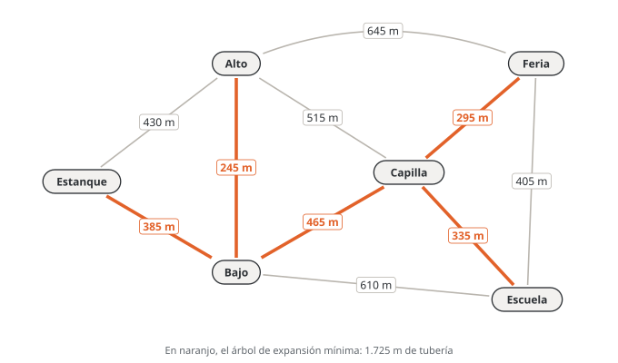
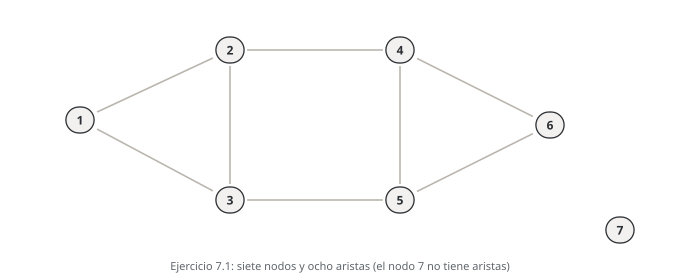
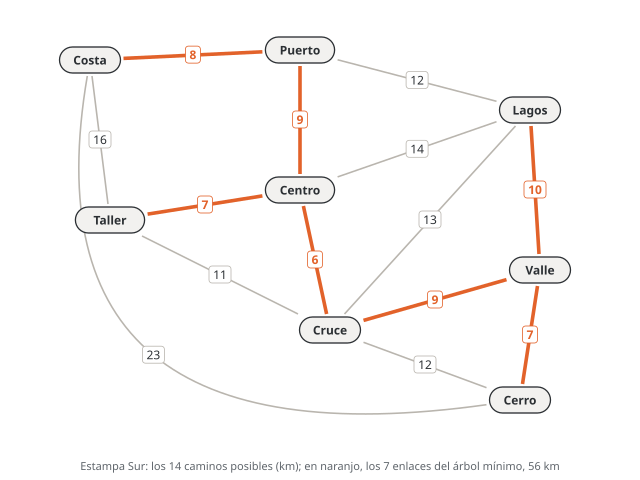

# Unidad 7 · Redes y árbol de expansión mínima

**Qué vas a poder hacer.** Describir una red con nodos, arcos, caminos, ciclos y árboles; escribirla
como matriz, lista o matriz de incidencia; encontrar el árbol de expansión mínima con Kruskal y con
Prim, paso a paso y con la tabla que se pide en el certamen; explicar por qué esos algoritmos codiciosos
dan el óptimo; escribir el árbol mínimo como programa entero, y reconocer cuándo una restricción extra
obliga a dejar el algoritmo y volver al modelo.

**Lo que necesitas antes.** De la unidad 2, una variable binaria bien definida y su naturaleza
($x \in \{0,1\}$). De la unidad 4, la red de Estampa Sur y la idea de subtour del vendedor viajero: la
restricción que la elimina es la misma que aparece acá. Nada de redes más allá de eso: esta unidad las
parte de cero.

**Tiempo.** Unas 7 horas: 3 de lectura con lápiz (las tablas se hacen a mano) y 4 de práctica.

---

## 1. La idea: una red es nodos y arcos

Una **red** (o **grafo**) $G = (N, A)$ es un conjunto $N$ de **nodos** unidos por un conjunto $A$ de
**arcos**. Los nodos son lugares o estados (una bodega, una antena, un cruce); los arcos, las conexiones
posibles entre ellos (un camino, un cable, una tubería). Casi siempre cada arco lleva un número: un
largo, un costo, un tiempo o una capacidad.

| Aplicación | Nodos | Arcos | Número del arco |
|---|---|---|---|
| reparto | bodega y tiendas | caminos | km o minutos |
| telecomunicaciones | antenas | enlaces de radio o fibra | costo de instalar |
| agua potable | estanque y sectores | tuberías | metros o litros por segundo |
| proyecto | hitos | actividades | días |

Las redes importan por dos razones. Muchos problemas se dibujan solos como red, y entonces el modelo se
escribe casi mirando el dibujo. Y su estructura permite **algoritmos especializados**, mucho más rápidos
que el simplex o la ramificación y acotamiento, que se hacen a mano en un certamen.

Los problemas de redes del ramo se separan en dos familias:

- **Diseño de redes:** se decide *qué arcos construir*. Las variables son binarias. El árbol de
  expansión mínima (esta unidad) y el vendedor viajero (unidad 4) son de esta familia.
- **Flujo en redes:** la red ya existe y se decide *cuánto mandar por cada arco*. Las variables son
  continuas. La ruta más corta y el flujo máximo (unidad 8) y el transporte (unidad 9) son de esta familia.

---

## 2. El vocabulario: caminos, ciclos, conexo, árbol

| Término | Qué es | Ejemplo en la figura del ejercicio 7.1 |
|---|---|---|
| **arco dirigido** $(i,j)$ | conexión con sentido: de $i$ a $j$ | una calle de un sentido |
| **arista** o arco no dirigido $\{i,j\}$ | conexión que sirve en los dos sentidos | un cable |
| **adyacentes** | dos nodos unidos por un arco | 1 y 2 |
| **grado** de un nodo | cuántas aristas lo tocan | el nodo 2 tiene grado 3 |
| **camino** (trayectoria) | secuencia de nodos distintos, cada uno unido al siguiente | 1–2–4–6 |
| **ciclo** | camino que vuelve a su nodo inicial | 1–2–3–1 |
| **conexo** | hay un camino entre cualquier par de nodos | no: el 7 queda aislado |
| **componente** | grupo máximo de nodos conectados entre sí | $\{1,\dots,6\}$ y $\{7\}$ |
| **árbol** | grafo conexo y sin ciclos | |
| **árbol de expansión** | subgrafo que es árbol y contiene **todos** los nodos | |

Dos hechos de los árboles se usan todo el tiempo:

- **Un árbol de $n$ nodos tiene exactamente $n-1$ aristas.** Con menos no alcanza a conectar; con más,
  forma un ciclo. Por eso Kruskal y Prim se detienen al llegar a $n-1$.
- **En un árbol hay un solo camino entre cada par de nodos.** Si agregas una arista que no estaba, cierras
  exactamente un ciclo; si quitas una arista, el árbol se parte en exactamente dos pedazos. Las dos
  propiedades de la sección 7 salen de aquí.

La suma de los grados de todos los nodos es el doble del número de aristas (cada arista tiene dos
extremos). Sirve para revisar una lista de adyacencia.

> **Cuidado con una definición que circula.** Un grafo con dos componentes es un grafo **no conexo**, no
> un grafo «bipartito». Bipartito significa que los nodos se pueden separar en dos grupos de modo que
> toda arista une un nodo de un grupo con uno del otro (como trabajadores y tareas en la asignación de la
> unidad 10).

---

## 3. Cómo se escribe una red: matriz, lista e incidencia

**Matriz de adyacencia (o de distancias).** Una fila y una columna por nodo; la celda $(i,j)$ tiene el
peso de la arista $\{i,j\}$, o una raya (en algunos textos, $\infty$) si no existe. En una red no
dirigida la matriz es simétrica. Es como se entregan casi todos los ejercicios de árbol mínimo.

**Lista de adyacencia.** Para cada nodo, sus vecinos con el peso: `Bajo: Estanque (385), Alto (245), …`.
Ocupa espacio proporcional al número de aristas y no al cuadrado de los nodos; por eso los programas
guardan así las redes grandes, que suelen tener la matriz casi vacía.

**Lista de aristas.** Una línea por arista: `<"Taller", "Centro", 7>`. Es lo que lee el modelo OPL.

**Matriz de incidencia nodo-arco.** Una fila por nodo y una columna por arco. En una red dirigida, la
columna del arco $(i,j)$ tiene $+1$ en la fila de $i$ (el arco sale), $-1$ en la de $j$ (el arco entra) y
0 en el resto; cada columna suma 0. En la unidad 8, la restricción de balance de flujo es exactamente
«matriz de incidencia por flujos = oferta de cada nodo». Algunos textos usan el signo al revés ($-1$ donde
sale); da lo mismo mientras sea igual en todo el modelo. En una red no dirigida la columna tiene un 1 en
cada extremo.

---

## 4. El problema del árbol de expansión mínima

Dada una red **no dirigida**, **conexa** y con un costo $c_e$ en cada arista, el **árbol de expansión
mínima** (AEM, en inglés *minimum spanning tree*, MST) es el árbol que toca todos los nodos con el menor
costo total. Es la respuesta a «conectar todo con la menor cantidad de cable, tubería o camino»,
cuando basta que cada par quede conectado *de alguna forma*, directa o indirecta.

Por qué el óptimo es un árbol: si la red elegida tuviera un ciclo, quitar la arista más cara del ciclo
mantiene todo conectado y baja el costo (con costos positivos). Así que la red más barata que conecta
todo no tiene ciclos: es un árbol.

**No es la ruta más corta.** El árbol mínimo minimiza el total construido, no la distancia de cada nodo a
un centro. En el árbol, el camino entre dos nodos puede ser bastante más largo que el camino directo en
la red completa. La unidad 8 compara los dos árboles (ejercicio 8.8).

Hay muchos árboles de expansión (en una red completa de 8 nodos, $8^{6} = 262.144$), así que no se
enumeran. Pero el problema, a diferencia del vendedor viajero, se resuelve **exactamente** con un
algoritmo codicioso que en cada paso toma lo más barato que no rompa nada. Hay dos versiones.

---

## 5. Kruskal: las aristas de menor a mayor

1. Ordena todas las aristas de menor a mayor costo. En empate, usa un criterio fijo y dilo (en esta
   unidad: el orden en que vienen los datos).
2. Recorre la lista. Una arista **entra** si sus extremos todavía no están conectados por las aristas ya
   elegidas; si ya lo están, **se descarta**, porque cerraría un ciclo.
3. Termina cuando hay $n-1$ aristas. Las que quedan en la lista ya no se miran.

La pregunta del paso 2 es «¿sus extremos ya están conectados?», no «¿alguno de sus extremos ya está en el
árbol?». En Kruskal las aristas elegidas forman un **bosque** (varios árboles sueltos que se van
juntando), y una arista entre dos árboles distintos siempre entra aunque sus dos extremos ya tengan
aristas.

La tabla que se pide en el certamen tiene una fila por arista evaluada: la arista, su costo, si cierra
ciclo (y cuál), la acción y el acumulado. La sección 10 la muestra completa.

---

## 6. Prim: un solo árbol que crece

1. Elige un nodo inicial (cualquiera: el resultado no depende de él).
2. A cada nodo de afuera asígnale una **etiqueta** $[c, p]$: el costo $c$ de la arista más barata que lo
   une al árbol y el nodo $p$ del árbol de donde sale. Si no hay ninguna, la etiqueta es $\infty$.
3. Entra el nodo de afuera con la etiqueta menor, junto con su arista (en empate, en esta unidad, el que
   va primero en la lista de nodos).
4. Con el nodo que entró, revisa las etiquetas de sus vecinos de afuera: si la arista nueva es **más
   barata** que la etiqueta, la reemplaza. Vuelve al paso 3 hasta que todos estén adentro.

Prim siempre mira las aristas que **cruzan** de los nodos de adentro a los de afuera, nunca la más
barata de toda la red. Por eso nunca cierra un ciclo: toda arista que agrega lleva a un nodo nuevo.

| | Kruskal | Prim |
|---|---|---|
| Qué crece | un bosque que se va juntando | un solo árbol |
| Qué mira en cada paso | la arista más barata que queda en la lista | la arista más barata que cruza del árbol hacia afuera |
| Revisión de cada paso | ¿cierra ciclo? | ¿qué etiqueta baja? |
| Conviene | con la lista de aristas a mano | con la matriz de distancias a mano |

Si el árbol mínimo es único, los dos dan el mismo árbol. Si hay empates, pueden dar árboles distintos,
pero **siempre con el mismo costo total**.

---

## 7. Por qué funcionan: la propiedad de corte y la del ciclo

Un **corte** separa los nodos en dos grupos $S$ y $N \setminus S$. Las aristas que **cruzan** el corte
son las que tienen un extremo en cada grupo.

**Propiedad de corte.** En cualquier corte, la arista más barata que lo cruza pertenece a algún árbol
mínimo (y si es estrictamente la más barata, a todos).

*Por qué.* Toma un árbol mínimo $T$ que no la use. Agrégale esa arista $e$: se forma un ciclo, y ese
ciclo tiene que cruzar el corte otra vez por alguna arista $f$ de $T$. Cambia $f$ por $e$: sigue siendo
un árbol (se rompió el único ciclo) y no cuesta más, porque $c_e \le c_f$. Entonces existe un árbol mínimo
que usa $e$.

**Propiedad del ciclo.** En cualquier ciclo, la arista estrictamente más cara no está en ningún árbol
mínimo. (Si estuviera, sacarla parte el árbol en dos, y otra arista del mismo ciclo vuelve a unir los
pedazos más barata.)

Con eso, los dos algoritmos quedan justificados:

- **Prim** aplica la propiedad de corte al corte (árbol, resto) en cada paso: agrega justo la arista más
  barata que lo cruza.
- **Kruskal** agrega $e = \{i,j\}$ cuando une dos pedazos distintos del bosque. Toma el corte que separa
  el pedazo de $i$ del resto: ninguna arista más barata lo cruza, porque todas las más baratas ya se
  revisaron y las que cruzaban habrían unido esos pedazos antes. Y lo que descarta es, en su ciclo, la
  arista más cara (todas las del ciclo entraron antes).

Las mismas dos propiedades responden las preguntas de sensibilidad del certamen, sin rehacer el
algoritmo:

- **Una arista que no está en el árbol, ¿cuánto tiene que bajar para entrar?** Agrégala al árbol: cierra
  un ciclo. Entra si queda más barata que la arista más cara de ese ciclo (en el empate hay dos árboles
  mínimos).
- **Una arista del árbol, ¿cuánto puede subir sin salir?** Sácala: el árbol se parte en dos. Se mantiene
  mientras no pase a la arista más barata que cruza entre los dos pedazos.
- **Se corta una arista del árbol (falla un enlace).** La reemplaza la más barata que cruza entre los dos
  pedazos.

---

## 8. El árbol mínimo como programa entero

El algoritmo basta para resolver, pero el certamen pide el modelo (y una restricción extra, como en el
ejercicio 7.10, obliga a usarlo). Se escribe pieza por pieza.

**En palabras.** Se decide qué aristas construir. Se busca el menor costo total. Hay que elegir $n-1$
aristas y ninguna parte de la red elegida puede tener un ciclo.

**Conjuntos y parámetros.** $N$: nodos, con $n = |N|$. $E$: aristas posibles. $c_e$: costo de la arista
$e \in E$. Para un subconjunto $S \subseteq N$, $E(S)$ son las aristas con **los dos** extremos en $S$.

**Variable de decisión** (las tres piezas: índice con su rango, qué significa el 1, el «en otro caso»):

$$x_e = \begin{cases} 1 & \text{si la arista } e \text{ se construye (entra al árbol)} \\ 0 & \text{en otro caso} \end{cases} \qquad \forall e \in E$$

**Modelo.**

$$\min \; \sum_{e \in E} c_e \, x_e$$

$$\text{s.a.} \quad \sum_{e \in E} x_e = n - 1$$

$$\sum_{e \in E(S)} x_e \le |S| - 1 \qquad \forall S \subseteq N,\ |S| \ge 3$$

$$x_e \in \{0,1\} \qquad \forall e \in E$$

**Por qué la segunda restricción elimina ciclos.** Un ciclo sobre los nodos de $S$ usa $|S|$ aristas de
$E(S)$; la restricción deja como máximo $|S|-1$. Con $n-1$ aristas y sin ciclos, la red elegida es un
árbol. Para $|S| = 2$ la restricción dice $x_e \le 1$, que ya cumple una binaria; por eso se escriben
desde $|S| = 3$. Es la misma restricción de eliminación de subtours del vendedor viajero (unidad 4).

**El problema del tamaño.** Hay una restricción por subconjunto: $2^n - 1$ subconjuntos en total. Con 8
nodos son 255 subconjuntos y 219 restricciones de tamaño 3 o más; con 30 nodos, más de mil millones. Por
eso en la práctica se agregan solo las que la solución actual viola (planos cortantes, unidad 6), o se
usa directamente Kruskal o Prim. Un dato que se ve en el ramo: la relajación lineal de **este** modelo
ya da soluciones enteras, así que no hace falta ramificar; lo difícil es solo la cantidad de
restricciones.

**Cuidado con la palabra «difícil».** El árbol mínimo es combinatorio (hay muchísimos árboles), pero
**no** es un problema difícil en el sentido técnico (NP-difícil): Kruskal y Prim lo resuelven en tiempo
polinomial, del orden de $m \log m$ operaciones para $m$ aristas. El vendedor viajero, en cambio, sí es
NP-difícil y por eso las unidades 11 y 12 usan heurísticas.

En OPL, el truco para escribir las $2^n - 1$ restricciones en una sola línea es numerar los subconjuntos:
el subconjunto número $s$ contiene al nodo $k$ si el bit $k$ de $s$ vale 1. El modelo completo está en
la sección 14.

---

## 9. Cuándo no aplica

- **Red dirigida.** Si los arcos tienen sentido (el agua baja, no sube), el problema es el de la
  *arborescencia mínima* y Kruskal y Prim pueden fallar; se resuelve con otro algoritmo (Chu-Liu y
  Edmonds), fuera del programa.
- **Solo algunos nodos deben quedar conectados.** Si los otros pueden usarse de paso pero no es
  obligatorio tocarlos, es el *problema de Steiner*, que sí es difícil.
- **Restricciones extra:** tope de grado en un nodo (puertos de un equipo), un largo máximo entre dos
  nodos, presupuesto por zona. El codicioso deja de ser óptimo (ejercicio 7.10) y hay que volver al
  programa entero.
- **Red no conexa.** No existe árbol de expansión; Kruskal entrega un *bosque* mínimo, uno por
  componente.
- **Costos negativos** no son problema (el orden sigue igual), y para el árbol **máximo** basta ordenar
  de mayor a menor (ejercicio 7.8).

---

## 10. Ejemplo resuelto · La red de agua potable rural

Un comité de agua potable rural de Ñuble va a unir su estanque con cinco sectores (Alto, Bajo, Capilla,
Escuela y Feria). Los trazados posibles siguen caminos y deslindes; la matriz da los metros de tubería
de cada tramo (una raya: no hay trazado posible). La tubería instalada cuesta $8.400 el metro. ¿Qué tramos
se construyen para que todos los sectores queden conectados al estanque con la menor tubería?

| | Estanque | Alto | Bajo | Capilla | Escuela | Feria |
|---|---|---|---|---|---|---|
| **Estanque** | 0 | 430 | 385 | — | — | — |
| **Alto** | 430 | 0 | 245 | 515 | — | 645 |
| **Bajo** | 385 | 245 | 0 | 465 | 610 | — |
| **Capilla** | — | 515 | 465 | 0 | 335 | 295 |
| **Escuela** | — | — | 610 | 335 | 0 | 405 |
| **Feria** | — | 645 | — | 295 | 405 | 0 |

**Paso 1 · Identificar el problema.** Hay que conectar todos los nodos, de cualquier forma, al menor
largo total, y la red no es dirigida (el agua se distribuye por la red con presión de bombeo): es un
árbol de expansión mínima. Tiene 6 nodos, así que el árbol tendrá 5 tramos.

**Paso 2 · Kruskal.** Las diez aristas, ordenadas: 245, 295, 335, 385, 405, 430, 465, 515, 610 y 645.

| Paso | Arista | Peso | ¿Sus extremos ya están conectados? | Acción | Acumulado |
|---|---|---|---|---|---|
| 1 | Alto–Bajo | 245 m | no | entra | 245 m |
| 2 | Capilla–Feria | 295 m | no | entra | 540 m |
| 3 | Capilla–Escuela | 335 m | no | entra | 875 m |
| 4 | Estanque–Bajo | 385 m | no | entra | 1.260 m |
| 5 | Escuela–Feria | 405 m | sí: cerraría el ciclo Escuela–Capilla–Feria–Escuela | se descarta | 1.260 m |
| 6 | Estanque–Alto | 430 m | sí: cerraría el ciclo Estanque–Bajo–Alto–Estanque | se descarta | 1.260 m |
| 7 | Bajo–Capilla | 465 m | no | entra | 1.725 m |

En el paso 4 el bosque tiene dos pedazos: {Estanque, Alto, Bajo} y {Capilla, Escuela, Feria}. Los pasos 5
y 6 se descartan porque cada uno une dos nodos del mismo pedazo. El paso 7 une los dos pedazos y completa
los 5 tramos; Alto–Capilla, Bajo–Escuela y Alto–Feria ya no se miran.

**Paso 3 · Prim desde el estanque, para comprobar.** Cada celda es la etiqueta [metros, desde dónde].

| Paso | Entra al árbol | Alto | Bajo | Capilla | Escuela | Feria |
|---|---|---|---|---|---|---|
| 0 | Estanque (inicio) | [430, Est] | [385, Est] | ∞ | ∞ | ∞ |
| 1 | Bajo (Estanque–Bajo, 385) | [245, Baj] | **entra** | [465, Baj] | [610, Baj] | ∞ |
| 2 | Alto (Bajo–Alto, 245) | **entra** | ✓ | [465, Baj] | [610, Baj] | [645, Alt] |
| 3 | Capilla (Bajo–Capilla, 465) | ✓ | ✓ | **entra** | [335, Cap] | [295, Cap] |
| 4 | Feria (Capilla–Feria, 295) | ✓ | ✓ | ✓ | [335, Cap] | **entra** |
| 5 | Escuela (Capilla–Escuela, 335) | ✓ | ✓ | ✓ | **entra** | ✓ |

Fíjate en el paso 1: Alto tenía [430, Est] y baja a [245, Baj] porque desde Bajo se llega más barato. Y en
el paso 2 la etiqueta de Capilla sigue en [465, Baj]: el tramo desde Alto (515) es más caro y no la
cambia. Prim llega a los mismos cinco tramos, en otro orden.



**Paso 4 · Resultado.** Se construyen Alto–Bajo, Estanque–Bajo, Bajo–Capilla, Capilla–Feria y
Capilla–Escuela: 1.725 m de tubería, que a $8.400 el metro cuestan $14.490.000.

**Cómo se lee.**

- **El tramo Bajo–Capilla (465 m) es el puente** entre las dos mitades del valle. Por la propiedad de
  corte, es la arista más barata que cruza entre {Estanque, Alto, Bajo} y {Capilla, Escuela, Feria}: si
  el comité encuentra un trazado más corto entre esas mitades, ahí está el ahorro.
- **El árbol no es una red de distribución con distancias cortas.** El agua llega a Feria recorriendo
  Estanque–Bajo–Capilla–Feria (1.145 m de tubería en el camino). El árbol minimiza lo que se construye,
  no lo que recorre el agua.
- **Decisión.** El comité licita esos cinco tramos por $14.490.000. Si un vecino ofrece servidumbre para
  un trazado Estanque–Capilla, conviene solo si mide menos de 465 m: así reemplazaría el puente
  Bajo–Capilla (propiedad del ciclo).

---

## 11. Errores típicos

| Error | Cómo evitarlo |
|---|---|
| En Kruskal, descartar una arista porque «uno de sus extremos ya está en el árbol» | la pregunta es si sus dos extremos ya están **conectados entre sí**; una arista entre dos pedazos del bosque entra |
| En Prim, tomar la arista más barata de toda la red | Prim solo mira las aristas que **cruzan** del árbol hacia afuera; para eso están las etiquetas |
| En Prim, no actualizar la etiqueta de un nodo cuando entra un vecino suyo | cada vez que entra un nodo, revisa la etiqueta de todos sus vecinos de afuera |
| Parar antes o después de $n-1$ aristas | cuenta los nodos primero y escribe «el árbol tendrá $n-1$ aristas» |
| Romper empates sin decirlo | escribe el criterio; con empates hay más de un árbol mínimo, pero el costo total es el mismo |
| Dar el árbol mínimo cuando piden «la ruta más corta del centro a cada barrio» | el árbol mínimo minimiza lo que se construye; la ruta más corta (unidad 8) minimiza lo que se recorre |
| Variable sin sus tres piezas: «$x_e$ = arista» | índice con su rango ($e \in E$), qué significa el 1 (se construye) y el «0 en otro caso»; cada pieza vale puntaje por sí sola |
| Olvidar la naturaleza o el «∀» | la línea $x_e \in \{0,1\}\ \forall e \in E$ va siempre, y cada familia de restricciones lleva su $\forall S$ |
| Escribir $\sum_{e \in E(S)} x_e \le |S|-1$ con $E(S)$ = aristas que tocan $S$ | $E(S)$ son las aristas con **los dos** extremos en $S$; las que salen de $S$ no forman ciclos dentro de $S$ |
| Decir que el árbol mínimo es NP-difícil porque es combinatorio | es combinatorio y polinomial: Kruskal y Prim lo resuelven exactamente; lo difícil es el vendedor viajero |
| Llamar «bipartito» a un grafo con dos componentes | es no conexo; bipartito es otra cosa (sección 2) |
| Agregar una restricción de grado y seguir usando Kruskal | con restricciones extra el codicioso puede fallar; se resuelve el programa entero (ejercicio 7.10) |

---

## 12. Práctica

Diez ejercicios: 7.1 a 7.4 básicos, 7.5 a 7.8 intermedios, 7.9 y 7.10 de desafío. Las pautas están en
la sección 13. Haz las tablas a mano antes de mirar.

**7.1 · Leer un grafo (básico).** El grafo de la figura tiene siete nodos y estas aristas: 1–2, 1–3, 2–3,
2–4, 3–5, 4–5, 5–6 y 4–6.



(a) ¿Cuántos nodos y aristas tiene? Escribe el grado de cada nodo y comprueba la suma. (b) Da un camino
de 1 a 6 y un ciclo. (c) ¿Es conexo? ¿Cuántas componentes tiene? (d) ¿Cuántas aristas tiene un árbol de
expansión de este grafo? ¿Existe alguno? (e) Se agrega la arista 6–7. ¿Cuántas aristas hay que sacar
para quedarse con un árbol de expansión? (f) Con la arista 6–7 agregada, ¿es árbol de expansión el
conjunto {1–2, 2–3, 3–5, 5–6, 4–6, 6–7}? ¿Y {1–2, 1–3, 2–3, 4–5, 5–6, 6–7}?

**7.2 · Tres formas de escribir la misma red (básico).** Una red no dirigida de cinco nodos tiene esta
matriz de pesos:

| | P | Q | R | S | T |
|---|---|---|---|---|---|
| **P** | 0 | 6 | 9 | — | — |
| **Q** | 6 | 0 | 4 | 7 | — |
| **R** | 9 | 4 | 0 | 5 | 8 |
| **S** | — | 7 | 5 | 0 | 3 |
| **T** | — | — | 8 | 3 | 0 |

(a) Escribe la lista de aristas y la lista de adyacencia. (b) ¿Cuántas celdas fuera de la diagonal están
vacías? ¿Qué porcentaje de las aristas posibles existe? (c) Orienta cada arista de la letra menor a la
mayor (P→Q, P→R, …) y escribe la matriz de incidencia nodo-arco con $+1$ donde sale y $-1$ donde entra.
Comprueba que cada columna suma 0.

**7.3 · Cable de un parque eólico (básico).** Un parque eólico conecta su subestación (A) con seis
aerogeneradores (B a G) con cable subterráneo. La matriz da los trazados posibles en cientos de metros.
Encuentra el árbol de expansión mínima con Kruskal: para cada arista evaluada di si entra o se descarta
y por qué. Rompe empates por orden alfabético de la arista. ¿Cuántos metros de cable se tienden?

| | A | B | C | D | E | F | G |
|---|---|---|---|---|---|---|---|
| **A** | 0 | 12 | 9 | — | — | — | — |
| **B** | 12 | 0 | 7 | 14 | — | 15 | — |
| **C** | 9 | 7 | 0 | 10 | 11 | — | — |
| **D** | — | 14 | 10 | 0 | 6 | 8 | — |
| **E** | — | — | 11 | 6 | 0 | 13 | 9 |
| **F** | — | 15 | — | 8 | 13 | 0 | 5 |
| **G** | — | — | — | — | 9 | 5 | 0 |

**7.4 · Electricidad en un camping (básico).** Un camping lleva electricidad desde su caseta (K) a cinco
zonas (L a P). La matriz da los metros de cable de cada trazado posible. Encuentra el árbol mínimo con
Prim desde K y registra la tabla de etiquetas completa. ¿Cuántos metros se tienden?

| | K | L | M | N | O | P |
|---|---|---|---|---|---|---|
| **K** | 0 | 35 | 50 | 60 | — | — |
| **L** | 35 | 0 | 25 | — | 70 | — |
| **M** | 50 | 25 | 0 | 30 | 45 | 55 |
| **N** | 60 | — | 30 | 0 | — | 40 |
| **O** | — | 70 | 45 | — | 0 | 20 |
| **P** | — | — | 55 | 40 | 20 | 0 |

**7.5 · El modelo extendido de una red chica (intermedio).** Una red de cuatro nodos tiene las aristas
1–2 (5), 1–3 (6), 2–3 (4), 2–4 (9) y 3–4 (8). (a) Escribe el programa entero del árbol mínimo **en forma
extendida**: la función objetivo con sus cinco términos y cada restricción escrita con sus variables.
(b) ¿Cuáles de las restricciones de subconjuntos son redundantes y por qué? (c) Resuelve el modelo sin las
restricciones de ciclos: ¿qué entrega y qué tiene de malo? (d) Resuélvelo completo con Kruskal y
compruébalo con `modelos/u07_arbol_minimo.mod` y `u07_e05_cuatro_nodos.dat`.

**7.6 · Sensibilidad sin rehacer el algoritmo (intermedio).** Con el árbol del ejercicio 7.3: (a) la
arista E–G no está en el árbol: ¿cuánto tiene que bajar su costo para entrar y a cuál reemplaza? (b) Lo
mismo para B–D. (c) La arista C–D sí está en el árbol: ¿hasta cuánto puede subir sin salir? ¿Qué pasa con
el total si sube a 12? (d) Lo mismo para A–C.

**7.7 · Un tramo obligado y uno prohibido (intermedio).** En el camping del ejercicio 7.4: (a) ya existe
una canalización bajo el camino entre K y N y la administración exige usarla: ¿cuál es el árbol mínimo
que incluye K–N y cuánto cable de más cuesta la exigencia? Resuélvelo con Kruskal partiendo con K–N y
compruébalo con la propiedad del ciclo. (b) Aparte de lo anterior, el tramo N–P cruza una zona que se
inunda y queda prohibido: ¿cuál es el nuevo árbol mínimo y cuánto cable de más necesita?

**7.8 · El árbol de máxima señal (intermedio).** Seis puestos de guardaparques (U a Z) se comunicarán por
radio. Cada enlace posible tiene una calidad de señal de 0 a 100:

| Enlace | U–V | U–W | V–W | V–X | W–X | W–Y | X–Y | X–Z | Y–Z | V–Z |
|---|---|---|---|---|---|---|---|---|---|---|
| Calidad | 72 | 65 | 80 | 58 | 77 | 61 | 84 | 69 | 74 | 50 |

(a) Encuentra el árbol de expansión de **mayor** calidad total. ¿Cómo adaptas Kruskal? (b) ¿Cuál es el
enlace más débil de ese árbol? Demuestra que ningún otro árbol de expansión tiene un enlace más débil
mejor (pista: mira el puesto U).

**7.9 · Una tormenta y una tienda nueva (desafío).** Con el árbol mínimo del caso integrador (sección
14): (a) una tormenta derriba el enlace Lagos–Valle. ¿Con qué enlace se reemplaza al menor costo y cuántos
km tiene la red nueva? Usa la propiedad de corte. (b) Ya reparado el enlace, Estampa Sur abre una séptima
tienda, Bosque, con enlaces posibles Bosque–Lagos (6 km), Bosque–Valle (11 km) y Bosque–Puerto (9 km).
Demuestra que para el árbol nuevo basta correr Kruskal sobre las 7 aristas del árbol actual más las 3
nuevas (no hace falta volver a los 14 caminos), hazlo y di qué enlace actual sale.

**7.10 · La central con dos puertos (desafío).** Un colegio cablea su red: la central (sala de
servidores) y cinco salas (A a E). Los enlaces posibles, en metros de cable:

| Enlace | Central–C | Central–D | Central–E | A–B | A–C | A–D | B–E | C–D |
|---|---|---|---|---|---|---|---|---|
| Metros | 35 | 85 | 175 | 265 | 280 | 205 | 95 | 110 |

(a) Encuentra el árbol mínimo con Kruskal. ¿Cuántos enlaces llegan a la central? (b) La central solo
tiene **dos puertos libres**. Un compañero propone «Kruskal saltándose las aristas que pasen el tope»:
córrelo. (c) Escribe el programa entero con la restricción de grado, resuélvelo en OPL y compara. ¿Por
qué falla la propuesta del compañero?

---

## 13. Pautas

**7.1.** (a) 7 nodos y 8 aristas. Grados: 1: 2 · 2: 3 · 3: 3 · 4: 3 · 5: 3 · 6: 2 · 7: 0. Suman 16, el
doble de 8. (b) Camino 1–2–4–6; ciclo 1–2–3–1 (hay otros, como 4–5–6–4). (c) No es conexo: tiene 2
componentes, $\{1,\dots,6\}$ y $\{7\}$. (d) Un árbol de expansión tendría $7 - 1 = 6$ aristas, pero no
existe ninguno: ninguna arista llega al nodo 7. (e) Con 6–7 hay 9 aristas y el árbol usa 6: hay que
sacar 3 (una por cada ciclo independiente). (f) El primero sí: 6 aristas, toca los 7 nodos y no tiene
ciclos (1–2–3–5–6, con 4 y 7 colgando de 6). El segundo no: también tiene 6 aristas, pero 1–2, 1–3 y 2–3
forman un ciclo y entonces quedan dos pedazos, {1, 2, 3} y {4, 5, 6, 7}. Tener $n-1$ aristas no basta:
además no puede haber ciclos.

**7.2.** (a) Lista de aristas: P–Q 6, P–R 9, Q–R 4, Q–S 7, R–S 5, R–T 8, S–T 3. Lista de adyacencia:

- P: Q (6), R (9)
- Q: P (6), R (4), S (7)
- R: P (9), Q (4), S (5), T (8)
- S: Q (7), R (5), T (3)
- T: R (8), S (3)

(b) Fuera de la diagonal hay 20 celdas; 14 tienen número (cada arista aparece dos veces) y 6 celdas
están vacías. Existen 7 de las 10 aristas posibles: 70 %. En una red real de cientos de nodos ese
porcentaje es mínimo y por eso se guarda como lista. (c) Columnas en el orden P→Q, P→R, Q→R, Q→S, R→S,
R→T, S→T:

| Nodo | P→Q | P→R | Q→R | Q→S | R→S | R→T | S→T |
|---|---|---|---|---|---|---|---|
| **P** | 1 | 1 | 0 | 0 | 0 | 0 | 0 |
| **Q** | −1 | 0 | 1 | 1 | 0 | 0 | 0 |
| **R** | 0 | −1 | −1 | 0 | 1 | 1 | 0 |
| **S** | 0 | 0 | 0 | −1 | −1 | 0 | 1 |
| **T** | 0 | 0 | 0 | 0 | 0 | −1 | −1 |

Cada columna tiene un $+1$ y un $-1$: suma 0. La fila de un nodo, leída como «sale menos entra», es el
lado izquierdo del balance de flujo de la unidad 8.

**7.3.** El árbol tendrá 6 aristas. Ordenadas: F–G 5, D–E 6, B–C 7, D–F 8, A–C 9, E–G 9, C–D 10, C–E 11,
A–B 12, E–F 13, B–D 14, B–F 15.

| Paso | Arista | Peso | ¿Sus extremos ya están conectados? | Acción | Acumulado |
|---|---|---|---|---|---|
| 1 | F–G | 5 | no | entra | 5 |
| 2 | D–E | 6 | no | entra | 11 |
| 3 | B–C | 7 | no | entra | 18 |
| 4 | D–F | 8 | no | entra | 26 |
| 5 | A–C | 9 | no | entra | 35 |
| 6 | E–G | 9 | sí: cerraría el ciclo E–D–F–G–E | se descarta | 35 |
| 7 | C–D | 10 | no | entra | 45 |

Total: 45 cientos de metros, o sea 4.500 m de cable. En el paso 4, D–F entra aunque D y F ya tienen
aristas: unía los pedazos {D, E} y {F, G}. C–D une el lado de la subestación con el de los
aerogeneradores del fondo; después del paso 7 el resto no se mira.

**7.4.**

| Paso | Entra al árbol | L | M | N | O | P |
|---|---|---|---|---|---|---|
| 0 | K (inicio) | [35, K] | [50, K] | [60, K] | ∞ | ∞ |
| 1 | L (K–L, 35) | **entra** | [25, L] | [60, K] | [70, L] | ∞ |
| 2 | M (L–M, 25) | ✓ | **entra** | [30, M] | [45, M] | [55, M] |
| 3 | N (M–N, 30) | ✓ | ✓ | **entra** | [45, M] | [40, N] |
| 4 | P (N–P, 40) | ✓ | ✓ | ✓ | [20, P] | **entra** |
| 5 | O (P–O, 20) | ✓ | ✓ | ✓ | **entra** | ✓ |

Árbol: K–L, L–M, M–N, N–P y P–O, con 150 m de cable. Las etiquetas que bajan cuentan la historia: M pasa de
50 (directo desde K) a 25 (desde L), N de 60 a 30 y O de 70 a 45 y después a 20. P–O (20 m) es la arista
más barata de la red y entra al final: Prim no la puede tomar hasta que P esté en el árbol.

**7.5.** (a) Con $x_{ij} = 1$ si la arista $\{i,j\}$ se construye y 0 en otro caso:

$$\min\; 5x_{12} + 6x_{13} + 4x_{23} + 9x_{24} + 8x_{34}$$

$$x_{12} + x_{13} + x_{23} + x_{24} + x_{34} = 3$$

$$\{1,2,3\}:\; x_{12} + x_{13} + x_{23} \le 2 \qquad \{1,2,4\}:\; x_{12} + x_{24} \le 2$$

$$\{1,3,4\}:\; x_{13} + x_{34} \le 2 \qquad \{2,3,4\}:\; x_{23} + x_{24} + x_{34} \le 2$$

$$\{1,2,3,4\}:\; x_{12} + x_{13} + x_{23} + x_{24} + x_{34} \le 3$$

$$x_{12}, x_{13}, x_{23}, x_{24}, x_{34} \in \{0,1\}$$

(b) Las de {1,2,4} y {1,3,4} tienen solo dos aristas adentro (no existe 1–4): dos binarias siempre suman
a lo más 2. La de {1,2,3,4} repite la igualdad. Solo cuentan los dos triángulos: {1,2,3} y {2,3,4}.
(c) Sin ellas, el modelo toma las tres aristas más baratas: 1–2, 1–3 y 2–3, con costo 15. Es un ciclo y
el nodo 4 queda aislado: tres aristas no bastan si forman un ciclo. (d) Kruskal: 2–3 (4) entra, 1–2 (5)
entra, 1–3 (6) se descarta (ciclo 1–2–3–1), 3–4 (8) entra: árbol 1–2, 2–3, 3–4 con costo 17. OPL con el
mismo `.mod` del caso (cambia solo el `.dat`) imprime:

```text
largo = 17
x[1,2] = 1
x[1,3] = 0
x[2,3] = 1
x[2,4] = 0
x[3,4] = 1
```

**7.6.** El árbol del 7.3 es F–G, D–E, B–C, D–F, A–C y C–D.

- (a) E–G (9) cierra en el árbol el ciclo E–D–F–G–E, con D–E 6, D–F 8 y F–G 5. Entra si baja de 8 y
  reemplaza a D–F; justo en 8 empata y hay dos árboles mínimos. Por ejemplo, con E–G en 7 el total baja a
  44.
- (b) B–D (14) cierra B–C–D–B, con B–C 7 y C–D 10: entra si baja de 10 y reemplaza a C–D.
- (c) Sin C–D el árbol se parte en {A, B, C} y {D, E, F, G}. Cruzan B–D 14, C–E 11 y B–F 15: C–D se
  mantiene mientras no pase de 11 (en 11 empata con C–E). Si sube a 12, sale, entra C–E y el total sube a
  46, no a 47: el árbol cambia de arista en vez de pagar el aumento.
- (d) Sin A–C, A queda sola; la única arista que la conecta con el resto es A–B 12. A–C se mantiene hasta
  12.

El verificador lo comprueba enumerando todos los árboles de la red para cada valor.

**7.7.** (a) Kruskal con K–N puesta desde el principio:

| Paso | Arista | Peso | ¿Sus extremos ya están conectados? | Acción | Acumulado |
|---|---|---|---|---|---|
| 1 | K–N | 60 | (obligada) | entra primero | 60 |
| 2 | O–P | 20 | no | entra | 80 |
| 3 | L–M | 25 | no | entra | 105 |
| 4 | M–N | 30 | no | entra | 135 |
| 5 | K–L | 35 | sí: cerraría el ciclo K–N–M–L–K | se descarta | 135 |
| 6 | N–P | 40 | no | entra | 175 |

Árbol K–N, O–P, L–M, M–N, N–P: 175 m, o sea 25 m más que los 150 m del óptimo. Con la propiedad del ciclo:
K–N cierra en el árbol del 7.4 el ciclo K–L–M–N–K, cuya arista más cara (sin contar K–N) es K–L 35; se
saca K–L y el total es $150 + 60 - 35 = 175$. (b) Sin N–P, el árbol del 7.4 se parte en {K, L, M, N} y
{O, P}. Cruzan L–O 70, M–O 45 y M–P 55; entra M–O. Árbol O–P, L–M, M–N, K–L, M–O: 155 m, 5 m más. Prohibir
cuesta poco porque había un reemplazo casi igual de barato; obligar cuesta más porque K–N es cara.

**7.8.** (a) Se ordena de **mayor** a menor y se descarta lo que cierra ciclo: es el mismo argumento con
los signos al revés.

| Paso | Arista | Peso | ¿Sus extremos ya están conectados? | Acción | Acumulado |
|---|---|---|---|---|---|
| 1 | X–Y | 84 | no | entra | 84 |
| 2 | V–W | 80 | no | entra | 164 |
| 3 | W–X | 77 | no | entra | 241 |
| 4 | Y–Z | 74 | no | entra | 315 |
| 5 | U–V | 72 | no | entra | 387 |

Árbol X–Y, V–W, W–X, Y–Z, U–V, con calidad total 387. (b) En ese árbol la más débil vale 72 (U–V). Todo
árbol de expansión tiene que llegar a U, y U solo tiene U–V (72) y U–W (65): ningún árbol puede tener su
enlace más débil por encima de 72. El árbol máximo lo logra, así que también es el mejor «por su eslabón
más débil». Esto vale siempre: el árbol de expansión máxima maximiza también el peso de su arista mínima.

**7.9.** (a) Lagos está en el árbol solo por Lagos–Valle. Si cae, el corte es {Lagos} contra el resto, y
lo cruzan Puerto–Lagos 12, Lagos–Cruce 13 y Centro–Lagos 14. Entra Puerto–Lagos (12 km) y la red pasa de
56 a 58 km. (b) Toda arista vieja que quedó fuera del árbol era la más cara de algún ciclo de la red
vieja, y ese ciclo sigue existiendo: sigue fuera (propiedad del ciclo). Por eso basta Kruskal sobre las 7
aristas del árbol y las 3 nuevas:

| Paso | Arista | Peso | ¿Sus extremos ya están conectados? | Acción | Acumulado |
|---|---|---|---|---|---|
| 1 | Centro–Cruce | 6 km | no | entra | 6 km |
| 2 | Bosque–Lagos | 6 km | no | entra | 12 km |
| 3 | Taller–Centro | 7 km | no | entra | 19 km |
| 4 | Valle–Cerro | 7 km | no | entra | 26 km |
| 5 | Puerto–Costa | 8 km | no | entra | 34 km |
| 6 | Centro–Puerto | 9 km | no | entra | 43 km |
| 7 | Valle–Cruce | 9 km | no | entra | 52 km |
| 8 | Bosque–Puerto | 9 km | no | entra | 61 km |

Con 9 nodos el árbol tiene 8 aristas y queda completo en el paso 8: Lagos–Valle (10) sale. La red mide 61
km. Leído con el ciclo: Bosque–Lagos y Bosque–Puerto cierran el ciclo
Bosque–Lagos–Valle–Cruce–Centro–Puerto–Bosque, cuya arista más cara es Lagos–Valle; $56 + 6 + 9 - 10 = 61$.
La tienda nueva no solo cuelga del árbol: cambia cómo se conecta Lagos.

**7.10.** (a) Kruskal: Central–C 35, Central–D 85 y B–E 95 entran; C–D 110 se descarta (ciclo
Central–C–D); Central–E 175 y A–D 205 entran. Árbol de 595 m, con grado 3 en la central: no cabe en dos
puertos. (b) La propuesta del compañero: Central–C, Central–D y B–E entran; C–D cierra ciclo; Central–E
se salta por el tope; A–D entra; A–B 265 entra para conectar {B, E}. Da 685 m. (c) Con la variable de la
sección 8 se agrega una sola familia (aquí, un solo nodo):

$$\sum_{e \in E:\ \text{Central} \in e} x_e \le 2$$

En OPL (`modelos/u07_e10_grado.mod`), el modelo del caso con una restricción más:

```opl
/*********************************************
 * Unidad 7 · Ejercicio 7.10
 * Árbol de expansión mínima con tope de grado en un nodo (puertos de la central).
 * Datos en u07_e10_grado.dat. Base abierta de ingeniería.
 *********************************************/

tuple Arista { string i; string j; int km; }
{string} Nodos   = ...;
{Arista} Aristas = ...;                 // metros de cable de cada enlace posible
string centro    = ...;                 // el nodo con tope de grado
int puertos      = ...;                 // cuántas aristas puede tener ese nodo

int N = card(Nodos);
range Subconjuntos = 1..ftoi(pow(2, N)) - 1;
int en[s in Subconjuntos][n in Nodos] = (s div ftoi(pow(2, ord(Nodos, n)))) mod 2;
int tam[s in Subconjuntos] = sum(n in Nodos) en[s][n];

dvar boolean x[Aristas];                // 1 si el enlace se tiende; 0 en otro caso

dexpr int Largo = sum(e in Aristas) e.km * x[e];

minimize Largo;

subject to {
  Total:
    sum(e in Aristas) x[e] == N - 1;
  forall(s in Subconjuntos: tam[s] >= 3)
    SinCiclos:
      sum(e in Aristas) en[s][e.i] * en[s][e.j] * x[e] <= tam[s] - 1;
  Grado:                                // la restricción nueva: a lo más «puertos» enlaces en la central
    sum(e in Aristas: e.i == centro || e.j == centro) x[e] <= puertos;
}

execute {
  writeln("largo = ", Largo);
  for (var e in Aristas)
    writeln("x[", e.i, ",", e.j, "] = ", x[e]);
}
```

El óptimo es Central–C, Central–E, C–D, A–D y B–E: 620 m, 25 m más que el árbol sin tope y 65 m menos que
la propuesta. La propuesta falla porque decide temprano: al tomar Central–D (85) gasta un puerto en algo
que C–D (110) podía hacer casi igual de barato, y después E y B quedan sin la única conexión barata a la
central. El tope de grado rompe la propiedad de corte: la arista más barata de un corte puede no caber.
Por eso, con restricciones extra, se vuelve al programa entero.

---

## 14. Caso integrador · Estampa Sur enlaza sus tiendas por radio

> Este caso sigue a Estampa Sur por todo el ramo. La unidad 4 usó su red de caminos (un taller y seis
> tiendas ficticias, con distancias ficticias) para la ruta del camión. Ahora el taller quiere conectar
> los ocho puntos con enlaces de radio para ver el inventario en línea; cada enlace sigue un camino
> existente (las antenas van en los postes) y su costo es proporcional a su largo.

**La red.** Los 14 caminos posibles, en km: Taller–Centro 7, Taller–Cruce 11, Taller–Costa 16,
Centro–Puerto 9, Centro–Cruce 6, Centro–Lagos 14, Puerto–Costa 8, Puerto–Lagos 12, Lagos–Valle 10,
Lagos–Cruce 13, Valle–Cruce 9, Valle–Cerro 7, Cerro–Cruce 12 y Cerro–Costa 23. Son 8 nodos: el árbol
tendrá 7 enlaces.

**Kruskal.**

| Paso | Arista | Peso | ¿Sus extremos ya están conectados? | Acción | Acumulado |
|---|---|---|---|---|---|
| 1 | Centro–Cruce | 6 km | no | entra | 6 km |
| 2 | Taller–Centro | 7 km | no | entra | 13 km |
| 3 | Valle–Cerro | 7 km | no | entra | 20 km |
| 4 | Puerto–Costa | 8 km | no | entra | 28 km |
| 5 | Centro–Puerto | 9 km | no | entra | 37 km |
| 6 | Valle–Cruce | 9 km | no | entra | 46 km |
| 7 | Lagos–Valle | 10 km | no | entra | 56 km |

Aquí no se descarta nada: las siete aristas más baratas ya forman un árbol. Las otras siete no se
evalúan: Taller–Cruce (11), Puerto–Lagos (12), Cerro–Cruce (12), Lagos–Cruce (13), Centro–Lagos (14),
Taller–Costa (16) y Cerro–Costa (23). Si se evaluaran, todas cerrarían un ciclo; por ejemplo, Taller–Cruce
cerraría Taller–Centro–Cruce–Taller. Los empates (dos de 7 y dos de 9) no cambian nada: entran las dos
de cada par.

**Prim desde el taller.**

| Paso | Entra al árbol | Centro | Puerto | Lagos | Valle | Costa | Cerro | Cruce |
|---|---|---|---|---|---|---|---|---|
| 0 | Taller (inicio) | [7, Tal] | ∞ | ∞ | ∞ | [16, Tal] | ∞ | [11, Tal] |
| 1 | Centro (Taller–Centro, 7) | **entra** | [9, Cen] | [14, Cen] | ∞ | [16, Tal] | ∞ | [6, Cen] |
| 2 | Cruce (Centro–Cruce, 6) | ✓ | [9, Cen] | [13, Cru] | [9, Cru] | [16, Tal] | [12, Cru] | **entra** |
| 3 | Puerto (Centro–Puerto, 9) | ✓ | **entra** | [12, Pue] | [9, Cru] | [8, Pue] | [12, Cru] | ✓ |
| 4 | Costa (Puerto–Costa, 8) | ✓ | ✓ | [12, Pue] | [9, Cru] | **entra** | [12, Cru] | ✓ |
| 5 | Valle (Cruce–Valle, 9) | ✓ | ✓ | [10, Val] | **entra** | ✓ | [7, Val] | ✓ |
| 6 | Cerro (Valle–Cerro, 7) | ✓ | ✓ | [10, Val] | ✓ | ✓ | **entra** | ✓ |
| 7 | Lagos (Valle–Lagos, 10) | ✓ | ✓ | **entra** | ✓ | ✓ | ✓ | ✓ |

En el paso 3 hay empate entre Puerto y Valle (las dos con 9) y entra Puerto, que va antes en la lista;
Valle entra dos pasos después con la misma etiqueta. La etiqueta de Lagos baja tres veces (14, 13, 12 y
10) y la de Costa de 16 a 8: el enlace directo Taller–Costa nunca conviene. Prim termina con los mismos 7
enlaces que Kruskal.



**El programa entero en OPL** (`modelos/u07_arbol_minimo.mod`). Las 219 restricciones de ciclos (una por
cada subconjunto de 3 o más de los 255 subconjuntos) se escriben en una línea con el truco de los bits:

```opl
/*********************************************
 * Unidad 7 · Árbol de expansión mínima como programa entero
 * Una restricción de «sin ciclos» por cada subconjunto de 3 o más nodos.
 * Datos en u07_arbol_minimo.dat (caso) o u07_e05_cuatro_nodos.dat.
 * Base abierta de ingeniería.
 *********************************************/

// CONJUNTOS Y PARÁMETROS
tuple Arista { string i; string j; int km; }
{string} Nodos   = ...;
{Arista} Aristas = ...;                 // cada arista con su largo (o costo)

int N = card(Nodos);

// Los subconjuntos de nodos se numeran de 1 a 2^N - 1: el bit k del número
// dice si el nodo k (en el orden de Nodos) está en el subconjunto.
range Subconjuntos = 1..ftoi(pow(2, N)) - 1;
int en[s in Subconjuntos][n in Nodos] = (s div ftoi(pow(2, ord(Nodos, n)))) mod 2;
int tam[s in Subconjuntos] = sum(n in Nodos) en[s][n];

// VARIABLES DE DECISIÓN
dvar boolean x[Aristas];                // 1 si la arista entra al árbol; 0 en otro caso

// EXPRESIONES
dexpr int Largo = sum(e in Aristas) e.km * x[e];

// OBJETIVO
minimize Largo;

// RESTRICCIONES
subject to {
  Total:                                // un árbol de N nodos tiene N - 1 aristas
    sum(e in Aristas) x[e] == N - 1;

  forall(s in Subconjuntos: tam[s] >= 3)
    SinCiclos:                          // dentro de S caben a lo más |S| - 1 aristas
      sum(e in Aristas) en[s][e.i] * en[s][e.j] * x[e] <= tam[s] - 1;
}

// SALIDA
execute {
  writeln("largo = ", Largo);
  for (var e in Aristas)
    writeln("x[", e.i, ",", e.j, "] = ", x[e]);
}
```

`en[s][e.i] * en[s][e.j]` vale 1 solo si los dos extremos de la arista están en el subconjunto $s$: es
el $E(S)$ de la sección 8. El `.dat` (`modelos/u07_arbol_minimo.dat`) trae la lista de aristas:

```opl
Nodos = {"Taller", "Centro", "Puerto", "Lagos", "Valle", "Costa", "Cerro", "Cruce"};
Aristas = {
  <"Taller", "Centro", 7>,
  <"Taller", "Cruce", 11>,
  <"Taller", "Costa", 16>,
  <"Centro", "Puerto", 9>,
  <"Centro", "Cruce", 6>,
  <"Centro", "Lagos", 14>,
  <"Puerto", "Costa", 8>,
  <"Puerto", "Lagos", 12>,
  <"Lagos", "Valle", 10>,
  <"Lagos", "Cruce", 13>,
  <"Valle", "Cruce", 9>,
  <"Valle", "Cerro", 7>,
  <"Cerro", "Cruce", 12>,
  <"Cerro", "Costa", 23>
};
```

La corrida da `OBJECTIVE: 56` y:

```text
largo = 56
x[Taller,Centro] = 1
x[Taller,Cruce] = 0
x[Taller,Costa] = 0
x[Centro,Puerto] = 1
x[Centro,Cruce] = 1
x[Centro,Lagos] = 0
x[Puerto,Costa] = 1
x[Puerto,Lagos] = 0
x[Lagos,Valle] = 1
x[Lagos,Cruce] = 0
x[Valle,Cruce] = 1
x[Valle,Cerro] = 1
x[Cerro,Cruce] = 0
x[Cerro,Costa] = 0
```

**Lectura.**

| Pregunta | Respuesta |
|---|---|
| ¿Qué enlaces se instalan? | Taller–Centro, Centro–Cruce, Centro–Puerto, Puerto–Costa, Cruce–Valle, Valle–Cerro y Valle–Lagos |
| ¿Cuánto mide la red? | 56 km de enlaces |
| ¿Es el único árbol mínimo? | sí: el verificador enumera los árboles de la red y solo uno cuesta 56 |
| ¿Qué nodo es el centro de la red? | Centro y Valle, con 3 enlaces cada uno; Taller, Costa, Cerro y Lagos son hojas (un solo enlace) |
| ¿Y el enlace directo Taller–Costa (16)? | no entra: Costa se conecta por Puerto con 8 km |

**La cadena.** El verificador corre Kruskal y Prim, los compara con `networkx` y con el programa entero
(resuelto en Python y en OPL) y exige que el total y las 7 aristas sean los del script del caso
(`CADENA: OK`).

**Lo que pasa a la unidad siguiente.** La unidad 8 usa la misma red de caminos para otra pregunta: no
cuánto se construye, sino cuánto recorre el camión desde el taller hasta cada tienda, y cuántas cajas por
día alcanzan a llegar a la tienda Cerro. El ejercicio 7.9 ya mostró que el árbol de enlaces y las rutas
del camión son cosas distintas: en el árbol, de Taller a Cerro hay 7 + 6 + 9 + 7 = 29 km; por caminos, la
unidad 8 encuentra 23.

---

## 15. Para seguir

**En los libros del ramo.**

- Winston, *Investigación de operaciones: aplicaciones y algoritmos* (4.ª ed., 2005): el capítulo de
  modelos de redes trae el árbol de expansión mínima con muchos problemas para practicar las tablas.
- Hillier y Lieberman, *Introducción a la investigación de operaciones* (7.ª ed., 2001): su capítulo de
  optimización de redes explica el árbol mínimo con el algoritmo codicioso.

**Abierto y gratis.**

- Bradley, Hax y Magnanti, *Applied Mathematical Programming* (MIT), capítulo 8, «Network Models», en
  inglés: árboles de expansión, la matriz de incidencia nodo-arco y por qué los problemas de red dan
  soluciones enteras. https://web.mit.edu/15.053/www/AMP-Chapter-08.pdf

**Con el tutor.** La carpeta `tutor/` trae el contexto de este ramo. Pégalo al inicio de la conversación
con cualquier IA y pídele, por ejemplo: «Dame una matriz de distancias de 7 nodos con dos empates,
déjame hacer Kruskal y Prim, y corrígeme la tabla fila por fila».
