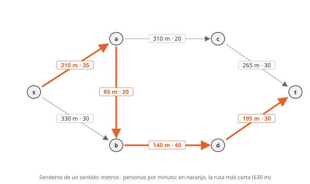
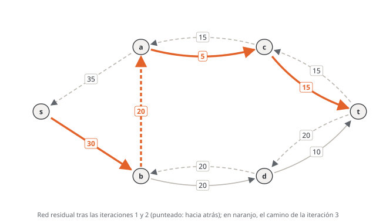
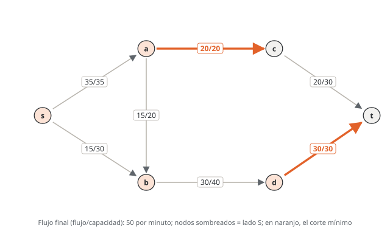
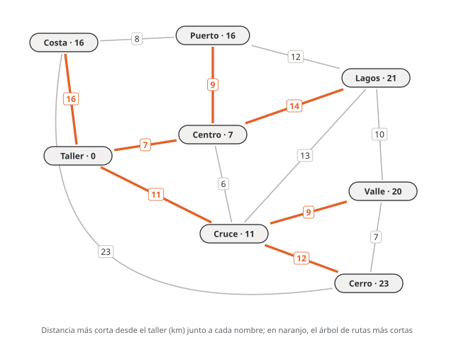
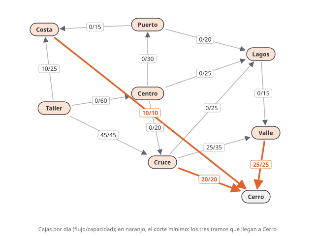

# Unidad 8 · Ruta más corta y flujo máximo

**Qué vas a poder hacer.** Encontrar la ruta más corta desde un nodo a todos los demás con Dijkstra,
con la tabla de etiquetas temporales y permanentes; escribir la ruta más corta como flujo de costo
mínimo; reconocer cuándo Dijkstra falla (costos negativos); encontrar el flujo máximo con
Ford-Fulkerson usando la red residual y los arcos hacia atrás; certificar el óptimo con el corte mínimo;
adaptar la red cuando hay varias fuentes o nodos con capacidad, y escribir y leer el flujo máximo en OPL.

**Lo que necesitas antes.** De la unidad 7, la notación de redes (nodos, arcos, caminos, matriz de
incidencia) y la idea de corte. De Optimización, la restricción de balance de un modelo de transbordo
(unidad 5) y qué es un precio sombra y por qué un problema lineal tiene un dual (unidad 10): el teorema
de flujo máximo y corte mínimo es dualidad.

**Tiempo.** Unas 8 horas: 3 de lectura con lápiz y 5 de práctica. Los dos algoritmos se piden a mano en
el certamen; practícalos hasta que la tabla salga sin dudar.

---

## 1. Dos preguntas sobre la misma red

Con una red ya construida (caminos, tuberías, cables), hay dos preguntas que aparecen siempre:

- **¿Por dónde se llega más rápido?** El camino de menor largo, tiempo o costo entre un origen y un
  destino: la **ruta más corta**. Cada arco tiene un costo $c_{ij}$.
- **¿Cuánto cabe?** La mayor cantidad por unidad de tiempo que puede ir de una fuente a un sumidero sin
  pasar la capacidad de ningún tramo: el **flujo máximo**. Cada arco tiene una capacidad $u_{ij}$.

Las dos son problemas de **flujo en redes**: la red existe y se decide cuánto mandar por cada arco. Por
eso las dos se escriben con la misma restricción de balance y las dos tienen un algoritmo especializado
que se hace a mano. En la misma red, la ruta más corta y la ruta por donde pasa más flujo suelen ser
distintas: el ejemplo de la sección 10 lo muestra.

---

## 2. El flujo de costo mínimo, el modelo que lo contiene todo

**Conjuntos y parámetros.** $N$: nodos. $A$: arcos dirigidos $(i,j)$. $c_{ij}$: costo por unidad que pasa
por $(i,j)$. $u_{ij}$: capacidad de $(i,j)$. $b_i$: oferta neta del nodo $i$ (positiva si el nodo
ofrece, negativa si demanda, cero si solo es de paso).

**Variable** (las tres piezas): $x_{ij}$ = unidades que se mandan por el arco $(i,j)$, para cada
$(i,j) \in A$. Naturaleza: $x_{ij} \ge 0$.

$$\min \sum_{(i,j) \in A} c_{ij}\, x_{ij}$$

$$\sum_{j:\,(i,j) \in A} x_{ij} \;-\; \sum_{k:\,(k,i) \in A} x_{ki} \;=\; b_i \qquad \forall i \in N$$

$$0 \le x_{ij} \le u_{ij} \qquad \forall (i,j) \in A$$

La restricción de **balance** dice: lo que sale de $i$ menos lo que entra a $i$ es su oferta neta. Su
lado izquierdo es la fila $i$ de la matriz de incidencia de la unidad 7 multiplicada por los flujos.
Cuando la oferta total supera a la demanda total, en los nodos de oferta se escribe $\le b_i$ (no hace
falta despachar todo). El transporte de la unidad 9 y el transbordo de Optimización son casos de este
modelo.

**Siempre da enteros.** Si los $b_i$ y los $u_{ij}$ son enteros, el simplex entrega flujos enteros sin
pedirlos: la matriz de incidencia es *totalmente unimodular* (todo vértice de la región factible es
entero). Por eso los problemas de red se resuelven como programas lineales aunque la decisión sea «usar
o no usar un arco».

---

## 3. La ruta más corta como programa lineal

La ruta más corta de $s$ a $t$ es un flujo de costo mínimo en que **una sola unidad** sale de $s$ y
llega a $t$, sin capacidades:

$$b_s = 1, \qquad b_t = -1, \qquad b_i = 0 \;\; \forall i \ne s, t$$

**Variable** (tres piezas): $x_{ij} = 1$ si la ruta usa el arco $(i,j)$; 0 en otro caso, para cada
$(i,j) \in A$. Naturaleza: $x_{ij} \in \{0,1\}$, aunque por la sección 2 basta $x_{ij} \ge 0$ y el
modelo igual entrega ceros y unos.

$$\min \sum_{(i,j) \in A} c_{ij}\, x_{ij} \quad \text{s.a.} \quad \sum_{j} x_{ij} - \sum_{k} x_{ki} = \begin{cases} 1 & i = s \\ -1 & i = t \\ 0 & \text{en otro caso} \end{cases} \quad \forall i \in N, \qquad x_{ij} \in \{0,1\} \;\; \forall (i,j) \in A$$

Por qué funciona: en un nodo intermedio entra tanto como sale, así que la unidad no se puede «perder» en
el camino; sale una vez de $s$ y entra una vez a $t$: los arcos con $x_{ij} = 1$ forman un camino de $s$
a $t$.

**Red no dirigida.** Un camino de doble sentido $\{i,j\}$ son **dos arcos**, $(i,j)$ y $(j,i)$, con el
mismo costo. Olvidarlo deja nodos a los que no se puede llegar.

**A todos los nodos a la vez.** Con $b_s = n-1$ y $b_i = -1$ en cada otro nodo, el mismo modelo (con
$x_{ij} \ge 0$ entero) manda una unidad a cada nodo por su ruta más corta. Los arcos usados forman el
**árbol de rutas más cortas** y el objetivo es la suma de las distancias a todos los nodos.

---

## 4. Dijkstra: etiquetas temporales y permanentes

Dijkstra encuentra las rutas más cortas desde un origen $s$ **a todos los nodos**, si todos los costos
son **no negativos**.

**Notación.** $d(i)$: la menor distancia conocida desde $s$ hasta $i$. $\text{pred}(i)$: el nodo anterior a
$i$ en esa ruta. La etiqueta de $i$ es $[d(i), \text{pred}(i)]$. $P$: nodos **permanentes** (su distancia
ya es la definitiva). $T$: nodos **temporales** (su etiqueta es solo una cota superior).

1. **Inicio.** $d(s) = 0$; $d(i) = \infty$ para los demás. Todos son temporales.
2. **Fijar.** El nodo temporal $k$ de menor $d(k)$ pasa a permanente (en esta unidad, los empates se
   rompen por el orden de la lista de nodos).
3. **Actualizar.** Para cada arco $(k,j)$ con $j$ temporal: si $d(k) + c_{kj} < d(j)$, entonces
   $d(j) \leftarrow d(k) + c_{kj}$ y $\text{pred}(j) \leftarrow k$. Solo se cambia si **baja**.
4. Si quedan temporales alcanzables, vuelve al paso 2.

**La ruta** se lee hacia atrás con los predecesores: $t \leftarrow \text{pred}(t) \leftarrow \dots \leftarrow s$.
Los arcos $(\text{pred}(i), i)$ forman el árbol de rutas más cortas.

**La tabla.** Una fila por iteración y una columna por nodo. Cada celda es la etiqueta $[d, \text{pred}]$
después de la iteración; en negrita, el nodo que se fija en esa fila; ✓, los ya permanentes; ∞, los que
aún no se alcanzan. Es el formato de la sección 10.

**Por qué funciona.** Cuando $k$ es el temporal de menor etiqueta, cualquier otro camino de $s$ a $k$
tiene que salir del conjunto permanente por algún nodo temporal $j$, con $d(j) \ge d(k)$, y después
recorrer arcos de costo $\ge 0$: no puede terminar con menos que $d(k)$. Por eso la etiqueta de $k$ ya es
definitiva y nunca más se revisa.

**Empates.** Si dos rutas dan la misma distancia, la etiqueta no cambia (la regla es «solo si baja»), así
que queda el primer predecesor encontrado. Hay más de una ruta más corta: conviene decirlo.

---

## 5. Por qué Dijkstra no sirve con costos negativos

El argumento de la sección 4 usa que recorrer un arco más **nunca** acorta. Con un arco negativo eso es
falso: un nodo se fija con una distancia que después se podría mejorar pasando por un nodo que se fijó
más tarde, y Dijkstra ya no lo revisa. Los costos negativos aparecen cuando el arco es una ganancia (un
flete de retorno pagado, un subsidio) y el problema es de costo neto.

**Sumar una constante a todos los arcos no lo arregla.** Una ruta con más arcos sube más que una con
menos, así que cambia cuál es la más corta (ejercicio 8.5).

**Bellman-Ford** (mención). Recorre **todos** los arcos y aplica la misma actualización
$d(j) \leftarrow \min\{d(j),\, d(i) + c_{ij}\}$; repite la pasada $n-1$ veces, o hasta que una pasada no
cambie nada. Funciona con costos negativos y, si después de $n-1$ pasadas algo todavía baja, hay un
**ciclo negativo**: dar vueltas en él baja el costo sin fin y la ruta más corta no existe.

---

## 6. El flujo máximo

Una fuente $s$ manda un solo producto a un sumidero $t$; cada arco $(i,j)$ admite como máximo $u_{ij}$.

**Variables** (tres piezas): $x_{ij}$ = flujo por unidad de tiempo que pasa por el arco $(i,j)$, para
cada $(i,j) \in A$; $F$ = flujo total de $s$ a $t$. Naturaleza: $x_{ij} \ge 0$, $F \ge 0$.

$$\max F$$

$$\sum_{j} x_{ij} - \sum_{k} x_{ki} = \begin{cases} F & i = s \\ -F & i = t \\ 0 & \text{en otro caso} \end{cases} \qquad \forall i \in N$$

$$0 \le x_{ij} \le u_{ij} \qquad \forall (i,j) \in A$$

Es un programa lineal continuo. En una red **dirigida** el flujo no puede ser negativo: escribir
$-u_{ij} \le x_{ij} \le u_{ij}$ deja que el agua suba por una tubería que solo baja. Solo si el arco es de
doble sentido se reemplaza por dos arcos, cada uno con $x \ge 0$.

---

## 7. Ford-Fulkerson: caminos aumentantes en la red residual

Tres ideas:

- **Capacidad residual.** Con un flujo $f$, al arco $(i,j)$ le quedan $u_{ij} - f_{ij}$ unidades hacia
  adelante. Y además se pueden **devolver** hasta $f_{ij}$ unidades: eso es un arco $(j,i)$ **hacia
  atrás** con capacidad residual $f_{ij}$.
- **Red residual.** Todos los arcos con capacidad residual positiva, hacia adelante y hacia atrás.
- **Camino aumentante.** Un camino de $s$ a $t$ en la red residual. Su **cuello** es la menor capacidad
  residual del camino.

**Algoritmo.**

1. Empieza con flujo 0 en todos los arcos.
2. Busca un camino aumentante en la red residual. Si no hay, termina: el flujo es máximo.
3. Manda el cuello por ese camino: en un arco hacia adelante, el flujo **sube**; en un arco hacia atrás
   $(j,i)$, el flujo del arco original $(i,j)$ **baja**. Vuelve al paso 2.

**El arco hacia atrás es la clave.** Sin él, una mala elección temprana deja la red atascada antes del
óptimo. Usarlo no manda nada «en contra»: deshace parte de lo que se mandó antes y lo redirige. En el
ejemplo de la sección 10 se ve en la iteración 3.

**Qué camino elegir.** Ford-Fulkerson no lo fija: cualquier camino aumentante sirve y el valor final es
el mismo; lo que cambia es cuántas iteraciones toma. Dos reglas que se usan en esta unidad:

- **En profundidad:** avanza siempre al primer vecino disponible (en la lista de nodos) y retrocede solo
  si se atasca. Es lo que uno hace mirando el dibujo; a veces toma caminos largos y necesita arcos hacia
  atrás.
- **En anchura** (la versión de Edmonds y Karp): el camino con **menos arcos**. Garantiza terminar en
  pocas iteraciones aunque las capacidades sean grandes.

Si las capacidades son enteras, cada cuello es entero y el flujo final es entero.

---

## 8. El corte mínimo: el certificado del óptimo

Un **corte** $(S, \bar S)$ separa los nodos en dos grupos, con $s \in S$ y $t \in \bar S$. Su
**capacidad** es la suma de las capacidades de los arcos que van **de $S$ a $\bar S$**. Los arcos que
vuelven de $\bar S$ a $S$ **no cuentan**.

**Ningún flujo pasa a ningún corte.** Todo lo que llega a $t$ tuvo que cruzar de $S$ a $\bar S$; lo que
vuelve de $\bar S$ a $S$ solo resta. Entonces, para cualquier flujo y cualquier corte:

$$F \;=\; \sum_{i \in S,\, j \in \bar S} x_{ij} \;-\; \sum_{i \in \bar S,\, j \in S} x_{ij} \;\le\; \sum_{i \in S,\, j \in \bar S} u_{ij}$$

**Teorema de flujo máximo y corte mínimo.** El flujo máximo es igual a la capacidad del corte mínimo.

*Por qué, y cómo encontrar el corte.* Cuando Ford-Fulkerson termina, toma $S$ = los nodos que todavía se
alcanzan desde $s$ en la red residual. $t$ no está en $S$ (si estuviera, habría camino aumentante).
Todo arco de $S$ a $\bar S$ está **lleno** (si no, su otro extremo se alcanzaría) y todo arco de $\bar S$ a
$S$ está **vacío** (si no, su arco hacia atrás se alcanzaría). En la desigualdad de arriba, las dos cosas
la vuelven igualdad: el flujo vale exactamente la capacidad de ese corte, y ningún flujo puede valer más.

**Cómo se usa.**

- **Certificar.** Para demostrar que un flujo es máximo, muestra un corte con la misma capacidad.
- **Decidir dónde invertir.** Ampliar un arco que **no** está en un corte mínimo no sube nada. Si hay
  varios cortes mínimos, hay que ampliar un arco **de cada uno** (ejercicio 8.9).
- **Es dualidad.** En el programa lineal de la sección 6, el precio sombra de la capacidad de un arco
  vale 1 si el arco está en el corte mínimo y 0 si no: una unidad más de capacidad ahí sube el flujo en
  1. OPL lo imprime en la sección 14.

---

## 9. Variantes y cuándo no aplica

| Situación | Qué hacer |
|---|---|
| varias fuentes o varios sumideros | una **superfuente** $S$ con un arco $S \to$ cada fuente (capacidad: lo que esa fuente puede producir, o ilimitada) y, si hace falta, un **supersumidero** |
| un nodo con capacidad (una bomba, una aduana) | partir el nodo en $i_e \to i_s$: los arcos que entraban llegan a $i_e$, los que salían parten de $i_s$, y el arco $i_e \to i_s$ lleva la capacidad del nodo |
| un tramo de doble sentido | dos arcos opuestos, cada uno con la capacidad del tramo |
| ruta más corta con costos negativos | Bellman-Ford, no Dijkstra |
| ruta más corta con una restricción extra (presupuesto, cantidad de tramos) | ya no es un problema de red puro: programa entero (ejercicio 8.10) |
| varios productos que comparten capacidad | flujo *multiproducto*: programa lineal general, sin algoritmo de red simple |

---

## 10. Ejemplo resuelto · El festival en el parque

Un festival en un parque organiza a la gente que va desde el acceso ($s$) al escenario ($t$) por
senderos de **un solo sentido**, con cuatro puntos intermedios ($a$, $b$, $c$, $d$). Cada sendero tiene un
largo y un máximo de personas por minuto que pueden pasar sin aglomeración.

| Sendero | s→a | s→b | a→b | a→c | b→d | c→t | d→t |
|---|---|---|---|---|---|---|---|
| Metros | 210 | 330 | 85 | 310 | 140 | 265 | 195 |
| Personas por minuto | 35 | 30 | 20 | 20 | 40 | 30 | 30 |

Dos preguntas: (1) ¿qué recorrido señalizar como «el más corto al escenario»? (2) ¿Cuántas personas por
minuto pueden llegar al escenario, como máximo, y qué senderos limitan?



**Paso 1 · Dijkstra desde el acceso** (sobre los metros).

| Iteración | Se fija | a | b | c | d | t |
|---|---|---|---|---|---|---|
| 0 | s (0) | [210, s] | [330, s] | ∞ | ∞ | ∞ |
| 1 | a (210) | **[210, s]** | [295, a] | [520, a] | ∞ | ∞ |
| 2 | b (295) | ✓ | **[295, a]** | [520, a] | [435, b] | ∞ |
| 3 | d (435) | ✓ | ✓ | [520, a] | **[435, b]** | [630, d] |
| 4 | c (520) | ✓ | ✓ | **[520, a]** | ✓ | [630, d] |
| 5 | t (630) | ✓ | ✓ | ✓ | ✓ | **[630, d]** |

En la iteración 1, $b$ baja de [330, s] a [295, a]: el sendero directo mide 330 m, pero por $a$ son
$210 + 85 = 295$. En la iteración 3, $t$ recibe su primera etiqueta (630 por $d$) y en la 4 no cambia:
por $c$ serían $520 + 265 = 785$. Hacia atrás: $t \leftarrow d \leftarrow b \leftarrow a \leftarrow s$.
**La ruta más corta es s–a–b–d–t, con 630 m.**

**Paso 2 · Ford-Fulkerson** (sobre las personas por minuto). Cada camino aumentante es el primero que
encuentra una búsqueda en profundidad, visitando los vecinos en orden alfabético.

| Iteración | Camino aumentante | Capacidad residual de cada tramo | Cuello | Flujo acumulado |
|---|---|---|---|---|
| 1 | s–a–b–d–t | s→a 35, a→b 20, b→d 40, d→t 30 | 20 | 20 |
| 2 | s–a–c–t | s→a 15, a→c 20, c→t 30 | 15 | 35 |
| 3 | s–b–a–c–t | s→b 30, b→a 20 (hacia atrás), a→c 5, c→t 15 | 5 | 40 |
| 4 | s–b–d–t | s→b 25, b→d 20, d→t 10 | 10 | 50 |

La iteración 1 mandó 20 personas por a→b. Después de la 2, el sendero s→a está lleno y desde $a$ solo
queda $a \to c$ con 5. La iteración 3 entra por $s \to b$ y usa el arco **hacia atrás** $b \to a$: no manda
gente de $b$ a $a$, sino que **deshace** 5 de las 20 que la iteración 1 mandó de $a$ a $b$. Esas 5
personas que llegan a $a$ por s→a siguen ahora por $a \to c$, y las que llegan a $b$ por el sendero
directo s→b toman su lugar en b→d. Así se ve la red residual justo antes de la iteración 3:



Tras la iteración 4 ya no hay camino aumentante: el flujo máximo es **50 personas por minuto**. Las 4
iteraciones dependen de la regla: con la búsqueda en anchura (caminos de menos arcos) bastan 2
iteraciones, s–a–c–t con 20 y s–b–d–t con 30, y el valor es el mismo.

| Arco | Capacidad | Flujo | Capacidad que sobra |
|---|---|---|---|
| s→a | 35 | 35 | 0 |
| s→b | 30 | 15 | 15 |
| a→b | 20 | 15 | 5 |
| a→c | 20 | 20 | 0 |
| b→d | 40 | 30 | 10 |
| c→t | 30 | 20 | 10 |
| d→t | 30 | 30 | 0 |

Balance en cada punto intermedio: en $a$ entran 35 y salen $15 + 20$; en $b$ entran $15 + 15$ y salen 30;
en $c$, 20 y 20; en $d$, 30 y 30. Al escenario llegan $20 + 30 = 50$.

**Paso 3 · El corte mínimo.** En la red residual final, desde $s$ todavía se alcanzan $b$ (s→b tiene 15
libres), $d$ (b→d tiene 10) y $a$ (hacia atrás desde $b$, porque a→b lleva flujo). No se alcanzan $c$ ni
$t$. Entonces $S$ = {s, a, b, d} y los arcos que salen de $S$ son a→c (20) y d→t (30): capacidad
$20 + 30 = 50$, igual al flujo. Es la prueba de que 50 es el máximo. El verificador revisa los 16 cortes
posibles: este es el único que vale 50.



**Cómo se lee.**

- **Se señaliza s–a–b–d–t como ruta más corta (630 m),** pero esa no es la ruta por donde cabe más gente:
  pasa por a→b, que admite solo 20 por minuto.
- **El cuello del festival son a→c y d→t,** los dos senderos del corte. Ensanchar s→a, el primero que uno
  miraría porque se llena, no sirve de nada: s→a está lleno pero no está en el corte mínimo (hay otra
  forma de llegar al mismo lado del corte, por s→b, que tiene 15 libres).
- **Decisión.** Si la productora espera más de 50 personas por minuto en la hora punta, tiene que abrir
  capacidad en a→c o en d→t (o habilitar un sendero nuevo que cruce el corte). Cada persona por minuto
  extra en uno de esos dos senderos sube el flujo en una, hasta que aparezca otro corte.

---

## 11. Errores típicos

| Error | Cómo evitarlo |
|---|---|
| En Dijkstra, cambiar la etiqueta de un nodo ya permanente | un nodo fijado no se vuelve a tocar; solo se actualizan los temporales |
| Fijar el último nodo actualizado en vez del temporal de menor etiqueta | en cada iteración se mira **toda** la fila y se fija el menor |
| Reemplazar una etiqueta por otra igual o mayor | solo si **baja**; en empate se queda el primer predecesor y se anota que hay otra ruta |
| Usar Dijkstra con un arco negativo | Dijkstra exige costos $\ge 0$; con negativos, Bellman-Ford |
| «Arreglar» los negativos sumando una constante a todos los arcos | cambia cuál ruta es la más corta; no sirve |
| En una red no dirigida, escribir un solo arco por camino en el modelo | un camino de doble sentido son dos arcos |
| Escribir el flujo con cotas $-u \le x \le u$ en una red dirigida | el flujo por un arco dirigido es $\ge 0$ |
| En Ford-Fulkerson, buscar caminos solo con arcos hacia adelante | la red residual incluye los arcos hacia atrás; sin ellos el algoritmo se puede atascar antes del óptimo |
| Al usar un arco hacia atrás, sumar flujo al arco original | un arco hacia atrás **resta** flujo del arco original |
| Contar en la capacidad del corte los arcos que vuelven de $\bar S$ a $S$ | solo cuentan los arcos de $S$ a $\bar S$ |
| Ampliar el arco que se llena primero | solo ampliar un arco de cada corte mínimo sube el flujo |
| Variable sin sus tres piezas: «$x_{ij}$ = flujo» | índice con su rango ($(i,j) \in A$), qué significa (unidades por período que pasan por el arco) y su naturaleza ($x_{ij} \ge 0$, o $\{0,1\}$ en la ruta) |
| Balance sin su «∀» o con los signos cambiados en el sumidero | una restricción por nodo, $\forall i \in N$, con la oferta $1$, $-1$ o $0$ (o $F$, $-F$, $0$) según el nodo |

---

## 12. Práctica

Diez ejercicios: 8.1 a 8.4 básicos, 8.5 a 8.8 intermedios, 8.9 y 8.10 de desafío. Las pautas están en la
sección 13. En Ford-Fulkerson cualquier orden de caminos da el mismo valor; las pautas usan la búsqueda en
anchura (caminos de menos arcos) salvo que se diga otra cosa.

**8.1 · El técnico de la cooperativa (básico).** Un técnico sale de la base (nodo 1) y tiene que poder
llegar a seis instalaciones. Los caminos son de doble sentido y el número es el tiempo en minutos: 1–2
(7), 1–3 (4), 2–3 (2), 2–4 (6), 3–4 (9), 3–5 (5), 4–5 (3), 4–6 (4), 5–6 (8), 5–7 (11), 6–7 (5). (a) Aplica
Dijkstra desde 1 con la tabla completa. (b) Da la ruta más corta y su tiempo para cada instalación.
(c) ¿Hay algún nodo con más de una ruta más corta?

**8.2 · El modelo extendido (básico).** Una red dirigida tiene los arcos s→1 (4), s→2 (2), 2→1 (1), 1→3
(5), 2→3 (8), 3→t (3) y 1→t (10). (a) Escribe el modelo de ruta más corta de $s$ a $t$ en forma
extendida: la función objetivo con sus siete términos y una restricción de balance por nodo, escrita con
sus variables. (b) Resuélvelo con Dijkstra. (c) ¿Por qué el modelo da una ruta aunque no se exija
$x_{ij} \in \{0,1\}$?

**8.3 · Agua para el estanque (básico).** Una planta de agua potable ($F$) abastece un estanque ($E$) por
tuberías de un solo sentido, en litros por segundo: F→1 (18), F→2 (14), 1→3 (10), 1→2 (6), 2→4 (15),
3→E (12), 4→3 (5), 4→E (10). (a) Encuentra el flujo máximo con Ford-Fulkerson. (b) Da el flujo de cada
tubería y comprueba el balance en los nodos 1 a 4.

**8.4 · Cortes de la misma red (básico).** En la red del 8.3: (a) calcula la capacidad de los cortes con
$S$ = {F}, {F, 1}, {F, 1, 3} y {F, 1, 2, 4}. En el tercero, ¿qué pasa con la tubería 4→3? (b) ¿Cuántos
cortes distintos tiene esta red? Encuentra el mínimo y di qué tuberías lo forman. (c) Sin hacer ningún
cálculo de flujo, ¿por qué es imposible mandar 23 L/s?

**8.5 · Un flete de retorno (intermedio).** Un camión va de $s$ a $t$. El costo neto de cada tramo, en
miles de pesos: s→a (4), s→b (6), b→a (−3), a→t (5), b→t (9). El tramo b→a es negativo porque ahí recoge
una carga pagada. (a) Aplica Dijkstra y di qué ruta entrega. (b) Encuentra la ruta realmente más barata
(Bellman-Ford o enumerando). ¿En qué paso se equivocó Dijkstra? (c) Un compañero propone sumar 3 a todos
los arcos para que no haya negativos y después usar Dijkstra. ¿Qué ruta obtiene y cuánto cuesta de verdad?

**8.6 · Dos plantas de áridos (intermedio).** Dos plantas de áridos, P1 (produce hasta 40 camiones por
día) y P2 (hasta 35), abastecen una obra ($C$) por caminos de faena con estos camiones por día:
P1→A (25), P1→B (20), P2→B (15), P2→D (25), A→C (30), B→A (10), B→D (15), D→C (30). (a) Arma la red con
una superfuente y encuentra cuántos camiones por día pueden llegar a la obra. (b) ¿Cuánto despacha cada
planta en tu solución? (c) ¿Conviene ampliar la producción de alguna planta?

**8.7 · Una cámara con tope (intermedio).** En la red del 8.3, la cámara del nodo 4 solo puede pasar 9 L/s
en total. (a) Modifica la red para representar ese tope. (b) Encuentra el nuevo flujo máximo y el corte
mínimo. (c) ¿Cuánto pasaba por el nodo 4 en tu solución del 8.3?

**8.8 · Pavimentar para bomberos (intermedio).** Un municipio rural va a pavimentar caminos para que el
carro de bomberos llegue desde el cuartel ($K$) a cinco sectores. Caminos posibles, en km: K–A (4), K–B
(6), A–B (3), A–C (8), B–C (5), B–D (9), C–D (2), C–E (8), D–E (10). Pavimentar cuesta $180 millones el km.
(a) Calcula el árbol de rutas más cortas desde el cuartel con Dijkstra. (b) Calcula el árbol de expansión
mínima (unidad 7). (c) ¿Cuánto más cuesta pavimentar el primero y cuántos km le ahorra al carro hasta cada
sector? ¿Qué le recomendarías al municipio?

**8.9 · Ampliar cintas transportadoras (desafío).** Un centro de distribución mueve cajas por cintas de un
sentido, desde la recepción ($s$) al despacho ($t$), en cajas por minuto: s→a (20), s→c (20), a→b (18),
a→d (10), b→c (12), b→t (19), c→d (11), d→t (13). (a) Encuentra el flujo máximo. (b) Encuentra **todos**
los cortes mínimos. (c) El jefe de operaciones puede acelerar **una** cinta en 5 cajas por minuto: ¿cuál
elige? (d) ¿Y si puede acelerar dos cintas, 5 cada una?

**8.10 · La ruta con tope de peajes (desafío).** Un repartidor va de $s$ a $t$ con un tope de $6.200 en
peajes por viaje. Los tramos, con minutos y peaje: s→a (8 min, $3.450), a→t (12 min, $5.850), s→b (15 min,
\$950), b→t (25 min, $2.150), s→c (18 min, $2.650), c→t (16 min, $2.750), a→b (4 min, \$650). (a) ¿Qué
entrega Dijkstra sobre los minutos? ¿Cumple el tope? (b) Escribe el modelo de ruta más rápida con la
restricción de peajes y resuélvelo en OPL. (c) Resuelve su relajación lineal ($0 \le x_{ij} \le 1$): ¿qué
da y por qué no es una ruta? ¿Qué cambió respecto de la sección 3?

---

## 13. Pautas

**8.1.** (a)

| Iteración | Se fija | 2 | 3 | 4 | 5 | 6 | 7 |
|---|---|---|---|---|---|---|---|
| 0 | 1 (0) | [7, 1] | [4, 1] | ∞ | ∞ | ∞ | ∞ |
| 1 | 3 (4) | [6, 3] | **[4, 1]** | [13, 3] | [9, 3] | ∞ | ∞ |
| 2 | 2 (6) | **[6, 3]** | ✓ | [12, 2] | [9, 3] | ∞ | ∞ |
| 3 | 5 (9) | ✓ | ✓ | [12, 2] | **[9, 3]** | [17, 5] | [20, 5] |
| 4 | 4 (12) | ✓ | ✓ | **[12, 2]** | ✓ | [16, 4] | [20, 5] |
| 5 | 6 (16) | ✓ | ✓ | ✓ | ✓ | **[16, 4]** | [20, 5] |
| 6 | 7 (20) | ✓ | ✓ | ✓ | ✓ | ✓ | **[20, 5]** |

(b) Rutas, leídas hacia atrás con los predecesores:

- 2: 1–3–2 (6 min)
- 3: 1–3 (4 min)
- 4: 1–3–2–4 (12 min)
- 5: 1–3–5 (9 min)
- 6: 1–3–2–4–6 (16 min)
- 7: 1–3–5–7 (20 min)

(c) Sí, el nodo 4. En la iteración 3, desde 5 se llega a 4 con $9 + 3 = 12$, lo mismo que la etiqueta
[12, 2]; como no baja, no se cambia. Hay 2 rutas más cortas a 4: 1–3–2–4 y 1–3–5–4. Fíjate también en el
nodo 2: el camino directo 1–2 (7 min) pierde contra 1–3–2 (6 min).

**8.2.** (a) Con $x_{ij} = 1$ si la ruta usa el arco $(i,j)$ y 0 en otro caso:

$$\min\; 4x_{s1} + 2x_{s2} + x_{21} + 5x_{13} + 8x_{23} + 3x_{3t} + 10x_{1t}$$

$$s:\; x_{s1} + x_{s2} = 1 \qquad 1:\; x_{13} + x_{1t} - x_{s1} - x_{21} = 0 \qquad 2:\; x_{21} + x_{23} - x_{s2} = 0$$

$$3:\; x_{3t} - x_{13} - x_{23} = 0 \qquad t:\; -x_{3t} - x_{1t} = -1$$

$$x_{s1}, x_{s2}, x_{21}, x_{13}, x_{23}, x_{3t}, x_{1t} \in \{0,1\}$$

(b)

| Iteración | Se fija | 1 | 2 | 3 | t |
|---|---|---|---|---|---|
| 0 | s (0) | [4, s] | [2, s] | ∞ | ∞ |
| 1 | 2 (2) | [3, 2] | **[2, s]** | [10, 2] | ∞ |
| 2 | 1 (3) | **[3, 2]** | ✓ | [8, 1] | [13, 1] |
| 3 | 3 (8) | ✓ | ✓ | **[8, 1]** | [11, 3] |
| 4 | t (11) | ✓ | ✓ | ✓ | **[11, 3]** |

La ruta es s–2–1–3–t, con costo 11. El arco 2→1 (1) hace que llegar a 1 pasando por 2 (3) gane al arco
directo s→1 (4). (c) La matriz del balance es la de incidencia nodo-arco, que es totalmente unimodular:
con lados derechos enteros, todos los vértices del poliedro son enteros. El verificador resuelve la
relajación ($x \ge 0$) y obtiene la misma ruta con ceros y unos.

**8.3.** (a) Con caminos de menos arcos:

| Iteración | Camino aumentante | Capacidad residual de cada tramo | Cuello | Flujo acumulado |
|---|---|---|---|---|
| 1 | F–1–3–E | F→1 18, 1→3 10, 3→E 12 | 10 | 10 |
| 2 | F–2–4–E | F→2 14, 2→4 15, 4→E 10 | 10 | 20 |
| 3 | F–2–4–3–E | F→2 4, 2→4 5, 4→3 5, 3→E 2 | 2 | 22 |

Flujo máximo: 22 L/s. (b)

| Arco | Capacidad | Flujo | Capacidad que sobra |
|---|---|---|---|
| F→1 | 18 | 10 | 8 |
| F→2 | 14 | 12 | 2 |
| 1→3 | 10 | 10 | 0 |
| 1→2 | 6 | 0 | 6 |
| 2→4 | 15 | 12 | 3 |
| 3→E | 12 | 12 | 0 |
| 4→3 | 5 | 2 | 3 |
| 4→E | 10 | 10 | 0 |

Balance: en 1 entran 10 y salen $10 + 0$; en 2 entran $12 + 0$ y salen 12; en 3 entran $10 + 2$ y salen
12; en 4 entran 12 y salen $2 + 10$. Otros órdenes de caminos dan otros flujos por tubería, pero siempre
22 L/s.

**8.4.** (a)

| $S$ | Capacidad |
|---|---|
| {F} | 32 |
| {F, 1} | 30 |
| {F, 1, 3} | 32 |
| {F, 1, 2, 4} | 25 |

Con $S$ = {F, 1, 3} salen F→2 (14), 1→2 (6) y 3→E (12). La tubería 4→3 va de $\bar S$ a $S$: no cuenta.
(b) Los nodos 1 a 4 pueden estar o no en $S$: hay $2^4 = 16$ cortes. El mínimo es $S$ = {F, 1, 2, 3, 4},
con 3→E (12) y 4→E (10): 22, y es el único que vale 22. (c) Todo lo que llega a $E$ pasa por 3→E o 4→E, y
juntas admiten 22: ningún flujo puede pasar a ningún corte.

**8.5.** (a)

| Iteración | Se fija | a | b | t |
|---|---|---|---|---|
| 0 | s (0) | [4, s] | [6, s] | ∞ |
| 1 | a (4) | **[4, s]** | [6, s] | [9, a] |
| 2 | b (6) | ✓ | **[6, s]** | [9, a] |
| 3 | t (9) | ✓ | ✓ | **[9, a]** |

Dijkstra entrega s–a–t con d(t) = 9. (b) La ruta s–b–a–t cuesta $6 - 3 + 5 = 8$. Bellman-Ford, recorriendo
los arcos en el orden dado: s→a deja $d(a) = 4$, s→b deja $d(b) = 6$, b→a baja $d(a)$ a 3, a→t deja
$d(t) = 8$; una segunda pasada no cambia nada, así que d(t) = 8 por s–b–a–t. Dijkstra se equivocó en la
iteración 1: fijó $a$ con 4 cuando todavía podía bajar a 3 pasando por $b$, y en la iteración 2 ya no lo
revisó. (c) Con 3 más por arco: s–a–t pasa a $7 + 8 = 15$ y s–b–a–t a $9 + 0 + 8 = 17$. Dijkstra elige
s–a–t, con costo real 9: la ruta de tres arcos subió 9 y la de dos solo 6. Sumar una constante castiga a
las rutas con más tramos.

**8.6.** (a) Superfuente $S$ con S→P1 (40) y S→P2 (35):

| Iteración | Camino aumentante | Capacidad residual de cada tramo | Cuello | Flujo acumulado |
|---|---|---|---|---|
| 1 | S–P1–A–C | S→P1 40, P1→A 25, A→C 30 | 25 | 25 |
| 2 | S–P2–D–C | S→P2 35, P2→D 25, D→C 30 | 25 | 50 |
| 3 | S–P1–B–A–C | S→P1 15, P1→B 20, B→A 10, A→C 5 | 5 | 55 |
| 4 | S–P1–B–D–C | S→P1 10, P1→B 15, B→D 15, D→C 5 | 5 | 60 |

Llegan 60 camiones por día. Corte mínimo: $S$ = todos menos $C$, con A→C (30) y D→C (30). (b) En esta
solución P1 despacha 35 y P2 25 (hay otros repartos con el mismo total). (c) No: el corte está en las
entradas a la obra. Aun con producción ilimitada en las dos plantas llegan 60 camiones. Lo que hay que
ampliar son los caminos A→C o D→C.

**8.7.** (a) El nodo 4 se parte en 4e (llegan los arcos que entraban a 4: 2→4e) y 4s (salen los que
salían: 4s→3 y 4s→E), con el arco 4e→4s de capacidad 9. (b)

| Iteración | Camino aumentante | Capacidad residual de cada tramo | Cuello | Flujo acumulado |
|---|---|---|---|---|
| 1 | F–1–3–E | F→1 18, 1→3 10, 3→E 12 | 10 | 10 |
| 2 | F–2–4e–4s–E | F→2 14, 2→4e 15, 4e→4s 9, 4s→E 10 | 9 | 19 |

El flujo máximo baja a 19 L/s. Corte mínimo: $S$ = {F, 1, 2, 4e}, con 1→3 (10) y 4e→4s (9). (c) En el 8.3
pasaban por el nodo 4 un total de 12 L/s (2 hacia 3 y 10 hacia $E$): el tope de 9 se lleva 3 L/s.

**8.8.** (a)

| Iteración | Se fija | A | B | C | D | E |
|---|---|---|---|---|---|---|
| 0 | K (0) | [4, K] | [6, K] | ∞ | ∞ | ∞ |
| 1 | A (4) | **[4, K]** | [6, K] | [12, A] | ∞ | ∞ |
| 2 | B (6) | ✓ | **[6, K]** | [11, B] | [15, B] | ∞ |
| 3 | C (11) | ✓ | ✓ | **[11, B]** | [13, C] | [19, C] |
| 4 | D (13) | ✓ | ✓ | ✓ | **[13, C]** | [19, C] |
| 5 | E (19) | ✓ | ✓ | ✓ | ✓ | **[19, C]** |

Árbol de rutas más cortas: K–A, K–B, B–C, C–D y C–E, con 25 km. (b) Kruskal: C–D (2), A–B (3), K–A (4) y
B–C (5) entran; K–B (6) se descarta (ciclo K–A–B); A–C (8) se descarta; C–E (8) entra. Árbol mínimo: 22
km. (c) El árbol de rutas cuesta 3 km más, o sea $540 millones. A cambio, el carro llega a B en 6 km en
vez de 7, a C en 11 en vez de 12, a D en 13 en vez de 14 y a E en 19 en vez de 20: 1 km menos a cuatro
sectores. Recomendación: si no hay razón fuerte de tiempo de respuesta, pavimentar el árbol mínimo; los
$540 millones compran apenas 1 km por salida. La comparación cambia si un sector tiene un riesgo alto
(un hospital, un bosque seco): ahí el kilómetro vale más.

**8.9.** (a)

| Iteración | Camino aumentante | Capacidad residual de cada tramo | Cuello | Flujo acumulado |
|---|---|---|---|---|
| 1 | s–a–b–t | s→a 20, a→b 18, b→t 19 | 18 | 18 |
| 2 | s–a–d–t | s→a 2, a→d 10, d→t 13 | 2 | 20 |
| 3 | s–c–d–t | s→c 20, c→d 11, d→t 11 | 11 | 31 |

Flujo máximo: 31 cajas por minuto. (b) Revisando los 16 cortes hay **dos** de capacidad 31: $S$ = {s, c},
con s→a (20) y c→d (11), y $S$ = {s, a, c, d}, con a→b (18) y d→t (13). No comparten ningún arco. (c)
Ninguna: acelerar una sola cinta sube a lo más uno de los dos cortes, y el otro sigue en 31. El
verificador lo comprueba para las ocho cintas. (d) Hay que acelerar una cinta de cada corte. Las cuatro
combinaciones que suben el flujo son s→a o c→d junto con a→b o d→t. Las mejores son c→d con d→t, o s→a
con d→t: el flujo llega a 36 cajas por minuto. Las otras dos combinaciones suben menos porque aparece
otro corte antes.

**8.10.** (a) Dijkstra sobre los minutos da s–a–t, con 20 minutos, pero cuesta $9.300 en peajes: no
cumple el tope. Dijkstra no sabe de presupuestos. (b) Las rutas de $s$ a $t$:

| Ruta | Minutos | Peaje |
|---|---|---|
| s–a–t | 20 | $9.300 |
| s–c–t | 34 | $5.400 |
| s–a–b–t | 37 | $6.250 |
| s–b–t | 40 | $3.100 |

El modelo agrega una sola restricción al de la sección 3 (`modelos/u08_e10_presupuesto.mod`):

```opl
/*********************************************
 * Unidad 8 · Ejercicio 8.10
 * Ruta más rápida con un tope de gasto en peajes.
 * Datos en u08_e10_presupuesto.dat. Base abierta de ingeniería.
 *********************************************/

tuple Arco { string i; string j; int tiempo; int peaje; }
{string} Nodos  = ...;
{Arco} Arcos    = ...;                  // minutos y peaje (pesos) de cada tramo
string origen   = ...;
string destino  = ...;
int presupuesto = ...;                  // pesos disponibles para peajes

int b[n in Nodos] = (n == origen) ? 1 : ((n == destino) ? -1 : 0);

dvar boolean x[Arcos];                  // 1 si la ruta usa el tramo; 0 en otro caso

dexpr int Minutos = sum(a in Arcos) a.tiempo * x[a];

minimize Minutos;

subject to {
  forall(n in Nodos)
    Balance:
      sum(a in Arcos: a.i == n) x[a] - sum(a in Arcos: a.j == n) x[a] == b[n];
  Peajes:                               // la restricción que Dijkstra no sabe manejar
    sum(a in Arcos) a.peaje * x[a] <= presupuesto;
}

execute {
  writeln("minutos = ", Minutos);
  for (var a in Arcos)
    if (x[a] > 0.5)
      writeln("x[", a.i, ",", a.j, "] = ", x[a]);
}
```

OPL imprime:

```text
minutos = 34
x[s,c] = 1
x[c,t] = 1
```

La ruta es s–c–t: 34 minutos y $5.400. (c) Con `dvar float x[Arcos] in 0..1;` (`modelos/u08_e10_relajacion.mod`):

```text
minutos = 30
peaje = 6200
x[s,a] = 0.5
x[a,t] = 0.5
x[s,b] = 0.5
x[b,t] = 0.5
```

La relajación da 30 minutos mandando «media unidad» por s–a–t y media por s–b–t: el promedio de peajes,
$(9.300 + 3.100)/2$, cae justo en el tope de $6.200. No es una ruta: el repartidor no puede ir por la
mitad de dos caminos. Lo que cambió es la restricción de peajes: la matriz ya no es solo la de incidencia
y deja de ser totalmente unimodular, así que los vértices pueden ser fraccionarios. Los 30 minutos son
una cota inferior; la ramificación y acotamiento de la unidad 5 cerraría la brecha ramificando en
$x_{sa}$.

---

## 14. Caso integrador · Las rutas y la capacidad de reparto de Estampa Sur

> Este caso sigue a Estampa Sur por todo el ramo. La unidad 7 conectó sus ocho puntos con 56 km de
> enlaces de radio. Ahora la pregunta es del camión: qué camino toma desde el taller a cada tienda y
> cuántas cajas por día pueden llegar a la tienda Cerro. Las tiendas, sus caminos y sus capacidades son
> ficticios.

### Ruta más corta desde el taller

Los 14 caminos son de doble sentido, con los km de la unidad 7.

| Iteración | Se fija | Centro | Puerto | Lagos | Valle | Costa | Cerro | Cruce |
|---|---|---|---|---|---|---|---|---|
| 0 | Taller (0) | [7, Tal] | ∞ | ∞ | ∞ | [16, Tal] | ∞ | [11, Tal] |
| 1 | Centro (7) | **[7, Tal]** | [16, Cen] | [21, Cen] | ∞ | [16, Tal] | ∞ | [11, Tal] |
| 2 | Cruce (11) | ✓ | [16, Cen] | [21, Cen] | [20, Cru] | [16, Tal] | [23, Cru] | **[11, Tal]** |
| 3 | Puerto (16) | ✓ | **[16, Cen]** | [21, Cen] | [20, Cru] | [16, Tal] | [23, Cru] | ✓ |
| 4 | Costa (16) | ✓ | ✓ | [21, Cen] | [20, Cru] | **[16, Tal]** | [23, Cru] | ✓ |
| 5 | Valle (20) | ✓ | ✓ | [21, Cen] | **[20, Cru]** | ✓ | [23, Cru] | ✓ |
| 6 | Lagos (21) | ✓ | ✓ | **[21, Cen]** | ✓ | ✓ | [23, Cru] | ✓ |
| 7 | Cerro (23) | ✓ | ✓ | ✓ | ✓ | ✓ | **[23, Cru]** | ✓ |

En la iteración 2 Cruce no mejora a Centro: el camino Centro–Cruce (6 km) daría $11 + 6 = 17$ a Centro,
que ya está fijo en 7. En la 3 hay empate entre Puerto y Costa (16) y se fija Puerto, que va antes en la
lista; Puerto no mejora a Costa ($16 + 8 = 24$). Lagos queda con [21, Cen]: por Cruce serían 24, por
Puerto 28 y por Valle 30. **A Cerro: Taller–Cruce–Cerro, 23 km.** La suma de las siete distancias es 114
km: es lo que el camión recorrería si fuera a cada tienda por separado, ida.



El árbol de rutas más cortas (Taller–Centro, Taller–Cruce, Taller–Costa, Centro–Puerto, Centro–Lagos,
Cruce–Valle, Cruce–Cerro) no es el árbol de 56 km de la unidad 7: en ese árbol, de Taller a Cerro hay 29
km.

**En OPL** (`modelos/u08_ruta_mas_corta.mod`). El `.dat` trae los 14 caminos; el modelo los convierte en
28 arcos:

```opl
/*********************************************
 * Unidad 8 · Ruta más corta como flujo de costo mínimo
 * Una unidad de flujo sale del origen y llega al destino.
 * Datos en u08_ruta_mas_corta.dat. Base abierta de ingeniería.
 *********************************************/

// CONJUNTOS Y PARÁMETROS
tuple Camino { string i; string j; int km; }
{string} Nodos   = ...;
{Camino} Caminos = ...;                 // caminos de doble sentido, con su largo
string origen    = ...;
string destino   = ...;

// Cada camino de doble sentido son dos arcos, uno en cada sentido
{Camino} Arcos = {<c.i, c.j, c.km> | c in Caminos} union {<c.j, c.i, c.km> | c in Caminos};

// Oferta de cada nodo: 1 en el origen, -1 en el destino, 0 en el resto
int b[n in Nodos] = (n == origen) ? 1 : ((n == destino) ? -1 : 0);

// VARIABLES DE DECISIÓN
dvar boolean x[Arcos];                  // 1 si la ruta usa el arco (i, j); 0 en otro caso

// EXPRESIONES
dexpr int Km = sum(a in Arcos) a.km * x[a];

// OBJETIVO
minimize Km;

// RESTRICCIONES
subject to {
  forall(n in Nodos)
    Balance:                            // lo que sale menos lo que entra = oferta del nodo
      sum(a in Arcos: a.i == n) x[a] - sum(a in Arcos: a.j == n) x[a] == b[n];
}

// SALIDA: solo los arcos que usa la ruta
execute {
  writeln("km = ", Km);
  for (var a in Arcos)
    if (x[a] > 0.5)
      writeln("x[", a.i, ",", a.j, "] = ", x[a]);
}
```

Con `origen = "Taller"` y `destino = "Cerro"`, la corrida da `OBJECTIVE: 23` y:

```text
km = 23
x[Taller,Cruce] = 1
x[Cruce,Cerro] = 1
```

### Flujo máximo hacia la tienda Cerro

Cada tramo admite un número de cajas por día (por horario de carga y descarga, tamaño del camión y
restricciones de tránsito), **en el sentido indicado**: Taller→Centro 60, Taller→Cruce 45, Taller→Costa
25, Centro→Puerto 30, Centro→Cruce 20, Centro→Lagos 25, Puerto→Costa 15, Puerto→Lagos 20, Cruce→Lagos 25,
Cruce→Valle 35, Cruce→Cerro 20, Lagos→Valle 15, Valle→Cerro 25 y Costa→Cerro 10. ¿Cuántas cajas por día
pueden llegar a Cerro, sumando todas las rutas?

**Ford-Fulkerson** con caminos de menos arcos:

| Iteración | Camino aumentante | Capacidad residual de cada tramo | Cuello | Flujo acumulado |
|---|---|---|---|---|
| 1 | Taller–Costa–Cerro | Taller→Costa 25, Costa→Cerro 10 | 10 | 10 |
| 2 | Taller–Cruce–Cerro | Taller→Cruce 45, Cruce→Cerro 20 | 20 | 30 |
| 3 | Taller–Cruce–Valle–Cerro | Taller→Cruce 25, Cruce→Valle 35, Valle→Cerro 25 | 25 | 55 |

Con la búsqueda en profundidad se necesitan 5 iteraciones y se llega a lo mismo.

| Arco | Capacidad | Flujo | Capacidad que sobra |
|---|---|---|---|
| Taller→Centro | 60 | 0 | 60 |
| Taller→Cruce | 45 | 45 | 0 |
| Taller→Costa | 25 | 10 | 15 |
| Centro→Puerto | 30 | 0 | 30 |
| Centro→Cruce | 20 | 0 | 20 |
| Centro→Lagos | 25 | 0 | 25 |
| Puerto→Costa | 15 | 0 | 15 |
| Puerto→Lagos | 20 | 0 | 20 |
| Cruce→Lagos | 25 | 0 | 25 |
| Cruce→Valle | 35 | 25 | 10 |
| Cruce→Cerro | 20 | 20 | 0 |
| Lagos→Valle | 15 | 0 | 15 |
| Valle→Cerro | 25 | 25 | 0 |
| Costa→Cerro | 10 | 10 | 0 |

**El corte mínimo.** Al final, desde el taller se alcanzan todos los nodos menos Cerro (por ejemplo,
Taller→Centro está vacío). Entonces $S$ son los siete nodos distintos de Cerro y el corte lo forman los
tres tramos que llegan a Cerro: $20 + 25 + 10 = 55$. Pueden llegar **55 cajas por día**, y el verificador
revisa los 64 cortes posibles: es el único que vale 55. El taller podría despachar hasta 130 cajas (la
suma de sus tres salidas), pero la tienda solo puede recibir 55 por sus tres accesos.



**En OPL** (`modelos/u08_flujo_maximo.mod`, el mismo para el ejemplo con `u08_festival.dat`):

```opl
/*********************************************
 * Unidad 8 · Flujo máximo
 * Cuánto se puede mandar de la fuente al sumidero sin pasar la capacidad de ningún arco.
 * Datos en u08_flujo_maximo.dat (caso) o u08_festival.dat (ejemplo).
 * Base abierta de ingeniería.
 *********************************************/

// CONJUNTOS Y PARÁMETROS
tuple Arco { string i; string j; int cap; }
{string} Nodos = ...;
{Arco} Arcos   = ...;                   // arcos dirigidos con su capacidad
string fuente   = ...;
string sumidero = ...;

// VARIABLES DE DECISIÓN
dvar float+ x[Arcos];                   // flujo que pasa por el arco (i, j)
dvar float+ F;                          // flujo total de la fuente al sumidero

// OBJETIVO
maximize F;

// RESTRICCIONES
subject to {
  forall(a in Arcos)
    Capacidad:
      x[a] <= a.cap;
  forall(n in Nodos: n == fuente)
    Fuente:
      sum(a in Arcos: a.i == n) x[a] - sum(a in Arcos: a.j == n) x[a] == F;
  forall(n in Nodos: n != fuente && n != sumidero)
    Conservacion:                       // en un nodo intermedio entra lo mismo que sale
      sum(a in Arcos: a.i == n) x[a] - sum(a in Arcos: a.j == n) x[a] == 0;
  forall(n in Nodos: n == sumidero)
    Sumidero:
      sum(a in Arcos: a.i == n) x[a] - sum(a in Arcos: a.j == n) x[a] == -F;
}

// SALIDA: flujo y precio sombra de la capacidad de cada arco
execute {
  writeln("flujo = ", F);
  for (var a in Arcos) {
    writeln("x[", a.i, ",", a.j, "] = ", x[a]);
    writeln("dual[", a.i, ",", a.j, "] = ", Capacidad[a].dual);
  }
}
```

El `.dat` (`modelos/u08_flujo_maximo.dat`):

```opl
Nodos = {"Taller", "Centro", "Puerto", "Lagos", "Valle", "Costa", "Cerro", "Cruce"};
fuente = "Taller";
sumidero = "Cerro";
Arcos = {
  <"Taller", "Centro", 60>,
  <"Taller", "Cruce", 45>,
  <"Taller", "Costa", 25>,
  <"Centro", "Puerto", 30>,
  <"Centro", "Cruce", 20>,
  <"Centro", "Lagos", 25>,
  <"Puerto", "Costa", 15>,
  <"Puerto", "Lagos", 20>,
  <"Cruce", "Lagos", 25>,
  <"Cruce", "Valle", 35>,
  <"Cruce", "Cerro", 20>,
  <"Lagos", "Valle", 15>,
  <"Valle", "Cerro", 25>,
  <"Costa", "Cerro", 10>
};
```

La corrida da `OBJECTIVE: 55` y:

```text
flujo = 55
x[Taller,Centro] = 45
dual[Taller,Centro] = 0
x[Taller,Cruce] = 10
dual[Taller,Cruce] = 0
x[Taller,Costa] = 0
dual[Taller,Costa] = 0
x[Centro,Puerto] = 25
dual[Centro,Puerto] = 0
x[Centro,Cruce] = 20
dual[Centro,Cruce] = 0
x[Centro,Lagos] = 0
dual[Centro,Lagos] = 0
x[Puerto,Costa] = 10
dual[Puerto,Costa] = 0
x[Puerto,Lagos] = 15
dual[Puerto,Lagos] = 0
x[Cruce,Lagos] = 0
dual[Cruce,Lagos] = 0
x[Cruce,Valle] = 10
dual[Cruce,Valle] = 0
x[Cruce,Cerro] = 20
dual[Cruce,Cerro] = 1
x[Lagos,Valle] = 15
dual[Lagos,Valle] = 0
x[Valle,Cerro] = 25
dual[Valle,Cerro] = 1
x[Costa,Cerro] = 10
dual[Costa,Cerro] = 1
```

**Lectura.**

| Pregunta | Respuesta |
|---|---|
| ¿Cuántas cajas por día llegan a Cerro? | 55, lo mismo en Ford-Fulkerson y en OPL |
| ¿Por qué el flujo de OPL es distinto al de la tabla? | hay muchos flujos óptimos: OPL sale del taller con 45 cajas por Taller→Centro; la tabla, con 45 por Taller→Cruce. Los dos cumplen balance y capacidades y llegan a 55 |
| ¿Qué limita? | los tres accesos a Cerro, llenos en las dos soluciones: Cruce→Cerro 20, Valle→Cerro 25 y Costa→Cerro 10 |
| ¿Qué dicen los precios sombra? | valen 1 justo en esos tres tramos y 0 en el resto: una caja más de capacidad en un acceso a Cerro sube el flujo en una; en cualquier otro tramo, en nada |
| ¿Conviene un camión más grande en Taller→Cruce? | no: ese tramo se llena en la tabla, pero no está en el corte mínimo |

**La cadena.** El verificador compara las distancias de Dijkstra, la ruta a Cerro (23 km), el flujo
máximo y el valor del corte mínimo (55 cajas) con el script del caso, y resuelve los dos modelos en
Python y en OPL (`CADENA: OK`).

**Lo que pasa a las unidades siguientes.** La unidad 9 arma el transporte desde el taller y un segundo
taller en Cruce a cuatro tiendas, con un costo de \$95 por caja y por km **de ruta más corta**: los km de
esta tabla (y los de Dijkstra desde Cruce) son los que multiplican. Las unidades 4, 11 y 12 usan la misma
matriz de distancias más cortas para la ruta del camión que visita todas las tiendas.

---

## 15. Para seguir

**En los libros del ramo.**

- Winston, *Investigación de operaciones: aplicaciones y algoritmos* (4.ª ed., 2005): el capítulo de
  modelos de redes trae ruta más corta, flujo máximo y flujo de costo mínimo, con su formulación como
  programa lineal.
- Hillier y Lieberman, *Introducción a la investigación de operaciones* (7.ª ed., 2001): su capítulo de
  optimización de redes desarrolla el algoritmo de caminos aumentantes y el teorema de flujo máximo y
  corte mínimo.

**Abierto y gratis.**

- Bradley, Hax y Magnanti, *Applied Mathematical Programming* (MIT), capítulo 8, «Network Models», en
  inglés: la ruta más corta y el flujo máximo como programas lineales de red, y la matriz de incidencia
  nodo-arco. https://web.mit.edu/15.053/www/AMP-Chapter-08.pdf

**Con el tutor.** La carpeta `tutor/` trae el contexto de este ramo. Pégalo al inicio de la conversación
con cualquier IA y pídele, por ejemplo: «Dame una red dirigida de 6 nodos donde Ford-Fulkerson necesite un
arco hacia atrás, déjame resolverla y corrígeme cada iteración y el corte mínimo».
