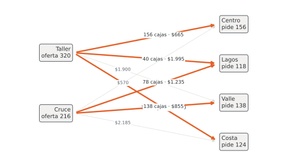

# Unidad 9 · Problema de transporte y sus métodos

**Qué vas a poder hacer.** Balancear un problema de transporte con un origen o un destino ficticio,
armar una solución inicial por esquina noroeste, costo mínimo y Vogel, mejorarla con el método MODI
(potenciales $u_i$ y $v_j$, costos reducidos y ciclo) hasta el óptimo, reconocer y destrabar una
solución degenerada, y leer en la tabla final cuánto cuesta usar una ruta que el plan no usa.

**Lo que necesitas antes.** De Optimización, la unidad 5 (el transporte como programa lineal, con
oferta, demanda y destino ficticio) y la unidad 10 (qué es un precio dual). De la unidad 8 de este
ramo, la ruta más corta: los costos del caso salen de ella. Basta con saber que un modelo de
transporte tiene una restricción por origen y una por destino.

**Tiempo.** Unas 6 horas: 2 de lectura con el ejemplo y 4 de práctica a mano (los métodos se
aprenden haciéndolos).

---

## 1. La idea: una red de dos columnas

Un problema de transporte es una red con dos columnas de nodos. A la izquierda, los **orígenes**
(talleres, plantas, bodegas), cada uno con una oferta $a_i$. A la derecha, los **destinos**
(tiendas, clientes), cada uno con una demanda $b_j$. Cada arco $i \to j$ es una ruta con un costo
$c_{ij}$ por unidad. Se decide cuánto mandar por cada arco.

En Optimización ya lo escribiste como programa lineal y lo resolviste con el solver. Esta unidad hace
otra cosa: lo resuelve **a mano**, aprovechando su estructura, con un simplex que no necesita tabla
simplex. Sirve por tres razones:

1. **Se ve qué hace el solver.** Cada paso de MODI es un paso del simplex: una ruta entra, otra sale.
2. **La tabla final se lee sola.** El costo reducido de cada ruta vacía dice cuánto subiría el costo
   por cada unidad que se mande por ella.
3. **Escala.** Una tabla de $m \times n$ se recorre en minutos; el simplex con $m \cdot n$ variables y
   $m + n$ restricciones, no.

El problema de transporte es un caso del flujo de costo mínimo de la unidad 8: una red sin nodos de
paso. Si hay bodegas intermedias (transbordo), se vuelve al flujo general (sección 8).

---

## 2. El modelo, pieza por pieza

Así se escribe y así se corrige: cada pieza vale por sí sola.

**Conjuntos.** $O$ orígenes, $D$ destinos.

**Parámetros.** $a_i$ oferta del origen $i \in O$; $b_j$ demanda del destino $j \in D$; $c_{ij}$ costo
por unidad enviada de $i$ a $j$.

**Variable de decisión.** Tiene tres piezas y una naturaleza:

- índice con su rango: $x_{ij}$, con $i \in O$, $j \in D$;
- qué significa el valor: unidades enviadas del origen $i$ al destino $j$ en el período;
- el «en otro caso»: vale 0 si la ruta no se usa;
- naturaleza: $x_{ij} \in \mathbb{Z}_0^+$ (entera y no negativa).

**Objetivo y restricciones**, cada familia con su «para todo»:

$$\min \sum_{i \in O}\sum_{j \in D} c_{ij}\,x_{ij} \qquad \text{s.a.} \qquad \sum_{j \in D} x_{ij} \le a_i \;\; \forall i \in O, \qquad \sum_{i \in O} x_{ij} \ge b_j \;\; \forall j \in D$$

**¿Por qué entera si en OPL va `float+`?** Porque el transporte tiene una propiedad que casi ningún
modelo tiene: si las ofertas y demandas son enteras, **todos los vértices son enteros**. Cada variable
aparece con coeficiente 1 en exactamente una fila de oferta y una de demanda, y con esa matriz el
simplex nunca divide. Por eso se declara continua, se resuelve como programa lineal (con duales, que
es lo que interesa) y sale entera igual. El verificador de esta unidad corre el modelo también con
`dvar int+` y obtiene el mismo costo.

En OPL (`modelos/u09_transporte.mod`), con las rutas prohibidas como un conjunto de pares:

```opl
/*********************************************
 * Unidad 9 · Problema de transporte
 * Envíos de orígenes a destinos al menor costo (oferta <=, demanda >=).
 * Datos en u09_*.dat. Base abierta de ingeniería.
 *********************************************/

// CONJUNTOS
{string} Orig = ...;                     // talleres, plantas o bodegas
{string} Dest = ...;                     // tiendas o clientes
tuple Ruta { string o; string d; }
{Ruta} Prohibidas = ...;                 // rutas que no se pueden usar (puede ir vacío)

// PARÁMETROS
int   oferta[Orig]       = ...;          // unidades disponibles por semana
int   demanda[Dest]      = ...;          // unidades pedidas por semana
float costo[Orig][Dest]  = ...;          // CLP por unidad enviada

// VARIABLES DE DECISIÓN
dvar float+ x[Orig][Dest];               // unidades enviadas de o a d (0 si la ruta no se usa)

// OBJETIVO
minimize sum(o in Orig, d in Dest) costo[o][d] * x[o][d];

// RESTRICCIONES
subject to {
  forall(o in Orig)
    Oferta:    sum(d in Dest) x[o][d] <= oferta[o];
  forall(d in Dest)
    Demanda:   sum(o in Orig) x[o][d] >= demanda[d];
  forall(<o, d> in Prohibidas)
    Prohibida: x[o][d] == 0;
}

// SALIDA
execute {
  writeln("costo = ", cplex.getObjValue());
  for (var o in Orig) for (var d in Dest) if (x[o][d] > 0) writeln("x[", o, "][", d, "] = ", x[o][d]);
  for (var o in Orig) writeln("dual_oferta[", o, "] = ", Oferta[o].dual);
  for (var d in Dest) writeln("dual_demanda[", d, "] = ", Demanda[d].dual);
  for (var o in Orig) for (var d in Dest) if (x[o][d] == 0) writeln("cr[", o, "][", d, "] = ", x[o][d].reducedCost);
}
```

---

## 3. Balancear: el origen o el destino ficticio

Los métodos a mano exigen que la oferta total sea igual a la demanda total. Si no lo es:

| Caso | Se agrega | Su costo | Qué significa lo que recibe o envía |
|---|---|---|---|
| $\sum a_i > \sum b_j$ | un **destino ficticio** con demanda $\sum a_i - \sum b_j$ | 0 (o el costo de guardar) | lo que el origen no despacha |
| $\sum a_i < \sum b_j$ | un **origen ficticio** con oferta $\sum b_j - \sum a_i$ | 0, o la multa por unidad no entregada en cada destino | la demanda que queda sin atender |

Con costo 0 en el origen ficticio, el modelo deja sin atender a quien sale más caro abastecer. Si
cada destino tiene una multa distinta, ponla como costo del ficticio: el método decide entonces a
quién le falta, comparando flete contra multa.

Después de balancear, las restricciones se cumplen con igualdad y la tabla tiene $m + n$ filas y
columnas en total (contando el ficticio).

---

## 4. La tabla de transporte y la solución básica

La tabla tiene una fila por origen y una columna por destino; cada celda es una ruta. Una **solución
básica** usa exactamente $m + n - 1$ celdas (las **básicas**). ¿Por qué $m + n - 1$ y no $m + n$?
Porque en un problema balanceado una de las $m + n$ igualdades sobra: si se cumplen todas las de
oferta y todas las de demanda menos una, la última se cumple sola.

Las celdas básicas forman un **árbol** que conecta todas las filas y columnas: no tienen ciclos y no
dejan ninguna fila o columna aislada. Esa propiedad es la que usan los métodos de mejora. Si una
solución tiene menos de $m + n - 1$ celdas con envío positivo, se completa con **ceros básicos**
(sección 7).

---

## 5. Tres maneras de partir

Los tres métodos llenan la tabla de a una celda: mandan por ella lo más que se pueda (el menor entre
lo que le queda al origen y lo que le falta al destino) y tachan la fila o la columna que se agotó.

**Esquina noroeste.** Parte en la celda de arriba a la izquierda y avanza: a la derecha si se agotó
el destino, hacia abajo si se agotó el origen. **No mira los costos.** Es rápido y sirve para tener
una solución básica, nada más.

**Costo mínimo.** Elige la celda más barata entre las que siguen disponibles. Empate: la que admite
el envío más grande; si sigue el empate, la primera de arriba a la izquierda. Mira los costos, pero
uno a la vez: puede gastar una ruta barata y dejar a otro destino con una ruta carísima.

**Aproximación de Vogel.** Para cada fila y columna disponible calcula su **penalización**: la
diferencia entre sus dos costos más bajos. Elige la línea con la mayor penalización y asigna en su
celda más barata. Empate de penalizaciones: la línea con el costo más bajo; si sigue, filas antes que
columnas y en orden. Cuando queda una sola fila o una sola columna, el resto está forzado y se asigna
de la celda más barata a la más cara.

La intuición de Vogel: la penalización es **lo que se pierde por no usar la mejor ruta de esa línea**.
Si un destino tiene una ruta a \$400 y la siguiente a \$900, perder la primera cuesta \$500 por unidad;
si otro tiene dos rutas a \$500 y \$510, da casi lo mismo. Vogel atiende primero al que más arriesga.
Por eso suele quedar muy cerca del óptimo, y muchas veces en él.

**Si una fila y una columna se agotan a la vez**, se tacha solo una (en esta base, la fila, salvo que
sea la última) y la columna queda con demanda 0: más adelante recibe un envío de 0, que cuenta como
celda básica. Así la solución siempre tiene sus $m + n - 1$ básicas.

**Cuándo NO aplican.** Los tres suponen un costo lineal por unidad y ninguna capacidad por ruta. Si la
ruta tiene un tope o un costo fijo por usarla (camión que se paga entero), el problema deja de ser
transporte: va a OPL con las variables de la unidad 3.

---

## 6. Mejorar: el método MODI

Una solución básica es óptima si ninguna ruta vacía conviene. Para saberlo sin probar ruta por ruta,
MODI (*modified distribution*) le pone un **potencial** a cada fila y columna.

**Paso 1 · Potenciales.** En cada celda básica, el costo se reparte entre su fila y su columna:

$$u_i + v_j = c_{ij} \qquad \text{para cada celda básica } (i, j)$$

Son $m + n$ incógnitas y $m + n - 1$ ecuaciones: se fija $u_1 = 0$ y el resto sale en cadena,
siguiendo el árbol de básicas.

**Paso 2 · Costos reducidos.** Para cada celda vacía:

$$\bar c_{ij} = c_{ij} - u_i - v_j$$

Si todos son $\bar c_{ij} \ge 0$, la solución es **óptima**. Si alguno es negativo, esa ruta mejora el
plan: cada unidad que se mande por ella baja el costo en $|\bar c_{ij}|$.

**Paso 3 · El ciclo.** Entra la celda con el costo reducido más negativo (empate: la primera de arriba
a la izquierda). Con las básicas forma un **único ciclo** que dobla solo en celdas básicas,
alternando fila y columna. Se marcan sus celdas $+, -, +, -, \dots$ partiendo por la que entra. Se
manda $\theta$ = el menor envío entre las celdas marcadas con $-$: se suma en las $+$, se resta en las
$-$, y sale la celda $-$ que llegó a cero (si llegan dos, sale solo una, la primera; la otra queda
como cero básico). El costo baja exactamente $\theta \cdot |\bar c_{ij}|$.

**Por qué funciona.** Los potenciales son los **duales** del programa lineal: $u_i$ el de la oferta
del origen $i$ y $v_j$ el de la demanda del destino $j$ (unidad 10 de Optimización). La condición
$\bar c_{ij} \ge 0$ en todas las celdas es la factibilidad dual, y $u_i + v_j = c_{ij}$ en las
básicas es la holgura complementaria: cuando las dos se cumplen, el plan es óptimo. Por eso la salida
de OPL trae los mismos $u$, $v$ y costos reducidos que la última tabla de MODI (sección 13).

**El cruce de piedras (*stepping stone*) es el mismo cálculo por otro camino.** Para una celda
vacía, se arma su ciclo y se suma el costo de las celdas con signo: $+c$ en las $+$ y $-c$ en las $-$.
Ese total es su costo reducido. MODI es más rápido porque saca todos los costos reducidos con una
resta por celda; el cruce de piedras arma un ciclo por celda. El verificador comprueba que ambos
caminos den lo mismo en todas las celdas de todas las tablas de esta unidad.

---

## 7. Degeneración

Una solución es **degenerada** si tiene menos de $m + n - 1$ envíos positivos. Pasa cuando una fila y
una columna se agotan en el mismo paso. Sin la celda que falta, los potenciales no se pueden calcular
(el árbol queda partido en dos). El remedio: poner un **cero básico** en una celda que reconecte el
árbol, sin formar ciclo. Los métodos de la sección 5 ya lo hacen solos.

El cero básico es una celda como cualquier otra: tiene potencial, puede quedar marcada con $-$ en un
ciclo y entonces $\theta = 0$. En esa iteración **el costo no baja**, pero la base cambia y la
siguiente sí avanza. No es un error: es el simplex dando un paso en el mismo vértice. El ejercicio 9.7
lo muestra.

---

## 8. Variantes que aparecen siempre

| Situación | Qué se hace |
|---|---|
| Ruta prohibida | costo $M$ muy grande en los métodos a mano (gran M); en OPL, `x[o][d] == 0` |
| Maximizar ganancia | se resuelve con costo $= -$ganancia; o se invierte la regla: entra la ganancia reducida más positiva y es óptimo cuando todas son $\le 0$ |
| Envío mínimo por una ruta | se manda ese mínimo primero y se resuelve el resto; mientras la base no cambie, el costo sube (mínimo) $\times\ \bar c_{ij}$ |
| Varios óptimos | un $\bar c_{ij} = 0$ en la tabla final: esa ruta puede entrar sin cambiar el costo |
| Transbordo (bodegas de paso) | flujo de costo mínimo con balance en los nodos intermedios, como en la unidad 5 de Optimización; también se puede convertir en transporte dándole a cada nodo de paso una oferta y una demanda iguales a lo que puede mover |

**Una advertencia con la gran M.** Costo mínimo y Vogel pueden poner envío en una ruta $M$ cuando no
les queda otra. Lo arregla MODI: esa ruta tiene un costo enorme y sale en la primera iteración que la
toque. El ejercicio 9.8 lo muestra.

---

## 9. Ejemplo resuelto · Agua del Itata

Una envasadora de agua purificada tiene tres plantas en Ñuble que despachan bidones de 20 litros a
cuatro sectores de reparto. Costo en pesos por bidón:

| | Norte | Poniente | Oriente | Sur | Oferta |
|---|---|---|---|---|---|
| Coihueco | 428 | 676 | 552 | 386 | 312 |
| Bulnes | 524 | 366 | 458 | 614 | 372 |
| Yungay | 662 | 494 | 336 | 486 | 228 |
| Demanda | 216 | 276 | 180 | 168 | |

**Paso 1 · Balancear.** La oferta es 912 y la demanda 840: sobran 72 bidones. Se agrega un destino
ficticio con demanda 72 y costo 0 (los bidones que no salen de la planta).

| | Norte | Poniente | Oriente | Sur | Ficticio | Oferta |
|---|---|---|---|---|---|---|
| Coihueco | 428 | 676 | 552 | 386 | 0 | 312 |
| Bulnes | 524 | 366 | 458 | 614 | 0 | 372 |
| Yungay | 662 | 494 | 336 | 486 | 0 | 228 |
| Demanda | 216 | 276 | 180 | 168 | 72 | |

**Paso 2 · Esquina noroeste.** Sin mirar costos, de arriba a la izquierda hacia abajo a la derecha:

| | Norte | Poniente | Oriente | Sur | Ficticio | Oferta |
|---|---|---|---|---|---|---|
| Coihueco | 216 | 96 | · | · | · | 312 |
| Bulnes | · | 180 | 180 | 12 | · | 372 |
| Yungay | · | · | · | 156 | 72 | 228 |
| Demanda | 216 | 276 | 180 | 168 | 72 | |

Usa $3 + 5 - 1 = 7$ celdas y cuesta **$388.848**.

**Paso 3 · Costo mínimo.** El ficticio cuesta 0 y se lleva la primera asignación:

| Paso | Celda (costo) | Envío | Se tacha |
|---|---|---|---|
| 1 | Coihueco–Ficticio (0) | 72 | columna Ficticio |
| 2 | Yungay–Oriente (336) | 180 | columna Oriente |
| 3 | Bulnes–Poniente (366) | 276 | columna Poniente |
| 4 | Coihueco–Sur (386) | 168 | columna Sur |
| 5 | Coihueco–Norte (428) | 72 | fila Coihueco |
| 6 | Bulnes–Norte (524) | 96 | fila Bulnes |
| 7 | Yungay–Norte (662) | 48 | columna Norte |

| | Norte | Poniente | Oriente | Sur | Ficticio | Oferta |
|---|---|---|---|---|---|---|
| Coihueco | 72 | · | · | 168 | 72 | 312 |
| Bulnes | 96 | 276 | · | · | · | 372 |
| Yungay | 48 | · | 180 | · | · | 228 |
| Demanda | 216 | 276 | 180 | 168 | 72 | |

Cuesta **$339.240**. Fíjate en el paso 7: a Yungay le quedan 48 bidones y la única columna abierta es
Norte, su ruta más cara (\$662).

**Paso 4 · Vogel.** Penalizaciones en cada paso:

| Paso | Penalizaciones de fila | Penalizaciones de columna | Línea elegida | Celda (costo) | Envío | Se tacha |
|---|---|---|---|---|---|---|
| 1 | Coihueco 386, Bulnes 366, Yungay 336 | Norte 96, Poniente 128, Oriente 122, Sur 100, Ficticio 0 | Coihueco (386) | Coihueco–Ficticio (0) | 72 | columna Ficticio |
| 2 | Coihueco 42, Bulnes 92, Yungay 150 | Norte 96, Poniente 128, Oriente 122, Sur 100 | Yungay (150) | Yungay–Oriente (336) | 180 | columna Oriente |
| 3 | Coihueco 42, Bulnes 158, Yungay 8 | Norte 96, Poniente 128, Sur 100 | Bulnes (158) | Bulnes–Poniente (366) | 276 | columna Poniente |
| 4 | Coihueco 42, Bulnes 90, Yungay 176 | Norte 96, Sur 100 | Yungay (176) | Yungay–Sur (486) | 48 | fila Yungay |
| 5 | Coihueco 42, Bulnes 90 | Norte 96, Sur 228 | Sur (228) | Coihueco–Sur (386) | 120 | columna Sur |
| 6 | — | — | queda una sola línea | Coihueco–Norte (428) | 120 | fila Coihueco |
| 7 | — | — | queda una sola línea | Bulnes–Norte (524) | 96 | columna Norte |

| | Norte | Poniente | Oriente | Sur | Ficticio | Oferta |
|---|---|---|---|---|---|---|
| Coihueco | 120 | · | · | 120 | 72 | 312 |
| Bulnes | 96 | 276 | · | · | · | 372 |
| Yungay | · | · | 180 | 48 | · | 228 |
| Demanda | 216 | 276 | 180 | 168 | 72 | |

Cuesta **$332.808**: mejor que los otros dos. En el paso 4, Yungay tiene una penalización de 176:
sin Oriente ni Poniente, le quedan Sur (\$486) y Norte (\$662), y si pierde Sur cada bidón le cuesta
\$176 más. Vogel le asigna Sur antes de que se pierda.

**Paso 5 · MODI desde la solución de costo mínimo.** En cada tabla, las celdas básicas van en negrita
con su envío; las vacías, con su costo reducido entre paréntesis.

*Iteración 0* (costo 339.240).

| | Norte | Poniente | Oriente | Sur | Ficticio | $u_i$ |
|---|---|---|---|---|---|---|
| Coihueco | **72** | (+406) | (+450) | **168** | **72** | 0 |
| Bulnes | **96** | **276** | (+260) | (+132) | (−96) | 96 |
| Yungay | **48** | (−10) | **180** | (−134) | (−234) | 234 |
| $v_j$ | 428 | 270 | 102 | 386 | 0 | |

Entra Yungay–Ficticio (costo reducido −234). Ciclo: Yungay–Ficticio (+) → Coihueco–Ficticio (−) → Coihueco–Norte (+) → Yungay–Norte (−). θ = 48; sale Yungay–Norte. El costo baja 48 × 234 = 11.232: de 339.240 a 328.008.

*Iteración 1* (costo 328.008).

| | Norte | Poniente | Oriente | Sur | Ficticio | $u_i$ |
|---|---|---|---|---|---|---|
| Coihueco | **120** | (+406) | (+216) | **168** | **24** | 0 |
| Bulnes | **96** | **276** | (+26) | (+132) | (−96) | 96 |
| Yungay | (+234) | (+224) | **180** | (+100) | **48** | 0 |
| $v_j$ | 428 | 270 | 336 | 386 | 0 | |

Entra Bulnes–Ficticio (costo reducido −96). Ciclo: Bulnes–Ficticio (+) → Coihueco–Ficticio (−) → Coihueco–Norte (+) → Bulnes–Norte (−). θ = 24; sale Coihueco–Ficticio. El costo baja 24 × 96 = 2.304: de 328.008 a 325.704.

*Iteración 2* (costo 325.704).

| | Norte | Poniente | Oriente | Sur | Ficticio | $u_i$ |
|---|---|---|---|---|---|---|
| Coihueco | **144** | (+406) | (+312) | **168** | (+96) | 0 |
| Bulnes | **72** | **276** | (+122) | (+132) | **24** | 96 |
| Yungay | (+138) | (+128) | **180** | (+4) | **48** | 96 |
| $v_j$ | 428 | 270 | 240 | 386 | −96 | |

Todos los costos reducidos son mayores o iguales a cero: **óptimo**, con costo 325.704.

El óptimo cuesta **$325.704**. Desde Vogel también se llega en 2 iteraciones; desde la esquina
noroeste, en 4.

**Cómo se lee.**

- **El plan.** Coihueco abastece Norte (144) y Sur (168); Bulnes, Poniente (276) y el resto de Norte
  (72); Yungay, Oriente (180). Sobran 24 bidones en Bulnes y 48 en Yungay. Coihueco despacha todo.
- **Coihueco es la planta escasa.** Su potencial es 0 y el de las otras dos es 96: un bidón más en
  Coihueco ahorra \$96 (reemplaza un bidón que Bulnes manda a Norte a \$524 por uno de Coihueco a
  \$428).
- **Yungay–Sur tiene costo reducido +4.** Casi entra: si su flete bajara más de \$4 por bidón,
  convendría mandar desde Yungay a Sur.
- **Decisión.** Si hay que ampliar una planta, es Coihueco; ampliar Bulnes o Yungay no ahorra nada,
  porque ya les sobra.

---

## 10. Errores típicos

| Error | Cómo evitarlo |
|---|---|
| Aplicar los métodos sin balancear | suma ofertas y demandas antes de dibujar la tabla; si no calzan, agrega el ficticio |
| Origen ficticio con costo 0 cuando el enunciado da multas | la multa por unidad no entregada es el costo del ficticio en cada destino |
| Contar mal las básicas (o dejar la solución con menos de $m + n - 1$) | cuenta filas y columnas *con* el ficticio; si faltan, pon un cero básico que conecte sin formar ciclo |
| Calcular $u_i + v_j$ en celdas vacías al buscar potenciales | las ecuaciones $u_i + v_j = c_{ij}$ son solo de las básicas; en las vacías se *usa* el resultado |
| Ciclo que dobla en una celda vacía | el ciclo dobla solo en básicas; la única vacía es la que entra |
| Tomar $\theta$ como el menor envío del ciclo entero | $\theta$ es el menor de las celdas marcadas con $-$ |
| Leer $\bar c_{ij} = 0$ como «la ruta se usa» | significa que podría usarse sin cambiar el costo: hay otro óptimo |
| Variable sin sus tres piezas («$x$ = envío») | índice con rango, qué es el valor y el «en otro caso», y la naturaleza en una línea aparte |
| Familia de restricciones sin su «$\forall$» | cada restricción de oferta va con $\forall i \in O$; cada una de demanda, con $\forall j \in D$ |
| Suponer que Vogel ya es óptimo | compruébalo con MODI: en el ejemplo, Vogel quedó a \$7.104 del óptimo |

---

## 11. Práctica

Diez ejercicios: 9.1 a 9.4 básicos, 9.5 a 9.8 intermedios, 9.9 y 9.10 de desafío. Las pautas están
en la sección 12. Resuelve a mano con las reglas de desempate de la sección 5 (así tus tablas
coinciden con las de la pauta) y comprueba el óptimo con `modelos/u09_transporte.mod`.

**9.1 · Cemento a cuatro ferreterías (básico).** Tres bodegas reparten sacos de cemento a cuatro
ferreterías. Costo en pesos por saco:

| | F1 | F2 | F3 | F4 | Oferta |
|---|---|---|---|---|---|
| Hualqui | 572 | 671 | 528 | 770 | 168 |
| Penco | 495 | 429 | 616 | 682 | 114 |
| Tomé | 660 | 517 | 561 | 473 | 144 |
| Demanda | 96 | 132 | 84 | 150 | |

(a) ¿Está balanceado? Si no, agrega lo que falte y di qué significa. (b) Escribe el modelo pieza por
pieza: variable con sus tres piezas, naturaleza, objetivo y cada familia con su «para todo».
(c) ¿Cuántas celdas básicas tiene una solución básica de la tabla balanceada? (d) Arma la solución
de esquina noroeste y calcula su costo.

**9.2 · Tomates de tres huertos (básico).** Tres huertos mandan cajones a tres ferias. Costo en pesos
por cajón:

| | Chillán | San Carlos | Coelemu | Oferta |
|---|---|---|---|---|
| H1 | 462 | 671 | 418 | 70 |
| H2 | 605 | 374 | 517 | 90 |
| H3 | 429 | 572 | 660 | 60 |
| Demanda | 80 | 75 | 65 | |

Arma la solución inicial por costo mínimo y calcula su costo.

**9.3 · Los mismos tomates con Vogel (básico).** Con los datos de 9.2, arma la solución de Vogel
mostrando las penalizaciones de cada paso. ¿Cuánto mejora respecto de costo mínimo?

**9.4 · ¿Es óptima? (básico).** Toma la solución de costo mínimo de 9.2. (a) Calcula $u_i$, $v_j$ y los
costos reducidos. (b) ¿Es óptima? Si no, haz una iteración de MODI. (c) Comprueba el costo reducido
de la celda que entra con el cruce de piedras.

**9.5 · Áridos para cuatro obras (intermedio).** Tres plantas de áridos mandan camiones a cuatro obras.
Costo en miles de pesos por camión:

| | O1 | O2 | O3 | O4 | Oferta |
|---|---|---|---|---|---|
| P1 | 12 | 9 | 15 | 11 | 165 |
| P2 | 8 | 13 | 10 | 14 | 220 |
| P3 | 16 | 11 | 7 | 9 | 143 |
| Demanda | 121 | 154 | 132 | 121 | |

Parte de la esquina noroeste y aplica MODI hasta el óptimo. ¿Cuántas iteraciones necesitaste y
cuánto ahorra el óptimo respecto de la solución inicial?

**9.6 · Leña que no alcanza (intermedio).** Dos acopios reparten sacos de leña a tres sectores. Flete
en pesos por saco:

| | S1 | S2 | S3 | Oferta |
|---|---|---|---|---|
| Acopio A | 341 | 308 | 385 | 132 |
| Acopio B | 286 | 363 | 319 | 99 |
| Demanda | 110 | 99 | 88 | |

Cada saco que no se entrega tiene una multa (compra de emergencia): \$550 en S1, \$495 en S2 y \$660
en S3. (a) Balancea poniendo las multas como costo del ficticio. (b) Resuelve con Vogel y comprueba
con MODI. (c) ¿A qué sector le falta leña y por qué a ese y no al de la multa más baja en flete?
(d) Separa el costo total en flete y multas.

**9.7 · Una solución degenerada (intermedio).** Tres bodegas y tres tiendas; costo en miles de pesos
por pallet:

| | T1 | T2 | T3 | Oferta |
|---|---|---|---|---|
| B1 | 10 | 8 | 10 | 110 |
| B2 | 7 | 12 | 4 | 88 |
| B3 | 4 | 11 | 9 | 132 |
| Demanda | 110 | 66 | 154 | |

(a) Arma la esquina noroeste. ¿Qué pasa en el primer paso y dónde queda el cero básico? (b) Aplica
MODI hasta el óptimo. ¿En qué iteración el costo no baja y por qué? (c) ¿Llegan al mismo óptimo
costo mínimo y Vogel?

**9.8 · Una ruta prohibida (intermedio).** Tres plantas y cuatro clientes; costo en miles de pesos por
tonelada. La planta P2 no puede abastecer a C4 (el puente no resiste su camión):

| | C1 | C2 | C3 | C4 | Oferta |
|---|---|---|---|---|---|
| P1 | 30 | 25 | 40 | 46 | 90 |
| P2 | 39 | 37 | 34 | — | 75 |
| P3 | 29 | 38 | 36 | 37 | 85 |
| Demanda | 60 | 70 | 55 | 65 | |

(a) Arma costo mínimo y Vogel con $M = 100.000$ en la ruta prohibida. ¿Qué le pasa a costo mínimo?
(b) Comprueba con MODI que Vogel es óptimo. (c) El cliente C3 pide que al menos 15 toneladas le
lleguen desde P1 (quiere un segundo proveedor). ¿Cuánto sube el costo? ¿Hasta cuántas toneladas por
esa ruta vale esa cuenta?

**9.9 · Fruta para tres plantas (desafío).** Tres huertos venden fruta a tres plantas procesadoras.
Cada planta compra exactamente lo que pide; lo que un huerto no vende se queda en el huerto.
Ganancia en miles de pesos por tonelada (Huerto 3 no tiene contrato con Planta A):

| | Planta A | Planta B | Planta C | Oferta |
|---|---|---|---|---|
| Huerto 1 | 70 | 62 | 46 | 80 |
| Huerto 2 | 70 | 70 | 68 | 70 |
| Huerto 3 | — | 49 | 40 | 90 |
| Demanda | 70 | 85 | 60 | |

(a) Balancea y resuelve con Vogel y MODI, maximizando la ganancia. (b) ¿Qué huerto se queda con
fruta y cuánta? (c) ¿Cuánto vale una tonelada más en cada huerto? Ajusta los potenciales para que el
ficticio valga 0 y explica por qué ese ajuste es legítimo. (d) Compruébalo con
`modelos/u09_e09_ganancia.mod`.

**9.10 · Dos planes que cuestan lo mismo (desafío).** Tres molinos mandan harina a cuatro
distribuidoras; costo en miles de pesos por tonelada:

| | D1 | D2 | D3 | D4 | Oferta |
|---|---|---|---|---|---|
| Q1 | 41 | 59 | 59 | 54 | 154 |
| Q2 | 45 | 73 | 49 | 64 | 110 |
| Q3 | 60 | 71 | 49 | 58 | 132 |
| Demanda | 99 | 121 | 88 | 88 | |

(a) Resuelve con Vogel y MODI. (b) La tabla final tiene un costo reducido 0: encuentra el otro plan
óptimo con su ciclo. (c) ¿Qué pasa con cada plan si el costo de esa ruta sube \$1.000 por tonelada?
¿Y si baja \$1.000? Cuantifica el cambio de costo.

---

## 12. Pautas

**9.1.** (a) Oferta 426, demanda 462: faltan 36 sacos. Se agrega un origen ficticio con 36 sacos y
costo 0; lo que «manda» a una ferretería es demanda que queda sin atender.

| | F1 | F2 | F3 | F4 | Oferta |
|---|---|---|---|---|---|
| Hualqui | 572 | 671 | 528 | 770 | 168 |
| Penco | 495 | 429 | 616 | 682 | 114 |
| Tomé | 660 | 517 | 561 | 473 | 144 |
| Ficticio | 0 | 0 | 0 | 0 | 36 |
| Demanda | 96 | 132 | 84 | 150 | |

(b) Conjuntos $O$ = {Hualqui, Penco, Tomé, Ficticio}, $D$ = {F1, …, F4}. Variable: $x_{ij}$, $i \in O$,
$j \in D$, sacos enviados de la bodega $i$ a la ferretería $j$ en la semana, 0 si no se usa la ruta;
$x_{ij} \in \mathbb{Z}_0^+$. $\min \sum_{i}\sum_{j} c_{ij} x_{ij}$ s.a.
$\sum_{j \in D} x_{ij} = a_i \;\; \forall i \in O$ y $\sum_{i \in O} x_{ij} = b_j \;\; \forall j \in D$
(con el ficticio, todas son igualdades). (c) $4 + 4 - 1$: 7 variables básicas. (d) Esquina noroeste:

| | F1 | F2 | F3 | F4 | Oferta |
|---|---|---|---|---|---|
| Hualqui | 96 | 72 | · | · | 168 |
| Penco | · | 60 | 54 | · | 114 |
| Tomé | · | · | 30 | 114 | 144 |
| Ficticio | · | · | · | 36 | 36 |
| Demanda | 96 | 132 | 84 | 150 | |

Cuesta **$232.980** (el ficticio aporta 0). El óptimo es **$209.418**: la esquina noroeste no mira
costos y queda un 11 % arriba.

**9.2.** Costo mínimo, paso a paso:

| Paso | Celda (costo) | Envío | Se tacha |
|---|---|---|---|
| 1 | H2–San Carlos (374) | 75 | columna San Carlos |
| 2 | H1–Coelemu (418) | 65 | columna Coelemu |
| 3 | H3–Chillán (429) | 60 | fila H3 |
| 4 | H1–Chillán (462) | 5 | fila H1 |
| 5 | H2–Chillán (605) | 15 | columna Chillán |

| | Chillán | San Carlos | Coelemu | Oferta |
|---|---|---|---|---|
| H1 | 5 | · | 65 | 70 |
| H2 | 15 | 75 | · | 90 |
| H3 | 60 | · | · | 60 |
| Demanda | 80 | 75 | 65 | |

Costo **$92.345**. La ruta más barata de H1 (Coelemu, \$418) se usó bien, pero a Chillán le tocó
recibir de H2 a \$605.

**9.3.** Vogel:

| Paso | Penalizaciones de fila | Penalizaciones de columna | Línea elegida | Celda (costo) | Envío | Se tacha |
|---|---|---|---|---|---|---|
| 1 | H1 44, H2 143, H3 143 | Chillán 33, San Carlos 198, Coelemu 99 | San Carlos (198) | H2–San Carlos (374) | 75 | columna San Carlos |
| 2 | H1 44, H2 88, H3 231 | Chillán 33, Coelemu 99 | H3 (231) | H3–Chillán (429) | 60 | fila H3 |
| 3 | H1 44, H2 88 | Chillán 143, Coelemu 99 | Chillán (143) | H1–Chillán (462) | 20 | columna Chillán |
| 4 | — | — | queda una sola línea | H1–Coelemu (418) | 50 | fila H1 |
| 5 | — | — | queda una sola línea | H2–Coelemu (517) | 15 | columna Coelemu |

| | Chillán | San Carlos | Coelemu | Oferta |
|---|---|---|---|---|
| H1 | 20 | · | 50 | 70 |
| H2 | · | 75 | 15 | 90 |
| H3 | 60 | · | · | 60 |
| Demanda | 80 | 75 | 65 | |

Costo **$91.685**: \$660 menos que costo mínimo. Vogel atendió primero a San Carlos (penalización 198:
perder H2 costaba eso por cajón) y a H3 (231).

**9.4.** (a) y (b), con la solución de costo mínimo:

*Iteración 0* (costo 92.345).

| | Chillán | San Carlos | Coelemu | $u_i$ |
|---|---|---|---|---|
| H1 | **5** | (+440) | **65** | 0 |
| H2 | **15** | **75** | (−44) | 143 |
| H3 | **60** | (+374) | (+275) | −33 |
| $v_j$ | 462 | 231 | 418 | |

Entra H2–Coelemu (costo reducido −44). Ciclo: H2–Coelemu (+) → H1–Coelemu (−) → H1–Chillán (+) → H2–Chillán (−). θ = 15; sale H2–Chillán. El costo baja 15 × 44 = 660: de 92.345 a 91.685.

*Iteración 1* (costo 91.685).

| | Chillán | San Carlos | Coelemu | $u_i$ |
|---|---|---|---|---|
| H1 | **20** | (+396) | **50** | 0 |
| H2 | (+44) | **75** | **15** | 99 |
| H3 | **60** | (+330) | (+275) | −33 |
| $v_j$ | 462 | 275 | 418 | |

Todos los costos reducidos son mayores o iguales a cero: **óptimo**, con costo 91.685.

H2–Coelemu tenía costo reducido −44: cada cajón por ahí ahorra \$44. Entran 15 y el costo baja \$660,
justo lo que separaba a costo mínimo de Vogel: el óptimo es la solución de Vogel. (c) Cruce de piedras
para H2–Coelemu: $+517 - 418 + 462 - 605 = -44$. Es el mismo número.

**9.5.**

| | O1 | O2 | O3 | O4 | Oferta |
|---|---|---|---|---|---|
| P1 | 121 | 44 | · | · | 165 |
| P2 | · | 110 | 110 | · | 220 |
| P3 | · | · | 22 | 121 | 143 |
| Demanda | 121 | 154 | 132 | 121 | |

*Iteración 0* (costo 5.621).

| | O1 | O2 | O3 | O4 | $u_i$ |
|---|---|---|---|---|---|
| P1 | **121** | **44** | (+9) | (+3) | 0 |
| P2 | (−8) | **110** | **110** | (+2) | 4 |
| P3 | (+3) | (+1) | **22** | **121** | 1 |
| $v_j$ | 12 | 9 | 6 | 8 | |

Entra P2–O1 (costo reducido −8). Ciclo: P2–O1 (+) → P1–O1 (−) → P1–O2 (+) → P2–O2 (−). θ = 110; sale P2–O2. El costo baja 110 × 8 = 880: de 5.621 a 4.741.

*Iteración 1* (costo 4.741).

| | O1 | O2 | O3 | O4 | $u_i$ |
|---|---|---|---|---|---|
| P1 | **11** | **154** | (+1) | (−5) | 0 |
| P2 | **110** | (+8) | **110** | (+2) | −4 |
| P3 | (+11) | (+9) | **22** | **121** | −7 |
| $v_j$ | 12 | 9 | 14 | 16 | |

Entra P1–O4 (costo reducido −5). Ciclo: P1–O4 (+) → P3–O4 (−) → P3–O3 (+) → P2–O3 (−) → P2–O1 (+) → P1–O1 (−). θ = 11; sale P1–O1. El costo baja 11 × 5 = 55: de 4.741 a 4.686.

*Iteración 2* (costo 4.686).

| | O1 | O2 | O3 | O4 | $u_i$ |
|---|---|---|---|---|---|
| P1 | (+5) | **154** | (+6) | **11** | 0 |
| P2 | **121** | (+3) | **99** | (+2) | 1 |
| P3 | (+11) | (+4) | **33** | **110** | −2 |
| $v_j$ | 7 | 9 | 9 | 11 | |

Todos los costos reducidos son mayores o iguales a cero: **óptimo**, con costo 4.686.

Dos iteraciones. El óptimo cuesta **4.686** miles de pesos contra 5.621 de la esquina noroeste: un
ahorro de 935 mil pesos por semana. La segunda iteración usa un ciclo de seis celdas: los ciclos no
siempre son rectángulos.

**9.6.** (a) Oferta 231, demanda 297: faltan 66 sacos. El ficticio ofrece 66 con las multas como costo:

| | S1 | S2 | S3 | Oferta |
|---|---|---|---|---|
| Acopio A | 341 | 308 | 385 | 132 |
| Acopio B | 286 | 363 | 319 | 99 |
| Ficticio | 550 | 495 | 660 | 66 |
| Demanda | 110 | 99 | 88 | |

(b) Vogel:

| Paso | Penalizaciones de fila | Penalizaciones de columna | Línea elegida | Celda (costo) | Envío | Se tacha |
|---|---|---|---|---|---|---|
| 1 | Acopio A 33, Acopio B 33, Ficticio 55 | S1 55, S2 55, S3 66 | S3 (66) | Acopio B–S3 (319) | 88 | columna S3 |
| 2 | Acopio A 33, Acopio B 77, Ficticio 55 | S1 55, S2 55 | Acopio B (77) | Acopio B–S1 (286) | 11 | fila Acopio B |
| 3 | Acopio A 33, Ficticio 55 | S1 209, S2 187 | S1 (209) | Acopio A–S1 (341) | 99 | columna S1 |
| 4 | — | — | queda una sola línea | Acopio A–S2 (308) | 33 | fila Acopio A |
| 5 | — | — | queda una sola línea | Ficticio–S2 (495) | 66 | columna S2 |

| | S1 | S2 | S3 | Oferta |
|---|---|---|---|---|
| Acopio A | 99 | 33 | · | 132 |
| Acopio B | 11 | · | 88 | 99 |
| Ficticio | · | 66 | · | 66 |
| Demanda | 110 | 99 | 88 | |

*Iteración 0* (costo 107.811).

| | S1 | S2 | S3 | $u_i$ |
|---|---|---|---|---|
| Acopio A | **99** | **33** | (+11) | 0 |
| Acopio B | **11** | (+110) | **88** | −55 |
| Ficticio | (+22) | **66** | (+99) | 187 |
| $v_j$ | 341 | 308 | 374 | |

Todos los costos reducidos son mayores o iguales a cero: **óptimo**, con costo 107.811.

Vogel ya es óptimo: **$107.811**. (c) A S2 le faltan **66 sacos sin entregar**. No es por su flete
(S2 tiene el flete más barato desde A), sino porque su multa es la más baja (\$495): dejar sin leña a
S2 cuesta menos que dejar sin leña a S1 o S3. (d) Multas $66 \cdot 495 =$ **$32.670**; flete
**$75.141**.

**9.7.** (a) En el primer paso B1–T1 recibe 110 y se agotan a la vez B1 y T1. Se tacha la fila B1 y T1
queda con demanda 0: el paso 2 manda 0 por B2–T1, el cero básico.

| Paso | Celda (costo) | Envío | Se tacha |
|---|---|---|---|
| 1 | B1–T1 (10) | 110 | fila B1 |
| 2 | B2–T1 (7) | 0 | columna T1 |
| 3 | B2–T2 (12) | 66 | columna T2 |
| 4 | B2–T3 (4) | 22 | fila B2 |
| 5 | B3–T3 (9) | 132 | columna T3 |

| | T1 | T2 | T3 | Oferta |
|---|---|---|---|---|
| B1 | 110 | · | · | 110 |
| B2 | 0 (básica) | 66 | 22 | 88 |
| B3 | · | · | 132 | 132 |
| Demanda | 110 | 66 | 154 | |

Costo 3.168. (b) MODI:

*Iteración 0* (costo 3.168).

| | T1 | T2 | T3 | $u_i$ |
|---|---|---|---|---|
| B1 | **110** | (−7) | (+3) | 0 |
| B2 | **0** | **66** | **22** | −3 |
| B3 | (−8) | (−6) | **132** | 2 |
| $v_j$ | 10 | 15 | 7 | |

Entra B3–T1 (costo reducido −8). Ciclo: B3–T1 (+) → B2–T1 (−) → B2–T3 (+) → B3–T3 (−). θ = 0; sale B2–T1. El costo baja 0 × 8 = 0: de 3.168 a 3.168.

*Iteración 1* (costo 3.168).

| | T1 | T2 | T3 | $u_i$ |
|---|---|---|---|---|
| B1 | **110** | (−15) | (−5) | 0 |
| B2 | (+8) | **66** | **22** | −11 |
| B3 | **0** | (−6) | **132** | −6 |
| $v_j$ | 10 | 23 | 15 | |

Entra B1–T2 (costo reducido −15). Ciclo: B1–T2 (+) → B2–T2 (−) → B2–T3 (+) → B3–T3 (−) → B3–T1 (+) → B1–T1 (−). θ = 66; sale B2–T2. El costo baja 66 × 15 = 990: de 3.168 a 2.178.

*Iteración 2* (costo 2.178).

| | T1 | T2 | T3 | $u_i$ |
|---|---|---|---|---|
| B1 | **44** | **66** | (−5) | 0 |
| B2 | (+8) | (+15) | **88** | −11 |
| B3 | **66** | (+9) | **66** | −6 |
| $v_j$ | 10 | 8 | 15 | |

Entra B1–T3 (costo reducido −5). Ciclo: B1–T3 (+) → B3–T3 (−) → B3–T1 (+) → B1–T1 (−). θ = 44; sale B1–T1. El costo baja 44 × 5 = 220: de 2.178 a 1.958.

*Iteración 3* (costo 1.958).

| | T1 | T2 | T3 | $u_i$ |
|---|---|---|---|---|
| B1 | (+5) | **66** | **44** | 0 |
| B2 | (+8) | (+10) | **88** | −6 |
| B3 | **110** | (+4) | **22** | −1 |
| $v_j$ | 5 | 8 | 10 | |

Todos los costos reducidos son mayores o iguales a cero: **óptimo**, con costo 1.958.

En la iteración 0 el ciclo pasa por el cero básico, que está marcado con $-$: $\theta = 0$ y el costo
no baja, pero la base cambia (B3–T1 entra con 0) y desde ahí MODI avanza. El óptimo es **1.958**
miles de pesos. (c) Sí: costo mínimo y Vogel llegan directo a 1.958, sin degeneración.

**9.8.** (a) Costo mínimo:

| | C1 | C2 | C3 | C4 | Oferta |
|---|---|---|---|---|---|
| P1 | · | 70 | · | 20 | 90 |
| P2 | · | · | 55 | 20 | 75 |
| P3 | 60 | · | · | 25 | 85 |
| Demanda | 60 | 70 | 55 | 65 | |

Cuesta 2.007.205: al final solo le quedaba la columna C4, y P2 tuvo que mandar 20 por la ruta
prohibida. Vogel no cae ahí:

| | C1 | C2 | C3 | C4 | Oferta |
|---|---|---|---|---|---|
| P1 | 20 | 70 | · | · | 90 |
| P2 | 20 | · | 55 | · | 75 |
| P3 | 20 | · | · | 65 | 85 |
| Demanda | 60 | 70 | 55 | 65 | |

(b) MODI sobre Vogel:

*Iteración 0* (costo 7.985).

| | C1 | C2 | C3 | C4 | $u_i$ |
|---|---|---|---|---|---|
| P1 | **20** | **70** | (+15) | (+8) | 0 |
| P2 | **20** | (+3) | **55** | — | 9 |
| P3 | **20** | (+14) | (+12) | **65** | −1 |
| $v_j$ | 30 | 25 | 25 | 38 | |

Todos los costos reducidos son mayores o iguales a cero: **óptimo**, con costo 7.985.

Óptimo **7.985** miles de pesos (la ruta prohibida se muestra con «—»). Desde costo mínimo, MODI saca
la ruta $M$ en la primera iteración y llega al mismo óptimo en dos. (c) P1–C3 tiene costo reducido
15: cada tonelada forzada por ahí sube el costo 15 mil pesos. Con 15 toneladas, sube 225 y el costo
queda en 8.210. La cuenta vale mientras el ciclo de P1–C3 (P1–C3, P2–C3, P2–C1, P1–C1) pueda
absorberlo: hasta $\theta =$ 20 unidades, el menor envío de sus celdas $-$. Más allá cambia la base
y cada tonelada adicional cuesta más.

**9.9.** (a) Oferta 240, pedidos 215: sobran 25 toneladas, destino ficticio con ganancia 0. Con
costo $= -$ganancia, Vogel da:

| | Planta A | Planta B | Planta C | Ficticio | Oferta |
|---|---|---|---|---|---|
| Huerto 1 | 70 | · | · | 10 | 80 |
| Huerto 2 | · | · | 60 | 10 | 70 |
| Huerto 3 | · | 85 | · | 5 | 90 |
| Demanda | 70 | 85 | 60 | 25 | |

Ganancia 13.145 (la esquina noroeste daba 13.065). MODI, mostrado en ganancias (entra la ganancia
reducida más positiva):

*Iteración 0* (ganancia 13.145).

| | Planta A | Planta B | Planta C | Ficticio | $u_i$ |
|---|---|---|---|---|---|
| Huerto 1 | **70** | (+13) | (−22) | **10** | 0 |
| Huerto 2 | (0) | (+21) | **60** | **10** | 0 |
| Huerto 3 | — | **85** | (−28) | **5** | 0 |
| $v_j$ | 70 | 49 | 68 | 0 | |

Entra Huerto 2–Planta B (ganancia reducida +21). Ciclo: Huerto 2–Planta B (+) → Huerto 3–Planta B (−) → Huerto 3–Ficticio (+) → Huerto 2–Ficticio (−). θ = 10; sale Huerto 2–Ficticio. La ganancia sube 10 × 21 = 210: de 13.145 a 13.355.

*Iteración 1* (ganancia 13.355).

| | Planta A | Planta B | Planta C | Ficticio | $u_i$ |
|---|---|---|---|---|---|
| Huerto 1 | **70** | (+13) | (−1) | **10** | 0 |
| Huerto 2 | (−21) | **10** | **60** | (−21) | 21 |
| Huerto 3 | — | **75** | (−7) | **15** | 0 |
| $v_j$ | 70 | 49 | 47 | 0 | |

Entra Huerto 1–Planta B (ganancia reducida +13). Ciclo: Huerto 1–Planta B (+) → Huerto 3–Planta B (−) → Huerto 3–Ficticio (+) → Huerto 1–Ficticio (−). θ = 10; sale Huerto 1–Ficticio. La ganancia sube 10 × 13 = 130: de 13.355 a 13.485.

*Iteración 2* (ganancia 13.485).

| | Planta A | Planta B | Planta C | Ficticio | $u_i$ |
|---|---|---|---|---|---|
| Huerto 1 | **70** | **10** | (−14) | (−13) | 0 |
| Huerto 2 | (−8) | **10** | **60** | (−21) | 8 |
| Huerto 3 | — | **65** | (−7) | **25** | −13 |
| $v_j$ | 70 | 62 | 60 | 13 | |

Todas las ganancias reducidas son menores o iguales a cero: **óptimo**, con ganancia 13.485.

Ganancia máxima **13.485** miles de pesos. (b) Huerto 3 se queda con 25 toneladas: es el de menor
ganancia por tonelada. (c) Los potenciales están definidos salvo una constante: sumar $k$ a todos
los $u_i$ y restarlo a todos los $v_j$ no cambia ninguna suma $u_i + v_j$. Se elige $k$ para que el
ficticio valga 0 (una tonelada más de pedido «ficticio» no gana nada): $k = 13$ da
$u = (13, 21, 0)$ y $v = (57, 49, 47)$. Una tonelada más en Huerto 1 vale 13 mil pesos; en Huerto 2,
21 mil; en Huerto 3, nada (ya le sobra). Una tonelada más pedida por Planta A vale 57 mil, por B 49 y
por C 47. (d) OPL entrega exactamente esos duales: `dual_oferta` 13, 21 y 0; `dual_pedido` 57, 49 y
47.

**9.10.** (a) Vogel y MODI:

| | D1 | D2 | D3 | D4 | Oferta |
|---|---|---|---|---|---|
| Q1 | 99 | 55 | · | · | 154 |
| Q2 | · | 22 | 88 | · | 110 |
| Q3 | · | 44 | · | 88 | 132 |
| Demanda | 99 | 121 | 88 | 88 | |

*Iteración 0* (costo 21.450).

| | D1 | D2 | D3 | D4 | $u_i$ |
|---|---|---|---|---|---|
| Q1 | **99** | **55** | (+24) | (+8) | 0 |
| Q2 | (−10) | **22** | **88** | (+4) | 14 |
| Q3 | (+7) | **44** | (+2) | **88** | 12 |
| $v_j$ | 41 | 59 | 35 | 46 | |

Entra Q2–D1 (costo reducido −10). Ciclo: Q2–D1 (+) → Q1–D1 (−) → Q1–D2 (+) → Q2–D2 (−). θ = 22; sale Q2–D2. El costo baja 22 × 10 = 220: de 21.450 a 21.230.

*Iteración 1* (costo 21.230).

| | D1 | D2 | D3 | D4 | $u_i$ |
|---|---|---|---|---|---|
| Q1 | **77** | **77** | (+14) | (+8) | 0 |
| Q2 | **22** | (+10) | **88** | (+14) | 4 |
| Q3 | (+7) | **44** | (−8) | **88** | 12 |
| $v_j$ | 41 | 59 | 45 | 46 | |

Entra Q3–D3 (costo reducido −8). Ciclo: Q3–D3 (+) → Q2–D3 (−) → Q2–D1 (+) → Q1–D1 (−) → Q1–D2 (+) → Q3–D2 (−). θ = 44; sale Q3–D2. El costo baja 44 × 8 = 352: de 21.230 a 20.878.

*Iteración 2* (costo 20.878).

| | D1 | D2 | D3 | D4 | $u_i$ |
|---|---|---|---|---|---|
| Q1 | **33** | **121** | (+14) | (0) | 0 |
| Q2 | **66** | (+10) | **44** | (+6) | 4 |
| Q3 | (+15) | (+8) | **44** | **88** | 4 |
| $v_j$ | 41 | 59 | 45 | 54 | |

Todos los costos reducidos son mayores o iguales a cero: **óptimo**, con costo 20.878.

Óptimo **20.878** miles de pesos. (b) Q1–D4 tiene costo reducido 0. Su ciclo es Q1–D4 (+), Q3–D4 (−),
Q3–D3 (+), Q2–D3 (−), Q2–D1 (+), Q1–D1 (−); $\theta =$ 33 (lo que lleva Q1–D1). El otro plan óptimo:

| | D1 | D2 | D3 | D4 | Oferta |
|---|---|---|---|---|---|
| Q1 | · | 121 | · | 33 | 154 |
| Q2 | 99 | · | 11 | · | 110 |
| Q3 | · | · | 77 | 55 | 132 |
| Demanda | 99 | 121 | 88 | 88 | |

Cuesta lo mismo. Cualquier mezcla de los dos también es óptima. (c) Si Q1–D4 sube \$1.000, el plan
de MODI sigue óptimo con el mismo costo (no la usa) y el alternativo deja de serlo. Si baja \$1.000, el
alternativo pasa a ser el único óptimo y el costo baja $33 \times 1 = 33$ miles de pesos: lo que pasa
por esa ruta por lo que bajó.

---

## 13. Caso integrador · Estampa Sur abre un segundo taller

> Este caso sigue a Estampa Sur por todo el ramo. En la unidad 8 se calculó la ruta más corta del
> taller a cada tienda. Ahora Estampa Sur abrió un segundo taller en Cruce y debe repartir la
> producción semanal de los dos entre sus cuatro tiendas grandes.

**Los datos.** El taller ofrece 320 cajas por semana y el de Cruce 216; Centro pide 156, Lagos 118,
Valle 138 y Costa 124. Oferta y demanda suman 536: está balanceado. El flete cuesta \$95 por km de la
ruta más corta (unidad 8): del taller, 7, 21, 20 y 16 km; de Cruce, 6, 13, 9 y 23 km. Costo por caja:

| | Centro | Lagos | Valle | Costa | Oferta |
|---|---|---|---|---|---|
| Taller | 665 | 1.995 | 1.900 | 1.520 | 320 |
| Cruce | 570 | 1.235 | 855 | 2.185 | 216 |
| Demanda | 156 | 118 | 138 | 124 | |

En OPL, el mismo `.mod` de la sección 2 con estos datos (`modelos/u09_estampa.dat`):

```opl
// Unidad 9 · caso integrador · Estampa Sur: dos talleres y cuatro tiendas (cajas por semana)
// costo por caja = $95 por km de la ruta más corta (unidad 8)

Orig = {"Taller", "Cruce"};
Dest = {"Centro", "Lagos", "Valle", "Costa"};
Prohibidas = {};

oferta  = [320 216];
demanda = [156 118 138 124];

costo = [
  [665 1995 1900 1520]    // Taller: 7, 21, 20 y 16 km
  [570 1235  855 2185]    // Cruce:  6, 13,  9 y 23 km
];
```

**Esquina noroeste.**

| Paso | Celda (costo) | Envío | Se tacha |
|---|---|---|---|
| 1 | Taller–Centro (665) | 156 | columna Centro |
| 2 | Taller–Lagos (1.995) | 118 | columna Lagos |
| 3 | Taller–Valle (1.900) | 46 | fila Taller |
| 4 | Cruce–Valle (855) | 92 | columna Valle |
| 5 | Cruce–Costa (2.185) | 124 | columna Costa |

| | Centro | Lagos | Valle | Costa | Oferta |
|---|---|---|---|---|---|
| Taller | 156 | 118 | 46 | · | 320 |
| Cruce | · | · | 92 | 124 | 216 |
| Demanda | 156 | 118 | 138 | 124 | |

Costo **$776.150**.

**Costo mínimo.**

| Paso | Celda (costo) | Envío | Se tacha |
|---|---|---|---|
| 1 | Cruce–Centro (570) | 156 | columna Centro |
| 2 | Cruce–Valle (855) | 60 | fila Cruce |
| 3 | Taller–Costa (1.520) | 124 | columna Costa |
| 4 | Taller–Valle (1.900) | 78 | columna Valle |
| 5 | Taller–Lagos (1.995) | 118 | columna Lagos |

| | Centro | Lagos | Valle | Costa | Oferta |
|---|---|---|---|---|---|
| Taller | · | 118 | 78 | 124 | 320 |
| Cruce | 156 | · | 60 | · | 216 |
| Demanda | 156 | 118 | 138 | 124 | |

Costo **$712.310**.

**Vogel.**

| Paso | Penalizaciones de fila | Penalizaciones de columna | Línea elegida | Celda (costo) | Envío | Se tacha |
|---|---|---|---|---|---|---|
| 1 | Taller 855, Cruce 285 | Centro 95, Lagos 760, Valle 1.045, Costa 665 | Valle (1.045) | Cruce–Valle (855) | 138 | columna Valle |
| 2 | Taller 855, Cruce 665 | Centro 95, Lagos 760, Costa 665 | Taller (855) | Taller–Centro (665) | 156 | columna Centro |
| 3 | Taller 475, Cruce 950 | Lagos 760, Costa 665 | Cruce (950) | Cruce–Lagos (1.235) | 78 | fila Cruce |
| 4 | — | — | queda una sola línea | Taller–Costa (1.520) | 124 | columna Costa |
| 5 | — | — | queda una sola línea | Taller–Lagos (1.995) | 40 | columna Lagos |

| | Centro | Lagos | Valle | Costa | Oferta |
|---|---|---|---|---|---|
| Taller | 156 | 40 | · | 124 | 320 |
| Cruce | · | 78 | 138 | · | 216 |
| Demanda | 156 | 118 | 138 | 124 | |

Costo **$586.340**. Vogel atendió primero a Valle (penalización 1.045: si no se abastece desde Cruce,
cada caja cuesta \$1.045 más) y después al taller y a Cruce.

**MODI desde la esquina noroeste.**

*Iteración 0* (costo 776.150).

| | Centro | Lagos | Valle | Costa | $u_i$ |
|---|---|---|---|---|---|
| Taller | **156** | **118** | **46** | (−1.710) | 0 |
| Cruce | (+950) | (+285) | **92** | **124** | −1.045 |
| $v_j$ | 665 | 1.995 | 1.900 | 3.230 | |

Entra Taller–Costa (costo reducido −1.710). Ciclo: Taller–Costa (+) → Cruce–Costa (−) → Cruce–Valle (+) → Taller–Valle (−). θ = 46; sale Taller–Valle. El costo baja 46 × 1.710 = 78.660: de 776.150 a 697.490.

*Iteración 1* (costo 697.490).

| | Centro | Lagos | Valle | Costa | $u_i$ |
|---|---|---|---|---|---|
| Taller | **156** | **118** | (+1.710) | **46** | 0 |
| Cruce | (−760) | (−1.425) | **138** | **78** | 665 |
| $v_j$ | 665 | 1.995 | 190 | 1.520 | |

Entra Cruce–Lagos (costo reducido −1.425). Ciclo: Cruce–Lagos (+) → Taller–Lagos (−) → Taller–Costa (+) → Cruce–Costa (−). θ = 78; sale Cruce–Costa. El costo baja 78 × 1.425 = 111.150: de 697.490 a 586.340.

*Iteración 2* (costo 586.340).

| | Centro | Lagos | Valle | Costa | $u_i$ |
|---|---|---|---|---|---|
| Taller | **156** | **40** | (+285) | **124** | 0 |
| Cruce | (+665) | **78** | **138** | (+1.425) | −760 |
| $v_j$ | 665 | 1.995 | 1.615 | 1.520 | |

Todos los costos reducidos son mayores o iguales a cero: **óptimo**, con costo 586.340.

En 2 iteraciones MODI llega al mismo plan que Vogel. Desde costo mínimo también son 2 iteraciones, y
desde Vogel, ninguna: Vogel ya era óptimo.



**La salida de OPL** confirma el plan y trae los potenciales de MODI como duales:

```text
costo = 586340
x[Taller][Centro] = 156
x[Taller][Lagos] = 40
x[Taller][Costa] = 124
x[Cruce][Lagos] = 78
x[Cruce][Valle] = 138
dual_oferta[Taller] = 0
dual_oferta[Cruce] = -760
dual_demanda[Centro] = 665
dual_demanda[Lagos] = 1995
dual_demanda[Valle] = 1615
dual_demanda[Costa] = 1520
cr[Taller][Valle] = 285
cr[Cruce][Centro] = 665
cr[Cruce][Costa] = 1425
```

| Pregunta | Respuesta |
|---|---|
| ¿Qué manda cada taller? | el taller: 156 cajas a Centro, 40 a Lagos y 124 a Costa; Cruce: 78 a Lagos y 138 a Valle |
| ¿Cuánto cuesta? | **$586.340** por semana |
| ¿Hay otro plan igual de barato? | no: todos los costos reducidos son positivos |
| ¿Qué ruta vacía está más cerca de entrar? | taller–Valle, con +285: tendría que bajar \$285 por caja |
| ¿Cuánto vale una caja más de capacidad en Cruce? | \$760: el dual de su oferta es −760 (en un mínimo, más capacidad baja el costo) |
| ¿Por qué Lagos recibe de los dos? | Cruce no alcanza para Lagos y Valle completos; Lagos es la tienda que reparte la diferencia |

**La cadena.** El verificador exige que los costos, los envíos y el total ($586.340) coincidan con el
script del caso (`CADENA: OK`), y que OPL, scipy y MODI den lo mismo.

**Lo que pasa a la unidad siguiente.** Si cada taller mandara una sola caja y cada tienda pidiera una,
el transporte sería una asignación: la unidad 10 decide qué operario va a cada máquina con un método
hecho para ese caso extremo.

---

## 14. Para seguir

**En los libros del ramo.**

- Winston, *Investigación de operaciones: aplicaciones y algoritmos* (4.ª ed., 2005): su capítulo de
  transporte, asignación y transbordo desarrolla los tres métodos de partida, MODI y el cruce de
  piedras con muchos ejercicios.
- Hillier y Lieberman, *Introducción a la investigación de operaciones* (7.ª ed., 2001): su capítulo
  sobre el problema de transporte y asignación presenta el simplex de transporte con la misma
  notación $u_i$, $v_j$.

**Abierto y gratis.**

- Bradley, Hax y Magnanti, *Applied Mathematical Programming* (MIT), capítulo 8 «Network Models», en
  inglés: el transporte y la asignación como redes, con la propiedad de soluciones enteras.
  https://web.mit.edu/15.053/www/AMP-Chapter-08.pdf

**Con el tutor.** La carpeta `tutor/` trae el contexto de este ramo. Pégalo al inicio de la
conversación con cualquier IA y pídele, por ejemplo: «Dame un transporte de 3 × 4 desbalanceado con
multas por demanda no atendida; yo lo resuelvo con Vogel y MODI y tú me corriges cada tabla».
