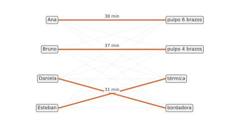

# Unidad 10 · Asignación y método húngaro

**Qué vas a poder hacer.** Plantear una asignación como modelo binario y como transporte, resolverla a
mano con el método húngaro (reducir filas y columnas, cubrir los ceros con el mínimo de líneas,
ajustar), adaptarla cuando no es cuadrada, cuando se maximiza o cuando hay pares prohibidos, y usarla
como cota inferior de un vendedor viajero.

**Lo que necesitas antes.** La unidad 2 (el modelo de asignación con variables binarias) y la unidad 9
(transporte, potenciales $u_i$ y $v_j$, degeneración). De Gestión de Operaciones basta la idea de
asignar trabajos a máquinas en la programación de corto plazo: acá se ve por qué el método funciona y
qué hacer cuando el problema no viene cuadrado.

**Tiempo.** Unas 5 horas: 1,5 de lectura con el ejemplo y 3,5 de práctica a mano.

---

## 1. La idea: el transporte más extremo

Hay $n$ personas y $n$ tareas, y un costo (o un tiempo) $c_{ij}$ por cada par. Cada persona hace una
tarea y cada tarea la hace una persona. Es un transporte en que todas las ofertas y demandas valen 1.

Ese caso extremo tiene un problema para MODI: una solución básica tiene $2n - 1$ celdas básicas, pero
solo $n$ envíos positivos (cada persona hace una sola tarea). Las otras $n - 1$ son **ceros básicos**:
la asignación es la solución más degenerada que existe, y MODI daría muchos pasos con $\theta = 0$. El
método húngaro (Kuhn, 1955, sobre ideas de König y Egerváry) evita ese problema: no recorre
soluciones básicas, sino que **transforma la matriz de costos** hasta que la asignación óptima se ve
a simple vista.

---

## 2. El modelo, pieza por pieza

**Conjuntos.** $P$ personas, $T$ tareas.

**Parámetro.** $c_{pt}$ costo (o minutos) de que la persona $p$ haga la tarea $t$.

**Variable de decisión**, con sus tres piezas y su naturaleza:

- índice con su rango: $x_{pt}$, con $p \in P$, $t \in T$;
- qué significa el 1: la persona $p$ hace la tarea $t$;
- el «en otro caso»: 0 si no la hace;
- naturaleza: $x_{pt} \in \{0, 1\}$.

**Objetivo y restricciones:**

$$\min \sum_{p \in P}\sum_{t \in T} c_{pt}\,x_{pt} \qquad \text{s.a.} \qquad \sum_{t \in T} x_{pt} = 1 \;\; \forall p \in P, \qquad \sum_{p \in P} x_{pt} = 1 \;\; \forall t \in T$$

Las dos familias hacen falta. Con solo la de personas, el modelo manda a todos a su tarea más barata
aunque sea la misma; con solo la de tareas, una persona hace varias. Como en el transporte, la
relajación lineal ya entrega ceros y unos: la asignación sale binaria aunque se declare continua.

En OPL (`modelos/u10_asignacion.mod`) el modelo se escribe un poco más general, para que el mismo
`.mod` sirva en todas las variantes de esta unidad: cada persona toma entre `minTareas` y `maxTareas`
tareas, cada tarea se hace a lo más una vez y, si es obligatoria, al menos una:

```opl
/*********************************************
 * Unidad 10 · Asignación
 * Personas a tareas al menor costo, con topes por persona, tareas optativas y pares prohibidos.
 * Datos en u10_*.dat. Base abierta de ingeniería.
 *********************************************/

// CONJUNTOS
{string} Personas = ...;
{string} Tareas   = ...;
tuple Par { string p; string t; }
{Par} Prohibidos = ...;                 // pares que no se pueden asignar (puede ir vacío)

// PARÁMETROS
float costo[Personas][Tareas] = ...;    // minutos o pesos de que p haga t
int   minTareas[Personas]     = ...;    // tareas que p debe tomar como mínimo
int   maxTareas[Personas]     = ...;    // tareas que p puede tomar como máximo
int   obligatoria[Tareas]     = ...;    // 1 si t se tiene que hacer; 0 si puede quedar sin hacer

// VARIABLES DE DECISIÓN
dvar boolean x[Personas][Tareas];       // 1 si la persona p hace la tarea t; 0 en otro caso

// OBJETIVO
minimize sum(p in Personas, t in Tareas) costo[p][t] * x[p][t];

// RESTRICCIONES
subject to {
  forall(p in Personas) {
    Minimo:  sum(t in Tareas) x[p][t] >= minTareas[p];
    Maximo:  sum(t in Tareas) x[p][t] <= maxTareas[p];
  }
  forall(t in Tareas) {
    UnaVez:  sum(p in Personas) x[p][t] <= 1;
    Cubrir:  sum(p in Personas) x[p][t] >= obligatoria[t];
  }
  forall(<p, t> in Prohibidos)
    Prohibido: x[p][t] == 0;
}

// SALIDA
execute {
  writeln("total = ", cplex.getObjValue());
  for (var p in Personas) for (var t in Tareas) if (x[p][t] == 1) writeln("x[", p, "][", t, "] = 1");
}
```

Con `minTareas = maxTareas = 1` y todas las tareas obligatorias es exactamente el modelo de arriba.
Como las variables son `boolean`, OPL no entrega duales.

---

## 3. Por qué se puede restar

Toda asignación usa **exactamente un** número de cada fila y **exactamente uno** de cada columna. Si a
una fila entera se le resta una constante $k$, *todas* las asignaciones bajan $k$: su orden no cambia
y la mejor sigue siendo la mejor. Lo mismo con una columna. El método se apoya en eso:

1. Se resta lo más posible sin dejar números negativos: el mínimo de cada fila, después el de cada
   columna. Aparecen ceros.
2. Si se puede asignar a cada persona un cero, en filas y columnas distintas (**ceros
   independientes**), esa asignación cuesta 0 en la matriz transformada, y como nada es negativo, es
   la mejor. En la matriz original cuesta exactamente lo que se restó.

**Lo restado es una cota inferior.** Cada resta a una fila es un $u_i$ y cada resta a una columna es un
$v_j$, como los potenciales de MODI: la suma de lo restado es una solución dual y nunca supera el
costo de una asignación. El método va subiendo esa cota hasta que alcanza a una asignación: ahí
ambas coinciden y la asignación es óptima. Las tablas de esta unidad anotan la **cota** en cada paso
para que lo veas.

---

## 4. El método húngaro paso a paso

1. **Reducir filas.** A cada fila réstale su mínimo.
2. **Reducir columnas.** A cada columna réstale su mínimo (en la matriz ya reducida por filas).
3. **Cubrir los ceros con el menor número de líneas** (filas o columnas completas). El menor número de
   líneas es igual al mayor número de ceros independientes (teorema de König). Si se necesitan $n$
   líneas, hay una asignación óptima entre los ceros: termina.
4. **Ajustar.** Si hay menos de $n$ líneas, toma $\delta$ = el menor número **sin cubrir**. Réstalo a
   todos los no cubiertos y súmalo a los que están en el **cruce** de dos líneas; los cubiertos por
   una sola línea no cambian. Vuelve al paso 3.

**Cómo encontrar el mínimo de líneas sin adivinar.** A simple vista se suele trazar una línea de más.
El procedimiento seguro tiene dos partes:

- *Asigna* el mayor número de ceros independientes que puedas (empieza por las filas o columnas que
  tienen un solo cero).
- *Marca*: (a) las filas sin asignación; (b) las columnas que tienen un cero en una fila marcada;
  (c) las filas que tienen su cero asignado en una columna marcada. Repite (b) y (c) hasta que no
  cambie nada. Las líneas son las **filas no marcadas** y las **columnas marcadas**.

Las tablas de esta unidad usan exactamente ese procedimiento: las columnas cubiertas llevan ▼ en el
encabezado y las filas cubiertas, ◀ al final. Otra cobertura con el mismo número de líneas puede dar
tablas intermedias distintas, pero el mismo óptimo.

**Por qué el ajuste sube la cota.** Restar $\delta$ a las filas no cubiertas y sumarlo a las columnas
cubiertas es lo que hace el paso 4 (los cruces reciben $+\delta$ porque están en una columna cubierta
y en una fila cubierta, que no se restó). La cota sube $\delta \cdot (n - \text{líneas})$. Como hay
menos de $n$ líneas, siempre sube: el método no se queda dando vueltas.

**Cuándo NO aplica.** Si una persona puede tomar varias tareas *con un tope de horas* (no de cantidad),
si importa el **tiempo máximo** en vez de la suma (que el último termine pronto), o si hay condiciones
entre pares («Ana y Bruno no en el mismo turno»), ya no es una asignación: es un modelo binario para
OPL (unidad 2) o una programación de operaciones.

---

## 5. Variantes

| Situación | Qué se hace |
|---|---|
| Más tareas que personas | se agregan personas ficticias con costo 0: la tarea que les toca queda sin hacer |
| Más personas que tareas | se agregan tareas ficticias con costo 0: la persona que la recibe queda libre |
| Maximizar (ventas, puntaje) | se usa el costo de oportunidad: (mayor valor de la matriz) $-$ valor, y se minimiza; o se multiplica por $-1$ |
| Par prohibido | costo $M$ muy grande; en OPL, `x[p][t] == 0` |
| Una persona puede hacer hasta $k$ tareas | se repite su fila $k$ veces (y se completa con ficticios hasta que la matriz sea cuadrada); en OPL, `maxTareas` |
| Vendedor viajero | la asignación con $c_{ii} = M$ es su relajación: da una cota inferior, pero puede formar subciclos (ejercicio 10.10) |

---

## 6. Ejemplo resuelto · Cinco repartos a la misma hora

Una botillería de barrio tiene cinco repartidores y, a las 21:00, cinco pedidos. Minutos que tardaría
cada repartidor en entregar cada pedido (según dónde está y en qué se mueve):

| | P1 | P2 | P3 | P4 | P5 |
|---|---|---|---|---|---|
| Rocío | 24 | 18 | 21 | 47 | 49 |
| Matías | 29 | 61 | 53 | 30 | 46 |
| Javiera | 50 | 30 | 64 | 26 | 44 |
| Tomás | 59 | 42 | 25 | 43 | 44 |
| Ignacia | 31 | 18 | 35 | 55 | 37 |

Se busca la asignación que minimiza el total de minutos.

*Matriz y mínimo de cada fila.*

| | P1 | P2 | P3 | P4 | P5 | mín. fila |
|---|---|---|---|---|---|---|
| Rocío | 24 | 18 | 21 | 47 | 49 | 18 |
| Matías | 29 | 61 | 53 | 30 | 46 | 29 |
| Javiera | 50 | 30 | 64 | 26 | 44 | 26 |
| Tomás | 59 | 42 | 25 | 43 | 44 | 25 |
| Ignacia | 31 | 18 | 35 | 55 | 37 | 18 |

*Reducción por filas y mínimo de cada columna.*

| | P1 | P2 | P3 | P4 | P5 |
|---|---|---|---|---|---|
| Rocío | 6 | 0 | 3 | 29 | 31 |
| Matías | 0 | 32 | 24 | 1 | 17 |
| Javiera | 24 | 4 | 38 | 0 | 18 |
| Tomás | 34 | 17 | 0 | 18 | 19 |
| Ignacia | 13 | 0 | 17 | 37 | 19 |
| mín. col. | 0 | 0 | 0 | 0 | 17 |

*Reducción por columnas (cota 133), con las líneas que cubren los ceros.*

| | P1 | P2 ▼ | P3 | P4 | P5 | |
|---|---|---|---|---|---|---|
| Rocío | 6 | 0 | 3 | 29 | 14 | |
| Matías | 0 | 32 | 24 | 1 | 0 | ◀ |
| Javiera | 24 | 4 | 38 | 0 | 1 | ◀ |
| Tomás | 34 | 17 | 0 | 18 | 2 | ◀ |
| Ignacia | 13 | 0 | 17 | 37 | 2 | |

Los ceros se cubren con 4 líneas (filas Matías, Javiera, Tomás y columna P2): 4 < 5, todavía no hay 5 ceros independientes. El menor número sin cubrir es **2**: se resta a los no cubiertos y se suma en los cruces.

*Ajuste 1 (cota 135): hay 5 ceros independientes (en negrita).*

| | P1 | P2 | P3 | P4 | P5 |
|---|---|---|---|---|---|
| Rocío | 4 | **0** | 1 | 27 | 12 |
| Matías | **0** | 34 | 24 | 1 | 0 |
| Javiera | 24 | 6 | 38 | **0** | 1 |
| Tomás | 34 | 19 | **0** | 18 | 2 |
| Ignacia | 11 | 0 | 15 | 35 | **0** |

Asignación: Rocío → P2 (18); Matías → P1 (29); Javiera → P4 (26); Tomás → P3 (25); Ignacia → P5 (37). Total: **135**.

**Cómo se lee el paso de las líneas.** Después de reducir, Rocío e Ignacia tienen su único cero en la
misma columna (P2): no pueden quedarse las dos con P2. Por eso no alcanzan 5 ceros independientes y
el método ajusta. El menor sin cubrir (2) está en la fila de Ignacia: al restarlo aparece un cero en
Ignacia–P5, que destraba el problema.

**La cota.** Lo restado por filas (116) y por columnas (17) suma 133; el ajuste suma $2 \cdot (5 - 4) = 2$
y la cota llega a 135, que es el total de la asignación. Nadie puede hacerlo en menos.

**Decisión.** Rocío lleva P2, Matías P1, Javiera P4, Tomás P3 e Ignacia P5: 135 minutos de reparto en
total. Mandar a cada repartidor a su pedido más cercano no sirve: Rocío e Ignacia irían las dos a P2.

---

## 7. Errores típicos

| Error | Cómo evitarlo |
|---|---|
| Reducir solo filas | después de las filas, reduce las columnas; si no, se trabaja con una cota más baja y se ajusta de más |
| Trazar más líneas de las necesarias y concluir que no hay asignación | usa el marcado de la sección 4: da siempre el mínimo |
| Contar ceros en vez de ceros independientes | dos ceros en la misma fila o columna valen por uno |
| Restar $\delta$ también a los cubiertos, o no sumarlo en los cruces | no cubiertos: $-\delta$; cruces: $+\delta$; cubiertos por una línea: igual |
| Leer el total en la matriz reducida | el total se suma con los costos **originales** de los pares elegidos (o con la cota final) |
| Maximizar con el húngaro sin transformar | pasa a costo de oportunidad (mayor valor $-$ valor) antes de reducir |
| Matriz no cuadrada | agrega filas o columnas ficticias con costo 0 hasta que lo sea |
| Escribir solo una de las dos familias de restricciones | una por persona ($\forall p$) y una por tarea ($\forall t$) |
| Variable sin sus tres piezas | índice con rango, qué es el 1 y el «en otro caso»; $x_{pt} \in \{0,1\}$ en su propia línea |
| Dar por óptima una asignación sin comprobarla | compara con la cota (lo restado) o, si $n \le 5$, con todas las permutaciones: con $n = 4$ son 24 |

---

## 8. Práctica

Diez ejercicios: 10.1 a 10.4 básicos, 10.5 a 10.8 intermedios, 10.9 y 10.10 de desafío. Las pautas
están en la sección 9. Para que tus tablas coincidan con las de la pauta, cubre los ceros con el
marcado de la sección 4.

**10.1 · Tres garzones (básico).** Un restorán asigna tres garzones a tres sectores. Minutos promedio de
espera de las mesas según quién atiende cada sector:

| | Terraza | Salón | Barra |
|---|---|---|---|
| Garzón 1 | 33 | 48 | 36 |
| Garzón 2 | 20 | 59 | 41 |
| Garzón 3 | 38 | 44 | 24 |

(a) Escribe el modelo pieza por pieza. (b) Enumera las seis asignaciones posibles y elige la mejor.

**10.2 · Cuatro trabajos (básico).** Costos en miles de pesos:

| | T1 | T2 | T3 | T4 |
|---|---|---|---|---|
| A | 14 | 14 | 18 | 30 |
| B | 32 | 19 | 12 | 31 |
| C | 23 | 23 | 31 | 26 |
| D | 16 | 30 | 27 | 38 |

Reduce filas y columnas. ¿Ya hay cuatro ceros independientes? ¿Cuál es la asignación y su costo?

**10.3 · Cuatro grúas (básico).** Una constructora asigna cuatro grúas a cuatro obras; costo de
traslado y montaje en miles de pesos:

| | Obra 1 | Obra 2 | Obra 3 | Obra 4 |
|---|---|---|---|---|
| Grúa 1 | 77 | 70 | 90 | 65 |
| Grúa 2 | 42 | 73 | 90 | 54 |
| Grúa 3 | 86 | 60 | 68 | 35 |
| Grúa 4 | 56 | 33 | 36 | 36 |

Reduce filas y columnas y cubre los ceros con el menor número de líneas. ¿Cuántas líneas? ¿Es
óptima?

**10.4 · El ajuste (básico).** Sigue con 10.3: haz el ajuste, encuentra la asignación y comprueba que
su costo es igual a la cota (lo restado en total).

**10.5 · Cinco trabajos (intermedio).** Costo en miles de pesos:

| | J1 | J2 | J3 | J4 | J5 |
|---|---|---|---|---|---|
| Amanda | 48 | 97 | 68 | 61 | 82 |
| Beto | 86 | 84 | 73 | 77 | 48 |
| Carla | 77 | 42 | 99 | 41 | 70 |
| Dante | 98 | 62 | 84 | 59 | 42 |
| Elisa | 41 | 78 | 80 | 44 | 70 |

Resuelve con el método húngaro. ¿Cuántos ajustes necesitaste? Anota la cota en cada paso.

**10.6 · Tres personas, cuatro tareas (intermedio).** En una tienda, tres personas cubren el cierre;
hay cuatro tareas y una puede quedar para mañana. Minutos:

| | Inventario | Caja | Bodega | Vitrinas |
|---|---|---|---|---|
| Pía | 57 | 65 | 52 | 47 |
| Raúl | 28 | 38 | 27 | 62 |
| Sara | 48 | 67 | 36 | 64 |

(a) Completa la matriz y resuelve. (b) ¿Qué tarea queda sin hacer? (c) En OPL, ¿qué parámetro del
`.mod` reemplaza a la fila ficticia?

**10.7 · Vendedores y zonas (intermedio).** Ventas semanales esperadas, en miles de pesos, de cada
vendedor en cada zona. Se busca **maximizar** la venta total:

| | Norte | Centro | Sur | Costa |
|---|---|---|---|---|
| V1 | 57 | 127 | 67 | 197 |
| V2 | 77 | 167 | 57 | 177 |
| V3 | 207 | 117 | 67 | 77 |
| V4 | 137 | 197 | 117 | 197 |

(a) Transforma a costo de oportunidad y resuelve. (b) ¿Cuánto venden en total?

**10.8 · Turnos de lavandería (intermedio).** Cuatro turnos se reparten cuatro procesos; minutos por
carga. El turno 1 no puede secar (la secadora está en mantención a esa hora) y el turno 3 no puede
doblar (no hay mesa); en la tabla, «M»:

| | Lavado | Secado | Planchado | Doblado |
|---|---|---|---|---|
| Turno 1 | 45 | M | 21 | 17 |
| Turno 2 | 18 | 32 | 31 | 35 |
| Turno 3 | 20 | 37 | 32 | M |
| Turno 4 | 41 | 22 | 23 | 18 |

(a) Resuelve con $M$ en los pares prohibidos. (b) ¿Cuánto costaría la asignación si no hubiera
prohibiciones, y qué pares usaría? (c) Compruébalo con `u10_e08_prohibidos.dat`.

**10.9 · Hasta dos trabajos por técnico (desafío).** Tres técnicos y cinco trabajos de mantención.
Cada técnico puede tomar hasta dos; todos los trabajos se hacen. Horas:

| | K1 | K2 | K3 | K4 | K5 |
|---|---|---|---|---|---|
| Hugo | 20 | 50 | 27 | 45 | 29 |
| Inés | 22 | 28 | 27 | 54 | 34 |
| Julio | 28 | 29 | 22 | 23 | 28 |

(a) Arma la matriz cuadrada (filas repetidas y lo que falte) y resuelve. (b) ¿Qué hace cada técnico?
(c) Compruébalo con `u10_e09_dos_tareas.dat`, que usa `maxTareas` en vez de repetir filas.

**10.10 · La asignación como cota del vendedor viajero (desafío).** Un técnico visita cinco puntos
(A a E) y vuelve al inicio. Distancias en km (simétricas):

| | A | B | C | D | E |
|---|---|---|---|---|---|
| A | M | 30 | 13 | 26 | 7 |
| B | 30 | M | 11 | 9 | 17 |
| C | 13 | 11 | M | 21 | 13 |
| D | 26 | 9 | 21 | M | 18 |
| E | 7 | 17 | 13 | 18 | M |

(a) Resuelve la asignación con $M$ en la diagonal (de un punto no se va a sí mismo). (b) Dibuja los
arcos elegidos: ¿forman una ruta? (c) La mejor ruta mide 58 km. ¿Qué tan lejos queda la cota de la
asignación? (d) ¿Qué restricción del vendedor viajero (unidad 4) le falta al modelo de asignación?

---

## 9. Pautas

**10.1.** (a) $x_{gs}$, con $g$ en los tres garzones y $s$ en los tres sectores: 1 si el garzón $g$
atiende el sector $s$, 0 en otro caso; $x_{gs} \in \{0,1\}$.
$\min \sum_g\sum_s c_{gs} x_{gs}$ s.a. $\sum_s x_{gs} = 1 \;\; \forall g$ y $\sum_g x_{gs} = 1 \;\; \forall s$.
(b) Las seis asignaciones:

| Garzón 1 | Garzón 2 | Garzón 3 | Minutos |
|---|---|---|---|
| Terraza | Salón | Barra | 116 |
| Terraza | Barra | Salón | 118 |
| Salón | Terraza | Barra | 92 |
| Salón | Barra | Terraza | 127 |
| Barra | Terraza | Salón | 100 |
| Barra | Salón | Terraza | 133 |

La mejor: Garzón 1 en el salón, Garzón 2 en la terraza y Garzón 3 en la barra, **92** minutos. El Garzón 2 va
a la terraza, donde es el más rápido de los tres (20), y el Garzón 3 a la barra, su mejor sector
(24). Al Garzón 1 le queda el salón: su mejor sector, la terraza, ya está tomado.

**10.2.**

*Matriz y mínimo de cada fila.*

| | T1 | T2 | T3 | T4 | mín. fila |
|---|---|---|---|---|---|
| A | 14 | 14 | 18 | 30 | 14 |
| B | 32 | 19 | 12 | 31 | 12 |
| C | 23 | 23 | 31 | 26 | 23 |
| D | 16 | 30 | 27 | 38 | 16 |

*Reducción por filas y mínimo de cada columna.*

| | T1 | T2 | T3 | T4 |
|---|---|---|---|---|
| A | 0 | 0 | 4 | 16 |
| B | 20 | 7 | 0 | 19 |
| C | 0 | 0 | 8 | 3 |
| D | 0 | 14 | 11 | 22 |
| mín. col. | 0 | 0 | 0 | 3 |

*Reducción por columnas (cota 68): hay 4 ceros independientes (en negrita).*

| | T1 | T2 | T3 | T4 |
|---|---|---|---|---|
| A | 0 | **0** | 4 | 13 |
| B | 20 | 7 | **0** | 16 |
| C | 0 | 0 | 8 | **0** |
| D | **0** | 14 | 11 | 19 |

Asignación: A → T2 (14); B → T3 (12); C → T4 (26); D → T1 (16). Total: **68**.

Basta con reducir: los cuatro ceros independientes aparecen sin ajustar. Costo **68** miles de pesos.

**10.3 y 10.4.**

*Matriz y mínimo de cada fila.*

| | Obra 1 | Obra 2 | Obra 3 | Obra 4 | mín. fila |
|---|---|---|---|---|---|
| Grúa 1 | 77 | 70 | 90 | 65 | 65 |
| Grúa 2 | 42 | 73 | 90 | 54 | 42 |
| Grúa 3 | 86 | 60 | 68 | 35 | 35 |
| Grúa 4 | 56 | 33 | 36 | 36 | 33 |

*Reducción por filas y mínimo de cada columna.*

| | Obra 1 | Obra 2 | Obra 3 | Obra 4 |
|---|---|---|---|---|
| Grúa 1 | 12 | 5 | 25 | 0 |
| Grúa 2 | 0 | 31 | 48 | 12 |
| Grúa 3 | 51 | 25 | 33 | 0 |
| Grúa 4 | 23 | 0 | 3 | 3 |
| mín. col. | 0 | 0 | 3 | 0 |

*Reducción por columnas (cota 178), con las líneas que cubren los ceros.*

| | Obra 1 | Obra 2 | Obra 3 | Obra 4 ▼ | |
|---|---|---|---|---|---|
| Grúa 1 | 12 | 5 | 22 | 0 | |
| Grúa 2 | 0 | 31 | 45 | 12 | ◀ |
| Grúa 3 | 51 | 25 | 30 | 0 | |
| Grúa 4 | 23 | 0 | 0 | 3 | ◀ |

Los ceros se cubren con 3 líneas (filas Grúa 2, Grúa 4 y columna Obra 4): 3 < 4, todavía no hay 4 ceros independientes. El menor número sin cubrir es **5**: se resta a los no cubiertos y se suma en los cruces.

*Ajuste 1 (cota 183): hay 4 ceros independientes (en negrita).*

| | Obra 1 | Obra 2 | Obra 3 | Obra 4 |
|---|---|---|---|---|
| Grúa 1 | 7 | **0** | 17 | 0 |
| Grúa 2 | **0** | 31 | 45 | 17 |
| Grúa 3 | 46 | 20 | 25 | **0** |
| Grúa 4 | 23 | 0 | **0** | 8 |

Asignación: Grúa 1 → Obra 2 (70); Grúa 2 → Obra 1 (42); Grúa 3 → Obra 4 (35); Grúa 4 → Obra 3 (36). Total: **183**.

Con 3 líneas no es óptima. El ajuste ($\delta = 5$) sube la cota de 178 a 183, que es el costo de la
asignación: **183** miles de pesos.

**10.5.**

*Matriz y mínimo de cada fila.*

| | J1 | J2 | J3 | J4 | J5 | mín. fila |
|---|---|---|---|---|---|---|
| Amanda | 48 | 97 | 68 | 61 | 82 | 48 |
| Beto | 86 | 84 | 73 | 77 | 48 | 48 |
| Carla | 77 | 42 | 99 | 41 | 70 | 41 |
| Dante | 98 | 62 | 84 | 59 | 42 | 42 |
| Elisa | 41 | 78 | 80 | 44 | 70 | 41 |

*Reducción por filas y mínimo de cada columna.*

| | J1 | J2 | J3 | J4 | J5 |
|---|---|---|---|---|---|
| Amanda | 0 | 49 | 20 | 13 | 34 |
| Beto | 38 | 36 | 25 | 29 | 0 |
| Carla | 36 | 1 | 58 | 0 | 29 |
| Dante | 56 | 20 | 42 | 17 | 0 |
| Elisa | 0 | 37 | 39 | 3 | 29 |
| mín. col. | 0 | 1 | 20 | 0 | 0 |

*Reducción por columnas (cota 241), con las líneas que cubren los ceros.*

| | J1 | J2 | J3 | J4 | J5 ▼ | |
|---|---|---|---|---|---|---|
| Amanda | 0 | 48 | 0 | 13 | 34 | ◀ |
| Beto | 38 | 35 | 5 | 29 | 0 | |
| Carla | 36 | 0 | 38 | 0 | 29 | ◀ |
| Dante | 56 | 19 | 22 | 17 | 0 | |
| Elisa | 0 | 36 | 19 | 3 | 29 | ◀ |

Los ceros se cubren con 4 líneas (filas Amanda, Carla, Elisa y columna J5): 4 < 5, todavía no hay 5 ceros independientes. El menor número sin cubrir es **5**: se resta a los no cubiertos y se suma en los cruces.

*Ajuste 1 (cota 246), con las líneas que cubren los ceros.*

| | J1 ▼ | J2 | J3 ▼ | J4 | J5 ▼ | |
|---|---|---|---|---|---|---|
| Amanda | 0 | 48 | 0 | 13 | 39 | |
| Beto | 33 | 30 | 0 | 24 | 0 | |
| Carla | 36 | 0 | 38 | 0 | 34 | ◀ |
| Dante | 51 | 14 | 17 | 12 | 0 | |
| Elisa | 0 | 36 | 19 | 3 | 34 | |

Los ceros se cubren con 4 líneas (fila Carla y columnas J1, J3, J5): 4 < 5, todavía no hay 5 ceros independientes. El menor número sin cubrir es **3**: se resta a los no cubiertos y se suma en los cruces.

*Ajuste 2 (cota 249): hay 5 ceros independientes (en negrita).*

| | J1 | J2 | J3 | J4 | J5 |
|---|---|---|---|---|---|
| Amanda | **0** | 45 | 0 | 10 | 39 |
| Beto | 33 | 27 | **0** | 21 | 0 |
| Carla | 39 | **0** | 41 | 0 | 37 |
| Dante | 51 | 11 | 17 | 9 | **0** |
| Elisa | 0 | 33 | 19 | **0** | 34 |

Asignación: Amanda → J1 (48); Beto → J3 (73); Carla → J2 (42); Dante → J5 (42); Elisa → J4 (44). Total: **249**.

Dos ajustes; la cota termina en **249**, igual al costo de la asignación.

**10.6.** (a) Se agrega una persona ficticia con 0 en todas las tareas:

*Matriz y mínimo de cada fila.*

| | Inventario | Caja | Bodega | Vitrinas | mín. fila |
|---|---|---|---|---|---|
| Pía | 57 | 65 | 52 | 47 | 47 |
| Raúl | 28 | 38 | 27 | 62 | 27 |
| Sara | 48 | 67 | 36 | 64 | 36 |
| Ficticio | 0 | 0 | 0 | 0 | 0 |

*Reducción por filas y mínimo de cada columna.*

| | Inventario | Caja | Bodega | Vitrinas |
|---|---|---|---|---|
| Pía | 10 | 18 | 5 | 0 |
| Raúl | 1 | 11 | 0 | 35 |
| Sara | 12 | 31 | 0 | 28 |
| Ficticio | 0 | 0 | 0 | 0 |
| mín. col. | 0 | 0 | 0 | 0 |

*Reducción por columnas (cota 110), con las líneas que cubren los ceros.*

| | Inventario | Caja | Bodega ▼ | Vitrinas | |
|---|---|---|---|---|---|
| Pía | 10 | 18 | 5 | 0 | ◀ |
| Raúl | 1 | 11 | 0 | 35 | |
| Sara | 12 | 31 | 0 | 28 | |
| Ficticio | 0 | 0 | 0 | 0 | ◀ |

Los ceros se cubren con 3 líneas (filas Pía, Ficticio y columna Bodega): 3 < 4, todavía no hay 4 ceros independientes. El menor número sin cubrir es **1**: se resta a los no cubiertos y se suma en los cruces.

*Ajuste 1 (cota 111): hay 4 ceros independientes (en negrita).*

| | Inventario | Caja | Bodega | Vitrinas |
|---|---|---|---|---|
| Pía | 10 | 18 | 6 | **0** |
| Raúl | **0** | 10 | 0 | 34 |
| Sara | 11 | 30 | **0** | 27 |
| Ficticio | 0 | **0** | 1 | 0 |

Asignación: Pía → Vitrinas (47); Raúl → Inventario (28); Sara → Bodega (36); Ficticio → Caja (0). Total: **111**.

(b) A la ficticia le toca la **Caja**: esa tarea queda para mañana. Total **111** minutos. (c) En OPL
no hace falta la fila ficticia: basta con `obligatoria = [0 0 0 0]`, que deja cada tarea con
«a lo más una persona».

**10.7.** (a) El mayor valor es 207. Costo de oportunidad $= 207 -$ venta:

*Matriz y mínimo de cada fila.*

| | Norte | Centro | Sur | Costa | mín. fila |
|---|---|---|---|---|---|
| V1 | 150 | 80 | 140 | 10 | 10 |
| V2 | 130 | 40 | 150 | 30 | 30 |
| V3 | 0 | 90 | 140 | 130 | 0 |
| V4 | 70 | 10 | 90 | 10 | 10 |

*Reducción por filas y mínimo de cada columna.*

| | Norte | Centro | Sur | Costa |
|---|---|---|---|---|
| V1 | 140 | 70 | 130 | 0 |
| V2 | 100 | 10 | 120 | 0 |
| V3 | 0 | 90 | 140 | 130 |
| V4 | 60 | 0 | 80 | 0 |
| mín. col. | 0 | 0 | 80 | 0 |

*Reducción por columnas (cota 130), con las líneas que cubren los ceros.*

| | Norte | Centro | Sur | Costa ▼ | |
|---|---|---|---|---|---|
| V1 | 140 | 70 | 50 | 0 | |
| V2 | 100 | 10 | 40 | 0 | |
| V3 | 0 | 90 | 60 | 130 | ◀ |
| V4 | 60 | 0 | 0 | 0 | ◀ |

Los ceros se cubren con 3 líneas (filas V3, V4 y columna Costa): 3 < 4, todavía no hay 4 ceros independientes. El menor número sin cubrir es **10**: se resta a los no cubiertos y se suma en los cruces.

*Ajuste 1 (cota 140): hay 4 ceros independientes (en negrita).*

| | Norte | Centro | Sur | Costa |
|---|---|---|---|---|
| V1 | 130 | 60 | 40 | **0** |
| V2 | 90 | **0** | 30 | 0 |
| V3 | **0** | 90 | 60 | 140 |
| V4 | 60 | 0 | **0** | 10 |

Asignación: V1 → Costa (10); V2 → Centro (40); V3 → Norte (0); V4 → Sur (90). Total: **140**.

(b) V1 a Costa (197), V2 a Centro (167), V3 a Norte (207) y V4 a Sur (117): **688** miles de pesos por
semana. Comprobación: $4 \cdot 207 - 140 = 688$.

**10.8.** (a)

*Matriz y mínimo de cada fila.*

| | Lavado | Secado | Planchado | Doblado | mín. fila |
|---|---|---|---|---|---|
| Turno 1 | 45 | M | 21 | 17 | 17 |
| Turno 2 | 18 | 32 | 31 | 35 | 18 |
| Turno 3 | 20 | 37 | 32 | M | 20 |
| Turno 4 | 41 | 22 | 23 | 18 | 18 |

*Reducción por filas y mínimo de cada columna.*

| | Lavado | Secado | Planchado | Doblado |
|---|---|---|---|---|
| Turno 1 | 28 | M | 4 | 0 |
| Turno 2 | 0 | 14 | 13 | 17 |
| Turno 3 | 0 | 17 | 12 | M |
| Turno 4 | 23 | 4 | 5 | 0 |
| mín. col. | 0 | 4 | 4 | 0 |

*Reducción por columnas (cota 81), con las líneas que cubren los ceros.*

| | Lavado ▼ | Secado | Planchado | Doblado | |
|---|---|---|---|---|---|
| Turno 1 | 28 | M | 0 | 0 | ◀ |
| Turno 2 | 0 | 10 | 9 | 17 | |
| Turno 3 | 0 | 13 | 8 | M | |
| Turno 4 | 23 | 0 | 1 | 0 | ◀ |

Los ceros se cubren con 3 líneas (filas Turno 1, Turno 4 y columna Lavado): 3 < 4, todavía no hay 4 ceros independientes. El menor número sin cubrir es **8**: se resta a los no cubiertos y se suma en los cruces.

*Ajuste 1 (cota 89): hay 4 ceros independientes (en negrita).*

| | Lavado | Secado | Planchado | Doblado |
|---|---|---|---|---|
| Turno 1 | 36 | M | 0 | **0** |
| Turno 2 | **0** | 2 | 1 | 9 |
| Turno 3 | 0 | 5 | **0** | M |
| Turno 4 | 31 | **0** | 1 | 0 |

Asignación: Turno 1 → Doblado (17); Turno 2 → Lavado (18); Turno 3 → Planchado (32); Turno 4 → Secado (22). Total: **89**.

Total **89** minutos. (b) Sin prohibiciones el óptimo sería 41 minutos, pero usaría justo los dos pares
prohibidos (Turno 1–Secado y Turno 3–Doblado): la mantención y la falta de mesa cuestan 48 minutos por
ronda. (c) OPL da el mismo total con `Prohibidos = {<"Turno 1", "Secado">, <"Turno 3", "Doblado">}`.

**10.9.** (a) Cada técnico aparece dos veces (seis filas) y se agrega un trabajo ficticio de 0 horas
(seis columnas): el técnico que lo recibe hace solo un trabajo.

*Matriz y mínimo de cada fila.*

| | K1 | K2 | K3 | K4 | K5 | Ficticio | mín. fila |
|---|---|---|---|---|---|---|---|
| Hugo (1) | 20 | 50 | 27 | 45 | 29 | 0 | 0 |
| Hugo (2) | 20 | 50 | 27 | 45 | 29 | 0 | 0 |
| Inés (1) | 22 | 28 | 27 | 54 | 34 | 0 | 0 |
| Inés (2) | 22 | 28 | 27 | 54 | 34 | 0 | 0 |
| Julio (1) | 28 | 29 | 22 | 23 | 28 | 0 | 0 |
| Julio (2) | 28 | 29 | 22 | 23 | 28 | 0 | 0 |

*Reducción por filas y mínimo de cada columna.*

| | K1 | K2 | K3 | K4 | K5 | Ficticio |
|---|---|---|---|---|---|---|
| Hugo (1) | 20 | 50 | 27 | 45 | 29 | 0 |
| Hugo (2) | 20 | 50 | 27 | 45 | 29 | 0 |
| Inés (1) | 22 | 28 | 27 | 54 | 34 | 0 |
| Inés (2) | 22 | 28 | 27 | 54 | 34 | 0 |
| Julio (1) | 28 | 29 | 22 | 23 | 28 | 0 |
| Julio (2) | 28 | 29 | 22 | 23 | 28 | 0 |
| mín. col. | 20 | 28 | 22 | 23 | 28 | 0 |

*Reducción por columnas (cota 121), con las líneas que cubren los ceros.*

| | K1 ▼ | K2 ▼ | K3 | K4 | K5 | Ficticio ▼ | |
|---|---|---|---|---|---|---|---|
| Hugo (1) | 0 | 22 | 5 | 22 | 1 | 0 | |
| Hugo (2) | 0 | 22 | 5 | 22 | 1 | 0 | |
| Inés (1) | 2 | 0 | 5 | 31 | 6 | 0 | |
| Inés (2) | 2 | 0 | 5 | 31 | 6 | 0 | |
| Julio (1) | 8 | 1 | 0 | 0 | 0 | 0 | ◀ |
| Julio (2) | 8 | 1 | 0 | 0 | 0 | 0 | ◀ |

Los ceros se cubren con 5 líneas (filas Julio (1), Julio (2) y columnas K1, K2, Ficticio): 5 < 6, todavía no hay 6 ceros independientes. El menor número sin cubrir es **1**: se resta a los no cubiertos y se suma en los cruces.

*Ajuste 1 (cota 122): hay 6 ceros independientes (en negrita).*

| | K1 | K2 | K3 | K4 | K5 | Ficticio |
|---|---|---|---|---|---|---|
| Hugo (1) | 0 | 22 | 4 | 21 | **0** | 0 |
| Hugo (2) | **0** | 22 | 4 | 21 | 0 | 0 |
| Inés (1) | 2 | 0 | 4 | 30 | 5 | **0** |
| Inés (2) | 2 | **0** | 4 | 30 | 5 | 0 |
| Julio (1) | 9 | 2 | 0 | **0** | 0 | 1 |
| Julio (2) | 9 | 2 | **0** | 0 | 0 | 1 |

Asignación: Hugo (1) → K5 (29); Hugo (2) → K1 (20); Inés (1) → Ficticio (0); Inés (2) → K2 (28); Julio (1) → K4 (23); Julio (2) → K3 (22). Total: **122**.

(b) Hugo: K1, K5; Inés: K2; Julio: K3, K4. Total **122** horas. Inés toma un solo trabajo. (c) OPL,
con `maxTareas = [2 2 2]`, da lo mismo sin repetir filas.

**10.10.** (a)

*Matriz y mínimo de cada fila.*

| | A | B | C | D | E | mín. fila |
|---|---|---|---|---|---|---|
| A | M | 30 | 13 | 26 | 7 | 7 |
| B | 30 | M | 11 | 9 | 17 | 9 |
| C | 13 | 11 | M | 21 | 13 | 11 |
| D | 26 | 9 | 21 | M | 18 | 9 |
| E | 7 | 17 | 13 | 18 | M | 7 |

*Reducción por filas y mínimo de cada columna.*

| | A | B | C | D | E |
|---|---|---|---|---|---|
| A | M | 23 | 6 | 19 | 0 |
| B | 21 | M | 2 | 0 | 8 |
| C | 2 | 0 | M | 10 | 2 |
| D | 17 | 0 | 12 | M | 9 |
| E | 0 | 10 | 6 | 11 | M |
| mín. col. | 0 | 0 | 2 | 0 | 0 |

*Reducción por columnas (cota 45), con las líneas que cubren los ceros.*

| | A | B ▼ | C | D | E | |
|---|---|---|---|---|---|---|
| A | M | 23 | 4 | 19 | 0 | ◀ |
| B | 21 | M | 0 | 0 | 8 | ◀ |
| C | 2 | 0 | M | 10 | 2 | |
| D | 17 | 0 | 10 | M | 9 | |
| E | 0 | 10 | 4 | 11 | M | ◀ |

Los ceros se cubren con 4 líneas (filas A, B, E y columna B): 4 < 5, todavía no hay 5 ceros independientes. El menor número sin cubrir es **2**: se resta a los no cubiertos y se suma en los cruces.

*Ajuste 1 (cota 47), con las líneas que cubren los ceros.*

| | A ▼ | B ▼ | C | D | E ▼ | |
|---|---|---|---|---|---|---|
| A | M | 25 | 4 | 19 | 0 | |
| B | 21 | M | 0 | 0 | 8 | ◀ |
| C | 0 | 0 | M | 8 | 0 | |
| D | 15 | 0 | 8 | M | 7 | |
| E | 0 | 12 | 4 | 11 | M | |

Los ceros se cubren con 4 líneas (fila B y columnas A, B, E): 4 < 5, todavía no hay 5 ceros independientes. El menor número sin cubrir es **4**: se resta a los no cubiertos y se suma en los cruces.

*Ajuste 2 (cota 51): hay 5 ceros independientes (en negrita).*

| | A | B | C | D | E |
|---|---|---|---|---|---|
| A | M | 25 | **0** | 15 | 0 |
| B | 25 | M | 0 | **0** | 12 |
| C | 0 | 0 | M | 4 | **0** |
| D | 15 | **0** | 4 | M | 7 |
| E | **0** | 12 | 0 | 7 | M |

Asignación: A → C (13); B → D (9); C → E (13); D → B (9); E → A (7). Total: **51**.

(b) Los arcos son A→C→E→A y B→D→B: **dos subciclos**, no una ruta. (c) La asignación da 51 km y la
ruta óptima 58 km: la cota queda un 12 % abajo. Sirve como cota inferior en una ramificación y
acotamiento (unidad 5). (d) Falta la eliminación de subciclos: que todo subconjunto de puntos tenga
al menos un arco que salga de él. Con ella, el modelo ya no es una asignación y no sale binario solo.

---

## 10. Caso integrador · Qué operario va a cada máquina

> Este caso sigue a Estampa Sur por todo el ramo. En la unidad 9 se repartieron las cajas entre los dos
> talleres y las tiendas. Ahora, dentro del taller, hay que decidir qué operario trabaja en cada
> máquina durante el próximo pedido grande.

**Los datos.** Cuatro operarios y cuatro máquinas (dos pulpos de serigrafía, de 6 y de 4 brazos, la
prensa térmica y la bordadora). Minutos que tarda cada operario en un lote en cada máquina:

| | pulpo 6 brazos | pulpo 4 brazos | térmica | bordadora |
|---|---|---|---|---|
| Ana | 38 | 44 | 29 | 51 |
| Bruno | 42 | 37 | 33 | 47 |
| Daniela | 35 | 41 | 36 | 43 |
| Esteban | 46 | 39 | 31 | 49 |

En OPL (`modelos/u10_estampa.dat`, sin tildes en los nombres):

```opl
// Unidad 10 · caso integrador · Estampa Sur: cuatro operarios y cuatro máquinas (minutos por lote)

Personas = {"Ana", "Bruno", "Daniela", "Esteban"};
Tareas   = {"pulpo 6 brazos", "pulpo 4 brazos", "termica", "bordadora"};
Prohibidos = {};

costo = [
  [38 44 29 51]    // Ana
  [42 37 33 47]    // Bruno
  [35 41 36 43]    // Daniela
  [46 39 31 49]    // Esteban
];

minTareas   = [1 1 1 1];
maxTareas   = [1 1 1 1];
obligatoria = [1 1 1 1];
```

**El método húngaro.**

*Matriz y mínimo de cada fila.*

| | pulpo 6 brazos | pulpo 4 brazos | térmica | bordadora | mín. fila |
|---|---|---|---|---|---|
| Ana | 38 | 44 | 29 | 51 | 29 |
| Bruno | 42 | 37 | 33 | 47 | 33 |
| Daniela | 35 | 41 | 36 | 43 | 35 |
| Esteban | 46 | 39 | 31 | 49 | 31 |

*Reducción por filas y mínimo de cada columna.*

| | pulpo 6 brazos | pulpo 4 brazos | térmica | bordadora |
|---|---|---|---|---|
| Ana | 9 | 15 | 0 | 22 |
| Bruno | 9 | 4 | 0 | 14 |
| Daniela | 0 | 6 | 1 | 8 |
| Esteban | 15 | 8 | 0 | 18 |
| mín. col. | 0 | 4 | 0 | 8 |

*Reducción por columnas (cota 140), con las líneas que cubren los ceros.*

| | pulpo 6 brazos | pulpo 4 brazos | térmica ▼ | bordadora | |
|---|---|---|---|---|---|
| Ana | 9 | 11 | 0 | 14 | |
| Bruno | 9 | 0 | 0 | 6 | ◀ |
| Daniela | 0 | 2 | 1 | 0 | ◀ |
| Esteban | 15 | 4 | 0 | 10 | |

Los ceros se cubren con 3 líneas (filas Bruno, Daniela y columna térmica): 3 < 4, todavía no hay 4 ceros independientes. El menor número sin cubrir es **4**: se resta a los no cubiertos y se suma en los cruces.

*Ajuste 1 (cota 144), con las líneas que cubren los ceros.*

| | pulpo 6 brazos | pulpo 4 brazos ▼ | térmica ▼ | bordadora | |
|---|---|---|---|---|---|
| Ana | 5 | 7 | 0 | 10 | |
| Bruno | 9 | 0 | 4 | 6 | |
| Daniela | 0 | 2 | 5 | 0 | ◀ |
| Esteban | 11 | 0 | 0 | 6 | |

Los ceros se cubren con 3 líneas (fila Daniela y columnas pulpo 4 brazos, térmica): 3 < 4, todavía no hay 4 ceros independientes. El menor número sin cubrir es **5**: se resta a los no cubiertos y se suma en los cruces.

*Ajuste 2 (cota 149): hay 4 ceros independientes (en negrita).*

| | pulpo 6 brazos | pulpo 4 brazos | térmica | bordadora |
|---|---|---|---|---|
| Ana | **0** | 7 | 0 | 5 |
| Bruno | 4 | **0** | 4 | 1 |
| Daniela | 0 | 7 | 10 | **0** |
| Esteban | 6 | 0 | **0** | 1 |

Asignación: Ana → pulpo 6 brazos (38); Bruno → pulpo 4 brazos (37); Daniela → bordadora (43); Esteban → térmica (31). Total: **149**.

Se necesitaron 2 ajustes. La cota pasó de 140 (lo restado por filas y columnas) a 144 y a 149, el
total de la asignación.



**La salida de OPL:**

```text
total = 149
x[Ana][pulpo 6 brazos] = 1
x[Bruno][pulpo 4 brazos] = 1
x[Daniela][bordadora] = 1
x[Esteban][termica] = 1
```

| Pregunta | Respuesta |
|---|---|
| ¿Quién va a cada máquina? | Ana al pulpo de 6 brazos, Bruno al de 4, Daniela a la bordadora y Esteban a la térmica |
| ¿Cuánto suman? | **149 minutos** por ronda de lotes (un lote en cada máquina) |
| ¿Hay otra asignación igual de buena? | no: es la única de 149 entre las 24 posibles |
| ¿Por qué Ana no va a la térmica, si es su máquina más rápida? | ahí le ganaría a Esteban por 2 minutos (29 contra 31); en el pulpo de 6 brazos le gana por 8 (38 contra 46), y Esteban no tiene otra máquina donde rinda tanto |
| ¿Qué pasa si se manda a cada uno a su máquina más rápida? | tres de los cuatro (Ana, Bruno y Esteban) querrían la térmica: no es una asignación |

**La cadena.** El verificador exige que el total (149 minutos) y la asignación coincidan con el script
del caso (`CADENA: OK`), con la fuerza bruta de las 24 asignaciones y con OPL.

**Lo que pasa a la unidad siguiente.** La asignación se resolvió exacta porque es un problema
«fácil»: la relajación lineal ya es binaria. La ruta del camión que visita las seis tiendas no lo es
(el ejercicio 10.10 muestra por qué); la unidad 11 la ataca con heurísticas.

---

## 11. Para seguir

**En los libros del ramo.**

- Winston, *Investigación de operaciones: aplicaciones y algoritmos* (4.ª ed., 2005): su capítulo de
  transporte, asignación y transbordo trae el método húngaro con la versión de maximización y los
  casos no cuadrados.
- Hillier y Lieberman, *Introducción a la investigación de operaciones* (7.ª ed., 2001): el capítulo
  de transporte y asignación presenta el húngaro como un caso del simplex de transporte.

**Abierto y gratis.**

- Bradley, Hax y Magnanti, *Applied Mathematical Programming* (MIT), capítulo 8 «Network Models», en
  inglés: la asignación como red y por qué su solución lineal es entera.
  https://web.mit.edu/15.053/www/AMP-Chapter-08.pdf

**Con el tutor.** La carpeta `tutor/` trae el contexto de este ramo. Pégalo al inicio de la
conversación con cualquier IA y pídele, por ejemplo: «Dame una matriz de 5 × 4 para maximizar, con un
par prohibido; yo la resuelvo con el húngaro y tú revisas mis líneas en cada paso».
