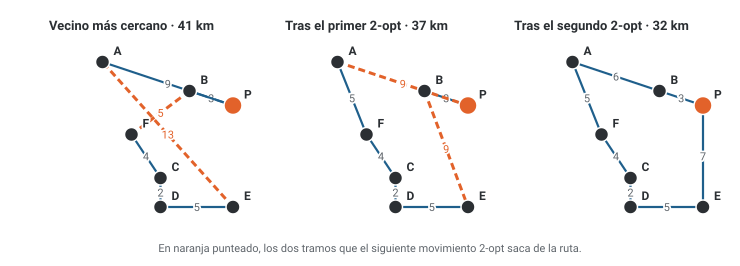
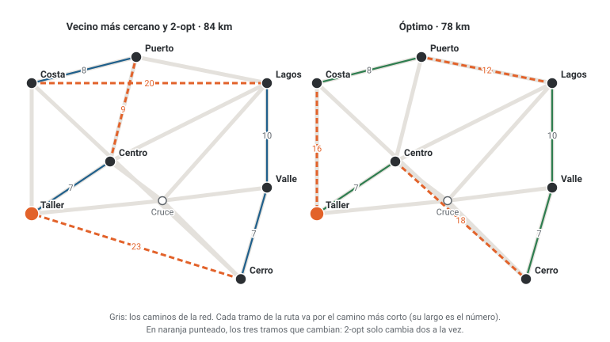

# Unidad 11 · Heurísticas constructivas y búsqueda local

**Qué vas a poder hacer.** Decidir si un problema se resuelve exacto o con una heurística, construir
una solución con el vecino más cercano, la inserción más barata o los ahorros, mejorarla con búsqueda
local (2-opt, intercambio o complemento) eligiendo entre primer mejor y mejor mejora, reconocer cuándo
quedaste en un óptimo local y medir con el gap qué tan lejos está del óptimo.

**Lo que necesitas antes.** De la unidad 4, el modelo del vendedor viajero y por qué el número de
rutas crece tan rápido. De la unidad 5, las cotas y el gap de ramificación y acotamiento. De la
unidad 8, la ruta más corta: las distancias del caso integrador son rutas más cortas de la red.

**Tiempo.** Unas 5 horas: 2 de lectura con el ejemplo y 3 de práctica.

---

## 1. Exacto o aproximado

Un método **exacto** (ramificación y acotamiento, el solver de OPL) entrega el óptimo y lo demuestra.
El precio es el tiempo: en problemas combinatorios, como el vendedor viajero, el número de soluciones
crece como un factorial. Con $n$ puntos contando la base, y distancias simétricas, hay $(n-1)!/2$ rutas
distintas.

| Almacenes además de la base | Rutas distintas $(n-1)!/2$ |
|---|---|
| 4 | 12 |
| 6 | 360 |
| 9 | 181.440 |
| 14 | 43.589.145.600 |
| 19 | $6{,}08 \cdot 10^{16}$ |
| 29 | $4{,}42 \cdot 10^{30}$ |

Un solver no las revisa todas (poda ramas con cotas), pero el árbol de ramificación también crece sin
control: hay problemas de reparto de un día que ningún solver cierra en una noche.

Una **heurística** es una regla razonable que entrega una buena solución rápido, **sin garantía** de
que sea la óptima. No es un método «peor»: es otro trato. Se cambia la garantía por velocidad.

| Conviene el método exacto cuando | Conviene una heurística cuando |
|---|---|
| el problema es chico o mediano y el solver lo cierra a tiempo | el problema es grande y el solver no termina |
| cada punto de diferencia vale mucho dinero (una red de localización que dura diez años) | la decisión se repite todos los días (la ruta del reparto de mañana) |
| hay que demostrar que no existe nada mejor (una licitación, un contrato) | los datos son aproximados: el error de los datos es mayor que el gap |
| hay tiempo para modelar y resolver | se necesita una respuesta en segundos o una solución inicial para el solver |

Las dos se combinan: la mejor solución de una heurística es una **cota** para ramificación y
acotamiento (en un mínimo, el óptimo no puede ser peor que ella) y le permite podar desde el primer
nodo.

### El gap: qué tan lejos quedó

Para un problema de mínimo con valor heurístico $z_H$ y óptimo $z^*$:

$$\text{gap} = \frac{z_H - z^*}{z^*}$$

Casi nunca se conoce $z^*$ (si se conociera, no haría falta la heurística). Lo que sí se tiene es una
**cota inferior** $L \le z^*$ (la relajación lineal, por ejemplo). Como $z^* \ge L$, el gap verdadero
no puede ser mayor que

$$\text{gap} \le \frac{z_H - L}{L}$$

Si esa cota del gap ya es chica (1 %, 5 %), la solución sirve aunque no se sepa el óptimo. Los
solvers como CPLEX informan el gap dividiendo por la solución encontrada ($\frac{z_H - L}{z_H}$), no por
la cota; con gaps chicos la diferencia es mínima, pero hay que saber cuál se usa (ejercicio 11.2).

Junto al gap se informa el **tiempo** o, mejor, el número de soluciones evaluadas: el tiempo depende del
computador; las evaluaciones no.

---

## 2. Heurísticas constructivas

Una heurística **constructiva** arma la solución pieza por pieza, decidiendo cada pieza una sola vez.

### 2.1 Vecino más cercano

1. Parte en la base. Es la ruta actual.
2. Desde el último punto de la ruta, ve al punto no visitado más cercano.
3. Repite hasta visitar todos y vuelve a la base.

Hace $n-1$ elecciones y en cada una mira a lo más $n$ distancias: unas $n^2$ operaciones, nada. Tiene
dos defectos que conviene conocer de memoria:

- **Es miope.** Cada paso es el mejor *ahora*, sin mirar lo que deja. Las primeras elecciones son
  cortas y las últimas, obligadas: el tramo de vuelta a la base suele ser el más largo de la ruta.
- **Depende del inicio y de los empates.** Partir en otro punto da otra ruta (ejercicio 11.1), y a
  igual distancia hay que fijar una regla (aquí: la que va primero en el orden de la lista).

### 2.2 Inserción más barata

1. Parte con un subtour de dos puntos (ida y vuelta).
2. Para cada punto $k$ fuera del subtour y cada tramo $(i, j)$ del subtour, calcula lo que cuesta meter
   $k$ entre $i$ y $j$:

$$c_{ik} + c_{kj} - c_{ij}$$

3. Inserta el par (punto, tramo) más barato y repite hasta que no quede nadie fuera.

La fórmula es el **costo marginal** del punto: se agregan dos tramos y se quita uno. A diferencia del
vecino más cercano, cada punto puede entrar en cualquier parte de la ruta, no solo al final. Cuesta
más cálculo (unas $n^3$ operaciones) y suele dejar rutas mejores.

### 2.3 Ahorros de Clarke y Wright (mención)

Cuando el camión tiene **capacidad** y no alcanza a visitar a todos en un viaje (el ruteo de vehículos
de la unidad 4), se parte con un viaje por cliente, $0 \to i \to 0$, y se van uniendo. Unir los viajes
de $i$ y de $j$ en $0 \to i \to j \to 0$ ahorra

$$s_{ij} = d_{0i} + d_{0j} - d_{ij}$$

porque ya no se vuelve a la base desde $i$ ni se sale de nuevo hacia $j$. Se ordenan los pares de mayor
a menor ahorro y se unen los viajes mientras la carga quepa en el camión y $i$ y $j$ estén en un
extremo de su viaje (no al medio). Es la heurística de ruteo más usada en la práctica; el ejercicio
11.10 la aplica.

La idea constructiva aparece en todo el ramo: en una mochila se meten los objetos por mayor margen por
kilo; en una máquina se ordenan los trabajos por fecha de entrega más temprana (ejercicio 11.8).

---

## 3. Búsqueda local

Una heurística de **mejora** parte de una solución completa y la cambia de a poco.

- La **solución actual** $x$.
- Un **movimiento**: una regla para cambiar $x$ un poco (invertir un tramo de la ruta, cambiar una
  variable de 0 a 1).
- El **vecindario** $N(x)$: todas las soluciones a un movimiento de $x$.

El algoritmo:

1. **Inicio.** Toma una solución factible $x$ (la de una heurística constructiva).
2. **Óptimo local.** Si ningún vecino factible de $N(x)$ mejora a $x$, detente: $x$ es un óptimo local.
3. **Movimiento.** Si no, muévete a un vecino factible que mejore y vuelve al paso 2.

### Los vecindarios de este ramo

Con una ruta de $n$ puntos contando la base (la base queda fija):

| Movimiento | Qué hace | Vecinos |
|---|---|---|
| **Complemento** (variables binarias) | cambia una $x_j$ de 0 a 1 o de 1 a 0 | tantos como variables |
| **Intercambio** (swap) | cambia de posición dos clientes | $\binom{n-1}{2}$ |
| **2-opt** | invierte un tramo de la ruta: saca dos tramos y los reconecta | $n(n-3)/2$ |
| **Inserción** (or-opt) | saca un cliente o un tramo corto y lo pone en otra parte | unos $n^2$ |

### 2-opt, en detalle

La ruta es $r_0, r_1, \dots, r_n$ con $r_0 = r_n$ = la base. El movimiento $(i, j)$, con
$1 \le i < j \le n-1$, invierte el tramo $r_i, \dots, r_j$. Salen dos tramos y entran dos:

$$\Delta_{ij} = d(r_{i-1}, r_j) + d(r_i, r_{j+1}) - d(r_{i-1}, r_i) - d(r_j, r_{j+1})$$

Con distancias simétricas el tramo invertido mide lo mismo al derecho y al revés, así que **solo
cambian los cuatro tramos de la fórmula**: no hace falta recalcular la ruta entera. El movimiento
$(1, n-1)$ invierte toda la ruta: es la misma ruta al revés y no se cuenta. Un $\Delta$ negativo
acorta la ruta. En el mapa, 2-opt **deshace cruces**: si dos tramos se cruzan, invertir lo que hay entre
ellos los descruza y acorta.

### Primer mejor o mejor mejora

- **Mejor mejora** (best improvement): revisa todo el vecindario y toma el $\Delta$ más negativo.
- **Primer mejor** (first improvement): revisa en un orden fijo y toma el primero que mejora.

Primer mejor hace cada iteración más barata y suele necesitar más iteraciones; ninguna de las dos
garantiza llegar al mismo óptimo local (ejercicio 11.6).

### Multiarranque

Una búsqueda local termina donde la lleva su punto de partida. **Multiarranque** (multistart) la corre
desde varias soluciones iniciales distintas y se queda con la mejor: es la manera más simple de no
depender de un solo óptimo local (ejercicio 11.9).

---

## 4. Óptimo local y óptimo global

Un **óptimo local** es una solución que ningún vecino mejora. El **óptimo global** es la mejor de todas.
Todo óptimo global es local, pero no al revés, y el óptimo local **depende del vecindario**: una ruta
puede ser óptimo local de intercambio y no de 2-opt (ejercicio 11.7).

- Un vecindario grande (todas las rutas) garantizaría el óptimo global, pero revisarlo es resolver el
  problema por fuerza bruta.
- Un vecindario chico se revisa rápido, pero tiene más óptimos locales donde quedarse.

Esa es la tensión de toda búsqueda local. Por eso la búsqueda local no se detiene «porque llegó al
óptimo», se detiene porque **ya no ve nada mejor desde donde está**. En programación lineal no pasa
(la región es convexa y todo óptimo local es global, Optimización unidad 3); en problemas enteros y
de rutas, sí. La unidad 12 trata cómo salir de un óptimo local.

---

## 5. Ejemplo resuelto · la panadería y sus seis almacenes

Una panadería de San Carlos (P) reparte cada mañana a seis almacenes (A a F) con un furgón. La tabla
da las distancias en km: son las de la figura, en línea recta y redondeadas al km.

| km | P | A | B | C | D | E | F |
|---|---|---|---|---|---|---|---|
| **P** | – | 9 | 3 | 7 | 9 | 7 | 7 |
| **A** | 9 | – | 6 | 9 | 11 | 13 | 5 |
| **B** | 3 | 6 | – | 6 | 8 | 9 | 5 |
| **C** | 7 | 9 | 6 | – | 2 | 5 | 4 |
| **D** | 9 | 11 | 8 | 2 | – | 5 | 5 |
| **E** | 7 | 13 | 9 | 5 | 5 | – | 9 |
| **F** | 7 | 5 | 5 | 4 | 5 | 9 | – |

**Paso 1 · Vecino más cercano desde P.** En cada paso, la columna «Pendientes» ordena los almacenes no
visitados por distancia.

| Paso | Desde | Pendientes (km) | Va a | Tramo |
|---|---|---|---|---|
| 1 | P | B 3, C 7, E 7, F 7, A 9, D 9 | B | 3 |
| 2 | B | F 5, A 6, C 6, D 8, E 9 | F | 5 |
| 3 | F | C 4, A 5, D 5, E 9 | C | 4 |
| 4 | C | D 2, E 5, A 9 | D | 2 |
| 5 | D | E 5, A 11 | E | 5 |
| 6 | E | A 13 | A | 13 |
| cierre | A | P 9 | P | 9 |

Ruta: P → B → F → C → D → E → A → P, de **41 km**. Las primeras elecciones son de 2 a 5 km; el tramo
E → A, obligado porque A es lo único que queda, mide 13: la miopía de la sección 2.1.

**Paso 2 · 2-opt con mejor mejora.** Con 7 puntos hay 14 movimientos ($7 \cdot 4 / 2$). La tabla da el
$\Delta$ de cada uno en cada iteración (la ruta cambia de una iteración a otra; los pares $(i, j)$ son
las posiciones); en negrita, el elegido.

| Movimiento (i, j) | Iteración 1 (41 km) | Iteración 2 (37 km) | Iteración 3 (32 km) |
|---|---|---|---|
| (1, 2) | +6 | +7 | +6 |
| (1, 3) | +10 | +10 | +6 |
| (1, 4) | +10 | +5 | +10 |
| (1, 5) | −3 | +5 | +10 |
| (2, 3) | +4 | +2 | +4 |
| (2, 4) | +7 | +2 | +9 |
| (2, 5) | **−4** | +4 | +10 |
| (2, 6) | −1 | **−5** | +5 |
| (3, 4) | +1 | +1 | +7 |
| (3, 5) | +1 | +10 | +10 |
| (3, 6) | −1 | +8 | +8 |
| (4, 5) | +1 | +7 | +1 |
| (4, 6) | +7 | +7 | +5 |
| (5, 6) | +4 | +3 | +5 |

- **Iteración 1.** El mejor es $(2, 5)$, con $\Delta = -4$: invierte F, C, D, E. Salen B–F (5) y E–A
  (13), entran B–E (9) y F–A (5): $9 + 5 - 5 - 13 = -4$. La ruta queda P → B → E → D → C → F → A → P,
  de **37 km**.
- **Iteración 2.** El mejor es $(2, 6)$, con $\Delta = -5$: salen B–E (9) y A–P (9), entran B–A (6) y
  E–P (7). La ruta queda P → B → A → F → C → D → E → P, de **32 km**.
- **Iteración 3.** Ningún $\Delta$ es negativo: la ruta es un **óptimo local** de 2-opt. Se revisaron
  42 evaluaciones (3 iteraciones de 14).



**Paso 3 · ¿Es el óptimo?** Con 6 almacenes hay 360 rutas: la fuerza bruta las revisa todas. El modelo
exacto del vendedor viajero (unidad 4, con las restricciones MTZ contra subrutas) en OPL:

- Conjuntos: $N$ = {P, A, …, F}, con la base P.
- Parámetros: $d_{ij}$, km entre $i$ y $j$; $n = |N| = 7$.
- Variables:
  - $x_{ij}$, para todo $i, j \in N$ con $i \ne j$: vale 1 si el furgón va directo de $i$ a $j$; 0 en
    otro caso.
  - $u_i$, para todo $i \in N \setminus \{P\}$: la posición del almacén $i$ en la ruta (1 el primero,
    $n - 1$ el último).
  - Naturaleza: $x_{ij} \in \{0, 1\}$, $u_i \in \mathbb{Z}_0^+$.

$$\min \sum_{i \in N} \sum_{j \in N,\, j \ne i} d_{ij}\, x_{ij}$$

$$\sum_{i \ne j} x_{ij} = 1 \;\; \forall j \in N \qquad \sum_{j \ne i} x_{ij} = 1 \;\; \forall i \in N \qquad 1 \le u_i \le n - 1 \;\; \forall i \in N \setminus \{P\}$$

$$u_i - u_j + n\, x_{ij} \le n - 1 \;\; \forall i, j \in N \setminus \{P\},\; i \ne j$$

```opl
/*********************************************
 * Unidad 11 · Ejemplo resuelto · la ruta exacta de la panadería
 * Vendedor viajero con restricciones MTZ (sin subrutas).
 * x[i][j] = 1 si el furgón va directo de i a j; 0 en otro caso.
 * u[i]    = posición del almacén i en la ruta (la base no lleva u).
 * Datos en u11_reparto_exacto.dat. Base abierta de ingeniería.
 *********************************************/

{string} Nodos = ...;
string Base = ...;
float d[Nodos][Nodos] = ...;            // km entre cada par de puntos
int n = card(Nodos);

dvar boolean x[Nodos][Nodos];           // 1 si va directo de i a j
dvar int+ u[Nodos];                     // posición de i en la ruta

minimize sum(i in Nodos, j in Nodos: i != j) d[i][j] * x[i][j];

subject to {
  forall(i in Nodos)
    SinLazo: x[i][i] == 0;
  forall(j in Nodos)
    Llega: sum(i in Nodos: i != j) x[i][j] == 1;
  forall(i in Nodos)
    Sale: sum(j in Nodos: j != i) x[i][j] == 1;
  forall(i in Nodos: i != Base)
    PosMin: u[i] >= 1;
  forall(i in Nodos: i != Base)
    PosMax: u[i] <= n - 1;
  forall(i in Nodos, j in Nodos: i != j && i != Base && j != Base)
    SinSubrutas: u[i] - u[j] + n * x[i][j] <= n - 1;
}

execute {
  var km = 0;
  for (var i in Nodos) for (var j in Nodos) km = km + d[i][j] * x[i][j];
  writeln("km = ", km);
  for (var i in Nodos) for (var j in Nodos) if (x[i][j] == 1) writeln("arco_", i, "_", j, " = 1");
}
```

Con el archivo de datos `u11_reparto_exacto.dat`:

```opl
/* Unidad 11 · Ejemplo resuelto · la panadería y sus seis almacenes (km, línea recta redondeada) */
Nodos = {"P", "A", "B", "C", "D", "E", "F"};
Base  = "P";
d = [
  [ 0,  9,  3,  7,  9,  7,  7],
  [ 9,  0,  6,  9, 11, 13,  5],
  [ 3,  6,  0,  6,  8,  9,  5],
  [ 7,  9,  6,  0,  2,  5,  4],
  [ 9, 11,  8,  2,  0,  5,  5],
  [ 7, 13,  9,  5,  5,  0,  9],
  [ 7,  5,  5,  4,  5,  9,  0]
];
```

OPL, `scipy.optimize.milp` y la fuerza bruta coinciden: el óptimo es de **32 km**, la misma ruta que
dejó 2-opt (la segunda mejor ruta mide 33 km).

| Método | km | Gap contra el óptimo | Soluciones evaluadas |
|---|---|---|---|
| Vecino más cercano | 41 | 28,13 % | 1 ruta |
| Vecino + 2-opt | 32 | 0,00 % | 42 evaluaciones |
| Exacto (fuerza bruta) | 32 | – | 360 rutas |

**Cómo se lee.**

- La panadería usa P → B → A → F → C → D → E → P: 9 km menos que la ruta del vecino más cercano, todos
  los días. Con dos movimientos de 2-opt se recuperó todo el gap.
- Esta vez el óptimo local fue el global. **Nada lo garantizaba**: lo sabemos solo porque la instancia
  es chica y se pudo resolver exacta. Con 40 almacenes no se sabría, y lo honesto sería informar el gap
  contra una cota.
- En la figura se ve por qué funcionó: la ruta del vecino cruzaba sus propios tramos y cada 2-opt
  deshizo un cruce.

---

## 6. Errores típicos

| Error | Cómo evitarlo |
|---|---|
| Llamar «óptimo» a lo que entrega la heurística | Di «óptimo local de 2-opt» o «solución heurística» y da el gap contra el óptimo o contra una cota |
| Calcular el gap dividiendo por la heurística cuando se pide sobre el óptimo (o al revés) | Escribe la fórmula antes del número: $(z_H - z^*)/z^*$ |
| Olvidar el tramo de vuelta a la base al sumar la ruta | Una ruta de $n$ puntos tiene $n$ tramos; la última fila de la tabla del vecino es el cierre |
| No fijar una regla de empate en el vecino más cercano | Escríbela antes de empezar (orden de la lista, orden alfabético) |
| Calcular el $\Delta$ de 2-opt recalculando la ruta entera, o sumando los tramos al revés | Solo cambian cuatro tramos: $d(r_{i-1}, r_j) + d(r_i, r_{j+1}) - d(r_{i-1}, r_i) - d(r_j, r_{j+1})$ |
| Detener la búsqueda en el primer vecino que no mejora | Un óptimo local exige revisar **todo** el vecindario y que ningún vecino mejore |
| Aceptar un vecino que mejora pero es infactible (en la mochila, uno que no cabe) | Revisa la factibilidad antes que el valor |
| Definir mal una variable del modelo exacto: sin su índice, sin decir qué significa el 1 o sin el «en otro caso» | Cada variable lleva tres piezas: índice con su rango, qué significa el 1 (o el valor) y el «en otro caso»; y aparte, su naturaleza ($x \in \{0,1\}$, $u \in \mathbb{Z}_0^+$) |
| Escribir una familia de restricciones sin su «∀» (por ejemplo, las MTZ sin decir para qué pares) | Toda familia termina con su «para todo»; un índice suelto es un error |

---

## 7. Práctica

Diez ejercicios: 11.1 a 11.4 básicos, 11.5 a 11.8 intermedios, 11.9 y 11.10 de desafío. Las pautas están
en la sección 8. En las rutas, la base queda fija y las distancias son simétricas.

**11.1 · El vecino depende del inicio (básico).** Una corredora de propiedades visita cinco casas
(1 a 5). Distancias en km:

| km | 1 | 2 | 3 | 4 | 5 |
|---|---|---|---|---|---|
| **1** | – | 8 | 14 | 9 | 12 |
| **2** | 8 | – | 7 | 13 | 10 |
| **3** | 14 | 7 | – | 6 | 12 |
| **4** | 9 | 13 | 6 | – | 5 |
| **5** | 12 | 10 | 12 | 5 | – |

(a) Construye la ruta del vecino más cercano partiendo de la casa 1 y su largo. (b) Repite partiendo de
la casa 4. (c) El óptimo es de 38 km: ¿qué gap tiene cada ruta? ¿Qué muestra la comparación?

**11.2 · Gap, cotas y tamaño (básico).** Un programa de ruteo entrega para 40 clientes una ruta de
212 km, y la relajación lineal del modelo da una cota inferior de 196 km. (a) ¿Cuál es, a lo más, el
gap de la ruta? Si la empresa acepta hasta 5 %, ¿puede quedarse con la ruta sin más? (b) Días después,
un solver encuentra el óptimo: 203 km. ¿Cuál era el gap verdadero? (c) ¿Qué gap informaría CPLEX con la
ruta y la cota de (a)? (d) ¿Cuántas rutas distintas hay con 12 puntos y con 20 puntos, contando la base? Si un
computador revisa un millón de rutas por segundo, ¿cuánto tarda la fuerza bruta en cada caso?

**11.3 · Inserción más barata (básico).** Con las distancias del ejercicio 11.1, aplica la inserción más
barata partiendo del subtour 1 → 2 → 1. En cada paso muestra el costo de la mejor inserción de cada
casa pendiente. Compara la ruta con la del vecino más cercano.

**11.4 · Búsqueda local en una mochila (básico).** Una imprenta tiene 9 horas libres esta semana y
cuatro pedidos que puede aceptar o no. Los márgenes son 12, 9, 7 y 22 mil pesos, y las horas, 4, 3, 2
y 6. (a) Escribe el modelo con sus variables bien definidas. (b) Parte de aceptar los pedidos 1 y 2,
$x = (1, 1, 0, 0)$, y aplica búsqueda local con el vecindario de complemento (cambiar una variable) y
mejor mejora, hasta un óptimo local. (c) Encuentra el óptimo enumerando: ¿a cuántos cambios del óptimo
local está?

**11.5 · 2-opt a mano (intermedio).** Un técnico sale de su base (1) y visita cinco clientes (2 a 6).
Distancias en km:

| km | 1 | 2 | 3 | 4 | 5 | 6 |
|---|---|---|---|---|---|---|
| **1** | – | 7 | 4 | 4 | 2 | 4 |
| **2** | 7 | – | 3 | 7 | 6 | 9 |
| **3** | 4 | 3 | – | 4 | 4 | 6 |
| **4** | 4 | 7 | 4 | – | 6 | 2 |
| **5** | 2 | 6 | 4 | 6 | – | 6 |
| **6** | 4 | 9 | 6 | 2 | 6 | – |

Parte de la ruta en el orden en que llamaron, 1 → 2 → 3 → 4 → 5 → 6 → 1. (a) ¿Cuánto mide? (b) Aplica
2-opt con mejor mejora: en cada iteración, el $\Delta$ de los 9 movimientos. (c) ¿Dónde se detiene? El
óptimo es de 21 km.

**11.6 · Primer mejor contra mejor mejora (intermedio).** Repite el paso 2 del ejemplo de la panadería
(desde la ruta del vecino, de 41 km) con **primer mejor**, revisando los movimientos en el orden
$(1, 2), (1, 3), \dots, (5, 6)$. ¿A qué ruta llega? ¿Cuántas evaluaciones hizo, contra las 42 de mejor
mejora?

**11.7 · Intercambio no es 2-opt (intermedio).** Con los datos del ejercicio 11.5 y la misma ruta
inicial, aplica búsqueda local con el vecindario de **intercambio** (cambiar de posición dos clientes) y
mejor mejora. (a) ¿Dónde se detiene y con qué gap? (b) Desde esa ruta, ¿mejora algún movimiento 2-opt?
(c) Explica por qué una ruta puede ser óptimo local de un vecindario y no de otro.

**11.8 · Ordenar pedidos (intermedio).** Una imprenta tiene cinco pedidos en una sola máquina. Cada día
de atraso de un pedido se paga con la multa de la tabla (en miles de pesos).

| Pedido | 1 | 2 | 3 | 4 | 5 |
|---|---|---|---|---|---|
| Días de trabajo $p_j$ | 4 | 8 | 9 | 6 | 6 |
| Entrega comprometida (día) $d_j$ | 29 | 14 | 16 | 7 | 6 |
| Multa por día de atraso $w_j$ | 4 | 1 | 2 | 5 | 2 |

(a) Ordena los pedidos por fecha de entrega más temprana (la heurística constructiva de la
secuenciación) y calcula el atraso ponderado total $\sum_j w_j \max(0, C_j - d_j)$, donde $C_j$ es el
día en que termina el pedido $j$. (b) Mejora con búsqueda local: el vecindario es intercambiar dos
pedidos **consecutivos**; usa mejor mejora. (c) Enumera las 120 secuencias: ¿cuál es la óptima y qué
gap deja la búsqueda local?

**11.9 · Multiarranque en Estampa Sur (desafío).** Con la matriz del caso integrador (sección 9), corre
el vecino más cercano partiendo de cada uno de los siete puntos (a igual distancia, el que va primero en
orden alfabético), gira cada ruta para que empiece y termine en el Taller, y aplica 2-opt con mejor
mejora a cada una. ¿Cuántos arranques llegan al óptimo de 78 km? ¿Qué dice eso del 84 del caso?

**11.10 · Ahorros de Clarke y Wright (desafío).** Una distribuidora de bidones (bodega 0) atiende a
cinco clientes con una camioneta de 18 cajas. Distancias en km:

| km | 0 | 1 | 2 | 3 | 4 | 5 |
|---|---|---|---|---|---|---|
| **0** | – | 4 | 5 | 5 | 6 | 4 |
| **1** | 4 | – | 3 | 4 | 6 | 9 |
| **2** | 5 | 3 | – | 7 | 3 | 9 |
| **3** | 5 | 4 | 7 | – | 9 | 9 |
| **4** | 6 | 6 | 3 | 9 | – | 8 |
| **5** | 4 | 9 | 9 | 9 | 8 | – |

| Cliente | 1 | 2 | 3 | 4 | 5 |
|---|---|---|---|---|---|
| Cajas | 5 | 7 | 6 | 6 | 5 |

(a) Calcula los ahorros $s_{ij}$ de todos los pares, ordénalos y aplica la heurística: ¿qué viajes
quedan y cuántos km suman? (b) Compara con hacer un viaje por cliente. (c) Encuentra el óptimo
enumerando todas las formas de repartir los clientes en viajes que quepan en la camioneta. ¿Qué gap
deja la heurística?

---

## 8. Pautas

**11.1.** (a) Desde la casa 1:

| Paso | Desde | Pendientes (km) | Va a | Tramo |
|---|---|---|---|---|
| 1 | 1 | 2 8, 4 9, 5 12, 3 14 | 2 | 8 |
| 2 | 2 | 3 7, 5 10, 4 13 | 3 | 7 |
| 3 | 3 | 4 6, 5 12 | 4 | 6 |
| 4 | 4 | 5 5 | 5 | 5 |
| cierre | 5 | 1 12 | 1 | 12 |

Ruta 1 → 2 → 3 → 4 → 5 → 1, de 38 km. (b) Desde la casa 4:

| Paso | Desde | Pendientes (km) | Va a | Tramo |
|---|---|---|---|---|
| 1 | 4 | 5 5, 3 6, 1 9, 2 13 | 5 | 5 |
| 2 | 5 | 2 10, 1 12, 3 12 | 2 | 10 |
| 3 | 2 | 3 7, 1 8 | 3 | 7 |
| 4 | 3 | 1 14 | 1 | 14 |
| cierre | 1 | 4 9 | 4 | 9 |

Ruta 4 → 5 → 2 → 3 → 1 → 4, de 45 km. (c) Desde la 1 el gap es 0,00 % (justo el óptimo de 38 km); desde
la 4, $(45 - 38)/38$ = 18,42 %. Lectura: la misma regla, con otro punto de partida, cambia el
resultado en casi un 20 %; el vecino más cercano no sabe de antemano cuál inicio le conviene.

**11.2.** (a) $\frac{212 - 196}{196}$ = 8,16 %: a lo más, el gap es de 8,16 %. No alcanza para
asegurar el 5 %: la ruta podría estar a 5 % del óptimo o a 8 %; no se sabe. (b)
$\frac{212 - 203}{203}$ = 4,43 %: la ruta sí cumplía, pero con la cota de (a) no se podía demostrar.
(c) CPLEX divide por la solución: $\frac{212 - 196}{212}$ = 7,55 %. (d) Con 12 puntos,
$11!/2 = 19.958.400$ rutas: 20,0 segundos. Con 20, $19!/2 = 60.822.550.204.416.000$ rutas: unos
1.929 años. Lectura: la cota del gap protege contra lo malo (se sabe el peor caso); y el tamaño explica
por qué se usan heurísticas: pasar de 12 a 20 clientes no hace el problema el doble de difícil.

**11.3.**

| Subtour | Mejor inserción de cada ciudad pendiente $c_{ik}+c_{kj}-c_{ij}$ | Se inserta |
|---|---|---|
| 1 → 2 → 1 | 3 entre 1 y 2: 13; 4 entre 1 y 2: 14; 5 entre 1 y 2: 14 | 3 entre 1 y 2 (+13) |
| 1 → 3 → 2 → 1 | 4 entre 1 y 3: 1; 5 entre 1 y 3: 10 | 4 entre 1 y 3 (+1) |
| 1 → 4 → 3 → 2 → 1 | 5 entre 1 y 4: 8 | 5 entre 1 y 4 (+8) |

El subtour 1 → 2 → 1 mide 16; se agregan 13, 1 y 8: la ruta 1 → 5 → 4 → 3 → 2 → 1 mide 38 km, gap
0,00 %. Es la misma ruta del vecino desde la casa 1 recorrida al revés. Lectura: la inserción pudo poner
la casa 4 *entre* 1 y 3 por un costo de 1 km; el vecino más cercano solo puede agregar al final.

**11.4.** (a) Variables: $x_j$, para todo $j \in \{1, 2, 3, 4\}$: vale 1 si se acepta el pedido $j$; 0 en
otro caso. Naturaleza: $x_j \in \{0, 1\}$.

$$\max\; 12x_1 + 9x_2 + 7x_3 + 22x_4 \quad\text{s.a.}\quad 4x_1 + 3x_2 + 2x_3 + 6x_4 \le 9, \quad x_j \in \{0, 1\} \;\; \forall j$$

(b)

| Solución | Margen | Horas | Vecinos (cambia $x_j$): margen, horas | Se mueve a |
|---|---|---|---|---|
| (1, 1, 0, 0) | 21 | 7 | $x_1$: 9, 3 h; $x_2$: 12, 4 h; $x_3$: 28, 9 h; $x_4$: 43, 13 h (no cabe) | (1, 1, 1, 0) |
| (1, 1, 1, 0) | 28 | 9 | $x_1$: 16, 5 h; $x_2$: 19, 6 h; $x_3$: 21, 7 h; $x_4$: 50, 15 h (no cabe) | nadie mejora: óptimo local |

El óptimo local es (1, 1, 1, 0), con 28 mil pesos y las 9 horas usadas. (c) De las 16 combinaciones,
hay 11 soluciones factibles; la mejor es (0, 1, 0, 1), con 31 mil pesos en 9 horas. Está a tres cambios
del óptimo local (sacar el 1, sacar el 3 y poner el 4), y cada cambio por separado empeora o no cabe.
Lectura: con todas las horas usadas, el complemento solo puede sacar pedidos; para llegar al pedido 4,
el grande, hay que pasar por soluciones peores.

**11.5.** (a) $7 + 3 + 4 + 6 + 6 + 4 = 30$ km.

| Movimiento (i, j) | Iteración 1 (30 km) | Iteración 2 (24 km) | Iteración 3 (21 km) |
|---|---|---|---|
| (1, 2) | 0 | 0 | +2 |
| (1, 3) | −3 | +4 | +6 |
| (1, 4) | −2 | **−3** | +3 |
| (2, 3) | +2 | +8 | +8 |
| (2, 4) | +3 | +4 | +7 |
| (2, 5) | +6 | +5 | +6 |
| (3, 4) | −4 | +2 | +1 |
| (3, 5) | +2 | +2 | +4 |
| (4, 5) | **−6** | +6 | +6 |

(b) Iteración 1: $(4, 5)$ con $-6$ (invierte 5 y 6) deja 1 → 2 → 3 → 4 → 6 → 5 → 1, de 24 km.
Iteración 2: $(1, 4)$ con $-3$ deja 1 → 6 → 4 → 3 → 2 → 5 → 1, de 21 km. (c) En la iteración 3 ningún
$\Delta$ es negativo: óptimo local de 21 km, que es el óptimo. Lectura: en la iteración 1 había cuatro
movimientos que mejoraban; mejor mejora tomó el de $-6$.

**11.6.**

| Iteración | Ruta al empezar | km | Movimientos revisados | Elige | Δ |
|---|---|---|---|---|---|
| 1 | P → B → F → C → D → E → A → P | 41 | 4 | (1, 5) | −3 |
| 2 | P → E → D → C → F → B → A → P | 38 | 14 | (5, 6) | −6 |
| 3 | P → E → D → C → F → A → B → P | 32 | 14 | ninguno: óptimo local | – |

Llega a P → E → D → C → F → A → B → P, de 32 km: la misma ruta que mejor mejora, recorrida al revés.
Hizo 32 evaluaciones contra 42. Lectura: el primer movimiento que mejora ($-3$) no era el mejor ($-4$),
pero el segundo paso compensó; en problemas grandes, primer mejor suele ganar en tiempo, y el óptimo
local al que llega puede ser otro.

**11.7.** (a) Con 6 puntos hay 10 intercambios.

| Intercambio | Iteración 1 (30 km) | Iteración 2 (24 km) |
|---|---|---|
| posiciones 1 y 2 | 0 | 0 |
| posiciones 1 y 3 | −3 | +4 |
| posiciones 1 y 4 | 0 | +5 |
| posiciones 1 y 5 | +3 | +4 |
| posiciones 2 y 3 | +2 | +8 |
| posiciones 2 y 4 | +3 | +4 |
| posiciones 2 y 5 | +2 | +7 |
| posiciones 3 y 4 | −4 | +2 |
| posiciones 3 y 5 | +2 | +2 |
| posiciones 4 y 5 | **−6** | +6 |

Se detiene en 1 → 2 → 3 → 4 → 6 → 5 → 1, de 24 km: gap de $(24 - 21)/21$ = 14,29 %. (b) Sí: el 2-opt
$(1, 4)$, con $\Delta = -3$, llega a 1 → 6 → 4 → 3 → 2 → 5 → 1, el óptimo de 21 km. (c) Invertir el
tramo 2, 3, 4, 6 equivale a dos intercambios (2 con 6, y 3 con 4), y cada uno por separado no mejora:
el intercambio no «ve» esa ruta como vecina. Lectura: un óptimo local es local **respecto de un
vecindario**; cambiar de vecindario es una forma de seguir mejorando.

**11.8.** (a) Por fecha de entrega: 5-4-2-3-1, con atraso ponderado de 73 mil pesos. (b)

| Secuencia | Atraso ponderado | Vecinos (intercambia posiciones k y k+1) | Se mueve a |
|---|---|---|---|
| 5-4-2-3-1 | 73 | 1-2: 60; 2-3: 107; 3-4: 66; 4-5: 65 | 4-5-2-3-1 |
| 4-5-2-3-1 | 60 | 1-2: 73; 2-3: 70; 3-4: 53; 4-5: 52 | 4-5-2-1-3 |
| 4-5-2-1-3 | 52 | 1-2: 65; 2-3: 62; 3-4: 56; 4-5: 60 | nadie mejora: óptimo local |

La búsqueda se detiene en 4-5-2-1-3, con 52. (c) La secuencia óptima es 4-5-3-1-2, con 41:

| Pedido | Termina el día | Atraso (días) | Multa ponderada |
|---|---|---|---|
| 4 | 6 | 0 | 0 |
| 5 | 12 | 6 | 12 |
| 3 | 21 | 5 | 10 |
| 1 | 25 | 0 | 0 |
| 2 | 33 | 19 | 19 |

Gap de la búsqueda local: $(52 - 41)/41$ = 26,83 %. Lectura: para pasar de 4-5-2-1-3 a 4-5-3-1-2
hay que intercambiar los pedidos 2 y 3, que no son consecutivos, y con intercambios consecutivos cada
paso intermedio empeora; la regla de fechas ignora las multas, y el pedido 2 (multa 1) conviene dejarlo atrasado.

**11.9.**

| Arranca en | Ruta del vecino, rotada al Taller | km | Después de 2-opt (km) |
|---|---|---|---|
| Taller | Taller → Centro → Puerto → Costa → Lagos → Valle → Cerro → Taller | 84 | 84 |
| Centro | Taller → Costa → Puerto → Lagos → Valle → Cerro → Centro → Taller | 78 | 78 |
| Cerro | Taller → Centro → Cerro → Valle → Lagos → Puerto → Costa → Taller | 78 | 78 |
| Costa | Taller → Valle → Cerro → Lagos → Costa → Puerto → Centro → Taller | 88 | 84 |
| Lagos | Taller → Costa → Puerto → Lagos → Valle → Cerro → Centro → Taller | 78 | 78 |
| Puerto | Taller → Centro → Lagos → Valle → Cerro → Puerto → Costa → Taller | 89 | 78 |
| Valle | Taller → Centro → Valle → Cerro → Lagos → Puerto → Costa → Taller | 82 | 78 |

Llegan al óptimo 5 de los 7 arranques (tres de ellos, Centro, Cerro y Lagos, ya con el puro vecino más cercano).
Solo el arranque en el Taller (el del caso) y el de Costa quedan en 84 km. Lectura: el 84 del caso no es
una falla de 2-opt «en general», sino del punto de partida; diez líneas de código más (siete arranques)
bastan para llegar al óptimo, aunque sin garantía de que siempre ocurra.

**11.10.** (a)

| Par | Ahorro $s_{ij}=d_{0i}+d_{0j}-d_{ij}$ | Qué pasa |
|---|---|---|
| 2-4 | 8 | se unen |
| 1-2 | 6 | se unen |
| 1-3 | 5 | no: suman 24 cajas |
| 1-4 | 4 | ya están en la misma ruta |
| 2-3 | 3 | no: suman 24 cajas |
| 3-4 | 2 | no: suman 24 cajas |
| 4-5 | 2 | no: suman 23 cajas |
| 2-5 | 0 | no: suman 23 cajas |
| 3-5 | 0 | se unen |
| 1-5 | −1 | ahorro negativo: no conviene unir |

Quedan dos viajes, 0 → 1 → 2 → 4 → 0 y 0 → 3 → 5 → 0 (18 y 11 cajas), que suman 34 km. (b) Un viaje por
cliente suma 48 km: los ahorros bajan 14 km. (c) El óptimo es de 33 km, con los viajes 0 → 1 → 3 → 0 y
0 → 2 → 4 → 5 → 0 (11 y 18 cajas). Gap de 3,03 %. Lectura: el ahorro más grande (2-4) se tomó primero y
el viaje se llenó con el 1; después, el 5 quedó con el 3, que está al otro lado de la bodega. La
heurística es codiciosa: lo que une al principio no lo deshace después.

---

## 9. Caso integrador · Estampa Sur reparte con heurísticas

> Este caso sigue a Estampa Sur, el taller de serigrafía ficticio, por todo el ramo. Las cifras salen
> de `verificacion/caso_estampa_sur_red.py`. La unidad 4 encontró la ruta óptima del camión, de 78 km,
> enumerando las rutas, con distancias de ruta más corta (la unidad 8) entre cada par de puntos.

**Lo que recibe.** La matriz de distancias de ruta más corta entre el Taller y las seis tiendas (el
Cruce no es parada, pero los caminos pasan por él) y el óptimo de 78 km. La pregunta: si el taller no
tuviera un solver, ¿cuánto se alejaría una heurística?

| km | Taller | Centro | Puerto | Lagos | Valle | Costa | Cerro |
|---|---|---|---|---|---|---|---|
| **Taller** | – | 7 | 16 | 21 | 20 | 16 | 23 |
| **Centro** | 7 | – | 9 | 14 | 15 | 17 | 18 |
| **Puerto** | 16 | 9 | – | 12 | 22 | 8 | 27 |
| **Lagos** | 21 | 14 | 12 | – | 10 | 20 | 17 |
| **Valle** | 20 | 15 | 22 | 10 | – | 30 | 7 |
| **Costa** | 16 | 17 | 8 | 20 | 30 | – | 23 |
| **Cerro** | 23 | 18 | 27 | 17 | 7 | 23 | – |

**Vecino más cercano desde el Taller** (a igual distancia, orden alfabético; en el primer paso Costa y
Puerto empatan en 16, pero no se eligen).

| Paso | Desde | Pendientes (km) | Va a | Tramo |
|---|---|---|---|---|
| 1 | Taller | Centro 7, Costa 16, Puerto 16, Valle 20, Lagos 21, Cerro 23 | Centro | 7 |
| 2 | Centro | Puerto 9, Lagos 14, Valle 15, Costa 17, Cerro 18 | Puerto | 9 |
| 3 | Puerto | Costa 8, Lagos 12, Valle 22, Cerro 27 | Costa | 8 |
| 4 | Costa | Lagos 20, Cerro 23, Valle 30 | Lagos | 20 |
| 5 | Lagos | Valle 10, Cerro 17 | Valle | 10 |
| 6 | Valle | Cerro 7 | Cerro | 7 |
| cierre | Cerro | Taller 23 | Taller | 23 |

La ruta Taller → Centro → Puerto → Costa → Lagos → Valle → Cerro → Taller mide **84 km**: gap de
$(84 - 78)/78$ = 7,69 %. Otra vez, el tramo de vuelta (Cerro–Taller, 23 km) es de los más largos.

**2-opt desde esa ruta.** Los 15 pares $(i, j)$ del script:

| Movimiento (i, j) | Salen | Entran | Δ (km) |
|---|---|---|---|
| (1, 2) | Taller–Centro y Puerto–Costa | Taller–Puerto y Centro–Costa | +18 |
| (1, 3) | Taller–Centro y Costa–Lagos | Taller–Costa y Centro–Lagos | +3 |
| (1, 4) | Taller–Centro y Lagos–Valle | Taller–Lagos y Centro–Valle | +19 |
| (1, 5) | Taller–Centro y Valle–Cerro | Taller–Valle y Centro–Cerro | +24 |
| (1, 6) (es la misma ruta al revés) | Taller–Centro y Cerro–Taller | Taller–Cerro y Centro–Taller | 0 |
| (2, 3) | Centro–Puerto y Costa–Lagos | Centro–Costa y Puerto–Lagos | 0 |
| (2, 4) | Centro–Puerto y Lagos–Valle | Centro–Lagos y Puerto–Valle | +17 |
| (2, 5) | Centro–Puerto y Valle–Cerro | Centro–Valle y Puerto–Cerro | +26 |
| (2, 6) | Centro–Puerto y Cerro–Taller | Centro–Cerro y Puerto–Taller | +2 |
| (3, 4) | Puerto–Costa y Lagos–Valle | Puerto–Lagos y Costa–Valle | +24 |
| (3, 5) | Puerto–Costa y Valle–Cerro | Puerto–Valle y Costa–Cerro | +30 |
| (3, 6) | Puerto–Costa y Cerro–Taller | Puerto–Cerro y Costa–Taller | +12 |
| (4, 5) | Costa–Lagos y Valle–Cerro | Costa–Valle y Lagos–Cerro | +20 |
| (4, 6) | Costa–Lagos y Cerro–Taller | Costa–Cerro y Lagos–Taller | +1 |
| (5, 6) | Lagos–Valle y Cerro–Taller | Lagos–Cerro y Valle–Taller | +4 |

Ningún $\Delta$ es negativo: la ruta de 84 km ya es un óptimo local de 2-opt, y la búsqueda termina en
84 km sin moverse. Hay dos ceros: uno es la ruta al revés; el otro, $(2, 3)$, es una ruta distinta del
mismo largo (Taller → Centro → Costa → Puerto → Lagos → Valle → Cerro → Taller), y como 2-opt solo acepta
mejoras estrictas, no se mueve. El intercambio tampoco ayuda: su mejor $\Delta$ es 0 y se queda en
84 km.

**Por qué 2-opt se estanca.** La ruta de 84 y la óptima comparten cuatro tramos y difieren en **tres**:

| Salen de la ruta de 84 | km | Entran en la de 78 | km |
|---|---|---|---|
| Costa–Lagos | 20 | Costa–Taller | 16 |
| Cerro–Taller | 23 | Centro–Cerro | 18 |
| Centro–Puerto | 9 | Lagos–Puerto | 12 |
| Suma | 52 | Suma | 46 |

Un movimiento 2-opt cambia **dos** tramos a la vez; para cambiar tres hay que pasar por una ruta
intermedia, y todas las rutas a un 2-opt de distancia son más largas (la tabla). El movimiento que sí
llega es uno de tres tramos (or-opt): sacar el tramo Lagos, Valle, Cerro y ponerlo al revés entre Centro
y Puerto, con $\Delta = 46 - 52 = $ −6 km. Queda Taller → Centro → Cerro → Valle → Lagos → Puerto →
Costa → Taller, de 78 km: el óptimo.



Revisando las 360 rutas, solo 3 de las 360 son óptimos locales de 2-opt (de 78, 84 y 85 km): el vecino
más cercano tuvo la mala suerte de caer justo en una de las trampas.

**Lectura.** Con una heurística de dos pasos, Estampa Sur recorrería 6 km de más cada día de reparto
(7,69 %). Para un camión que sale todos los días, son unos 1.500 km al año si reparte 250 días: vale la
pena mejorar la búsqueda, y hay dos caminos. El del ejercicio 11.9, partir desde varios puntos; o el de
la unidad 12, dejar que la búsqueda acepte a veces una ruta peor para salir de la trampa.

**Lo que pasa a la unidad siguiente.** La ruta de 84 km como punto de partida del recocido simulado,
la búsqueda tabú y el algoritmo genético de la unidad 12, y el óptimo de 78 km para medir el gap de cada
uno.

---

## 10. Para seguir

**En los libros del ramo.**

- Winston, *Investigación de operaciones: aplicaciones y algoritmos* (4.ª ed., 2005): al tratar el
  problema del agente viajero dentro de la programación entera presenta las heurísticas del vecino más
  cercano y de inserción más barata, con ejemplos para hacer a mano.
- Hillier y Lieberman, *Investigación de operaciones* (7.ª ed., 2001): la programación entera y el
  problema del agente viajero, para contrastar el método exacto con las heurísticas de esta unidad.

**Abierto y gratis.**

- Jason Brownlee, *Clever Algorithms: Nature-Inspired Programming Recipes*, en inglés, completo en
  línea. La parte «Stochastic Algorithms» explica la búsqueda local («Stochastic Hill Climbing»), la
  búsqueda local iterada y el multiarranque, con código y ejemplos sobre un vendedor viajero con 2-opt:
  https://cleveralgorithms.com/nature-inspired/index.html

**Con el tutor.** La carpeta `tutor/` trae el contexto de este ramo. Pégalo al inicio de la
conversación con cualquier IA y pídele, por ejemplo: «Dame una matriz de distancias de seis ciudades,
déjame hacer el vecino más cercano y 2-opt a mano, y revísame cada $\Delta$».
