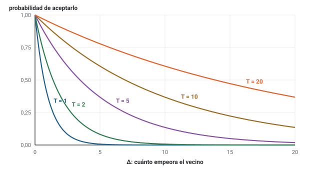
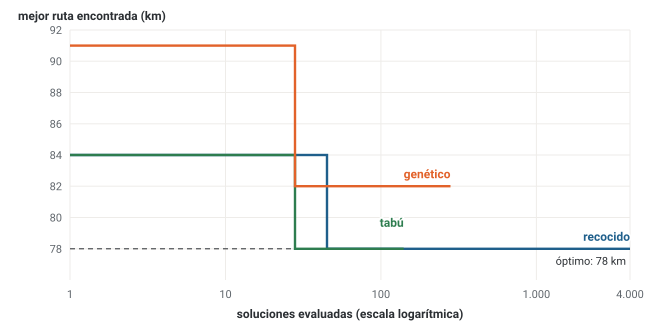

# Unidad 12 · Metaheurísticas · tabú, recocido simulado y algoritmos genéticos

**Qué vas a poder hacer.** Salir de un óptimo local con una búsqueda tabú (lista tabú, tenencia y
criterio de aspiración), con recocido simulado (temperatura, enfriamiento y probabilidad de aceptar
una solución peor) o con un algoritmo genético (codificación, aptitud, selección, cruce y mutación);
hacer cada una a mano con números aleatorios dados, y calibrar y comparar métodos con varias semillas y
el gap contra el óptimo.

**Lo que necesitas antes.** La unidad 11 entera: vecindarios, búsqueda local, óptimo local y gap. De la
unidad 2, el problema de la mochila con variables binarias; de la unidad 4, el vendedor viajero.

**Tiempo.** Unas 6 horas: 2 de lectura con el ejemplo y 4 de práctica.

---

## 1. Por qué hace falta algo más que la búsqueda local

La búsqueda local de la unidad 11 se detiene en el primer óptimo local que encuentra. La idea obvia
para seguir es **aceptar a veces un vecino peor**. El problema: desde el vecino peor, el mejor
movimiento suele ser volver a donde se estaba, y la búsqueda queda ciclando entre dos soluciones.

Una **metaheurística** es una estrategia general que dirige a una heurística (casi siempre una búsqueda
local) para que explore más allá del primer óptimo local sin ciclar. «Meta» porque no es la regla para
un problema: es la regla para dirigir reglas. La misma búsqueda tabú sirve para rutas, mochilas o
secuencias; lo que cambia es la codificación de la solución, el vecindario y cómo se evalúa.

Toda metaheurística equilibra dos fuerzas:

- **Intensificar:** buscar cerca de las buenas soluciones ya encontradas.
- **Diversificar:** ir a zonas no visitadas, aunque al principio se vean peores.

Mucha intensificación es una búsqueda local (se queda en el primer óptimo local); mucha diversificación
es una búsqueda al azar (no aprovecha lo que encontró). Calibrar es buscar el equilibrio.

---

## 2. Tipos de metaheurísticas

| | **Solución única** (una solución que se mueve) | **Población** (muchas soluciones a la vez) |
|---|---|---|
| **Búsqueda local** (la solución se mueve por su vecindario) | búsqueda tabú, recocido simulado, búsqueda local iterada, multiarranque | búsqueda dispersa (varias trayectorias que se combinan) |
| **Estrategia de aprendizaje** (lo visto enseña qué partes de una solución son buenas) | tabú con memoria de largo plazo (qué atributos se repiten en las buenas soluciones) | algoritmos genéticos, colonia de hormigas |

- **Búsqueda local contra aprendizaje.** La tabú y el recocido mueven una solución de vecino en vecino;
  su memoria (la lista tabú) o su azar (la temperatura) solo sirven para no quedarse pegadas. Un
  algoritmo genético no tiene vecindario: **aprende** de la población, porque las partes de las buenas
  soluciones se heredan y se combinan. La colonia de hormigas aprende con «feromonas» que marcan los
  tramos de las buenas rutas.
- **Solución única contra población.** Una sola solución es barata por iteración y fácil de seguir a
  mano. Una población explora varias zonas a la vez, pero cada generación evalúa muchas soluciones.

Esta unidad trata tres: búsqueda tabú y recocido simulado (solución única, búsqueda local) y algoritmos
genéticos (población, aprendizaje).

---

## 3. Búsqueda tabú

La tabú controla los ciclos con **memoria**: prohíbe por un tiempo los movimientos que devolverían la
búsqueda a donde estuvo recién.

1. **Inicio.** Una solución factible $x^{(0)}$, un límite de iteraciones $t_{\max}$ y la **mejor**
   $x' = x^{(0)}$. La lista tabú parte vacía.
2. **Detención.** Si $t = t_{\max}$, o si ningún movimiento admisible lleva a un vecino factible,
   detente: $x'$ es la respuesta.
3. **Movimiento.** Muévete al **mejor vecino admisible**, aunque sea peor que la solución actual.
   Admisible quiere decir: no es tabú, o es tabú pero cumple el criterio de aspiración.
4. **Mejor.** Si el nuevo $x^{(t+1)}$ es mejor que $x'$, reemplaza $x'$.
5. **Lista tabú.** Agrega el atributo que desharía el movimiento; quita los que cumplieron su
   tenencia. Suma uno a $t$ y vuelve al paso 2.

Las piezas que hay que fijar:

- **El atributo tabú.** No se guarda la solución entera (sería caro compararlas), sino un rasgo del
  movimiento: la variable que se cambió (mochila), el par de ciudades intercambiadas o los extremos del
  tramo invertido (rutas).
- **La tenencia** (tabu tenure): cuántas iteraciones queda prohibido. Con tenencia 2, lo que se cambió
  en la iteración $t$ está prohibido en $t+1$ y $t+2$. Corta, la búsqueda cicla; larga, se prohíbe
  casi todo.
- **El criterio de aspiración.** Un movimiento tabú se permite igual si lleva a una solución **mejor que
  la mejor encontrada** $x'$. La lista tabú existe para no volver atrás; si un movimiento prohibido
  lleva a un récord, no es volver atrás.
- **La respuesta es $x'$**, no la solución actual: la actual puede estar en plena subida.

La lista tabú evita los ciclos **cortos**. Ciclos más largos que la tenencia pueden repetirse (el caso
integrador lo muestra).

---

## 4. Recocido simulado

El recocido de los metales: se calienta el metal y se enfría lento para que los átomos encuentren una
estructura de baja energía. El recocido simulado acepta soluciones peores con una probabilidad que baja
a medida que «se enfría».

Si el vecino elegido empeora el objetivo en $\Delta > 0$ (más km, menos ganancia), se acepta con
probabilidad

$$p = e^{-\Delta / T}$$

donde $T > 0$ es la **temperatura**. Si el vecino no empeora, se acepta siempre.

- **Por qué funciona.** Un empeoramiento chico se acepta casi siempre; uno grande, casi nunca. Al
  principio, con $T$ alta, la búsqueda recorre mucho (diversifica); al final, con $T$ baja, solo acepta
  mejoras y se comporta como una búsqueda local (intensifica).
- **Con números aleatorios.** Se toma un número $u$ entre 0 y 1: si $u \le p$, se acepta; si no, se
  rechaza y se elige otro vecino sin avanzar la iteración. La probabilidad de **rechazar** una solución
  peor es $1 - p$.
- **Elegir el vecino al azar.** Con $m$ vecinos factibles en un orden fijo, el número $u$ elige el
  vecino número $\lfloor u \cdot m \rfloor + 1$ (con $m = 3$: $u < 0{,}33$ el primero, etc.).



**El enfriamiento.** La temperatura baja con una regla fija. La más usada es la geométrica:

$$T_k = T_0 \, \alpha^k, \qquad 0 < \alpha < 1$$

(o bajarla en un porcentaje cada cierto número de iteraciones). Tres parámetros mandan: $T_0$, $\alpha$
y el número de iteraciones.

**Calibrar $T_0$.** Una regla práctica: elegir $T_0$ para que un empeoramiento típico $\Delta$ se acepte
al principio con una probabilidad alta $p_0$ (0,8, por ejemplo):

$$e^{-\Delta/T_0} = p_0 \quad\Longrightarrow\quad T_0 = \frac{\Delta}{\ln(1/p_0)}$$

Con $T_0$ muy alta, el recocido es un paseo al azar; con $T_0$ muy baja, es una búsqueda local.

---

## 5. Algoritmos genéticos

Un algoritmo genético imita la evolución: una **población** de soluciones se reproduce, y las mejores
tienen más hijos.

| Pieza | Qué es | En una mochila | En una ruta |
|---|---|---|---|
| **Codificación** | cómo se escribe una solución (el cromosoma) | una cadena de bits: 10101 lleva las cajas 1, 3 y 5 | una permutación de las ciudades |
| **Aptitud** (fitness) | qué tan buena es | la ganancia, menos una **penalización** si no cabe | los km (menos es mejor) |
| **Selección** | quiénes son padres | **torneo**: se sortean dos y gana el mejor; **ruleta**: probabilidad proporcional a la aptitud | igual |
| **Cruce** | cómo se combinan dos padres | **un punto**: el hijo toma los primeros genes de un padre y el resto del otro | **OX** (cruce de orden), para no repetir ciudades |
| **Mutación** | un cambio chico al azar | cambiar un bit | intercambiar dos ciudades |
| **Reemplazo** | quién pasa a la siguiente generación | los hijos, más los mejores padres (**elitismo**) | igual |

- **La penalización.** El cruce de dos soluciones factibles puede no caber. En vez de botarla, se
  castiga: aptitud = ganancia − (penalización por unidad) × exceso. Así la población puede pasar por
  zonas infactibles, pero no quedarse ahí.
- **El cruce OX.** El hijo copia un tramo del padre 1 en las mismas posiciones; las posiciones que faltan
  se llenan, desde la que sigue al tramo y dando la vuelta, con las ciudades del padre 2 en el orden en
  que aparecen en él (también desde la posición que sigue al tramo), saltando las que ya están. El hijo
  hereda un tramo de un padre y el orden relativo del otro, y nunca repite una ciudad.
- **Elitismo.** Pasar siempre a la mejor solución a la siguiente generación asegura que la mejor nunca
  empeore.
- **Convergencia prematura.** Si la población se llena de copias de una solución buena, el cruce ya no
  produce nada nuevo y el algoritmo se estanca. Lo combaten una población más grande, más mutación o una
  selección menos agresiva.

---

## 6. Cómo calibrar y comparar

Una metaheurística con azar da **otro resultado con otra semilla**. Por eso:

1. **Fija y escribe la semilla y todos los parámetros.** Sin eso, nadie puede repetir el resultado.
2. **Corre varias semillas** (10 como mínimo) y reporta el mejor, el promedio, el peor y cuántas
   corridas llegan al óptimo (o a menos de cierto gap). Una corrida buena puede ser suerte.
3. **Compara con el mismo presupuesto**: el mismo número de soluciones evaluadas (o el mismo tiempo).
   Un método que evalúa diez veces más soluciones no es «mejor» por llegar más lejos.
4. **Mide contra el óptimo o contra una cota** (el gap de la unidad 11).
5. **Calibra con unas instancias y evalúa con otras.** Si los parámetros se ajustan hasta que la
   instancia de prueba sale perfecta, el resultado no dice nada de las demás.

---

## 7. Ejemplo resuelto · la camioneta de la feria

Una feriante de Chillán lleva sus cajas a la feria en una camioneta con espacio para 14 jabas. Tiene
cinco cajas posibles:

| Caja | 1 · paltas | 2 · tomates | 3 · ajos | 4 · zapallos | 5 · frutillas |
|---|---|---|---|---|---|
| Ganancia (miles de \$) | 25 | 29 | 13 | 11 | 26 |
| Volumen (jabas) | 7 | 8 | 4 | 5 | 3 |

**El modelo exacto.**

- Conjunto: $I$ = las cinco cajas. Parámetros: $g_i$, ganancia de la caja $i$ en miles de pesos; $v_i$,
  su volumen en jabas; capacidad $C = 14$.
- Variable: $x_i$, para todo $i \in I$: vale 1 si se lleva la caja $i$; 0 en otro caso. Naturaleza:
  $x_i \in \{0, 1\}$.

$$\max \sum_{i \in I} g_i\, x_i \quad\text{s.a.}\quad \sum_{i \in I} v_i\, x_i \le C$$

```opl
/*********************************************
 * Unidad 12 · Ejemplo resuelto · la camioneta de la feria (exacto)
 * Mochila binaria: qué cajas llevar con 14 jabas de espacio.
 * x[i] = 1 si se lleva la caja i; 0 en otro caso.
 * Datos en u12_feria_exacto.dat. Base abierta de ingeniería.
 *********************************************/

{string} Cajas = ...;
float ganancia[Cajas] = ...;            // miles de pesos
float volumen[Cajas]  = ...;            // jabas
float cap = ...;                        // jabas de la camioneta

dvar boolean x[Cajas];                  // 1 si se lleva la caja i

maximize sum(i in Cajas) ganancia[i] * x[i];

subject to {
  Espacio: sum(i in Cajas) volumen[i] * x[i] <= cap;
}

execute {
  for (var i in Cajas) writeln("x_", i, " = ", x[i]);
}
```

```opl
/* Unidad 12 · Ejemplo resuelto · la camioneta de la feria */
Cajas    = {"paltas", "tomates", "ajos", "zapallos", "frutillas"};
ganancia = [25, 29, 13, 11, 26];
volumen  = [7, 8, 4, 5, 3];
cap      = 14;
```

De las 32 combinaciones, 17 combinaciones caben; la mejor es **10101** (paltas, ajos y frutillas): 64 mil
pesos en 14 jabas. OPL, `milp` y la enumeración coinciden. Las metaheurísticas no saben eso: lo usamos
solo para medirlas.

**Paso 1 · La búsqueda local se queda pegada.** La heurística de la razón ganancia por jaba (frutillas,
luego tomates) deja 01001: 55 mil pesos en 11 jabas. Sus vecinos (cambiar una variable):

| Cambia | Vecino | Ganancia | Jabas | ¿Cabe? |
|---|---|---|---|---|
| $x_1$ | 11001 | 80 | 18 | no |
| $x_2$ | 00001 | 26 | 3 | sí |
| $x_3$ | 01101 | 68 | 15 | no |
| $x_4$ | 01011 | 66 | 16 | no |
| $x_5$ | 01000 | 29 | 8 | sí |

Los dos vecinos que caben son peores: 01001 es un óptimo local, a 9 mil pesos del óptimo.

**Paso 2 · Búsqueda tabú.** Vecindario de complemento; atributo tabú: la variable que se cambió;
tenencia 2; aspiración; $t_{\max} = 6$.

| t | Actual | Ganancia | Mejor hasta ahora | Prohibidas | Vecinos admisibles (cambia $x_j$: ganancia) | Elige |
|---|---|---|---|---|---|---|
| 1 | 01001 | 55 | 55 | ninguna | $x_2$: 26; $x_5$: 29 | $x_5$ → 01000 (29) |
| 2 | 01000 | 29 | 55 | $x_5$ | $x_2$: 0; $x_3$: 42; $x_4$: 40 | $x_3$ → 01100 (42) |
| 3 | 01100 | 42 | 55 | $x_3$, $x_5$ | $x_2$: 13 | $x_2$ → 00100 (13) |
| 4 | 00100 | 13 | 55 | $x_2$, $x_3$ | $x_1$: 38; $x_4$: 24; $x_5$: 39 | $x_5$ → 00101 (39) |
| 5 | 00101 | 39 | 55 | $x_2$, $x_5$ | $x_1$: 64; $x_3$: 26; $x_4$: 50 | $x_1$ → 10101 (64) |
| 6 | 10101 | 64 | 64 | $x_1$, $x_5$ | $x_3$: 51 | $x_3$ → 10001 (51) |

- En $t = 1$ no hay vecino mejor: la tabú toma el **menos malo** (sacar las frutillas deja 29; sacar
  los tomates, 26) y prohíbe $x_5$ por dos iteraciones. Sin esa prohibición, en $t = 2$ volvería a
  poner las frutillas y a 01001.
- En $t = 3$ el único vecino admisible es bajar a 13: $x_3$ y $x_5$ están prohibidas, y los demás no
  caben. La tabú baja hasta 13 para poder rearmar la camioneta.
- En $t = 5$ llega a 10101, con 64: el óptimo. En $t = 6$ sigue moviéndose (a 51), pero la respuesta es
  la mejor, 64.

**Paso 3 · Recocido simulado.** Desde 01001, con $T_0 = 20$ y enfriamiento $T \leftarrow 0{,}8\,T$ después
de cada movimiento aceptado, 4 movimientos aceptados. Los vecinos factibles se ordenan por la variable
que cambian ($x_1$ a $x_5$). Los números aleatorios (semilla 28, con dos decimales) son 0,11, 0,13,
0,59, 0,17, 0,13, 0,46, 0,41, 0,21, y se usan en orden.

| t | Actual (ganancia) | T | u (vecino) | Vecino (ganancia) | Empeora en | $e^{-\Delta/T}$ | u (acepta) | Resultado |
|---|---|---|---|---|---|---|---|---|
| 0 | 01001 (55) | 20,00 | 0,11 de 2 | 00001 (26) | 29 | 0,235 | 0,13 | acepta |
| 1 | 00001 (26) | 16,00 | 0,59 de 5 | 00101 (39) | no empeora | – | – | acepta |
| 2 | 00101 (39) | 12,80 | 0,17 de 4 | 10101 (64) | no empeora | – | – | acepta |
| 3 | 10101 (64) | 10,24 | 0,13 de 3 | 00101 (39) | 25 | 0,087 | 0,46 | rechaza |
| 3 | 10101 (64) | 10,24 | 0,41 de 3 | 10001 (51) | 13 | 0,281 | 0,21 | acepta |

- En $t = 0$, sacar los tomates empeora en 29: con $T = 20$ se acepta con probabilidad
  $e^{-29/20} = 0{,}235$, y el número 0,13 es menor: se acepta. Ese salto «malo» es el que la búsqueda
  local nunca da.
- Dos mejoras después, en $t = 2$, llega a 10101, con 64 mil: el óptimo.
- En $t = 3$, con $T = 10{,}24$, rechaza un empeoramiento de 25 (probabilidad 0,087) y acepta uno de 13
  (0,281). La mejor sigue en 10101, con 64 mil.

**Paso 4 · Una generación de un algoritmo genético.** Población de cuatro (generada con la semilla 1);
aptitud = ganancia − 10 × jabas de exceso.

| Individuo | Cromosoma | Ganancia | Jabas | Aptitud |
|---|---|---|---|---|
| 1 | 00101 | 39 | 7 | 39 |
| 2 | 11100 | 67 | 19 | 17 |
| 3 | 10110 | 49 | 16 | 29 |
| 4 | 11001 | 80 | 18 | 40 |

Torneo de dos (el número $u$ elige al individuo $\lfloor 4u \rfloor + 1$), cruce en un punto (corte
después del gen $\lfloor 4u \rfloor + 1$), mutación de un bit con probabilidad 0,2 y reemplazo: los dos
mejores padres más los dos hijos. Números aleatorios (semilla 8): 0,22, 0,96, 0,12, 0,70, 0,08, 0,24,
0,99.

| Paso | Números | Resultado |
|---|---|---|
| Padre 1: torneo | 0,22 y 0,96 | compiten 1 y 4; gana 4 |
| Padre 2: torneo | 0,12 y 0,70 | compiten 1 y 3; gana 1 |
| Cruce | 0,08 | corte después del gen 1 |
| Mutación hijo 1 | 0,24 | no muta |
| Mutación hijo 2 | 0,99 | no muta |
| Hijo 1 | – | 10101: ganancia 64, volumen 14, aptitud 64 |
| Hijo 2 | – | 01001: ganancia 55, volumen 11, aptitud 55 |

El cruce de 11001 (que no cabe: 18 jabas) con 00101 da 10101: toma la palta de un padre y los ajos y
frutillas del otro. La nueva población es 11001, 00101, 10101 y 01001, y la mejor aptitud sube de 40 a
64 en una generación.

**Cómo se lee.**

- La búsqueda local se quedó en 55; las tres metaheurísticas llegaron a 64 porque **aceptaron pasar por
  soluciones peores** (la tabú bajó hasta 13; el recocido, a 26) o **combinaron** partes de dos
  soluciones (el genético, partiendo de una que ni siquiera cabía).
- La feriante lleva paltas, ajos y frutillas: 9 mil pesos más por feria que con la regla de la razón.
- Un ejemplo a mano no compara métodos: con otros números aleatorios, el recocido o el genético podían
  no llegar. Para comparar se corren muchas semillas (sección 6 y caso integrador).

---

## 8. Errores típicos

| Error | Cómo evitarlo |
|---|---|
| Declarar ganador a un método por una sola corrida | Corre 10 semillas o más y reporta mejor, promedio, peor y cuántas llegan |
| No escribir la semilla ni los parámetros | Sin semilla, $T_0$, $\alpha$, tenencia o tamaño de población, el resultado no se puede repetir |
| Comparar métodos con presupuestos distintos | Iguala las soluciones evaluadas (o el tiempo) antes de comparar |
| En el recocido, usar el $\Delta$ con el signo cambiado (en un máximo, la ganancia baja: $\Delta$ es lo que **empeora**) | Calcula «cuánto empeora» como número positivo; si da $p > 1$, el signo está mal |
| Aceptar cuando $u > p$ | Se acepta si $u \le p$: con $p$ cerca de 1 casi todo $u$ acepta |
| Reportar la solución actual en vez de la mejor encontrada | La tabú y el recocido terminan donde están; la respuesta es la mejor que vieron |
| Olvidar sacar de la lista tabú los atributos vencidos, o el criterio de aspiración | Lleva la lista con la iteración hasta la que prohíbe; antes de descartar un tabú, mira si supera la mejor |
| Hacer el cruce OX y que el hijo repita o pierda una ciudad | Revisa que el hijo sea una permutación: cada ciudad una vez |
| Descartar los hijos que no caben sin penalizar | Penaliza el exceso; así la población puede cruzar zonas infactibles |
| Definir mal la variable del modelo exacto con que se mide el gap | Tres piezas: índice con su rango, qué significa el 1 y el «en otro caso»; aparte su naturaleza ($x_i \in \{0,1\}$), y cada familia de restricciones con su «∀» |

---

## 9. Práctica

Diez ejercicios: 12.1 a 12.4 básicos, 12.5 a 12.8 intermedios, 12.9 y 12.10 de desafío. Las pautas están
en la sección 10. Los números aleatorios se usan en el orden dado; con $m$ vecinos, $u$ elige el vecino
$\lfloor u \cdot m \rfloor + 1$, y una solución peor se acepta si $u \le p$.

**12.1 · La probabilidad de aceptar (básico).** Calcula $p = e^{-\Delta/T}$ para empeoramientos de 2, 5 y
10 km con temperaturas 20, 5 y 1. Con el número aleatorio 0,35, ¿qué combinaciones se aceptan? ¿Cuál es
la probabilidad de **rechazar** un empeoramiento de 5 km con $T = 5$? ¿Qué pasa con la búsqueda si $T$
es muy alta o muy baja?

**12.2 · ¿Qué elige la tabú? (básico).** Una búsqueda tabú sobre rutas está en una solución de 96 km y la
mejor encontrada mide 91 km. Los vecinos del vecindario (km de cada uno) son:

| Movimiento | Km del vecino | ¿Tabú? |
|---|---|---|
| (2, 6) | 99 | no |
| (3, 5) | 90 | sí |
| (1, 4) | 93 | sí |
| (2, 4) | 97 | no |
| (5, 6) | 101 | no |

(a) ¿A qué vecino se mueve, con criterio de aspiración? (b) ¿Y si la mejor encontrada midiera 89 km?

**12.3 · Cruce en un punto (básico).** Una mochila de seis proyectos tiene capacidad 13 y penalización de
10 por unidad de exceso.

| Proyecto | 1 | 2 | 3 | 4 | 5 | 6 |
|---|---|---|---|---|---|---|
| Ganancia | 14 | 9 | 21 | 7 | 17 | 11 |
| Volumen | 4 | 3 | 6 | 2 | 5 | 4 |

Los padres son A = 110010 y B = 011101. (a) Calcula la aptitud de cada padre. (b) Cruza con corte
después del gen 3 y calcula la aptitud de los dos hijos. (c) Muta el gen 4 del hijo 1. (d) La mejor
mochila (por enumeración) es 001110, con 45: ¿alguno se acerca?

**12.4 · Cruce de orden (básico).** Con las distancias de la panadería de la unidad 11 (base P), dos
rutas son padres: A = B F C D E A y B = D A E C B F (el orden en que se visitan los almacenes). (a) Haz el
cruce OX copiando de A las posiciones 2 a 4 (F C D). (b) Muta el hijo intercambiando las posiciones 2 y 5.
(c) Calcula los km de los padres, del hijo y del hijo mutado (sumando la salida y la vuelta a P).

**12.5 · Búsqueda tabú en una cartera de proyectos (intermedio).** Una empresa elige proyectos con
11 millones de presupuesto y 9 ingenieros.

| Proyecto | 1 | 2 | 3 | 4 | 5 |
|---|---|---|---|---|---|
| Valor (millones de \$) | 30 | 18 | 24 | 15 | 21 |
| Costo (millones de \$) | 6 | 3 | 5 | 2 | 4 |
| Ingenieros | 3 | 4 | 2 | 3 | 3 |

Parte de 10100 (proyectos 1 y 3). Aplica búsqueda tabú con vecindario de complemento, atributo tabú la
variable cambiada, tenencia 2, aspiración y $t_{\max} = 5$. (a) ¿Es 10100 un óptimo local? (b) Muestra
cada iteración. (c) ¿Cuál es la mejor cartera encontrada? Compárala con la óptima por enumeración.

**12.6 · Recocido en una secuencia (intermedio).** Cuatro trabajos pasan por una máquina; cada hora de
atraso se multa con su peso.

| Trabajo | 1 | 2 | 3 | 4 |
|---|---|---|---|---|
| Duración (h) | 3 | 6 | 4 | 5 |
| Entrega (h) | 5 | 14 | 8 | 10 |
| Multa por hora | 2 | 1 | 3 | 2 |

Parte de la secuencia 1-2-3-4. El vecindario es intercambiar dos trabajos consecutivos (tres vecinos,
en el orden: posiciones 1-2, 2-3, 3-4). Usa $T_0 = 8$, $T \leftarrow 0{,}9\,T$ después de cada movimiento
aceptado, 4 movimientos aceptados y los números aleatorios 0,23, 0,54, 0,36, 0,60, 0,62, 0,06, 0,01,
0,83, 0,25. Muestra cada paso y compara la mejor secuencia con la óptima por enumeración.

**12.7 · La tabú escapa donde el intercambio se quedó (intermedio).** En el ejercicio 11.7, la búsqueda
local con intercambio se quedó en la ruta 1 → 2 → 3 → 4 → 6 → 5 → 1, de 24 km. Desde esa ruta, aplica
búsqueda tabú con el vecindario de intercambio (cambiar de posición dos clientes), atributo tabú el par
de clientes intercambiado, tenencia 2, aspiración y $t_{\max} = 5$. ¿Llega al óptimo de 21 km? ¿En qué
iteración?

**12.8 · Calibrar la temperatura (intermedio).** En un recocido, los empeoramientos típicos son de 6 km.
(a) ¿Qué $T_0$ acepta un empeoramiento de 6 con probabilidad 0,8? (b) Con enfriamiento geométrico
$\alpha = 0{,}95$ por iteración, ¿cuánto vale $T$ después de 50 iteraciones, y con qué probabilidad se
acepta ahí un empeoramiento de 6? (c) ¿Desde qué iteración esa probabilidad es menor que 0,01?

**12.9 · Una generación con ruleta (desafío).** Una mochila de 12 kilos con penalización de 8 por kilo de
exceso:

| Producto | 1 | 2 | 3 | 4 | 5 |
|---|---|---|---|---|---|
| Ganancia | 20 | 12 | 18 | 9 | 15 |
| Kilos | 6 | 3 | 5 | 2 | 4 |

La población inicial (semilla 3) es 00110, 01100, 11100 y 01000. Haz una generación: dos padres por
**ruleta**, cruce en un punto (corte después del gen $\lfloor 4u \rfloor + 1$), mutación de un bit con
probabilidad 0,1 (otro número elige el gen, $\lfloor 5u \rfloor + 1$) y reemplazo por los dos mejores
padres más los dos hijos. Números aleatorios (semilla 26): 0,74, 0,20, 0,20, 0,60, 0,05, 0,77. (a) ¿Cómo
cambia la mejor aptitud? (b) Compara con el óptimo por enumeración.

**12.10 · Calibrar el recocido en el caso (desafío).** Con el script de la unidad (función
`recocido_ruta`), corre el recocido del caso integrador desde la ruta de 84 km con 100 iteraciones,
$\alpha = 0{,}97$ y tres temperaturas iniciales: 0,5, 5 y 100, cada una con las semillas 1 a 10. (a)
¿Cuántas corridas llegan a 78 km con cada $T_0$? (b) ¿Por qué una temperatura tan baja como 0,5 funciona
en esta instancia? (c) ¿Qué falla con 100?

---

## 10. Pautas

**12.1.**

| Empeora en Δ | T = 20 | T = 5 | T = 1 |
|---|---|---|---|
| 2 | 0,905 | 0,670 | 0,135 |
| 5 | 0,779 | 0,368 | 0,007 |
| 10 | 0,607 | 0,135 | 0,000 |

Con $u = 0{,}35$ se acepta todo lo que tenga $p \ge 0{,}35$: los empeoramientos de 2 y de 5 con $T = 20$ o
$T = 5$, y el de 10 solo con $T = 20$. Con $T = 1$ no se acepta ninguno. La probabilidad de rechazar 5 km
con $T = 5$ es $1 - 0{,}368 = 0{,}632$. Lectura: con $T$ alta casi todo se acepta (la búsqueda deambula);
con $T$ baja casi nada (es una búsqueda local).

**12.2.** (a) El mejor vecino es (3, 5), con 90 km, pero es tabú. Como 90 < 91, mejora la mejor encontrada:
el criterio de aspiración lo permite, y la búsqueda se mueve a (3, 5), de 90 km. (b) Con la mejor en 89,
la aspiración no aplica: (3, 5) y (1, 4) quedan prohibidos y el mejor admisible es (2, 4), de 97 km, peor
que la solución actual de 96. La tabú se mueve igual. Lectura: la tabú siempre se mueve al mejor
admisible, mejore o no; la aspiración es la excepción que deja pasar un récord.

**12.3.**

| Cromosoma | Bits | Ganancia | Volumen | Aptitud |
|---|---|---|---|---|
| Padre A | 110010 | 40 | 12 | 40 |
| Padre B | 011101 | 48 | 15 | 28 |
| Hijo 1 | 110101 | 41 | 13 | 41 |
| Hijo 2 | 011010 | 47 | 14 | 37 |
| Hijo 1 mutado | 110001 | 34 | 11 | 34 |

(a) A vale 40 (cabe justo en 12); B, 48 − 10 × 2 = 28. (b) Hijo 1 = 110 + 101 = 110101, con 41 en 13
unidades; hijo 2 = 011 + 010 = 011010, con 47 pero 14 unidades: aptitud 37. (c) El hijo 1 mutado,
110001, baja a 34. (d) Ninguno llega a 001110 (45): todos llevan el proyecto 1 o el 2, que el óptimo no
lleva. Lectura: el hijo 1 supera a los dos padres; la mutación esta vez empeoró, que es lo normal: sirve
para mantener variedad, no para mejorar en cada paso.

**12.4.** (a) El hijo copia F C D en las posiciones 2 a 4. Desde la posición 5, las ciudades de B en su
orden a partir de la posición 5 son B, F, D, A, E, C; sin F, C y D quedan B, A, E, que van a las
posiciones 5, 6 y 1: hijo E F C D B A. (b) Intercambiando las posiciones 2 y 5: E B C D F A. (c) Padre A:
41 km (es la ruta del vecino más cercano); padre B: 56 km; hijo: 45 km; hijo mutado: 43 km. Lectura: el
hijo heredó el tramo F C D de A y el orden de B para el resto; ninguno de los dos llega al óptimo de
32 km, y un genético necesita muchas generaciones para eso.

**12.5.** (a) Sí: 10100 vale 54 millones y usa los 11 millones; los únicos vecinos factibles sacan un
proyecto (24 o 30). (b)

| t | Actual | Valor | Mejor | Prohibidas | Vecinos factibles (cambia $x_j$: valor) | Elige |
|---|---|---|---|---|---|---|
| 1 | 10100 | 54 | 54 | ninguna | $x_1$: 24; $x_3$: 30 | $x_3$ → 10000 (30) |
| 2 | 10000 | 30 | 54 | $x_3$ | $x_1$: 0; $x_2$: 48; $x_3$: 54 (tabú); $x_4$: 45; $x_5$: 51 | $x_5$ → 10001 (51) |
| 3 | 10001 | 51 | 54 | $x_3$, $x_5$ | $x_1$: 21; $x_5$: 30 (tabú) | $x_1$ → 00001 (21) |
| 4 | 00001 | 21 | 54 | $x_1$, $x_5$ | $x_1$: 51 (tabú); $x_2$: 39; $x_3$: 45; $x_4$: 36; $x_5$: 0 (tabú) | $x_3$ → 00101 (45) |
| 5 | 00101 | 45 | 54 | $x_1$, $x_3$ | $x_3$: 21 (tabú); $x_4$: 60; $x_5$: 24 | $x_4$ → 00111 (60) |

(c) En $t = 5$ llega a 00111 (proyectos 3, 4 y 5), con 60 millones: es el óptimo por enumeración, 60
millones. Lectura: para llegar hubo que sacar el proyecto 1, el más valioso, y pasar por 21; la lista tabú
impidió volver a ponerlo en $t = 4$ (habría dado 51 y la búsqueda volvía atrás).

**12.6.**

| t | Actual (atraso) | T | u (vecino) | Vecino (atraso) | Empeora en | $e^{-\Delta/T}$ | u (acepta) | Resultado |
|---|---|---|---|---|---|---|---|---|
| 0 | 1-2-3-4 (31) | 8,00 | 0,23 de 3 | 2-1-3-4 (39) | 8 | 0,368 | 0,54 | rechaza |
| 0 | 1-2-3-4 (31) | 8,00 | 0,36 de 3 | 1-3-2-4 (16) | no empeora | – | – | acepta |
| 1 | 1-3-2-4 (16) | 7,20 | 0,60 de 3 | 1-2-3-4 (31) | 15 | 0,125 | 0,62 | rechaza |
| 1 | 1-3-2-4 (16) | 7,20 | 0,06 de 3 | 3-1-2-4 (20) | 4 | 0,574 | 0,01 | acepta |
| 2 | 3-1-2-4 (20) | 6,48 | 0,83 de 3 | 3-1-4-2 (12) | no empeora | – | – | acepta |
| 3 | 3-1-4-2 (12) | 5,83 | 0,25 de 3 | 1-3-4-2 (8) | no empeora | – | – | acepta |

La mejor secuencia es 1-3-4-2, con atraso ponderado de 8, que es la óptima por enumeración (partió de
31). Lectura: en el paso 1 se aceptó empeorar de 16 a 20 (con $p = 0{,}574$), y desde ahí dos mejoras
llegaron al óptimo; con $T$ bajando, el segundo rechazo (de 15) muestra que los saltos grandes ya casi no
pasan.

**12.7.**

| t | Ruta actual | km | Prohibidos | Elige | km nuevo | Mejor |
|---|---|---|---|---|---|---|
| 1 | 1 → 2 → 3 → 4 → 6 → 5 → 1 | 24 | ninguno | {2, 3} | 24 | 24 |
| 2 | 1 → 3 → 2 → 4 → 6 → 5 → 1 | 24 | {2, 3} | {4, 5} | 25 | 24 |
| 3 | 1 → 3 → 2 → 5 → 6 → 4 → 1 | 25 | {2, 3}, {4, 5} | {3, 5} | 23 | 23 |
| 4 | 1 → 5 → 2 → 3 → 6 → 4 → 1 | 23 | {3, 5}, {4, 5} | {4, 6} | 21 | 21 |
| 5 | 1 → 5 → 2 → 3 → 4 → 6 → 1 | 21 | {3, 5}, {4, 6} | {2, 3} | 22 | 21 |

Llega al óptimo de 21 km en la iteración 4: 1 → 5 → 2 → 3 → 4 → 6 → 1. En la iteración 1 ningún
intercambio mejora (es el óptimo local de 11.7): la tabú toma uno que deja igual los km y prohíbe
deshacerlo; en la 2 acepta subir a 25, y desde ahí baja a 23 y a 21. Lectura: con el **mismo vecindario**
que se había quedado pegado, la memoria basta para salir.

**12.8.** (a) $T_0 = 6 / \ln(1/0{,}8) = 26{,}89$. (b) $T_{50} = 26{,}89 \cdot 0{,}95^{50} = 2{,}07$, y
$e^{-6/2{,}07} = 0{,}055$. (c) Hace falta $T < 6/\ln 100 = 1{,}30$: $26{,}89 \cdot 0{,}95^k < 1{,}30$
desde la iteración 60. Lectura: con estos parámetros, después de unas 60 iteraciones el recocido ya es
una búsqueda local; si el problema necesita más exploración, hay que subir $\alpha$ o $T_0$.

**12.9.** La ruleta usa la aptitud acumulada:

| Individuo | Cromosoma | Ganancia | Kilos | Aptitud | Probabilidad | Acumulada |
|---|---|---|---|---|---|---|
| 1 | 00110 | 27 | 7 | 27 | 0,262 | 0,262 |
| 2 | 01100 | 30 | 8 | 30 | 0,291 | 0,553 |
| 3 | 11100 | 50 | 14 | 34 | 0,330 | 0,883 |
| 4 | 01000 | 12 | 3 | 12 | 0,117 | 1,000 |

| Paso | Números | Resultado |
|---|---|---|
| Padre 1: ruleta | 0,74 | sale el 3 |
| Padre 2: ruleta | 0,20 | sale el 1 |
| Cruce | 0,20 | corte después del gen 1 |
| Mutación hijo 1 | 0,60 | no muta |
| Mutación hijo 2 | 0,05 | muta el gen 4 |
| Hijo 1 | – | 10110: ganancia 47, volumen 13, aptitud 39 |
| Hijo 2 | – | 01110: ganancia 39, volumen 10, aptitud 39 |

(a) La nueva población es 11100, 01100, 10110 y 01110: la mejor aptitud sube de 34 a 39 (los dos hijos
valen 39). (b) El óptimo es 01101, con 45 mil. Lectura: la ruleta le da al mejor individuo solo un 33 %
de probabilidad; es menos agresiva que el torneo y mantiene más variedad, a costa de avanzar más lento.

**12.10.**

| Temperatura inicial | Mejor ruta de cada semilla (1 a 10), km | Llegan a 78 | Promedio |
|---|---|---|---|
| 0,5 | 78, 78, 78, 78, 78, 78, 78, 78, 78, 78 | 10 de 10 | 78,0 |
| 5,0 | 78, 78, 78, 78, 78, 78, 78, 78, 78, 78 | 10 de 10 | 78,0 |
| 100,0 | 82, 82, 82, 82, 84, 84, 84, 78, 78, 78 | 3 de 10 | 81,4 |

(a) Con 0,5 y con 5, las diez corridas llegan a 78; con 100, solo 3 de 10. (b) En esta instancia la
ruta de 84 tiene vecinos 2-opt **del mismo largo** (unidad 11): con $\Delta = 0$ la probabilidad es
$e^0 = 1$, así que el recocido camina por esa meseta aunque la temperatura sea mínima, y desde ahí
encuentra la bajada a 78. (c) Con $T_0 = 100$, después de 100 iteraciones la temperatura sigue en 4,9:
acepta casi cualquier empeoramiento y termina en un paseo al azar sin tiempo para bajar. Lectura: la
temperatura «correcta» depende de la instancia; se calibra con experimentos como este, no con una
regla fija.

---

## 11. Caso integrador · Estampa Sur sale de la trampa

> Este caso sigue a Estampa Sur, el taller de serigrafía ficticio, por todo el ramo. Las cifras salen
> de `verificacion/caso_estampa_sur_red.py`. En la unidad 11, el vecino más cercano y 2-opt quedaron
> atrapados en una ruta de 84 km; el óptimo (unidad 4) es de 78 km.

**Lo que recibe.** La ruta de 84 km (Taller → Centro → Puerto → Costa → Lagos → Valle → Cerro → Taller),
la matriz de distancias de ruta más corta y el óptimo de 78 km para medir el gap.

**Recocido simulado (el del script).** Parte de la ruta de 84 km. En cada iteración elige al azar dos
posiciones e invierte el tramo entre ellas (un 2-opt al azar); acepta si mejora o si un número aleatorio
es menor que $e^{-\Delta/T}$. Temperatura $T_k = 20 \cdot 0{,}999^k$, 4.000 iteraciones, semilla 2026.

- Encuentra la ruta de 78 km en la iteración 45: Taller → Costa → Puerto → Lagos → Valle → Cerro →
  Centro → Taller (la óptima de la unidad 4, recorrida al revés).
- En las 4.000 iteraciones aceptó un vecino peor 345 veces; al final la temperatura es 0,37 y ya solo
  acepta mejoras o empates.

**Búsqueda tabú.** Vecindario 2-opt (los 14 movimientos de la unidad 11); atributo tabú: el par de
tiendas de los extremos del tramo invertido; tenencia 3; aspiración; 10 iteraciones; no usa azar (en
cada iteración revisa los 14 vecinos y toma el mejor admisible; a igual km, el primer par).

| t | Ruta actual | km | Prohibidos | Movimiento | Par que entra a la lista | km nuevo |
|---|---|---|---|---|---|---|
| 1 | Taller → Centro → Puerto → Costa → Lagos → Valle → Cerro → Taller | 84 | ninguno | (2, 3) | {Costa, Puerto} | 84 |
| 2 | Taller → Centro → Costa → Puerto → Lagos → Valle → Cerro → Taller | 84 | {Costa, Puerto} | (2, 6) | {Cerro, Costa} | 78 |
| 3 | Taller → Centro → Cerro → Valle → Lagos → Puerto → Costa → Taller | 78 | {Costa, Puerto}, {Cerro, Costa} | (2, 3) | {Cerro, Valle} | 82 |
| 4 | Taller → Centro → Valle → Cerro → Lagos → Puerto → Costa → Taller | 82 | {Costa, Puerto}, {Cerro, Costa}, {Cerro, Valle} | (2, 6) | {Costa, Valle} | 88 |
| 5 | Taller → Centro → Costa → Puerto → Lagos → Cerro → Valle → Taller | 88 | {Cerro, Costa}, {Cerro, Valle}, {Costa, Valle} | (2, 3) | {Costa, Puerto} | 88 |
| 6 | Taller → Centro → Puerto → Costa → Lagos → Cerro → Valle → Taller | 88 | {Costa, Puerto}, {Cerro, Valle}, {Costa, Valle} | (2, 6) | {Puerto, Valle} | 90 |
| 7 | Taller → Centro → Valle → Cerro → Lagos → Costa → Puerto → Taller | 90 | {Costa, Puerto}, {Costa, Valle}, {Puerto, Valle} | (2, 3) | {Cerro, Valle} | 86 |
| 8 | Taller → Centro → Cerro → Valle → Lagos → Costa → Puerto → Taller | 86 | {Costa, Puerto}, {Cerro, Valle}, {Puerto, Valle} | (2, 6) | {Cerro, Puerto} | 84 |
| 9 | Taller → Centro → Puerto → Costa → Lagos → Valle → Cerro → Taller | 84 | {Cerro, Valle}, {Puerto, Valle}, {Cerro, Puerto} | (2, 3) | {Costa, Puerto} | 84 |
| 10 | Taller → Centro → Costa → Puerto → Lagos → Valle → Cerro → Taller | 84 | {Costa, Puerto}, {Cerro, Valle}, {Cerro, Puerto} | (2, 6) | {Cerro, Costa} | 78 |

- En la iteración 1 ningún 2-opt mejora; la tabú toma el **empate** (2, 3): otra ruta de 84 km. La
  búsqueda local de la unidad 11 no lo hacía porque solo aceptaba mejoras estrictas.
- Desde esa ruta, el movimiento (2, 6) baja a 78 km en la iteración 2: el óptimo, con 28 soluciones
  evaluadas.
- Después sigue moviéndose (82, 88, 88, 90, 86, 84, 84) y en la iteración 10 vuelve a 78: un ciclo de ocho
  iteraciones, más largo que la tenencia de 3. La lista tabú evita los ciclos cortos, no los largos.

**Algoritmo genético.** Codificación: el orden de las seis tiendas (el Taller fijo al principio y al
final). Población de 10 rutas al azar; torneo de 2; cruce OX con probabilidad 0,9; mutación por
intercambio con probabilidad 0,2; elitismo de 1; 30 generaciones; semilla 2026: 280 evaluaciones.

- Llega a 82 km en la generación 2 (Taller → Centro → Valle → Cerro → Lagos → Puerto → Costa → Taller) y
  no se mueve más: gap de 5,13 %. La ruta está a un intercambio del óptimo (Valle y Cerro), pero la
  población se llenó de copias parecidas y el cruce ya no producía nada nuevo: **convergencia
  prematura**.



**Comparar bien: diez semillas.** Una corrida no basta (el genético con la semilla 2026 pudo tener mala
suerte). Con las semillas 1 a 10 (la tabú, que no usa azar, parte de una ruta al azar distinta en cada
semilla):

| Método | Evaluaciones por corrida | Mejor | Promedio | Peor | Llegan a 78 |
|---|---|---|---|---|---|
| Recocido, 4.000 iteraciones, α = 0,999 | 4.000 | 78 | 78,0 | 78 | 10 de 10 |
| Recocido, 300 iteraciones, α = 0,999 | 300 | 78 | 78,4 | 82 | 9 de 10 |
| Recocido, 300 iteraciones, α = 0,99 | 300 | 78 | 78,0 | 78 | 10 de 10 |
| Tabú desde una ruta al azar, 10 iteraciones | 140 | 78 | 78,0 | 78 | 10 de 10 |
| Genético, 10 individuos, 30 generaciones | 280 | 78 | 79,9 | 85 | 7 de 10 |

| Método (corrida del caso) | Parámetros | Mejor km | Gap |
|---|---|---|---|
| Vecino más cercano + 2-opt (unidad 11) | sin azar | 84 | 7,69 % |
| Recocido simulado | $T_0 = 20$, $\alpha = 0{,}999$, 4.000 iteraciones, semilla 2026 | 78 | 0,00 % |
| Búsqueda tabú | 2-opt, tenencia 3, aspiración, 10 iteraciones | 78 | 0,00 % |
| Algoritmo genético | 10 rutas, 30 generaciones, OX 0,9, mutación 0,2, torneo 2, semilla 2026 | 82 | 5,13 % |

**Lectura.**

- **Las tres metaheurísticas mejoran a la búsqueda local**, y dos llegan al óptimo. Estampa Sur recupera
  los 6 km diarios que perdía con la heurística de la unidad 11.
- **La tabú fue la más eficiente aquí** (140 evaluaciones y 10 de 10 llegan): en una instancia chica,
  revisar todo el vecindario y aceptar empates es suficiente.
- **El recocido es robusto pero hay que calibrarlo.** Con 4.000 iteraciones llegan las diez semillas;
  con 300, depende del enfriamiento: con $\alpha = 0{,}999$ la temperatura casi no baja y una corrida
  termina en 82; con $\alpha = 0{,}99$ llegan las diez.
- **El genético chico es el más débil:** 7 de 10 llegan, con 280 evaluaciones. No es que los genéticos
  sean malos; es que este es pequeño (10 rutas) y converge temprano. Antes de descartarlo habría que
  calibrar población y mutación, con otras instancias.
- Con seis tiendas, todo esto se puede comparar con el óptimo exacto. Con sesenta, ya no: el criterio
  pasa a ser el gap contra una cota y el comportamiento en muchas semillas.

**Lo que cierra.** Esta es la última pieza del caso: Estampa Sur pasó de decisiones enteras (unidades 1
a 6) a redes (7 a 10) y, cuando el problema crece, a métodos aproximados con su gap a la vista.

---

## 12. Para seguir

**En los libros del ramo.**

- Winston, *Investigación de operaciones: aplicaciones y algoritmos* (4.ª ed., 2005), y Hillier y
  Lieberman, *Investigación de operaciones* (7.ª ed., 2001): la programación entera y el vendedor
  viajero, los métodos exactos contra los que se mide el gap de una metaheurística.

**Abierto y gratis.**

- Jason Brownlee, *Clever Algorithms: Nature-Inspired Programming Recipes*, en inglés, completo en
  línea. Tiene una sección por método («Tabu Search», «Simulated Annealing», «Genetic Algorithm»), cada
  una con la estrategia, el pseudocódigo, la heurística para calibrar y un ejemplo de código; la de
  búsqueda tabú la aplica a un vendedor viajero con 2-opt y guarda en la lista los tramos que saca:
  https://cleveralgorithms.com/nature-inspired/index.html

**Con el tutor.** La carpeta `tutor/` trae el contexto de este ramo. Pégalo al inicio de la
conversación con cualquier IA y pídele, por ejemplo: «Dame una mochila de cinco objetos y una lista de
números aleatorios, déjame hacer tres iteraciones de recocido simulado y revísame cada probabilidad».
